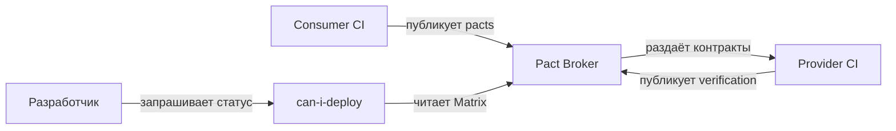

# Контрактное тестирование в CI/CD

## Определения

**Contract Testing (Контрактное тестирование)** — проверка взаимодействия между сервисами на основе формализованного соглашения (контракта). Гарантирует, что поставщик (Producer) удовлетворяет ожиданиям потребителя (Consumer) без полного развёртывания всех сервисов.

**Consumer-Driven Contract (CDC)** — контракт, определяемый потребителем API. Потребитель описывает свои ожидания (запросы и ответы), а поставщик обязан их выполнять.

**Pact** — открытый инструмент для CDC-тестирования. Потребитель генерирует контракт, Pact Broker хранит и валидирует его, поставщик проверяет соответствие.

**Bi-directional Contract Testing (BDCT)** — двунаправленное контрактное тестирование (PactFlow). Контракты проверяются в обе стороны: потребитель проверяет ожидания, а поставщик — стабы потребителя.

**Pact Broker** — сервер для хранения, версионирования и проверки контрактов. Интегрируется с CI/CD через `can-i-deploy`.

**can-i-deploy** — CLI-утилита Pact Broker, блокирующая деплой при нарушении матрицы совместимости версий consumer/provider.

**Pact Matrix** — матрица совместимости версий consumer и provider, хранимая в Pact Broker; определяет, какие комбинации можно деплоить в production.

**Pending contracts** — контракты, для которых provider verification ещё не опубликована; используются при постепенном rollout'е provider-изменений.

**Verification results** — результаты прогона provider-тестов против контрактов, публикуемые обратно в Pact Broker для обновления Matrix.

## Основные концепции и архитектура

### Зачем контрактное тестирование

| Проблема | Решение |
| :--- | :--- |
| Микросервис A изменил API, сервис B сломался | CDC-контракт гарантирует обратную совместимость |
| Интеграционные тесты требуют все сервисы одновременно | Контракты проверяются без деплоя всех сервисов |
| Несколько потребителей одного API | Pact Broker показывает, какие контракты нарушены |
| Деплой без согласования | `can-i-deploy` блокирует деплой при нарушении контракта |

### Архитектура системы



| Компонент | Роль | Особенности |
| :--- | :--- | :--- |
| **Consumer CI** | Генерация контрактов | Запускает Pact-тесты, публикует pacts в Broker с версией `CI_COMMIT_SHA` |
| **Pact Broker** | Хранение и версионирование | Web UI + API, PostgreSQL/MySQL backend, `can-i-deploy`, Matrix |
| **Provider CI** | Верификация контрактов | Скачивает актуальные pacts, запускает provider-сервис, публикует результаты |
| **can-i-deploy** | Quality Gate | Блокирует pipeline при несовместимых версиях; интегрируется в deploy stage |
| **Contract Storage** | Артефакты | JSON-файлы pacts в артефактах pipeline, локальный кэш или сетевое хранилище |

### Жизненный цикл CDC в CI/CD

1. **Consumer** пишет тест, описывающий ожидания от API
2. **Consumer CI** генерирует контракт (Pact file)
3. **Pact Broker** хранит контракт и проверяет версии
4. **Provider CI** запускает `pact-provider-verifier` для проверки контракта
5. **`can-i-deploy`** проверяет, безопасно ли деплоить consumer/provider

### Интеграция с CI/CD

- **Stages:** contract generation → provider verification → can-i-deploy → deploy
- **Artifacts:** pacts и verification results сохраняются как артефакты pipeline для аудита
- **Branch protection:** can-i-deploy блокирует merge в main при нарушении контрактов
- **Matrix builds:** при множестве consumer/provider версий можно параллельно верифицировать несколько контрактов

### Сравнение инструментов

| Инструмент | Тип | Язык | Особенности |
| :--- | :--- | :--- | :--- |
| **Pact** | CDC | JS, Ruby, Java, Go, Python | Стандарт де-факто, Pact Broker, `can-i-deploy` |
| **PactFlow** | CDC + BDCT | Multi-language | Commercial, Pact в обе стороны, GitHub Actions |
| **Specmatic** | CDC + Stub | Multi-language | OpenAPI → контракт, stub-сервер |
| **Spring Cloud Contract** | CDC | Java | Встроенный в Spring, Verifier |
| **Dredd** | API Blueprint / OpenAPI | Multi-language | Валидация по спецификации |

## Практические сценарии

### Pact: consumer-тест (JavaScript)

```javascript
const { Pact } = require('@pact-foundation/pact');
const axios = require('axios');

describe('Consumer Pact Test', () => {
  const provider = new Pact({
    consumer: 'FrontendApp',
    provider: 'UserService',
    port: 1234,
  });

  beforeAll(() => provider.setup());
  afterAll(() => provider.finalize());

  describe('get user by ID', () => {
    beforeEach(() => {
      return provider.addInteraction({
        state: 'user with ID 123 exists',
        uponReceiving: 'a request for user 123',
        withRequest: {
          method: 'GET',
          path: '/users/123',
          headers: { Accept: 'application/json' },
        },
        willRespondWith: {
          status: 200,
          headers: { 'Content-Type': 'application/json' },
          body: {
            id: 123,
            name: 'John Doe',
            email: 'john@example.com',
          },
        },
      });
    });

    it('returns user data', async () => {
      const response = await axios.get('http://localhost:1234/users/123');
      expect(response.data).toEqual({
        id: 123,
        name: 'John Doe',
        email: 'john@example.com',
      });
    });
  });
});
```

### Pact: provider-тест (Python)

```python
import pytest
from pact import Verifier

PACT_BROKER_URL = "http://pact-broker:9292"
PROVIDER_NAME = "UserService"
PROVIDER_BASE_URL = "http://localhost:8080"

def test_pact_provider():
    """Проверка всех контрактов из Pact Broker."""
    verifier = Verifier(
        provider=PROVIDER_NAME,
        provider_base_url=PROVIDER_BASE_URL,
        publish_verification_results=True,
        provider_version="1.0.0",
    )
    
    output, _ = verifier.verify_pacts(
        f"{PACT_BROKER_URL}/pacts/provider/{PROVIDER_NAME}/latest",
        enable_pending=True,
        verbose=True,
    )
    assert output == 0
```

### Pact Broker: can-i-deploy

```bash
# Проверка: можно ли деплоить consumer v1.2.3?
pact-broker can-i-deploy \
  --pacticipant FrontendApp \
  --version 1.2.3 \
  --broker-base-url http://pact-broker:9292

# Проверка между двумя версиями
pact-broker can-i-deploy \
  --pacticipant FrontendApp \
  --version 1.2.3 \
  --to-environment production

# Деплой с пометкой в Pact Broker
pact-broker record-deployment \
  --pacticipant FrontendApp \
  --version 1.2.3 \
  --environment production
```

### Specmatic: OpenAPI → контракт

```bash
# Установка
npm install -g @specmatic/specmatic

# Генерация stub из OpenAPI
specmatic stub --port 8080 openapi.yaml

# Проверка контракта
specmatic test openapi.yaml --host localhost --port 8080

# Проверка контракта в CI
specmatic test openapi.yaml \
  --host api.example.com \
  --port 443 \
  --https \
  --result-json results/specmatic.json
```

### GitLab CI: Pact workflow

```yaml
stages:
  - test
  - contract
  - deploy

# Consumer: генерация контракта
pact_consumer:
  stage: contract
  image: node:20
  script:
    - npm ci
    - npm run test:pact
    - npx @pact-foundation/pact-cli publish ./pacts \
        --consumer-app-version=${CI_COMMIT_SHA} \
        --broker-base-url=${PACT_BROKER_URL}
  artifacts:
    paths:
      - pacts/

# Provider: проверка контракта
pact_provider:
  stage: contract
  image: python:3.12
  services:
    - postgres:16
  script:
    - pip install -r requirements.txt
    - python -m uvicorn main:app --port 8080 &
    - sleep 5
    - |
      docker run --rm \
        --network host \
        pactfoundation/pact-verification-service:latest \
        --provider-app-url=http://localhost:8080 \
        --pact-url=http://pact-broker:9292/pacts/provider/UserService/latest \
        --provider-version=${CI_COMMIT_SHA} \
        --publish-verification-results=true

# can-i-deploy
can_i_deploy:
  stage: deploy
  image: pactfoundation/pact-cli:latest
  script:
    - pact-broker can-i-deploy \
        --pacticipant FrontendApp \
        --version ${FRONTEND_SHA} \
        --broker-base-url=${PACT_BROKER_URL} || exit 1
    - pact-broker can-i-deploy \
        --pacticipant UserService \
        --version ${CI_COMMIT_SHA} \
        --broker-base-url=${PACT_BROKER_URL} || exit 1
```

### GitHub Actions: Pact + PactFlow

```yaml
name: Contract Tests
on: [pull_request]

jobs:
  consumer:
    runs-on: ubuntu-latest
    steps:
      - uses: actions/checkout@v4
      - run: npm ci && npm run test:pact
      - uses: pact-foundation/actions-pact-broker/publish-pact-docker-action@v2.0.0
        with:
          pact-files: 'pacts/'
          pact-broker-url: ${{ secrets.PACTFLOW_URL }}
          pact-broker-token: ${{ secrets.PACTFLOW_TOKEN }}
          consumer-app-version: ${{ github.sha }}
  
  provider:
    runs-on: ubuntu-latest
    needs: consumer
    steps:
      - uses: actions/checkout@v4
      - run: pip install -r requirements.txt
      - run: python -m uvicorn main:app --port 8080 &
      - uses: pact-foundation/actions-pact-broker/verify-contract-docker-action@v2.0.0
        with:
          provider: UserService
          provider-base-url: http://localhost:8080
          pact-broker-url: ${{ secrets.PACTFLOW_URL }}
          pact-broker-token: ${{ secrets.PACTFLOW_TOKEN }}
          provider-app-version: ${{ github.sha }}
  
  can-i-deploy:
    runs-on: ubuntu-latest
    needs: [consumer, provider]
    steps:
      - uses: pact-foundation/actions-pact-broker/can-i-deploy-docker-action@v2.0.0
        with:
          pacticipant: FrontendApp
          version: ${{ github.sha }}
          to-environment: staging
```

## Операции и команды

### CLI-инструменты для управления контрактами

| Инструмент | Назначение | Типичное использование |
| :--- | :--- | :--- |
| `pact-broker` | Взаимодействие с Pact Broker | Публикация pacts, can-i-deploy, record-deployment |
| `pact` (Python) | Consumer-генерация и provider-верификация | `pact-provider-verifier`, `pact-python` |
| `@pact-foundation/pact-cli` | Pact CLI для CI/CD | Публикация pacts, верификация в Docker |
| `pactflow` | PactFlow CLI (BDCT) | `publish-provider-contract`, `publish-consumer-contract` |
| `specmatic` | OpenAPI-контракты | `specmatic test`, `specmatic stub` |
| `jq` | Парсинг JSON-отчётов | Извлечение verification results, Pact Matrix |
| `gh` / `curl` | Интеграция с GitHub / HTTP | Получение статусов, webhooks, деплой |

### Основные параметры pact-broker

```bash
# Публикация контракта
pact-broker publish ./pacts \
  --broker-base-url=http://pact-broker:9292 \
  --consumer-app-version=${CI_COMMIT_SHA} \
  --tag-with-git-branch=true

# Верификация provider'ом
pact-broker record-deployment \
  --pacticipant=FrontendApp \
  --version=${CI_COMMIT_SHA} \
  --environment=production

# Проверка совместимости
pact-broker can-i-deploy \
  --pacticipant=FrontendApp \
  --version=${CI_COMMIT_SHA} \
  --to-environment=production
```

### Основные параметры pact-provider-verifier

```bash
pact-provider-verifier \
  --provider-base-url=http://localhost:8080 \
  --pact-urls=http://pact-broker:9292/pacts/provider/UserService/latest \
  --provider-version=${CI_COMMIT_SHA} \
  --publish-verification-results=true \
  --enable-pending=true \
  --verbose
```

### Bash-паттерны для анализа

```bash
# Проверка статуса Pact Broker
curl -s http://pact-broker:9292/diagnostic/status | jq .

# Получение версии provider'а из verification results
curl -s http://pact-broker:9292/pacts/provider/UserService/latest | jq '.providerVersion'

# Проверка pending contracts
curl -s "http://pact-broker:9292/pacts/provider/UserService/latest" | jq '.pending'

# Экспорт Matrix для отладки
curl -s http://pact-broker:9292/matrix | jq '.summary'
```

## Типичные ошибки и диагностика

| Симптом | Причина | Решение |
| :--- | :--- | :--- |
| `can-i-deploy` говорит "no" | Контракт нарушён или отсутствует | Проверить Pact Broker UI, исправить provider или consumer |
| Provider verification fails | Provider изменил API без обновления контракта | Обновить контракт в consumer, перезапустить provider verification |
| Pact Broker не доступен из CI | Сетевая проблема / неправильный URL | Проверить DNS, firewall, `--broker-base-url` |
| Контракт устарел (stale) | Consumer не обновляет контракт | Настроить `--enable-pending` для игнорирования старых контрактов |
| Consumer тесты проходят, но provider падает | Стейты (states) не реализованы на provider | Реализовать все `state` handlers на provider |
| Pact verification doesn't publish results | Нет `--publish-verification-results` | Добавить флаг и `--provider-version` |
| `can-i-deploy` блокирует при pending | Provider ещё не верифицировал pending contract | Убедиться, что provider CI запущен и опубликовал verification |
| Pact Broker перегружен | Большой объём pacts / отсутствие cleanup | Настроить retention policies, архивировать старые pacts |
| Версия provider не отображается в Matrix | Неверный `provider-version` при публикации | Использовать тот же идентификатор (обычно `CI_COMMIT_SHA`) |
| Consumer публикует, но provider не видит | Несовпадение тэгов или бранчей | Проверить тэги при публикации, использовать `--tag-with-git-branch` |

### Диагностика в CI/CD

```bash
# Проверка доступности Pact Broker
curl -I http://pact-broker:9292

# Проверка DNS внутри CI-runner
nslookup pact-broker

# Проверка firewall / network policies
nc -zv pact-broker 9292

# Просмотр логов Pact Broker (Docker)
docker logs pact-broker --tail 100

# Быстрая проверка контракта локально
pact-provider-verifier \
  --provider-base-url=http://localhost:8080 \
  --pact-url=./pacts/frontend-backend.json \
  --state=user\ with\ ID\ 123\ exists \
  --state-setup-url=http://localhost:8080/setup
```

## Best Practices

### Проектирование контрактов

- **Consumer-first:** контракты должны определяться потребителем, а не поставщиком; это гарантирует, что изменения API не ломают existing consumer'ы.
- **State handlers:** всегда реализуйте `state` handlers на provider-стороне; без них provider verification не гарантирует reproducibility.
- **Изоляция состояний:** каждый Pact-тест должен быть независим; используйте уникальные states или cleanup после каждого теста.
- **Идемпотентность:** provider-сервис для верификации должен поддерживать idempotent вызовы; иначе параллельные verification jobs конфликтуют.

### Управление версиями

- **Версионируйте consumer и provider:** используйте `CI_COMMIT_SHA` или семантическое версионирование для `--consumer-app-version` и `--provider-version`.
- **Tagging:** применяйте `--tag-with-git-branch` и `--tag-with-git-commit` в Pact Broker для отслеживания версий по бранчам.
- **Pending contracts:** используйте `enable_pending=true` при постепенном rollout'е provider-изменений, чтобы не блокировать consumer-пайплайны.
- **Retention:** настройте автоматическое удаление старых pacts в Pact Broker (например, через `pactbroker:api:pact:purge`).

### CI/CD оркестрация

- **Изоляция jobs:** запускайте consumer и provider verification в отдельных jobs с собственными окружениями; не делите runner между consumer-генерацией и provider-верификацией.
- **Артефакты:** сохраняйте pacts и verification results как артефакты pipeline минимум 30 дней для аудита и отладки.
- **Quality Gates:** `can-i-deploy` должен стоять перед deploy stage и blocking merge в защищённые бранчи.
- **Matrix testing:** при множестве consumer/provider комбинаций используйте matrix strategy в CI для параллельной верификации.
- **Secrets:** `PACT_BROKER_URL` и токены храните в CI secrets (Vault, GitHub Secrets, GitLab CI variables); не коммитьте в репозиторий.

### Observability и отладка

- **Debug artifacts:** сохраняйте логи provider-сервиса и stderr от `pact-provider-verifier` при падениях.
- **Reproducibility:** фиксируйте версии инструментов (`pact-broker --version`, `pact --version`) в pipeline; используйте Docker-образы с зашитыми версиями.
- **Network policies:** в Kubernetes ограничьте доступ к Pact Broker только CI-runner'ами; используйте NetworkPolicy или firewall rules.
- **Noisy neighbors:** выделяйте dedicated runner'ы для contract tests; генерация и верификация pacts требовательны к CPU и RAM.

### Безопасность

- **Авторизация в Broker:** включите basic auth или token-based auth в Pact Broker; отключите анонимную запись.
- **HTTPS:** используйте TLS для `pact-broker` URL в production; для self-hosted вариантов настройте обратный прокси (Nginx, Traefik).
- **Secrets rotation:** регулярно ротируйте `PACTFLOW_TOKEN` и другие credentials; храните их в секрет-менеджере, а не в переменных окружения без защиты.

## Дополнительная информация

### См. также

* **[Типы тестирования: Unit, Integration, E2E](../../Testing/testing_types_unit_integration_e2e.md)** — обзор Contract Testing, Pact workflow, BDCT.
* **[Интеграция тестов в CI/CD](../../Testing/testing_cicd_integration.md)** — quality gates, TIA, эфемерные окружения.
* **[TDD/BDD Overview](./tdd_bdd_overview.md)** — CDC в контексте TDD/BDD.

### Внешние ресурсы

- [Pact Documentation](https://docs.pact.io/) — официальная документация Pact.
- [PactFlow](https://pactflow.io/) — commercial Pact-сервис.
- [Specmatic](https://specmatic.in/) — OpenAPI → контракт.
- [Spring Cloud Contract](https://spring.io/projects/spring-cloud-contract) — CDC для Spring.
