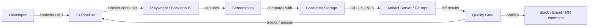

# Визуальное регрессионное тестирование в CI/CD

## Определения

**Visual Regression Testing (Визуальное регрессионное тестирование)** — процесс проверки пользовательского интерфейса на отсутствие нежелательных визуальных изменений путем сравнения текущего состояния (скриншота или DOM-слепка) с утвержденным эталоном (Baseline).

**Baseline (Эталон)** — контрольное изображение или набор данных, отражающий корректное состояние интерфейса. Используется как точка сравнения для всех последующих тестов.

**Visual Diff (Дифф)** — результат наложения текущего скриншота на эталон, где подсвечиваются пиксельные или структурные различия.

**Snapshot Management (Управление снапшотами)** — стратегия хранения, обновления и версионирования эталонных изображений в условиях распределенной разработки и автоматизированных пайплайнов.

**Threshold (Порог допуска)** — коэффициент чувствительности при сравнении. Определяет, какой процент несовпадающих пикселей или какая разница в цвете (`pixelmatch`) считается допустимой для признания теста успешным.

## Основные концепции и архитектура

### Типы сравнения интерфейсов

В 2026 году выделяют два основных подхода к сравнению:

1.  **Pixel-by-pixel (Попиксельное):** Самый простой и строгий метод. Сравнивает каждый пиксель по RGBA-значениям.
    - *Инструменты:* Playwright (`toHaveScreenshot`), BackstopJS.
    - *Минусы:* Крайне чувствителен к сглаживанию (anti-aliasing) и разным GPU.
2.  **Structural / DOM-based (Структурное):** Сравнивает не картинки, а структуру DOM и CSS. Рендеринг происходит в контролируемой среде.
    - *Инструменты:* Playwright Visual, Lost Pixel.
    - *Плюсы:* Игнорирует проблемы с железом, так как снапшоты рендерятся в одинаковой среде.

### Проблема консистентности рендеринга

Главный вызов при внедрении Visual Regression в CI/CD — **недетерминизм рендеринга**. Одно и то же приложение может выглядеть по-разному из-за:

-   **Anti-aliasing (Сглаживание):** Разные алгоритмы отрисовки шрифтов и кривых в Linux (CI) и macOS/Windows (разработка).
-   **Версии ОС и браузеров:** Даже минорное обновление Chromium может изменить отрисовку тени или скругления углов.
-   **GPU Acceleration:** В CI-раннерах часто отсутствует видеокарта, что переключает рендеринг на CPU (SwiftShader), меняя результат на 1–2 пикселя.
-   **Динамический контент:** Даты, случайные ID, курсоры, анимации загрузки, видео и GIF-файлы.

**Решение:** Использование строго идентичных Docker-контейнеров для локального запуска и CI. Все эталоны должны генерироваться внутри контейнера. Дополнительно применяется маскирование динамических областей.

### Архитектура визуального тестирования в CI/CD



| Компонент | Роль | Особенности |
| :--- | :--- | :--- |
| **CI Pipeline** | Оркестрация | Запускает тесты в Docker, кэширует baselines, публикует артефакты |
| **Docker Container** | Изоляция среды | Гарантирует идентичные шрифты, ОС, браузер и GPU-роллбэк (SwiftShader) |
| **Playwright / BackstopJS** | Генерация и сравнение | Делает скриншоты, считает pixel diff, генерирует HTML-отчет |
| **Baselines Storage** | Хранение эталонов | Git LFS, NFS-share или локальное хранилище в репозитории |
| **Artifact Server** | Результаты | Хранит diff-изображения и HTML-отчеты для аудита (retention 30–90 дней) |
| **Quality Gate** | Блокировка | Блокирует merge в защищённые бранчи при превышении порога; может требовать ручного approve |

### Жизненный цикл визуального теста в CI/CD

1.  **Baseline generation:** При первом запуске или обновлении дизайна baselines генерируются в Docker и коммитятся в Git LFS через отдельный MR.
2.  **CI execution:** При каждом PR/merge pipeline запускает тесты в том же Docker-образе, что и при генерации baselines.
3.  **Comparison:** Скриншоты сравниваются с порогом (`threshold`, `maxDiffPixelRatio`).
4.  **Artifacts:** При падении публикуются diff-изображения и HTML-отчет.
5.  **Quality gate:** Решение о блокировке merge или deploy.

### Интеграция с CI/CD

-   **Stages:** visual tests запускаются после deploy на staging или параллельно с E2E; блокируют merge в main.
-   **Artifacts:** diff-изображения и HTML-отчеты сохраняются как артефакты pipeline минимум 30 дней.
-   **Branch protection:** visual regression job должен стоять в required checks для merge в защищённые бранчи.
-   **Cache:** baselines кэшируются между запусками через `actions/cache` или GitLab cache для ускорения.

### Сравнение инструментов

| Инструмент | Тип | Хранение эталонов | Особенности |
| :--- | :--- | :--- | :--- |
| **Playwright Visual** | Self-hosted | Git LFS / локально | Бесплатно, встроен в Playwright, требует Docker-инфраструктуру. |
| **BackstopJS** | Self-hosted | Локально / Git | Олдскульный, но мощный инструмент с отличными HTML-отчетами. |
| **Lost Pixel** | Hybrid | Git | Open-source, подходит для монорепозиториев и современных веб-фреймворков. |
| **Loki** | Component | Git / локальное хранилище | Оптимизирован для Storybook, быстрый за счет работы с компонентами. |

## Практические сценарии

### Сценарий 1: Docker для консистентной среды

Исключает проблемы с антиалиасингом и шрифтами за счет идентичного образа для разработки и CI.

**Dockerfile для визуальных тестов (`tests/visual.Dockerfile`):**
```dockerfile
FROM mcr.microsoft.com/playwright:v1.49.0-noble

# Установка шрифтов для соответствия системным (важно для pixel-by-pixel)
RUN apt-get update && apt-get install -y \
    fonts-liberation \
    fontconfig \
    && rm -rf /var/lib/apt/lists/*

# Копирование локальных шрифтов, если проект использует специфические
# COPY ./assets/fonts/* /usr/share/fonts/truetype/custom/
# RUN fc-cache -f -v

WORKDIR /work
```

### Сценарий 2: Playwright Visual в GitHub Actions

```typescript
import { test, expect } from '@playwright/test';

test('Dashboard visual check', async ({ page }) => {
  await page.goto('/dashboard');

  // Ожидание стабильности
  await page.waitForLoadState('networkidle');

  // Маскирование динамических данных (даты, графики)
  const chart = page.locator('.realtime-chart');
  const userDate = page.locator('.current-date');

  // Сравнение с эталоном
  await expect(page).toHaveScreenshot('dashboard.png', {
    mask: [chart, userDate],
    maxDiffPixelRatio: 0.05,
    threshold: 0.2,
    animations: 'disabled',
  });
});
```

#### Workflow (`.github/workflows/visual-tests.yml`)
```yaml
name: Visual Regression
on: [pull_request]

jobs:
  visual:
    runs-on: ubuntu-latest
    container:
      image: mcr.microsoft.com/playwright:v1.49.0-noble
    steps:
      - uses: actions/checkout@v4
      - name: Install dependencies
        run: npm ci
      - name: Run Visual Tests
        run: npx playwright test --grep @visual
      - name: Upload Artifacts on Failure
        if: failure()
        uses: actions/upload-artifact@v4
        with:
          name: visual-results
          path: test-results/
```

### Сценарий 3: Playwright Visual в GitLab CI (Self-hosted)

Для проектов с приватными данными или без дополнительных затрат на внешние сервисы.

#### Локальная генерация эталонов
Всегда генерируйте эталоны в Docker, чтобы они совпадали с CI-окружением.
```bash
# Запуск тестов в Docker для получения "правильных" скриншотов
docker run --rm -v $(pwd):/work -w /work mcr.microsoft.com/playwright:v1.49.0-noble \
  npx playwright test --update-snapshots
```

#### Настройка пайплайна (`.gitlab-ci.yml`)
```yaml
visual_test:
  stage: test
  image: mcr.microsoft.com/playwright:v1.49.0-noble
  script:
    - npm ci
    - ./scripts/pull-baselines.sh
    - npx playwright test --grep @visual
  artifacts:
    when: on_failure
    paths:
      - test-results/
    expose_as: 'visual-diffs'
```

### Сценарий 4: BackstopJS

Универсальный инструмент для pixel-by-pixel сравнения с гибкой конфигурацией.

#### Конфигурация (`backstop.json`)
```json
{
  "id": "frontend_visual",
  "viewports": [
    { "label": "desktop", "width": 1920, "height": 1080 },
    { "label": "mobile", "width": 375, "height": 812 }
  ],
  "scenarios": [
    {
      "label": "Home Page",
      "url": "http://localhost:3000/",
      "selectors": ["document"],
      "hideSelectors": [".current-date", ".realtime-chart"],
      "delay": 500
    }
  ],
  "paths": {
    "bitmaps_reference": "backstop_data/bitmaps_reference",
    "bitmaps_test": "backstop_data/bitmaps_test",
    "engine_scripts": "backstop_data/engine_scripts",
    "html_report": "backstop_data/html_report",
    "ci_report": "backstop_data/ci_report.json"
  },
  "engine": "puppeteer",
  "threshold": 0.2,
  "report": ["CI"]
}
```

#### CLI
```bash
# Генерация эталонов (первый запуск)
npx backstopjs reference

# Запуск сравнения
npx backstopjs test

# Авто-апрув при сознательном обновлении дизайна
npx backstopjs approve
```

## Управление эталонами (Snapshot Management)

В распределенной разработке критически важно централизовать хранение baselines и обеспечить reproducibility.

### Стратегии хранения

| Стратегия | Масштаб | Инструменты | Особенности |
| :--- | :--- | :--- | :--- |
| **Git LFS** | Малый / средний | Git LFS | Простота, версионирование вместе с кодом; ограничение размера repo |
| **NFS / Shared storage** | Средний / большой | NFS, SMB, MinIO (self-hosted) | Централизованное хранилище, быстрый доступ из всех runner'ов |
| **Artifact Server** | Любой | Nexus, Artifactory, MinIO | Версионирование артефактов, retention policies, скачивание перед тестом |

### Git LFS Pattern

Для небольших проектов baseline хранятся в Git LFS:

```bash
# Инициализация
git lfs install
git lfs track "**/screenshots/**/*.png"
git add .gitattributes

# Синхронизация перед тестом
git lfs pull origin main -- include="**/screenshots/**/*.png"

# После обновления baselines
git add screenshots/
git commit -m "chore: update visual baselines for v2.1"
git push
```

### Image Registry Pattern (Self-hosted)

Для крупных проектов с множеством baseline:

1.  **Storage:** Эталоны хранятся на NFS или MinIO: `project/branch/browser/test_name.png`.
2.  **Pull:** Перед тестом CI-скрипт скачивает эталоны для `target branch` (например, `main`).
3.  **Compare:** Playwright/BackstopJS сравнивает текущие результаты с выкачанными эталонами.
4.  **Push (Update):** Если задана переменная `UPDATE_SNAPSHOTS=true`, новые скриншоты загружаются в папку текущей ветки.
5.  **Review:** В MR добавляется комментарий со ссылкой на HTML-отчет с диффами.

## Операции и команды

### Playwright Visual

| Команда | Назначение |
| :--- | :--- |
| `npx playwright test --grep @visual` | Запуск только визуальных тестов |
| `npx playwright test --update-snapshots` | Обновление всех baselines |
| `npx playwright test --update-snapshots --grep "dashboard"` | Обновление baseline для конкретного теста |
| `npx playwright test --project=chromium` | Запуск только в Chromium |
| `npx playwright test --workers=1` | Последовательный запуск (меньше шансов на гонки) |

### BackstopJS

| Команда | Назначение |
| :--- | :--- |
| `npx backstopjs reference` | Генерация всех эталонов |
| `npx backstopjs test` | Запуск сравнения |
| `npx backstopjs approve` | Авто-апрув изменений (переносит current в reference) |
| `npx backstopjs test --filter="*dashboard*"` | Запуск только dashboard-сценариев |

### Git LFS

| Команда | Назначение |
| :--- | :--- |
| `git lfs install` | Инициализация Git LFS в репозитории |
| `git lfs track "*.png"` | Добавление шаблона для отслеживания PNG |
| `git lfs pull origin main` | Скачивание LFS-объектов из ветки |
| `git lfs ls-files` | Проверка статуса LFS-файлов |
| `git lfs migrate import --include="*.png"` | Миграция существующих PNG в LFS |

### Bash-паттерны для CI

```bash
# Проверка: есть ли неучтенные LFS-изменения
git lfs status | grep -c "modified"

# Скачивание baselines из MinIO / NFS перед тестом
curl -s -o baselines.tar.gz "http://minio:9000/baselines/${CI_COMMIT_REF_NAME}.tar.gz" && tar -xzf baselines.tar.gz

# Экспорт CI-отчета BackstopJS
jq '.tests | length' backstop_data/ci_report.json
jq '.[] | select(.status == "fail") | .name' backstop_data/ci_report.json

# Очистка старых артефактов (старше 30 дней)
find test-results/ -type f -mtime +30 -delete
```

## Типичные ошибки и диагностика

| Симптом | Причина | Решение |
| :--- | :--- | :--- |
| Flaky: тест то проходит, то падает | Разные версии Chromium / GPU acceleration / антиалиасинг | Используйте идентичный Docker-образ; фиксируйте версию Playwright в `package.json` |
| Разница в 1 пиксель на всей странице | Сдвиг из-за шрифтов или GPU (SwiftShader) | Установите `threshold: 0.2`; проверьте `fonts-liberation` в Dockerfile |
| Layout shift на скриншоте | Асинхронная загрузка шрифтов / изображений | `await page.waitForLoadState('networkidle')` или `await document.fonts.ready` |
| Dynamic content вызывает ложные падения | Даты, ID, курсоры, анимации | Маскируйте через `mask` или `hideSelectors`; отключайте анимации `animations: 'disabled'` |
| Baseline не найден в CI | LFS-объекты не скачаны / неправильный путь | `git lfs pull` перед тестом; проверьте `paths` в конфиге |
| Artifacts не загружаются | Диск runner'а переполнен / `when: on_failure` | Ограничьте размер артефактов; настройте `expire_in` |
| Quality gate блокирует merge без изменений | Порог слишком чувствительный / stale baseline | Пересмотрите `threshold`; обновите baseline через `--update-snapshots` в отдельном MR |
| Медленный прогон ( >10 мин) | Слишком много разрешений / браузеров / страниц | Ограничьте `viewports`; запускайте только для changed paths; используйте `--workers=1` |
| Runner перегружен (noisy neighbor) | Другие jobs потребляют CPU/RAM на shared runner | Выделите dedicated runner'ы для visual tests; задайте `resource_group` в GitLab |
| Конфликт LFS-блокировок | Параллельные MR обновляют одни baselines | Устанавливайте `git lfs lock` перед обновлением; используйте branch-specific baselines |

### Диагностика в CI/CD

```bash
# Проверка доступности runner'а и ресурсов
ssh ci-runner "nproc && free -h && df -h /tmp"

# Проверка версии Chromium в Docker
docker run --rm mcr.microsoft.com/playwright:v1.49.0-noble chromium --version

# Проверка LFS-объектов
git lfs ls-files | wc -l
git lfs status

# Быстрый smoke-test визуального сравнения локально
npx playwright test --grep "Dashboard visual check" --headed

# Просмотр HTML-отчета BackstopJS
open backstop_data/html_report/index.html
```

## Best Practices

### Проектирование и стабильность

-   **Docker-first:** Всегда генерируйте baselines и запускайте тесты в одном и том же Docker-образе. Никогда не смешивайте локальный Chrome/Chromium с CI.
-   **Маскируйте динамику:** Даты, случайные ID, курсы валют, анимации — всегда скрывайте через `mask` / `hideSelectors` или `addStyleTag`.
-   **Идемпотентность:** Baseline generation должна быть детерминированной; фиксируйте версию Playwright/BackstopJS в `package.json` или `package-lock.json`.
-   **Компоненты, а не страницы:** Визуальные тесты эффективнее на уровне Storybook или отдельных UI-библиотек. Это снижает шум от глобальных элементов (шапка, футер, спиннеры).
-   **Fail fast:** Запускайте визуальные тесты только после успешных Unit и API-тестов. В GitLab/GitHub Actions используйте `needs` / `rules` для фильтрации по changed paths.

### Управление версиями и baselines

-   **Версионируйте baselines:** При использовании Git LFS каждая ветка имеет свои baselines. При слиянии MR обновляйте baselines в том же PR.
-   **Осознанное обновление:** Обновляйте скриншоты только через `--update-snapshots` или `backstop approve` в отдельном коммите/MR с код-ревью.
-   **Retention:** Настройте удаление старых артефактов в CI (обычно 30–90 дней). Для Git LFS используйте `git lfs prune` на runner'е.

### CI/CD оркестрация и инфраструктура

-   **Runner isolation:** Выделяйте dedicated runner'ы для visual tests. Генерация скриншотов требовательна к CPU и RAM; shared runner'ы страдают от noisy neighbors.
-   **GPU / CPU роллбэк:** Если runner имеет GPU, убедитесь, что драйверы и `--disable-gpu` настроены единообразно. В контейнерах Playwright GPU отключен по умолчанию (SwiftShader), что обеспечивает детерминизм.
-   **Артефакты:** Сохраняйте diff-изображения и HTML-отчеты как артефакты pipeline. Это обязательный минимум для отладки без локального воспроизведения.
-   **Quality gates:** Визуальные тесты должны стоять перед deploy в staging/production. Настройте branch protection: merge в main блокируется при падении visual tests.
-   **Secrets:** Токены для artifact store (MinIO, Nexus) храните в CI secrets (GitLab CI variables, GitHub Secrets). Не коммитьте credentials в репозиторий.
-   **Caching:** Кэшируйте `node_modules` и baselines между запусками для ускорения. В GitHub Actions используйте `actions/cache@v4`; в GitLab — `cache:`.

### Observability и отладка

-   **Debug artifacts:** При падении всегда сохраняйте stderr от Playwright/BackstopJS, логи браузера и скриншоты failed-тестов.
-   **Reproducibility:** Воспроизведите падение локально в том же Docker-образе: `docker run --rm -v $(pwd):/work mcr.microsoft.com/playwright:v1.49.0-noble npx playwright test --grep "failing test" --headed`.
-   **Network policies:** В Kubernetes ограничьте доступ к artifact store и baselines только CI-runner'ам.
-   **Metrics:** Собирайте метрики: среднее время прогона, процент flaky, количество failed visual tests per PR. Это помогает выявлять проблемы с runner'ами или шрифтами.

### Безопасность

-   **Авторизация в artifact store:** Включите basic auth или token-based auth в MinIO/Nexus. Отключите анонимный доступ.
-   **HTTPS:** Используйте TLS для artifact store URL в production.
-   **Secrets rotation:** Регулярно ротируйте токены доступа к artifact store. Храните их в секрет-менеджере.

## Дополнительная информация

### См. также

* **[Интеграция тестов в CI/CD](../../Testing/testing_cicd_integration.md)** — общие принципы и другие виды тестов.
* **[Специфика Frontend CI/CD](../Frontend_CI_CD/frontend_pipeline_specifics.md)** — контекст применения визуальных тестов в веб-разработке.
* **[Testing Types: Unit, Integration, E2E](../../Testing/testing_types_unit_integration_e2e.md)** — обзор видов тестирования.

### Внешние ресурсы

- [Playwright Test Snapshots](https://playwright.dev/docs/test-snapshots) — официальная документация Playwright по визуальному сравнению.
- [BackstopJS](https://github.com/garris/BackstopJS) — документация и конфигурация.
- [Lost Pixel](https://www.lost-pixel.com/) — open-source визуальное регрессионное тестирование для монорепозиториев.
