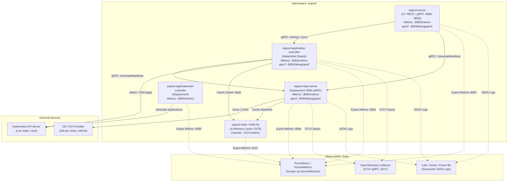

# Argo CD: Диагностика и мониторинг

**Актуально для:** Argo CD v3.5+ (покрывает v3.4.x, v3.5.x, v3.6.x; Kubernetes 1.28–1.32+; bare-metal / on-premise)

> **Ключевые эксплуатационные изменения ветки v3.x:** Оптимизация кардинальности метрик Prometheus через единую SSoT-метрику `argocd_app_info` и параметр `--metrics-cache-expiration`, полный переход межкомпонентного взаимодействия на gRPC/HTTP2, поддержка Server-Side Diff (`--server-side-diff`), нативная интеграция трейсинга OpenTelemetry (OTLP), встроенный контроллер ApplicationSets и возможность динамического шардирования контроллера по алгоритму `round-robin`.

## Предварительные требования

Для полноценной диагностики и настройки мониторинга Argo CD в on-premise / bare-metal кластере необходимы:

1. **Доступ к Kubernetes API:** Права администратора (`cluster-admin` или ограниченный ServiceAccount с правами на namespace `argocd` и мониторинговые CRD).
2. **Установленные CLI-утилиты:**
   - `kubectl` v1.28+
   - `argocd` CLI v3.5+
   - `promtool` (для валидации PrometheusRule и ServiceMonitor)
   - `go` / `pprof` (для анализа профилей производительности)
3. **Prometheus Operator / VictoriaMetrics:** Развернутый стек мониторинга с поддержкой кастомных ресурсов `ServiceMonitor` и `PrometheusRule`.
4. **Grafana:** Версия 10.x+ для импорта дашбордов и визуализации DORA-метрик.
5. **Централизованный сбор логов:** Развернутый агент сбора логов (Vector, Fluent Bit, Promtail) и хранилище (Loki, Elasticsearch).

---

## Определения

**Диагностика (Troubleshooting) Argo CD** — систематический инженерный процесс локализации и устранения отказов в компонентах контрольной плоскости GitOps (контроллер, repo-server, API-сервер, Redis), механизмах рендеринга манифестов (Helm, Kustomize, CMP v2) и процессах согласования состояния с Kubernetes API.

**Мониторинг и наблюдаемость (Monitoring & Observability)** — непрерывный сбор, агрегация и анализ телеметрических данных (метрик Prometheus, распределенных трасс OpenTelemetry, структурированных журналов событий) для контроля надежности GitOps-конвейера и расчета метрик стабильности доставки (DORA).

**Reconciliation Loop (Цикл сверки)** — базовый цикл управления `argocd-application-controller`, в рамках которого периодически сравнивается целевое состояние (Desired State из Git) с фактическим состоянием (Live State из Kubernetes API) и генерируется план синхронизации (diff/patch).

**Desired State (Желаемое состояние)** — эталонная конфигурация ресурсов Kubernetes, зафиксированная в Git-репозитории или OCI-реестре.

**Live State (Фактическое состояние)** — текущее состояние манифестов и объектов, возвращаемое API-сервером целевого кластера Kubernetes.

**Детекция расхождений (Drift Detection) и OutOfSync** — обнаружение несоответствия между Live State и Desired State. Состояние `OutOfSync` информирует о необходимости применения изменений или наличии ручных правок в кластере.

**Состояния здоровья (Health Statuses):**
- `Healthy` — все ресурсы приложения развернуты и успешно прошли проверки готовности (Readiness/Liveness).
- `Progressing` — ресурсы находятся в процессе развертывания или обновления (например, RollingUpdate Deployment или ожидание Job).
- `Degraded` — сбой в работе хотя бы одного ресурса (CrashLoopBackOff подов, откат Deployment, ошибка PVC).
- `Suspended` — выполнение рабочей нагрузки приостановлено (например, приостановленный CronJob или Argo Rollout).
- `Missing` — ресурс объявлен в Git, но отсутствует в кластере.
- `Unknown` — контроллер не может определить статус ресурса из-за сетевого сбоя или отсутствия CRD Health-чека.

**Resource Tracking** — механизм идентификации ресурсов, управляемых конкретным экземпляром `Application`, реализуемый через аннотацию `argocd.argoproj.io/tracking-id` или метку `app.kubernetes.io/instance`.

**Server-Side Apply (SSA)** — механизм применения конфигураций на уровне Kubernetes API (`fieldManager`), предотвращающий конфликты владения полями манифестов между Argo CD и сторонними операторами (HPA, cert-manager).

**Шардирование контроллера (Controller Sharding)** — разделение нагрузки по обработке сотен и тысяч приложений между несколькими репликами `argocd-application-controller` в составе `StatefulSet`.

**Кэш манифестов и состояний (Manifest & State Cache)** — промежуточный слой хранения в Redis, содержащий отрендеренные манифесты Git/Helm и снапшоты Live State кластера для минимизации нагрузки на Git-серверы и K8s API.

**DORA-метрики GitOps** — инженерные метрики эффективности доставки: Deployment Frequency (частота деплоев), Change Failure Rate (доля неудачных изменений), Mean Time to Recovery (время восстановления после сбоя).

---

## Архитектура и базовые концепции

### Внутренняя архитектура компонентов и потоки данных при диагностике

Контрольная плоскость Argo CD построена по микросервисной модели, где каждый компонент выполняет строго изолированные задачи:



### Назначение компонентов и критические точки отказа

| Компонент | Рабочие порты | Метрики / pprof | Основные зоны риска и сбои |
| :--- | :--- | :--- | :--- |
| `argocd-application-controller` | Внутренний | `:8082/metrics`<br>`:8082/debug/pprof` | Зависание очередей сверки (workqueue starvation), rate limiting со стороны K8s API (Throttling), утечки памяти в Go runtime, нехватка шардов при >1000 приложений. |
| `argocd-repo-server` | `8081` (gRPC) | `:8084/metrics`<br>`:8084/debug/pprof` | Ошибки клонирования Git (SSH/TLS timeouts), OOMKilled при тяжелых `helm template` или `kustomize build`, блокировки параллельных очередей fork-exec, переполнение `/tmp`. |
| `argocd-server` | `8080` (HTTP)<br>`8083` (gRPC) | `:8083/metrics`<br>`:8083/debug/pprof` | Ошибки RBAC (403), сбои WebSocket/SSE при обновлении UI, таймауты upstream-запросов к repo-server, исчерпание пула gRPC-соединений. |
| `argocd-redis` / `redis-ha` | `6379` (TCP)<br>`26379` (Sentinel) | `:9121/metrics` (exporter) | Ошибки `OOM command not allowed` при неправильной `maxmemory-policy`, задержки чтения/записи, рассинхронизация реплик Sentinel (`READONLY You can't write...`). |
| `argocd-applicationset-controller` | Внутренний | `:8080/metrics` | Ошибки генераторов (Git Generator, Matrix, Cluster), лимиты API Git-провайдеров, сбои рендеринга шаблонов Application. |

### Модель метрик в Argo CD v3.x

В ветке v3.x структура экспорта телеметрии подверглась радикальной оптимизации:

1. **Единая метрика состояния `argocd_app_info`:**
   Вместо десятков разрозненных gauge-метрик основным источником информации о состоянии приложений является метрика `argocd_app_info`. Она содержит лейблы: `name`, `namespace`, `project`, `health_status`, `sync_status`, `repo`, `dest_server`, `dest_namespace`, `operation`, `phase`.
2. **Снижение кардинальности (Cardinality Reduction):**
   - Устаревшие метрики с высокой изменчивостью меток были удалены или агрегированы.
   - Флаг контроллера `--metrics-cache-expiration` (по умолчанию `24h`) автоматически удаляет временные ряды для удаленных приложений, предотвращая утечки памяти в Prometheus TSDB.
3. **Метрики очередей и задержек сверки:**
   - `argocd_app_reconcile` (гистограмма) — фиксирует время выполнения одной сверки приложения.
   - `argocd_kubectl_exec_pending` (gauge) — очередь команд, ожидающих отправки в K8s API. Значение `> 50` говорит о серьезном троттлинге или перегрузке etcd.
   - `argocd_git_request_duration_seconds` (гистограмма) — латентность сетевых вызовов Git на уровне repo-server.

### Дерево решений при локализации сбоев (SRE Decision Flow)

```text
Сбой приложения в Argo CD
├── Статус: OutOfSync
│   ├── Причина: В Git появились новые коммиты, но они не применяются
│   │   ├── Проверить: Включен ли Automated Sync? (auto_sync)
│   │   ├── Проверить: Активны ли Sync Windows? (метрика argocd_app_sync_blocked == 1)
│   │   └── Проверить: Работает ли Git Webhook? (проверить логи argocd-server /webhook)
│   └── Причина: Дрифт в кластере (Live State != Desired State)
│       ├── Выполнить: argocd app diff <app> --server-side
│       ├── Мутация сторонним контроллером (HPA, Kyverno, mutating webhook)?
│       └── Решение: Настроить ignoreDifferences или включить Server-Side Apply
├── Статус: Degraded
│   ├── Ресурсы Kubernetes не могут выйти в готовность
│   │   ├── kubectl describe pod / deployment (CrashLoopBackOff, ImagePullBackOff, OOMKilled)
│   │   └── Сбой PVC / StorageClass (PersistentVolumeClaim Pending)
│   └── Кастомный Health Check вернул ошибку
│       ├── Проверить кастомные Lua-скрипты в ConfigMap argocd-cm
│       └── Проверить статус CRD через kubectl get <crd> -o yaml
├── Ошибка: ComparisonError
│   ├── Таймаут генерации (rpc error: code = DeadlineExceeded)
│   │   └── Решение: Увеличить controller.repo.server.timeout.seconds в argocd-cmd-params-cm
│   ├── Сбой рендеринга Helm / Kustomize манифеста
│   │   └── Проверить: kubectl logs deploy/argocd-repo-server
│   └── Ошибка доступа к репозиторию (Authentication failed / Connection refused)
│       └── Проверить Secret репозитория и DNS-резолв в repo-server
└── Ошибка контроллера: Reconcile Starvation (задержка обновления > 10 минут)
    ├── Нехватка воркеров: увеличить --status-processors в argocd-cmd-params-cm
    ├── Throttling со стороны K8s API: увеличить --kube-api-qps и --kube-api-burst
    └── Высокая нагрузка: настроить шардирование controller.sharding.algorithm=round-robin
```

---

## Практические сценарии диагностики и настройки

### Сценарий 1: Настройка комплексного мониторинга через Prometheus Operator

Для обеспечения наблюдаемости в продакшене необходимо создать объекты `ServiceMonitor` для всех ключевых компонентов Argo CD.

**1. Проверка наличия сервисов метрик в кластере:**

```bash
kubectl get svc -n argocd -l app.kubernetes.io/part-of=argocd
# → result:
# NAME                                TYPE        CLUSTER-IP      EXTERNAL-IP   PORT(S)             AGE
# argocd-applicationset-controller    ClusterIP   10.96.142.12    <none>        7000/TCP,8080/TCP   45d
# argocd-metrics                      ClusterIP   10.96.180.44    <none>        8082/TCP            45d
# argocd-repo-server                  ClusterIP   10.96.210.15    <none>        8081/TCP,8084/TCP   45d
# argocd-server                       ClusterIP   10.96.88.90     <none>        80/TCP,443/TCP      45d
# argocd-server-metrics               ClusterIP   10.96.195.77    <none>        8083/TCP            45d
```

**2. Создание манифеста ServiceMonitor (`argocd-servicemonitors.yaml`):**

```yaml
apiVersion: monitoring.coreos.com/v1
kind: ServiceMonitor
metadata:
  name: argocd-application-controller-metrics
  namespace: argocd
  labels:
    release: prometheus-stack
    app.kubernetes.io/name: argocd-application-controller-metrics
spec:
  selector:
    matchLabels:
      app.kubernetes.io/name: argocd-metrics
  endpoints:
    - port: metrics
      interval: 15s
      scrapeTimeout: 10s
      metricRelabelings:
        # Удаление избыточных лейблов с высокой кардинальностью при необходимости
        - sourceLabels: [__name__]
          regex: "argocd_app_info"
          action: keep
---
apiVersion: monitoring.coreos.com/v1
kind: ServiceMonitor
metadata:
  name: argocd-repo-server-metrics
  namespace: argocd
  labels:
    release: prometheus-stack
    app.kubernetes.io/name: argocd-repo-server-metrics
spec:
  selector:
    matchLabels:
      app.kubernetes.io/name: argocd-repo-server
  endpoints:
    - port: metrics
      interval: 15s
      scrapeTimeout: 10s
---
apiVersion: monitoring.coreos.com/v1
kind: ServiceMonitor
metadata:
  name: argocd-server-metrics
  namespace: argocd
  labels:
    release: prometheus-stack
    app.kubernetes.io/name: argocd-server-metrics
spec:
  selector:
    matchLabels:
      app.kubernetes.io/name: argocd-server-metrics
  endpoints:
    - port: metrics
      interval: 15s
      scrapeTimeout: 10s
---
apiVersion: monitoring.coreos.com/v1
kind: ServiceMonitor
metadata:
  name: argocd-applicationset-controller-metrics
  namespace: argocd
  labels:
    release: prometheus-stack
    app.kubernetes.io/name: argocd-applicationset-controller-metrics
spec:
  selector:
    matchLabels:
      app.kubernetes.io/name: argocd-applicationset-controller
  endpoints:
    - port: webhook
      interval: 30s
      scrapeTimeout: 10s
```

**3. Применение и валидация манифестов:**

```bash
kubectl apply -f argocd-servicemonitors.yaml
# → result:
# servicemonitor.monitoring.coreos.com/argocd-application-controller-metrics created
# servicemonitor.monitoring.coreos.com/argocd-repo-server-metrics created
# servicemonitor.monitoring.coreos.com/argocd-server-metrics created
# servicemonitor.monitoring.coreos.com/argocd-applicationset-controller-metrics created

# Проверка доступности метрик контроллера локально через port-forward
kubectl port-forward -n argocd svc/argocd-metrics 8082:8082 &
# → result: Forwarding from 127.0.0.1:8082 -> 8082

curl -s http://127.0.0.1:8082/metrics | grep -E "^argocd_app_info" | head -n 3
# → result:
# argocd_app_info{dest_namespace="prod",dest_server="https://kubernetes.default.svc",health_status="Healthy",name="payment-service",namespace="argocd",operation="",phase="",project="fintech",repo="git@git.corp.internal:apps/payment.git",sync_status="Synced"} 1
```

---

### Сценарий 2: Развертывание производственных правил алертинга (PrometheusRule)

Правила алертинга для Argo CD должны покрывать как деградацию управляемых приложений, так и отказы самой инфраструктуры GitOps.

**1. Манифест PrometheusRule (`argocd-alerts.yaml`):**

```yaml
apiVersion: monitoring.coreos.com/v1
kind: PrometheusRule
metadata:
  name: argocd-alerts
  namespace: monitoring
  labels:
    role: alert-rules
    release: prometheus-stack
spec:
  groups:
    - name: ArgoCD-Application-Alerts
      rules:
        - alert: ArgoAppDegraded
          expr: argocd_app_info{health_status="Degraded"} == 1
          for: 5m
          labels:
            severity: critical
            tier: gitops
          annotations:
            summary: "Приложение Argo CD {{ $labels.name }} в статусе Degraded"
            description: "Приложение {{ $labels.name }} в проекте {{ $labels.project }} деградировало более 5 минут. Проверьте поды и события в целевом namespace {{ $labels.dest_namespace }}."

        - alert: ArgoAppOutOfSyncLong
          expr: argocd_app_info{sync_status="OutOfSync"} == 1
          for: 30m
          labels:
            severity: warning
            tier: gitops
          annotations:
            summary: "Приложение {{ $labels.name }} не синхронизировано"
            description: "Приложение {{ $labels.name }} находится в статусе OutOfSync более 30 минут. Возможен дрифт конфигурации или сбой автоматической синхронизации."

        - alert: ArgoSyncWindowBlocked
          expr: argocd_app_sync_blocked == 1
          for: 1h
          labels:
            severity: info
            tier: gitops
          annotations:
            summary: "Синхронизация приложения {{ $labels.name }} заблокирована окном"
            description: "Автоматическая синхронизация заблокирована активным Sync Window. Убедитесь, что окно не затянулось."

    - name: ArgoCD-Infrastructure-Alerts
      rules:
        - alert: ArgoControllerDown
          expr: absent(up{job=~".*argocd.*application-controller.*"} == 1)
          for: 2m
          labels:
            severity: page
            tier: platform
          annotations:
            summary: "Контроллер Argo CD недоступен"
            description: "Инстанс argocd-application-controller не отдает метрики более 2 минут. Процессы сверки остановлены."

        - alert: ArgoHighReconcileLatency
          expr: histogram_quantile(0.95, sum(rate(argocd_app_reconcile_bucket[5m])) by (le)) > 15
          for: 10m
          labels:
            severity: warning
            tier: platform
          annotations:
            summary: "Высокая задержка сверки приложений (p95 > 15s)"
            description: "Задержка цикла сверки приложений превышает 15 секунд. Возможно перегружен K8s API сервер или не хватает воркеров контроллера."

        - alert: ArgoKubectlExecPendingHigh
          expr: argocd_kubectl_exec_pending > 50
          for: 5m
          labels:
            severity: warning
            tier: platform
          annotations:
            summary: "Большая очередь kubectl-запросов к Kubernetes API"
            description: "Очередь argocd_kubectl_exec_pending превышает 50 запросов. Контроллер троттлится API-сервером Kubernetes."

        - alert: ArgoRepoServerGitFetchFailed
          expr: rate(argocd_git_fetch_fail_total[10m]) > 0.05
          for: 5m
          labels:
            severity: critical
            tier: platform
          annotations:
            summary: "Сбои обращения к Git-репозиториям в repo-server"
            description: "Частота ошибок argocd_git_fetch_fail_total превышает порог. Проверьте сетевую связность до Git-сервера и валидность SSH/Token ключей."

        - alert: ArgoRedisMemoryHigh
          expr: (redis_memory_used_bytes{service="argocd-redis"} / redis_memory_max_bytes{service="argocd-redis"}) * 100 > 85
          for: 5m
          labels:
            severity: warning
            tier: platform
          annotations:
            summary: "Кэш Redis Argo CD заполнен более чем на 85%"
            description: "Память Redis исчерпана. Проверьте политику allkeys-lru или увеличьте maxmemory."
```

**2. Проверка правил с помощью `promtool` и применение:**

```bash
promtool check rules argocd-alerts.yaml
# → result: Checking argocd-alerts.yaml  SUCCESS: 8 rules found

kubectl apply -f argocd-alerts.yaml
# → result: prometheusrule.monitoring.coreos.com/argocd-alerts created
```

---

### Сценарий 3: Построение SRE-дашбордов и вычисление DORA-метрик (PromQL)

В GitOps-модели Argo CD является первоисточником для расчета метрик стабильности и производительности доставки (DORA).

#### 1. Deployment Frequency (Частота деплоев)
Количество успешных синхронизаций в единицу времени (сутки/неделя):

```promql
# Успешные синхронизации по проектам за последние 24 часа
sum(increase(argocd_app_sync_total{phase="Succeeded"}[24h])) by (project)
```

#### 2. Change Failure Rate (CFR — Доля неудачных изменений)
Соотношение упавших синхронизаций к общему числу попыток деплоя:

```promql
# Процент неудачных синхронизаций за последние 7 дней
(
  sum(increase(argocd_app_sync_total{phase=~"Failed|Error"}[7d]))
  /
  sum(increase(argocd_app_sync_total[7d]))
) * 100
```

#### 3. Mean Time to Recovery (MTTR)
Время нахождения приложений в деградированном состоянии:

```promql
# Среднее время пребывания приложений в статусе Degraded за последние 24 часа (в минутах)
sum_over_time((argocd_app_info{health_status="Degraded"} == 1)[24h:1m])
/
count_over_time((argocd_app_info{health_status="Degraded"} == 1)[24h:1m])
```

#### 4. Производственные панели Grafana (PromQL спецификация)

| Название панели | Тип визуализации | PromQL запрос | Назначение |
| :--- | :--- | :--- | :--- |
| **Active Applications by Status** | Bar Gauge / Pie | `count by (health_status) (argocd_app_info)` | Общее распределение здоровья флота приложений |
| **Sync Status Distribution** | Stat | `count by (sync_status) (argocd_app_info)` | Контроль дрифта (Synced vs OutOfSync) |
| **Reconcile Duration (p50, p95, p99)** | Time Series | `histogram_quantile(0.99, sum(rate(argocd_app_reconcile_bucket[5m])) by (le))` | Латентность цикла сверки контроллера |
| **Git Operations Rate & Errors** | Time Series | `sum(rate(argocd_git_request_total[5m])) by (request_type)` | Интенсивность клонирования и fetch в Git |
| **K8s API Throttling Queue** | Time Series | `argocd_kubectl_exec_pending` | Очередь блокировок обращений к K8s API |
| **Repo Server Manifest Cache Hit Ratio**| Gauge | `sum(rate(argocd_repo_server_manifest_cache_hits_total[5m])) / (sum(rate(argocd_repo_server_manifest_cache_hits_total[5m])) + sum(rate(argocd_repo_server_manifest_cache_misses_total[5m]))) * 100` | Эффективность кэширования в Redis |

---

### Сценарий 4: Тюнинг масштабируемости и производительности при высоких нагрузках

При росте инсталляции свыше 500–1000 приложений контроллер и repo-server начинают испытывать задержки. Оптимизация выполняется разделением параметров между `argocd-cmd-params-cm` (аргументы CLI и флаги процессов) и `argocd-cm` (бизнес-настройки и тайминги).

**1. Конфигурация параметров CLI в `argocd-cmd-params-cm`:**

```yaml
apiVersion: v1
kind: ConfigMap
metadata:
  name: argocd-cmd-params-cm
  namespace: argocd
data:
  # Алгоритм шардирования контроллера (round-robin распределяет приложения равномерно)
  controller.sharding.algorithm: "round-robin"

  # Пул параллельных обработчиков сверки статусов (по умолчанию 20)
  controller.status.processors: "50"

  # Пул параллельных обработчиков операций синхронизации (по умолчанию 10)
  controller.operation.processors: "25"

  # Таймаут ожидания ответа от repo-server для контроллера и API (по умолчанию 60-90s)
  controller.repo.server.timeout.seconds: "120"
  server.repo.server.timeout.seconds: "120"

  # Оптимизация Git: использование неглубокого клонирования (shallow clone)
  repo.server.use.shallow.clone: "true"

  # Лимиты размера манифестов (защита от gRPC ResourceExhausted)
  repo.server.max.combined.directory.manifests.size: "20M"
```

**2. Конфигурация интервалов сверки в `argocd-cm`:**

```yaml
apiVersion: v1
kind: ConfigMap
metadata:
  name: argocd-cm
  namespace: argocd
data:
  # Период фонового цикла сверки (по умолчанию 180s = 3m)
  timeout.reconciliation: "180s"

  # Таймаут принудительной жесткой сверки (0s = отключено)
  timeout.hard.reconciliation: "0s"

  # Срок устаревания записей метрик удаленных приложений
  controller.metrics.cache.expiration: "12h"
```

**3. Масштабирование контроллера в StatefulSet и проверка распределения:**

```bash
# Масштабирование контроллера на 3 шарда
kubectl scale statefulset argocd-application-controller -n argocd --replicas=3
# → result: statefulset.apps/argocd-application-controller scaled

# Ожидание готовности реплик
kubectl rollout status statefulset argocd-application-controller -n argocd
# → result: partitioned roll out complete: 3 new pods have been updated...

# Проверка распределения приложений и кластеров по шардам через argocd admin
argocd admin cluster stats
# → result:
# SHARD  SERVER                          APPLICATIONS  STATUS
# 0      https://kubernetes.default.svc  342           Successful
# 1      https://k8s-worker-01.corp:6443 318           Successful
# 2      https://k8s-worker-02.corp:6443 335           Successful
```

**4. Настройка оптимизации Redis LRU Cache:**

В production необходимо убедиться, что Redis настроен на вытеснение наименее востребованных ключей (`allkeys-lru`), иначе переполнение памяти заблокирует запись новых манифестов:

```bash
# Проверка текущей политики maxmemory
kubectl exec -it -n argocd deploy/argocd-redis -- redis-cli config get maxmemory-policy
# → result:
# 1) "maxmemory-policy"
# 2) "allkeys-lru"

# Установка лимита памяти на лету при необходимости
kubectl exec -it -n argocd deploy/argocd-redis -- redis-cli config set maxmemory 2147483648
# → result: OK
```

---

### Сценарий 5: Runtime Profiling (pprof) контроллера и repo-server

Когда поды контроллера или repo-server потребляют аномальное количество CPU или памяти (предвестники OOMKilled), системный администратор может снять диагностические профили Go runtime через встроенный HTTP-эндпоинт pprof.

**1. Проверка доступности эндпоинта pprof:**
Порт метрик контроллера (`8082`) и repo-server (`8084`) по умолчанию содержит обработчик `/debug/pprof/`.

```bash
# Проброс порта метрик repo-server
kubectl port-forward -n argocd deploy/argocd-repo-server 8084:8084 &
# → result: Forwarding from 127.0.0.1:8084 -> 8084

# Проверка эндпоинта
curl -s http://127.0.0.1:8084/debug/pprof/ | head -n 5
# → result:
# <html>
# <head>
# <title>/debug/pprof/</title>
# ...
```

**2. Снятие дампа кучи (Heap Profile) для анализа утечек памяти:**

```bash
# Выгрузка профиля кучи памяти в бинарный файл
curl -s http://127.0.0.1:8084/debug/pprof/heap > /tmp/repo-server-heap.pb.gz
# → result: (файл сохранен)

# Анализ профиля кучи в консоли
go tool pprof -top /tmp/repo-server-heap.pb.gz
# → result:
# Showing nodes accounting for 1.45GB, 92.40% of 1.57GB total
# Dropped 112 nodes (cum <= 0.01GB)
#       flat  flat%   sum%        cum   cum%
#     0.82GB 52.23% 52.23%     0.82GB 52.23%  github.com/argoproj/argo-cd/v2/util/helm.RunCommand
#     0.41GB 26.11% 78.34%     0.41GB 26.11%  os.ReadFile
#     0.22GB 14.01% 92.36%     0.22GB 14.01%  bytes.makeSlice
```

**3. Снятие профиля активности CPU (30 секунд сбора под нагрузкой):**

```bash
# Запуск сбора 30-секундного профиля CPU
curl -s "http://127.0.0.1:8082/debug/pprof/profile?seconds=30" > /tmp/controller-cpu.pb.gz

# Анализ топ-функций, загружающих CPU
go tool pprof -top /tmp/controller-cpu.pb.gz
# → result:
# Showing nodes accounting for 28.40s, 88.75% of 32.00s total
#       flat  flat%   sum%        cum   cum%
#     14.20s 44.38% 44.38%     14.20s 44.38%  k8s.io/apimachinery/pkg/util/json.Unmarshal
#      8.10s 25.31% 69.69%      8.10s 25.31%  runtime.kevent / runtime.epollwait
#      6.10s 19.06% 88.75%      6.10s 19.06%  github.com/argoproj/argo-cd/v2/controller.(*ApplicationController).reconcileApp
```

**4. Анализ зависших горутин (Goroutine Stack Dump):**

```bash
# Получение списка всех выполняющихся горутин
curl -s http://127.0.0.1:8082/debug/pprof/goroutine?debug=1 | head -n 15
# → result:
# goroutine profile: total 284
# 112 @ 0x43b246 0x44b2e8 0x7b23c1 0x7b22a0 0x46df81
# #	0x7b23c0	k8s.io/client-go/util/workqueue.(*Type).Get+0x60
# #	0x7b229f	github.com/argoproj/argo-cd/v2/controller.(*ApplicationController).processAppQueueItem+0x3f
```

---

### Сценарий 6: Трассировка с OpenTelemetry в On-Premise инфраструктуре

Интеграция с локальным OpenTelemetry Collector позволяет отслеживать время прохождения каждого этапа конвейера: от вызова API до клонирования Git, рендеринга шаблонов и подтверждения коммита в etcd.

**1. Конфигурация экспорта OTLP в `argocd-cmd-params-cm`:**

```yaml
apiVersion: v1
kind: ConfigMap
metadata:
  name: argocd-cmd-params-cm
  namespace: argocd
data:
  # OTLP gRPC endpoint локального агента OpenTelemetry Collector
  otlp.address: "otel-collector.monitoring.svc.cluster.local:4317"
  # Настройка передачи атрибутов сервисов
  otlp.insecure: "true"
```

**2. Добавление аргументов запуска в Deployment / StatefulSet:**
Если передача выполняется через CLI-флаги, в спецификацию контейнеров добавляются аргументы:

```yaml
spec:
  template:
    spec:
      containers:
        - name: argocd-application-controller
          args:
            - --otelendpoint=otel-collector.monitoring.svc.cluster.local:4317
            - --otelservice=argocd-application-controller
            - --otelinsecure=true
```

**3. Проверка экспорта спанов:**
После перезапуска контроллер начнет генерировать спаны `ReconcileApp`, `Comparison`, `ManifestGen`, отправляемые в OTel Collector. В логах агента можно увидеть структуру спана:

```bash
kubectl logs -n monitoring -l app.kubernetes.io/name=otel-collector --tail=50 | grep -A5 "argocd-application-controller"
# → result:
# ScopeSpans #0
# ScopeSpans SchemaURL: 
# InstrumentationScope argocd-application-controller 
# Span #0
#     Trace ID       : 4bf92f3577b34da6a3ce929d0e0e4736
#     Parent ID      : 00f067aa0ba902b7
#     Span ID        : 5fb397be34d23b26
#     Name           : Comparison
#     Kind           : SPAN_KIND_INTERNAL
```

---

### Сценарий 7: Централизованный анализ структурированных логов через Loki / Vector / CLI

По умолчанию логи Argo CD выводятся в текстовом формате. Для автоматизированного парсинга в Loki, Vector или Elasticsearch необходимо перевести все компоненты на формат JSON.

**1. Включение JSON-логирования в `argocd-cmd-params-cm`:**

```yaml
apiVersion: v1
kind: ConfigMap
metadata:
  name: argocd-cmd-params-cm
  namespace: argocd
data:
  # Формат: json или text
  log.format: "json"
  # Уровень: debug, info, warn, error
  log.level: "info"
```

**2. Перезапуск подов для применения формата:**

```bash
kubectl rollout restart deployment argocd-repo-server -n argocd
# → result: deployment.apps/argocd-repo-server restarted

kubectl rollout restart statefulset argocd-application-controller -n argocd
# → result: statefulset.apps/argocd-application-controller restarted
```

**3. Выборка логов с помощью LogQL в Grafana Loki:**

```logql
# Поиск всех ошибок ComparisonError по всем подам в namespace argocd
{namespace="argocd"} | json | level = "error" | msg =~ ".*ComparisonError.*"

# Анализ таймаутов repo-server
{namespace="argocd", container="argocd-repo-server"} | json | msg =~ ".*context deadline exceeded.*"

# Фильтрация действий над конкретным приложением
{namespace="argocd", container="argocd-application-controller"} | json | application = "payment-service"
```

**4. Быстрая фильтрация через `kubectl` и `jq`:**

```bash
kubectl logs -n argocd -l app.kubernetes.io/name=argocd-application-controller --tail=200 | \
  jq -r 'select(.level=="error") | "\(.time) [\(.application // "system")] \(.msg)"'
# → result:
# 2026-10-12T16:20:11Z [payment-service] ComparisonError: helm template failed: values.yaml not found
# 2026-10-12T16:21:05Z [auth-service] Failed to cache application state: dial tcp 10.96.18.2:6379: i/o timeout
```

---

### Сценарий 8: Безопасное восстановление локального административного доступа

В аварийных ситуациях (недоступность корпоративного SSO/Dex, потеря пароля `admin`) требуется восстановить доступ под учетной записью локального администратора.

> [!CAUTION]
> **Категорически запрещено удалять Secret `argocd-secret`!** Удаление этого секрета приводит к уничтожению закрытых SSH-ключей, токенов вебхуков, ключей шифрования сессий и сертификатов mTLS. Сброс пароля выполняется точечной модификацией ключей `admin.password` и `admin.passwordMtime`.

**1. Генерация нового хэша пароля с помощью bcrypt:**

```bash
# Генерация соли и bcrypt-хэша для нового пароля "StrongAdminPass2026!"
NEW_PASS="StrongAdminPass2026!"
HASH=$(python3 -c "import bcrypt; print(bcrypt.hashpw(b'$NEW_PASS', bcrypt.gensalt(rounds=10)).decode('utf-8'))")
MTIME=$(date -u +%FT%T%Z)
echo "Generated Hash: $HASH"
# → result: Generated Hash: $2b$10$wN2Jj4P7ZzY1t...
```

**2. Безопасный патч секрета `argocd-secret`:**

```bash
kubectl -n argocd patch secret argocd-secret \
  -p "{\"stringData\": {\"admin.password\": \"$HASH\", \"admin.passwordMtime\": \"$MTIME\"}}"
# → result: secret/argocd-secret patched
```

**3. Перезапуск API-сервера и проверка входа:**

```bash
kubectl -n argocd rollout restart deployment argocd-server
# → result: deployment.apps/argocd-server restarted

kubectl -n argocd rollout status deployment argocd-server
# → result: deployment "argocd-server" successfully rolled out

# Вход через CLI
argocd login localhost:8080 --username admin --password "$NEW_PASS" --insecure
# → result: 'admin:login' logged in successfully
# Context 'localhost:8080' updated
```

---

## Операции и команды диагностики

Справочник инженерных команд CLI для расследования инцидентов:

| Команда | Назначение | Пример использования | Ожидаемый результат (`# → result`) |
| :--- | :--- | :--- | :--- |
| `argocd app diff` | Анализ расхождения между Git и кластером с учетом SSA | `argocd app diff payment-service --server-side` | Отображение diff полей или пустой вывод, если дрифт отсутствует |
| `argocd app get` | Полная сводка о состоянии ресурсов, Health и Sync | `argocd app get payment-service --show-params` | Таблица с ресурсами, статусом синхронизации и текущей ревизией Git |
| `argocd app sync` | Тестовый запуск синхронизации в безопасном режиме | `argocd app sync payment-service --dry-run` | `Dry-run sync succeeded` с перечислением планируемых изменений |
| `argocd admin cluster stats` | Статистика распределения приложений по шардам | `argocd admin cluster stats` | Таблица шардов, привязанных кластеров и числа приложений |
| `argocd repo get` | Проверка доступности репозитория из repo-server | `argocd repo get git@git.corp.internal:apps.git` | `Connection status: Successful`, SHA последней ревизии |
| `kubectl get events` | Сбор системных событий по приложению | `kubectl get events -n argocd --field-selector involvedObject.name=my-app` | Хронологический список Warning/Normal событий контроллера |
| `kubectl top pods` | Мониторинг потребления ресурсов подами | `kubectl top pods -n argocd -l app.kubernetes.io/part-of=argocd` | Потребление CPU (m) и Memory (Mi) по каждому компоненту |
| `promtool query instant` | Проверка значения метрики в Prometheus из терминала | `promtool query instant http://localhost:9090 'argocd_kubectl_exec_pending'` | Текущее значение счетчика очереди K8s API |

### Примеры выполнения команд в терминале

**Просмотр событий контроллера при зависании синхронизации:**

```bash
kubectl get events -n argocd \
  --field-selector involvedObject.kind=Application \
  --sort-by='.lastTimestamp' | tail -n 5
# → result:
# LAST SEEN   TYPE      REASON              OBJECT                      MESSAGE
# 2m          Warning   ComparisonError     application/billing-app     rpc error: code = Unknown desc = helm template failed: exit status 1
# 1m          Normal    OperationStarted    application/payment-core    Initiating sync to 9c8f2b3
# 45s         Warning   SyncFailed          application/payment-core    one or more objects failed to apply
# 30s         Normal    ResourceUpdated     application/gateway         Applied Deployment/gateway in namespace default
# 10s         Warning   HealthDegraded      application/database        StatefulSet/db-node-0 is in CrashLoopBackOff
```

**Проверка статуса подключения repo-server к Git:**

```bash
argocd repo list
# → result:
# TYPE  NAME  REPO                                     INSECURE  OCI    LFS    STATUS      MESSAGE
# git         git@git.corp.internal:infra/cluster.git  false     false  false  Successful  
# git         https://git.corp.internal/apps/core.git  false     false  false  Failed      dial tcp 10.10.20.5:443: connect: connection refused
```

---

## Устранение неисправностей (Troubleshooting)

### Матрица типовых отказов

| Симптом / Ошибка | Первопричина | Диагностика | Решение |
| :--- | :--- | :--- | :--- |
| **`ComparisonError`**<br>`helm template failed` | Синтаксическая ошибка в Helm-шаблоне или отсутствие обязательного `values.yaml`. | `kubectl logs deploy/argocd-repo-server -n argocd \| grep -i "helm template"` | Исправить ошибку в Git-репозитории или локально протестировать `helm template . -f values.yaml`. |
| **`rpc error: code = ResourceExhausted`**<br>`received message larger than max (4MB)` | Отрендеренный манифест монорепозитория или чарта превысил лимит gRPC-сообщения (4 MiB). | `kubectl logs deploy/argocd-server -n argocd \| grep ResourceExhausted` | Увеличить `--grpc-max-msg-size` в `argocd-cmd-params-cm` или настроить разбиение чарта на несколько `Application`. |
| **`rpc error: code = DeadlineExceeded`** | Repo-server не успел сгенерировать манифест за отведенный таймаут (по умолчанию 60–90s). | Метрика `argocd_git_request_duration_seconds`<br>Логи `argocd-repo-server` | Увеличить `controller.repo.server.timeout.seconds` до `180` в `argocd-cmd-params-cm` и добавить CPU для repo-server. |
| **`OOMKilled` repo-server** (Exit Code 137) | Нехватка памяти при параллельном рендеринге нескольких тяжелых чартов/плагинов. | `kubectl describe pod -n argocd -l app.kubernetes.io/name=argocd-repo-server \| grep -E "Exit Code|Last State"` | Увеличить лимит памяти `resources.limits.memory` до 4–8Gi, включить `repo.server.use.shallow.clone=true`. |
| **Зависание сверки**<br>`client-side throttling` | Контроллер уперся в лимиты Client-Go QPS при обращении к K8s API серверу. | Метрика `argocd_kubectl_exec_pending > 50`<br>Логи `client-side throttling, not priority and fairness` | Увеличить флаги `--kube-api-qps=100` и `--kube-api-burst=150` в контроллере. |
| **Конфликт SSA**<br>`Apply failed with 1 conflict` | Другой контроллер (например, HPA или cert-manager) владеет теми же полями манифеста. | `argocd app diff <app> --server-side`<br>Проверка секции `metadata.managedFields` | Настроить `syncOptions: [ServerSideApply=true, ForceConflicts=true]` или исключить поле через `ignoreDifferences`. |
| **Зависание в `Progressing`** | Ошибка в кастомном Lua Health Check или Job ожидает несуществующий секрет. | `kubectl get app <app> -o jsonpath='{.status.resources[*].health}'` | Исправить скрипт проверки здоровья в `argocd-cm` (`resource.customizations`) или устранить блокировку Job. |
| **`Git fetch failed` / HTTP 429** | Превышен rate limit Git-провайдера (GitLab, Gitea) из-за частого опроса без вебхуков. | Метрика `argocd_git_fetch_fail_total`<br>Логи `status 429 Too Many Requests` | Настроить входящие Webhooks от Git-сервера и увеличить `timeout.reconciliation` с 3m до 10m. |
| **`READONLY You can't write...` в Redis** | Сбой Sentinel failover или подключение контроллера к read-only реплике Redis. | `kubectl logs deploy/argocd-redis-ha-haproxy -n argocd` | Проверить статус кворума Sentinel: `redis-cli -p 26379 sentinel masters`, перезапустить упавший мастер. |
| **Не срабатывает Webhook** | Неверный HMAC-секрет или блокировка входящего HTTP-запроса корпоративным Firewall. | `kubectl logs deploy/argocd-server -n argocd \| grep -i "webhook"` | Проверить секрет `webhook.github.secret` / `webhook.gitlab.secret` в `argocd-secret`. |

---

### Детальный разбор критических отказов

#### 1. Ошибка превышения лимита gRPC: `ResourceExhausted`

**Симптом:**
При попытке синхронизации крупного приложения (более 200 ресурсов или манифесты CRD с огромными схемами OpenAPI) операция завершается с ошибкой:
```text
rpc error: code = ResourceExhausted desc = grpc: received message larger than max (4194304 vs 10485760)
```

**Причина:**
По умолчанию клиент и сервер gRPC в Go имеют ограничение на размер одного сообщения в 4 МБ (`4194304` байт). При рендеринге манифестов repo-server передает весь сгенерированный YAML в контроллер одним gRPC-ответом.

**Решение:**
1. Настроить параметр максимального размера манифестов в `argocd-cmd-params-cm`:
```yaml
apiVersion: v1
kind: ConfigMap
metadata:
  name: argocd-cmd-params-cm
  namespace: argocd
data:
  # Увеличение максимального размера директории манифестов до 30MB
  repo.server.max.combined.directory.manifests.size: "30M"
```
2. Если ошибка возникает на уровне API-сервера или CLI, добавить флаг `--grpc-max-msg-size 104857600` (100MB) в аргументы запуска контейнеров `argocd-server`, `argocd-repo-server` и `argocd-application-controller`.

---

#### 2. Зависание очередей сверки из-за Throttling Kubernetes API

**Симптом:**
Новые коммиты появляются в Git, вебхуки доставляются, но статус приложений не обновляется по 15–30 минут. В логах контроллера появляются предупреждения:
```text
waited for 1.258412s due to client-side throttling, not priority and fairness, request: GET https://kubernetes.default.svc/api/v1/namespaces/...
```

**Причина:**
По умолчанию библиотека `client-go` внутри контроллера ограничена значениями `QPS=50` и `Burst=100`. В кластерах с тысячами управляемых ресурсов контроллер исчерпывает этот лимит, формируя локальную очередь запросов. Метрика `argocd_kubectl_exec_pending` при этом вырастает до сотен единиц.

**Решение:**
Увеличить лимиты QPS и Burst для взаимодействия с K8s API через параметры `argocd-cmd-params-cm`:
```yaml
apiVersion: v1
kind: ConfigMap
metadata:
  name: argocd-cmd-params-cm
  namespace: argocd
data:
  # Увеличение пропускной способности клиента Kubernetes API
  controller.kube.api.qps: "150"
  controller.kube.api.burst: "300"
```
После перезапуска контроллера троттлинг прекращается, а время сверки возвращается к норме (p99 < 3s).

---

#### 3. Конфликт владения полями Server-Side Apply (SSA Conflict)

**Симптом:**
Синхронизация завершается сбоем:
```text
Apply failed with 1 conflict: conflict with "k8s-hpa-controller" using autoscaling/v2: .spec.replicas
```

**Причина:**
Argo CD использует Server-Side Apply. Поле `.spec.replicas` в манифесте Deployment в Git конфликтует с внешним контроллером горизонтального автомасштабирования (HPA), который динамически меняет число реплик в кластере.

**Решение:**
1. Удалить явное указание `.spec.replicas` из манифеста Git (рекомендуется для приложений под управлением HPA).
2. Или настроить `ignoreDifferences` в спецификации объекта `Application`:
```yaml
spec:
  ignoreDifferences:
    - group: apps
      kind: Deployment
      jsonPointers:
        - /spec/replicas
```
3. Для экстренного переопределения конфликта в опциях синхронизации временно включить `ForceConflicts`:
```yaml
spec:
  syncPolicy:
    syncOptions:
      - ServerSideApply=true
      - ForceConflicts=true
```

---

#### 4. Деградация и очистка кэша Redis без простоя сервиса

**Симптом:**
Контроллер или repo-server отдают устаревшие манифесты, либо в логах появляются ошибки:
```text
OOM command not allowed when used memory > 'maxmemory'
```

**Причина:**
Неправильно выставленная политика памяти (например, `noeviction` вместо `allkeys-lru`) либо повреждение структуры кэшированных ключей в Redis.

**Решение:**
1. Подключиться к Redis CLI и проверить статус использования памяти:
```bash
kubectl exec -it -n argocd deploy/argocd-redis -- redis-cli info memory
# → result:
# used_memory_human:1.85G
# maxmemory_human:2.00G
# maxmemory_policy:allkeys-lru
```
2. Выборочный сброс кэша конкретного приложения (без перезапуска подов):
```bash
# Поиск ключей кэша манифестов для приложения payment-service
kubectl exec -it -n argocd deploy/argocd-redis -- redis-cli --scan --pattern "mfst|*payment-service*" | xargs -r kubectl exec -it -n argocd deploy/argocd-redis -- redis-cli del
# → result: (integer) 4
```
3. Полный сброс кэша манифестов при глобальной рассинхронизации:
```bash
# Сброс базы данных кэша (БД 0 в Redis)
kubectl exec -it -n argocd deploy/argocd-redis -- redis-cli flushdb async
# → result: OK
```
*Примечание:* Сброс кэша Redis в Argo CD безопасен, так как Redis используется исключительно как ephemeral cache; все постоянные данные хранятся в Git и etcd.

---

## Лучшие практики (Best Practices)

### SRE-стандарты надежности для Argo CD

1. **Разделение ответственности и ресурсов:**
   - Никогда не совмещайте `argocd-application-controller` и `argocd-repo-server` на одном узле Kubernetes без жестких `ResourceQuota` и `LimitRange`.
   - Для `argocd-repo-server` гарантируйте `requests.memory` не менее `2Gi`, а `limits.memory` — `4Gi+`. Рендеринг Helm/Kustomize при пиковых нагрузках создает резкие всплески аллокации памяти.
2. **Отказоустойчивость Redis (HA Topology):**
   - В производственных средах используйте топологию `argocd-redis-ha` с тремя репликами и Sentinel. Это исключает единую точку отказа при перезагрузке воркер-нод.
3. **Политика очередей и вебхуков:**
   - Не полагайтесь исключительно на 3-минутный polling Git. Настройте доставку Webhook из вашего Git-провайдера (GitLab, Gitea) на эндпоинт `argocd-server/api/webhook`. Это снизит количество обращений к Git на 90% и сократит время доставки до секунд.
4. **Управление кардинальностью телеметрии:**
   - Включайте флаг `--metrics-cache-expiration=24h` на контроллере. В средах с частым созданием и удалением динамических сред (Preview Environments) отсутствие очистки приводит к раздуванию памяти в Prometheus.
5. **Безопасное тестирование манифестов:**
   - Всегда проверяйте поведение синхронизации через `argocd app sync <app> --dry-run` перед выполнением масштабных накаток манифестов с удалением устаревших ресурсов (`--prune`).

---

## Дополнительная информация

### См. также
- [Обзор Argo CD: Архитектура](./argocd_overview.md) — фундаментальные принципы GitOps, микросервисная архитектура и потоки данных.
- [Установка и настройка Argo CD](./argocd_installation_and_setup.md) — развертывание в HA-режиме, базовая настройка ConfigMap и манифестов.
- [Синхронизация и политики](./synchronization.md) — фазы синхронизации, волны (Sync Waves), хуки и политики самовосстановления.
- [RBAC — модель доступа](./argocd_rbac_deep.md) — разграничение прав доступа, policy.csv, JWT-токены и диагностика авторизации.
- [SSO с GitLab](./argocd_sso_gitlab.md) — интеграция с корпоративными провайдерами идентификации через Dex / OIDC.
- [Disaster Recovery](./argocd_disaster_recovery.md) — резервное копирование, восстановление после сбоев etcd, экспорт и импорт манифестов.
- [Безопасность и харденинг](./argocd_security_hardening.md) — mTLS между компонентами, сетевые политики NetworkPolicy, защита секретов.
- [Мультитенантность](./argocd_multi_tenancy.md) — AppProject изоляция, шардирование контроллеров по кластерам и командам.
- [Удаление и очистка](./argocd_deletion_and_cleanup.md) — политики каскадного удаления, Orphaned Resources, финализаторы.

### Ссылки и источники
- [Официальная документация по метрикам Argo CD](https://argo-cd.readthedocs.io/en/stable/operator-manual/metrics/)
- [Руководство по устранению неполадок (Argo CD Troubleshooting Guide)](https://argo-cd.readthedocs.io/en/stable/operator-manual/troubleshooting/)
- [Интеграция OpenTelemetry Tracing](https://argo-cd.readthedocs.io/en/stable/operator-manual/open-telemetry/)
- [Официальный репозиторий дашбордов Grafana для Argo CD](https://grafana.com/grafana/dashboards/?search=argocd)
- [Prometheus Operator: ServiceMonitor & PrometheusRule Specifications](https://prometheus-operator.dev/docs/operator/specifications/)
