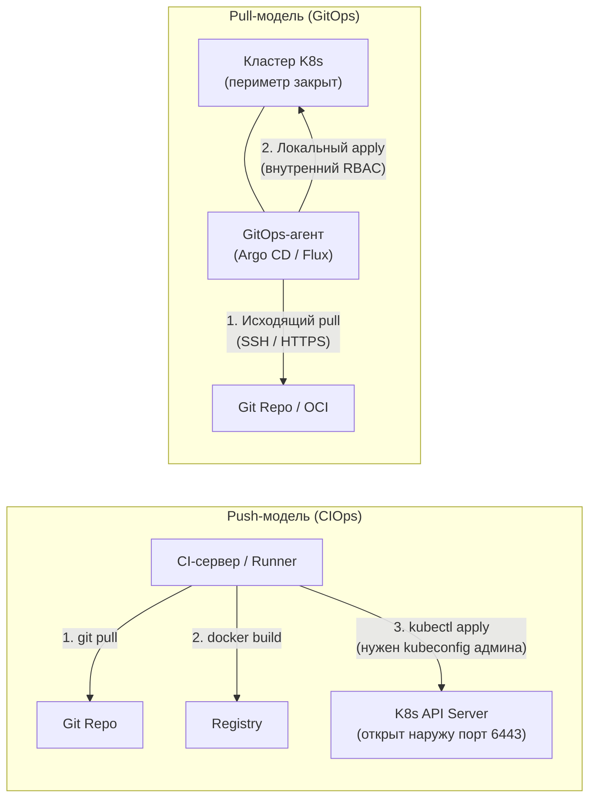

# GitOps: обзор методологии

**Актуально для:** OpenGitOps v1.0 / Argo CD v3.5.x / Flux v2.9.x (on-premise, bare-metal)

## Определения

**GitOps** — это методология управления инфраструктурой и приложениями, при которой Git-репозиторий является единственным и авторитетным источником истины (Single Source of Truth) для всей декларативной среды. Основная цель — автоматизация, версионирование, повторяемость и полная аудируемость (auditability) доставки программного обеспечения без необходимости предоставления инженерам прямого административного доступа к продакшн-кластерам.

В рамках GitOps любые изменения в конфигурациях систем — параметры сервисов, сетевые политики, квоты ресурсов, правила ingress — вносятся исключительно через коммиты и Pull/Merge Request'ы в репозиторий. Программные агенты внутри кластера автоматически считывают конфигурацию и непрерывно приводят реальное состояние среды в соответствие с эталоном.

Ключевые термины:

| Термин | Определение |
| :--- | :--- |
| **Желаемое состояние (Desired State)** | Полное декларативное описание системы (манифесты Kubernetes, Kustomize-оверлеи, Helm-чарты, OCI-артефакты), хранящееся в Git или доверенном OCI-реестре. Единственный авторитетный источник правды (SSoT). |
| **Фактическое состояние (Actual / Live State)** | Реальное состояние объектов в кластере, возвращаемое API-сервером Kubernetes в текущий момент времени. |
| **Реконсиляция (Reconciliation Loop)** | Непрерывный цикл сверки желаемого и фактического состояния с автоматическим вычислением разницы (diff) и применением недостающих изменений через Kubernetes API. |
| **Дрейф (Drift)** | Расхождение между фактическим состоянием кластера и описанием в Git (ручные правки через `kubectl`, действия операторов, адмиссионных вебхуков или сбои). |
| **Самовосстановление (Self-Healing)** | Способность контроллера автоматически откатывать несанкционированные ручные правки в кластере, принудительно возвращая объекты к эталону из Git. |
| **Очистка ресурсов (Pruning)** | Автоматическое удаление ресурсов из кластера, если их декларативное описание было удалено из Git-репозитория. |
| **GitOps-контроллер (Агент)** | Программный оператор внутри кластера (Argo CD, Flux, Fleet), выполняющий непрерывный опрос источников и реконсиляцию. |
| **SSoT (Single Source of Truth)** | Принцип единого источника правды: конфигурация существует в одном каноническом месте (Git), исключая ручное дублирование и конфигурационный дрейф. |
| **Server-Side Apply (SSA)** | Нативный механизм Kubernetes API (`fieldManager`), позволяющий отслеживать владение отдельными полями объектов и бесконфликтно объединять изменения от GitOps и runtime-контроллеров (например, HPA). |
| **Паттерн «Rendered Manifests»** | Подход, при котором шаблоны (Helm, Kustomize) рендерятся до попадания в кластер (в CI или отдельном сервисе) и сохраняются в Git/OCI в виде плоского итогового YAML. |
| **Прогрессивная доставка (Progressive Delivery)** | Расширение непрерывной доставки механизмами канареечных релизов (Canary) и сине-зеленых переключений (Blue/Green) на базе анализа метрик качества работы сервиса. |

---

## Архитектура и базовые концепции

### Эволюция подхода

GitOps стал закономерным этапом эволюции практик системного администрирования и SRE:

1. **Системы управления конфигурациями (Ansible, Puppet, SaltStack):** Обеспечили повторяемость настройки операционных систем и демонов на физических серверах и виртуальных машинах через код, но традиционно выполнялись по команде инженера (Push-модель).
2. **Инфраструктура как код (IaC) (Terraform, OpenTofu):** Перевели описание сетей, виртуализации и блочных хранилищ в декларативный код. Git стал стандартным хранилищем конфигураций, но синхронизация чаще всего запускалась вручную или из централизованного CI.
3. **GitOps (2017+, Weaveworks):** Распространил декларативный подход на приложения и платформенные компоненты внутри оркестраторов, сделав Git активным элементом доставки через агенты внутри кластеров.
4. **Стандартизация OpenGitOps (2021+):** Рабочая группа CNCF выпустила спецификацию [OpenGitOps Principles v1.0.0](https://github.com/open-gitops/documents/blob/main/PRINCIPLES.md), зафиксировав четыре вендор-нейтральных критерия соответствия методологии.

**Связка с Kubernetes:** Оркестратор Kubernetes изначально спроектирован вокруг циклов согласования (Reconciliation Loops) и декларативного API. Контроллеры Kubernetes постоянно приводят реальное состояние подов к описанному в `spec`. GitOps расширяет эту идею на уровень выше: источником `spec` становится Git-репозиторий.

---

### Модели доставки: Push (CIOps) против Pull (GitOps)

Выбор архитектуры доставки определяет уровень безопасности, сетевую изоляцию и надежность платформы:



| Критерий | Push-модель (CIOps) | Pull-модель (GitOps) |
| :--- | :--- | :--- |
| **Инициатор соединения** | Внешний CI-раннер инициирует подключение к кластеру. | Внутренний агент кластера опрашивает внешний репозиторий. |
| **Управление учетными данными** | Ключи доступа (`kubeconfig`, токены) хранятся в CI-сервере. Компрометация CI дает доступ ко всем кластерам. | Кредиты кластера никогда не покидают его периметр. Агент работает через локальные `ServiceAccount`. |
| **Сетевой периметр** | API-сервер Kubernetes (порт 6443) должен быть доступен для входящих соединений из сети CI. | Кластер находится за NAT/Firewall; требуется только исходящий доступ в Git/реестр по HTTPS/SSH. |
| **Детекция и устранение дрейфа** | Происходит только во время запуска CI-пайплайна. Ручные правки живут в кластере до следующего деплоя. | Непрерывная сверка в реальном времени. Ручные правки мгновенно выявляются и перезаписываются (Self-Healing). |
| **Масштабируемость парка кластеров** | Централизованный CI перегружается при росте числа целевых кластеров и сетевых зон. | Каждый кластер реконсилируется автономно, снижая нагрузку на центральные системы. |
| **Отказоустойчивость при сетевых сбоях** | Падение связи между CI и кластером блокирует деплой. | При обрыве связи агент сохраняет текущее состояние, а при восстановлении связи догоняет коммиты. |

#### Гибридные сценарии на практике

1. **Webhook + Polling:** Для минимизации задержки доставки изменений Git-сервер (GitLab/Gitea) отправляет Webhook GitOps-контроллеру при каждом `git push`. Однако периодический опрос (Polling, по умолчанию 180 с в Argo CD, 60 с во Flux) сохраняется как обязательный механизм отказоустойчивости на случай потери вебхука.
2. **CI-driven Push-деплой:** CI-пайплайн собирает манифесты и выполняет `kubectl apply`. Это компромисс для быстрого старта, но он теряет защиту от дрейфа и требует публикации доступа к API-серверу, поэтому полноценным GitOps не является.

---

### Фундаментальные принципы OpenGitOps v1.0

Согласно официальной спецификации CNCF OpenGitOps, система соответствует методологии только при соблюдении всех четырех критериев:

1. **Декларативность (Declarative):** Желаемое состояние системы выражается исключительно в виде декларативных манифестов. Описывается целевой результат («3 реплики приложения на порту 8080»), а не последовательность императивных действий.
2. **Версионируемость и неизменяемость (Versioned and Immutable):** Желаемое состояние хранится в версионируемом хранилище с сохранением полной истории ревизий (Git). Каждое состояние фиксируется неизменяемым хешем коммита. Использование плавающих ссылок (например, тега `:latest`) нарушает этот принцип.
3. **Автоматическое извлечение (Pulled Automatically):** Программные агенты самостоятельно забирают одобренные манифесты из источника. Прямой ручной ввод манифестов человеком на продакшн-окружениях исключен.
4. **Непрерывное согласование (Continuously Reconciled):** Программные агенты непрерывно сверяют фактическое состояние среды с целевым и автоматически предпринимают действия по устранению обнаруженных расхождений (Drift).

---

### Детекция и устранение дрейфа (Drift Detection)

Дрейф конфигурации возникает в результате рассинхронизации между состоянием в Git и реальными ресурсами кластера.

```text
┌──────────────────────────┐             ┌──────────────────────────┐
│     Git / OCI Реестр     │             │    Кластер Kubernetes    │
│ (Желаемое состояние: SSoT)│             │   (Фактическое состояние)│
└─────────────┬────────────┘             └────────────┬─────────────┘
              │                                       │
              ▼                                       ▼
       [ Desired State ]                       [ Live State ]
              │                                       │
              └───────────────►[ Diff ]◄──────────────┘
                                  │
                    ┌─────────────┴─────────────┐
                    ▼                           ▼
            [ Расхождений нет ]          [ Обнаружен дрейф ]
            Статус: Synced                      │
                                                ├─► Алерт / Уведомление
                                                └─► Self-Healing (перезапись)
```

#### Источники дрейфа и стратегии их обработки

| Тип дрейфа | Причина | Способ решения в SRE-практике |
| :--- | :--- | :--- |
| **Нелегитимный дрейф** | Администратор выполнил `kubectl edit`, `kubectl scale` или удалил ресурс вручную. | **Self-healing:** GitOps-контроллер автоматически возвращает состояние к описанному в Git. Доступ к кластеру для людей ограничивается ролью `view`. |
| **Легитимный runtime-дрейф** | Автоскейлер (HPA) меняет число реплик `spec.replicas`; адмиссионный мутирующий вебхук внедряет sidecar-контейнеры или аннотации. | **Исключение полей из сверки:** Настройка `ignoreDifferences` в Argo CD или игнорирование через Server-Side Apply. Неустранение этого приводит к бесконечной войне контроллеров. |
| **Императивные генерации** | Job'ы генерируют ресурсы на лету, Helm-хуки создают временные ConfigMap. | Вынесение временных объектов из области отслеживания контроллера либо явное объявление их в манифестах Git. |

Механика работы трехстороннего слияния (3-way merge) и разрешение конфликтов подробно разобраны в документе [Декомпозиция GitOps и апгрейд CIOps](./Concepts/gitops_decomposition.md).

---

### Неизменяемая инфраструктура и работа с артефактами

Неизменяемость — ключевой фактор детерминированности GitOps:

- **Запрет inplace-обновлений:** Контейнеры и виртуальные машины не обновляются патчами на горячую; они пересоздаются из нового неизменяемого образа.
- **Использование Digest вместо плавающих тегов:** Тег `v1.2.0` может быть случайно перезаписан в реестре. В production-манифестах GitOps фиксируется неизменяемый SHA256-хэш:
  ```yaml
  image: harbor.internal.net/apps/payment-service@sha256:4b22777f329d45e548d8a7a9fcbe4894451000b5ec29b8295b9d3b4e723554b5
  ```
- **OCI-реестры как универсальный транспорт:** Современные приватные реестры (Harbor) используются не только для контейнеров, но и для Helm-чартов и готовых манифестов Kustomize (OCI Artifacts).
- **Подпись артефактов (Cosign / Notary):** Перед деплоем GitOps-контроллеры и admission-контроллеры (Kyverno) проверяют цифровую подпись образа, гарантируя, что код прошел проверку в CI и не был подменен.

Подробный разбор жизненного цикла образов доступен в заметке [Жизненный цикл образов контейнеров](./Concepts/containerization_and_image_storage.md).

---

### Сравнение GitOps-контроллеров для On-Premise и Bare-Metal

| Критерий | Argo CD | Flux v2 | Fleet (Rancher) |
| :--- | :--- | :--- | :--- |
| **Архитектура** | Монолитный набор сервисов с единым сервером управления. | Модульный инструментарий (GitOps Toolkit) по философии Unix-way. | Централизованный менеджер кластеров с агентами на узлах. |
| **Интерфейс** | Полнофункциональный Web UI + CLI + REST/gRPC API. | CLI (`flux`) + стандартные CRD Kubernetes. UI отсутствует в базе (есть сторонние). | Интегрирован в Rancher Dashboard UI. |
| **Мультикластерность** | Центральный Argo CD подключается к целевым кластерам через ServiceAccount токены. | Автономный контроллер внутри каждого кластера (Pull-per-cluster) либо управление через OCI. | Оптимизирован под управление тысячами Edge/IoT кластеров. |
| **Управление секретами** | Argo CD Vault Plugin, SOPS (через CMP), ESO. | Встроенная поддержка SOPS (нативно в `kustomize-controller`), ESO. | Поддержка Sealed Secrets и внешних операторов. |
| **Изоляция и тенантность** | CRD `AppProject` с ролями, группами OIDC и окнами синхронизации. | Нативный RBAC Kubernetes и ServiceAccount Impersonation на уровне CRD. | Разделение по Workspace в кластерах Rancher. |
| **Рекомендуемое применение** | Кластеры с большим числом инженеров, где критичен наглядный визуальный контроль и аудит. | Минималистичные bare-metal инсталляции, строгий декларативный подход без UI, работа с OCI. | Огромные парки Edge-кластеров с нестабильной сетью. |

Детальное сопоставление контроллеров представлено в [ArgoCD: обзор и архитектура](./ArgoCD/argocd_overview.md) и [Flux: возможности и концепции](./flux.md).

---

### Преимущества и системные компромиссы (Trade-offs)

#### Преимущества для SRE и системных администраторов
1. **Воспроизводимость и Zero-Touch Recovery:** Полное восстановление кластера с нуля за минуты путем подключения контроллера к репозиторию.
2. **Исключение конфигурационного дрейфа:** Жесткий контроль над ручными правками на production-узлах.
3. **Безопасность сетевого периметра:** Закрытый на входящие соединения порт 6443 Kubernetes API; отсутствие мастер-ключей в сторонних CI-системах.
4. **Прозрачный аудит (Audit Trail):** Каждый коммит содержит автора, рецензента и точное время утверждения изменений.
5. **Простой откат (Rollback):** Откат инфраструктуры и приложений сводится к `git revert <commit_hash>`.

#### Системные компромиссы и сложности
1. **Управление секретами:** Требует внедрения шифрования в Git (SOPS, age) или интеграции с внешним хранилищем (HashiCorp Vault через ESO).
2. **Сложность локальной отладки:** Запрет прямого `kubectl apply` вынуждает тестировать манифесты через ветки или специализированные dev-пространства.
3. **Зависимость от VCS:** Отказ внутреннего Git-сервера (GitLab/Gitea) блокирует доставку обновлений (хотя текущее состояние кластера сохраняется).
4. **Проблема упорядочивания зависимостей:** Установка CRD до их использования в кастомных ресурсах требует настройки Sync Waves (Argo CD) или `dependsOn` (Flux).

---

## Практические сценарии и организация репозиториев

### Жизненный цикл и шаги настройки (Workflow Setup)

Пошаговый план внедрения GitOps на платформе:

```text
[ 1. Git-репозиторий ] ──► [ 2. CI-валидация ] ──► [ 3. Установка агента ] ──► [ 4. Реконсиляция и мониторинг ]
  - Структура каталогов      - kubeconform               - Argo CD / Flux             - Prometheus метрики
  - Branch Protection        - conftest (политики)       - Подключение к Git          - Slack / Telegram алерты
  - CODEOWNERS               - Сборка образов            - Настройка Webhook          - Аудит расхождений
```

1. **Инициализация репозитория конфигураций:** Создание репозитория `fleet-infra` с защитой ветки `main`, разграничением прав через `CODEOWNERS` и обязательным прохождением проверок перед мерджем.
2. **Интеграция CI-проверок:** Встраивание в пайплайн автоматической валидации синтаксиса Kubernetes (`kubeconform`), статического анализа (`kube-score`) и политик безопасности (`conftest`).
3. **Развертывание GitOps-оператора:** Установка Argo CD или Flux в выделенный namespace (`argocd` или `flux-system`) с минимальными необходимыми привилегиями.
4. **Настройка источников и секретов:** Добавление deploy keys или токенов доступа к локальному Git-серверу и настройка шифрования (SOPS / age).
5. **Подключение мониторинга:** Экспорт метрик контроллеров в Prometheus и настройка алертинга на рассинхронизацию (`OutOfSync`) и ошибки реконсиляции (`Degraded`).

---

### Структурирование репозиториев (Repo Patterns)

Разделение репозиториев — фундаментальное архитектурное решение:

```text
┌──────────────────────────────┐          ┌──────────────────────────────┐
│       Application Repo       │          │      Config / Infra Repo     │
│       (Репозиторий кода)     │          │  (Репозиторий конфигураций)  │
├──────────────────────────────┤          ├──────────────────────────────┤
│ - Исходный код сервиса       │          │ - Базовые манифесты K8s      │
│ - Dockerfile                 │          │ - Kustomize оверлеи (окруж.) │
│ - Unit / Integration тесты   │          │ - Helm values файлы          │
│ - CI пайплайн сборки образа  │          │ - Платформенные аддоны       │
└──────────────┬───────────────┘          └──────────────┬───────────────┘
               │                                         │
               ▼ сборка и пуш                            ▼ pull манифестов
       [ Harbor Registry ]                     [ GitOps Контроллер ]
               ▲                                         │
               └───────────────── deploy ────────────────┘
```

**Почему код и манифесты разделяются:**
- **Разделение прав:** Разработчики имеют права на мердж в репозиторий приложения, но инфраструктурный репозиторий защищен ревью от системных инженеров и SRE.
- **Предотвращение циклов CI:** Изменение конфигурации реплик не должно запускать долгую пересборку Docker-образов и выполнение юнит-тестов.
- **Атомарность окружений:** Инфраструктурный репозиторий хранит целостное состояние всего кластера (все сервисы, ingress, сетевые политики).

#### Типовая структура инфраструктурного репозитория (Kustomize Overlays)

```text
fleet-infra/
├── platform/                      # Системные аддоны кластера (Platform Stack)
│   ├── ingress-nginx/
│   ├── cert-manager/
│   ├── victoria-metrics/
│   └── kyverno/
├── apps/                          # Бизнес-сервисы
│   └── billing-service/
│       ├── base/                  # Общие манифесты (Deployment, Service)
│       │   ├── deployment.yaml
│       │   ├── service.yaml
│       │   └── kustomization.yaml
│       └── overlays/              # Специфичные настройки окружений
│           ├── dev/
│           │   ├── kustomization.yaml
│           │   └── patches/
│           │       └── replicas.yaml
│           ├── staging/
│           └── prod/
│               ├── kustomization.yaml
│               └── patches/
│                   └── resources.yaml
└── clusters/                      # Точки входа для GitOps-контроллеров
    ├── dc1-production/
    │   ├── kustomization.yaml     # Подключает platform и apps/overlays/prod
    │   └── root-app.yaml          # Корневое приложение (App of Apps)
    └── dc2-staging/
        └── kustomization.yaml
```

---

### Организация Helm-чартов и локальных OCI-реестров

При использовании Helm в корпоративной сети без доступа к внешним облакам рекомендуется хранить собранные чарты в локальном OCI-реестре (Harbor):

| Подход | Организация | Плюсы | Минусы |
| :--- | :--- | :--- | :--- |
| **Чарты в Git-репозитории** | Исходники чартов лежат в директории `charts/` вместе с манифестами. | Простота, не нужен отдельный реестр для чартов. | Медленный рендеринг, риск случайной правки исходника чарта. |
| **Локальный OCI-реестр (Harbor)** | Чарты собираются в CI (`helm package`), подписываются и пушатся в Harbor как OCI-артефакты. | Строгое версионирование (SemVer), высокая скорость загрузки, кэширование, проверка уязвимостей. | Требует поддержки реестра и аутентификации контроллеров. |

**Рекомендация SRE:** Использовать OCI-реестр Harbor для хранения как образов контейнеров, так и Helm-чартов. В Git хранятся только легковесные `values.yaml` и декларативные ссылки на версии чартов.

---

### Паттерн «Rendered Manifests» (рендеринг до кластера)

Паттерн Rendered Manifests устраняет непрозрачность шаблонизации Helm/Kustomize в момент синхронизации:

1. **Проблема:** Если контроллер рендерит чарт внутри кластера на лету, рецензент в Merge Request видит только изменение `values.yaml`, но не видит итоговый YAML, который применится в API Kubernetes. Ошибка в шаблоне чарта может привести к удалению критических ресурсов.
2. **Решение:** Процесс рендеринга переносится на этап до деплоя. Финальный сгенерированный плоский манифест коммитится в отдельную ветку (`env/prod-rendered`) или публикуется в OCI-реестр.
3. **Реализации:**
   - **CI-гидратация:** Пайплайн выполняет `helm template` или `kustomize build` и формирует PR с итоговым YAML для проверки.
   - **Argo CD Source Hydrator:** Встроенный механизм (начиная с Argo CD v3.5), позволяющий декларативно связывать репозиторий шаблонов (`drySource`) и репозиторий готовых манифестов (`syncSource`).
   - **Kargo:** Специализированный инструмент для многоэтапного продвижения (promotion) артефактов и манифестов с автоматическим тестированием.

---

### Стратегии продвижения (Promotion Strategies)

Продвижение изменений между окружениями (Dev → Staging → Prod):

1. **Продвижение через директории и оверлеи (Directory-based / Overlays):**
   - Все окружения живут в одной ветке (`main`).
   - Изменение версии сервиса — это точечный коммит, меняющий тег в `apps/billing/overlays/prod/kustomization.yaml`.
   - **Плюсы:** Исключен дрейф веток; `git diff` наглядно показывает разницу между окружениями. Это наиболее рекомендуемый подход.
2. **Продвижение через ветки (Branch-based):**
   - Ветка `develop` для Dev-кластера, `main` — для Prod-кластера.
   - Продвижение выполняется через Merge Request из одной ветки в другую.
   - **Минусы:** Высокий риск конфликтов слияния и накопления расхождений, когда горячие фиксы попадают в `main`, минуя `develop`.
3. **Автоматизация обновления образов:**
   - **Argo CD Image Updater:** Отслеживает появление новых тегов в реестре и автоматически коммитит новый digest в Git.
   - **Flux Image Automation Controller:** Нативно сканирует реестр (`ImageRepository`), выбирает тег по политике SemVer (`ImagePolicy`) и создает коммит в репозиторий (`ImageUpdateAutomation`).
   - **Renovate:** Бот, создающий Merge Request'ы с обновлением зависимостей, базовых образов и чартов с проверкой в CI (см. [Renovate: автоматизация обновлений](./Concepts/renovate_dependency_updates.md)).

---

### Валидация и тестирование манифестов в CI

Перед тем как манифест попадет в ветку `main`, он проходит обязательный конвейер валидации:

```yaml
# Пример стадии CI (.gitlab-ci.yml)
stages:
  - validate

lint-and-validate:
  stage: validate
  image: alpine:3.20
  before_script:
    - apk add --no-cache curl git
    - curl -sLo /usr/local/bin/kustomize https://github.com/kubernetes-sigs/kustomize/releases/download/kustomize%2Fv5.4.3/kustomize_v5.4.3_linux_amd64.tar.gz && tar -xzf /usr/local/bin/kustomize -C /usr/local/bin/
    - curl -sLo /usr/local/bin/kubeconform https://github.com/yannh/kubeconform/releases/download/v0.6.7/kubeconform-linux-amd64.tar.gz && tar -xzf /usr/local/bin/kubeconform -C /usr/local/bin/
  script:
    - echo "=== Рендеринг манифестов ==="
    - kustomize build apps/billing-service/overlays/prod > rendered-prod.yaml
    - echo "=== Схематическая валидация Kubernetes API ==="
    - kubeconform -strict -summary -schema-location default -schema-location 'https://raw.githubusercontent.com/datreeio/CRDs-catalog/main/{{.ResourceKind}}_{{.ResourceAPIVersion}}.json' rendered-prod.yaml
```

Инструменты:
- **`kubeconform`:** Быстрая проверка соответствия манифестов схемам OpenAPI Kubernetes и CRD.
- **`conftest` / Open Policy Agent:** Проверка манифестов на соответствие корпоративным политикам (запрет `privileged: true`, обязательное указание `resources.limits`).
- **`kube-score`:** Статический анализ рекомендаций по надежности (наличие `readinessProbe`, `livenessProbe`, `podAntiAffinity`).

---

### Прогрессивная доставка на On-Premise инфраструктуре

Интеграция GitOps со стратегиями безопасного выпуска релизов:

- **Argo Rollouts:** Контроллер, заменяющий стандартный ресурс `Deployment` на `Rollout`. Поддерживает канареечный выпуск с пошаговым переключением трафика через локальный Ingress (Nginx Ingress Controller, Envoy, HAProxy) и анализ метрик из Prometheus (уровень HTTP-ошибок, латентность p99).
- **Flagger:** Контроллер из экосистемы Flux, работающий поверх стандартных `Deployment`. Автоматизирует создание canary-реплик и управление трафиком.

GitOps-контроллер доставляет только манифест `Rollout` с новым образом, а процесс раскатки и возможный автоматический откат выполняет специализированный контроллер на основе метрик. Подробные примеры — в [Прогрессивной доставке в GitOps](./Concepts/progressive_delivery_gitops.md).

---

### Состояние экосистемы и тренды (2026)

| Инструмент | Актуальная линейка | Статус поддержки | Ключевые возможности |
| :--- | :--- | :--- | :--- |
| **Argo CD** | v3.5.x | Поддержка трех последних минорных версий (v3.3–v3.5); ветка v2.x полностью EOL. | Server-Side Apply по умолчанию, Source Hydrator (beta), нативная поддержка OCI-источников, Shallow Clone, Server-Side Diff. |
| **Flux** | v2.9.x | Регулярные релизы синхронно с версиями K8s; поддержка N-2 минорных версий. | Модуль `source-watcher` для оптимизации монорепозиториев, встроенный OCI-клиент, строгий RBAC Impersonation, поддержка Helm v4. |

Главные тренды развития:
1. **OCI как основной канал доставки:** Переход от прямого чтения Git к использованию OCI-реестров как универсального транспорта для образов, Helm-чартов и Kustomize-артефактов.
2. **Server-Side Apply (SSA):** Окончательное вытеснение старого механизма `kubectl.kubernetes.io/last-applied-configuration` в пользу нативного отслеживания владения полями на стороне API-сервера.
3. **Ужесточение цепочки поставок (Supply Chain Security):** Встроенная проверка подписей Cosign/GPG непосредственно контроллерами перед применением манифестов.

---

### Сценарии применения в локальной инфраструктуре

#### Сценарий 1: Инфраструктурный GitOps на On-Premise (Crossplane и Terraform-контроллер)
Управление ресурсами платформы через Kubernetes API:
- **Crossplane:** Декларативное управление локальными СУБД (PostgreSQL через CloudNativePG-провайдер), хранилищами S3 (MinIO), виртуальными машинами (Proxmox/KVM) и DNS-записями (PowerDNS).
- **Flux TF-controller:** Запуск Terraform/OpenTofu планов внутри изолированных подов кластера по коммитам в Git.

#### Сценарий 2: Observability as Code (VictoriaMetrics, Prometheus, Grafana)
Декларативное управление мониторингом:
- **Правила алертов:** Манифесты `PrometheusRule` и `VMRule` хранятся в Git и синхронизируются в кластер.
- **Дашборды Grafana:** Описываются в JSON и монтируются в виде `ConfigMap` с меткой `grafana_dashboard: "1"`. Sidecar-контейнер Grafana автоматически считывает новые дашборды без перезапуска сервиса.

#### Сценарий 3: Управление политиками (Policy as Code через Kyverno)
Контроль соответствия кластера стандартам ИБ:
- Политики `ClusterPolicy` хранятся в каталоге `platform/kyverno/policies/`.
- Любая попытка запуска небезопасного пода (например, запуск от пользователя `root` или отсутствие `readinessProbe`) блокируется адмиссионным вебхуком Kyverno как в CI через CLI, так и в кластере.

#### Сценарий 4: Управление секретами на On-Premise инфраструктуре
Хранение секретов без облачных провайдеров:
- **SOPS + age:** Разработчики шифруют файлы секретов с помощью утилиты `sops` и открытого ключа `age`. Зашифрованный файл безопасно хранится в Git. Контроллер внутри кластера расшифровывает его приватным ключом.
- **External Secrets Operator (ESO) + HashiCorp Vault:** В Git хранятся только ссылки `ExternalSecret`. Оператор ESO запрашивает секреты из корпоративного локального инстанса HashiCorp Vault по AppRole или Kubernetes Auth.
- **Sealed Secrets:** Асимметричное шифрование открытым ключом контроллера.

Подробные схемы настройки описаны в [Управлении секретами в GitOps](./secrets_encryption.md).

#### Сценарий 5: Автоматическая инициализация кластеров (Cluster Bootstrapping)
Развертывание базового стека на новом узле или кластере:
- **Argo CD ApplicationSet:** Генератор кластеров (`clusters: {}`) автоматически обнаруживает зарегистрированные в Argo CD кластеры и накатывает платформенный стек (Ingress, CNI, мониторинг, CSI) в зависимости от меток (`labels: env=prod`).
- **Flux Bootstrap:** Команда `flux bootstrap git` создает необходимые CRD и связывает кластер с репозиторием.

#### Сценарий 6: Мультитенантность и Self-Service
Предоставление автономных окружений продуктовым командам:
- Ограничение команд через `AppProject` в Argo CD: фиксируются разрешенные репозитории, целевые неймспейсы и запрещенные типы ресурсов (например, запрет создания `ClusterRoleBinding` и `NodePort`).
- Во Flux используется механизм ServiceAccount Impersonation: контроллер применяет манифесты конкретной команды с ее локальными правами.

#### Сценарий 7: Аварийное восстановление (Disaster Recovery на Bare-Metal)
План быстрого восстановления площадки:
1. **ОС и базовый кластер:** Развертывание физических серверов через PXE/BMO, Ansible или дистрибутивы (Talos Linux, kubeadm, RKE2).
2. **Bootstrapping GitOps:** Установка оператора через Helm или манифесты одной командой.
3. **Корневое приложение:** Подключение к `fleet-infra.git` — контроллер автоматически разворачивает все сервисы и сетевые политики.
4. **Восстановление секретов:** Расшифровка через локальный ключ age или синхронизация с Vault.
5. **Восстановление данных (Persistent Volumes):** Применение бэкапов через Velero из локального MinIO или моментальные снимки CSI (Ceph RBD/CephFS, Longhorn). Состояние инфраструктуры берется из Git, данные — из снимков хранилищ.

#### Сценарий 8: Мультикластерные топологии (Multi-Cluster Fleet)
- **Топология Hub-and-Spoke:** Выделенный управляющий кластер с Argo CD регистрирует целевые кластеры через сетевые туннели и доставляет конфигурации из центра.
- **Топология Pull-per-Cluster (Автономная):** В каждом кластере работает собственный агент Flux или Argo CD, читающий общие или индивидуальные каталоги Git-репозитория. Оптимально при изоляции сетей и закрытых контурах.

---

## Операции и команды

Справочник базовых команд для инженеров SRE и системных администраторов при эксплуатации GitOps.

### Диагностика и управление через Argo CD CLI

```bash
# Аутентификация в Argo CD через терминал
argocd login argocd.internal.net --username admin --insecure
# → 'admin:login' logged in successfully

# Просмотр списка приложений и их статусов синхронизации
argocd app list
# → NAME         CLUSTER                         STATUS   HEALTH   AUTO-SYNC
# → ingress      https://kubernetes.default.svc  Synced   Healthy  Enabled
# → billing-app  https://kubernetes.default.svc  OutOfSync Healthy Enabled

# Детальная информация о приложении и причинах OutOfSync
argocd app get billing-app
# → Application:        billing-app
# → Sync Status:        OutOfSync from main (a4c8e12)
# → Health Status:      Healthy

# Просмотр точного расхождения (Diff) между Git и кластером
argocd app diff billing-app
# → ===== apps/Deployment billing-namespace/billing-service ======
# → 32c32
# → <   replicas: 2
# → ---
# → >   replicas: 5

# Принудительная ручная синхронизация с удалением лишних ресурсов (Prune)
argocd app sync billing-app --prune
# → TIMESTAMP                  GROUP        KIND   NAMESPACE                  NAME    STATUS   HEALTH        HOOK  MESSAGE
# → 2026-10-13T18:30:01+03:00  apps   Deployment   billing-namespace   billing-app    Synced  Healthy              deployment.apps/billing-app configured

# Включение автоматического самовосстановления (Self-Healing)
argocd app set billing-app --self-heal
# → application 'billing-app' updated

# Приостановка автосинхронизации на время проведения регламентных работ
argocd app set billing-app --sync-policy none
# → application 'billing-app' updated
```

### Диагностика и управление через Flux CLI

```bash
# Просмотр состояния всех объектов Kustomization
flux get kustomizations
# → NAME            REVISION    SUSPENDED   READY   MESSAGE
# → platform-stack  main@1b2c3d False       True    Applied revision: main@1b2c3d
# → apps-prod       main@1b2c3d False       False   Kustomization/apps-prod dry-run failed: ...

# Принудительный опрос Git-репозитория без ожидания интервала опроса
flux reconcile source git fleet-infra
# → ► annotating GitRepository fleet-infra in flux-system namespace
# → ✔ GitRepository reconciliation completed
# → ✔ fetched revision: main@a4c8e12

# Принудительная немедленная реконсиляция Kustomization со всеми зависимостями
flux reconcile kustomization apps-prod --with-source
# → ► annotating Kustomization apps-prod in flux-system namespace
# → ✔ Kustomization apps-prod reconciled successfully

# Временная приостановка реконсиляции для проведения аварийных работ
flux suspend kustomization apps-prod
# → ► suspending kustomization apps-prod in flux-system namespace
# → ✔ kustomization suspended

# Возобновление штатной реконсиляции
flux resume kustomization apps-prod
# → ► resuming kustomization apps-prod in flux-system namespace
# → ✔ kustomization resumed
```

### Валидация манифестов перед коммитом

```bash
# Локальная сборка оверлея Kustomize для проверки рендеринга
kustomize build apps/billing-service/overlays/prod > /tmp/test-render.yaml
# → манифест успешно сгенерирован без синтаксических ошибок

# Строгая проверка сгенерированных ресурсов на соответствие схемам Kubernetes
kubeconform -strict -summary /tmp/test-render.yaml
# → Summary: 12 resources found in 1 file - Valid: 12, Invalid: 0, Errors: 0, Skipped: 0
```

### Работа с секретами через SOPS и age

```bash
# Генерация ключевой пары age для администратора
age-keygen -o ~/.age/key.txt
# → Public key: age1ql3z7hjy54pw3hyww5ayyfg7zqgvc7w3j2elw8zmrj2kg5sfn9aqmcac8p

# Создание зашифрованного Secret манифеста
sops --encrypt --age age1ql3z7hjy54pw3hyww5ayyfg7zqgvc7w3j2elw8zmrj2kg5sfn9aqmcac8p \
  --encrypted-regex '^(data|stringData)$' \
  secret-plain.yaml > secret-enc.yaml
# → файл secret-enc.yaml создан: поля data зашифрованы, метаданные сохранены в открытом виде

# Просмотр расшифрованного содержимого секретов в терминале
sops --decrypt secret-enc.yaml
# → вывод расшифрованного Kubernetes Secret
```

---

## Диагностика и устранение неисправностей

Сводная матрица типовых неисправностей в GitOps-системах:

| Проблема / Симптом | Первопричина | Метод диагностики | Способ устранения |
| :--- | :--- | :--- | :--- |
| **OutOfSync Flapping** (постоянная перезапись ресурса) | Конфликт контроллера с мутирующим вебхуком или HPA по полю `spec.replicas`. | `argocd app diff <app>` показывает постоянное расхождение одного поля. | Добавить конфликтное поле в `ignoreDifferences` (Argo CD) или перейти на Server-Side Apply. |
| **CRD Dependency Deadlock** (ошибка `no matches for kind`) | Кастомный ресурс (CR) применяется раньше, чем API-сервер зарегистрировал его CRD. | В логах контроллера: `unable to recognize "": no matches for kind "MyCR"`. | Использовать `Sync Waves` в Argo CD (CRD волна 0, CR волна 1) или `dependsOn` во Flux. |
| **Secret Decryption Failure** (ошибка рендеринга секретов) | В целевом namespace отсутствует ключ age/PGP, либо истек токен доступа ESO к Vault. | `flux logs --level=error` или статус `SecretStore`: `Invalid credentials`. | Проверить наличие приватного ключа в Secret `sops-age` или проверить статус Vault AppRole. |
| **Зависание при Pruning** (`Terminating` статус ресурсов) | Удаляемый ресурс удерживается финализатором (`finalizer`), ожидающим очистки внешних ресурсов. | `kubectl get <kind> <name> -o yaml \| grep -A 5 finalizers`. | Устранить причину блокировки финализатора либо очистить финализатор вручную через patch. |
| **Repo-Server OOMKilled / Timeout** | Рендеринг тяжелого Helm-чарта с множественными зависимостями превышает память или лимит времени (90 с). | `kubectl describe pod -n argocd -l app.kubernetes.io/name=argocd-repo-server`. | Увеличить memory limit для `argocd-repo-server`, вынести рендеринг в CI (Rendered Manifests). |
| **Environment Branch Drift** (рассинхронизация веток) | Hotfix был применен в `main`, но не слит обратно в ветку `staging`. | `git log staging..main --oneline`. | Отказаться от branch-per-environment в пользу Kustomize overlays в единой ветке `main`. |

### Глубокий разбор ключевых инцидентов

#### 1. OutOfSync Flapping из-за Horizontal Pod Autoscaler (HPA)
- **Симптом:** Приложение каждую минуту переходит из `Synced` в `OutOfSync`. Контроллер уменьшает реплики до значения из Git, а HPA тут же увеличивает их по нагрузке.
- **Диагностика:** Выполните `argocd app diff <app>`. Если расхождение касается только поля `spec.replicas` в `Deployment`, причина в автоскейлере.
- **Решение:** Исключите поле `replicas` из сверки в манифесте `Application`:
  ```yaml
  spec:
    ignoreDifferences:
      - group: apps
        kind: Deployment
        jsonPointers:
          - /spec/replicas
  ```
  Либо удалите строку `replicas` из манифеста `Deployment` в Git, оставив управление полем исключительно за ресурсом `HorizontalPodAutoscaler`.

#### 2. Зависание удаления ресурсов при Prune (Finalizer Deadlock)
- **Симптом:** Ресурс удален из Git, контроллер пытается выполнить `prune`, но синхронизация зависает со статусом `Prune event failed: resource is terminating`.
- **Причина:** Оператор, управлявший ресурсом, уже был удален раньше самого ресурса, и финализатор некому обработать.
- **Решение:** Проверьте и снимите финализатор принудительно (только если внешние данные безопасно удалены):
  ```bash
  kubectl patch <kind> <name> -n <namespace> -p '{"metadata":{"finalizers":null}}' --type=merge
  ```

---

## Лучшие практики

### Организация репозиториев
1. **Строгое разделение репозиториев:** Храните исходный код приложений отдельно от репозиториев инфраструктурных манифестов.
2. **Directory-based продвижение:** Используйте структуру с Kustomize-оверлеями (`apps/<app>/overlays/<env>`) в единой ветке `main` вместо раздельных веток под каждое окружение. Это полностью исключает конфликт версий при слияниях.
3. **Защита основной ветки (Branch Protection):** Запретите прямой коммит в `main`. Требуйте обязательного прохождения CI-валидации и минимум одного одобрения (LGTM) через `CODEOWNERS`.

### Безопасность и контроль доступа
1. **Нулевой прямой доступ в Production:** Инженеры не должны иметь прав на создание или изменение ресурсов в production-кластере через `kubectl`. Прямой доступ выдается только на чтение (`view`) для диагностики. Любые изменения проводятся через Pull Request.
2. **Аутентификация коммитов:** Требуйте подписи коммитов через GPG или SSH-ключи. Контроллеры Argo CD и Flux умеют отклонять коммиты без доверенной подписи.
3. **Безопасность секретов:** Запретите хранение незашифрованных секретов в Git. Используйте `gitleaks` в pre-commit хуках и CI-пайплайнах для предотвращения случайной утечки паролей в историю Git.

### Неизменяемость и версионирование
1. **Запрет плавающего тега `:latest`:** Всегда фиксируйте точные теги или SHA256-хэши (`digest`) для контейнеров.
2. **Фиксация версий зависимостей:** В Helm-чартах всегда явно указывайте версию чарта (`version: 2.4.1`) вместо диапазонов версий (`version: ^2.0.0`), чтобы избежать неконтролируемых обновлений.

### Политики синхронизации
1. **Включение Prune и Self-Heal:** На dev и staging средах держите параметры `prune: true` и `selfHeal: true` всегда включенными.
2. **Защита критических данных от удаления:** Для StatefulSet, PersistentVolumeClaim и баз данных устанавливайте аннотацию защиты от удаления:
   - В Argo CD: `argocd.argoproj.io/sync-options: Delete=false`
   - В Helm: `helm.sh/resource-policy: keep`
3. **Окна синхронизации (Sync Windows):** На production-кластерах настраивайте окна синхронизации, блокирующие автодеплой в нерабочие часы, выходные дни или периоды пиковой нагрузки.

### Наблюдаемость (Observability)
1. **Мониторинг метрик контроллеров:** Настройте сбор Prometheus-метрик:
   - `argocd_app_sync_status` (статус синхронизации приложений);
   - `argocd_app_health_status` (состояние работоспособности);
   - `gotk_reconcile_condition` (состояние контроллеров Flux).
2. **Алертинг:** Настройте оповещения в дежурный канал при нахождении приложения в статусе `OutOfSync` или `Degraded` дольше 15 минут.

---

## Вопросы для собеседования

### Опишите план аварийного восстановления на базе GitOps для bare-metal / on-premise кластера Kubernetes
1. **Восстановление базовой платформы:** Развертывание операционных систем на серверах через PXE/BMO, настройка сети и развертывание базового кластера Kubernetes с помощью утилит автоматизации (kubeadm, Ansible, Talos Linux).
2. **Bootstrapping GitOps:** Развертывание оператора (Argo CD или Flux) через базовые Helm-манифесты или bootstrap-команду сразу после старта API-сервера.
3. **Корневая синхронизация:** Подключение оператора к репозиторию `fleet-infra`. Оператор автоматически накатывает системные аддоны (CNI Cilium, MetalLB, Ingress, Cert-Manager) и приложения.
4. **Секреты:** Автоматическая расшифровка данных через локальный приватный ключ age (смонтированный в Secret) или оператор ESO из локального кластера HashiCorp Vault.
5. **Данные:** Восстановление PersistentVolumeClaim из моментальных снимков локального хранилища (Ceph RBD/CephFS, Longhorn) или бэкапов Velero из локального MinIO S3.

### Что такое AppProject в Argo CD и как он обеспечивает мультитенантность?
**AppProject** — это CRD в Argo CD, создающий логические границы изоляции между командами разработчиков. Он регламентирует:
1. **Source Repos:** Список разрешенных Git-репозиториев, откуда проект может забирать манифесты.
2. **Destinations:** Список разрешенных кластеров и конкретных пространств имен (namespaces) для деплоя.
3. **Cluster Resource Whitelist/Blacklist:** Список типов ресурсов (например, запрет создания глобальных `ClusterRole`, `CustomResourceDefinition` или `Namespace`).
4. **Scoped RBAC:** Внутренние роли пользователей, сопоставляемые с группами корпоративного провайдера (OIDC/Keycloak).
5. **Sync Windows:** Временные расписания, разрешающие или блокирующие автосинхронизацию.

### Как контроллер обнаруживает и применяет изменения после слияния ветки в Git?
1. **Обнаружение:** Через входящий Webhook от Git-сервера (мгновенно) либо по таймеру фонового опроса (Polling, каждые 3 минуты по умолчанию).
2. **Клонирование и рендеринг:** Сервис `repo-server` забирает нужный коммит и рендерит шаблоны (Helm, Kustomize) в плоский YAML.
3. **Вычисление Diff:** Application Controller запрашивает текущее состояние объектов из Kubernetes API, вычисляет расхождение (diff) с отрендеренным эталоном с учетом исключений.
4. **Применение (Sync):** Если включен автоматический sync, контроллер отправляет манифесты в Kubernetes API через Server-Side Apply с соблюдением волн синхронизации (`Sync Waves`).
5. **Health Check:** Контроллер отслеживает статус готовности (`Healthy`, `Progressing`, `Degraded`) развернутых подов и сервисов.

### Почему Pull-модель считается более безопасной, чем традиционная Push-модель CI?
1. **Отсутствие учетных данных в CI:** Ключи доступа с правами администратора кластера (`kubeconfig`) не хранятся на серверах и раннерах CI. Компрометация пайплайна сборки не компрометирует кластер.
2. **Закрытый сетевой периметр:** Кластер не требует открытия порта 6443 наружу. Доступ осуществляется через исходящие безопасные HTTPS/SSH-сессии к Git-серверу.
3. **Непрерывный Self-Healing:** Push-пайплайн слеп к ручным правкам после завершения шага деплоя. Pull-агент контролирует среду постоянно и перезаписывает несанкционированные изменения.
4. **Аудит и контроль:** Вся история изменений хранится в неизменяемой истории коммитов Git, исключая скрытые ручные вмешательства.

### Как реализовать канареечное развертывание (Canary) в связке с GitOps?
Используется связка GitOps-контроллера с контроллером прогрессивной доставки (Argo Rollouts или Flagger):
1. Обычный `Deployment` заменяется на манифест `Rollout`, где описаны процентные шаги переключения трафика (например: 10% → пауза 10 мин → 50% → 100%).
2. Настраивается интеграция с локальным Ingress-контроллером (Nginx Ingress, Envoy) для разделения сетевого трафика.
3. Создается ресурс `AnalysisTemplate`, обращающийся к Prometheus для проверки метрик качества (процент HTTP 5xx < 0.5%, латентность p99 < 200 мс).
4. GitOps-контроллер доставляет изменение манифеста `Rollout` (новый тег образа) в кластер, а Argo Rollouts автономно управляет канареечной раскаткой и автоматически откатывает релиз при деградации метрик.

---

## Дополнительная информация

### Связанные документы в базе знаний
- [ArgoCD: обзор и архитектура](./ArgoCD/argocd_overview.md) — детальная архитектура компонентов Argo CD.
- [ArgoCD: установка и настройка](./ArgoCD/argocd_installation_and_setup.md) — развертывание в production.
- [ArgoCD: мультитенантность и AppProject](./ArgoCD/argocd_multi_tenancy.md) — настройка изоляции команд.
- [ArgoCD: аварийное восстановление](./ArgoCD/argocd_disaster_recovery.md) — резервное копирование и DR.
- [Flux: возможности и концепции](./flux.md) — архитектура GitOps Toolkit и практические сценарии.
- [ArgoCD vs Flux: сопоставление манифестов](./argo_vs_flux_manifests.md) — практическое сравнение синтаксиса.
- [Управление секретами в GitOps](./secrets_encryption.md) — интеграция SOPS, age, External Secrets Operator и Vault.
- [GitOps: пример сквозного пайплайна](./gitops_pipeline_example.md) — интеграция CI и CD конвейеров.
- [Декомпозиция GitOps и апгрейд CIOps](./Concepts/gitops_decomposition.md) — механика 3-way merge и переход от Push к Pull.
- [Прогрессивная доставка в GitOps](./Concepts/progressive_delivery_gitops.md) — настройка Argo Rollouts и Flagger.
- [Управление политиками через GitOps](./Concepts/gitops-policy-management.md) — Policy as Code с Kyverno.
- [Stateful-нагрузки в GitOps](./Concepts/stateful_workloads_gitops.md) — управление базами данных и защита данных от prune.
- [Crossplane: интеграция с GitOps](./Crossplane/gitops_integration.md) — управление инфраструктурой через K8s API.
- [Структура Helm-чарта](../Kubernetes/ToolsUtilities/Helm/helm_chart_structure.md) — организация пакетов Helm.
- [Kustomize: наложения и патчи](../Kubernetes/ToolsUtilities/kustomize/kustomize_overlays_and_patches.md) — композиция конфигураций.

### Официальные ресурсы
- [OpenGitOps Specification v1.0.0](https://opengitops.dev/) — официальные принципы CNCF.
- [Документация Argo CD](https://argo-cd.readthedocs.io/) — официальное руководство проекта.
- [Документация Flux CD](https://fluxcd.io/docs/) — руководство по инструментам GitOps Toolkit.
- [Спецификация Kustomize](https://kustomize.io/) — документация по декларативной кастомизации манифестов.
