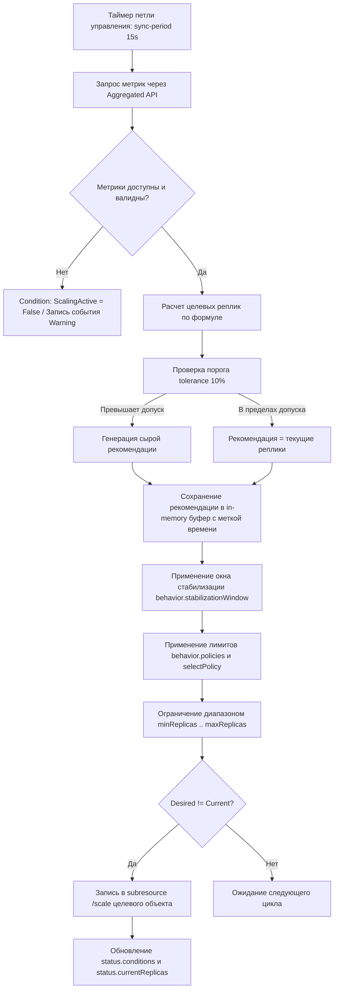

# HPA: Продвинутые темы и тонкая настройка

**Актуально для:** Kubernetes 1.28–1.35 (API autoscaling/v2)

В данном документе рассматриваются глубокие архитектурные и эксплуатационные аспекты работы Horizontal Pod Autoscaler (HPA) в инфраструктуре Kubernetes: внутренние механизмы контроллера `kube-controller-manager`, тонкая настройка политик `behavior`, специфика метрик памяти на уровне подсистем ядра Linux (cgroups v1/v2), предотвращение деградации сетевого трафика при масштабировании вниз, а также координация HPA с системными ограничениями (ResourceQuota, LimitRange, TopologySpreadConstraints, Pod Disruption Budget, PriorityClass).

Материал ориентирован на DevOps-, SRE- и системных инженеров, управляющих production-кластерами на выделенной и bare-metal инфраструктуре без привязки к проприетарным облачным сервисам.

Базовые концепции и типы метрик описаны в **[HPA: Основные концепции](./hpa_concepts.md)**. Готовые типовые конфигурации приведены в **[HPA: Практические сценарии](./hpa_scenarios.md)**. Первичный обзор доступен в **[HPA: Главная](./index.md)**.

---

## Определения

**Flapping (дребезг / thrashing)** — паразитный режим работы автомасштабировщика, при котором количество реплик непрерывно и с высокой частотой колеблется (увеличивается и тут же уменьшается) из-за краткосрочных всплесков метрик, слишком агрессивных политик масштабирования или отсутствия достаточных окон стабилизации.

**Секция `behavior`** — блок спецификации HPA v2 (`spec.behavior`), предоставляющий раздельное управление политиками и скоростью масштабирования вверх (`scaleUp`) и вниз (`scaleDown`), включая длительность окон стабилизации (`stabilizationWindowSeconds`) и выбор между конкурирующими правилами (`selectPolicy`).

**Окно стабилизации (Stabilization Window)** — временной интервал в прошлом, за который контроллер анализирует сгенерированные рекомендации по масштабированию. Для `scaleDown` алгоритм выбирает наибольшее число реплик за окно, предотвращая преждевременное удаление подов при кратковременном спаде нагрузки.

**ContainerResource** — тип метрики в API `autoscaling/v2`, позволяющий рассчитывать утилизацию ресурсов конкретного именованного контейнера в поде, изолируя метрики основного приложения от влияния вспомогательных контейнеров (sidecars: Envoy/Istio, Fluent-bit, прокси).

**Политика масштабирования (Scaling Policy)** — атомарное правило изменения числа подов, задающее допустимый шаг (в абсолютных единицах `Pods` или в процентах `Percent`) за фиксированный период времени (`periodSeconds`).

**Scaling Latency (Задержка сквозного масштабирования)** — суммарный временной лаг от момента физического роста нагрузки на приложение до момента, когда вновь созданный под начинает обрабатывать рабочий трафик (пройдены стадии сбора метрик, расчёта HPA, планирования подов, выгрузки образов, старта рантайма и проверок `readinessProbe`).

**Working Set Memory (память рабочего набора)** — объем памяти процесса, рассчитываемый ядром Linux и cgroups как сумма RSS и страниц памяти файлового кэша за вычетом неактивного страничного кэша (`inactive_file`). Именно эта метрика используется Kubelet и Metrics Server для принятия решений о лимитах и масштабировании.

**Рекомендация масштабирования (Scaling Recommendation)** — расчетное целочисленное значение целевого числа реплик, вычисляемое алгоритмом HPA на каждой итерации цикла управления и сохраняемое во внутреннем кольцевом буфере памяти контроллера.

**Толерантность масштабирования (Scaling Tolerance)** — допустимый порог отклонения текущей метрики от целевой (по умолчанию `0.1` или 10%), в рамках которого контроллер считает систему сбалансированной и не инициирует изменение числа реплик.

**Server-Side Apply (SSA)** — механизм декларативного управления объектами Kubernetes через отслеживание владельцев полей (`metadata.managedFields`), предотвращающий конфликты перезаписи между HPA и GitOps-контроллерами (ArgoCD, Flux).

---

## Архитектура и механизмы работы

### Внутреннее устройство и цикл управления HPA

HPA не является отдельным демоном; его логику выполняет контроллер `horizontal-pod-autoscaler`, входящий в состав `kube-controller-manager`. Контроллер функционирует по принципу реактивной петли управления (Control Loop):



#### Кольцевой буфер рекомендаций контроллера

Для реализации окон стабилизации контроллер HPA хранит в оперативной памяти процесса `kube-controller-manager` временной ряд рекомендаций для каждого объекта HPA.

1. На каждом цикле синхронизации вычисляется «сырая» рекомендация.
2. Рекомендация помещается во внутренний слайс структур с меткой времени `time.Now()`.
3. Записи, чей возраст превышает максимальное настроенное окно стабилизации (`stabilizationWindowSeconds`), вытесняются сборщиком мусора контроллера.
4. **Важная особенность для SRE:** данный кэш хранится исключительно в памяти процесса `kube-controller-manager`. При падении, перезапуске или смене лидера в HA-инсталляции контроллера буфер рекомендаций полностью сбрасывается. После старта нового мастера контроллер не имеет ретроспективных данных за предыдущие 5 минут и принимает решения на основе текущего значения метрики, пока окно не наполнится заново.

#### Параметры `kube-controller-manager` (уровень кластера)

На bare-metal и on-premise инсталляциях (kubeadm, RKE2, Talos, k3s) системный администратор управляет глобальным поведением автомасштабирования через аргументы запуска `kube-controller-manager`:

| Флаг контроллера | Значение по умолчанию | Описание и влияние на поведение |
|:---|:---|:---|
| `--horizontal-pod-autoscaler-sync-period` | `15s` | Частота опроса API метрик и вычисления рекомендаций. Уменьшение (<10s) увеличивает нагрузку на API-сервер и etcd. |
| `--horizontal-pod-autoscaler-downscale-stabilization` | `5m0s` | Глобальное окно стабилизации масштабирования вниз, если в HPA не переопределен блок `behavior.scaleDown.stabilizationWindowSeconds`. |
| `--horizontal-pod-autoscaler-tolerance` | `0.1` (10%) | Коэффициент нечувствительности. Масштабирование происходит только если `abs(1 - текущее/целевое) > tolerance`. Предотвращает микроколебания при целевом значении, например, 70% CPU в диапазоне 63%..77%. |
| `--horizontal-pod-autoscaler-cpu-initialization-period` | `5m0s` | Период после старта пода, в течение которого метрики CPU с пода не учитываются в общей средней, если под еще не стал Ready. |
| `--horizontal-pod-autoscaler-initial-readiness-delay` | `30s` | Задержка после перехода пода в состояние Ready, в течение которой метрики CPU могут игнорироваться, если под стартовал без `readinessProbe`. |

> [!NOTE]
> Начиная с API `autoscaling/v2`, настройки секции `spec.behavior` в конкретном манифесте HPA имеют **наивысший приоритет** и полностью переопределяют кластерные значения `--horizontal-pod-autoscaler-downscale-stabilization`.

---

### Механика вычисления Behavior и алгоритм стабилизации

Секция `behavior` управляет переводом сырой рекомендации в фактическую команду изменения масштаба.

#### 1. Окно стабилизации (`stabilizationWindowSeconds`)
- **Для `scaleDown`:** алгоритм просматривает все рекомендации за последние `N` секунд и выбирает **максимальное** значение. Если нагрузка упала 1 минуту назад, но 4 минуты назад требовалось 10 подов, контроллер сохранит 10 подов до тех пор, пока всё окно не заполнится низкими рекомендациями.
- **Для `scaleUp`:** алгоритм по умолчанию выбирает текущую рекомендацию (`stabilizationWindowSeconds: 0`), обеспечивая мгновенную реакцию. Если для `scaleUp` задать окно > 0, контроллер выберет **минимальную** рекомендацию за окно, что сделает масштабирование вверх максимально осторожным.

#### 2. Политики масштабирования (`policies`)
Каждая политика задает предел изменения за временной интервал `periodSeconds`:
- `type: Pods` — разрешает изменение не более чем на `value` подов за период.
- `type: Percent` — разрешает изменение не более чем на `value` процентов от **текущего** числа реплик (с округлением вверх до целого числа) за период.

#### 3. Политика выбора (`selectPolicy`)
Если в блоке задано несколько правил в массиве `policies`:
- `Max`: вычисляется допустимое количество подов по каждому правилу, выбирается вариант, дающий **наибольшее** число реплик.
  - Для `scaleUp` — это максимальный рост (наиболее агрессивная политика).
  - Для `scaleDown` — это наименьшее сокращение (наиболее безопасная, консервативная политика).
- `Min`: вычисляется допустимое количество подов по каждому правилу, выбирается вариант, дающий **наименьшее** число реплик.
  - Для `scaleUp` — осторожный рост.
  - Для `scaleDown` — агрессивное сокращение подов.
- `Disabled`: полностью блокирует масштабирование в данном направлении. Поле `policies` при этом игнорируется.

---

### Анатомия метрик памяти и ловушки масштабирования

Масштабирование по оперативной памяти кардинально отличается от масштабирования по CPU из-за особенностей подсистемы управления виртуальной памятью ядра Linux (Virtual Memory Subsystem).

```
┌────────────────────────────────────────────────────────────────────────┐
│                   container_memory_working_set_bytes                   │
│  ┌───────────────────────────────┐  ┌───────────────────────────────┐  │
│  │              RSS              │  │        Active File Cache      │  │
│  │ (Анонимная память приложения, │  │   (Страницы кэша чтения/записи│  │
│  │  куча JVM/Go, стек, mmap)     │  │    диска, активно в памяти)   │  │
│  └───────────────────────────────┘  └───────────────────────────────┘  │
└────────────────────────────────────────────────────────────────────────┘
  [Не входит в Working Set]: Inactive File Cache (может быть мгновенно сброшен ядром)
```

#### Расчет памяти в Cgroups v1 vs Cgroups v2

Kubelet рассчитывает метрику `working_set` на основе псевдофайлов cgroups:
- **Cgroups v1:**
  $$\text{working\_set} = \text{memory.usage\_in\_bytes} - \text{memory.stat[total\_inactive\_file]}$$
- **Cgroups v2:**
  $$\text{working\_set} = \text{memory.current} - \text{memory.stat[inactive\_file]}$$

#### Почему масштабирование по памяти приводит к отказам

1. **Несжимаемость ресурса (Non-compressible resource):**
   Если при нехватке CPU процесс замедляется (CPU Throttling), то при нехватке памяти ядро вызывает OOM Killer (`137 Exit Code`). Масштабирование HPA по памяти реагирует постфактум: если всплеск потребления памяти происходит быстрее, чем проходит цикл масштабирования (30–60 секунд), поды получают OOMKilled до того, как HPA успеет добавить реплики.
2. **Файловый кэш (Page Cache):**
   Приложения, активно работающие с диском, локальными логами, RocksDB или SQLite, заполняют оперативную память файловым кэшем. Пока страницы числятся в категории `active_file`, они входят в `working_set`. HPA считает, что контейнер перегружен, и масштабирует Deployment вверх, хотя приложению память не требуется.
3. **Особенности Garbage Collection (JVM, Go, Node.js, Python):**
   Среды выполнения программ редко отдают аллоцированную память операционной системе сразу после сборки мусора:
   - В JVM память кучи (`Heap`) удерживается виртуальной машиной до тех пор, пока не сработает явное сжатие (например, Shenandoah или ZGC с флагом `-XX:-ShenandoahUncommit`).
   - В Go рантайм использует механизм `MADV_DONTNEED` / `MADV_FREE`, при котором страницы физически освобождаются ядром только при общем дефиците памяти на ноде.
   - **Результат:** После пика трафика метрика `working_set` не снижается. HPA навсегда «застревает» на значении `maxReplicas`.

> [!TIP]
> **Рекомендация SRE:** Никогда не используйте стандартную метрику памяти `Resource: memory` в качестве единственного триггера HPA для приложений с управляемой кучей (JVM, Go). Для них используйте **Custom Metrics** через Prometheus Adapter (например, `jvm_memory_used_bytes{area="heap"} / jvm_memory_max_bytes{area="heap"}` или активные соединения/RPS).

---

### Взаимодействие с подсистемами ядра Kubernetes

#### 1. Pod Disruption Budget (PDB)
При масштабировании вниз HPA удаляет поды через контроллер Deployment. Если настроен PDB:
- Если PDB задает `minAvailable: 80%` при 10 подах, максимально допустимое число удалений (`Allowed disruptions`) равно 2.
- Если политика HPA `scaleDown` требует удалить 5 подов, Deployment удалит 2 пода, после чего процесс приостановится до обновления статуса PDB.
- Если PDB находится в состоянии `Allowed disruptions: 0` (например, узел находится на обслуживании `kubectl drain`), HPA **не сможет уменьшить масштаб**, и в событиях появятся предупреждения.

#### 2. ResourceQuota и LimitRange
HPA рассчитывает целевое количество реплик математически, не опрашивая квоты пространства имен:
- Если `maxReplicas: 30`, а `ResourceQuota` в namespace ограничивает `requests.cpu: 10` (при запросе 500m на под, максимум 20 подов), при достижении 21 пода API-сервер отклонит создание ReplicaSet с ошибкой admission webhook: `exceeded quota: compute-quota, requested: requests.cpu=500m, used: 10, limited: 10`.
- Поды переходят в состояние `FailedCreate`, а HPA выставляет условие `ScalingLimited: True`.

#### 3. StatefulSet: особенности масштабирования
StatefulSet поддерживает управление через HPA с существенными архитектурными ограничениями:
- **LIFO-порядок:** Удаление подов при scale-down всегда происходит строго в обратном порядке номеров: от `pod-N-1` к `pod-0`. Нельзя удалить конкретный незагруженный под.
- **Осиротевшие тома (Orphaned PVCs):** При масштабировании вниз PersistentVolumeClaims, созданные через `volumeClaimTemplates`, **не удаляются** автоматически (защита от потери данных). При последующем `scaleUp` новые поды подключат старые тома с накопившимися данными.
- **Canary Partitioning:** Если в `spec.updateStrategy.rollingUpdate.partition` задано число, при масштабировании вверх новые поды с индексами меньше `partition` будут созданы со **старой** версией образа.
- **Скорость:** По умолчанию поды StatefulSet создаются последовательно (`OrderedReady`). Для ускорения автомасштабирования в StatefulSet рекомендуется устанавливать `spec.podManagementPolicy: Parallel`.

#### 4. TopologySpreadConstraints и PodAntiAffinity
При горизонтальном масштабировании поды размещаются планировщиком `kube-scheduler`:
- Если задан `maxSkew: 1` с правилом `whenUnsatisfiable: DoNotSchedule` по зонам или нодам, а на части нод исчерпаны ресурсы или память, планировщик не сможет разместить новые поды.
- HPA увеличивает `.spec.replicas`, поды создаются и зависают в статусе `Pending` с событием `FailedScheduling: 0/10 nodes are available: 3 node(s) didn't match pod topology spread constraints`.

#### 5. Буфер емкости на Bare-Metal (Overprovisioning Headroom)
В отличие от публичных облаков, где кластерный автоскейлер может заказать новые виртуальные машины, bare-metal кластер ограничен физическими серверами.
- При массовом срабатывании HPA на нескольких сервисах физические ноды мгновенно насыщаются.
- Для предотвращения блокировки критичных сервисов применяется связка **PriorityClass** и **Headroom Overprovisioning** (низкоприоритетные `pause`-поды, которые вытесняются планировщиком в пользу масштабируемых рабочих нагрузок).

#### 6. GitOps и Server-Side Apply
При использовании GitOps (ArgoCD, Flux):
- Если поле `replicas` зафиксировано в Git-репозитории, контроллер GitOps при обнаружении расхождения (drift) попытается вернуть число реплик к исходному, входя в бесконечную борьбу с HPA.
- Для предотвращения конфликта поле исключается через `ignoreDifferences` в ArgoCD либо передается под раздельное владение через Server-Side Apply (SSA).

---

### Декомпозиция Scaling Latency (сквозной бюджет времени)

Scaling Latency — ключевая метрика для SRE при определении запаса по емкости (`Headroom`).

```
Всплеск нагрузки (t = 0)
  │
  ├─[1] Задержка агрегации метрик (Metrics Server / Prometheus): 10–30 с
  ├─[2] Цикл синхронизации HPA (sync-period): 0–15 с
  ├─[3] Расчет контроллера и запись в API Server: ~1 с
  ├─[4] Планирование подов (kube-scheduler): 1–3 с
  ├─[5] Загрузка контейнерного образа (Image Pull): 0–60 с (0с при ImagePullPolicy: IfNotPresent)
  ├─[6] Запуск рантайма контейнера и cgroup: 2–5 с
  ├─[7] Инициализация приложения (JVM warmup, пулы БД): 5–60 с
  ├─[8] Прохождение readinessProbe (periodSeconds * successThreshold): 5–15 с
  └─[9] Распространение эндпоинтов (EndpointSlice -> kube-proxy / Ingress): 1–5 с
─────────────────────────────────────────────────────────────────────────────
ИТОГОВОЕ ВРЕМЯ РЕАКЦИИ: 25 секунд — 3.5 минуты
```

> [!IMPORTANT]
> Если приложение утилизирует 90% CPU, а время развертывания нового пода составляет 90 секунд, сервис будет деградировать полторы минуты до ввода мощностей. Именно поэтому базовый порог целевой утилизации (`targetCPUUtilizationPercentage`) в production устанавливают на уровне **60–70%**, обеспечивая буфер для покрытия Scaling Latency.

---

### Статусные условия (`status.conditions`)

Состояние HPA контролируется тремя ключевыми условиями в секции `status.conditions`:

| Условие (Type) | Статус | Причина (Reason) | Диагностическое значение |
|:---|:---|:---|:---|
| **`AbleToScale`** | `True` | `ReadyForNewScale` | Контроллер имеет доступ к объекту через subresource `/scale` и готов изменять размер. |
| | `False` | `FailedGetScale` | Целевой объект не найден, либо у `system:hpa-controller` отсутствуют права RBAC. |
| | `False` | `BackoffLimitReached` | Внутреннее ограничение контроллера на частоту генерации масштабирования. |
| **`ScalingActive`** | `True` | `ValidMetricFound` | Все целевые метрики успешно получены от Aggregated API, расчеты выполняются. |
| | `False` | `FailedGetResourceMetric` | Сбой получения базовых метрик (Metrics Server недоступен, нет `resources.requests`). |
| | `False` | `FailedGetExternalMetric` | Сбой получения кастомных или внешних метрик от Prometheus Adapter / KEDA. |
| | `False` | `InvalidSelector` | Селектор меток метрики некорректен или возвращает пустой набор. |
| **`ScalingLimited`** | `False` | `DesiredWithinRange` | Число реплик находится строго внутри диапазона `[minReplicas, maxReplicas]`. |
| | `True` | `TooManyReplicas` | Расчет требует больше реплик, но уперся в `maxReplicas`. Система перегружена. |
| | `True` | `TooFewReplicas` | Расчет требует меньше реплик, но ограничен `minReplicas`. |
| | `True` | `ScaleUpLimitReached` | Политика `behavior.scaleUp` ограничила шаг роста. |
| | `True` | `ScaleDownLimitReached` | Политика `behavior.scaleDown` ограничила шаг сжатия. |

---

## Практические сценарии и конфигурация

### Предварительные требования и валидация готовности кластера

Перед внедрением сложных конфигураций убедитесь в корректности базовых компонентов:

```bash
# 1. Проверка регистрации Core Metrics API
kubectl get apiservice v1beta1.metrics.k8s.io
# → NAME                     SERVICE                      AVAILABLE   AGE
# → v1beta1.metrics.k8s.io   kube-system/metrics-server   True        120d

# 2. Проверка работы сбора метрик с узлов и подов
kubectl top nodes
# → NAME         CPU(cores)   CPU%   MEMORY(bytes)   MEMORY%
# → node-worker1 850m         21%    12450Mi         39%

# 3. Проверка прав контроллера HPA на чтение подресурса scale
kubectl auth can-i update deployment/scale --as=system:serviceaccount:kube-system:horizontal-pod-autoscaler -n default
# → yes
```

---

### Сценарии тонкой настройки Behavior

#### Сценарий 1: Production Web API (Агрессивный Burst-рост, Консервативный спуск)

Оптимальный рецепт для публичных веб-сервисов и API-шлюзов: мгновенная реакция на наплыв пользователей и защита от флаппинга при неравномерном спаде.

```yaml
apiVersion: autoscaling/v2
kind: HorizontalPodAutoscaler
metadata:
  name: api-gateway-hpa
  namespace: production
spec:
  scaleTargetRef:
    apiVersion: apps/v1
    kind: Deployment
    name: api-gateway
  minReplicas: 5
  maxReplicas: 50
  metrics:
    - type: Resource
      resource:
        name: cpu
        target:
          type: Utilization
          averageUtilization: 65
  behavior:
    scaleUp:
      stabilizationWindowSeconds: 0
      selectPolicy: Max
      policies:
        - type: Percent
          value: 100
          periodSeconds: 15
        - type: Pods
          value: 8
          periodSeconds: 15
    scaleDown:
      stabilizationWindowSeconds: 600
      selectPolicy: Min
      policies:
        - type: Percent
          value: 10
          periodSeconds: 60
        - type: Pods
          value: 2
          periodSeconds: 60
```

**Разбор логики работы:**
- **При резком скачке нагрузки:** `selectPolicy: Max` выбирает большее между удвоением (+100%) и добавлением 8 подов каждые 15 секунд. Если подов было 5, станет `5 + 8 = 13`. Если подов было 20, станет `20 + 20 = 40`.
- **При спаде нагрузки:** `stabilizationWindowSeconds: 600` удерживает максимальное число подов за последние 10 минут. Затем `selectPolicy: Min` выбирает наиболее осторожное сокращение: не более 10% или 2 подов в минуту, исключая деградацию кэшей и пулов соединений.

---

#### Сценарий 2: Фоновые воркеры / Ограничение темпа масштабирования

Паттерн для сервисов обработки очередей (RabbitMQ, Kafka), где слишком быстрый рост подов может перегрузить внутреннюю реляционную базу данных или вызвать исчерпание соединений в пуле PgBouncer.

```yaml
apiVersion: autoscaling/v2
kind: HorizontalPodAutoscaler
metadata:
  name: queue-worker-hpa
  namespace: processing
spec:
  scaleTargetRef:
    apiVersion: apps/v1
    kind: Deployment
    name: queue-worker
  minReplicas: 3
  maxReplicas: 20
  metrics:
    - type: Resource
      resource:
        name: cpu
        target:
          type: Utilization
          averageUtilization: 75
  behavior:
    scaleUp:
      stabilizationWindowSeconds: 60
      selectPolicy: Min
      policies:
        - type: Pods
          value: 2
          periodSeconds: 60
    scaleDown:
      stabilizationWindowSeconds: 300
      selectPolicy: Max
      policies:
        - type: Pods
          value: 1
          periodSeconds: 120
```

---

#### Сценарий 3: Заморозка масштабирования вниз (Maintenance / Black Friday)

Используется в периоды проведения маркетинговых акций или технических работ, когда удаление подов категорически запрещено, но расширение при пиковой нагрузке должно оставаться активным.

```yaml
apiVersion: autoscaling/v2
kind: HorizontalPodAutoscaler
metadata:
  name: checkout-hpa
  namespace: ecommerce
spec:
  scaleTargetRef:
    apiVersion: apps/v1
    kind: Deployment
    name: checkout-service
  minReplicas: 10
  maxReplicas: 100
  metrics:
    - type: Resource
      resource:
        name: cpu
        target:
          type: Utilization
          averageUtilization: 60
  behavior:
    scaleDown:
      selectPolicy: Disabled
```

---

#### Сценарий 4: Комбинированные правила с жестким потолком шага

Предотвращает резкий «взрывной» рост при кратковременных аномалиях метрик (например, при падении одной из нод, когда метрики оставшихся подов временно взлетают).

```yaml
apiVersion: autoscaling/v2
kind: HorizontalPodAutoscaler
metadata:
  name: reports-hpa
  namespace: analytics
spec:
  scaleTargetRef:
    apiVersion: apps/v1
    kind: Deployment
    name: reports-engine
  minReplicas: 2
  maxReplicas: 20
  metrics:
    - type: Resource
      resource:
        name: cpu
        target:
          type: Utilization
          averageUtilization: 70
  behavior:
    scaleUp:
      stabilizationWindowSeconds: 0
      selectPolicy: Min
      policies:
        - type: Percent
          value: 50
          periodSeconds: 30
        - type: Pods
          value: 4
          periodSeconds: 30
```

---

### Масштабирование по отдельным контейнерам (`ContainerResource`)

Когда под содержит инфраструктурные контейнеры (Istio Envoy sidecar, Fluent-bit логгер), их потребление может искажать общую утилизацию пода. Метрика `ContainerResource` вычисляет утилизацию строго для целевого контейнера приложения.

```yaml
apiVersion: autoscaling/v2
kind: HorizontalPodAutoscaler
metadata:
  name: payment-service-hpa
  namespace: core
spec:
  scaleTargetRef:
    apiVersion: apps/v1
    kind: Deployment
    name: payment-service
  minReplicas: 4
  maxReplicas: 24
  metrics:
    - type: ContainerResource
      containerResource:
        container: backend
        name: cpu
        target:
          type: Utilization
          averageUtilization: 70
```

**Проверка потребления по отдельным контейнерам:**
```bash
kubectl top pods -n core -l app=payment-service --containers
# → POD                                CONTAINER   CPU(cores)   MEMORY(bytes)
# → payment-service-59bc769f49-2nm7l   backend     420m         310Mi
# → payment-service-59bc769f49-2nm7l   istio-proxy 45m          64Mi
```

---

### Конфигурация бесшовного scale-down (Graceful Shutdown)

При масштабировании вниз HPA выставляет `deletionTimestamp` удаляемым подам. Чтобы исключить появление ошибок HTTP 502/504 из-за задержки обновления маршрутов в Ingress и `kube-proxy`, необходимо настроить жизненный цикл пода:

```yaml
apiVersion: apps/v1
kind: Deployment
metadata:
  name: graceful-api
  namespace: production
spec:
  replicas: 10
  strategy:
    type: RollingUpdate
    rollingUpdate:
      maxSurge: 25%
      maxUnavailable: 0
  template:
    metadata:
      labels:
        app: graceful-api
    spec:
      terminationGracePeriodSeconds: 45
      containers:
        - name: application
          image: internal-registry.example.local/apps/api:v1.4.0
          lifecycle:
            preStop:
              # Для Kubernetes 1.30+ (нативная поддержка PodLifecycleSleepAction)
              sleep:
                seconds: 10
              # Для Kubernetes < 1.30 используется вызов шелла:
              # exec:
              #   command: ["/bin/sh", "-c", "sleep 10"]
          readinessProbe:
            httpGet:
              path: /readyz
              port: 8080
            periodSeconds: 3
            failureThreshold: 1
          resources:
            requests:
              cpu: 300m
              memory: 512Mi
            limits:
              cpu: 1000m
              memory: 1024Mi
```

**Архитектурная цепочка при scale-down:**
1. HPA уменьшает `replicas`.
2. Контроллер помечает под как `Terminating`.
3. Одновременно запускаются два независимых потока:
   - **Сетевой поток:** Контроллер EndpointSlice удаляет IP пода из списка endpoints. Kube-proxy на нодах и Ingress-контроллер обновляют таблицы маршрутизации (требуется 2–7 секунд).
   - **Поток пода:** Kubelet запускает хук `preStop` (`sleep 10`). Приложение продолжает работать и успешно отвечать на запросы, которые успели уйти в сеть до обновления таблиц Ingress.
4. По истечении 10 секунд Kubelet отправляет процессу сигнал `SIGTERM`.
5. Приложение закрывает прием новых соединений и плавно завершает активные транзакции за оставшиеся 35 секунд (`terminationGracePeriodSeconds: 45`).

---

### Разрешение конфликтов с ResourceQuota и LimitRange

При burst-масштабировании новые поды могут блокироваться квотой namespace. Конфигурация квоты должна рассчитываться от `maxReplicas` критических сервисов:

$$\text{QuotaRequestsCPU} \ge \sum (\text{maxReplicas}_i \times \text{requests.cpu}_i) \times 1.25$$

```yaml
apiVersion: v1
kind: ResourceQuota
metadata:
  name: production-compute-quota
  namespace: production
spec:
  hard:
    requests.cpu: "24000m"     # Рассчитано под maxReplicas всех HPA с запасом 20%
    requests.memory: "48Gi"
    limits.cpu: "48000m"
    limits.memory: "96Gi"
    pods: "60"                 # Сумма maxReplicas + запас под RollingUpdate
```

Для гарантии вытеснения низкоприоритетных фоновых задач при нехватке физических ресурсов подам с HPA назначается `PriorityClass`:

```yaml
apiVersion: scheduling.k8s.io/v1
kind: PriorityClass
metadata:
  name: production-hpa-high
value: 900000
globalDefault: false
preemptionPolicy: PreemptLowerPriority
description: "Высокий приоритет для сервисов под управлением HPA"
```

---

### Разрешение коллизий с TopologySpreadConstraints

Чтобы HPA не создавал поды, которые зависнут в статусе `Pending` из-за жестких правил распределения по нодам, в `topologySpreadConstraints` используется режим `ScheduleAnyway`:

```yaml
apiVersion: apps/v1
kind: Deployment
metadata:
  name: distributed-workload
  namespace: production
spec:
  template:
    spec:
      topologySpreadConstraints:
        - maxSkew: 1
          topologyKey: kubernetes.io/hostname
          whenUnsatisfiable: ScheduleAnyway
          labelSelector:
            matchLabels:
              app: distributed-workload
```

---

### Настройка мониторинга и алертинга (SRE / Prometheus)

Для контроля работоспособности HPA в bare-metal окружении используется `kube-state-metrics`.

```yaml
apiVersion: monitoring.coreos.com/v1
kind: PrometheusRule
metadata:
  name: hpa-monitoring-rules
  namespace: monitoring
spec:
  groups:
    - name: hpa.rules
      rules:
        # Алерт: HPA уперся в потолок реплик (риск нехватки ресурсов)
        - alert: HPAScalingAtMaxReplicas
          expr: |
            kube_hpa_status_current_replicas{namespace=~"production|core"}
            ==
            kube_hpa_spec_max_replicas{namespace=~"production|core"}
          for: 15m
          labels:
            severity: warning
            team: sre
          annotations:
            summary: "HPA {{ $labels.hpa }} достиг maxReplicas"
            description: "HPA {{ $labels.namespace }}/{{ $labels.hpa }} работает на пределе ({{ $value }} реплик) более 15 минут. Возможно исчерпание емкости."

        # Алерт: Дребезг (Flapping) реплик
        - alert: HPAReplicasFlapping
          expr: |
            changes(kube_hpa_status_current_replicas{namespace=~"production|core"}[15m]) > 6
          for: 5m
          labels:
            severity: warning
            team: sre
          annotations:
            summary: "Обнаружен дребезг (flapping) в HPA {{ $labels.hpa }}"
            description: "Число реплик для {{ $labels.namespace }}/{{ $labels.hpa }} изменилось {{ $value }} раз за 15 минут. Проверьте stabilizationWindowSeconds и пороги метрик."

        # Алерт: Сбой сбора метрик (HPA degraded)
        - alert: HPAScalingActiveDegraded
          expr: |
            kube_hpa_status_condition{condition="ScalingActive",status="false"} == 1
          for: 5m
          labels:
            severity: critical
            team: sre
          annotations:
            summary: "HPA {{ $labels.hpa }} не может получать метрики"
            description: "Условие ScalingActive=False для {{ $labels.namespace }}/{{ $labels.hpa }} более 5 минут. Автомасштабирование парализовано."
```

---

## Операции и команды

Сводка команд для углубленного аудита и манипуляций с HPA:

| Операция | Команда CLI | Назначение |
|:---|:---|:---|
| **Быстрый аудит** | `kubectl get hpa -A` | Обзор всех HPA во всех пространствах имен, текущие и целевые значения. |
| **Инспекция условий** | `kubectl get hpa <name> -o jsonpath='{range .status.conditions[*]}{.type}{"="}{.status}{" ("}{.reason}{")\n"}{end}'` | Вывод всех статусов условий и причин без лишнего YAML. |
| **Проверка поведения** | `kubectl get hpa <name> -o jsonpath='{.spec.behavior}' \| jq .` | Анализ примененных правил `behavior` в формате JSON. |
| **Проверка `/scale`** | `kubectl get --raw "/apis/apps/v1/namespaces/default/deployments/my-app/scale"` | Чтение прямого состояния подресурса масштабирования целевого объекта. |
| **Владельцы полей (SSA)** | `kubectl get deployment my-app -o jsonpath='{.metadata.managedFields}' \| jq .` | Проверка того, кто управляет полем `.spec.replicas` (HPA, ArgoCD или kubectl). |
| **Сырые Core метрики** | `kubectl get --raw "/apis/metrics.k8s.io/v1beta1/namespaces/default/pods"` | Прямая проверка ответа Metrics Server в формате JSON. |
| **События контроллера** | `kubectl get events --field-selector involvedObject.kind=HorizontalPodAutoscaler` | Фильтрация системных событий планирования и масштабирования. |

### Примеры выполнения команд с ожидаемым выводом

```bash
# Проверка текущих условий HPA
kubectl get hpa api-gateway-hpa -o jsonpath='{range .status.conditions[*]}{.type}{"="}{.status}{" ("}{.reason}{")\n"}{end}'
# → AbleToScale=True (ReadyForNewScale)
# → ScalingActive=True (ValidMetricFound)
# → ScalingLimited=False (DesiredWithinRange)

# Ручной вызов подресурса scale для инспекции реплик
kubectl get --raw "/apis/apps/v1/namespaces/production/deployments/api-gateway/scale" | jq .
# → {
# →   "kind": "Scale",
# →   "apiVersion": "autoscaling/v1",
# →   "metadata": {
# →     "name": "api-gateway",
# →     "namespace": "production"
# →   },
# →   "spec": {
# →     "replicas": 12
# →   },
# →   "status": {
# →     "replicas": 12,
# →     "selector": "app=api-gateway"
# →   }
# → }
```

---

## Диагностика и устранение неполадок

### Пошаговый алгоритм отладки при сбоях HPA

```
[Индикатор: <unknown> в TARGETS или нет реакции на нагрузку]
   │
   ├─► 1. Проверить события HPA:
   │      kubectl describe hpa <name>
   │      └─► Ошибка FailedGetResourceMetric? ──► Переход к Шагу 2
   │      └─► Ошибка FailedGetScale?          ──► Переход к Шагу 3
   │      └─► Condition ScalingLimited=True?  ──► Переход к Шагу 4
   │
   ├─► 2. Диагностика конвейера метрик:
   │      kubectl get apiservice v1beta1.metrics.k8s.io
   │      kubectl top pods -l app=<app>
   │      └─► Метрики отсутствуют? ──► Проверить наличие resources.requests у ВСЕХ контейнеров
   │
   ├─► 3. Диагностика прав и объекта:
   │      Проверить существование объекта в scaleTargetRef
   │      Проверить RBAC роль system:hpa-controller
   │
   └─► 4. Диагностика системных лимитов:
          kubectl describe resourcequota -n <ns>
          kubectl get pods -l app=<app> | grep Pending
          └─► Есть Pending поды? ──► Проверить события планировщика (Quota, Topology, Node Resources)
```

---

### Сводная таблица типовых сбоев и решений

| Симптом / Ошибка | Первопричина | Диагностическая команда | Решение |
|:---|:---|:---|:---|
| `TARGETS: <unknown>/70%` | У одного из контейнеров (включая sidecar) не заданы `resources.requests`. | `kubectl get deployment <name> -o yaml \| grep -A 8 resources` | Добавить `requests` всем контейнерам или переключить HPA на `ContainerResource`. |
| `FailedGetResourceMetric: the server could not find the requested resource` | Metrics Server недоступен или не зарегистрирован в API. | `kubectl get apiservice v1beta1.metrics.k8s.io` | Проверить логи `metrics-server` в namespace `kube-system`. |
| `FailedGetScale` | Неверное имя объекта или `kind` в `scaleTargetRef`. | `kubectl get <kind> <name>` | Исправить ссылку на `Deployment` или `StatefulSet`. |
| HPA масштабирует вверх, но поды не создаются | Исчерпана квота `ResourceQuota` по числу подов или CPU. | `kubectl describe resourcequota -n <ns>` | Увеличить лимиты квоты с учетом `maxReplicas`. |
| Поды зависают в `Pending` при scale-up | Нехватка ресурсов на нодах bare-metal или конфликт `topologySpreadConstraints`. | `kubectl describe pod <pending-pod> \| grep -A 5 Events` | Использовать `whenUnsatisfiable: ScheduleAnyway` или добавить буферные pause-поды. |
| HPA не масштабирует вниз после спада | Активно окно стабилизации `stabilizationWindowSeconds`. | `kubectl describe hpa <name> \| grep -A 5 Behavior` | Дождаться истечения окна (по умолчанию 300с) либо скорректировать `behavior`. |
| HPA удерживает `maxReplicas` при низком CPU | Масштабирование настроено по `memory`, а runtime (JVM/Go) держит кэш кучи. | `kubectl top pods --sort-by=memory` | Отказаться от HPA по памяти в пользу Custom Metrics (RPS, queue depth). |
| Ошибки HTTP 502/504 при scale-down | Сетевые маршруты не успевают обновиться до остановки процесса. | Логи Ingress-контроллера (`502 Bad Gateway`) | Добавить `lifecycle.preStop` задержку 5–15 секунд и настроить graceful shutdown. |
| Число реплик скачет каждые 2 минуты | `stabilizationWindowSeconds: 0` на `scaleDown` или слишком узкий диапазон реплик. | `kubectl get events --field-selector involvedObject.kind=HorizontalPodAutoscaler` | Настроить `stabilizationWindowSeconds: 300+` и увеличить диапазон `maxReplicas`. |

---

### Практический разбор инцидента: Исправление `<unknown>` из-за Sidecar

**Симптом:** После внедрения лог-коллектора Fluent-bit в поды сервиса HPA перестал вычислять метрики:

```bash
kubectl get hpa backend-service
# → NAME              REFERENCE                    TARGETS         MINPODS   MAXPODS   REPLICAS   AGE
# → backend-service   Deployment/backend-service   <unknown>/70%   3         15        3          12m
```

**Шаг 1: Анализ условий HPA**
```bash
kubectl describe hpa backend-service | grep -A 8 "Conditions:"
# → Conditions:
# →   Type            Status  Reason
# →   ----            ------  ------
# →   AbleToScale     True    ReadyForNewScale
# →   ScalingActive   False   FailedGetResourceMetric
# →   ScalingLimited  False   DesiredWithinRange
```

**Шаг 2: Проверка наличия requests по всем контейнерам**
```bash
kubectl get deployment backend-service -o jsonpath='{range .spec.template.spec.containers[*]}{.name}{": requests="}{.resources.requests}{"\n"}{end}'
# → app: requests={"cpu":"500m","memory":"512Mi"}
# → fluent-bit-sidecar: requests=
```

**Шаг 3: Исправление манифеста**
Контейнер `fluent-bit-sidecar` не имел объявленных `requests`. Вариант решения через `kubectl patch`:

```bash
kubectl patch deployment backend-service --type='json' -p='[
  {"op": "add", "path": "/spec/template/spec/containers/1/resources/requests", "value": {"cpu": "50m", "memory": "64Mi"}}
]'
# → deployment.apps/backend-service patched
```

**Шаг 4: Проверка восстановления через 20 секунд**
```bash
kubectl get hpa backend-service
# → NAME              REFERENCE                    TARGETS   MINPODS   MAXPODS   REPLICAS   AGE
# → backend-service   Deployment/backend-service   42%/70%   3         15        3          14m
```

---

## Лучшие практики

1. **Не задавайте `replicas` в манифесте Deployment при включенном HPA:**
   Поле `spec.replicas` должно быть удалено из Git-манифестов Deployment. Иначе повторный деплой через CI/CD перезапишет рассчитанное HPA число подов.
2. **Всегда настраивайте запас по емкости (Headroom):**
   Устанавливайте целевую утилизацию CPU на уровне **60–70%**. Это дает сервису 30–40% резерва вычислительной мощности для обслуживания входящего трафика в течение Scaling Latency (пока новые поды запускаются).
3. **Используйте раздельные окна стабилизации:**
   Для веб-сервисов: `scaleUp.stabilizationWindowSeconds: 0` (мгновенный рост), `scaleDown.stabilizationWindowSeconds: 300..600` (плавное 5–10 минутное охлаждение).
4. **Ограничивайте относительный шаг масштабирования:**
   Используйте комбинированные политики `policies: [type: Percent, type: Pods]` с `selectPolicy: Min` для scaleUp на некритичных сервисах, чтобы сбой мониторинга не раздул кластер до максимума.
5. **Компенсируйте задержку сети при удалении подов:**
   Обязательно добавляйте `preStop: sleep: 10` в контейнеры под управлением HPA. Это полностью нивелирует ошибки 502/504 на Ingress-контроллерах при scale-down.
6. **Всегда сопровождайте HPA политикой Pod Disruption Budget (PDB):**
   PDB страхует от одновременного удаления слишком большого числа подов при совмещении scale-down и планового обслуживания кластера (`node drain`).
7. **Тестируйте поведение под нагрузкой перед production:**
   Используйте утилиты стресс-тестирования (`hey`, `k6`, `wrk`) в staging-окружении для замера реального времени Scaling Latency вашего приложения.

### Процедура отката и очистки

#### Перевод Deployment на статическое управление:
```bash
# 1. Удаление объекта HPA (поды остаются в текущем количестве)
kubectl delete hpa api-gateway-hpa -n production
# → horizontalpodautoscaler.autoscaling "api-gateway-hpa" deleted

# 2. Фиксация статического числа реплик вручную
kubectl scale deployment api-gateway --replicas=5 -n production
# → deployment.apps/api-gateway scaled
```

#### Сброс секции `behavior` к значениям по умолчанию:
```bash
# Удаление кастомного блока behavior через patch
kubectl patch hpa api-gateway-hpa -n production --type='json' -p='[{"op": "remove", "path": "/spec/behavior"}]'
# → horizontalpodautoscaler.autoscaling "api-gateway-hpa" patched
```

---

## Дополнительная информация

- **[HPA: Главная](./index.md)** — обзор архитектуры, установка Metrics Server и быстрое начало.
- **[HPA: Основные концепции](./hpa_concepts.md)** — алгоритм расчета желаемых реплик, толерантность и типы метрик.
- **[HPA: Практические сценарии](./hpa_scenarios.md)** — типовые YAML-манифесты HPA для различных профилей нагрузки.
- **[Каскадное масштабирование](./cascading_scaling.md)** — координация многоуровневого масштабирования микросервисов, очереди и пулы потоков.
- **[Prometheus Adapter: настройка](./prometheus_adapter_setup.md)** — экспорт метрик Prometheus в Custom Metrics API для HPA.
- **[GitOps для Autoscaling](../gitops_autoscaling.md)** — предотвращение конфликтов между ArgoCD/Flux и HPA через `ignoreDifferences` и Server-Side Apply.
- **[Масштабирование StatefulSet](../statefulset_autoscaling.md)** — особенности работы HPA с базами данных, томами PVC и брокерами сообщений.
- **[Pod Disruption Budget](../pod_disruption_budget.md)** — защита доступности приложений при scale-down и обслуживании нод.
- **[HPA + PriorityClass + Preemption](../hpa_priority_preemption.md)** — приоритезация и вытеснение подов при дефиците емкости кластера.
- **[Устранение неполадок HPA](../../Troubleshooting/Common_Errors/hpa_troubleshooting.md)** — углубленные postmortem-сценарии и пошаговая отладка редких ошибок.
