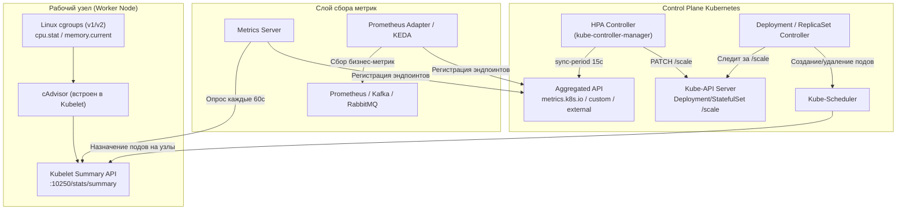

# HPA: Основные концепции

**Актуально для:** Kubernetes 1.28–1.35 (API autoscaling/v2)

В данном документе рассматриваются математический алгоритм, внутреннее устройство контроллера `horizontal-pod-autoscaler`, спецификация типов метрик API `autoscaling/v2`, подресурс `/scale` и архитектурные компоненты горизонтального масштабирования подов в Kubernetes.

Материал ориентирован на инженеров DevOps, SRE и системных администраторов инфраструктуры Kubernetes (включая bare-metal и on-premise инсталляции) без использования проприетарных облачных сервисов.

Для получения вводной информации см. основной раздел **[HPA: Главная](./index.md)**. Готовые типовые манифесты — в **[HPA: Практические сценарии](./hpa_scenarios.md)**. Глубокая настройка `behavior`, cgroups и системные взаимодействия — в **[HPA: Продвинутые темы](./hpa_advanced.md)**.

---

## Определения

**Horizontal Pod Autoscaler (HPA)** — контроллер Kubernetes в составе `kube-controller-manager`, который автоматически регулирует количество реплик рабочей нагрузки (Deployment, ReplicaSet или StatefulSet) на основе наблюдаемых метрик ресурсов (`metrics.k8s.io`), пользовательских метрик приложения (`custom.metrics.k8s.io`) или внешних событий (`external.metrics.k8s.io`).

**Control Loop (Петля управления)** — замкнутый непрерывный цикл работы контроллера HPA: опрос API метрик → вычисление целевого количества реплик → сравнение с текущим числом подов → внесение корректировок через API Kubernetes. Частота цикла определяется флагом `--horizontal-pod-autoscaler-sync-period` в `kube-controller-manager` (по умолчанию 15 секунд). Контроллер не останавливается при стабильной нагрузке и продолжает непрерывный мониторинг.

**ScaleTargetRef** — блок спецификации HPA, указывающий на масштабируемый целевой ресурс (`apiVersion`, `kind`, `name`). HPA не управляет подами напрямую — он изменяет поле `replicas` через подресурс `/scale` управляющего объекта. При использовании Deployment ссылка должна указывать строго на Deployment, а не на дочерний ReplicaSet, чтобы не нарушать процесс обновления (Rollout).

**Подресурс `/scale` (Scale Subresource)** — специализированный REST-эндпоинт Kubernetes API (`/apis/apps/v1/namespaces/{ns}/deployments/{name}/scale`), инкапсулирующий текущее (`status.replicas`) и желаемое (`spec.replicas`) число реплик. Позволяет HPA модифицировать размер рабочей нагрузки без доступа к полной спецификации пода и риска повреждения остальных параметров.

**Stabilization Window (Окно стабилизации)** — временной интервал, используемый для фильтрации кратковременных пиков и спадов метрик. Предотвращает явление «дребезга» (flapping / thrashing) — непрерывное частое переключение между масштабированием вверх и вниз. По умолчанию в API v2: `scaleUp` = 0 секунд (немедленный отклик на рост нагрузки), `scaleDown` = 300 секунд (5 минут ожидания стабильного снижения). Максимально допустимое значение — 3600 секунд.

**Target Utilization (Целевое использование)** — желаемый средний уровень загрузки ресурса (например, 70% CPU), выраженный в процентах от гарантированных запросов (`requests`) контейнера. При `requests.cpu: 200m` и целевой утилизации 70% HPA стремится поддерживать потребление на уровне `140m` CPU на один под.

**Requests и Limits** — фундаментальные параметры резервирования ресурсов контейнера в `spec.containers[*].resources`. Поле `requests` — гарантированный минимум, резервируемый планировщиком (Scheduler) на узле, который служит базой (100%) для расчета процента утилизации в HPA. Поле `limits` — верхний жесткий предел потребления. При отсутствии `requests` вычисление процента утилизации невозможно, и HPA переходит в статус `<unknown>`.

**Resource Metrics API (`metrics.k8s.io`)** — стандартный Aggregated API Kubernetes, предоставляющий оперативные данные о потреблении CPU и памяти (Working Set) контейнерами и узлами. Источником данных служит Metrics Server. Данные не сохраняются в долговременную базу и не образуют архивных рядов.

**Custom Metrics API (`custom.metrics.k8s.io`)** — расширение API Kubernetes через механизм Aggregated API, предоставляющее метрики, связанные с объектами кластера (например, HTTP RPS на под, latency, размер локальной очереди). Реализуется через адаптеры систем мониторинга (например, Prometheus Adapter).

**External Metrics API (`external.metrics.k8s.io`)** — расширение API Kubernetes для поставки метрик от систем за пределами кластера или не привязанных к конкретным подам (длина очереди RabbitMQ, лаг партиций Kafka, число соединений к внешней СУБД). Обычно предоставляется KEDA или специализированными экспортерами.

**Толерантность масштабирования (Tolerance)** — коэффициент нечувствительности алгоритма HPA к незначительным отклонениям метрик (по умолчанию `0.1` или 10%, настраивается флагом `--horizontal-pod-autoscaler-tolerance`). Предотвращает лишние срабатывания при колебаниях метрики в пределах диапазона `[0.9, 1.1]` от целевого значения.

**Статусные условия HPA (Conditions)** — массив структур в `status.conditions` (`AbleToScale`, `ScalingActive`, `ScalingLimited`), отражающий текущее состояние контроллера, доступность метрик и ограничения диапазона реплик.

---

## Архитектура и базовые концепции

### Внутреннее устройство и конвейер метрик

Автомасштабирование представляет собой непрерывный конвейер передачи данных от ядра Linux до шедулера Kubernetes:



**Этапы прохождения данных:**
1. **Сбор на узле:** cAdvisor (встроенный в Kubelet) считывает метрики потребления процессора и памяти напрямую из виртуальной файловой системы cgroups ядра Linux (`/sys/fs/cgroup/`).
2. **Агрегация:** Metrics Server периодически (по умолчанию раз в 60 секунд) опрашивает Kubelet Summary API на каждом узле кластера и агрегирует срез данных в памяти.
3. **Публикация в API:** Aggregated API Server (`kube-aggregator`) маршрутизирует запросы к `metrics.k8s.io` в сторону сервиса Metrics Server. Аналогично Prometheus Adapter или KEDA регистрируют группы `custom.metrics.k8s.io` и `external.metrics.k8s.io`.
4. **Опрос контроллером:** Контроллер HPA внутри `kube-controller-manager` каждые 15 секунд запрашивает текущие метрики для подов целевой рабочей нагрузки.
5. **Математический расчёт:** На основе формулы и правил толерантности алгоритм вычисляет желаемое число реплик.
6. **Применение через `/scale`:** HPA отправляет запрос на изменение поля `replicas` в подресурс `/scale` целевого Deployment или StatefulSet.
7. **Исполнение контроллером нагрузки:** Deployment/ReplicaSet контроллер реагирует на изменение `spec.replicas` и генерирует новые объекты Pod (или помечает лишние на удаление с установкой `deletionTimestamp`).
8. **Планирование:** Kube-scheduler распределяет новые поды по свободным узлам, после чего Kubelet запускает контейнеры через CRI.

### Системные флаги kube-controller-manager

Поведение HPA на уровне кластера регулируется системными аргументами `kube-controller-manager`:

| Флаг | Значение по умолчанию | Описание и влияние на инфраструктуру |
|:---|:---|:---|
| `--horizontal-pod-autoscaler-sync-period` | `15s` | Интервал петли управления HPA. Слишком низкое значение (<5s) создает чрезмерную нагрузку на API-сервер и etcd. |
| `--horizontal-pod-autoscaler-tolerance` | `0.1` (10%) | Допустимый порог отклонения метрики от цели. Предотвращает масштабирование при мелких флуктуациях. |
| `--horizontal-pod-autoscaler-downscale-stabilization` | `5m0s` | Глобальное окно стабилизации масштабирования вниз. В API `autoscaling/v2` переопределяется индивидуальной настройкой `spec.behavior.scaleDown.stabilizationWindowSeconds`. |
| `--horizontal-pod-autoscaler-cpu-initialization-period` | `5m0s` | Период после старта пода, в течение которого метрики CPU могут считаться неинициализированными, если под еще не перешел в состояние Ready. |
| `--horizontal-pod-autoscaler-initial-readiness-delay` | `30s` | Задержка после перехода пода в состояние Ready, в течение которой метрики CPU временно игнорируются при отсутствии явно настроенной `readinessProbe`. |

### Механизм подресурса `/scale` и модель RBAC

HPA намеренно изолирован от внутренней структуры рабочей нагрузки. Он оперирует исключительно объектом `Scale` (`autoscaling/v1`):

```json
{
  "apiVersion": "autoscaling/v1",
  "kind": "Scale",
  "metadata": {
    "name": "my-app",
    "namespace": "production"
  },
  "spec": {
    "replicas": 5
  },
  "status": {
    "replicas": 3,
    "selector": "app=my-app"
  }
}
```

**Особенности взаимодействия:**
- **Разделение ответственности:** HPA читает текущее количество реплик из `status.replicas`, читает селектор подов из `status.selector` (чтобы знать, с каких именно подов запрашивать метрики), а затем записывает результат в `spec.replicas`.
- **Deployment против ReplicaSet:** `scaleTargetRef` должен ссылаться **строго на Deployment**. Если настроить HPA на ReplicaSet, то при первом же обновлении образа (Deployment Rollout) Deployment создаст новый ReplicaSet с 1 репликой, в то время как HPA продолжит масштабировать старый, выводящийся из эксплуатации ReplicaSet, что приведет к конфликту контроллеров и зависанию деплоя.
- **RBAC:** Контроллер HPA функционирует от имени системного ServiceAccount `horizontal-pod-autoscaler` в составе `kube-controller-manager`. Ему требуются права на чтение и обновление эндпоинтов `*/scale` (входят в стандартную ClusterRole `system:controller:horizontal-pod-autoscaler`).

---

### Алгоритм принятия решений

#### Математическая формула

Расчет требуемого количества реплик выполняется по формуле:

$$\text{desiredReplicas} = \left\lceil \text{currentReplicas} \times \left( \frac{\text{currentMetricValue}}{\text{targetMetricValue}} \right) \right\rceil$$

Где:
- $\text{currentReplicas}$ — текущее фактическое число запущенных реплик объекта;
- $\text{currentMetricValue}$ — текущее вычисленное среднее значение метрики по всем готовым подам;
- $\text{targetMetricValue}$ — целевое пороговое значение, заданное в спецификации HPA;
- $\lceil \dots \rceil$ (`ceil`) — математическая функция округления вверх до ближайшего целого числа.

#### Правила и логика работы алгоритма

1. **Проверка зоны толерантности:**
   Контроллер не инициирует масштабирование, если отношение метрик находится в пределах допуска:
   $$1.0 - \text{tolerance} \le \frac{\text{currentMetricValue}}{\text{targetMetricValue}} \le 1.0 + \text{tolerance}$$
   При стандартном значении толерантности `0.1` диапазон составляет $[0.9, 1.1]$. Если текущая метрика отличается от целевой менее чем на 10%, число реплик остается неизменным.

2. **Округление вверх (`ceil`):**
   Результат деления всегда округляется в большую сторону. Это фундаментальный принцип Kubernetes, обеспечивающий гарантию запаса вычислительной мощности под нагрузкой. Например, $\lceil 3.05 \rceil = 4$.

3. **Обработка невалидных и инициализирующихся подов:**
   - **Удаляемые поды:** Поды, находящиеся в процессе завершения (у которых установлено поле `metadata.deletionTimestamp`), **полностью исключаются** из расчетов текущей утилизации.
   - **Неготовые поды (`Ready == False`):**
     - Если алгоритм склоняется к **масштабированию вверх (scale-up)**, считается, что поды без метрик потребляют **0%** ресурса. Это оптимистичное предположение, гарантирующее, что зависшие или долго стартующие поды не замедлят ввод дополнительных реплик.
     - Если алгоритм склоняется к **масштабированию вниз (scale-down)**, считается, что поды без метрик потребляют **100%** ресурса. Это защитное пессимистичное предположение, предотвращающее удаление здоровых подов, пока остальные рестартуют или прогреваются.
   - **Поды без сэмплов CPU:** Новые поды в пределах окна `--horizontal-pod-autoscaler-cpu-initialization-period` (5 минут), еще не отдавшие первый сэмпл метрики, временно исключаются из подсчета среднего значения.

4. **Многокритериальное масштабирование (несколько метрик):**
   Если в секции `spec.metrics` определено несколько метрик (например, CPU + Memory + Custom RPS), алгоритм производит независимый расчет желаемого числа реплик для каждого правила. В качестве финального решения выбирается **наибольшее** значение:
   $$\text{desiredReplicas} = \max(\text{desired}_{\text{cpu}}, \text{desired}_{\text{mem}}, \text{desired}_{\text{rps}})$$
   Это гарантирует, что ни одно из ресурсных или прикладных ограничений приложения не будет нарушено.

5. **Ограничение диапазоном:**
   Полученное значение жестко ограничивается границами `minReplicas` и `maxReplicas`:
   $$\text{finalReplicas} = \min(\text{maxReplicas}, \max(\text{minReplicas}, \text{desiredReplicas}))$$

#### Пошаговые числовые примеры расчёта

**Пример 1: Базовый scale-up по CPU**
```text
Текущие реплики: 2
Текущее среднее потребление CPU: 85%
Целевое значение (targetUtilization): 50%

Отношение метрик: 85 / 50 = 1.7
1.7 > 1.1 (выходит за пределы толерантности 10%)
Расчёт: ceil(2 × 1.7) = ceil(3.4) = 4 реплики
Результат: Масштабирование с 2 до 4 реплик
```

**Пример 2: Удержание в зоне толерантности**
```text
Текущие реплики: 4
Текущее среднее потребление CPU: 54%
Целевое значение: 50%

Отношение метрик: 54 / 50 = 1.08
1.08 находится внутри диапазона [0.9, 1.1]
Результат: Масштабирование НЕ происходит (число реплик остается 4)
```

**Пример 3: Безопасный scale-down**
```text
Текущие реплики: 10
Текущее среднее потребление CPU: 22%
Целевое значение: 50%

Отношение метрик: 22 / 50 = 0.44
0.44 < 0.9 (выходит за пределы толерантности)
Расчёт: ceil(10 × 0.44) = ceil(4.4) = 5 реплик
Результат: Контроллер формирует рекомендацию на снижение до 5 реплик (с учетом окна стабилизации)
```

**Пример 4: Комбинированный расчёт по нескольким метрикам**
```text
Текущие реплики: 3
Метрика 1 (CPU): текущая 75%, цель 50% → ceil(3 × (75 / 50)) = ceil(4.5) = 5 реплик
Метрика 2 (Memory): текущая 55%, цель 60% → ceil(3 × (55 / 60)) = ceil(2.75) = 3 реплики
Метрика 3 (Custom RPS): текущий 120 rps, цель 50 rps → ceil(3 × (120 / 50)) = ceil(7.2) = 8 реплик

Выбор максимума: max(5, 3, 8) = 8 реплик
Результат: HPA масштабирует нагрузку до 8 реплик
```

---

### Типы метрик (API `autoscaling/v2`)

API `autoscaling/v2` предоставляет пять специализированных типов метрик:

| Тип метрики | Источник данных | Целевое назначение в SRE/DevOps | Поддерживаемые типы таргета |
|:---|:---|:---|:---|
| **Resource** | Metrics Server (`metrics.k8s.io`) | Масштабирование по суммарному потреблению CPU или памяти всеми контейнерами пода. | `Utilization` (% от requests), `AverageValue` |
| **ContainerResource** | Metrics Server (`metrics.k8s.io`) | Масштабирование по потреблению конкретного именованного контейнера внутри пода. Изолирует метрики приложения от служебных sidecar-контейнеров (Envoy, fluent-bit, vault-agent). | `Utilization`, `AverageValue` |
| **Pods** | Custom Metrics API (`custom.metrics.k8s.io`) | Метрики, индивидуально привязанные к каждому поду (например, HTTP RPS приложения, число активных gRPC-соединений на инстанс). | `AverageValue` |
| **Object** | Custom Metrics API (`custom.metrics.k8s.io`) | Метрики конкретного объекта Kubernetes, отличного от масштабируемого пода (например, RPS на Ingress, число соединений к Service). | `Value`, `AverageValue` |
| **External** | External Metrics API (`external.metrics.k8s.io`) | Метрики систем вне кластера или глобальных сервисов (очереди Kafka/RabbitMQ, задачи в Redis, внешние вебхуки). | `Value`, `AverageValue` |

#### Способы задания целевых значений (Target Types)

- `Utilization`: Процент от суммарных `requests` подов. Допустим **только** для типов `Resource` и `ContainerResource`. Формула: `(текущее_потребление / requests) * 100%`.
- `AverageValue`: Абсолютное целевое значение в среднем на один готовый под (например, `500m`, `300Mi`, `50`). HPA суммирует метрику по всем подам и делит на количество готовых подов.
- `Value`: Абсолютное значение метрики для всего целевого объекта в целом (например, `1000` сообщений в очереди). Применяется только в `Object` и `External`.

#### Синтаксические примеры объявления метрик

```yaml
# 1. Resource: CPU в процентах и память в абсолютном значении
metrics:
  - type: Resource
    resource:
      name: cpu
      target:
        type: Utilization
        averageUtilization: 70
  - type: Resource
    resource:
      name: memory
      target:
        type: AverageValue
        averageValue: 512Mi

# 2. ContainerResource: Изоляция основного контейнера от sidecar
  - type: ContainerResource
    containerResource:
      name: cpu
      container: app
      target:
        type: Utilization
        averageUtilization: 65

# 3. Pods: Пользовательская метрика приложения на инстанс
  - type: Pods
    pods:
      metric:
        name: http_requests_per_second
      target:
        type: AverageValue
        averageValue: 150

# 4. Object: Нагрузка на Ingress-контроллер
  - type: Object
    object:
      describedObject:
        apiVersion: networking.k8s.io/v1
        kind: Ingress
        name: api-gateway
      metric:
        name: requests_per_second
      target:
        type: Value
        value: 5000

# 5. External: Длина очереди RabbitMQ
  - type: External
    external:
      metric:
        name: rabbitmq_queue_messages
        selector:
          matchLabels:
            queue: orders-processing
      target:
        type: Value
        value: 200
```

---

### Статусные условия HPA (HPA Conditions)

Состояние HPA непрерывно протоколируется в массиве `status.conditions`. Анализ этих условий — первоочередной шаг диагностики для SRE:

```bash
kubectl get hpa my-app -o jsonpath='{range .status.conditions[*]}{.type}{"\t"}{.status}{"\t"}{.reason}{"\t"}{.message}{"\n"}{end}'
# → AbleToScale    True    SucceededGetScale     the HPA controller was able to get the target's current scale
# → ScalingActive  True    ValidMetricFound      the HPA was able to successfully calculate a replica count from cpu
# → ScalingLimited False   DesiredWithinRange    the desired count is within the acceptable range
```

| Условие (Condition) | Статус | Типовые причины (Reason) | Описание для инженера |
|:---|:---|:---|:---|
| **AbleToScale** | `True` | `SucceededGetScale`, `SucceededUpdateScale` | Контроллер успешно получает и изменяет подресурс `/scale`. |
| | `False` | `FailedGetScale`, `FailedUpdateScale`, `ScalingNotAuthorized` | Ошибка доступа RBAC, неверное имя ресурса или битый API целевого объекта. |
| **ScalingActive** | `True` | `ValidMetricFound` | Метрики успешно собираются, алгоритм активен и вычисляет рекомендации. |
| | `False` | `FailedGetResourceMetric`, `InvalidSelector`, `ScalingDisabled` | Сбой передачи метрик: отсутствует Metrics Server, поды не имеют `requests` или метрика `<unknown>`. |
| **ScalingLimited** | `False` | `DesiredWithinRange` | Желаемое количество реплик свободно изменяется внутри интервала `[minReplicas, maxReplicas]`. |
| | `True` | `TooFewReplicas`, `TooManyReplicas` | Вычисленное значение уперлось в лимит: либо `minReplicas` удерживает систему от сжатия, либо `maxReplicas` блокирует дальнейший рост при перегрузке. |

---

## Практические сценарии и конфигурация

### Предварительные требования

Перед развертыванием HPA необходимо убедиться в выполнении следующих условий инфраструктуры:

1. **Доступность Metrics Server:**
   В кластере должен быть развернут сервис сбора метрик, и соответствующий APIService должен быть в состоянии `True`:
   ```bash
   kubectl get apiservice v1beta1.metrics.k8s.io
   # → NAME                     SERVICE                      AVAILABLE   AGE
   # → v1beta1.metrics.k8s.io   kube-system/metrics-server   True        12d
   ```
2. **Наличие `resources.requests`:**
   В манифесте целевой рабочей нагрузки поле `resources.requests` должно быть явно задано для **всех** контейнеров пода (включая sidecar). Без этого расчет процента невозможен:
   ```yaml
   resources:
     requests:
       cpu: 250m
       memory: 256Mi
   ```
3. **Отсутствие зафиксированного поля `spec.replicas` в манифесте:**
   При постоянном управлении через HPA поле `replicas` удаляется из Deployment-манифестов во избежание перезаписи состояния при деплое через GitOps.

### Базовый эталонный манифест HPA (API `autoscaling/v2`)

Готовый к эксплуатации production-манифест с комментариями параметров:

```yaml
apiVersion: autoscaling/v2
kind: HorizontalPodAutoscaler
metadata:
  name: api-service-hpa
  namespace: production
  labels:
    app.kubernetes.io/name: api-service
    app.kubernetes.io/component: backend
spec:
  # Ссылка на объект управления масштабированием
  scaleTargetRef:
    apiVersion: apps/v1
    kind: Deployment
    name: api-service
  
  # Допустимый диапазон реплик
  minReplicas: 3
  maxReplicas: 15
  
  # Правила оценки нагрузки
  metrics:
    # Базовая метрика CPU (цель: 70% от requests)
    - type: Resource
      resource:
        name: cpu
        target:
          type: Utilization
          averageUtilization: 70
          
    # Предохранительная метрика памяти (цель: среднее 400Mi на под)
    - type: Resource
      resource:
        name: memory
        target:
          type: AverageValue
          averageValue: 400Mi

  # Тонкая настройка поведения (защита от дребезга)
  behavior:
    scaleUp:
      stabilizationWindowSeconds: 0 # Мгновенная реакция при всплеске нагрузки
      policies:
        - type: Percent
          value: 100
          periodSeconds: 15 # Удвоение числа реплик каждые 15 секунд при необходимости
        - type: Pods
          value: 4
          periodSeconds: 15 # Или добавление минимум 4 подов
      selectPolicy: Max
    scaleDown:
      stabilizationWindowSeconds: 300 # 5 минут ожидания стабильного спада
      policies:
        - type: Percent
          value: 20
          periodSeconds: 60 # Снижение не быстрее 20% подов в минуту
      selectPolicy: Min
```

### Валидация работы HPA

Проверка состояния развернутого автомасштабировщика:

```bash
# 1. Проверка текущей строки состояния HPA
kubectl get hpa api-service-hpa -n production
# → NAME              REFERENCE                TARGETS                      MINPODS   MAXPODS   REPLICAS   AGE
# → api-service-hpa   Deployment/api-service   42%/70%, 280Mi/400Mi (avg)   3         15        3          4m

# 2. Инспекция событий контроллера и условий работы
kubectl describe hpa api-service-hpa -n production

# 3. Мониторинг фактического потребления ресурсов подами
kubectl top pods -n production -l app.kubernetes.io/name=api-service
# → NAME                           CPU(cores)   MEMORY(bytes)
# → api-service-7bb5df7448-6l6z7   105m         275Mi
# → api-service-7bb5df7448-k4l92   112m         290Mi
# → api-service-7bb5df7448-r8h2q   98m          268Mi
```

---

## Операции и команды

Справочник базовых CLI-команд для системного инженера:

```bash
# Просмотр списка HPA в пространстве имен с отслеживанием в реальном времени
kubectl get hpa -n production -w
# → NAME              REFERENCE                TARGETS   MINPODS   MAXPODS   REPLICAS   AGE
# → api-service-hpa   Deployment/api-service   42%/70%   3         15        3          10m
# → api-service-hpa   Deployment/api-service   82%/70%   3         15        5          11m

# Детальный вывод конфигурации, включая историю событий ScalingEvent
kubectl describe hpa api-service-hpa -n production

# Выгрузка полной спецификации в YAML для аудита секций metrics и behavior
kubectl get hpa api-service-hpa -n production -o yaml

# Быстрое извлечение текущих метрик и условий работы через jsonpath
kubectl get hpa api-service-hpa -n production -o jsonpath='{.status.currentMetrics}'
# → [{"resource":{"current":{"averageUtilization":42,"averageValue":"105m"},"name":"cpu"},"type":"Resource"}]

# Проверка регистрации и доступности Metrics API в Aggregation Layer
kubectl get apiservice v1beta1.metrics.k8s.io -o wide
# → NAME                     SERVICE                      AVAILABLE   AGE
# → v1beta1.metrics.k8s.io   kube-system/metrics-server   True        12d

# Прямой запрос сырого эндпоинта Metrics API для проверки отдачи данных подом
kubectl get --raw "/apis/metrics.k8s.io/v1beta1/namespaces/production/pods" | grep -A 5 "api-service"

# Проверка содержимого подресурса /scale целевого Deployment
kubectl get --raw "/apis/apps/v1/namespaces/production/deployments/api-service/scale"
# → {"kind":"Scale","apiVersion":"autoscaling/v1","metadata":{"name":"api-service"...},"spec":{"replicas":3},"status":{"replicas":3}}

# Просмотр логов контроллера HPA в составе kube-controller-manager (на control-plane ноде)
kubectl logs -n kube-system -l component=kube-controller-manager | grep -i "horizontal-pod-autoscaler"
```

---

## Диагностика и устранение неполадок

### Сводная таблица типовых неисправностей

| Симптом | Вероятная причина | Шаги диагностики | Практическое решение |
|:---|:---|:---|:---|
| В колонке `TARGETS` отображается `<unknown>/70%` | 1. У контейнеров отсутствуют `resources.requests`.<br>2. Metrics Server недоступен.<br>3. Новые поды еще не перешли в `Ready`. | `kubectl describe hpa`<br>`kubectl get apiservice v1beta1.metrics.k8s.io`<br>`kubectl top pods` | 1. Добавить `resources.requests` всем контейнерам.<br>2. Проверить работу пода Metrics Server.<br>3. Проверить `readinessProbe`. |
| HPA не масштабирует нагрузку вниз | 1. Метрика удерживается в зоне толерантности (10%).<br>2. Утечка памяти или Working Set удерживает кэш страниц ОС.<br>3. Работает окно стабилизации `scaleDown` (300с). | `kubectl top pods`<br>`kubectl describe hpa` (секция Conditions и Events)<br>`free -m` внутри контейнера | 1. Дождаться истечения окна `stabilizationWindowSeconds`.<br>2. Пересмотреть метрику (не использовать RAM как главную).<br>3. Проверить значение `minReplicas`. |
| HPA не масштабирует нагрузку вверх при росте трафика | 1. Достигнут лимит `maxReplicas`.<br>2. Состояние `ScalingLimited=True`.<br>3. Рост нагрузки попадает в диапазон толерантности. | `kubectl describe hpa`<br>`kubectl get hpa -o jsonpath='{.status.conditions}'` | 1. Увеличить `spec.maxReplicas`.<br>2. Проверить наличие свободных вычислительных мощностей в кластере. |
| Дребезг реплик (flapping / thrashing) | 1. Отсутствие окна стабилизации `scaleDown`.<br>2. Слишком резкий спад нагрузки после ввода новых подов. | Анализ графика изменения реплик в Prometheus или логов HPA. | Настроить `behavior.scaleDown.stabilizationWindowSeconds: 300` и ограничить скорость сжатия (`Percent: 10`). |
| Постоянный конфликт количества реплик (сброс HPA) | GitOps-контроллер (ArgoCD, Flux) или Helm перезаписывает поле `spec.replicas` из манифеста в Git. | `kubectl get deployment -o yaml` (проверка `managedFields`). | Удалить строку `replicas:` из манифеста в Git или настроить `ignoreDifferences` в ArgoCD для `/spec/replicas`. |
| Поды зависают в `Pending` при масштабировании вверх | Дефицит аппаратных ресурсов на bare-metal/on-premise узлах (нет свободного CPU/RAM под `requests`). | `kubectl describe pod <pending-pod>` (событие `FailedScheduling`). | 1. Проверить `requests` (устранить overprovisioning).<br>2. Настроить `PriorityClass` для вытеснения низкоприоритетных задач.<br>3. Ввести в строй дополнительные физические ноды. |
| Ошибка `<unknown>` для типа `ContainerResource` | Имя контейнера в HPA не совпадает с именем в `podTemplateSpec`. | `kubectl get pods -o jsonpath='{.items[*].spec.containers[*].name}'` | Исправить опечатку в поле `spec.metrics[*].containerResource.container`. |

Детальная пошаговая диагностика и алгоритмы расследования инцидентов приведены в документе **[Устранение неполадок HPA](../../Troubleshooting/Common_Errors/hpa_troubleshooting.md)**.

---

## Лучшие практики

1. **Используйте CPU как базовую метрику:**
   Для stateless-сервисов процессорное время является наиболее динамичным и быстро реагирующим показателем. Целевое значение утилизации рекомендуется удерживать в диапазоне **60–70%**. Задание порогов 90–95% недопустимо в production, так как естественный лаг запуска новых подов приведет к деградации сервиса при резком всплеске нагрузки.

2. **Осторожность при масштабировании по памяти (RAM):**
   Память является несжимаемым ресурсом (non-compressible). В средах со сборщиком мусора (JVM, Go, Node.js) рантайм редко возвращает освобожденные страницы обратно ядру Linux, а ядро удерживает неактивный файловый кэш в составе Working Set Memory. В результате средняя утилизация памяти не снижается после прохождения пика нагрузки, и HPA «застревает» на максимальном количестве реплик. Память следует использовать преимущественно как вторичное защитное ограничение (`AverageValue`).

3. **Обязательно настраивайте Pod Disruption Budget (PDB):**
   При масштабировании вниз контроллер удаляет лишние поды. Без настроенного PDB одновременный дрейн ноды администратором и scale-down контроллером HPA может нарушить доступность критического сервиса. См. подробнее **[Pod Disruption Budget](../pod_disruption_budget.md)**.

4. **Удаляйте поле `replicas` из манифестов в системе контроля версий:**
   Если рабочей нагрузкой управляет HPA, поле `spec.replicas` должно отсутствовать в YAML-манифесте Deployment в Git. Иначе каждый прогон CI/CD пайплайна или синхронизация GitOps будет сбрасывать количество реплик до статичного значения, провоцируя просадку производительности.

5. **Обеспечивайте минимальную избыточность (`minReplicas >= 2`):**
   Значение `minReplicas: 1` недопустимо для отказоустойчивых сред. При падении единственного пода сервис становится недоступен до момента старта замены. Рекомендуемый минимум для production — **от 2 до 3 реплик**, распределенных по разным узлам через `topologySpreadConstraints`.

6. **Изолируйте sidecar-контейнеры через `ContainerResource`:**
   В инфраструктурах с Service Mesh (Envoy/Istio), агентами логирования (Fluent-bit) или Vault-agent вспомогательные контейнеры могут потреблять от 50m до 200m CPU независимо от бизнес-логики. Использование `ContainerResource` позволяет HPA оценивать нагрузку строго по основному контейнеру приложения.

7. **Корректно настраивайте пробы `startupProbe` и `readinessProbe`:**
   HPA учитывает только поды в состоянии `Ready`. Если приложение стартует медленно (прогрев JVM, загрузка локальных кэшей), отсутствие `startupProbe` приведет к тому, что под либо упадет по таймауту `livenessProbe`, либо начнет получать трафик до реальной готовности, создавая ложные пики утилизации CPU.

8. **Учитывайте ограничения инфраструктуры на bare-metal и on-premise:**
   В отличие от публичных облаков, физический кластер имеет фиксированный объем процессоров и памяти. Неконтролируемый рост `maxReplicas` у одного сервиса может монополизировать ресурсы всех рабочих узлов, приведя к вытеснению других нагрузок. Всегда задавайте обоснованные `maxReplicas` и защищайте пространства имен квотами `ResourceQuota`.

---

## Дополнительная информация

### Граничные случаи (Edge Cases)

1. **Масштабирование во время обновления (Deployment Rollout):**
   При обновлении образа Deployment запускает новый ReplicaSet. HPA опрашивает метрики со всех подов, соответствующих селектору Deployment (включая как старые, так и новые поды). Однако масштабирование через подресурс `/scale` применяется к Deployment, который пропорционально распределяет реплики между старым и новым ReplicaSet в соответствии со стратегией `maxSurge` и `maxUnavailable`.
2. **HPA и DaemonSet:**
   HPA **архитектурно не поддерживается** для объектов DaemonSet. Количество реплик DaemonSet жестко регламентировано числом узлов в кластере, удовлетворяющих селекторам и толерантностям.
3. **HPA и пакетные задачи (Job / CronJob):**
   HPA не применяется к объектам с конечным жизненным циклом. Для масштабирования пула обработчиков на основе очереди сообщений следует использовать архитектурный паттерн **[Workers + Queue Pattern](../workers_queue_pattern.md)** и **[KEDA ScaledJob](../keda/keda_concepts.md#scaledjob-dlya-batch-zadach)**.
4. **Недопустимость дублирования HPA на одну нагрузку:**
   Запрещено создавать более одного объекта HPA, указывающего на один и тот же `scaleTargetRef`. Контроллеры будут вычислять разные целевые значения и бесконечно перезаписывать поле `replicas`, создавая лавинообразную нагрузку на API-сервер. Все метрики должны объединяться в рамках одного манифеста HPA.
5. **Поведение при сбое Metrics Server:**
   Если Metrics Server становится недоступен, условие `ScalingActive` переходит в `False`. В этом режиме HPA **замораживает** текущее количество подов и не производит масштабирования вниз, защищая кластер от деградации при отказе мониторинга.
6. **Масштабирование до нуля (Scale-to-Zero):**
   Стандартный HPA в Kubernetes не поддерживает уменьшение до 0 реплик (`minReplicas` должен быть $\ge 1$). Для реализации масштабирования в ноль и обратного пробуждения по событию используется KEDA.

### Взаимодействие с компонентами экосистемы

- **[Cluster Autoscaler (CA)](../cluster_autoscaler_detailed.md):** Взаимодействует опосредованно через поды в статусе `Pending`. HPA создает потребность в репликах; если емкости узлов не хватает, планировщик оставляет поды в очереди, на что реагирует Autoscaler добавлением серверов.
- **[Vertical Pod Autoscaler (VPA)](../vpa_detailed.md):** Совместное использование HPA и VPA по одним и тем же ресурсам (CPU/Memory) **запрещено**, так как вызывает конфликт регуляторов. Допустима связка: HPA по бизнес-метрикам (RPS) + VPA по ресурсам (или VPA в режиме рекомендаций `Off`).
- **[Descheduler](../descheduler.md):** Помогает перебалансировать реплики по узлам после агрессивного масштабирования HPA, если поды оказались неравномерно распределены по инфраструктуре.
- **[In-Place Pod Resize](../in_place_pod_resize.md):** Механизм динамического изменения ресурсов контейнеров без перезапуска подов, дополняющий горизонтальное масштабирование HPA.
- **[KEDA](../keda/keda_concepts.md):** Управляет объектами HPA в событийных сценариях, выступая поставщиком внешних метрик и транслируя триггеры масштабирования в API Kubernetes.

### См. также

- **[HPA: Главная](./index.md)** — обзор архитектуры и базовые вводные сценарии.
- **[HPA: Практические сценарии](./hpa_scenarios.md)** — готовые манифесты для веб-сервисов, очередей и StatefulSet.
- **[HPA: Продвинутые темы](./hpa_advanced.md)** — тонкая настройка политик `behavior`, cgroups v1/v2 и координация с системными лимитами.
- **[HPA: Prometheus Adapter](./prometheus_adapter_setup.md)** — развертывание и настройка правил адаптера Prometheus.
- **[HPA: Каскадное масштабирование](./cascading_scaling.md)** — предотвращение каскадных сбоев при масштабировании связанных сервисов.
- **[HPA: Cost и Right-sizing](./hpa_cost_rightsizing.md)** — оптимизация базовых запросов и расчет аппаратных затрат.
- **[Metrics Server](../../MonitoringLogging/metrics-server.md)** — архитектура и установка компонента сбора метрик.
- **[Устранение неполадок HPA](../../Troubleshooting/Common_Errors/hpa_troubleshooting.md)** — руководство по расследованию инцидентов.
