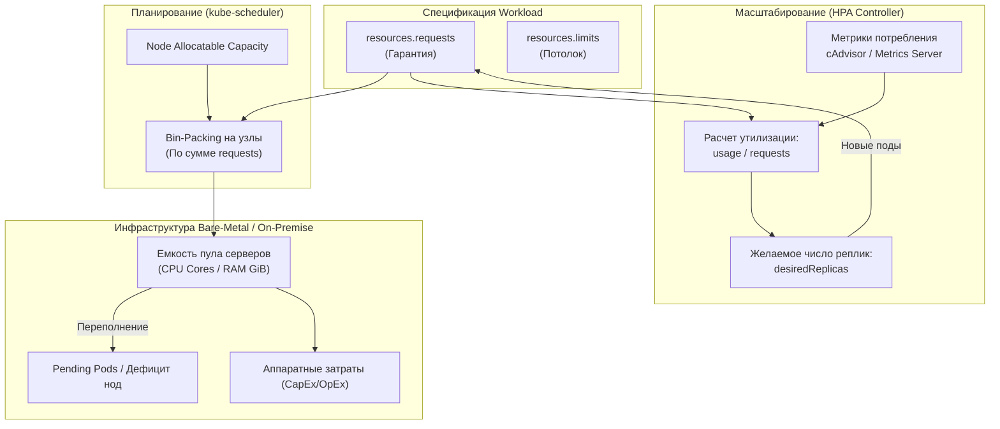
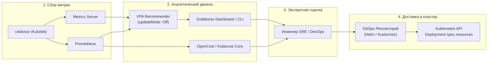
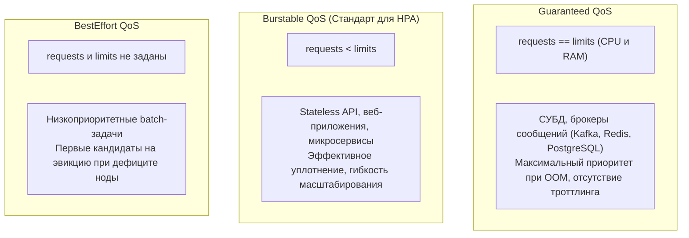

# HPA: Cost и Right-sizing — оптимизация requests и аппаратных затрат

**Актуально для:** Kubernetes 1.28–1.35 (API autoscaling/v2)

В данном руководстве рассматриваются методы оптимизации параметров `resources.requests` и `resources.limits` (Right-sizing) рабочих нагрузок Kubernetes под управлением Horizontal Pod Autoscaler (HPA) в инфраструктурах Bare-Metal и On-Premise. Анализируется влияние завышенных и заниженных запросов на работу планировщика (kube-scheduler), точность работы HPA, плотность размещения подов (bin-packing) и совокупную стоимость владения (TCO/CapEx) аппаратными ресурсами кластера.

---

## Определения

**Right-sizing** — систематический процесс выравнивания запрашиваемых ресурсов (`resources.requests`) и жестких ограничений (`resources.limits`) контейнеров с их фактическим профилем потребления. Основная цель — устранение избыточного резервирования без риска деградации производительности (CPU Throttling) или аварийной остановки процессов (OOMKilled).

**Over-provisioning (Избыточное выделение)** — конфигурация, при которой `requests` контейнеров существенно превышают реальное потребление ресурсов (например, выделено 2000m CPU при среднем потреблении 200m). Приводит к искажению расчета утилизации в HPA, блокировке планирования других подов и нерациональному расходованию серверных мощностей.

**Under-provisioning (Недостаточное выделение)** — конфигурация с заниженными `requests` относительно реального профиля нагрузки. Вызывает ложные срабатывания HPA, избыточное горизонтальное разрастание (scale-out), дефицит ресурсов на узлах и деградацию времени отклика сервиса.

**Resource Slack (Ресурсный зазор / Недоутилизация)** — разница между зарезервированной емкостью (`requests`), учитываемой планировщиком, и фактически потребляемыми ресурсами на уровне ядра Linux (`usage`). Представляет собой «мертвый капитал» инфраструктуры.

**Allocatable Capacity (Аллоцируемая емкость узла)** — объем вычислительных ресурсов узла (`status.allocatable`), доступный для распределения пользовательским подам после вычета резервов операционной системы (`system-reserved`), системных демонов кластера (`kube-reserved`) и порога вытеснения (`eviction-hard`).

**Working Set Memory** — объем оперативной памяти контейнера, вычисляемый Kubelet как общее использование за вычетом неактивных страниц файлового кэша (`container_memory_working_set_bytes = usage - inactive_file`). Именно эта метрика используется подсистемой памяти ядра Linux и Kubelet для принятия решений об эвикции и OOMKilled.

**CFS Quota и Throttling** — механизм планировщика Completely Fair Scheduler ядра Linux, ограничивающий время использования процессорных ядер контейнером при наличии `limits.cpu`. Если контейнер исчерпывает выделенную квоту за период (по умолчанию 100 мс), его потоки принудительно замораживаются (throttling), что вызывает рост задержек (latency).

**Cost of Allocation (Стоимость аллокации на On-Premise)** — финансовая и ресурсная модель учета, при которой стоимость инфраструктуры относится на команды и сервисы на основе гарантированно занятых ими ресурсов (`requests`), так как именно `requests` определяют необходимость закупки серверов, блейд-корзин, систем питания и охлаждения.

---

## Архитектура и принцип работы

### Взаимосвязь requests, HPA и аппаратной емкости кластера

В Kubernetes планирование рабочих нагрузок и принятие решений о горизонтальном масштабировании неразрывно связаны через спецификацию ресурсов контейнеров:



1. **Планировщик (kube-scheduler)** оперирует исключительно значениями `requests`. Поды размещаются на узле до тех пор, пока сумма `requests` всех контейнеров не превысит `status.allocatable` узла. Реальное потребление процессора и памяти планировщиком не учитывается.
2. **Контроллер HPA** в `kube-controller-manager` вычисляет процент утилизации ресурсов по отношению к `requests`.
3. **Физическая инфраструктура** испытывает искусственный голод, если поды резервируют больше ресурсов, чем потребляют, препятствуя запуску других задач.

### Математическая модель HPA и влияние искаженных requests

Алгоритм вычисления количества реплик контроллером HPA определяется формулой:

$$\text{desiredReplicas} = \left\lceil \text{currentReplicas} \times \left( \frac{\text{currentMetricValue}}{\text{desiredMetricValue}} \right) \right\rceil$$

При использовании масштабирования по целевой утилизации (`TargetUtilization`):

$$\text{currentMetricValue} = \frac{\sum_{i=1}^{N} \text{usage}_i}{\sum_{i=1}^{N} \text{requests}_i} \times 100\%$$

#### Аномалия завышенных requests (Over-provisioning)

Пусть микросервис настроен со следующими параметрами:
- `requests.cpu`: `1000m`
- Фактическое потребление в штатном режиме: `200m`
- Целевая утилизация в HPA (`targetCPUUtilizationPercentage`): `70%`

Текущая утилизация, фиксируемая HPA:

$$\text{currentMetricValue} = \frac{200\text{m}}{1000\text{m}} \times 100\% = 20\%$$

При возрастании трафика нагрузка на каждый под увеличивается в 2.5 раза (до `500m`). Однако для HPA утилизация составляет:

$$\text{currentMetricValue} = \frac{500\text{m}}{1000\text{m}} \times 100\% = 50\%$$

Так как $50\% < 70\%$, HPA не инициирует масштабирование. Сервис испытывает деградацию отклика, очереди запросов растут, но автоскейлер бездействует. При этом 10 реплик сервиса заблокировали на физических узлах 10 процессорных ядер, реально утилизируя лишь 2–5 ядер.

#### Аномалия заниженных requests (Under-provisioning)

Пусть для того же сервиса задано:
- `requests.cpu`: `100m`
- Штатное потребление: `200m`
- Целевая утилизация: `70%`

Текущая утилизация:

$$\text{currentMetricValue} = \frac{200\text{m}}{100\text{m}} \times 100\% = 200\%$$

HPA стремится масштабировать нагрузку до максимально допустимого значения `maxReplicas`. Кластер наполняется избыточными репликами, планировщик исчерпывает свободную емкость узлов, новые поды зависают в статусе `Pending`, провоцируя инфраструктурный кризис.

### Разделение механики для сжимаемых и несжимаемых ресурсов

| Характеристика | CPU (Сжимаемый ресурс) | Memory (Несжимаемый ресурс) |
| :--- | :--- | :--- |
| **Реакция на превышение requests** | Контейнер использует свободные такты узла по весам CFS shares. | Контейнер продолжает работу, пока на узле есть свободная RAM. |
| **Реакция на превышение limits** | CFS Bandwidth Throttling (потеря производительности без падения процесса). | Немедленное завершение процесса ядром Linux: `OOMKilled` (Exit Code 137). |
| **Поведение при дефиците узла** | Kubelet не вытесняет поды из-за дефицита CPU. | Kubelet инициирует Eviction подов с классом QoS `BestEffort` и `Burstable`. |
| **Применимость для HPA** | **Рекомендуется**. Быстро отражает изменения входящего сетевого трафика и нагрузки. | **С высокой осторожностью**. Runtimes (JVM, Go, Node.js) не отдают память ОС сразу, искажая метрику. |
| **Метрика ядра** | `container_cpu_usage_seconds_total` (cgroups `cpu.stat`). | `container_memory_working_set_bytes` (cgroups `memory.current` - inactive file). |

### Архитектура конвейера сбора данных и вычисления рекомендаций

Для построения безопасного контура Right-sizing в On-Premise инфраструктуре применяется разделение контуров анализа и применения:



Использование VPA Recommender исключительно в режиме `updateMode: "Off"` гарантирует, что ни один рабочий под не будет перезапущен автоматически, а рассчитанные перцентили послужат основой для контролируемого обновления спецификаций в репозиториях конфигураций.

---

## Практические сценарии и конфигурация

### Методология Right-sizing в 6 шагов

```
Шаг 1: Накопление метрик (7-14 дней, покрытие пиков нагрузки)
  ↓
Шаг 2: Расчет перцентилей (P95 CPU, P99 Memory Working Set)
  ↓
Шаг 3: Формирование спецификации с коэффициентами запаса
  ↓
Шаг 4: Развертывание VPA Recommender в режиме Off для проверки
  ↓
Шаг 5: Аудит через Goldilocks и расчет On-Premise стоимости
  ↓
Шаг 6: Применение в Staging → Production и валидация HPA
```

1. **Сбор данных:** Минимальный интервал мониторинга — 7 дней (для сервисов с недельным циклом активности — 14 дней).
2. **Формула расчета CPU:**
   - $\text{requests.cpu} = \text{P95}(\text{usage}) \times 1.15 \dots 1.20$ (запас 15–20% на всплески до реакции HPA).
   - $\text{limits.cpu} = \text{P99}(\text{usage}) \times 1.50 \dots 2.00$ (либо снятие лимитов при наличии контроля через CPU Quota в Namespace).
3. **Формула расчета Memory:**
   - $\text{requests.memory} = \text{P99}(\text{working\_set}) \times 1.25 \dots 1.30$ (запас 25–30% для предотвращения вытеснения).
   - $\text{limits.memory} = \text{requests.memory} \times 1.20 \dots 1.30$ (защитный буфер под пиковую обработку пакетов или сборку мусора).
4. **Калибровка HPA:** Целевая утилизация `averageUtilization` устанавливается на уровне 60–75%.

---

### Сценарий 1: Развертывание автономного VPA Recommender (Режим Off)

Для проведения аудита без риска непредвиденной перезагрузки подов разворачивается только компонент `vpa-recommender` (без `vpa-updater` и мутирующего вебхука `vpa-admission-controller`).

Манифест объекта VPA для целевого сервиса:

```yaml
apiVersion: autoscaling.k8s.io/v1
kind: VerticalPodAutoscaler
metadata:
  name: billing-service-vpa
  namespace: production
  labels:
    app.kubernetes.io/name: billing-service
    app.kubernetes.io/component: rightsizing-audit
spec:
  targetRef:
    apiVersion: apps/v1
    kind: Deployment
    name: billing-service
  updatePolicy:
    updateMode: "Off"
  resourcePolicy:
    containerPolicies:
      - containerName: "app"
        mode: "Auto"
        minAllowed:
          cpu: 100m
          memory: 128Mi
        maxAllowed:
          cpu: 4000m
          memory: 8Gi
        controlledValues: RequestsAndLimits
      - containerName: "prom-exporter"
        mode: "Off"
```

Параметры манифеста:
- `updateMode: "Off"`: запрещает контроллеру изменять спецификацию запущенных подов; расчет ведется исключительно в поле `status.recommendation`.
- `minAllowed` и `maxAllowed`: защитные пороги, предотвращающие генерацию аномально низких или опасно высоких рекомендаций.
- `controlledValues: RequestsAndLimits`: предписывает VPA рассчитывать рекомендации как для гарантированных запросов, так и для пределов.
- `mode: "Off"` для контейнера `prom-exporter`: исключает вспомогательные контейнеры (sidecars) из анализа ресурсов.

---

### Сценарий 2: Комплексная оптимизация Workload (До и После)

#### Конфигурация до проведения Right-sizing

```yaml
# Исходный Deployment с завышенными requests
apiVersion: apps/v1
kind: Deployment
metadata:
  name: order-processor
  namespace: production
spec:
  replicas: 4
  selector:
    matchLabels:
      app: order-processor
  template:
    metadata:
      labels:
        app: order-processor
    spec:
      containers:
        - name: app
          image: internal-registry.local/apps/order-processor:v2.14.0
          resources:
            requests:
              cpu: "2000m"
              memory: "4Gi"
            limits:
              cpu: "4000m"
              memory: "8Gi"
---
# Исходный HPA
apiVersion: autoscaling.v2/v2
kind: HorizontalPodAutoscaler
metadata:
  name: order-processor-hpa
  namespace: production
spec:
  scaleTargetRef:
    apiVersion: apps/v1
    kind: Deployment
    name: order-processor
  minReplicas: 4
  maxReplicas: 20
  metrics:
    - type: Resource
      resource:
        name: cpu
        target:
          type: Utilization
          averageUtilization: 70
```

Проблема: фактическое среднее потребление подов составляет `350m` CPU и `1.2Gi` RAM. Средняя утилизация в HPA составляет всего $350 / 2000 = 17.5\%$. HPA никогда не поднимает число реплик выше 4. Четыре пода блокируют на серверах 8 физических ядер и 16 GiB RAM.

#### Конфигурация после проведения Right-sizing

На основе 14-дневного анализа VPA и Prometheus определены: P95 CPU = `380m`, P99 Memory Working Set = `1.3Gi`.

```yaml
# Скорректированный Deployment
apiVersion: apps/v1
kind: Deployment
metadata:
  name: order-processor
  namespace: production
spec:
  replicas: 3
  selector:
    matchLabels:
      app: order-processor
  template:
    metadata:
      labels:
        app: order-processor
    spec:
      containers:
        - name: app
          image: internal-registry.local/apps/order-processor:v2.14.0
          resources:
            requests:
              cpu: "450m"       # P95 (380m) * 1.18
              memory: "1700Mi"  # P99 (1.3Gi) * 1.28
            limits:
              cpu: "1500m"      # Запас на пиковую обработку
              memory: "2500Mi"  # Буфер против OOMKilled
---
# Скорректированный HPA со стабилизацией
apiVersion: autoscaling/v2
kind: HorizontalPodAutoscaler
metadata:
  name: order-processor-hpa
  namespace: production
spec:
  scaleTargetRef:
    apiVersion: apps/v1
    kind: Deployment
    name: order-processor
  minReplicas: 3
  maxReplicas: 20
  metrics:
    - type: Resource
      resource:
        name: cpu
        target:
          type: Utilization
          averageUtilization: 65
  behavior:
    scaleUp:
      stabilizationWindowSeconds: 0
      policies:
        - type: Percent
          value: 100
          periodSeconds: 15
    scaleDown:
      stabilizationWindowSeconds: 300
      policies:
        - type: Percent
          value: 20
          periodSeconds: 60
```

Эффект оптимизации в On-Premise кластере:

| Показатель | До оптимизации | После оптимизации | Результат |
| :--- | :--- | :--- | :--- |
| **Гарантия CPU на под** | 2000m | 450m | Высвобождено 77.5% емкости на под |
| **Гарантия RAM на под** | 4096 MiB | 1700 MiB | Высвобождено 58.5% памяти |
| **Базовый резерв кластера (minReplicas)** | 8 ядер / 16 GiB | 1.35 ядра / 5.1 GiB | **Высвобождено 6.65 ядер CPU** |
| **Реакция HPA при всплеске** | Отсутствует (утилизация < 50%) | Точное масштабирование при 300m+ | Надежность SLA сервиса |
| **Плотность подов на ноду (32 ядра)** | Максимум 15 подов | До 60 подов | Увеличение плотности в 4 раза |

---

### Сценарий 3: Расчет стоимости ресурсов в On-Premise инфраструктуре

Для расчета стоимости инфраструктуры без привязки к публичным облакам применяется модель OpenCost / Kubecost с локальной матрицей цен физического оборудования.

Конфигурационный файл локального биллинга OpenCost (`custom-cost-model.json`):

```json
{
  "provider": "custom",
  "description": "On-Premise Bare-Metal Infrastructure Cluster Costs",
  "cpuCostPerCoreMonthly": 12.50,
  "ramCostPerGiBMonthly": 1.80,
  "storageCostPerGiBMonthly": 0.08,
  "zoneNetworkCostPerGiB": 0.00
}
```

Расчет месячной стоимости гарантированного резервирования (Cost of Allocation) для сервиса:

$$\text{Cost}_{\text{workload}} = \sum \left( \text{requests.cpu} \times \text{Cost}_{\text{CPU}} + \text{requests.memory} \times \text{Cost}_{\text{RAM}} \right) \times \text{avgReplicas}$$

Пример вычисления для `order-processor`:
- До оптимизации: $(2 \times 12.50 + 4 \times 1.80) \times 4 = (25.0 + 7.2) \times 4 = 128.80$ у.е./мес.
- После оптимизации (при средних 4 репликах): $(0.45 \times 12.50 + 1.66 \times 1.80) \times 4 = (5.625 + 2.988) \times 4 = 34.45$ у.е./мес.
- **Чистая экономия аппаратного бюджета: 73.2%**.

---

### Сценарий 4: Правила мониторинга и алертинга Prometheus

Для непрерывного контроля качества Right-sizing и выявления деградации HPA применяются правила Prometheus:

```yaml
apiVersion: monitoring.coreos.com/v1
kind: PrometheusRule
metadata:
  name: rightsizing-hpa-rules
  namespace: monitoring
  labels:
    role: alert-rules
spec:
  groups:
    - name: kubernetes.rightsizing
      rules:
        # 1. Завышенные CPU requests (Over-provisioning)
        - alert: PodCPUOverProvisioned
          expr: |
            (
              sum(kube_pod_container_resource_requests{resource="cpu"}) by (namespace, pod)
              - sum(rate(container_cpu_usage_seconds_total{container!=""}[15m])) by (namespace, pod)
            )
            / sum(kube_pod_container_resource_requests{resource="cpu"}) by (namespace, pod) * 100 > 65
          for: 6h
          labels:
            severity: warning
            team: platform-sre
          annotations:
            summary: "Обнаружен существенный Over-provisioning по CPU для {{ $labels.pod }}"
            description: "Контейнеры пода {{ $labels.pod }} в namespace {{ $labels.namespace }} не доутилизируют более 65% запрошенного CPU в течение 6 часов. Текущий slack: {{ $value | printf \"%.1f\" }}%."

        # 2. Риск исчерпания памяти (Under-provisioning / OOM risk)
        - alert: PodMemoryNearLimit
          expr: |
            sum(container_memory_working_set_bytes{container!=""}) by (namespace, pod, container)
            / sum(kube_pod_container_resource_limits{resource="memory"}) by (namespace, pod, container) * 100 > 85
          for: 5m
          labels:
            severity: critical
            team: platform-sre
          annotations:
            summary: "Контейнер {{ $labels.container }} близок к OOMKilled"
            description: "Использование Working Set памяти контейнером {{ $labels.container }} превышает 85% от лимита в течение 5 минут."

        # 3. HPA заблокирован на minReplicas при высокой нагрузке
        - alert: HPAStuckAtMinReplicas
          expr: |
            (
              kube_horizontalpodautoscaler_status_current_replicas
              == kube_horizontalpodautoscaler_spec_min_replicas
            )
            and on(namespace, horizontalpodautoscaler)
            (
              kube_horizontalpodautoscaler_status_target_metric{metric="cpu"} > 0
            )
          for: 12h
          labels:
            severity: info
            team: platform-sre
          annotations:
            summary: "HPA {{ $labels.horizontalpodautoscaler }} не масштабируется"
            description: "HPA в пространстве {{ $labels.namespace }} удерживает минимальное число реплик более 12 часов. Вероятна причина завышенных requests."
```

---

## Эксплуатация и команды

### Оперативный аудит через CLI

#### 1. Проверка текущего потребления и утилизации подов

```bash
kubectl top pods -n production --containers -l app=order-processor
```
Ожидаемый вывод:
```text
# → POD                               NAME   CPU(cores)   MEMORY(bytes)
# → order-processor-78d4c9f9b5-2v8x9  app    342m         1289Mi
# → order-processor-78d4c9f9b5-k9xl2  app    358m         1312Mi
# → order-processor-78d4c9f9b5-zq1p4  app    330m         1260Mi
```

#### 2. Анализ аллоцированной емкости узлов с помощью kube-capacity

Утилита `kube-capacity` сопоставляет фактическое использование с запрошенными ресурсами узлов:

```bash
kube-capacity --pods --namespace production --sort cpu.util
```
Ожидаемый вывод:
```text
# → NODE               POD                               CPU REQUESTS   CPU LIMITS   CPU USAGE   MEMORY REQUESTS   MEMORY LIMITS   MEMORY USAGE
# → node-worker-01.dc  *                                 24500m (76%)   32000m (100%) 6200m (19%) 96Gi (75%)        120Gi (93%)     42Gi (32%)
# → node-worker-01.dc  order-processor-78d4c9f9b5-2v8x9  450m (1%)      1500m (4%)   342m (1%)   1700Mi (1%)       2500Mi (1%)     1289Mi (1%)
# → node-worker-02.dc  order-processor-78d4c9f9b5-k9xl2  450m (1%)      1500m (4%)   358m (1%)   1700Mi (1%)       2500Mi (1%)     1312Mi (1%)
```

#### 3. Извлечение рекомендаций VPA Recommender

```bash
kubectl get vpa billing-service-vpa -n production -o yaml
```
Ожидаемый вывод:
```yaml
# → apiVersion: autoscaling.k8s.io/v1
# → kind: VerticalPodAutoscaler
# → metadata:
# →   name: billing-service-vpa
# →   namespace: production
# → status:
# →   conditions:
# →   - status: "True"
# →     type: RecommendationProvided
# →   recommendation:
# →     containerRecommendations:
# →     - containerName: app
# →       lowerBound:
# →         cpu: 250m
# →         memory: 850Mi
# →       target:
# →         cpu: 450m
# →         memory: 1700Mi
# →       uncappedTarget:
# →         cpu: 450m
# →         memory: 1700Mi
# →       upperBound:
# →         cpu: 1200m
# →         memory: 3200Mi
```

Интерпретация полей VPA:
- `lowerBound`: минимальное расчетное значение. Если текущие `requests` ниже этого порога, рабочая нагрузка недополучает ресурсы.
- `target`: базовое рекомендуемое значение для установки в `requests`.
- `upperBound`: верхняя граница потребления с учетом пиковых выбросов нагрузки.
- `uncappedTarget`: рекомендация VPA без учета ограничений `minAllowed`/`maxAllowed`.

#### 4. Пакетная выгрузка сводки Goldilocks

```bash
goldilocks summary -n production --exclude-containers="istio-proxy,prom-exporter"
```
Ожидаемый вывод:
```text
# → Deployment: order-processor
# →   Container: app
# →     Guaranteed (QoS):
# →       Requests: CPU: 450m, Memory: 1700Mi
# →       Limits:   CPU: 450m, Memory: 1700Mi
# →     Burstable (QoS):
# →       Requests: CPU: 450m, Memory: 1700Mi
# →       Limits:   CPU: 1500m, Memory: 2500Mi
```

---

### Аналитические PromQL запросы для аудита

#### 1. Фактическая утилизация CPU относительно requests в процентах

```promql
sum(rate(container_cpu_usage_seconds_total{container!="",namespace="production"}[5m])) by (pod)
/
sum(kube_pod_container_resource_requests{resource="cpu",namespace="production"}) by (pod) * 100
```

#### 2. Объем неиспользуемой процессорной мощности (CPU Slack) в абсолютных ядрах

```promql
sum(kube_pod_container_resource_requests{resource="cpu",namespace="production"}) by (namespace)
-
sum(rate(container_cpu_usage_seconds_total{container!="",namespace="production"}[5m])) by (namespace)
```

#### 3. Соотношение Working Set памяти к гарантированным requests

```promql
sum(container_memory_working_set_bytes{container!="",namespace="production"}) by (pod)
/
sum(kube_pod_container_resource_requests{resource="memory",namespace="production"}) by (pod) * 100
```

#### 4. Выявление контейнеров с жестким CPU Throttling

```promql
sum(rate(container_cpu_cfs_throttled_periods_total{container!="",namespace="production"}[5m])) by (pod, container)
/
sum(rate(container_cpu_cfs_periods_total{container!="",namespace="production"}[5m])) by (pod, container) * 100 > 15
```

---

## Диагностика и устранение неполадок

### Диагностическая матрица инцидентов

| Симптом | Первопричина | Метод диагностики | Решение |
| :--- | :--- | :--- | :--- |
| **HPA не масштабирует при росте latency** | Завышенные `requests.cpu` приводят к низкой относительной утилизации. | Сравнить `kubectl top pod` с `spec.resources.requests.cpu`. Проверить статус HPA. | Выполнить Right-sizing: снизить `requests.cpu` до реального P95 потребления. |
| **Аварийный перезапуск пода: OOMKilled (Exit Code 137)** | Занижен `limits.memory` либо игнорирование пиков Working Set / утечек памяти. | `kubectl describe pod <name>` (`Last State: Terminated, Reason: OOMKilled`). Проверить `dmesg` на узле. | Увеличить `limits.memory` на 25–30% выше P99. Настроить лимиты кучи в рантайме. |
| **Дребезг реплик HPA (Flapping/Thrashing)** | Целевая утилизация слишком близка к текущей; нет окна стабилизации. | Анализ графика реплик: колебания между min и max в интервале 1–3 минут. | Включить `behavior.scaleDown.stabilizationWindowSeconds: 300` и скорректировать target. |
| **Поды зависают в статусе Pending при Scale-Up** | Фрагментация ресурсов (Bin-packing issue) или исчерпание физической ноды. | `kubectl describe pod <name>` (`0/N nodes available: Insufficient cpu`). | Декомпозиция размера подов, установка **[Descheduler](../descheduler.md)** для уплотнения нод. |
| **VPA Recommender выдает пустые рекомендации** | Недоступен Metrics Server или VPA не накопил достаточную историю метрик. | `kubectl logs -n kube-system deploy/vpa-recommender`. Проверить статус VPA объекта. | Убедиться в работоспособности Metrics Server и выждать не менее 24–48 часов сбора данных. |

### Пошаговый сценарий: Устранение OOMKilled после снижения лимитов памяти

Если в процессе Right-sizing приложение подверглось OOMKilled:

1. **Проверка причины завершения контейнера:**
   ```bash
   kubectl get pod -l app=order-processor -o jsonpath='{range .items[*]}{.metadata.name}{"\t"}{.status.containerStatuses[*].lastState.terminated.reason}{"\tExitCode:"}{.status.containerStatuses[*].lastState.terminated.exitCode}{"\n"}{end}'
   ```
   Ожидаемый вывод:
   ```text
   # → order-processor-78d4c9f9b5-2v8x9  OOMKilled  ExitCode:137
   ```

2. **Анализ кривой потребления памяти перед падением:**
   Снять показания `container_memory_working_set_bytes` в Prometheus за последние 30 минут до момента перезагрузки:
   ```promql
   container_memory_working_set_bytes{pod="order-processor-78d4c9f9b5-2v8x9",container="app"}
   ```
   Если на графике наблюдается линейный монотонный рост без плато — в приложении присутствует утечка памяти (Memory Leak), и регулировка лимитов лишь отсрочит падение.

3. **Сверка параметров рантайма приложения:**
   - Для Java (JVM): убедиться, что задан флаг `-XX:MaxRAMPercentage=75.0` (не использовать жесткий `-Xmx`, если размер контейнера может динамически меняться).
   - Для Go: убедиться, что задана переменная окружения `GOMEMLIMIT=1400MiB` (при `limits.memory: 1700Mi`), что гарантирует запуск сборщика мусора (GC) до того, как контейнер достигнет порога cgroups OOM.
   - Для Node.js: проверить опцию `--max-old-space-size`.

4. **Экстренная стабилизация:**
   Временно поднять `limits.memory` на 30%, оставив `requests.memory` на уровне стабильного P99, пока профилирование памяти не завершено.

---

## Лучшие практики

### 1. Выбор перцентилей и коэффициентов запаса

- **CPU:** базовые `requests` рассчитываются по **P95** потребления за 7–14 дней с коэффициентом $1.15 \dots 1.20$.
- **Память:** базовые `requests` рассчитываются по **P99** Working Set памяти с коэффициентом $1.25 \dots 1.30$. Память является несжимаемым ресурсом, поэтому экономия на ней не должна создавать риск вытеснения пода Kubelet'ом.
- **Целевая утилизация в HPA:** устанавливается в диапазоне **60–75%**. Значения выше 80% приводят к тому, что при резком скачке входящего трафика поды уходят в троттлинг до того, как HPA и Kubelet успеют запустить и перевести новые реплики в состояние `Ready`.

### 2. Согласование классов Quality of Service (QoS)

Kubernetes определяет три класса обслуживания подов:



- Для подов под управлением HPA оптимальным является класс **Burstable** (`requests < limits`). Это позволяет планировщику плотно упаковывать поды по `requests`, а подам — кратковременно задействовать свободные ресурсы узла до момента срабатывания масштабирования.
- Для критических stateful-нагрузок (базы данных, где HPA не используется) применяется класс **Guaranteed** (`requests == limits`).

### 3. Настройка параметров рантаймов при Right-sizing

При ограничении лимитов контейнера необходимо явно передавать ограничения внутрь рантайма приложения:
- **Java 17+:** `-XX:+UseContainerSupport -XX:MaxRAMPercentage=75.0 -XX:MinRAMPercentage=50.0`. Это предотвращает конфликт между JVM и подсистемой cgroups v2.
- **Go 1.19+:** `GOMEMLIMIT` должен быть установлен на уровне 80–85% от `limits.memory`, а `GOMAXPROCS` — выровнен с выделенной процессорной квотой через библиотеку `go.uber.org/automaxprocs`.
- **Node.js:** `--max-old-space-size=<значение_в_мегабайтах>` (примерно 75% от лимита памяти контейнера).

### 4. Автоматизация аудита через GitOps-пайплайн

Автоматическое применение изменений ресурсов через VPA (`updateMode: "Auto"`) в production-средах On-Premise несет риски циклического перезапуска подов. Рекомендуемый подход:
1. Запуск VPA Recommender или Goldilocks в режиме фонового сбора данных (`Off`).
2. Периодический экспорт рекомендаций скриптом автоматизации раз в месяц / спринт.
3. Формирование Pull Request с обновленными `resources.requests` в GitOps-репозиторий (ArgoCD/Flux).
4. Прогон нагрузочного тестирования в Staging и контролируемый мерж в Production.

---

## Дополнительная информация

### Чек-лист проверки эффективности Right-sizing

- [ ] Все рабочие нагрузки в namespace имеют явно заданные `requests.cpu` и `requests.memory`.
- [ ] VPA Recommender развернут и собирает метрики более 7 непрерывных дней.
- [ ] Ни один под под управлением HPA не находится в классе QoS `BestEffort`.
- [ ] Значения `requests.cpu` покрывают P95 профиля нагрузки с запасом не менее 15%.
- [ ] Параметры кучи рантаймов (JVM, Go, Node.js) согласованы с `limits.memory`.
- [ ] HPA настроен на целевую утилизацию 60–75% и снабжен окном стабилизации `scaleDown` не менее 300 секунд.
- [ ] Настроены алерты Prometheus на Over-provisioning (slack > 65%) и приближение к OOMKilled (> 85% limit).
- [ ] Проведена проверка фрагментации узлов через `kube-capacity`.

---

### См. также

- **[HPA: Основные концепции](./hpa_concepts.md)** — математический алгоритм, типы метрик и подресурс `/scale`.
- **[HPA: Практические сценарии](./hpa_scenarios.md)** — типовые манифесты масштабирования по CPU, памяти и кастомным метрикам.
- **[HPA: Продвинутые темы](./hpa_advanced.md)** — поведение `behavior`, окна стабилизации и взаимодействие с cgroups.
- **[VPA: Вертикальное масштабирование](../vpa_detailed.md)** — подробное руководство по архитектуре и режимам работы VPA.
- **[Autoscaling в On-Premise / Bare-Metal](../on_premise_autoscaling.md)** — специфика управления емкостью на физических серверах и CAPI.
- **[Cluster Autoscaler](../cluster_autoscaler_detailed.md)** — взаимодействие с инфраструктурными провайдерами.
- **[Descheduler](../descheduler.md)** — балансировка и уплотнение подов на узлах для устранения фрагментации.
- **[KEDA: FinOps](../keda/keda-finops.md)** — финансовые аспекты масштабирования по внешним событиям.
- **[Goldilocks](../../ToolsUtilities/goldilocks.md)** — развертывание и эксплуатация контроллера рекомендаций.
- **[Kubecost и OpenCost](../../MonitoringLogging/kubecost.md)** — учет и аллокация затрат на инфраструктуру Kubernetes.
