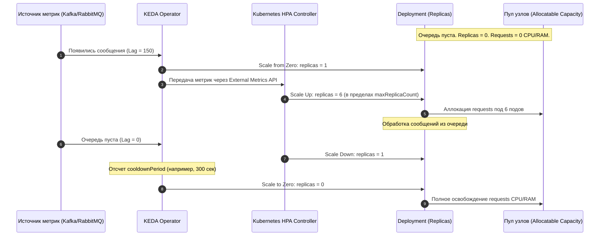

# KEDA: FinOps-гардрейлы и измерение экономии

**Актуально для:** KEDA 2.19.x / 2.20.x, Kubernetes 1.28–1.32+

## Определения

**FinOps (Financial Operations)** — культурная и операционная практика управления затратами на вычислительные мощности, объединяющая разработку, SRE/DevOps и бизнес для обеспечения прозрачности расходов, максимизации отдачи от инвестиций в инфраструктуру и исключения непроизводительного расходования мощностей.

**Over-provisioning (Избыточное выделение)** — эксплуатация рабочих нагрузок с постоянным выделением вычислительных ресурсов (CPU, RAM), значительно превышающих их среднее и минимальное фактическое потребление. В сценариях асинхронных очередей и пакетных задач приводит к простою серверов и росту совокупной стоимости владения (TCO).

**Scale-to-zero (Масштабирование до нуля)** — механика KEDA, при которой при отсутствии целевых событий (пустая очередь сообщений, отсутствие задач в стриме, завершение временного интервала) контроллер уменьшает число реплик `Deployment` или `StatefulSet` до нуля (`replicas: 0`). Полностью освобождает аллоцированные `requests` памяти и ядер на узлах кластера.

**maxReplicaCount (Предохранитель масштабирования)** — обязательный защитный гардрейл в спецификации `ScaledObject` и `ScaledJob`, задающий жесткую верхнюю границу горизонтального расширения. Предотвращает лавинообразное разрастание реплик при авариях (poison message, деградация downstream-баз данных, retry-штормы), защищая кластер от исчерпания серверных ресурсов (Node OOM/CPU starvation).

**Resource Slack (Ресурсный зазор / Недоутилизация)** — разница между аппаратно зарезервированной емкостью (`requests`), учитываемой планировщиком `kube-scheduler`, и реальным потреблением приложения на уровне ядра ОС. KEDA сокращает slack за счет перевода простаивающих сервисов в нулевой режим.

**ScaledJob** — кастомный ресурс KEDA, создающий независимые сущности `Job` в ответ на события и гарантирующий удаление подов сразу после успешного завершения единицы работы. Радикальный FinOps-инструмент для тяжелых и длительных batch-нагрузок, исключающий постоянное содержание пула долгоживущих воркеров.

**Pod-Hour (Под-час)** — базовая учетная единица потребления вычислительных мощностей в Kubernetes, равная работе одного пода в течение одного часа с фиксированным профилем `requests` CPU и RAM.

**Flapping (Биение / Дребезг реплик)** — паразитный процесс непрерывного масштабирования вверх и вниз с высокой частотой, возникающий при коротких импульсах нагрузки и слишком агрессивных тайм-аутах сжатия. Приводит к деградации производительности из-за накладных расходов на холодные старты (Cold Start CPU spikes).

**Headroom (Буферная емкость)** — расчетный запас свободных ресурсов на физических узлах On-Premise кластера, необходимый для безаварийного масштабирования сервисов во время непредвиденных пиков нагрузки.

**Idle Cost (Стоимость простоя)** — финансовое выражение вычислительных мощностей серверов, выделенных под приложение, но не выполняющих полезную бизнес-работу.

---

## Архитектура и базовые концепции

### Финансовая проблема Over-provisioning в Kubernetes

Стандартный контроллер Horizontal Pod Autoscaler (HPA) опирается на встроенные системные метрики: процент утилизации CPU и использование оперативной памяти от заданных `resources.requests`. Для синхронных stateless веб-сервисов со стабильным профилем трафика этот подход эффективен.

Однако в корпоративных архитектурах значительная часть рабочих нагрузок носит асинхронный характер:
* воркеры фоновых очередей сообщений (RabbitMQ, Apache Kafka, Redis Streams);
* сервисы пакетной обработки и ночной генерации отчетов;
* вспомогательные задачи миграции, импорта данных и очистки хранилищ;
* среды разработки (Dev), тестирования (QA) и предпродакшн-песочницы (Staging).

Для таких сервисов профиль утилизации CPU/RAM расходится с фактической бизнес-нагрузкой:

```text
Метрики для стандартного HPA:
  CPU Usage: 1.5% (от requests)
  Memory: стабильна (базовый оверхед runtime/JVM)
  Replicas: 3 (статический минимум)

Фактическое состояние бизнес-контекста:
  Queue Depth (RabbitMQ / Kafka): 14 500 сообщений
  Oldest Message Age: 27 минут
  SLA: нарушен (задержка обработки превысила критический порог)
```

При попытке использовать стандартный HPA инженеры сталкиваются с дилеммой:
1. **Занизить порог CPU утилизации (например, до 30%):** HPA среагирует с задержкой в несколько минут (пока накопится нагрузка на ядрах), а после разгона воркеры выгребут очередь за считанные секунды и быстро сбросят нагрузку, провоцируя биение.
2. **Держать постоянный запас реплик 24/7:** компания оплачивает серверные мощности, стойко-места, электропитание и амортизацию оборудования, когда воркеры простаивают по 16–18 часов в сутки в ожидании сообщений.

```mermaid
flowchart TD
    subgraph Traditional ["Стандартный подход (Over-provisioning)"]
        F1["5 реплик круглосуточно (120 pod-hours/день)"] --> F2["Средняя утилизация CPU: 5-8%"]
        F2 --> F3["Простой: 16-18 часов в сутки"]
        F3 --> F4["Высокий TCO: оплата простаивающего железа"]
    end

    subgraph KEDA_FinOps ["KEDA Event-Driven FinOps"]
        K1["Scale-to-zero (0 реплик в простое)"] --> K2["Всплеск событий в брокере (Kafka/RabbitMQ)"]
        K2 --> K3["Динамический подъем N реплик (до maxReplicaCount)"]
        K3 --> K4["Сжатие до 0 после опустошения очереди"]
        K4 --> K5["Экономия 40-75% ресурсов кластера"]
    end
```



### Принцип работы KEDA как финансового гардрейла

KEDA (Kubernetes Event-driven Autoscaling) выступает внешним управляющим контуром над встроенным HPA:

1. **Метрика из источника событий:** KEDA Operator непрерывно опрашивает внешний источник (размер очереди RabbitMQ, лаг партиций Kafka, количество элементов в Redis, скалярный результат PromQL в Prometheus).
2. **Активация из нуля (Scale from Zero):** стандартный HPA в Kubernetes не умеет масштабировать нагрузки с `0` до `1` реплики. Эту задачу берет на себя KEDA Operator. Как только метрика превышает пороговое значение активации, KEDA обновляет `spec.replicas` объекта `Deployment`/`StatefulSet` с `0` на `1`.
3. **Горизонтальное масштабирование (1 → N):** управление репликами в диапазоне от `1` до `maxReplicaCount` передается стандартному HPA через динамически регистрируемый External Metrics API (`keda.sh`).
4. **Возврат в ноль (Scale to Zero):** после того как очередь пустеет, HPA сжимает workload до `1` реплики. Затем вступает таймер `cooldownPeriod`: если за это время новых событий не поступило, KEDA переводит реплики в `0`.



### Защитные финансовые барьеры (Guardrails)

Автомасштабирование без жестких ограничений представляет угрозу стабильности и бюджету. В KEDA заложены критические механизмы защиты:

#### 1. maxReplicaCount как финансовый предохранитель
Если целевая downstream-система (например, реляционная СУБД PostgreSQL) начинает деградировать или блокировать транзакции, воркеры зависают в ожидании ответов. Очередь сообщений стремительно растет. 

Без `maxReplicaCount`:
* Автоскейлер пытается компенсировать лаг, запрашивая все больше подов (50 → 100 → 200).
* Поды выгребают все свободные `requests` на физических узлах кластера, провоцируя вытеснение (Eviction) других сервисов.
* Огромное количество воркеров добивает пул соединений СУБД, вызывая полный отказ сервиса.

Параметр `maxReplicaCount` жестко ограничивает радиус поражения (blast radius), фиксируя максимальное количество одновременно работающих подов независимо от глубины очереди.

#### 2. Асимметричное масштабирование против Flapping
С точки зрения FinOps и SRE масштабирование должно быть асимметричным:
* **Scale-up:** максимально быстрый (для соблюдения бизнес-SLA и предотвращения накопления критического лага).
* **Scale-down:** консервативный и плавный с периодом стабилизации (для исключения дребезга и постоянных холодных стартов).

Каждый подъем пода сопряжен с аппаратными издержками: запуск рантайма, инициализация пулов соединений, прогрев кэшей и пиковая утилизация CPU. Частые циклы «подняли 5 подов на 30 секунд → удалили → через минуту снова подняли» создают паразитный расход ресурсов ядра, сопоставимый с непрерывной работой.

#### 3. Fallback-механика при сбое мониторинга
Если брокер очередей временно недоступен по сети или падает Prometheus, KEDA переходит в режим аварийной защиты (`fallback`). Инженер явно задает безопасное количество реплик (`fallback.replicas`), предотвращая неконтролируемый сброс воркеров в ноль или разгон в потолок `maxReplicaCount`.

---

## ScaledObject vs ScaledJob: FinOps-выбор архитектуры

| Критерий | ScaledObject (Deployment / StatefulSet) | ScaledJob (Kubernetes Job) |
|---|---|---|
| **Характер задач** | Быстрые, регулярные, легковесные сообщения (воркеры очередей, события RabbitMQ, партиции Kafka) | Тяжелые, изолированные, ресурсоемкие вычисления (генерация PDF/Excel, транскодирование видео, ETL, ML-инференс) |
| **Жизненный цикл процесса** | Постоянный пул долгоживущих процессов, меняющий число реплик 0..N | Одноразовые поды, уничтожаемые сразу после выполнения объема работы |
| **Холодный старт** | Минимален при переходе 1..N; заметен только при старте из 0 | Присутствует на каждом созданном Job (создание пода, pull образа, запуск) |
| **Утилизация ресурсов (Slack)** | Присутствует небольшой холостой ход в рамках `cooldownPeriod` | Нулевой: ресурсы потребляются строго от старта до завершения процесса |
| **Очистка ресурсов** | Автоматически контролируется контроллером Deployment | Требует обязательной настройки `successfulJobsHistoryLimit` и `failedJobsHistoryLimit` |
| **Финансовый риск** | Зависание процессов при утечках памяти в долгоживущих воркерах | Накопление миллионов completed-подов в etcd при отсутствии лимитов истории |

---

## Формулы расчета экономии, ROI и TCO

Для защиты бюджета и демонстрации эффективности внедрения KEDA на On-Premise инфраструктуре используются формализованные метрики.

### 1. Расчет стоимости потребления рабочей нагрузки (Workload Cost)

В On-Premise инфраструктуре стоимость пода определяется стоимостью гарантированно зарезервированных им ресурсов (`requests`), так как именно `requests` формируют потребность в закупке физических серверов, шасси, сетевых портов и систем охлаждения:

$$\text{Cost}_{\text{workload}} = \sum_{t=1}^{T} \left( \text{Replicas}(t) \times \left( R_{\text{CPU}} \times C_{\text{core-hour}} + R_{\text{RAM}} \times C_{\text{GiB-hour}} \right) \right)$$

Где:
* $R_{\text{CPU}}$ — зарезервированные ядра CPU (`requests.cpu`) на один под;
* $R_{\text{RAM}}$ — зарезервированная оперативная память (`requests.memory` в GiB);
* $C_{\text{core-hour}}$ — внутренняя себестоимость часа физического процессорного ядра с учетом амортизации, питания и ЦОД;
* $C_{\text{GiB-hour}}$ — себестоимость гигабайта RAM в час.

### 2. Формула абсолютной и относительной экономии от Scale-to-Zero

$$\Delta \text{Cost} = \text{Cost}_{\text{before}} - \text{Cost}_{\text{after}}$$

$$\text{Savings \%} = \frac{\text{Pod-Hours}_{\text{fixed}} - \text{Pod-Hours}_{\text{keda}}}{\text{Pod-Hours}_{\text{fixed}}} \times 100\%$$

### 3. Формула возврата инвестиций (ROI)

$$\text{ROI} = \frac{\text{Annual Savings} - \text{Implementation Cost}}{\text{Implementation Cost}} \times 100\%$$

Где:
* $\text{Annual Savings} = \Delta \text{Cost}_{\text{month}} \times 12$;
* $\text{Implementation Cost} = \text{Engineering Hours} \times \text{Hourly Rate}$.

### 4. Стоимость за единицу бизнес-операции (Cost per Transaction)

$$\text{Cost}_{\text{unit}} = \frac{\text{Total Workload Cost}}{\text{Total Processed Messages / Orders}}$$

### 5. Анализ стоимости холодного старта (Total Cost of Cold Start)

Холодный старт создает задержку обработки первого сообщения после периода простоя. Финансовая стоимость холодного старта складывается из прямых аппаратных издержек на инициализацию и штрафов за нарушение бизнес-SLA:

$$\text{TCS} = \left( N_{\text{starts}} \times T_{\text{cold}} \times C_{\text{sec}} \right) + \left( P_{\text{breach}} \times \text{Penalty}_{\text{SLA}} \right)$$

Где:
* $N_{\text{starts}}$ — количество переходов $0 \to 1$ за расчетный период;
* $T_{\text{cold}}$ — среднее время холодного старта в секундах (Image pull + Container start + Readiness probe);
* $C_{\text{sec}}$ — стоимость секунды вычислительных ресурсов пода;
* $P_{\text{breach}}$ — вероятность превышения допустимого порога ожидания сообщения;
* $\text{Penalty}_{\text{SLA}}$ — прямой или косвенный финансовый штраф за нарушение регламента обслуживания.

---

## Практические сценарии и конфигурация

### Сценарий 1: Производственный воркер очереди сообщений (RabbitMQ)

Workload обрабатывает заказы клиентов. В нерабочее время (ночью и на выходных) заказов практически нет. Нагрузка пиковая с 10:00 до 19:00.

#### Манифест ScaledObject с FinOps-гардрейлами:

```yaml
apiVersion: keda.sh/v1alpha1
kind: ScaledObject
metadata:
  name: orders-worker-scaler
  namespace: ecom-prod
  labels:
    app.kubernetes.io/name: orders-worker
    finops.corp/cost-center: "cc-402"
    finops.corp/managed-by: "keda"
spec:
  scaleTargetRef:
    apiVersion: apps/v1
    kind: Deployment
    name: orders-worker
  minReplicaCount: 0
  maxReplicaCount: 12
  pollingInterval: 15
  cooldownPeriod: 300
  idleReplicaCount: 0
  fallback:
    failureThreshold: 3
    replicas: 2
    behavior: currentReplicasIfHigher
  advanced:
    restoreToOriginalReplicaCount: false
    horizontalPodAutoscalerConfig:
      behavior:
        scaleUp:
          stabilizationWindowSeconds: 0
          policies:
            - type: Percent
              value: 100
              periodSeconds: 15
            - type: Pods
              value: 4
              periodSeconds: 15
          selectPolicy: Max
        scaleDown:
          stabilizationWindowSeconds: 600
          policies:
            - type: Pods
              value: 2
              periodSeconds: 60
          selectPolicy: Min
  triggers:
    - type: rabbitmq
      metadata:
        queueName: orders-incoming
        mode: QueueLength
        value: "25"
        activationValue: "1"
      authenticationRef:
        name: rabbitmq-keda-auth
```

#### Манифест TriggerAuthentication:

```yaml
apiVersion: keda.sh/v1alpha1
kind: TriggerAuthentication
metadata:
  name: rabbitmq-keda-auth
  namespace: ecom-prod
spec:
  secretTargetRef:
    - parameter: host
      name: rabbitmq-credentials
      key: rmq-management-uri
```

#### Манифест защищаемого Deployment:

```yaml
apiVersion: apps/v1
kind: Deployment
metadata:
  name: orders-worker
  namespace: ecom-prod
  labels:
    app: orders-worker
    team: logistics
    cost-center: cc-402
spec:
  replicas: 0
  selector:
    matchLabels:
      app: orders-worker
  template:
    metadata:
      labels:
        app: orders-worker
        team: logistics
        cost-center: cc-402
    spec:
      terminationGracePeriodSeconds: 60
      containers:
        - name: worker
          image: internal-registry.corp/apps/orders-worker:v2.4.1
          imagePullPolicy: IfNotPresent
          resources:
            requests:
              cpu: "500m"
              memory: "512Mi"
            limits:
              cpu: "1000m"
              memory: "1024Mi"
          readinessProbe:
            httpGet:
              path: /healthz
              port: 8080
            initialDelaySeconds: 5
            periodSeconds: 5
            failureThreshold: 2
```

---

### Сценарий 2: Тяжелая пакетная обработка через ScaledJob (Redis / Apache Kafka)

Вместо постоянного содержания пула подов для конвертации тяжелых файлов или расчета отчетов разворачивается `ScaledJob`. Каждый pod создается как однократный `Job`, отрабатывает задачу и уничтожается.

```yaml
apiVersion: keda.sh/v1alpha1
kind: ScaledJob
metadata:
  name: pdf-generator-job
  namespace: batch-processing
  labels:
    finops.corp/workload-type: "batch-ephemeral"
    finops.corp/cost-center: "analytics-701"
spec:
  jobTargetRef:
    parallelism: 1
    completions: 1
    activeDeadlineSeconds: 1200
    backoffLimit: 2
    template:
      metadata:
        labels:
          job-name: pdf-generator
      spec:
        restartPolicy: OnFailure
        containers:
          - name: generator
            image: internal-registry.corp/batch/pdf-generator:v1.1.0
            resources:
              requests:
                cpu: "2000m"
                memory: "4Gi"
              limits:
                cpu: "4000m"
                memory: "8Gi"
            env:
              - name: REDIS_QUEUE
                value: "pdf_tasks"
  pollingInterval: 30
  maxReplicaCount: 20
  successfulJobsHistoryLimit: 3
  failedJobsHistoryLimit: 5
  scalingStrategy:
    strategy: "custom"
    customScalingQueueLengthDeduction: 1
  triggers:
    - type: redis
      metadata:
        addressFromEnv: REDIS_ENDPOINT
        listName: pdf_tasks
        listLength: "1"
        enableTLS: "false"
      authenticationRef:
        name: redis-trigger-auth
```

*FinOps-эффект:* 20 подов по 2 ядра и 4 GiB оперативной памяти требуют 40 ядер CPU и 80 GiB RAM. При постоянном запуске (Deployment) они блокировали бы 2 крупных физических сервера. Со `ScaledJob` ресурсы задействуются ровно на время обработки задач (например, 20 минут в сутки), освобождая мощности кластера на оставшиеся 23 часа и 40 минут.

---

### Сценарий 3: Dev/Staging окружение с отключением по расписанию (Cron Trigger)

Сервисы стенда разработки требуются только в рабочее время с понедельника по пятницу. Вне этого диапазона среда полностью обесточивается на уровне подов.

```yaml
apiVersion: keda.sh/v1alpha1
kind: ScaledObject
metadata:
  name: dev-backend-scheduler
  namespace: team-alpha-dev
  labels:
    finops.corp/managed-by: "keda-cron"
    finops.corp/environment: "development"
spec:
  scaleTargetRef:
    apiVersion: apps/v1
    kind: Deployment
    name: dev-backend
  minReplicaCount: 0
  maxReplicaCount: 2
  cooldownPeriod: 60
  triggers:
    - type: cron
      metadata:
        timezone: Europe/Moscow
        start: 0 9 * * 1-5
        end: 0 19 * * 1-5
        desiredReplicas: "1"
```

*Расчет эффекта:*
* Неделя = 168 часов.
* Время активности сервиса: $5 \text{ дней} \times 10 \text{ часов} = 50 \text{ часов}$.
* Время нахождения в 0: $168 - 50 = 118 \text{ часов}$ ($70.2\%$ недели).
* Прямое сокращение выделения `requests` в среде разработки составляет $70\%$.

---

### Сценарий 4: Оптимизация узлов и плотности размещения (Bin-Packing) на On-Premise

В локальных дата-центрах физическое добавление серверов занимает от нескольких недель до месяцев (закупка, монтаж, кабельная разводка). KEDA высвобождает аппаратный Headroom за счет агрессивного scale-to-zero:

```yaml
# Конфигурация локальной модели учета затрат в OpenCost (custom-cost-model.json)
{
  "provider": "custom",
  "description": "On-Premise Private Datacenter Cost Model",
  "CPU": "0.025",
  "RAM": "0.0035",
  "storage": "0.0001",
  "zoneNetworkPricings": {
    "zoneNetworkCost": "0.0000"
  }
}
```

#### Стратегия совмещения гарантированных и всплесковых нагрузок:
1. Критичные сервисы ядра (StatefulSet, API базы данных) развертываются с профилем `Guaranteed` (`requests == limits`) и высоким приоритетом (`PriorityClass: high-priority`).
2. Воркеры очередей под управлением KEDA развертываются с `Burstable` профилем и умеренным приоритетом.
3. В периоды затишья воркеры сжимаются до 0, позволяя планировщику `kube-scheduler` упаковывать смежные сервисы без нехватки памяти на узлах (Node Memory Pressure).

---

### Сценарий 5: Multi-Tenant квотирование и защита бюджета кластера

В многопользовательском кластере команда разработки может случайно настроить ScaledObject с `maxReplicaCount: 200`, что при инциденте вызовет захват всех ресурсов узлов. 

Для предотвращения подобных ситуаций системные администраторы и SRE комбинируют `ResourceQuota` с лимитом на количество самих объектов KEDA:

```yaml
apiVersion: v1
kind: ResourceQuota
metadata:
  name: team-logistics-quota
  namespace: ecom-prod
spec:
  hard:
    requests.cpu: "16"
    requests.memory: "32Gi"
    limits.cpu: "32"
    limits.memory: "64Gi"
    pods: "30"
    count/scaledobjects.keda.sh: "8"
    count/scaledjobs.keda.sh: "4"
```

Если автоскейлер пытается расширить реплики сверх квоты пространства имен, Kubernetes заблокирует создание избыточных подов со статусом `FailedCreate: exceeded quota`, защищая остальные команды кластера.

---

## Операции и команды

### Команды аудита и оперативного контроля

```bash
# Проверка общего состояния всех объектов KEDA в кластере
kubectl get scaledobject,scaledjob -A -o wide
# → NAMESPACE    NAME                     SCALETARGETKIND      SCALETARGETNAME   MIN   MAX   TRIGGERS   AUTHENTICATION       READY   ACTIVE   FALLBACK   AGE
# → ecom-prod    orders-worker-scaler     apps/v1.Deployment   orders-worker     0     12    rabbitmq   rabbitmq-keda-auth   True    False    False      14d
# → batch-jobs   pdf-generator-job                                               0     20    redis      redis-trigger-auth   True    True     False      3d

# Проверка подов, находящихся в состоянии scale-to-zero (0 реплик)
kubectl get deployment -A -l finops.corp/managed-by=keda -o custom-columns=NAMESPACE:.metadata.namespace,NAME:.metadata.name,DESIRED:.spec.replicas,READY:.status.readyReplicas
# → NAMESPACE       NAME             DESIRED   READY
# → ecom-prod       orders-worker    0         <none>
# → team-alpha-dev  dev-backend      0         <none>

# Проверка событий скейлера KEDA для анализа холодных стартов и переходов
kubectl get events -n ecom-prod --field-selector reason=KedaScalerActive --sort-by='.lastTimestamp' | tail -n 10
# → 2m15s       Normal    KedaScalerActive    scaledobject/orders-worker-scaler    ScaledObject orders-worker-scaler is active
# → 15s         Normal    KedaScalerInactive  scaledobject/orders-worker-scaler    ScaledObject orders-worker-scaler is no longer active

# Детальная инспекция HPA, созданного KEDA
kubectl get hpa -n ecom-prod keda-hpa-orders-worker-scaler -o yaml
# → Выводит параметры стабилизационного окна и текущие External Metrics
```

---

### FinOps PromQL-запросы для мониторинга и отчетов

#### 1. Доля времени нахождения рабочей нагрузки на 0 репликах (Idle Ratio)
Показывает процент времени за последние 24 часа, когда приложение не занимало вычислительных ресурсов:

```promql
(1 - (avg_over_time(keda_scaledobject_replicas{namespace="ecom-prod", scaledobject="orders-worker-scaler"}[24h]) > 0)) * 100
```

#### 2. Суммарный расход Pod-Hours за неделю
Интеграл количества запущенных реплик воркера по времени:

```promql
sum_over_time(keda_scaledobject_replicas{namespace="ecom-prod", scaledobject="orders-worker-scaler"}[7d:1h])
```

#### 3. Расчет сэкономленных ядер процессора (Core-Hours Saved)
Сравнение с постоянным статическим выделением (например, 5 подов по 500m CPU):

```promql
(
  (5 * 0.5 * 168)
  -
  (sum_over_time(keda_scaledobject_replicas{namespace="ecom-prod", scaledobject="orders-worker-scaler"}[7d:1h]) * 0.5)
)
```

#### 4. Коэффициент приближения к верхнему финансовому лимиту
Отношение текущих реплик к `maxReplicaCount`:

```promql
keda_scaledobject_replicas{namespace="ecom-prod"} 
/ 
keda_scaledobject_max_replicas{namespace="ecom-prod"}
```

#### 5. Задержка холодного старта скейлера (p95 в секундах)

```promql
histogram_quantile(0.95, rate(keda_scaler_latency_seconds_bucket[15m]))
```

---

### Правила алертинга Alertmanager для FinOps-гардрейлов

```yaml
groups:
  - name: keda-finops-alerts
    rules:
      - alert: KedaNearMaxReplicasBudgetLimit
        expr: (keda_scaledobject_replicas / keda_scaledobject_max_replicas) >= 0.85
        for: 10m
        labels:
          severity: warning
          tier: finops
        annotations:
          summary: "ScaledObject {{ $labels.scaledobject }} близок к максимальному лимиту"
          description: "Нагрузка достигла {{ $value | humanizePercentage }} от maxReplicaCount в namespace {{ $labels.namespace }}. Риск исчерпания серверного бюджета или downstream деградации."

      - alert: KedaContinuousMaxReplicasStuck
        expr: (keda_scaledobject_replicas == keda_scaledobject_max_replicas)
        for: 30m
        labels:
          severity: critical
          tier: finops
        annotations:
          summary: "ScaledObject {{ $labels.scaledobject }} застрял на максимуме реплик"
          description: "Воркеры непрерывно работают на максимальном числе реплик более 30 минут. Проверьте downstream СУБД, наличие poison-pill сообщений в очереди или утечку задач."

      - alert: KedaScalerHighFlappingRate
        expr: changes(keda_scaledobject_replicas[15m]) > 8
        for: 5m
        labels:
          severity: warning
          tier: sre
        annotations:
          summary: "Обнаружен flapping (биение) для {{ $labels.scaledobject }}"
          description: "Количество изменений числа реплик превышает 8 за 15 минут. Настройте stabilizationWindowSeconds в behavior и увеличьте cooldownPeriod."

      - alert: KedaTriggerSourceFailure
        expr: rate(keda_scaler_errors_total[5m]) > 0
        for: 5m
        labels:
          severity: critical
          tier: sre
        annotations:
          summary: "Ошибка опроса триггера KEDA в namespace {{ $labels.namespace }}"
          description: "KEDA не может получить метрики из внешнего источника. Проверьте сетевую связность, аутентификацию и срабатывание fallback-режима."
```

---

## Диагностика и Troubleshooting

### Сводная таблица типовых FinOps-неисправностей

| Проблема | Причина | Индикация / Команда | Способ устранения |
|---|---|---|---|
| **Workload не опускается до 0** | В кластере задан `PodDisruptionBudget` с `minAvailable: 1` | `kubectl get pdb -n <ns>`; события `FailedScaleDown` в HPA | Заменить `minAvailable: 1` на `maxUnavailable: 25%` или `maxUnavailable: 1` |
| **Паразитный скачок CPU при старте** | Flapping и частые холодные старты из-за короткого `cooldownPeriod` | Рост `changes(keda_scaledobject_replicas[15m])`, скачки CPU в cAdvisor | Увеличить `cooldownPeriod` до 300–600с; задать `scaleDown.stabilizationWindowSeconds` |
| **Лавинообразный рост подов** | Poison message в очереди вызывает крах воркеров, лаг растет | Очередь не уменьшается при `maxReplicaCount`; рост RestartCount подов | Настроить Dead-Letter Queue (DLQ) в брокере; ограничить `maxReplicaCount` |
| **Утечка подов и ресурсов etcd** | В `ScaledJob` отсутствуют лимиты истории завершенных задач | Тысячи Completed подов: `kubectl get pods -l job-name` | Задать в спецификации `successfulJobsHistoryLimit: 3` и `failedJobsHistoryLimit: 5` |
| **Застревание подов в Pending** | `ResourceQuota` пространства имен исчерпана при scale-up | `kubectl describe pod <name>`: `exceeded quota` | Отрегулировать лимиты квоты или пересмотреть `maxReplicaCount` воркера |
| **Зависание на fallback репликах** | Недоступность источника метрик (таймаут, смена пароля в брокере) | Метрика `keda_scaler_errors_total > 0`; статус `Fallback: True` | Восстановить доступность брокера; проверить секреты в `TriggerAuthentication` |

---

### Детальный разбор типовых инцидентов

#### 1. Блокировка Scale-to-Zero политикой PodDisruptionBudget (PDB)
*Симптом:* Воркер обработал все сообщения, очередь пуста, `cooldownPeriod` истек, но количество реплик остается равным `1`.
*Анализ:*
```bash
kubectl get pdb -n ecom-prod
# → NAME               MIN AVAILABLE   MAX UNAVAILABLE   ALLOWED DISRUPTIONS   AGE
# → orders-worker-pdb  1               N/A               0                     120d
```
Если в `PodDisruptionBudget` установлено `minAvailable: 1`, контроллер вытеснения и HPA не могут удалить последний под, так как это нарушит гарантию доступности хотя бы одной копии.
*Решение:* Переключить PDB на процентную или абсолютную недоступность:
```yaml
apiVersion: policy/v1
kind: PodDisruptionBudget
metadata:
  name: orders-worker-pdb
  namespace: ecom-prod
spec:
  maxUnavailable: 1
  selector:
    matchLabels:
      app: orders-worker
```

#### 2. Зависание воркеров и блокировка соединений с базой данных
*Симптом:* Автоскейлер поднимает реплики до максимума (`maxReplicaCount: 12`), но скорость обработки очереди падает до нуля.
*Анализ:* Каждый под открывает пул соединений к PostgreSQL (например, `max_pool_size: 20`). При подъеме 12 подов они требуют 240 соединений. Лимит базы `max_connections: 150` исчерпывается. Все поды виснут в ожидании соединения, новые сообщения накапливаются в брокере.
*Решение:* 
1. Рассчитывать `maxReplicaCount` строго по формуле:
   $$\text{maxReplicaCount} \le \frac{\text{DB Available Connections}}{\text{Pool Size per Pod}}$$
2. Внедрить транзакционный пул соединений PgBouncer между подами воркеров и базой данных.

#### 3. Утечка completed-подов при использовании ScaledJob
*Симптом:* Утилизация памяти kubelet и cAdvisor на узлах растет, запросы `kubectl` к кластеру замедляются.
*Анализ:* По умолчанию Kubernetes Job после успешного завершения оставляет Pod в состоянии `Completed` для сохранения логов. При обработке 10 000 задач в сутки накапливается 10 000 неактивных подов, забивающих etcd.
*Решение:* Обязательно декларировать политику ротации истории и тайм-аут жизни:
```yaml
spec:
  successfulJobsHistoryLimit: 3
  failedJobsHistoryLimit: 5
  jobTargetRef:
    ttlSecondsAfterFinished: 300
    activeDeadlineSeconds: 900
```

---

## Лучшие практики (Best Practices)

1. **Обязательный maxReplicaCount для каждого объекта:** Ни один `ScaledObject` или `ScaledJob` не должен попадать в production без явно заданного `maxReplicaCount`. Лимит должен быть согласован с пропускной способностью зависимостей (СУБД, сеть, брокеры).
2. **Асимметричное стабилизационное окно:** Устанавливайте `scaleDown.stabilizationWindowSeconds` от 300 до 600 секунд. Это страхует инфраструктуру от частых циклов холодного старта и сглаживает естественные пульсации очереди.
3. **Оптимизация размера контейнерного образа:** Время холодного старта прямо зависит от размера образа. Базовые образы на базе Distroless или Alpine размером до 100 МБ стартуют за 3–5 секунд, тогда как полные образы на базе Ubuntu/Debian (1–2 ГБ) могут увеличивать задержку старта до 30–60 секунд.
4. **Настройка Graceful Shutdown:** При scale-down воркер не должен обрывать обработку текущего сообщения. Задайте `terminationGracePeriodSeconds: 60` (или выше в зависимости от длительности транзакции), перехватывайте сигнал `SIGTERM` и возвращайте сообщение в очередь при аварийной остановке (NACK/Requeue).
5. **Разделение типов масштабирования:**
   * Используйте `ScaledObject` для сервисов с высокой частотой коротких сообщений (время обработки < 5 секунд).
   * Используйте `ScaledJob` для изолированных тяжелых задач (время обработки > 30 секунд), чтобы не держать постоянные резервы памяти.
6. **Контроль квот на уровне Namespace:** Всегда защищайте кластер комбинацией `ResourceQuota` по суммарным `requests.cpu` и количеству `count/scaledobjects.keda.sh`.
7. **Обязательное указание Fallback:** На случай сетевой недоступности брокера или мониторинга всегда определяйте `fallback.failureThreshold` и минимальное безопасное количество `fallback.replicas`.
8. **Маркировка для Cost Allocation:** Добавляйте лейблы `finops.corp/cost-center`, `team` и `finops.corp/managed-by: keda` во все метаданные подов для автоматической агрегации в OpenCost/Kubecost.

---

## Связанные материалы

* **[KEDA: Основные концепции](./keda_concepts.md)** — архитектура компонентов KEDA, Metrics Server, Controller.
* **[KEDA: Практические сценарии](./practical_scenarios.md)** — установка KEDA и типовые триггеры масштабирования.
* **[KEDA: Эксплуатация — мониторинг и troubleshooting](./keda-operations.md)** — промышленная эксплуатация, диагностика и алерты.
* **[KEDA + Kafka](./kafka-keda-scaler.md)** — глубокая настройка автомасштабирования по Consumer Lag в Apache Kafka.
* **[KEDA + Redis](./redis-keda-scaler.md)** — масштабирование очередей и стримов Redis.
* **[KEDA: Тестирование и валидация](./keda-testing-validation.md)** — методы нагрузочного тестирования и проверка сценариев сбоя.
* **[HPA: Cost и Right-sizing](../HPA/hpa_cost_rightsizing.md)** — расчет requests/limits и оптимизация аппаратных затрат.
* **[Autoscaling в On-Premise / Bare-Metal](../on_premise_autoscaling.md)** — специфика управления емкостью частных дата-центров.
* **[Паттерн Workers + Queue](../workers_queue_pattern.md)** — архитектурные шаблоны проектирования распределенных очередей.
* **[Kubecost и OpenCost](../../MonitoringLogging/kubecost.md)** — аллокация и мониторинг затрат в кластере Kubernetes.
