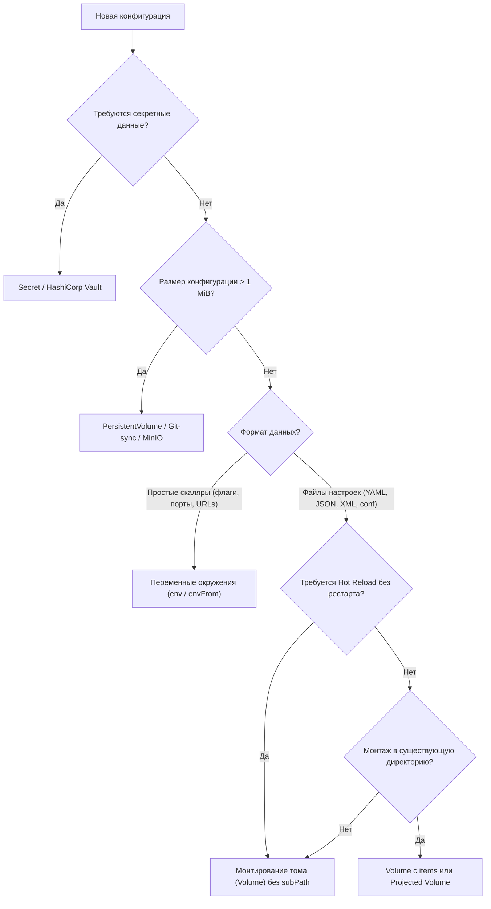

# Рекомендации и лучшие практики для ConfigMap

**Актуально для:** Kubernetes 1.28–1.32+

## Определения

**ConfigMap** — объект API Kubernetes (группа `core/v1`), предназначенный для хранения неконфиденциальных конфигурационных данных в виде пар «ключ-значение». Основная архитектурная цель ConfigMap — реализация принципа **Separation of Concerns** (разделение ответственности) за счет изоляции параметров окружения и настроек приложений от неизменяемых образов контейнеров.

**Best Practices для ConfigMap** — совокупность производственных стандартов, инженерных шаблонов и эксплуатационных ограничений в областях DevOps, SRE и системного администрирования. Они обеспечивают воспроизводимость, версионирование, атомарность доставки, аудит изменений и отказоустойчивость инфраструктуры конфигураций в кластере.

**Immutability (неизменяемость)** — режим работы ConfigMap (`immutable: true`), блокирующий изменение полей `data` и `binaryData` после создания объекта. Защищает кластер от непреднамеренных мутаций и снимает нагрузку с control plane за счет отключения постоянного Kubelet Watch.

**Configuration Drift (дрейф конфигурации)** — расхождение между декларированным состоянием конфигурации в системе контроля версий (Git) и фактическим состоянием объектов внутри etcd кластера, возникающее из-за ручных правок (`kubectl edit`, `kubectl apply`).

**Hot Reload (горячая перезагрузка)** — способность приложения перечитывать измененные конфигурационные файлы «на лету» без перезапуска контейнера или пода при обновлении целевого ConfigMap.

**Границы применимости ConfigMap:**

*   **Конфиденциальные данные** — пароли, API-ключи, токены доступа, закрытые ключи TLS. Для них предназначен исключительно [Secret](../secrets/security.md).
*   **Большие и бинарные объемы** — жесткое системное ограничение etcd на размер одного объекта составляет **1 MiB**. Конфигурации сверх этого предела, тяжелые статические файлы или бинарные артефакты выносятся в `PersistentVolume` или внешние распределенные хранилища.
*   **Данные с сохранением состояния приложения** — запись из контейнера в смонтированный том ConfigMap либо запрещена файловой системой (`readOnly`), либо сбрасывается при синхронизации Kubelet. Для изменяемых данных применяются `emptyDir`, `PersistentVolumeClaim` или сетевые базы данных.
*   **Сверхдинамичные флаги (Feature Flags)** — параметры, изменяющиеся чаще нескольких раз в час, не должны транслироваться через ConfigMap, так как массовые обновления создают избыточную нагрузку на etcd и вызывают задержки инвалидации кэша.

---

## Основные концепции

### Архитектурные принципы ConfigMap в Production

*   **Приоритет неизменяемости (Immutability-First):** Для всех стабильных рабочих нагрузок рекомендуется выставлять флаг `immutable: true`. Это защищает кластер от случайных модификаций оператором и снижает нагрузку на `kube-apiserver` и etcd: Kubelet перестает поддерживать постоянное Watch-соединение для этого объекта. Подробнее специфика разобрана в [Неизменяемые ConfigMap](./immutable.md).
*   **Исключение конфигурации из образов (Stateless Containers):** Образы контейнеров должны компилироваться один раз и быть полностью независимыми от окружения. Все зависящие от среды переменные (хосты очередей, уровни логирования, адреса сервисов) инжектируются исключительно через ConfigMap или Secret.
*   **Выбор метода доставки по сценарию использования:**
    *   **Монтирование томом (Volumes):** Основной промышленный метод для комплексных файлов конфигурации. Обеспечивает атомарную ротацию файлов через символические ссылки (`..data`) и поддержку Hot Reload.
    *   **Переменные окружения (`env`, `envFrom`):** Используются для скалярных значений (порты, флаги, числовые лимиты, системные константы). Требуют обязательного перезапуска пода при изменении.
*   **Принцип единой ответственности (Single Responsibility):** Разделяйте конфигурации по логическим границам сервисов и компонентов. Запрещается агрегировать настройки независимых систем в один общий ConfigMap: это увеличивает радиус поражения при сбоях (blast radius), раздувает объем передаваемых по сети данных и создает конфликты владения.
*   **Config-as-Code и GitOps:** Единственным источником истины для конфигураций должен являться Git-репозиторий. Все манифесты применяются через GitOps-инструменты (Argo CD, Flux). Императивное создание (`kubectl create configmap`) допускается исключительно в локальных стендах для отладки.
*   **Принцип Fail Fast:** Параметр `optional: false` (активен по умолчанию) гарантирует, что при отсутствии ConfigMap или запрашиваемого ключа под завершится с явной ошибкой `CreateContainerConfigError` еще до запуска контейнера. Флаг `optional: true` применяется только для действительно опциональных конфигурационных плагинов.

### Стандарты именования и маркировки

*   **DNS-совместимость:** Имя ConfigMap должно соответствовать стандарту DNS-1123: состоять только из строчных латинских букв, цифр и дефисов, длиной не более 253 символов. Рекомендуемый паттерн: `<application>-<component>-<role>` (например, `order-service-api-config`).
*   **Изоляция окружений через Namespaces:** Не используйте суффиксы сред в именах объектов (`app-config-prod`, `app-config-stage`). Разделение сред (Production, Staging, Dev) должно выполняться на уровне отдельных пространств имен (Namespaces). Манифест конфигурации должен сохранять идентичное имя во всех средах, меняясь только на уровне параметров оверлеев.
*   **Стандартизация меток (Labels):** Каждый ConfigMap должен содержать рекомендованный CNCF/Kubernetes набор меток `app.kubernetes.io/*`:
    *   `app.kubernetes.io/name`: имя приложения.
    *   `app.kubernetes.io/instance`: уникальный экземпляр инсталляции.
    *   `app.kubernetes.io/version`: версия компонента.
    *   `app.kubernetes.io/component`: архитектурный слой (`backend`, `database`, `proxy`).
    *   `app.kubernetes.io/part-of`: высокоуровневая система или домен.
    *   `app.kubernetes.io/managed-by`: инструмент доставки (`helm`, `argocd`, `flux`).
*   **Хеширование имен (Content Hashing):** Для обеспечения надежного Rolling Update зависимых подов при изменении содержимого ConfigMap следует применять хеширование имен (например, `app-config-9f7b4c`). Это исключает ситуацию рассинхронизации между подами старой и новой реплики. Инструменты: Kustomize `configMapGenerator` или аннотация `checksum/config` в шаблонах Helm (подробнее: [Helm: перезапуск при изменении конфига](../../ToolsUtilities/Helm/templating/scenarios/restart_on_change.md)).
*   **Соглашение об именовании ключей:**
    *   Для файлов, монтируемых через Volume: используйте имя реального целевого файла с расширением (`nginx.conf`, `prometheus.yml`).
    *   Для переменных окружения (`envFrom`): имена ключей обязаны соответствовать стандарту C-идентификаторов (латинские буквы, цифры, символ подчеркивания, не начинаться с цифры). Имена с дефисами или точками `kubelet` пропустит без предупреждения (детали: [Использование ConfigMap в поде](./pod_usage.md)).

### Когда не следует использовать ConfigMap

| Критерий | Почему ConfigMap не подходит | Альтернативное решение |
| :--- | :--- | :--- |
| **Секреты и токены** | Данные хранятся в открытом виде (plaintext), доступны всем субъектам с правами чтения Namespace, попадают в дампы аудита. | [Secret](../secrets/security.md), HashiCorp Vault. |
| **Файлы > 1 MiB** | Жесткий лимит транзакции etcd; замедление сериализации и передачи по Raft. | `PersistentVolume`, S3-совместимые хранилища (MinIO), Git-sync. Подробнее: [Работа с большими конфигурациями](./large_configs.md). |
| **Запись из контейнера** | Файловая система тома монтируется в `readOnly`, либо локальные правки сбрасываются Kubelet при очередном цикле рендеринга тома. | `PersistentVolumeClaim`, локальный `emptyDir`. |
| **Высокая частота правок** | Массовая репликация обновлений создает всплески трафика Watch, нагрузку на CPU Kubelet и частые смены символических ссылок. | Внешние сервисы распределенной конфигурации, Consul, Feature Flag движки. |
| **Хостовые параметры ноды** | ConfigMap привязан к Namespace и контексту подов, а не к физическому или виртуальному серверу. | Конфигурация системных сервисов хоста (systemd, Kubelet Configuration, DaemonSet с `hostPath`). |

---

## Практические сценарии

### Сценарий 1: Декларативное управление и GitOps-пайплайн

В производственной среде вся конфигурация управляется как код через Git-репозиторий и непрерывно синхронизируется оператором (Argo CD или Flux).

#### 1. Структура манифестов и автоматический перезапуск (Rollout Trigger)

Для приложений, читающих конфигурацию из `env`, изменение ConfigMap не приводит к автоматическому перечитыванию значений без перезапуска пода. Для обеспечения автоматического Rolling Update в шаблон пода внедряется аннотация с SHA256-хешем содержимого конфигурации:

```yaml
apiVersion: apps/v1
kind: Deployment
metadata:
  name: billing-service
  namespace: production
  labels:
    app.kubernetes.io/name: billing-service
    app.kubernetes.io/part-of: billing
spec:
  replicas: 3
  selector:
    matchLabels:
      app.kubernetes.io/name: billing-service
  template:
    metadata:
      labels:
        app.kubernetes.io/name: billing-service
      annotations:
        # Хеш вычисляется Helm или Kustomize на этапе сборки манифеста
        checksum/config: "a8f5f167f44f4964e6c998dee827110c"
    spec:
      containers:
        - name: app
          image: internal-registry.example.com/apps/billing:v2.4.1
          envFrom:
            - configMapRef:
                name: billing-config
                optional: false
```

#### 2. Валидация манифестов в CI/CD конвейере

Перед отправкой изменений в кластер конфигурационные манифесты валидируются на синтаксис, схему Kubernetes API и соответствие внутренним политикам безопасности:

```bash
# 1. Проверка синтаксиса и совместимости со схемой API Kubernetes
kubeconform -strict -kubernetes-version 1.30.0 -summary k8s/production/
# → Summary: 12 resources checked, 0 errors, 0 invalid, 0 ignored

# 2. Серверная валидация без фактического применения изменений
kubectl apply -f k8s/production/configmap.yaml --dry-run=server -n production
# → configmap/billing-config configured (server dry run)
```

#### 3. Мониторинг дрейфа и откат через GitOps

```bash
# Проверка наличия расхождений между Git и кластером через Argo CD CLI
argocd app diff billing-production
# → ====== ConfigMap/production/billing-config ======
# → 12c12
# → <   LOG_LEVEL: "info"
# → ---
# → >   LOG_LEVEL: "debug"  # Обнаружен ручной дрейф в кластере

# Принудительная синхронизация для восстановления декларативного состояния
argocd app sync billing-production --force
# → TIMESTAMP                  GROUP        KIND   NAMESPACE                  NAME    STATUS   HEALTH        HOOK  MESSAGE
# → 2026-10-13T18:40:00+03:00            ConfigMap  production        billing-config   Synced                        configmap/billing-config configured
```

Откат конфигурации в GitOps выполняется исключительно через систему контроля версий:
1. Создание коммита отката: `git revert <commit_hash>`.
2. Push в основную ветку и автоматическая синхронизация контроллером.
3. Контроллер обновляет ConfigMap и хеш-аннотацию, запуская штатный Rolling Update.

---

### Сценарий 2: Многослойная архитектура конфигураций (Base + Overlays)

Для управления конфигурациями в разных окружениях без дублирования кода применяется Kustomize.

```
deploy/
├── base/
│   ├── kustomization.yaml
│   ├── deployment.yaml
│   └── application.properties
└── overlays/
    ├── dev/
    │   ├── kustomization.yaml
    │   └── env.properties
    └── production/
        ├── kustomization.yaml
        └── env.properties
```

#### Манифест базового слоя (`deploy/base/kustomization.yaml`)

```yaml
apiVersion: kustomize.config.k8s.io/v1beta1
kind: Kustomization
resources:
  - deployment.yaml
configMapGenerator:
  - name: service-config
    files:
      - application.properties
generatorOptions:
  disableNameSuffixHash: false
```

#### Манифест продуктивного слоя (`deploy/overlays/production/kustomization.yaml`)

```yaml
apiVersion: kustomize.config.k8s.io/v1beta1
kind: Kustomization
namespace: production
bases:
  - ../../base
configMapGenerator:
  - name: service-config
    behavior: merge
    files:
      - env.properties
generatorOptions:
  immutable: true
```

Сборка и проверка результирующего манифеста:

```bash
# Рендеринг манифестов Kustomize
kubectl kustomize deploy/overlays/production/ | grep -A 15 "kind: ConfigMap"
# → kind: ConfigMap
# → metadata:
# →   name: service-config-7h8564bgf2
# →   namespace: production
# → immutable: true
# → data:
# →   application.properties: |
# →     server.port=8080
# →     management.endpoints.web.exposure.include=health,prometheus
# →   env.properties: |
# →     db.pool.size=50
# →     cache.enabled=true
```

Преимущества подхода:
*   При изменении файла `env.properties` Kustomize генерирует новый суффикс хеша (`service-config-k8f921m7bc`), обновляет ссылки в спецификации пода и инициирует Rolling Update без простоев.
*   Старый ConfigMap остается в кластере до завершения выката, что гарантирует работу старых подов без сбоев при откатах.

---

### Сценарий 3: Защита и безопасность (Hardening) на уровне кластера

Конфигурации не должны предоставлять вектор для эскалации привилегий или несанкционированного изменения логики приложений.

#### 1. Минимальные права RBAC с ограничением по resourceNames

Приложениям в поде требуется доступ к API-серверу только для чтения конкретной конфигурации:

```yaml
apiVersion: rbac.authorization.k8s.io/v1
kind: Role
metadata:
  name: config-reader
  namespace: production
rules:
  - apiGroups: [""]
    resources: ["configmaps"]
    resourceNames: ["app-config", "routing-rules"]
    verbs: ["get", "watch"]
```

#### 2. Защита файловой системы тома (readOnly, defaultMode и fsGroup)

При монтировании тома ConfigMap критично задавать строгие права POSIX и режим `readOnly: true`:

```yaml
apiVersion: v1
kind: Pod
metadata:
  name: secured-worker
  namespace: production
spec:
  securityContext:
    runAsNonRoot: true
    runAsUser: 10001
    runAsGroup: 10001
    fsGroup: 10001
  containers:
    - name: worker
      image: internal-registry.example.com/apps/worker:v1.12.0
      volumeMounts:
        - name: config-volume
          mountPath: /etc/config
          readOnly: true
  volumes:
    - name: config-volume
      configMap:
        name: worker-config
        defaultMode: 0440
```

Проверка прав доступа смонтированных файлов:

```bash
# Проверка прав и владельца файла внутри запущенного контейнера
kubectl exec -n production secured-worker -- ls -la /etc/config
# → total 0
# → drwxrwxrwx 3 root  root  140 Oct 13 18:30 .
# → drwxr-xr-x 1 root  root   40 Oct 13 18:30 ..
# → drwxr-xr-x 2 root  root  100 Oct 13 18:30 ..2026_10_13_15_30_00.123456789
# → lrwxrwxrwx 1 root  root   32 Oct 13 18:30 ..data -> ..2026_10_13_15_30_00.123456789
# → lrwxrwxrwx 1 root  root   18 Oct 13 18:30 app.yaml -> ..data/app.yaml

# Проверка прав фактического файла в директории ревизии
kubectl exec -n production secured-worker -- ls -l /etc/config/..data/app.yaml
# → -r--r----- 1 root 10001 542 Oct 13 18:30 /etc/config/..data/app.yaml
```

*Механика прав:* Kubelet выставляет права `0440` (`-r--r-----`) на целевые файлы. Наличие `fsGroup: 10001` в securityContext пода гарантирует, что GID файла совпадает с группой процесса, позволяя non-root пользователю читать файл, запрещая запись любому субъекту.

#### 3. Нативная валидация политик через ValidatingAdmissionPolicy (Kubernetes 1.30+)

Встроенный в ядро Kubernetes контроллер ValidatingAdmissionPolicy позволяет на базе CEL (Common Expression Language) блокировать невалидные или небезопасные конфигурации без задержек сетевых вебхуков.

##### Манифест политики (`configmap-guardrails.yaml`)

```yaml
apiVersion: admissionregistration.k8s.io/v1
kind: ValidatingAdmissionPolicy
metadata:
  name: configmap-best-practices
spec:
  failurePolicy: Fail
  matchConstraints:
    resourceRules:
      - apiGroups: [""]
        apiVersions: ["v1"]
        operations: ["CREATE", "UPDATE"]
        resources: ["configmaps"]
  validations:
    # 1. Запрет на хранение приватных ключей и паролей в ConfigMap
    - expression: |
        !object.data.exists(k, k.matches('(?i)(password|secret|token|private_key|apikey)')) &&
        !object.data.exists(k, object.data[k].contains('BEGIN RSA PRIVATE KEY') || object.data[k].contains('BEGIN OPENSSH PRIVATE KEY'))
      message: "ConfigMap не должен содержать конфиденциальные данные (ключи, пароли, токены). Используйте Secret."
    # 2. Обязательное наличие стандартных меток в namespace production
    - expression: |
        has(object.metadata.labels) &&
        has(object.metadata.labels['app.kubernetes.io/name']) &&
        has(object.metadata.labels['app.kubernetes.io/managed-by'])
      message: "ConfigMap обязан содержать метки app.kubernetes.io/name и app.kubernetes.io/managed-by."
```

##### Привязка политики (`configmap-binding.yaml`)

```yaml
apiVersion: admissionregistration.k8s.io/v1
kind: ValidatingAdmissionPolicyBinding
metadata:
  name: configmap-best-practices-binding
spec:
  policyName: configmap-best-practices
  validationActions: [Deny]
  matchResources:
    namespaceSelector:
      matchExpressions:
        - key: environment
          operator: In
          values: ["production", "staging"]
```

Тестирование блокировки политики:

```bash
# Попытка создания ConfigMap с ключом, содержащим признак секрета
kubectl create configmap leak-test --from-literal=api_token="supersecret123" -n production
# → Error from server (Forbidden): admission webhook "configmap-best-practices" denied the request: ConfigMap не должен содержать конфиденциальные данные (ключи, пароли, токены). Используйте Secret.
```

---

### Сценарий 4: Версионирование, откаты и канареечные выкаты

#### 1. Различие механики отката для Env и Volume

*   **Откат конфигураций типа Environment Variables:**
    Значения переменных окружения копируются Kubelet в спецификацию контейнера в момент его создания. Предыдущие версии `ReplicaSet` сохраняют старые значения переменных в своих шаблонах пода. Поэтому команда `kubectl rollout undo deployment/<name>` мгновенно и безопасно восстанавливает прежнюю конфигурацию.
*   **Откат конфигураций типа Volume:**
    Смонтированные тома ссылаются на активный объект ConfigMap в кластере. Стандартный `kubectl rollout undo` без изменения самого ConfigMap приведет к тому, что новые поды снова смонтируют *текущую* (возможно, сломанную) версию ConfigMap.
    *Решение:* Использование хеширования имен (`configMapGenerator`). При этом каждый релиз создает независимый ConfigMap, и `kubectl rollout undo` переключает спецификацию Deployment на прежнее имя ConfigMap, гарантируя полный детерминированный откат.

#### 2. Канареечный выкат конфигурации (Canary Config Rollout)

Для минимизации риска глобального сбоя при обновлении критичных конфигураций (например, параметров Nginx или конфигурации пулов соединений БД) применяется канареечная схема:

```yaml
# 1. Базовый ConfigMap для 90% трафика
apiVersion: v1
kind: ConfigMap
metadata:
  name: gateway-config-v1
  namespace: production
data:
  proxy.conf: |
    keepalive_timeout 65;
    proxy_buffer_size 4k;
---
# 2. Канареечный ConfigMap с оптимизированными настройками для 10% подов
apiVersion: v1
kind: ConfigMap
metadata:
  name: gateway-config-canary
  namespace: production
data:
  proxy.conf: |
    keepalive_timeout 30;
    proxy_buffer_size 16k;
```

Deployment канарейки с уменьшенным количеством реплик:

```yaml
apiVersion: apps/v1
kind: Deployment
metadata:
  name: gateway-canary
  namespace: production
spec:
  replicas: 1
  selector:
    matchLabels:
      app: gateway
      track: canary
  template:
    metadata:
      labels:
        app: gateway
        track: canary
    spec:
      containers:
        - name: nginx
          image: internal-registry.example.com/proxy/nginx:1.26.1
          volumeMounts:
            - name: cfg
              mountPath: /etc/nginx/conf.d
      volumes:
        - name: cfg
          configMap:
            name: gateway-config-canary
```

Инженер отслеживает метрики ошибок (`nginx_http_requests_total{status=~"5.."}`) и задержек (`request_duration_seconds`). При отсутствии аномалий в течение 30 минут канареечная конфигурация транслируется на основной `gateway-config-v2`.

---

### Сценарий 5: Производительность, масштабирование etcd и Resource Quotas

В высоконагруженных кластерах тысячи изменяемых объектов ConfigMap создают существенную нагрузку на control plane.

#### 1. Влияние Immutability на метрики etcd и Kubelet

Каждый изменяемый ConfigMap, смонтированный как том, держит активный Watch-поток между Kubelet на каждом узле и `kube-apiserver`. При наличии 500 узлов и 100 подов с изменяемым ConfigMap это генерирует сотни постоянных подписок на etcd.

Выставление `immutable: true` переключает Kubelet в режим разового `GET` запроса при создании пода, полностью освобождая etcd от хранения подписок на обновления.

#### 2. Ограничение квотами (ResourceQuota)

Для предотвращения исчерпания памяти etcd в многоарендных (multi-tenant) кластерах администраторы ограничивают суммарное количество ConfigMap на Namespace:

```yaml
apiVersion: v1
kind: ResourceQuota
metadata:
  name: config-limits
  namespace: tenant-analytics
spec:
  hard:
    count/configmaps: "100"
```

Диагностика квот дежурным администратором:

```bash
# Проверка текущего потребления квоты
kubectl get resourcequota config-limits -n tenant-analytics
# → NAME            AGE   REQUEST   LIMIT
# → config-limits   42d   98/100    —

# Детализация лимитов при блокировке создания
kubectl describe resourcequota config-limits -n tenant-analytics
# → Name:             config-limits
# → Namespace:        tenant-analytics
# → Resource          Used  Hard
# → --------          ----  ----
# → count/configmaps  98    100
```

#### 3. Автоматическая очистка неиспользуемых версий ConfigMap

При использовании Kustomize или Helm с хешированием имен в кластере накапливаются устаревшие объекты ConfigMap. Для автоматизированной очистки развертывается CronJob:

```yaml
apiVersion: batch/v1
kind: CronJob
metadata:
  name: configmap-garbage-collector
  namespace: kube-system
spec:
  schedule: "0 3 * * *" # Запуск ежедневно в 03:00
  successfulJobsHistoryLimit: 1
  failedJobsHistoryLimit: 3
  jobTemplate:
    spec:
      template:
        spec:
          serviceAccountName: cm-cleaner-sa
          restartPolicy: OnFailure
          containers:
            - name: cleaner
              image: internal-registry.example.com/tools/k8s-cleaner:v1.4.0
              command:
                - /bin/sh
                - -c
                - |
                  # Поиск и удаление неиспользуемых ConfigMap с меткой хеша старше 7 дней
                  echo "Starting ConfigMap garbage collection..."
                  # → Starting ConfigMap garbage collection...
```

Для ручной инспекции и очистки используется утилита `kor`:

```bash
# Сканирование неиспользуемых ConfigMap в пространстве имен
kor configmap --namespace production
# → Scanning namespace: production
# → Unused ConfigMaps:
# → - billing-config-9f7b4c (Age: 14d, Unreferenced by any Pod/Deployment)
# → - old-cache-settings (Age: 62d, Unreferenced by any Pod/Deployment)

# Удаление найденных ресурсов в dry-run режиме
kor configmap --namespace production --delete --dry-run
# → [DRY RUN] Would delete ConfigMap: production/billing-config-9f7b4c
```

---

### Сценарий 6: Резервное копирование, аудит и восстановление

ConfigMap хранятся в etcd. Инциденты с повреждением конфигурации требуют отлаженных процедур восстановления.

#### 1. Настройка политики аудита Kubernetes API

Для расследования инцидентов (кто изменил или удалил конфигурацию) в `kube-apiserver` настраивается Audit Policy:

```yaml
apiVersion: audit.k8s.io/v1
kind: Policy
rules:
  # Мутации ConfigMap логируются с полным телом запроса и ответа
  - level: RequestResponse
    resources:
      - group: ""
        resources: ["configmaps"]
    verbs: ["create", "update", "patch", "delete"]

  # Чтение логируется только на уровне метаданных для исключения утечек в логи
  - level: Metadata
    resources:
      - group: ""
        resources: ["configmaps"]
    verbs: ["get", "list", "watch"]
```

Поиск виновника удаления ConfigMap в аудит-логах API-сервера:

```bash
cat /var/log/kubernetes/audit/audit.log | jq -c 'select(
  .objectRef.resource == "configmaps" and
  .verb == "delete" and
  .objectRef.name == "core-routing-config"
) | {timestamp: .requestReceivedTimestamp, user: .user.username, ip: .sourceIPs[0]}'
# → {"timestamp":"2026-10-13T17:42:10.124Z","user":"ci-runner-deployer","ip":"192.168.10.45"}
```

#### 2. Резервное копирование и восстановление через etcdctl

При глобальном повреждении etcd восстановление выполняется из локального снапшота:

```bash
# 1. Создание консистентного снапшота etcd на control-plane узле
ETCDCTL_API=3 etcdctl snapshot save /var/backups/etcd/etcd-snapshot-$(date +%Y%m%d_%H%M%S).db \
  --endpoints=https://127.0.0.1:2379 \
  --cacert=/etc/kubernetes/pki/etcd/ca.crt \
  --cert=/etc/kubernetes/pki/etcd/server.crt \
  --key=/etc/kubernetes/pki/etcd/server.key
# → Snapshot saved at /var/backups/etcd/etcd-snapshot-20261013_184500.db

# 2. Проверка статуса и валидности снапшота
ETCDCTL_API=3 etcdctl snapshot status /var/backups/etcd/etcd-snapshot-20261013_184500.db --write-out=table
# → +----------+----------+------------+------------+
# → |   HASH   | REVISION | TOTAL KEYS | TOTAL SIZE |
# → +----------+----------+------------+------------+
# → | c91d743a | 18459201 |       2481 |     4.2 MB |
# → +----------+----------+------------+------------+
```

Восстановление выполняется только на остановленном экземпляре etcd с указанием нового пути `data-dir` (подробнее: [Стратегии резервного копирования etcd](../../../etcd/backup_strategies.md)).

#### 3. Точечное резервное копирование и восстановление через Velero (On-Premise / S3)

Для резервного копирования на уровне ресурсов пространства имен используется Velero:

```bash
# Создание резервной копии конфигураций конкретного пространства имен
velero backup create prod-config-backup \
  --include-namespaces production \
  --include-resources configmaps \
  --selector app.kubernetes.io/part-of=payment
# → Backup request "prod-config-backup" submitted successfully.
# → Run `velero backup describe prod-config-backup` or `velero backup logs prod-config-backup` for more details.

# Проверка статуса резервной копии
velero backup get prod-config-backup
# → NAME                 STATUS      ERRORS   WARNINGS   CREATED                         EXPIRES   STORAGE LOCATION   SELECTOR
# → prod-config-backup   Completed   0        0          2026-10-13 18:46:12 +0300 MSK   29d       default            app.kubernetes.io/part-of=payment

# Восстановление только ConfigMaps из снапшота
velero restore create restore-configs \
  --from-backup prod-config-backup \
  --include-resources configmaps
# → Restore request "restore-configs" submitted successfully.
```

---

## Диагностика и устранение неисправностей

### Сводная матрица типовых неисправностей

| Симптом / Ошибка | Первопричина | Метод быстрой проверки | Решение для SRE / SysAdmin |
| :--- | :--- | :--- | :--- |
| `CreateContainerConfigError` | ConfigMap не найден, либо отсутствует ключ, запрошенный через `configMapKeyRef` с `optional: false` | `kubectl describe pod <pod>` | Проверить имя и Namespace; создать недостающий объект или ключ; выставить `optional: true` только если параметр некритичен. |
| `CrashLoopBackOff` | Приложение упало при старте из-за невалидного синтаксиса файла конфига (YAML/JSON/INI) | `kubectl logs <pod> --previous` | Исправить опечатку в теле ConfigMap в Git; протестировать линтером в CI перед деплоем. |
| `FailedMount` (Warning Event) | Том ConfigMap не может быть смонтирован из-за недоступности API-сервера или ошибки монтирования Kubelet | `kubectl get events -n <ns> --field-selector reason=FailedMount` | Проверить логи `kubelet.service` на ноде; убедиться, что ConfigMap существует в том же Namespace. |
| Файлы не обновляются в поде | Использован `subPath` в `volumeMounts`, либо в ConfigMap установлен `immutable: true` | `kubectl get pod <pod> -o yaml \| grep -A 5 subPath` | Убрать `subPath`, перейти на монтирование каталога целиком; если конфиг immutable — выполнить Rolling Restart с новым именем. |
| `Permission denied` (EACCES) | Контейнер работает под non-root UID, а `defaultMode` запрещает чтение группе/остальным (например, `0400` без `runAsUser: 0`) | `kubectl exec <pod> -- id`, проверить права смонтированного файла | Задать `defaultMode: 0440` и добавить `fsGroup: <gid>` в `securityContext` пода. |
| Игнорирование переменных | Имена ключей в `envFrom` содержат дефисы, точки или спецсимволы, недопустимые в POSIX env | `kubectl exec <pod> -- env` (ключ отсутствует в выводе) | Переименовать ключи в валидные идентификаторы C (`[A-Za-z_][A-Za-z0-9_]*`) или мапить ключи вручную через `valueFrom.configMapKeyRef`. |
| Ошибка квоты при деплое | Превышен лимит `count/configmaps` в ResourceQuota пространства имен | `kubectl describe resourcequota -n <ns>` | Удалить старые неиспользуемые версии ConfigMap (`kor`); увеличить квоту в манифесте ResourceQuota. |
| Namespace застрял в `Terminating` | На объектах ConfigMap висят внешние финализаторы (Finalizers), либо контроллер удаления не отвечает | `kubectl get cm -n <ns> -o jsonpath='{range .items[*]}{.metadata.name}{": "}{.metadata.finalizers}{"\n"}{end}'` | Снять зависший финализатор через `kubectl patch` после подтверждения безопасности операции. |

### Пошаговые сценарии диагностики

#### 1. Разбор ошибки `CreateContainerConfigError`

```bash
# Шаг 1. Получение статуса подов в проблемном пространстве имен
kubectl get pods -n production -l app=order-api
# → NAME                         READY   STATUS                       RESTARTS   AGE
# → order-api-687f8979b-2xk8m    0/1     CreateContainerConfigError   0          2m
# → order-api-687f8979b-w9j4p    0/1     CreateContainerConfigError   0          2m

# Шаг 2. Инспекция событий пода
kubectl describe pod order-api-687f8979b-2xk8m -n production | grep -A 8 Events:
# → Events:
# →   Type     Reason     Age                   From               Message
# →   ----     ------     ----                  ----               -------
# →   Normal   Scheduled  2m10s                 default-scheduler  Successfully assigned production/order-api-687f8979b-2xk8m to worker-node-04
# →   Warning  Failed     15s (x8 over 2m)      kubelet            Error: configmap "order-service-config" not found

# Шаг 3. Проверка существования ConfigMap в целевом Namespace
kubectl get configmap order-service-config -n production
# → Error from server (NotFound): configmaps "order-service-config" not found

# Решение: Применить недостающий манифест или скорректировать опечатку в имени объекта в спецификации Deployment.
```

Подробный анализ смежных ситуаций приведен в [CreateContainerConfigError: проблемы с ConfigMap](../../Troubleshooting/Common_Errors/CreateContainerConfigError/configmap_issues.md).

#### 2. Диагностика неперечитываемого тома (ловушка `subPath`)

Если ConfigMap был обновлен в кластере, но файл внутри контейнера сохраняет старое содержимое:

```bash
# Шаг 1. Проверка времени обновления ConfigMap в кластере
kubectl get configmap app-cfg -n production -o jsonpath='{.metadata.resourceVersion}'
# → 48921045

# Шаг 2. Проверка спецификации монтирования в поде
kubectl get pod app-worker-1 -n production -o jsonpath='{.spec.containers[*].volumeMounts}' | jq .
# → [
# →   {
# →     "mountPath": "/etc/app/config.yaml",
# →     "name": "config-vol",
# →     "subPath": "config.yaml"   # ← ВНИМАНИЕ: subPath блокирует inotify и автоматическое обновление Kubelet!
# →   }
# → ]

# Решение:
# Файлы, смонтированные через subPath, не обновляются Kubelet при изменении целевого объекта.
# Для динамического обновления следует монтировать том как каталог целиком либо выполнять перезапуск:
kubectl rollout restart deployment/app-worker -n production
# → deployment.apps/app-worker restarted
```

#### 3. Диагностика конфликта прав non-root пользователя

```bash
# Проверка логов упавшего контейнера
kubectl logs -n production payment-processor-78d9b-l9k4j
# → 2026-10-13T18:42:01.450Z [FATAL] Failed to open /etc/config/payment.conf: open /etc/config/payment.conf: permission denied

# Проверка конфигурации Security Context и прав доступа
kubectl get pod payment-processor-78d9b-l9k4j -n production -o jsonpath='{.spec.securityContext}' | jq .
# → {
# →   "runAsNonRoot": true,
# →   "runAsUser": 10001
# → }

# Проверка defaultMode тома в спецификации пода
kubectl get pod payment-processor-78d9b-l9k4j -n production -o jsonpath='{.spec.volumes[?(@.name=="config-volume")].configMap}' | jq .
# → {
# →   "defaultMode": 256,   # 256 в десятичной системе = 0400 в восьмеричной (-r-------- root only)
# →   "name": "payment-config"
# → }

# Причина: Файл принадлежит root:root с правами 0400. Пользователь 10001 не может его прочитать.
# Решение: Установить defaultMode: 0440 (восьмеричное) и добавить fsGroup: 10001 в spec.securityContext.
```

---

## Рекомендации и лучшие практики

### Сводная матрица архитектурных паттернов и анти-паттернов

| Категория | Анти-паттерн | Рекомендуемый паттерн (Best Practice) | Обоснование и влияние |
| :--- | :--- | :--- | :--- |
| **Безопасность** | Хранение паролей, токенов и TLS-ключей в ConfigMap. | Использование [Secret](../secrets/security.md) или внешних провайдеров (Vault CSI). | ConfigMap хранится открытым текстом в etcd и легко доступен через аудит и API. |
| **Управление** | Императивные правки на живом кластере (`kubectl edit configmap`). | Полный GitOps-пайплайн (Argo CD, Flux), декларативные манифесты. | Исключает дрейф конфигураций, сохраняет историю версий и возможность быстрого отката. |
| **Производительность** | Использование мутабельных ConfigMap для сотен стабильных сервисов. | Принудительное указание `immutable: true` для неизменяемых конфигураций. | Снижает нагрузку на API-сервер и etcd за счет отключения постоянных Watch-соединений Kubelet. |
| **Архитектура** | Один гигантский ConfigMap «на все сервисы домена». | Гранулярные объекты ConfigMap с четким разделением ответственности. | Локализует радиус сбоя, снижает сетевой оверхед и упрощает разграничение прав доступа RBAC. |
| **Доставка** | Использование `subPath` для файлов, требующих Hot Reload. | Монтирование директории целиком или использование генераторов с хешированием имен. | `subPath` прерывает связь с механизмом обновления симлинков Kubelet (`..data`). |
| **Надежность** | Отсутствие хеш-аннотаций при передаче параметров через `env`. | Внедрение `checksum/config` в аннотации шаблона пода или использование суффиксов Kustomize. | Гарантирует автоматический Rolling Update подов при изменении содержимого конфигурации. |
| **Отказоустойчивость** | Использование `optional: true` для всех параметров подряд. | `optional: false` по умолчанию для обязательных параметров. | Реализует принцип Fail Fast: под падает при старте, а не зависает в непредсказуемом состоянии. |
| **Эксплуатация** | Ручные суффиксы дат в именах (`app-config-20261013`). | Автоматическое хеширование содержимого через Kustomize / Helm. | Исключает человеческий фактор, гарантирует уникальность имени только при реальном изменении данных. |
| **Харденинг** | Монтирование томов без флага `readOnly: true`. | Обязательное указание `readOnly: true` и `defaultMode: 0440`. | Защищает конфигурационные файлы от компрометации или изменения процессами контейнера. |

### Чек-лист готовности к Production (Production Readiness Checklist)

- [ ] **1. Именование и метаданные:**
  - [ ] Имя объекта валидно по стандарту DNS-1123, не содержит указаний на окружение (dev/prod).
  - [ ] Проставлены все стандартные метки CNCF: `app.kubernetes.io/name`, `app.kubernetes.io/managed-by`, `app.kubernetes.io/part-of`.
  - [ ] Добавлена аннотация с описанием назначения и владельца (команда/контакт).
- [ ] **2. Валидация содержимого:**
  - [ ] В `data` и `binaryData` отсутствуют конфиденциальные данные (проверено линтером / VAP).
  - [ ] Размер объекта не превышает 500 KiB (с запасом до жесткого лимита 1 MiB etcd).
  - [ ] Все ключи, предназначенные для `envFrom`, состоят только из `[A-Z0-9_]` и не начинаются с цифры.
- [ ] **3. Стратегия доставки и безопасность:**
  - [ ] Все тома монтируются с флагом `readOnly: true`.
  - [ ] Установлен `defaultMode: 0440` (или `0400`) с согласованным `fsGroup` в Security Context.
  - [ ] Для всех стабильных конфигураций включен флаг `immutable: true`.
  - [ ] Для переменных окружения вычислен и добавлен `checksum/config` в шаблон пода.
- [ ] **4. Управление и жизненный цикл (DevOps/SRE):**
  - [ ] Манифест зафиксирован в Git; ручные правки запрещены правилами RBAC и GitOps.
  - [ ] В CI настроена валидация схемы через `kubeconform` и dry-run проверка.
  - [ ] Настроена политика ValidatingAdmissionPolicy (или Kyverno/OPA) для контроля правил кластера.
  - [ ] Настроен мониторинг удаления ConfigMap по метрике `kube_configmap_created`.
  - [ ] Настроена процедура очистки устаревших версий ConfigMap (`kor` / CronJob).

### Выбор метода доставки конфигурации



| Метод доставки | Поддержка Hot Reload | Влияние на время старта | Сложность отката | Рекомендуемый сценарий |
| :--- | :--- | :--- | :--- | :--- |
| **Volume (Каталог)** | Да (через атомарные симлинки Kubelet) | Минимальное | Средняя (требует версионирования имени) | Конфигурационные файлы сервисов (Nginx, Prometheus, Spring, Redis). |
| **Environment (`env`)** | Нет (требует рестарта пода) | Мгновенно | Низкая (сохраняется в истории ReplicaSet) | Флаги логирования, сетевые порты, базовые URL зависимостей, тюнинг GC. |
| **`envFrom`** | Нет (требует рестарта пода) | Мгновенно | Низкая | Массовый импорт общих констант сервиса (при строгом именовании ключей). |
| **Projected Volume** | Да | Минимальное | Средняя | Объединение нескольких ConfigMap, Secret и Downward API в одну директорию. |
| **`subPath` тома** | **Нет** (блокирует автообновление) | Минимальное | Высокая | Изолированная подмена одного файла в заполненном каталоге контейнера (избегать в Prod). |

---

## Дополнительная информация

### ConfigMap vs Secret: эксплуатационное сравнение

| Критерий | ConfigMap | Secret |
| :--- | :--- | :--- |
| **Целевое назначение** | Неконфиденциальные параметры, конфигурационные файлы, статические шаблоны. | Пароли, токены API, приватные ключи SSH/TLS, реквизиты доступа к БД. |
| **Хранение в etcd** | Открытый текст (Plaintext). | Кодирование Base64; опционально аппаратное шифрование (KMS / Encryption at Rest). |
| **Шифрование по умолчанию** | Нет. | Нет (только Base64-обфускация, если не включен EncryptionConfiguration). |
| **Разграничение прав RBAC** | Общедоступно для чтения разработчиками и деплой-агентами Namespace. | Строго ограничено; доступ к чтению предоставляется только уполномоченным сервисам. |
| **Ограничение по размеру** | **1 MiB** (лимит записи etcd). | **1 MiB** (лимит записи etcd). |
| **Поля спецификации** | `data` (UTF-8 текст), `binaryData` (Base64). | `data` (Base64), `stringData` (Plaintext только для записи). |
| **Аудит безопасности** | Запросы чтения логируются на уровне метаданных. | Чтение тела Secret должно исключаться из подробных аудит-логов во избежание утечек. |

Подробнее о защите секретов: [Безопасность Secret](../secrets/security.md) и [Основы работы с Secret](../secrets/secrets_basics.md).

### Жизненный цикл Namespace и влияние на привязанные конфигурации

ConfigMap является строго пространственно-изолированным (namespaced) ресурсом. Это накладывает эксплуатационные особенности:

1.  **Каскадное удаление:** При переводе пространства имен в статус `Terminating` (`kubectl delete namespace <ns>`) сборщик мусора Kubernetes инициирует каскадное удаление всех ConfigMap в этом Namespace.
2.  **Поведение работающих подов:** Запущенные поды продолжают использовать смонтированные файлы из локального кэша ноды до момента их планового завершения (`terminationGracePeriodSeconds`). Однако новые поды не смогут запуститься из-за немедленного отказа Kubelet с `CreateContainerConfigError`.
3.  **Зависание удаления Namespace из-за Finalizers:** Если на ConfigMap был добавлен кастомный финализатор (например, от внешнего оператора резервного копирования или Terraform) и оператор недоступен, удаление Namespace зависнет на этапе `Terminating`.
    *Диагностика зависания:*
    ```bash
    kubectl get configmap -n production -o json | jq '.items[] | select(.metadata.finalizers != null) | {name: .metadata.name, finalizers: .metadata.finalizers}'
    # → {"name":"db-init-scripts","finalizers":["custom.operator.io/cleanup"]}
    ```
    Детали разрешения подобных коллизий описаны в [Проблемы с финализаторами Pod/Namespace](../../Troubleshooting/Common_Errors/PodTerminating/finalizer_issues.md).

### Матрица защиты от потери конфигурации

| Инструмент / Механизм | Защита от сценария сбоя | От чего НЕ защищает |
| :--- | :--- | :--- |
| `immutable: true` | Случайное изменение данных оператором (`kubectl edit / apply`). | Удаление объекта (`kubectl delete configmap`). |
| **GitOps (Argo CD / Flux)** | Ручной дрейф в кластере, рассинхронизация конфигураций между нодами. | Ошибочный коммит или удаление файла конфигурации из Git. |
| **RBAC (`resourceNames`)** | Несанкционированная модификация со стороны скомпрометированного пода. | Действия пользователей с ролью `cluster-admin` или полными правами в Namespace. |
| **Audit Policy** | Скрытые несанкционированные правки (всегда известен автор и время). | Не блокирует саму деструктивную операцию (только постфактум-анализ). |
| **Velero / etcd Snapshot** | Катастрофический сбой кластера, потеря дисков etcd. | Задержка восстановления (RPO зависит от периодичности снапшотов). |
| **ValidatingAdmissionPolicy** | Загрузка конфигураций с паролями, нарушение корпоративных стандартов. | Логические ошибки в самом содержимом конфигурации приложения. |

### См. также

* [Создание ConfigMap](./creation.md) — обзор декларативных и генеративных подходов создания объектов.
* [Использование ConfigMap в поде](./pod_usage.md) — детальная механика монтирования томов, симлинки, переменные окружения и Downward API.
* [Неизменяемые ConfigMap](./immutable.md) — глубокий разбор флага `immutable`, архитектурная оптимизация и миграция.
* [Обновление и Rollout](./update_and_rollout.md) — механика Hot Reload, inotify и стратегии перезапуска рабочих нагрузок.
* [Работа с большими конфигурациями](./large_configs.md) — преодоление лимита etcd в 1 MiB, компрессия и Git-sync.
* [Готовые шаблоны ConfigMap](./practical_templates.md) — практические шаблоны конфигураций для Nginx, Prometheus, PostgreSQL.
* [Безопасность Secret](../secrets/security.md) — защита конфиденциальных данных и шифрование etcd на уровне хранения.
* [Стратегии резервного копирования etcd](../../../etcd/backup_strategies.md) — создание и восстановление снапшотов etcd в отказоустойчивых кластерах.
* [Аудит в Kubernetes](../../Security/audit.md) — конфигурирование правил Audit Policy API-сервера.
* [Ограничения RBAC и ValidatingAdmissionPolicy](../../Security/rbac/limitations_opa.md) — нативная политика безопасности на базе CEL.
* [CreateContainerConfigError: проблемы с ConfigMap](../../Troubleshooting/Common_Errors/CreateContainerConfigError/configmap_issues.md) — подробное руководство по диагностике ошибок монтирования и отсутствия ключей.