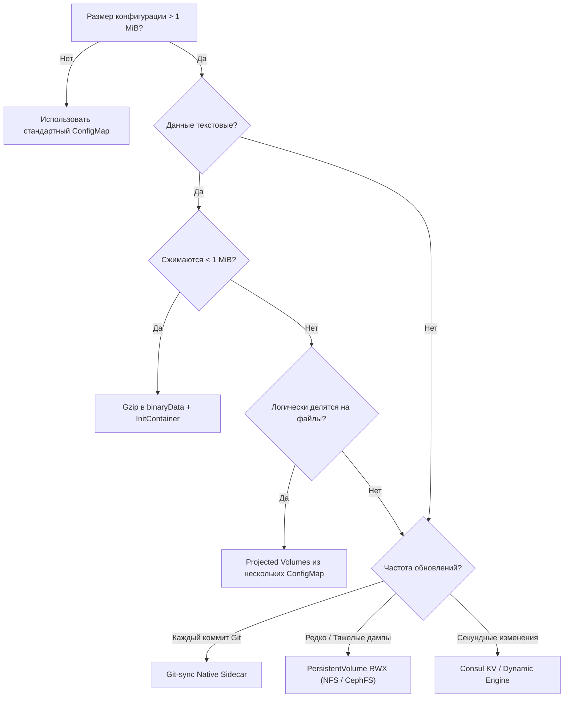

# Работа с большими конфигурациями (>1 MiB)

**Актуально для:** Kubernetes 1.28–1.32+

## Определения

**Лимит размера ConfigMap** — системное архитектурное ограничение платформы Kubernetes, при котором суммарный размер одного объекта API `kind: ConfigMap` (включая метаданные `metadata`, ключи и значения в полях `data` и `binaryData`) не может превышать **1 MiB** (1 048 576 байт). При попытке создания или обновления объекта большего размера `kube-apiserver` отклоняет транзакцию с ошибкой HTTP 413 `RequestEntityTooLarge`.

**`--max-request-bytes`** — параметр запуска распределенного хранилища `etcd` (по умолчанию `1572864` байт / 1.5 MiB), задающий предельный размер входящего gRPC-запроса к серверу etcd. Учитывает сериализованный protobuf/JSON-объект, накладные расходы протокола и ключи транзакции.

**`binaryData`** — поле спецификации ConfigMap (`map[string]string`), содержащее бинарные данные, закодированные в Base64. Используется для хранения нетекстовых файлов, сжатых архивов (Gzip, Zstandard) и бинарных словарей.

**Projected Volume** — специализированный механизм монтирования томов Kubernetes, объединяющий несколько независимых источников конфигураций (несколько ConfigMap, Secret, Downward API, ServiceAccountToken) в единую файловую директорию контейнера без ограничений `subPath`.

**Native Sidecar Containers** — механизм Kubernetes (стабилен с v1.29, KEP-753), позволяющий запускать вспомогательные контейнеры в блоке `initContainers` со спецификацией `restartPolicy: Always`. Гарантирует запуск и инициализацию sidecar-процесса (например, `git-sync` или `vault-agent`) строго до старта основных контейнеров приложения и завершение после их остановки.

**ReadWriteMany (RWX)** — режим доступа к постоянным томам (`PersistentVolumeClaim`), позволяющий одновременно монтировать один и тот же том на чтение и запись множеству подов, расположенных на разных физических рабочих узлах кластера.

---

## Архитектура и принципы работы

### Почему 1 MiB — фундаментальное ограничение etcd

Ограничение в 1 MiB не является произвольным параметром интерфейса CLI, а вытекает из внутренней архитектуры распределенного консенсуса `etcd` и модели транзакций `kube-apiserver`:

```
Client (kubectl / CI) ──( HTTP POST/PUT )──► kube-apiserver (JSON Unmarshal / Validation)
                                                    │
                                             ( gRPC Raft Proposal )
                                                    ▼
                                          etcd Leader (WAL Entry)
                                          ┌────────────────────────┐
                                          │ Raft Replicate (Log)   │
                                          │ Bbolt B+Tree Commit    │
                                          └────────────────────────┘
                                                    │
                                         ( Raft AppendEntries )
                                                    ▼
                                         etcd Followers (Quorum)
```

1. **Raft Consensus и сериализация журнала (WAL):**
   - Каждая операция записи в etcd преобразуется в запись журнала упреждающей записи (Write-Ahead Log, WAL).
   - Записи реплицируются лидером кластера etcd на все узлы-фолловеры синхронно через gRPC-вызовы `AppendEntries`.
   - Передача крупных блоков данных (например, объектов по 5–10 MiB) монополизирует сетевой канал между узлами etcd, приводит к задержкам передачи периодических heartbeat-сообщений (по умолчанию каждые 100 мс) и провоцирует ложные тайм-ауты лидера с последующим перевыбором (Leader Election Spikes).

2. **Bbolt B+Tree и фрагментация памяти:**
   - Внутренний движок хранения etcd (bbolt) хранит данные на диске в виде B+ дерева с фиксированным размером страниц (обычно 4 KiB).
   - Крупные значения не помещаются в стандартные листовые страницы и выделяются в так называемые «overflow pages» (страницы переполнения). Это приводит к ускоренной фрагментации дискового пространства, деградации производительности compaction и росту задержек fsync на дисках Control Plane.

3. **Аллокация памяти в `kube-apiserver`:**
   - Для каждого запроса `kube-apiserver` производит десериализацию JSON/YAML в структуры Golang, валидацию схемы, прогон через цепочку Admission Webhooks, сериализацию в Protocol Buffers и отправку в etcd.
   - При активных Watch-подписках (например, когда тысячи `kubelet` читают ConfigMap) объект многократно копируется в памяти API-сервера. Если объект весит десятки мегабайт, Control Plane быстро исчерпывает оперативную память (OOM) и страдает от задержек сборщика мусора (GC pauses).

При превышении лимита `kube-apiserver` прерывает обработку запроса на этапе валидации и возвращает статус HTTP 413:

```
Error from server (RequestEntityTooLarge): the server responded with the status code 413
```

---

### Архитектурные паттерны преодоления лимита

Для доставки конфигураций, превышающих 1 MiB, в enterprise-инфраструктуре без использования облачных управляемых сервисов применяются семь базовых архитектурных паттернов:

```
                                  Размер данных конфигурации?
                                                │
                     ┌──────────────────────────┴──────────────────────────┐
                     ▼                                                     ▼
                <= 5 MiB                                                > 5 MiB
                     │                                                     │
         ┌───────────┴───────────┐                         ┌───────────────┴───────────────┐
         ▼                       ▼                         ▼                               ▼
Логически делим?          Сжимаем текст?             Частота обновлений?              Секретные данные?
(Nginx, HAProxy, Envoy)   (JSON, XML, Таблицы)             │                               │
         │                       │                 ┌───────┴───────┐                       ▼
         ▼                       ▼                 ▼               ▼                  Vault Agent
  Разбиение через       binaryData (Gzip)       Частые          Редкие                  Sidecar
 Projected Volumes     + Init-Container        (GitOps)      (RWX Volumes)             (emptyDir)
                                                   │               │
                                                   ▼               ▼
                                               Git-sync        NFS / CephFS /
                                                Native          Shared PVC
                                               Sidecar
```

---

### Сравнительная матрица стратегий

| Стратегия | Допустимый объем | Место хранения | Задержка доставки (Hot Reload) | Инфраструктурные требования | GitOps-совместимость |
| :--- | :--- | :--- | :--- | :--- | :--- |
| **Projected Volumes (Разбиение)** | До 5 MiB суммарно (каждый <1 MiB) | etcd кластера | Автоматически через Kubelet (60–90 с) | Нет (нативные ресурсы K8s) | Высокая (чистый YAML/Kustomize) |
| **Сжатие (Gzip / Zstandard)** | До 5–10 MiB исходного текста | etcd кластера (`binaryData`) | Требует рестарта пода (или inotify-скрипта) | Нет (стандартный `initContainer`) | Высокая (архивирование на этапе сборки/CI) |
| **PersistentVolume (NFS/CephFS)** | Без ограничений (Гигабайты) | On-premise СХД (NFS, Ceph, Longhorn) | Мгновенно (при изменении файла на СХД) | Наличие RWX StorageClass в кластере | Средняя (данные вне Git-манифеста пода) |
| **Git-sync Native Sidecar** | Без ограничений (Сотни мегабайт) | Внутренний Git (GitLab, Gitea) | 15–60 секунд (период опроса git-sync) | Git-сервер, сетевая доступность пода к Git | Идеальная (источник правды — Git-коммит) |
| **S3-совместимое хранилище (MinIO/Ceph)** | Без ограничений (Гигабайты) | On-premise MinIO / Ceph RGW | Требует рестарта пода (Init) или Sidecar | MinIO/Ceph кластер в сети | Высокая (артефакты версионируются в бакете) |
| **Распределенный KV (Consul)** | Десятки мегабайт | Кластер HashiCorp Consul | Субсекундная (<1 с через Long Polling) | Выделенный кластер Consul | Средняя (хранение в Consul KV) |
| **Vault Agent Sidecar** | Десятки мегабайт | HashiCorp Vault | Субсекундная (по истечении TTL или событию) | Кластер Vault | Высокая (шаблоны в Git, секреты в Vault) |

---

## Практические сценарии

### Сценарий 1: Логическое разбиение на несколько ConfigMap через Projected Volume

Когда конфигурация логически состоит из множества файлов (например, директория `/etc/nginx/conf.d/` с десятками виртуальных хостов или правила алертов Prometheus), конфигурацию разбивают на несколько независимых объектов ConfigMap размером <1 MiB каждый.

Использование `projected` тома вместо множества директив `subPath` решает ключевую проблему: **сохраняется автоматическое обновление файлов Kubelet'ем** (механизм symlink swap), и исключаются блокировки со стороны ядра Linux.

#### Манифест конфигурационных объектов:

```yaml
# 01-nginx-upstreams.yaml
apiVersion: v1
kind: ConfigMap
metadata:
  name: nginx-cfg-upstreams
  namespace: production
data:
  upstreams.conf: |
    upstream auth_backend {
        zone auth_backend 64k;
        server auth-srv-01.internal:8080 max_fails=3 fail_timeout=10s;
        server auth-srv-02.internal:8080 max_fails=3 fail_timeout=10s;
        keepalive 32;
    }
    upstream api_backend {
        zone api_backend 128k;
        server api-srv-01.internal:8081;
        server api-srv-02.internal:8081;
        keepalive 64;
    }
---
# 02-nginx-vhosts.yaml
apiVersion: v1
kind: ConfigMap
metadata:
  name: nginx-cfg-vhosts
  namespace: production
data:
  api-vhost.conf: |
    server {
        listen 80;
        server_name api.example.internal;

        location /auth/ {
            proxy_pass http://auth_backend;
            proxy_http_version 1.1;
            proxy_set_header Connection "";
        }

        location /v1/ {
            proxy_pass http://api_backend;
            proxy_http_version 1.1;
            proxy_set_header Connection "";
        }
    }
```

#### Манифест Deployment с Projected Volume:

```yaml
# deployment-projected.yaml
apiVersion: apps/v1
kind: Deployment
metadata:
  name: edge-nginx
  namespace: production
spec:
  replicas: 2
  selector:
    matchLabels:
      app: edge-nginx
  template:
    metadata:
      labels:
        app: edge-nginx
    spec:
      containers:
      - name: nginx
        image: nginx:1.27-alpine
        ports:
        - containerPort: 80
        volumeMounts:
        # Все спроецированные файлы объединяются в единую целевую директорию
        - name: combined-nginx-configs
          mountPath: /etc/nginx/conf.d
          readOnly: true
      volumes:
      - name: combined-nginx-configs
        projected:
          defaultMode: 0440
          sources:
          - configMap:
              name: nginx-cfg-upstreams
          - configMap:
              name: nginx-cfg-vhosts
```

**Особенности работы:**
- Оба ConfigMap проецируются в директорию `/etc/nginx/conf.d/` (`upstreams.conf` и `api-vhost.conf`).
- При изменении любого из объектов Kubelet атомарно переключает symlink-каталог `..data`.

---

### Сценарий 2: Сжатие больших текстовых данных (Gzip) в `binaryData` + распаковка через InitContainer

Текстовые конфигурации (JSON-схемы, списки ACL, правила брандмауэра, GeoIP, дампы маршрутизации) размером 3–8 MiB обладают коэффициентом сжатия 70–90%. Будучи упакованными алгоритмом Gzip, они сжимаются до 300–700 KiB, легко укладываясь в системный лимит ConfigMap.

#### Подготовка данных на рабочей станции инженера:

```bash
# 1. Замер исходного размера файла
ls -lh acl-rules.json
# → -rw-r--r-- 1 devops devops 4.8M Oct 13 19:15 acl-rules.json

# 2. Сжатие файла алгоритмом gzip с максимальным уровнем компрессии
gzip -9 -c acl-rules.json > acl-rules.json.gz

# 3. Проверка размера сжатого файла
ls -lh acl-rules.json.gz
# → -rw-r--r-- 1 devops devops 480K Oct 13 19:15 acl-rules.json.gz

# 4. Создание ConfigMap с автоматическим помещением файла в binaryData
kubectl create configmap app-compressed-rules \
  --namespace=production \
  --from-file=acl-rules.json.gz=acl-rules.json.gz \
  --dry-run=client -o yaml > compressed-configmap.yaml
```

#### Манифест ConfigMap с полем `binaryData`:

```yaml
# compressed-configmap.yaml
apiVersion: v1
kind: ConfigMap
metadata:
  name: app-compressed-rules
  namespace: production
binaryData:
  # Base64-представление gzip-архива (размер в etcd ~640 KiB)
  acl-rules.json.gz: H4sICDxU6WYA/2FjbC1ydWxlcy5qc29uAO3BAQ0AAADCoPtX32Av...
```

#### Манифест Pod с распаковкой через `initContainers` в `emptyDir`:

```yaml
# pod-decompression.yaml
apiVersion: apps/v1
kind: Deployment
metadata:
  name: rule-engine
  namespace: production
spec:
  replicas: 2
  selector:
    matchLabels:
      app: rule-engine
  template:
    metadata:
      labels:
        app: rule-engine
    spec:
      initContainers:
      - name: decompress-config
        image: busybox:1.36-musl
        command:
        - sh
        - -c
        - |
          set -euo pipefail
          echo "Распаковка архива конфигурации..."
          gunzip -c /compressed/acl-rules.json.gz > /target/acl-rules.json
          chmod 0640 /target/acl-rules.json
          echo "Распаковка завершена. Размер: $(wc -c < /target/acl-rules.json) байт"
        volumeMounts:
        - name: source-volume
          mountPath: /compressed
          readOnly: true
        - name: decompressed-volume
          mountPath: /target
      containers:
      - name: engine
        image: internal-registry.infra.local/apps/rule-engine:v1.4.0
        volumeMounts:
        - name: decompressed-volume
          mountPath: /etc/rules
          readOnly: true
      volumes:
      - name: source-volume
        configMap:
          name: app-compressed-rules
      - name: decompressed-volume
        emptyDir:
          # При необходимости высокой скорости IO и малом размере используем Memory
          medium: Memory
          sizeLimit: 64Mi
```

---

### Сценарий 3: Использование PersistentVolume (RWX) для сверхбольших конфигураций

Если конфигурационные файлы превышают 10–50 MiB или представляют собой тяжелые бинарные базы (GeoIP MaxMind, индексы полнотекстового поиска, локальные таблицы маршрутизации), их выносят на постоянные тома `PersistentVolumeClaim` с режимом доступа `ReadWriteMany` (RWX), поддерживаемым локальными хранилищами NFS, CephFS или Longhorn.

#### Манифест PVC (ReadWriteMany) на локальном NFS/CephFS:

```yaml
# config-pvc.yaml
apiVersion: v1
kind: PersistentVolumeClaim
metadata:
  name: shared-config-pvc
  namespace: production
spec:
  accessModes:
    - ReadWriteMany
  storageClassName: nfs-client # Или cephfs, longhorn
  resources:
    requests:
      storage: 2Gi
```

#### Декларативная Job для первичного наполнения или обновления тома:

Вместо нестабильной императивной команды `kubectl cp` в production используется детерминированная Kubernetes Job, выполняющая загрузку и валидацию конфигурации:

```yaml
# job-config-seeder.yaml
apiVersion: batch/v1
kind: Job
metadata:
  name: config-seeder-v12
  namespace: production
spec:
  ttlSecondsAfterFinished: 3600
  template:
    spec:
      restartPolicy: OnFailure
      containers:
      - name: seeder
        image: curlimages/curl:8.6.0
        command:
        - sh
        - -c
        - |
          set -euo pipefail
          TARGET_DIR="/mnt/config-storage"
          echo "Загрузка конфигурации из внутреннего репозитория артефактов..."
          curl -fSL http://nexus.infra.local/repository/configs/app/config-v12.tar.gz -o /tmp/config.tar.gz
          echo "Распаковка в постоянный том..."
          tar -xzf /tmp/config.tar.gz -C "$TARGET_DIR"
          touch "$TARGET_DIR/.version_v12"
          echo "Готово."
        volumeMounts:
        - name: storage
          mountPath: /mnt/config-storage
      volumes:
      - name: storage
        persistentVolumeClaim:
          claimName: shared-config-pvc
```

#### Манифест Deployment, потребляющий конфигурацию с PVC:

```yaml
# deployment-pvc.yaml
apiVersion: apps/v1
kind: Deployment
metadata:
  name: geo-service
  namespace: production
spec:
  replicas: 3
  selector:
    matchLabels:
      app: geo-service
  template:
    metadata:
      labels:
        app: geo-service
    spec:
      containers:
      - name: app
        image: internal-registry.infra.local/apps/geo-service:v2.1.0
        volumeMounts:
        - name: shared-configs
          mountPath: /data/geoip
          readOnly: true
      volumes:
      - name: shared-configs
        persistentVolumeClaim:
          claimName: shared-config-pvc
          readOnly: true
```

---

### Сценарий 4: Git-sync v4 через Native Sidecar Container (K8s 1.29+)

Паттерн Git-sync обеспечивает синхронизацию файлов конфигурации напрямую из локального Git-репозитория (GitLab, Gitea) в разделяемый том `emptyDir`. Начиная с Kubernetes 1.29 (GA механизма Native Sidecar Containers), контейнер `git-sync` запускается внутри `initContainers` с флагом `restartPolicy: Always`.

**Преимущества Native Sidecar перед классическим контейнером:**
1. Kubelet блокирует запуск основных контейнеров приложения до тех пор, пока `git-sync` не выполнит первичное клонирование и не перейдет в статус Ready.
2. Процесс `git-sync` продолжает работать в фоновом режиме на протяжении всей жизни пода, регулярно опрашивая ветку Git.

```yaml
# deployment-gitsync-native.yaml
apiVersion: apps/v1
kind: Deployment
metadata:
  name: report-generator
  namespace: production
spec:
  replicas: 2
  selector:
    matchLabels:
      app: report-generator
  template:
    metadata:
      labels:
        app: report-generator
    spec:
      initContainers:
      # Native Sidecar контейнер: запускается первым, остается работать постоянно
      - name: git-sync
        image: registry.k8s.io/git-sync/git-sync:v4.4.0
        restartPolicy: Always
        args:
        - --repo=http://gitea.infra.local/devops/report-templates.git
        - --ref=main
        - --period=30s
        - --root=/etc/git-templates
        - --link=current
        - --max-sync-failures=3
        env:
        - name: GITSYNC_USERNAME
          valueFrom:
            secretKeyRef:
              name: gitea-auth-secret
              key: username
        - name: GITSYNC_PASSWORD
          valueFrom:
            secretKeyRef:
              name: gitea-auth-secret
              key: token
        volumeMounts:
        - name: shared-templates
          mountPath: /etc/git-templates
        resources:
          requests:
            cpu: 20m
            memory: 32Mi
          limits:
            cpu: 100m
            memory: 128Mi
      containers:
      - name: reporter
        image: internal-registry.infra.local/apps/reporter:v3.0.0
        volumeMounts:
        # Доступ к текущей актуальной версии через симлинк current
        - name: shared-templates
          mountPath: /templates
          subPath: current
          readOnly: true
      volumes:
      - name: shared-templates
        emptyDir: {}
```

---

### Сценарий 5: Локальное S3-совместимое хранилище (MinIO / Ceph RGW) + Init-контейнер

Для выгрузки больших наборов конфигурационных файлов и словарей из локального объектного хранилища MinIO или Ceph Object Gateway (RGW) без зависимостей от внешних облаков используется утилита `mc` (MinIO Client) в `initContainers`.

```yaml
# deployment-minio-init.yaml
apiVersion: apps/v1
kind: Deployment
metadata:
  name: parser-worker
  namespace: production
spec:
  replicas: 2
  selector:
    matchLabels:
      app: parser-worker
  template:
    metadata:
      labels:
        app: parser-worker
    spec:
      initContainers:
      - name: fetch-s3-config
        image: quay.io/minio/mc:RELEASE.2024-03-03T17-50-39Z
        command:
        - sh
        - -c
        - |
          set -euo pipefail
          echo "Настройка подключения к локальному MinIO..."
          mc alias set local-minio "$MINIO_ENDPOINT" "$MINIO_ACCESS_KEY" "$MINIO_SECRET_KEY" --api S3v4

          echo "Скачивание конфигурационного пакета..."
          mc cp local-minio/app-configs/production/dictionaries.tar.gz /config-tmp/

          echo "Распаковка артефактов в целевой том..."
          tar -xzf /config-tmp/dictionaries.tar.gz -C /app/configs/
          rm -f /config-tmp/dictionaries.tar.gz
          echo "Конфигурация успешно загружена."
        env:
        - name: MINIO_ENDPOINT
          value: "http://minio-service.storage.svc.cluster.local:9000"
        - name: MINIO_ACCESS_KEY
          valueFrom:
            secretKeyRef:
              name: minio-app-credentials
              key: access-key
        - name: MINIO_SECRET_KEY
          valueFrom:
            secretKeyRef:
              name: minio-app-credentials
              key: secret-key
        volumeMounts:
        - name: config-storage
          mountPath: /app/configs
        - name: temp-storage
          mountPath: /config-tmp
      containers:
      - name: worker
        image: internal-registry.infra.local/apps/parser-worker:v1.12.0
        volumeMounts:
        - name: config-storage
          mountPath: /app/configs
          readOnly: true
      volumes:
      - name: config-storage
        emptyDir: {}
      - name: temp-storage
        emptyDir: {}
```

---

### Сценарий 6: Динамическая конфигурация через HashiCorp Consul KV

Для динамических настроек, меняющихся во время работы сервиса с требованием доставки менее 1 секунды, ConfigMap заменяется на локальный кластер Consul.

```yaml
# deployment-consul-template.yaml
apiVersion: apps/v1
kind: Deployment
metadata:
  name: payment-processor
  namespace: production
spec:
  replicas: 2
  selector:
    matchLabels:
      app: payment-processor
  template:
    metadata:
      labels:
        app: payment-processor
    spec:
      initContainers:
      # Генерация начальной конфигурации до запуска приложения
      - name: consul-template-init
        image: hashicorp/consul-template:0.39.0
        command:
        - consul-template
        - -consul-addr=consul-server.consul.svc.cluster.local:8500
        - -template=/templates/app.json.ctmpl:/rendered/app.json
        - -once
        volumeMounts:
        - name: templates
          mountPath: /templates
        - name: config-dir
          mountPath: /rendered
      containers:
      # Основное приложение
      - name: app
        image: internal-registry.infra.local/apps/payment-processor:v2.0.0
        volumeMounts:
        - name: config-dir
          mountPath: /etc/app
          readOnly: true
      # Sidecar для фонового отслеживания изменений (Dynamic Hot Reload)
      - name: consul-template-sidecar
        image: hashicorp/consul-template:0.39.0
        command:
        - consul-template
        - -consul-addr=consul-server.consul.svc.cluster.local:8500
        - -template=/templates/app.json.ctmpl:/rendered/app.json
        volumeMounts:
        - name: templates
          mountPath: /templates
        - name: config-dir
          mountPath: /rendered
      volumes:
      - name: templates
        configMap:
          name: app-consul-templates
      - name: config-dir
        emptyDir: {}
```

> Детальное описание архитектуры KV и консенсуса см. в [Consul KV Store](../../../Consul/consul_kv_store.md).

---

### Сценарий 7: HashiCorp Vault Agent Sidecar для больших секретных конфигураций

Если конфигурационный файл превышает 1 MiB и содержит конфиденциальные параметры (сертификаты mTLS, ключи шифрования, токены интеграций), его запрещено хранить в незашифрованном виде. Для рендеринга больших секретных файлов применяется `vault-agent` с Native Sidecar контейнером.

```yaml
# deployment-vault-agent.yaml
apiVersion: apps/v1
kind: Deployment
metadata:
  name: secured-api
  namespace: production
spec:
  replicas: 2
  selector:
    matchLabels:
      app: secured-api
  template:
    metadata:
      labels:
        app: secured-api
    spec:
      serviceAccountName: secured-api-sa
      initContainers:
      - name: vault-agent
        image: hashicorp/vault:1.16.1
        restartPolicy: Always
        args:
        - agent
        - -config=/vault/config/agent.hcl
        volumeMounts:
        - name: vault-config
          mountPath: /vault/config
        - name: shared-secrets
          mountPath: /vault/rendered
      containers:
      - name: api
        image: internal-registry.infra.local/apps/secured-api:v5.0.0
        volumeMounts:
        - name: shared-secrets
          mountPath: /etc/app/security
          readOnly: true
      volumes:
      - name: vault-config
        configMap:
          name: vault-agent-config
      - name: shared-secrets
        emptyDir:
          medium: Memory
          sizeLimit: 128Mi
```

> Архитектура интеграции и примеры `agent.hcl` подробно разобраны в [Vault Agent Sidecar Pattern](../../../Vault/guides/vault_agent/sidecar_pattern.md).

---

### Сценарий 8: Впекание неизменяемой конфигурации в OCI-образ (Image Baking)

Если многомегабайтные конфигурации меняются строго одновременно с кодом приложения в рамках цикла релизов CI/CD, наиболее стабильный SysAdmin-подход — упаковка файлов в OCI-образ контейнера:

```dockerfile
# Dockerfile
FROM alpine:3.20
WORKDIR /app
COPY app-binary /app/
# Впекание тяжелой статичной конфигурации (15 MiB)
COPY configs/large-rules-catalog.json /app/configs/rules.json
USER 10001:10001
ENTRYPOINT ["/app/app-binary"]
CMD ["--config=/app/configs/rules.json"]
```

**Преимущества:**
- Полная изоляция от etcd, СХД и сети при старте пода.
- Мгновенный запуск контейнеров (время старта не зависит от выгрузки файлов).
- Атомарность версий: код и конфиг версионируются единым SHA256-хешем образа.

---

## Операции и команды

### 1. Измерение размера локального файла перед созданием ConfigMap

Для предотвращения падения CI/CD пайплайнов проверяйте суммарный объем данных перед выполнением `kubectl apply`:

```bash
# Проверка размера в байтах
wc -c < config-source.json
# → 1048500

# Вычисление запаса до лимита 1 MiB (1 048 576 байт)
python3 -c "size = 1048500; limit = 1048576; print(f'Размер: {size} B. Остаток: {limit - size} B')"
# → Размер: 1048500 B. Остаток: 76 B
```

### 2. Замер размера существующего объекта в кластере

```bash
# Получение точного объема данных полей data и binaryData
kubectl get configmap app-config -n production -o json | jq '
  [.data // {} | to_entries[] | .value | length] +
  [.binaryData // {} | to_entries[] | .value | length] | add // 0
'
# → 854120
```

### 3. Кластерный аудит: Поиск топ-10 самых тяжелых ConfigMap

Команда для системного администратора, позволяющая выявить объекты, находящиеся на грани превышения лимита:

```bash
# Сканирование всех пространств имен и сортировка по размеру полезной нагрузки
kubectl get configmaps -A -o json | jq -r '
  .items[] |
  {
    namespace: .metadata.namespace,
    name: .metadata.name,
    bytes: (
      ([.data // {} | to_entries[] | .value | length] +
       [.binaryData // {} | to_entries[] | .value | length]) | add // 0
    )
  } |
  "\(.bytes)\t\(.namespace)/\(.name)"
' | sort -nr | head -n 10
# → 1042100	monitoring/prometheus-aggregated-rules
# → 987540	production/nginx-edge-full-config
# → 892300	default/core-service-bootstrap
# → 750120	kube-system/kube-proxy
# → 450100	ingress-nginx/ingress-nginx-controller
```

### 4. Проверка параметров лимитов etcd на Master-ноде

```bash
# Проверка флага --max-request-bytes в манифесте etcd
grep -E 'max-request-bytes|quota-backend-bytes' /etc/kubernetes/manifests/etcd.yaml
# → - --max-request-bytes=1572864
# → - --quota-backend-bytes=8589934592
```

---

## Диагностика и устранение неполадок

### Таблица типовых ошибок и сценариев сбоев

| Симптом / Ошибка | Первопричина | Диагностика | Решение |
| :--- | :--- | :--- | :--- |
| `Error from server (RequestEntityTooLarge): 413` | Манифест ConfigMap превышает 1 048 576 байт | `kubectl apply -f cm.yaml -v=8 2>&1 \| grep 413` | Разбить на несколько ConfigMap, применить сжатие gzip или вынести в PV/Git-sync |
| `etcdserver: request is too large` | Размер gRPC-запроса превысил параметр `--max-request-bytes` | Журнал `journalctl -u kube-apiserver` или логи etcd | Уменьшить размер объекта либо поднять `--max-request-bytes` на серверах etcd |
| `CrashLoopBackOff` у основного контейнера | Приложение стартовало раньше, чем Init-контейнер/Sidecar загрузил файл | `kubectl logs <pod> -c app` → `FileNotFoundException: /etc/config/app.json` | Использовать Native Sidecar (`restartPolicy: Always`) или `initContainers` |
| `no space left on device` в поде | Переполнение `emptyDir` при распаковке файлов в память (`medium: Memory`) | `kubectl describe pod <pod>` → `Evicted: The node had condition: DiskPressure` | Увеличить `sizeLimit` тома `emptyDir` либо переключить его на стандартный диск |
| Ошибка доступа `EACCES: permission denied` | Контейнер приложения работает под non-root, а файлы смонтированы с правами root | `kubectl logs <pod>` → `open /etc/app/config.json: permission denied` | Задать `securityContext.fsGroup: <ID>` и `defaultMode: 0440` в спецификации тома |
| Конфигурация не обновляется при изменении ConfigMap | Файл смонтирован в под с использованием директивы `subPath` | `kubectl exec -it <pod> -- cat /etc/config.json` показывает старые данные | Заменить `subPath` на Projected Volume или использовать `inotify`-триггер перезапуска |
| Git-sync ошибка `fatal: could not read Username` | Неверные учетные данные в Secret или сетевая блокировка Git | `kubectl logs <pod> -c git-sync` | Проверить поля `GITSYNC_USERNAME`/`PASSWORD` и доступность Git-сервера по сети |

---

## Рекомендации и лучшие практики

### 1. Архитектурное дерево решений



### 2. Безопасность и разграничение прав доступа

При передаче конфигураций через разделяемые тома (`emptyDir` или `PersistentVolume`) соблюдайте системные ограничения безопасности ядра:

- **Запрет root-пользователя:** Все контейнеры (основные и вспомогательные) должны запускаться от непривилегированного пользователя:
  ```yaml
  securityContext:
    runAsNonRoot: true
    runAsUser: 10001
    runAsGroup: 10001
    fsGroup: 10001
  ```
- **Монтирование только для чтения:** Основной контейнер приложения должен монтировать директорию с конфигурацией строго с директивой `readOnly: true`, предотвращая случайное или вредоносное изменение файлов изнутри процесса.
- **Маска доступа к файлам:** Для предотвращения утечки данных между пользователями узла указывайте `defaultMode: 0440` (чтение владельцем и группой).

### 3. Ограничение ресурсов для Sidecar-контейнеров

Вспомогательные процессы (`git-sync`, `consul-template`, `vault-agent`) не должны приводить к деградации основного приложения:
- Всегда выставляйте `resources.limits` и `resources.requests` для sidecar-контейнеров (рекомендуется: `requests: 20m CPU / 32Mi RAM`, `limits: 100m CPU / 128Mi RAM`).
- Если `emptyDir` монтируется в RAM (`medium: Memory`), выделенная память учитывается в лимитах памяти пода (`memory limits`). Не допускайте исчерпания памяти хоста.

### 4. Мониторинг и алертинг (Prometheus Rules)

Для своевременного обнаружения попыток заливки сверхбольших объектов и сбоев в Control Plane добавьте правила алертинга Prometheus:

```yaml
# prometheus-rules-configmap-limits.yaml
apiVersion: monitoring.coreos.com/v1
kind: PrometheusRule
metadata:
  name: apiserver-configmap-alerts
  namespace: monitoring
spec:
  groups:
  - name: configmap.limits.rules
    rules:
    - alert: ApiserverEntityTooLargeErrors
      expr: |
        sum by (resource) (
          rate(apiserver_request_total{code="413"}[5m])
        ) > 0
      for: 2m
      labels:
        severity: warning
      annotations:
        summary: "API-сервер отклоняет запросы с ошибкой HTTP 413 RequestEntityTooLarge"
        description: "Обнаружены попытки создания или обновления объектов (ConfigMap/Secret) размером более 1 MiB."

    - alert: EtcdRequestTooLargeDetected
      expr: |
        increase(etcd_server_failed_proposals_total[5m]) > 0
      for: 1m
      labels:
        severity: critical
      annotations:
        summary: "Ошибки фиксации предложений в etcd"
        description: "etcd отклоняет запросы на запись. Возможна попытка отправки транзакции, превышающей --max-request-bytes."
```

---

## Дополнительная информация

### Внутренние параметры и лимиты etcd

| Параметр etcd | Значение по умолчанию | Рекомендуемый максимум | Влияние на кластер |
| :--- | :--- | :--- | :--- |
| `--max-request-bytes` | `1572864` (1.5 MiB) | `10485760` (10 MiB) | Предельный размер одного gRPC-запроса. Увеличение приводит к задержкам репликации Raft. |
| `--quota-backend-bytes` | `2147483648` (2 GiB) | `8589934592` (8 GiB) | Максимальный физический размер базы bbolt на диске. При превышении включается режим `alarm:NOSPACE`. |
| `--snapshot-count` | `100000` | `10000`–`50000` (для тяжелых данных) | Частота сброса транзакций WAL в снапшот. При больших объектах снижают для уменьшения размера WAL. |

> **Предупреждение:** Изменение параметра `--max-request-bytes` в etcd требует синхронного изменения параметров `kube-apiserver` и клиентских библиотек gRPC (`MaxCallSendMsgSize`). В enterprise-эксплуатации изменение этого флага **категорически не рекомендуется** — правильным решением является вынос тяжелых данных на выделенные уровни хранения (PV, Git, MinIO).

---

### Ссылки на связанные материалы

- [Создание ConfigMap](./creation.md) — декларативные подходы, генераторы Kustomize и Helm.
- [Неизменяемые (Immutable) ConfigMap](./immutable.md) — защита от дрейфа конфигурации и оптимизация Watch Reduction.
- [Использование ConfigMap в поде](./pod_usage.md) — механизмы монтирования томов, subPath и переменные окружения.
- [Обновление и Rollout](./update_and_rollout.md) — стратегия актуализации конфигураций без простоев.
- [Рекомендации и лучшие практики](./best_practices.md) — границы применимости и стандарты именования.
- [Готовые шаблоны ConfigMap](./practical_templates.md) — production-шаблоны для Nginx, HAProxy, PostgreSQL.
- [Хранение секретов в etcd](../secrets/etcd_storage.md) — анатомия хранения объектов `core/v1` в распределенной базе.
- [Обзор etcd](../../Concepts/etcd_overview.md) — архитектура консенсуса Raft и транзакционная модель.
- [PV и PVC в Kubernetes](../../Storage/pv_and_pvc.md) — постоянные тома и режимы доступа в кластере.
- [NFS Subdir External Provisioner](../../Storage/nfs-subdir-external-provisioner.md) — развертывание RWX хранилища на базе NFS.
- [Паттерны сайдкар-контейнеров](../Pod/pod_sidecar_patterns.md) — расширение функциональности подов через sidecar.
- [Consul KV Store](../../../Consul/consul_kv_store.md) — распределенное хранилище динамической конфигурации.
- [Vault Agent Sidecar Pattern](../../../Vault/guides/vault_agent/sidecar_pattern.md) — доставка защищенных конфигураций через sidecar.
