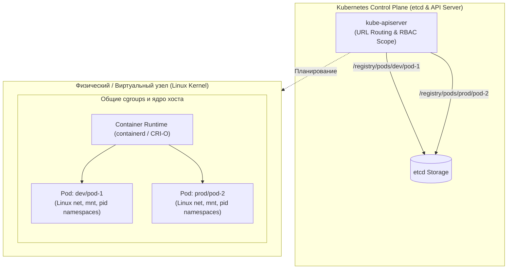

# Пространства имен (Namespace)

**Актуально для:** Kubernetes 1.30–1.35

## Определения

**Namespace (Пространство имен)** — объект базового API Kubernetes (`apiVersion: v1`, `kind: Namespace`), обеспечивающий виртуальное разделение одного физического кластера на изолированные логические сегменты. Namespace задает область видимости (scope) для имен ресурсов, авторизации RBAC, политик безопасности PSA и квот потребления вычислительных мощностей.

**Namespaced Resources (Ресурсы с областью видимости Namespace)** — объекты API, жизненный цикл и уникальность имен которых ограничены конкретным пространством имен (например, `Pod`, `Service`, `Deployment`, `ConfigMap`, `Secret`, `PersistentVolumeClaim`).

**Cluster-scoped Resources (Общекластерные ресурсы)** — глобальные объекты кластера, не принадлежащие ни одному пространству имен и разделяемые между всеми тенантами (например, `Node`, `PersistentVolume`, `StorageClass`, `ClusterRole`, `ValidatingAdmissionPolicy`).

**Namespace Lifecycle (Жизненный цикл Namespace)** — последовательность состояний пространства имен в процессе его существования. Включает две фазы: `Active` (полноценное функционирование) и `Terminating` (каскадное удаление всех вложенных объектов контроллером `namespace-controller` перед физическим удалением записи из etcd).

**Финализатор (Finalizer)** — механизм в Kubernetes, препятствующий удалению объекта из базы данных `etcd`, пока массив `metadata.finalizers` или `spec.finalizers` не станет пустым. Для пространств имен встроенный финализатор `kubernetes` гарантирует, что само пространство не будет удалено до тех пор, пока контроллер не удалит все находящиеся в нем ресурсы.

**Pod Security Admission (PSA)** — встроенный в API-сервер механизм допуска (Admission Controller), регулирующий соответствие развертываемых подов стандартам безопасности **Pod Security Standards (PSS)** на основе меток, установленных на объекте `Namespace`.

**ResourceQuota и LimitRange** — встроенные механизмы планирования и квотирования ресурсов. `ResourceQuota` задает жесткий суммарный лимит потребления (CPU, память, число объектов) для всего Namespace, а `LimitRange` задает минимальные, максимальные и назначаемые по умолчанию ограничения для отдельных контейнеров.

**Soft Multi-Tenancy (Мягкая мульти-тенантность)** — модель совместного использования кластера доверенными командами одной организации, где изоляция строится на базе логических границ: Namespace, RBAC, NetworkPolicy, ResourceQuota и PSA. Пространства имен обеспечивают исключительно мягкую мульти-тенантность, так как разделяют общее ядро хостов, сеть и Control Plane.

---

## Основные концепции и архитектура

### Архитектура изоляции и представление в etcd

На системном уровне Kubernetes Namespace — это абстракция уровня Control Plane (API-сервера). В распределенном хранилище `etcd` все namespaced-объекты физически сохраняются с префиксом пути, содержащим имя пространства имен:

```
/registry/<resource-plural>/<namespace>/<name>
# Например:
/registry/pods/production/payment-api-7b8f994d4-2k4lp
/registry/services/production/payment-api
/registry/configmaps/production/app-config
```

Общекластерные ресурсы не имеют сегмента `<namespace>` в пути:
```
/registry/nodes/k8s-worker-01
/registry/namespaces/production
/registry/storageclasses/local-nvme
```

Когда клиент (например, `kubectl` или CI/CD раннер) выполняет REST-запрос к API-серверу:
1. Запрос маршрутизируется по URL вида `/api/v1/namespaces/{namespace}/{resource}/{name}`.
2. Модуль аутентификации идентифицирует субъекта (User / ServiceAccount).
3. Модуль авторизации **RBAC** проверяет права субъекта на выполнение глагола (`get`, `list`, `create`, `delete`) в рамках указанного пространства имен (`RoleBinding`) либо кластера в целом (`ClusterRoleBinding`).
4. На этапе Admission Control контроллеры валидируют и мутируют объект с учетом правил и меток целевого Namespace (`LimitRange`, `ResourceQuota`, `Pod Security Admission`, `ValidatingAdmissionPolicy`).

> [!IMPORTANT]
> **Различие между Linux Namespaces и Kubernetes Namespaces (Критично для SRE/SysAdmin):**
> Создание Kubernetes `Namespace` **не создает** пространств имен ядра Linux (`net`, `pid`, `mnt`, `ipc`, `uts`, `user`) и не выделяет контрольные группы `cgroups` на рабочих узлах (Node). 
> 
> Пространства имен ядра Linux и ограничения cgroups создаются низкоуровневым Container Runtime (`containerd`, `CRI-O`) непосредственно в момент запуска конкретного **Pod**, а не при создании объекта `Namespace`. Два пода из разных пространств имен Kubernetes, попавшие на один рабочий узел, разделяют одно ядро операционной системы, таблицу маршрутизации хоста (если не изолированы CNI), диск и системные вызовы.



### Жизненный цикл Namespace и цикл согласования (Reconciliation)

Управление жизненным циклом пространств имен возложено на `namespace-controller`, работающий внутри демона `kube-controller-manager`.

```
[ Active ] ─── (kubectl delete ns) ───> [ Terminating ] ─── (Cleanup OK) ───> [ Deleted from etcd ]
                                              │
                                     (Discovery failure /
                                      Stuck Finalizer)
                                              │
                                              ▼
                                    [ Hung in Terminating ]
```

1. **Фаза Active:** Пространство имен доступно для создания и модификации ресурсов.
2. **Инициализация удаления:** При отправке запроса на удаление (`kubectl delete ns <name>`):
   - API-сервер устанавливает временную метку `metadata.deletionTimestamp`.
   - Поле `status.phase` переключается в значение `Terminating`.
   - Запрещается создание любых новых ресурсов внутри данного пространства имен (возвращается ошибка `403 Forbidden: unable to create new content in namespace ... because it is being terminated`).
3. **Каскадная очистка (Discovery & Deletion):**
   - Контроллер `namespace-controller` опрашивает **Discovery API** кластера, чтобы получить полный перечень всех доступных в кластере namespaced-ресурсов (как core-ресурсов, так и CRD, а также агрегированных APIService).
   - Для каждого типа ресурса контроллер отправляет команду удаления всех экземпляров в удаляемом пространстве имен.
   - Контроллер периодически перепроверяет, что счетчик ресурсов каждого типа равен нулю.
4. **Снятие финализатора и удаление:**
   - После того как все объекты внутри Namespace физически удалены, контроллер выполняет подзапрос к подресурсу `finalize` (`/api/v1/namespaces/<name>/finalize`), удаляя системный финализатор `kubernetes` из массива `spec.finalizers`.
   - Объект Namespace с пустым списком финализаторов физически удаляется из базы `etcd`.

> [!WARNING]
> Если хотя бы один зарегистрированный в кластере `APIService` (например, кастомный `metrics-server` или вебхук cert-manager) недоступен или падает с таймаутом, Discovery API не сможет вернуть полный список типов ресурсов. В этом случае контроллер Namespace блокирует каскадное удаление из соображений целостности данных, переводя Namespace в состояние зависания (`DiscoveryFailed`).

### Типы ресурсов по области действия (Namespaced vs Cluster-wide)

| Область действия | Категория | Ресурсы Kubernetes |
| :--- | :--- | :--- |
| **Namespaced** | Рабочие нагрузки (Workloads) | [Pod](./Pod/pod_overview.md), [Deployment](./Deployment/index.md), [StatefulSet](./StatefulSet/statefulset_overview.md), [DaemonSet](./daemonset.md), [Job / CronJob](./job.md) |
| **Namespaced** | Конфигурация и сеть | [Service](../Networking/Service/service_overview.md), [Ingress](../Networking/Ingress/overview.md), [HTTPRoute](../Networking/gateway_api/resources.md), [ConfigMap](./configmap.md), [Secret](./secrets/secrets_basics.md), `PersistentVolumeClaim` |
| **Namespaced** | Политики и квоты | `NetworkPolicy`, `ResourceQuota`, `LimitRange`, `RoleBinding`, `Role` |
| **Cluster-wide** | Вычислительная инфраструктура | `Node`, `PersistentVolume`, `StorageClass`, `PriorityClass`, `RuntimeClass` |
| **Cluster-wide** | Безопасность и политики | `ClusterRole`, `ClusterRoleBinding`, `ValidatingAdmissionPolicy`, `MutatingWebhookConfiguration` |
| **Cluster-wide** | Мета-объекты и расширения | `Namespace`, `CustomResourceDefinition`, `APIService` |

### Ограничения именования (RFC 1123 DNS Label)

Имя Namespace включается в состав доменных имен сервисов, поэтому оно строго валидируется по стандарту **RFC 1123 DNS Label**:
*   Длина: от **1 до 63 символов**.
*   Допустимые символы: только строчные латинские буквы (`a-z`), цифры (`0-9`) и дефис (`-`).
*   Специальные правила: дефис не может быть первым или последним символом; подчеркивания (`_`) и точки (`.`) **запрещены**.

### DNS-адресация, CoreDNS и FQDN

Встроенный DNS-сервер кластера (CoreDNS) формирует полные доменные имена (**FQDN**) для сетевых сервисов по строгой иерархии:

$$\text{FQDN} = \langle\text{service-name}\rangle.\langle\text{namespace}\rangle.\text{svc}.\langle\text{cluster-domain}\rangle$$

Например: `postgres.database.svc.cluster.local`.

Каждый под в кластере получает сгенерированный файл `/etc/resolv.conf`, содержащий поисковые домены:
```ini
search <current-namespace>.svc.cluster.local svc.cluster.local cluster.local
nameserver 10.96.0.10
options ndots:5
```

**Особенности разрешения имен для SRE/SysAdmin:**
*   **Внутри одного Namespace:** Достаточно использовать короткое имя сервиса (`curl http://billing-api`). Резолвер найдет его по первой записи в `search`.
*   **Между разными Namespace:** Необходимо указывать как минимум `<service>.<namespace>` (`curl http://billing-api.finance`).
*   **Влияние на производительность (ndots:5):** При обращении по внешним адресам (например, `external-api.company.corp`) libc контейнера сначала последовательно перебирает все поисковые суффиксы с участием текущего Namespace. В высоконагруженных системах рекомендуется использовать FQDN с точкой на конце (`external-api.company.corp.`), чтобы исключить паразитные DNS-запросы к CoreDNS.

### Стандартные системные пространства имен

*   **`default`:** Пространство имен, используемое по умолчанию для любых команд `kubectl` и манифестов без указания `metadata.namespace`. В Production размещение нагрузок в `default` запрещено; оно должно оставаться пустым.
*   **`kube-system`:** Зарезервировано исключительно для системных компонентов Kubernetes Control Plane, CNI-плагинов, CoreDNS, kube-proxy и управляющих агентов. Нагрузки пользователей здесь блокируются.
*   **`kube-public`:** Общедоступное пространство имен, доступное для чтения всем субъектам, включая неаутентифицированных пользователей (`system:unauthenticated`). Исторически содержит ConfigMap `cluster-info` для инициализации нод кластера.
*   **`kube-node-lease`:** Содержит легковесные объекты `Lease` для каждого рабочего узла. Узлы отправляют регулярные heartbeats в свои Lease-объекты, что снижает нагрузку на etcd по сравнению со старой схемой обновления полного статуса объекта `Node`.

### Pod Security Admission (PSA)

Механизм **Pod Security Admission (PSA)** контролирует допустимость параметров безопасности подов в конкретном Namespace. Настройка выполняется через метки пространства имен:

```yaml
metadata:
  labels:
    pod-security.kubernetes.io/enforce: "restricted"
    pod-security.kubernetes.io/enforce-version: "latest"
    pod-security.kubernetes.io/warn: "restricted"
    pod-security.kubernetes.io/audit: "restricted"
```

*   **Режимы действия:**
    *   `enforce`: Блокирует создание подов, нарушающих политику (возвращает HTTP 403).
    *   `warn`: Пропускает создание пода, но возвращает предупреждение пользователю в выводе `kubectl` / CI пайплайна.
    *   `audit`: Пропускает создание пода, но записывает событие нарушения в аудит-лог API-сервера.
*   **Уровни безопасности (PSS):**
    *   `privileged`: Полное отсутствие ограничений (для CNI, CSI драйверов в `kube-system`).
    *   `baseline`: Запрет критических привилегий (hostNetwork, hostPID, capability escalation).
    *   `restricted`: Следование строгим практикам безопасности (read-only rootfs, non-root user, сброс всех capabilities за исключением необходимых).

### Автоматическая метка kubernetes.io/metadata.name

Начиная с Kubernetes 1.21, admission-плагин API-сервера автоматически добавляет и гарантирует неизменность метки:
```yaml
metadata:
  labels:
    kubernetes.io/metadata.name: <имя-пространства-имен>
```

Это исключает необходимость вручную размечать пространства имен для селекторов `namespaceSelector` в сетевых политиках `NetworkPolicy` и правилах `podAffinity`.

---

## Практические сценарии

### Сценарий 1: Декларативное создание безопасного Namespace (Production Baseline)

В корпоративной среде создание Namespace должно осуществляться через GitOps с обязательной разметкой принадлежности и параметров безопасности:

```yaml
# production-namespace.yaml
apiVersion: v1
kind: Namespace
metadata:
  name: payment-prod
  labels:
    # Идентификация и биллинг / FinOps
    environment: production
    team: payments
    cost-center: "cc-4091"
    # Настройки Pod Security Admission
    pod-security.kubernetes.io/enforce: "restricted"
    pod-security.kubernetes.io/enforce-version: "latest"
    pod-security.kubernetes.io/warn: "restricted"
    pod-security.kubernetes.io/warn-version: "latest"
  annotations:
    contact: "payments-oncall@company.corp"
    runbook: "https://wiki.company.corp/runbooks/payments"
```

Применение манифеста и проверка:

```bash
# Применение манифеста
kubectl apply -f production-namespace.yaml
# → namespace/payment-prod created

# Проверка созданного пространства имен и установленных меток
kubectl get ns payment-prod --show-labels
# → NAME           STATUS   AGE   LABELS
# → payment-prod   Active   10s   cost-center=cc-4091,environment=production,kubernetes.io/metadata.name=payment-prod,pod-security.kubernetes.io/enforce=restricted,pod-security.kubernetes.io/enforce-version=latest,pod-security.kubernetes.io/warn=restricted,pod-security.kubernetes.io/warn-version=latest,team=payments
```

### Сценарий 2: Комплексная изоляция тенанта (Namespace + ResourceQuota + LimitRange + Default-Deny NetworkPolicy)

При предоставлении пространства имен команде разработки администратор обязан развернуть базовый комплект изоляции: квоты, лимиты по умолчанию и сетевую микросегментацию.

```yaml
# tenant-isolation.yaml
apiVersion: v1
kind: Namespace
metadata:
  name: analytics-staging
  labels:
    environment: staging
    team: analytics
    pod-security.kubernetes.io/enforce: "baseline"
---
# 1. Лимиты по умолчанию для предотвращения создания контейнеров без requests/limits
apiVersion: v1
kind: LimitRange
metadata:
  name: default-container-limits
  namespace: analytics-staging
spec:
  limits:
  - type: Container
    default: # Лимиты, если не указаны
      cpu: "500m"
      memory: "512Mi"
    defaultRequest: # Запросы, если не указаны
      cpu: "100m"
      memory: "128Mi"
    max: # Максимум на один контейнер
      cpu: "2"
      memory: "4Gi"
    min: # Минимум на один контейнер
      cpu: "50m"
      memory: "64Mi"
---
# 2. Суммарная квота на всё пространство имен
apiVersion: v1
kind: ResourceQuota
metadata:
  name: compute-quota
  namespace: analytics-staging
spec:
  hard:
    requests.cpu: "4"
    requests.memory: "8Gi"
    limits.cpu: "8"
    limits.memory: "16Gi"
    pods: "20"
    persistentvolumeclaims: "5"
    requests.storage: "100Gi"
---
# 3. Полная изоляция входящего сетевого трафика (Default Deny Ingress)
apiVersion: networking.k8s.io/v1
kind: NetworkPolicy
metadata:
  name: default-deny-ingress
  namespace: analytics-staging
spec:
  podSelector: {} # Применяется ко всем подам в namespace
  policyTypes:
  - Ingress
```

Применение и проверка ограничений:

```bash
# Применение комплексного манифеста
kubectl apply -f tenant-isolation.yaml
# → namespace/analytics-staging created
# → limitrange/default-container-limits created
# → resourcequota/compute-quota created
# → networkpolicy/default-deny-ingress created

# Проверка созданной квоты и текущего потребления
kubectl describe resourcequota compute-quota -n analytics-staging
# → Name:                   compute-quota
# → Namespace:              analytics-staging
# → Resource                Used  Hard
# → --------                ----  ----
# → limits.cpu              0     8
# → limits.memory           0     16Gi
# → persistentvolumeclaims  0     5
# → pods                    0     20
# → requests.cpu            0     4
# → requests.memory         0     8Gi
# → requests.storage        0     100Gi
```

### Сценарий 3: Защита критических Namespace от случайного удаления через ValidatingAdmissionPolicy

Начиная с Kubernetes 1.30 (GA), механизм **ValidatingAdmissionPolicy** позволяет средствами встроенного языка CEL (Common Expression Language) предотвратить удаление защищенных пространств имен без использования сторонних вебхуков:

```yaml
# protect-namespaces-policy.yaml
apiVersion: admissionregistration.k8s.io/v1
kind: ValidatingAdmissionPolicy
metadata:
  name: "prevent-critical-namespace-deletion"
spec:
  failurePolicy: Fail
  matchConstraints:
    resourceRules:
    - apiGroups: [""]
      apiVersions: ["v1"]
      operations: ["DELETE"]
      resources: ["namespaces"]
  validations:
  - expression: "!('deletion-protection' in object.metadata.labels && object.metadata.labels['deletion-protection'] == 'enabled')"
    message: "Удаление данного Namespace запрещено политикой безопасности: снятие блокировки требует удаления метки deletion-protection=enabled."
---
apiVersion: admissionregistration.k8s.io/v1
kind: ValidatingAdmissionPolicyBinding
metadata:
  name: "prevent-critical-namespace-deletion-binding"
spec:
  policyName: "prevent-critical-namespace-deletion"
  validationActions: [Deny]
```

Применение защиты и проверка блокировки:

```bash
# Применение политики
kubectl apply -f protect-namespaces-policy.yaml
# → validatingadmissionpolicy.admissionregistration.k8s.io/prevent-critical-namespace-deletion created
# → validatingadmissionpolicybinding.admissionregistration.k8s.io/prevent-critical-namespace-deletion-binding created

# Установка метки защиты на namespace
kubectl label ns payment-prod deletion-protection=enabled
# → namespace/payment-prod labeled

# Попытка удалить защищенный namespace
kubectl delete ns payment-prod
# → Error from server (Forbidden): admission webhook "validatingadmissionpolicy.admissionregistration.k8s.io" denied the request: Удаление данного Namespace запрещено политикой безопасности: снятие блокировки требует удаления метки deletion-protection=enabled.
```

### Сценарий 4: Управление контекстом и переключение (CLI Toolkit)

Для предотвращения случайных операций в чужом окружении системный администратор должен оперативно управлять активным контекстом и рабочим пространством имен:

```bash
# Установить пространство имен по умолчанию для активного контекста kubeconfig
kubectl config set-context --current --namespace=payment-prod
# → Context "kubernetes-admin@cluster.local" modified.

# Проверить текущий активный namespace в контексте
kubectl config view --minify -o jsonpath='{.contexts[0].context.namespace}'
# → payment-prod

# Использование специализированной утилиты kubens (пакет kubectx)
kubens analytics-staging
# → Active namespace is "analytics-staging".

# Возврат к предыдущему пространству имен через kubens
kubens -
# → Active namespace is "payment-prod".
```

### Сценарий 5: Аудит и проверка матрицы прав RBAC в пространстве имен

Проверка того, какие операции разрешены конкретному пользователю или служебной учетной записи (`ServiceAccount`), без необходимости реального выполнения команд:

```bash
# Проверка возможности создания подов текущим пользователем
kubectl auth can-i create pods -n payment-prod
# → yes

# Проверка возможности удаления секретов
kubectl auth can-i delete secrets -n payment-prod
# → no

# Проверка прав конкретного ServiceAccount из CI/CD пайплайна
kubectl auth can-i update deployments -n payment-prod --as=system:serviceaccount:payment-prod:deployer
# → yes

# Вывод полного списка доступных прав субъекта в конкретном namespace
kubectl auth can-i --list -n payment-prod
# → Resources                                       Non-Resource URLs   Resource Names   Verbs
# → configmaps                                      []                  []               [get list watch]
# → deployments.apps                                []                  []               [*]
# → pods                                            []                  []               [get list watch create delete]
```

### Сценарий 6: Housekeeping и инспекция состояния кластера

Полезные идиомы и команды командной строки для SRE-инженера:

```bash
# Быстрый аудит всех объектов в пространстве имен
kubectl get all -n payment-prod
# → NAME                               READY   STATUS    RESTARTS   AGE
# → pod/payment-api-7b8f994d4-2k4lp    1/1     Running   0          5h
# → service/payment-api                ClusterIP   10.96.12.44   <none>   80/TCP   5h
# → deployment.apps/payment-api        1/1     1            1          5h

# Подсчет количества подов по каждому Namespace в кластере
kubectl get pods -A --no-headers | awk '{print $1}' | sort | uniq -c | sort -rn
# → 42   kube-system
# → 18   payment-prod
# → 12   analytics-staging
# → 4    ingress-nginx

# Поиск пространств имен, в которых отсутствует ResourceQuota (риск исчерпания памяти хостов)
comm -23 <(kubectl get ns --no-headers | awk '{print $1}' | sort) \
         <(kubectl get resourcequota -A --no-headers | awk '{print $1}' | sort -u)
# → default
# → kube-public
# → test-playground

# Безопасное удаление всех Deployments и Services внутри тестового namespace без удаления самого NS
kubectl delete deployment,svc --all -n test-playground
# → deployment.apps "stub-service" deleted
# → service "stub-service" deleted
```

### Сценарий 7: Архитектурный разбор «Весь интернет в одном Namespace» (Capacity Planning)

Классический вопрос системного проектирования и технических собеседований для SRE: *«Что произойдет, если запустить абсолютно все сервисы и рабочие нагрузки гигантской инфраструктуры в одном-единственном Namespace?»*

**Глубокий технический анализ системных ограничений:**

1. **Ограничения etcd и Control Plane:**
   - Каждое обновление статуса пода, эндпоинта или секрета генерирует событие в etcd. Внутри одного пространства имен контроллеры (например, `deployment-controller`, `endpointslice-controller`) вынуждены подписываться (`WATCH`) на огромный единый пул ресурсов.
   - Запросы `LIST` без фильтрации по селекторам для получения десятков тысяч объектов в одном Namespace приводят к резкому скачку потребления памяти `kube-apiserver` (OOM-Killed) и огромным JSON/Protobuf сериализациям (размер одного ответа API может превышать рекомендуемый лимит etcd в 1.5 МБ).
2. **Взрывной рост правил iptables / IPVS на узлах:**
   - Если в одном Namespace развернуты десятки тысяч сервисов (`ClusterIP`), демон `kube-proxy` на каждом рабочем узле должен поддерживать гигантские таблицы правил сетевой трансляции. Это приводит к задержкам синхронизации правил (packet processing latency) и деградации сетевого стека ядра Linux.
3. **Деградация DNS-подсистемы (CoreDNS):**
   - Межсервисные вызовы без изоляции вынуждены опрашивать CoreDNS. Если тысячи сервисов находятся в одной плоской плоскости имен, повышается вероятность коллизий, а при сбоях кэширования CoreDNS сталкивается с DNS-штормом (`NXDOMAIN storm`), выводящим из строя весь кластер.
4. **Невозможность реализации безопасности (Blast Radius):**
   - При отсутствии разделения по Namespace невозможно настроить гранулярный RBAC: разработчик одного сервиса получает доступ к секретам всех остальных сервисов.
   - Невозможно построить модель нулевого доверия (Zero Trust) через `NetworkPolicy`: микросегментация требует селекторов по меткам пространств имен (`namespaceSelector`).
   - Любая авария или ошибка автоматизации имеет максимальный радиус поражения (Blast Radius = 100% инфраструктуры).

---

## Диагностика и устранение неполадок (Troubleshooting)

### Проблема 1: Namespace завис в состоянии Terminating (Stuck Finalizer)

Самая частая аварийная ситуация с объектом `Namespace` в практике системного администратора.

#### Причины возникновения
1. **Неудаляемые дочерние ресурсы:** В пространстве имен остались поды, PVC или CRD-объекты, удерживаемые собственными зависшими финализаторами (например, том PVC не может отмонтироваться из-за аварии CSI-драйвера хранилища).
2. **Недоступный APIService (DiscoveryFailed):** В кластере зарегистрирован агрегированный API (`kubectl get apiservice`), контроллер которого упал или недоступен. `namespace-controller` не может подтвердить отсутствие ресурсов этой группы и блокирует удаление.
3. **Ошибки Admission Webhook:** Валидирующий или мутирующий вебхук перехватывает операцию удаления дочерних объектов и падает с ошибкой, препятствуя очистке.

#### Систематический алгоритм устранения

```
                 Namespace завис в Terminating
                              │
                              ▼
           Проверить status.conditions объекта Namespace
                              │
         ┌────────────────────┴────────────────────┐
         ▼                                         ▼
   DiscoveryFailed?                        ContentRemaining?
         │                                         │
Проверить apiservice:                      Найти неудаленные
kubectl get apiservice | grep False        ресурсы в namespace
         │                                         │
Удалить сбойный APIService                 Снять финализаторы
(kubectl delete apiservice <name>)         с дочерних объектов
```

**Шаг 1: Изучение условий блокировки в статусе Namespace**

```bash
kubectl get ns staging-test -o json | jq '.status.conditions'
# → [
# →   {
# →     "type": "NamespaceContentRemaining",
# →     "status": "True",
# →     "reason": "SomeResourcesRemain",
# →     "message": "Some resources are remaining: pods. has 1 resource instances"
# →   },
# →   {
# →     "type": "NamespaceFinalizersRemaining",
# →     "status": "True",
# →     "reason": "SomeFinalizersRemain",
# →     "message": "Some content in the namespace has finalizers remaining: [custom.operator.io/protection]"
# →   }
# → ]
```

**Шаг 2: Проверка состояния APIServices (исключение DiscoveryFailed)**

```bash
kubectl get apiservice | grep False
# → v1beta1.custom.metrics.k8s.io   monitoring/custom-metrics   False (ServiceNotFound)   12d

# Если найден сломанный APIService, удалите его, чтобы разблокировать discovery:
kubectl delete apiservice v1beta1.custom.metrics.k8s.io
# → apiservice.apiregistration.k8s.io "v1beta1.custom.metrics.k8s.io" deleted
```

**Шаг 3: Поиск оставшихся ресурсов в пространстве имен**

```bash
# Сканирование всех namespaced-ресурсов кластера на наличие объектов в зависшем namespace
kubectl api-resources --verbs=list --namespaced -o name | \
  xargs -n 1 kubectl get --show-kind --ignore-not-found -n staging-test
# → pod/stuck-worker-6789f-8x9pz
```

**Шаг 4: Анализ и снятие финализатора с зависшего дочернего ресурса**

```bash
# Проверка финализаторов блокирующего пода
kubectl get pod stuck-worker-6789f-8x9pz -n staging-test -o jsonpath='{.metadata.finalizers}'
# → ["custom.operator.io/protection"]

# Снятие финализатора с дочернего объекта (штатный и безопасный способ решения)
kubectl patch pod stuck-worker-6789f-8x9pz -n staging-test -p '{"metadata":{"finalizers":[]}}' --type=merge
# → pod/stuck-worker-6789f-8x9pz patched

# После этого контроллер удалит под, а затем автоматически завершит удаление namespace:
kubectl get ns staging-test
# → Error from server (NotFound): namespaces "staging-test" not found
```

> [!CAUTION]
> **Крайняя аварийная мера: Очистка финализатора Namespace напрямую**
> Если все ресурсы удалены, но пространство имен все равно не удаляется из-за бага Control Plane, допускается напрямую очистить `spec.finalizers` через подресурс `finalize`. 
> 
> Никогда не применяйте этот метод, пока в Namespace остаются объекты! Это приведет к появлению «ресурсов-сирот» (orphaned resources) в etcd, которые невозможно будет удалить стандартными средствами.

```bash
# Аварийная очистка финализатора kubernetes через curl к локальному прокси
kubectl proxy --port=8001 &
# → Starting to serve on 127.0.0.1:8001

# Отправка очищенного манифеста в API-сервер
curl -k -H "Content-Type: application/json" -X PUT \
  --data '{"apiVersion":"v1","kind":"Namespace","metadata":{"name":"staging-test"},"spec":{"finalizers":[]}}' \
  http://127.0.0.1:8001/api/v1/namespaces/staging-test/finalize
# → {"kind":"Namespace","apiVersion":"v1", ...}

# Завершение фонового процесса прокси
kill %1
```

Подробнее о механизмах работы финализаторов см. в [Pod Terminating — финализаторы и проблемы CSI](../Troubleshooting/Common_Errors/PodTerminating/finalizer_issues.md).

### Проблема 2: Ошибка «exceeded quota» при развертывании приложений

#### Симптомы
Пользователь или пайплайн получает отказ при создании пода:
```
Error from server (Forbidden): pods "api-gateway-556bc9d97d-z8k2l" is forbidden: 
exceeded quota: compute-quota, requested: requests.cpu=500m, used: requests.cpu=3800m, limited: requests.cpu=4
```

#### Диагностика и решение
1. **Проверка текущей квоты:**
   ```bash
   kubectl describe resourcequota -n payment-prod
   # → Name:            compute-quota
   # → Resource        Used   Hard
   # → --------        ----   ----
   # → requests.cpu    3800m  4
   ```
2. **Поиск потребителей ресурсов внутри Namespace:**
   ```bash
   kubectl top pods -n payment-prod --sort-by=cpu
   ```
3. **Устранение:**
   - Либо снизить `requests.cpu` в спецификации деплоймента;
   - Либо удалить устаревшие/неиспользуемые реплики;
   - Либо скорректировать лимиты в объекте `ResourceQuota` в соответствии с регламентом capacity planning.

Подробнее о настройке квот и классов обслуживания см. в [QoS, Limits и Requests](../Scheduling/qos_limit_and_requests.md).

### Проблема 3: Отклонение подов политикой Pod Security Admission

#### Симптомы
При попытке применить манифест пода API-сервер возвращает ошибку:
```
Error from server (Forbidden): pods "privileged-agent" is forbidden: violates PodSecurity "restricted:latest": 
allowPrivilegeEscalation != false, unrestricted capabilities, runAsNonRoot != true
```

#### Диагностика и решение
1. **Проверка уровня PSA на Namespace:**
   ```bash
   kubectl get ns payment-prod -o custom-columns=NAME:.metadata.name,PSA:.metadata.labels.pod-security\.kubernetes\.io/enforce
   # → NAME           PSA
   # → payment-prod   restricted
   ```
2. **Проверка манифеста в режиме dry-run:**
   ```bash
   kubectl create -f pod.yaml -n payment-prod --dry-run=server
   # → Позволяет локализовать все поля SecurityContext, не удовлетворяющие требованиям.
   ```
3. **Решение:** Привести секцию `securityContext` пода в соответствие стандарту Restricted (добавить `runAsNonRoot: true`, `allowPrivilegeEscalation: false`, `readOnlyRootFilesystem: true`, сбросить capabilities: `drop: ["ALL"]`). Детальные примеры — в [Security Context в Kubernetes](../Security/pod_security_context.md).

---

## Мониторинг и наблюдаемость Namespace (SRE/DevOps)

Для обеспечения надежности мульти-тенантного кластера SRE-инженеры обязаны отслеживать метрики жизненного цикла пространств имен и утилизации ресурсов через `kube-state-metrics`.

### Ключевые метрики (kube-state-metrics)

| Метрика | Тип | Назначение |
| :--- | :--- | :--- |
| `kube_namespace_status_phase{namespace="...", phase="..."}` | Gauge | Текущая фаза Namespace: `Active` (значение 1) или `Terminating` (значение 1). |
| `kube_namespace_created{namespace="..."}` | Gauge | Время создания пространства имен в формате Unix Timestamp. |
| `kube_namespace_labels{namespace="..."}` | Gauge | Метки пространства имен (критично для PromQL группировки по командам и окружениям). |
| `kube_resourcequota{namespace="...", resource="...", type="hard|used"}` | Gauge | Жесткие лимиты и текущий объем потребления квотируемых ресурсов. |

### Продакшен-алерты (PrometheusRule)

```yaml
# namespace-alerts.yaml
apiVersion: monitoring.coreos.com/v1
kind: PrometheusRule
metadata:
  name: namespace-operational-alerts
  namespace: monitoring
spec:
  groups:
  - name: namespace.rules
    rules:
    # 1. Оповещение о зависшем удалении Namespace
    - alert: NamespaceStuckInTerminating
      expr: |
        kube_namespace_status_phase{phase="Terminating"} == 1
      for: 15m
      labels:
        severity: warning
        tier: platform
      annotations:
        summary: "Namespace {{ $labels.namespace }} завис в фазе Terminating"
        description: "Пространство имен {{ $labels.namespace }} находится в состоянии Terminating более 15 минут. Возможная причина: зависшие финализаторы подов/PVC или недоступный APIService."
        runbook_url: "https://wiki.company.corp/runbooks/k8s/stuck-namespace"

    # 2. Предупреждение об исчерпании квоты ресурсов тенантом
    - alert: NamespaceResourceQuotaExhaustionWarning
      expr: |
        (
          kube_resourcequota{type="used"}
          /
          kube_resourcequota{type="hard"}
        ) * 100 > 85
      for: 10m
      labels:
        severity: warning
        tier: application
      annotations:
        summary: "Квота ресурса {{ $labels.resource }} в namespace {{ $labels.namespace }} исчерпана на {{ $value | printf \"%.1f\" }}%"
        description: "Потребление ресурса приближается к максимуму. Новые поды начнут отклоняться планировщиком."

    # 3. Обнаружение производственных Namespace без установленных квот
    - alert: ProductionNamespaceMissingQuota
      expr: |
        kube_namespace_labels{label_environment="production"} == 1
        unless on(namespace)
        kube_resourcequota
      for: 30m
      labels:
        severity: critical
        tier: governance
      annotations:
        summary: "В продакшен-namespace {{ $labels.namespace }} отсутствует ResourceQuota"
        description: "Отсутствие ResourceQuota в Production создает риск отказа по памяти (OOM) и деградации соседних сервисов."
```

---

## Рекомендации и лучшие практики (Best Practices)

1. **Единый стандарт именования (Naming Conventions):**
   - Используйте шаблон `<продукт>-<окружение>` или `<домен>-<сервис>-<окружение>` (например, `billing-core-prod`, `data-lake-dev`).
   - Имена должны быть в нижнем регистре, с дефисами (`kebab-case`), длиной не более 40 символов (для резервирования места под имена подов и сервисов в DNS).
   - Запрещено использовать в именах чувствительную информацию, номера версий ПО или имена конкретных сотрудников.

2. **Шаблон «Zero-Day Namespace» (Обязательный Baseline):**
   Ни один Namespace не должен создаваться «пустым». В каждый новый Namespace должны автоматически (через Helm, Kustomize или GitOps контроллер) раскатываться:
   - Метки PSA (`enforce: restricted` или `baseline`);
   - Объект `LimitRange` с дефолтными и максимальными ограничениями;
   - Объект `ResourceQuota` для защиты от перерасхода мощностей;
   - Базовая политика `NetworkPolicy` (Default-Deny Ingress с явным открытием нужных портов).

3. **Отказ от ClusterRoleBinding для прикладных сервисов:**
   - Сервисные учетные записи (`ServiceAccount`) приложений должны связываться с ролями исключительно через `RoleBinding` в рамках своего пространства имен.
   - Использование `ClusterRoleBinding` допускается только для общекластерных инфраструктурных агентов (мониторинг, ingress, CNI, storage).

4. **Защита от случайного удаления в Production:**
   - Ограничьте права на глагол `delete` для ресурса `namespaces` в RBAC. Обычные разработчики и сервисные аккаунты CI/CD не должны иметь права удалять пространства имен.
   - Используйте нативную политику `ValidatingAdmissionPolicy` с проверкой метки `deletion-protection=enabled` на всех критических сегментах.

5. **Метаданные для FinOps и атрибуции затрат:**
   - Размечайте каждый Namespace обязательными метками: `owner`, `cost-center`, `env`. Это позволит системам биллинга корректно разносить инфраструктурные затраты по подразделениям.

6. **Осознанный выбор уровня изоляции (Soft vs Hard Multi-Tenancy):**
   - **Namespace:** Идеален для изоляции доверенных сервисов внутри одной компании (Soft Multi-Tenancy).
   - **vcluster (Virtual Clusters):** Рекомендуется, если тенантам требуются собственные CRD, разные версии операторов или независимый API-сервер без затрат на физический кластер.
   - **Отдельные физические кластеры:** Обязательны для недоверенного кода, жестких требований регуляторов (PCI-DSS, HIPAA) или при угрозе побега из контейнера на уровне ядра хоста (Hard Multi-Tenancy).

---

## Дополнительная информация

### Связанные стандарты и спецификации
*   **RFC 1123:** Требования к именованию доменных узлов интернета (DNS-1123).
*   **Kubernetes Enhancement Proposals (KEP-2579):** Стандарты Pod Security Admission.
*   **Kubernetes Enhancement Proposals (KEP-3488):** ValidatingAdmissionPolicy на базе CEL.

### См. также
*   [Обзор управления доступом на основе ролей (RBAC)](../Security/rbac/rbac_overview.md) — разграничение прав доступа субъектов в пространствах имен.
*   [Сетевые политики (Network Policies)](../Networking/Network/network_policy.md) — межнеймспейсовая и внутринеймспейсовая микросегментация трафика.
*   [QoS, Limits и Requests](../Scheduling/qos_limit_and_requests.md) — настройка ресурсных ограничений и классов обслуживания.
*   [Мульти-тенантность в Kubernetes](../Concepts/multi-tenancy.md) — архитектурные паттерны совместного использования кластера.
*   [Pod Terminating — финализаторы и проблемы CSI](../Troubleshooting/Common_Errors/PodTerminating/finalizer_issues.md) — глубокая диагностика зависших финализаторов.
*   [Security Context в Kubernetes](../Security/pod_security_context.md) — требования безопасности подов и контейнеров.
*   [Продвинутая авторизация: Ограничения RBAC, OPA Gatekeeper, Kyverno и ValidatingAdmissionPolicy](../Security/rbac/limitations_opa.md) — декларативная валидация операций с ресурсами.
*   [Архитектура мониторинга и логирования в Kubernetes](../MonitoringLogging/kubernetes-monitoring-logging-architecture.md) — сбор метрик Control Plane и рабочих нагрузок.
