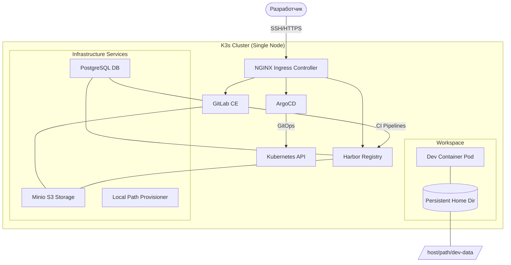

# Архитектура Dev-окружения на K3s

Обзор архитектуры самодостаточной лаборатории для изучения практик DevOps на базе легковесного дистрибутива Kubernetes K3s. Все вспомогательные сервисы (CI/CD, реестр, GitOps) запускаются внутри кластера.

Контекст: Этот файл описывает общую архитектуру. Детали реализации см. в [Создание Dev-контейнера с SSH](./dev_container_ssh.md), [Развертывание через Helm](./dev_container_helm_deployment.md), [Интеграция GitLab с Harbor](./gitlab_harbor_integration.md).

---

## Определения

| Термин | Описание |
| :--- | :--- |
| **K3s Dev Environment** | Самодостаточная лаборатория для изучения DevOps-практик на базе одного сервера с K3s. Все сервисы (GitLab, Harbor, ArgoCD) запускаются внутри кластера. |
| **Dev-контейнер** | Изолированное рабочее пространство в кластере с доступом по протоколу SSH и персистентной домашней директорией через `hostPath` или `Local PV`. |
| **K3s Server** | Режим K3s, запускающий компоненты Control Plane (API Server, Scheduler, Controller Manager, etcd/SQLite) и опционально — рабочую нагрузку. Аналог control-plane ноды в kubeadm. |
| **K3s Agent** | Режим K3s, подключающий рабочий узел к серверу. Запускает kubelet и containerd, размещает поды по указанию сервера. Может быть добавлен бесконечное количество агентов. |
| **containerd** | Container Runtime по умолчанию в K3s. Отвечает за скачивание, изоляцию и запуск контейнеров через runc (OCI-compliant). Сокет: `/run/k3s/containerd/containerd.sock`. |
| **CoreDNS** | DNS-сервер кластера, обеспечивающий разрешение имён сервисов (например, `gitlab.default.svc.cluster.local`). Единственный компонент, критичный для работы Service Discovery. |
| **Traefik** | Встроенный Ingress Controller в K3s по умолчанию. Автоматически обнаруживает сервисы по аннотациям. В данной лаборатории отключается в пользу NGINX для соответствия prod-стандартам. |
| **Local Path Provisioner** | Встроенный в K3s провизионер для динамического выделения хранилища на локальных дисках узла. Используется как стандарт для dev-сред. |
| **Kine** | Абстрактный слой в K3s, позволяющий использовать SQLite, PostgreSQL или MySQL вместо etcd для хранения состояния Control Plane. |
| **ServiceLB** | Встроенный в K3s балансировщик нагрузки, использующий порты хоста для экспонирования сервисов типа `LoadBalancer`. Подменяет внешний IP на IP узла. |
| **CNI (Flannel)** | Container Network Interface по умолчанию в K3s, обеспечивающий L3-связность между подами через VXLAN-туннели. Другие варианты: Calico, Cilium (требуют отключения встроенного Flannel). |
| **cert-manager** | Kubernetes-controller для автоматического выпуска и продления TLS-сертификатов. Поддерживает Let's Encrypt, self-signed и внутренние CA. |
| **HelmChart CRD** | Custom Resource Definition в K3s, позволяющая применять Helm-чарты как нативные манифесты через директорию `/var/lib/rancher/k3s/server/manifests/`. |

Навигация по K3s: [Kubernetes Overview](../../kubernetes_overview.md) | [Local Path Provisioner](../../Storage/local-path-provisioner.md) | [containerd](../../Concepts/container_runtime.md)

---

## Основные концепции

### Визуализация архитектуры



### Состав программного стека

В основе — один сервер (физический или виртуальный) под управлением Linux с установленным **K3s**. Вся инфраструктура "Dev-as-Code" развернута внутри этого кластера.

| Компонент | Назначение | Технология |
| :--- | :--- | :--- |
| **Оркестратор** | Легковесная реализация Kubernetes | K3s (v1.36.3+) |
| **Ingress Controller** | Маршрутизация внешнего трафика (HTTP/HTTPS) | NGINX (выбран для совместимости с prod-стандартами) |
| **Хранилище** | Динамическое выделение локальных томов | Local Path Provisioner |
| **CI/CD платформа** | Хранение кода и выполнение пайплайнов | GitLab (v19.2+) |
| **Реестр артефактов** | Хранение Docker-образов и Helm-чартов | Harbor (v2.15.2+) |
| **GitOps оператор** | Декларативное управление состоянием кластера | ArgoCD (v2.15.x) |
| **Объектное хранилище** | S3-совместимое хранилище для артефактов и бэкапов | Minio |
| **Базы данных** | Реляционная СУБД для внутренних нужд | PostgreSQL |

### Технические особенности K3s

K3s идеально подходит для локальных лабораторий и edge-сценариев благодаря следующим особенностям:

1.  **Консолидация процессов:** Весь Control Plane упакован в один бинарный файл (`/usr/local/bin/k3s`). Это критично для экономии ресурсов на dev-серверах. Бинарник содержит встроенные версии containerd, Flannel, CoreDNS, ServiceLB и Local Path Provisioner.
2.  **Kine и SQLite:** По умолчанию K3s использует SQLite (файл `/var/lib/rancher/k3s/server/db/state.db`), что избавляет от накладных расходов на etcd. При необходимости масштабирования Kine позволяет прозрачно переключиться на внешний PostgreSQL или MySQL через флаг `--datastore-endpoint`.
3.  **Сетевая подсистема:** По умолчанию используется Flannel (VXLAN), но для dev-окружений возможна оптимизация через `host-gw` для снижения оверхеда на инкапсуляцию трафика. Каждый под получает IP-адрес из подсети `/24` через кастомный CNI-плагин `flannel`.
4.  **Автоматизация манифестов:** Директория `/var/lib/rancher/k3s/server/manifests/` позволяет автоматически применять YAML-файлы (HelmChart, ConfigMap) при старте кластера, что удобно для инициализации лаборатории.
5.  **Режимы работы:** K3s поддерживает два режима — `server` (аналог control-plane) и `agent` (worker-узел). Для dev-окружения используется одиночный сервер, совмещающий обе роли. Агенты добавляются через токен: `k3s agent --server https://server:6443 --token <token>`.

### Архитектура компонентов K3s

K3s заменяет стандартные компоненты Kubernetes собственными легковесными реализациями:

| Компонент | Стандартный K8s | K3s замена | Примечание |
| :--- | :--- | :--- | :--- |
| **Container Runtime** | containerd/CRI-O | containerd (встроенный) | Сокет: `/run/k3s/containerd/containerd.sock` |
| **CNI** | Calico/Cilium/Flannel | Flannel (встроенный) | Поддержка Calico/Cilium через `--disable-network-policy` + установка отдельно |
| **DNS** | CoreDNS | CoreDNS (встроенный) | Конфигурация: `/var/lib/rancher/k3s/server/config/coredns.yaml` |
| **Ingress** | NGINX/Traefik | Traefik (встроенный) | В данной лаборатории отключается: `--disable traefik` |
| **LoadBalancer** | MetalLB | ServiceLB (встроенный) | Подменяет `externalIP` на IP узла |
| **Storage** | rancher.io/local-path | Local Path Provisioner (встроенный) | StorageClass по умолчанию: `local-path` |
| **Metrics Server** | metrics-server | metrics-server (встроенный) | Автоматически развертывается в namespace `kube-system` |

### Сравнение с альтернативами

Сравнение с MicroK8s (архитектура, ресурсы, аддоны) вынесено в основной файл: [MicroK8s: обзор и архитектура](../microk8s/microk8s_overview.md).
K3s остается приоритетным выбором для систем с ограниченными ресурсами и сценариев, где важна простота установки и высокая скорость старта.

### Реализация рабочего окружения (Dev-контейнер)

Ключевая идея архитектуры — перенос рабочего окружения разработчика в кластер.

1.  **Изоляция:** Разработчик работает внутри пода, имеющего прямой доступ к ресурсам кластера через `ServiceAccount`.
2.  **Персистентность:** Использование `Local Path Provisioner` гарантирует, что установленные зависимости (node_modules, go mod) и настройки IDE сохранятся после перезагрузки пода.
3.  **Безопасность:** Доступ по SSH защищен ключами, а права внутри кластера ограничены через RBAC.

---

## Требования и предварительная подготовка

### Аппаратные требования

| Ресурс | Минимум | Рекомендация | Примечание |
| :--- | :--- | :--- | :--- |
| **CPU** | 2 ядра | 4+ ядра | GitLab и Harbor потребляют значительный CPU при сборке образов |
| **RAM** | 8 ГБ | 16+ ГБ | GitLab (4 ГБ), Harbor (2 ГБ), PostgreSQL (1 ГБ), ArgoCD (512 МБ), System (2+ ГБ) |
| **Диск** | 40 ГБ SSD | 80+ ГБ NVMe | Docker-образы, Git-репозитории, логи быстро заполняют пространство |
| **Сеть** | 100 Мбит | 1 Гбит | CI/CD пайплайны и пул образов требуют пропускной способности |

### Требования к операционной системе

Поддерживаемые ОС (официально): Ubuntu 20.04/22.04/24.04 LTS, Debian 11/12, RHEL 8/9, Rocky Linux 8/9, AlmaLinux 8/9, Oracle Linux 8/9, SUSE Linux Enterprise 15, openSUSE Leap 15.

Для данной лаборатории рекомендуется **Ubuntu 24.04 LTS** (долгосрочная поддержка до 2029).

### Ядерные параметры

K3s требует активированных модулей ядра для работы сетевой подсистемы и маршрутизации:

```bash
# Проверка текущего состояния
sysctl net.ipv4.ip_forward
# → net.ipv4.ip_forward = 1

sysctl net.bridge.bridge-nf-call-iptables
# → net.bridge.bridge-nf-call-iptables = 1
```

Если параметры не активированы, примените Persistent-настройки:

```bash
cat <<EOF | sudo tee /etc/sysctl.d/99-k3s-requirements.conf
net.ipv4.ip_forward = 1
net.bridge.bridge-nf-call-iptables = 1
net.bridge.bridge-nf-call-ip6tables = 1
EOF

sudo sysctl --system
```

### Необходимые порты

K3s использует следующие порты. При настройке фаервола необходимо открыть их все:

| Протокол | Порт | Назначение | Направление |
| :--- | :--- | :--- | :--- |
| **TCP** | 6443 | Kubernetes API Server | Внешний (для kubectl и агентов) |
| **TCP** | 8443 | Kubernetes API Server (webhook) | Внутренний |
| **TCP** | 2379-2380 | etcd (если используется) | Внутренний |
| **TCP** | 80 | HTTP Ingress | Внешний |
| **TCP** | 443 | HTTPS Ingress | Внешний |
| **UDP** | 8472 | Flannel VXLAN | Внутренний (между узлами) |
| **TCP** | 10250 | Kubelet API | Внутренний |
| **TCP** | 10251 | kube-scheduler | Внутренний |
| **TCP** | 10252 | kube-controller-manager | Внутренний |
| **TCP** | 10257 | kube-controller-manager | Внутренний |

### Зависимости для установки

```bash
# Ubuntu/Debian
sudo apt update && sudo apt install -y curl wget apt-transport-https

# Отключение swap (рекомендуется для производительности)
sudo swapoff -a
sudo sed -i '/ swap / s/^\(.*\)$/#\1/g' /etc/fstab

# Проверка
free -h
# → total        used        free      shared  buff/cache   available
# → 15Gi        1.2Gi       12Gi       256Mi       2.1Gi       13Gi
# → (без swap)
```

---

## Практические сценарии

### Алгоритм развертывания лаборатории

1.  **Подготовка ОС:** Настройка ядерных параметров (`ip_forward`, `bridge-nf-call-iptables`) и установка зависимостей.
2.  **Инсталляция K3s:** Установка через скрипт с флагами `--disable traefik` и `--disable servicelb` (если используется внешний балансировщик или NGINX).
3.  **Установка Ingress:** Развертывание NGINX Ingress Controller через Helm.
4.  **Развертывание Core-сервисов:** Последовательная установка Minio -> PostgreSQL -> Harbor -> GitLab -> ArgoCD.
5.  **Конфигурация TLS:** Настройка `cert-manager` для автоматического выпуска сертификатов (Self-signed для локальной сети или Let's Encrypt).
6.  **Запуск Workspace:** Деплой персонального `dev-container` через Helm.

### Шаг 1: Установка K3s

```bash
# Установка K3s с отключением встроенного Traefik и ServiceLB
curl -sfL https://get.k3s.io | INSTALL_K3S_EXEC="--disable traefik --disable servicelb" sh -

# Ожидание готовности ноды (.statust должно стать Ready)
sudo k3s kubectl get nodes --watch
# → NAME     STATUS   ROLES                  AGE   VERSION
# → server   Ready    control-plane,master   30s   v1.36.3+k3s1

# Проверка работоспособности Control Plane
sudo k3s kubectl get pods -n kube-system
# → NAME                                      READY   STATUS    RESTARTS   AGE
# → coredns-xxx                               1/1     Running   0          60s
# → local-path-provisioner-xxx                1/1     Running   0          60s
# → metrics-server-xxx                        1/1     Running   0          60s
# → svclb-traefik-xxx                         2/2     Running   0          30s  (если ServiceLB включен)
```

Настройка доступа к `kubectl` для текущего пользователя:

```bash
# Создание директории для конфигов
mkdir -p ~/.kube

# Копирование конфига (учитывайте права доступа!)
sudo cp /etc/rancher/k3s/k3s.yaml ~/.kube/config
sudo chown $(id -u):$(id -g) ~/.kube/config

# Проверка
kubectl get nodes
# → NAME     STATUS   ROLES                  AGE   VERSION
# → server   Ready    control-plane,master   2m    v1.36.3+k3s1
```

### Шаг 2: Установка NGINX Ingress Controller

```bash
# Добавление репозитория Helm
helm repo add ingress-nginx https://kubernetes.github.io/ingress-nginx
helm repo update

# Установка NGINX Ingress Controller
helm install ingress-nginx ingress-nginx/ingress-nginx \
  --namespace ingress-nginx \
  --create-namespace \
  --set controller.service.type=LoadBalancer \
  --set controller.service.externalLocalHostports.enabled=true

# Ожидание готовности подов
kubectl -n ingress-nginx get pods -w
# → NAME                                        READY   STATUS    AGE
# → ingress-nginx-controller-xxx                1/1     Running   30s

# Проверка получения внешнего IP (ServiceLB подменяет на IP узла)
kubectl -n ingress-nginx get svc
# → NAME                       TYPE           CLUSTER-IP     EXTERNAL-IP   PORT(S)
# → ingress-nginx-controller   LoadBalancer   10.43.x.x     192.168.1.x   80:3xxxx/TCP,443:3xxxx/TCP
```

### Шаг 3: Установка cert-manager

```bash
# Добавление репозитория Jetstack
helm repo add jetstack https://charts.jetstack.io
helm repo update

# Установка cert-manager с CRDs
helm install cert-manager jetstack/cert-manager \
  --namespace cert-manager \
  --create-namespace \
  --set crds.enabled=true

# Проверка
kubectl -n cert-manager get pods
# → NAME                                       READY   STATUS    AGE
# → cert-manager-xxx                           1/1     Running   30s
# → cert-manager-cainjector-xxx                1/1     Running   30s
# → cert-manager-webhook-xxx                   1/1     Running   30s

# Создание ClusterIssuer для self-signed CA
cat <<EOF | kubectl apply -f -
apiVersion: cert-manager.io/v1
kind: ClusterIssuer
metadata:
  name: selfsigned-issuer
spec:
  selfSigned: {}
EOF
```

### Шаг 4: Установка Minio

```bash
# Установка Minio через Helm
helm repo add minio https://charts.min.io/
helm repo update

helm install minio minio/minio \
  --namespace minio \
  --create-namespace \
  --set mode=single \
  --set rootUser=admin \
  --set rootPassword=minioadmin123 \
  --set persistence.size=20Gi \
  --set consoleService.type=ClusterIP

# Проверка
kubectl -n minio get pods
# → NAME                   READY   STATUS    AGE
# → minio-xxx              1/1     Running   30s

# Получение URL консоли (через port-forward для доступа)
kubectl -n minio port-forward svc/minio-console 9001:9001 &
# → Forwarding from 127.0.0.1:9001 -> 9001
```

### Шаг 5: Установка PostgreSQL

```bash
# Установка PostgreSQL через Bitnami Helm-чарт
helm repo add bitnami https://charts.bitnami.com/bitnami
helm repo update

helm install postgresql bitnami/postgresql \
  --namespace postgresql \
  --create-namespace \
  --set auth.postgresPassword=pgadmin123 \
  --set auth.database=gitlab \
  --set primary.persistence.size=10Gi

# Проверка подключения
kubectl -n postgresql exec -it postgresql-0 -- psql -U postgres -c "\l"
# →                              List of databases
# →  Name   |  Owner   | Encoding | Collate | Ctype |   Access privileges
# → ---------+----------+----------+---------+-------+-----------------------
# →  gitlab  | postgres | UTF8     | en_US.UTF-8 | en_US.UTF-8 |
# →  postgres| postgres | UTF8     | en_US.UTF-8 | en_US.UTF-8 |
```

### Шаг 6: Установка Harbor

```bash
# Добавление репозитория Harbor
helm repo add harbor https://helm.goharbor.io
helm repo update

helm install harbor harbor/harbor \
  --namespace harbor \
  --create-namespace \
  --set expose.type=clusterIP \
  --set expose.ingress.hosts.core=harbor.dev.local \
  --set persistence.enabled=true \
  --set persistence.persistentVolumeClaim.registry.storageClass=local-path \
  --set persistence.persistentVolumeClaim.registry.size=20Gi \
  --set persistence.persistentVolumeClaim.database.size=5Gi \
  --set persistence.persistentVolumeClaim.redis.size=2Gi

# Проверка
kubectl -n harbor get pods
# → NAME                            READY   STATUS    RESTARTS   AGE
# → harbor-core-xxx                 1/1     Running   0          60s
# → harbor-database-0               1/1     Running   0          60s
# → harbor-registry-xxx             1/1     Running   0          60s
# → harbor-redis-0                  1/1     Running   0          60s
# → harbor-trivy-xxx                1/1     Running   0          60s
# → harbor-portal-xxx               1/1     Running   0          60s
```

### Шаг 7: Установка GitLab

```bash
# Добавление репозитория GitLab
helm repo add gitlab https://charts.gitlab.io
helm repo update

# Установка GitLab CE (минимальная конфигурация)
helm install gitlab gitlab/gitlab \
  --namespace gitlab \
  --create-namespace \
  --set global.hosts.domain=dev.local \
  --set global.hosts.https=false \
  --set global.ingress.configureCertmanager=false \
  --set certmanager.install=false \
  --set prometheus.install=false \
  --set gitlab-runner.install=false \
  --set registry.enabled=true \
  --set minio.install=false

# Ожидание развертывания (GitLab занимает 5-10 минут)
kubectl -n gitlab get pods -w
# → NAME                                            READY   STATUS    AGE
# → gitlab-gitaly-0                                 1/1     Running   5m
# → gitlab-gitlab-shell-xxx                         1/1     Running   5m
# → gitlab-nginx-ingress-controller-xxx             1/1     Running   5m
# → gitlab-nginx-ingress-default-backend-xxx        1/1     Running   5m
# → gitlab-postgresql-0                             1/1     Running   5m
# → gitlab-redis-master-0                           1/1     Running   5m
# → gitlab-sidekiq-0                                1/1     Running   5m
# → gitlab-toolbox-xxx                              1/1     Running   5m
# → gitlab-webservice-xxx                           1/1     Running   5m

# Получение пароля root
kubectl -n gitlab get secret gitlab-gitlab-root-password -o jsonpath="{.data.password}" | base64 -d
# → <auto-generated-password>
```

### Шаг 8: Установка ArgoCD

```bash
# Добавление репозитория ArgoCD
helm repo add argo https://argoproj.github.io/argo-helm
helm repo update

helm install argocd argo/argo-cd \
  --namespace argocd \
  --create-namespace \
  --set server.service.type=LoadBalancer \
  --set server.extraArgs[0]="--insecure"

# Проверка
kubectl -n argocd get pods
# → NAME                                            READY   STATUS    AGE
# → argocd-application-controller-xxx               1/1     Running   30s
# → argocd-dex-server-xxx                           1/1     Running   30s
# → argocd-repo-server-xxx                          1/1     Running   30s
# → argocd-server-xxx                               1/1     Running   30s

# Получение первоначального пароля admin
kubectl -n argocd get secret argocd-initial-admin-secret -o jsonpath="{.data.password}" | base64 -d
# → <auto-generated-password>
```

### Шаг 9: Wildcard DNS и Ingress

Для доступа к сервисам по доменным именам настройте Wildcard DNS:

```bash
# Добавление Wildcard DNS в /etc/hosts (для локальной разработки)
echo "192.168.1.100 *.dev.local gitlab.dev.local harbor.dev.local argocd.dev.local" | sudo tee -a /etc/hosts

# Пример Ingress для GitLab
cat <<EOF | kubectl apply -f -
apiVersion: networking.k8s.io/v1
kind: Ingress
metadata:
  name: gitlab-ingress
  namespace: gitlab
  annotations:
    nginx.ingress.kubernetes.io/proxy-body-size: "0"
spec:
  rules:
  - host: gitlab.dev.local
    http:
      paths:
      - path: /
        pathType: Prefix
        backend:
          service:
            name: gitlab-webservice-default
            port:
              number: 8181
EOF
```

### Шаг 10: Валидация всей инфраструктуры

```bash
# Проверка состояния всех подов
kubectl get pods -A | grep -v Running | grep -v Completed
# → (пустой вывод = все поды работоспособны)

# Проверка сервисов с внешними IP
kubectl get svc -A | grep LoadBalancer
# → NAME                       TYPE           CLUSTER-IP     EXTERNAL-IP   
# → ingress-nginx-controller   LoadBalancer   10.43.x.x     192.168.1.x
# → gitlab-nginx-ingress       LoadBalancer   10.43.x.x     192.168.1.x
# → argocd-server              LoadBalancer   10.43.x.x     192.168.1.x

# Проверка доступности сервисов
curl -s -o /dev/null -w "%{http_code}" http://gitlab.dev.local
# → 302 (редирект на страницу входа)

curl -s -o /dev/null -w "%{http_code}" http://harbor.dev.local
# → 200 (страница входа Harbor)

curl -s -o /dev/null -w "%{http_code}" http://argocd.dev.local
# → 200 (страница входа ArgoCD)
```

---

## Типичные ошибки и устранение неполадок

### Ошибка: Нода в статусе `NotReady`

**Причина:** Проблемы с сетевой подсистемой (Flannel), containerd или kubelet.

```bash
# Диагностика
kubectl describe node server | grep -A 5 "Conditions:"
# → Looking for "Ready=False" или "Ready=Unknown"

# Проверка логов kubelet
sudo journalctl -u k3s-agent -f --no-pager | head -50

# Проверка containerd
sudo crictl ps
# → Если ошибка: sudo systemctl restart k3s-agent

# Перезапуск агента (на multi-node кластерах)
sudo systemctl restart k3s-agent
```

### Ошибка: Pod в статусе `CrashLoopBackOff`

**Причина:** Контейнер падает при запуске (ошибка в CMD/ENTRYPOINT, нехватка ресурсов, неверные переменные окружения).

```bash
# Просмотр логов упавшего контейнера
kubectl logs <pod-name> --previous
# → Показывает stdout/stderr из предыдущего запуска

# Проверка событий
kubectl describe pod <pod-name> | grep -A 10 "Events:"
# → Ищите "OOMKilled" (нехватка памяти) или "Error" (проблемы с конфигурацией)

# Проверка лимитов ресурсов
kubectl get pod <pod-name> -o jsonpath='{.spec.containers[*].resources}'
```

### Ошибка: PVC в статусе `Pending`

**Причина:** Нет доступного StorageClass или provisioner не работает.

```bash
# Проверка StorageClass
kubectl get sc
# → NAME                   PROVISIONER             RECLAIMPOLICY
# → local-path (default)   rancher.io/local-path   Delete

# Проверка событий PVC
kubectl describe pvc <pvc-name>
# → Ищите "waiting for a volume to be created"

# Проверка подов local-path-provisioner
kubectl -n kube-system get pods | grep local
# → local-path-provisioner-xxx   1/1     Running
```

### Ошибка: Ingress не маршрутизирует трафик

**Причина:** Ingress Controller не запущен, неверные аннотации или serviceName/port неверны.

```bash
# Проверка Ingress Controller
kubectl -n ingress-nginx get pods
# → controller должен быть Running

# Проверка Ingress-ресурса
kubectl describe ingress <ingress-name>
# → Ищите "Events" — там будут ошибки конфигурации

# Проверка аннотаций
kubectl get ingress <ingress-name> -o yaml | grep annotations -A 20

# Тестирование подключения напрямую к сервису
kubectl port-forward svc/<service-name> 8080:80
curl http://localhost:8080
```

### Ошибка: kubectl не находит кластер

**Причина:** Неверный kubeconfig или переменная окружения `KUBECONFIG`.

```bash
# Проверка текущего контекста
kubectl config current-context
# → minikube (если переключился на другую среду)

# Установка контекста K3s
kubectl config use-context default

# Проверка пути к kubeconfig
echo $KUBECONFIG
# → Должен быть пустым или указывать на ~/.kube/config

# Использование явного пути
KUBECONFIG=/etc/rancher/k3s/k3s.yaml kubectl get nodes
```

### Ошибка: GitLab не отвечает после установки

**Причина:** GitLab требует 5-10 минут для полной инициализации. Также возможны проблемы с ресурсами.

```bash
# Проверка статуса подов
kubectl -n gitlab get pods | grep -v Running
# → Если есть CrashLoopBackOff — проверьте ресурсы

# Проверка логов Webservice
kubectl -n gitlab logs deploy/gitlab-webservice-default -f --tail=100
# → Ищите "gitlab Reconfigured" — означает готовность

# Проверка доступности Health Check
kubectl -n gitlab exec -it $(kubectl -n gitlab get pod -l app=toolbox -o jsonpath='{.items[0].metadata.name}') \
  -- curl -s http://gitlab-webservice-default:8181/-/health
# → 200 OK
```

### Ошибка: Harbor не принимает образы (rejected)

**Причина:** Self-signed сертификат, неверный Content-Type или quota exceeded.

```bash
# Добавление self-signed CA в Docker daemon (на хосте)
sudo mkdir -p /etc/docker/certs.d/harbor.dev.local
sudo cp ca.crt /etc/docker/certs.d/harbor.dev.local/ca.crt
sudo systemctl restart docker

# Или добавление в信任清单信赖仓库 (на хосте)
cat <<EOF | sudo tee /etc/docker/daemon.json
{
  "insecure-registries": ["harbor.dev.local"]
}
EOF
sudo systemctl restart docker

# Проверка логов Harbor Registry
kubectl -n harbor logs deploy/harbor-registry -f | grep -i "error\|reject"
```

---

## Мониторинг и наблюдаемость

### Базовые команды проверки здоровья

```bash
# Состояние ноды
kubectl top nodes
# → NAME     CPU(cores)   CPU%   MEMORY(bytes)   MEMORY%
# → server   250m         6%     4096Mi          25%

# Состояние подов по пространствам имён
kubectl top pods -n kube-system
kubectl top pods -n gitlab
kubectl top pods -n harbor

# Использование ресурсов кластера
kubectl describe nodes | grep -A 10 "Allocated resources"
# → CPU: 2000m/4000m (50%), Memory: 8192Mi/16384Mi (50%)
```

### Сбор логов K3s

K3s логирует компоненты Control Plane в **journald**:

```bash
# Логи API Server
sudo journalctl -u k3s -f --no-pager | tail -50

# Логи агента (worker)
sudo journalctl -u k3s-agent -f --no-pager | tail -50

# Логи containerd
sudo journalctl -u k3s -f --grep "containerd" --no-pager

# Логи конкретного пода
kubectl logs <pod-name> -n <namespace> --tail=100 -f

# Логи всех подов в namespace (параллельно)
kubectl logs -l app=<label> -n <namespace> --all-containers=true -f
```

### Готовые скрипты проверки кластера

```bash
# Быстрая проверка всех компонентов
kubectl get componentstatuses
# → NAME                 STATUS    MESSAGE             ERROR
# → controller-manager   Healthy   ok
# → scheduler            Healthy   ok
# → etcd-0               Healthy   {"health":"true"}   (или "leader changed" для SQLite)

# Проверка версий всех компонентов
kubectl version
# → Client Version: v1.36.3+k3s1
# → Server Version: v1.36.3+k3s1

# Проверка версии K3s
k3s --version
# → k3s version v1.36.3+k3s1 (xxxxxx)
```

### Рекомендации по мониторингу

Для полноценного мониторинга dev-окружения рекомендуется развернуть:

| Компонент | Назначение | Ресурсы |
| :--- | :--- | :--- |
| **Prometheus** | Сбор метрик (CPU, RAM, сеть, диски) | 512 МБ RAM |
| **Grafana** | Визуализация и дашборды | 256 МБ RAM |
| **Loki** | Агрегация логов | 512 МБ RAM |
| **Alertmanager** | Уведомления о критических событиях | 128 МБ RAM |

Детали установки и конфигурации см. в [Мониторинг K3s](./k3s_monitoring.md) (Prometheus + Grafana) и [Логирование K3s](./k3s_logging.md) (Loki + Alloy).

---

## Безопасность

### Рекомендации по харденингу

| Параметр | Рекомендация | Команда |
| :--- | :--- | :--- |
| **Disable匿名ный доступ** | Отключить анонимный доступ к API Server | `--kube-apiserver-arg=anonymous-auth=false` |
| **Enable Audit Logging** | Включить логирование аудита API-запросов | `--kube-apiserver-arg=audit-log-path=/var/log/k8s-audit.log` |
| **RBAC** | Включить Role-Based Access Control | По умолчанию включен: `--kube-apiserver-arg=authorization-mode=RBAC` |
| **NetworkPolicy** | Включить сетевые политики (требует Calico/Cilium) | `--disable-network-policy` (отключает встроенный Flannel) |
| **PodSecurityAdmission** | Применить Pod Security Standards | `--kube-apiserver-arg=admission-control-config-file=/etc/rancher/k3s/psa.yaml` |

### Конфигурация фаервола

```bash
# UFW (Ubuntu)
sudo ufw allow 6443/tcp    # Kubernetes API
sudo ufw allow 80/tcp      # HTTP Ingress
sudo ufw allow 443/tcp     # HTTPS Ingress
sudo ufw allow 8472/udp    # Flannel VXLAN
sudo ufw enable

# firewalld (RHEL/CentOS)
sudo firewall-cmd --permanent --add-port=6443/tcp
sudo firewall-cmd --permanent --add-port=80/tcp
sudo firewall-cmd --permanent --add-port=443/tcp
sudo firewall-cmd --permanent --add-port=8472/udp
sudo firewall-cmd --reload
```

### Защита Kubernetes Secrets

Стандартные K8s Secrets хранятся в base64 (НЕ шифрование). Рекомендации:

1.  **Использование внешних менеджеров:** HashiCorp Vault, GitLab Secrets Manager, SOPS.
2.  **Шифрование etcd:** K3s (SQLite) не поддерживает шифрование at rest. Для продакшена — etcd с KMS-плагином.
3.  **RBAC для Secrets:** Ограничение доступа через Role/ClusterRole с minimal privileges.

```bash
# Проверка доступа к секретам
kubectl auth can-i get secrets --as=system:serviceaccount:default:default
# → no (если RBAC корректно настроен)
```

### CIS Benchmark

K3s поддерживает CIS Kubernetes Benchmark через kube-bench:

```bash
# Установка kube-bench
kubectl apply -f https://raw.githubusercontent.com/aquasecurity/kube-bench/main/job.yaml

# Проверка
kubectl logs -l app=kube-bench
# → [INFO] 1 Control Plane Security Configuration
# → [PASS] 1.1.1 Ensure that the --anonymous-auth argument is set to false
# → [PASS] 1.1.2 Ensure that the --basic-auth-file argument is not set
```

---

## Дополнительная информация

### Команды управления K3s

```bash
# Статус службы
sudo systemctl status k3s

# Остановка/Запуск
sudo systemctl stop k3s
sudo systemctl start k3s

# Удаление K3s (полное)
/usr/local/bin/k3s-uninstall.sh

# Удаление только агента (на worker-узлах)
/usr/local/bin/k3s-agent-uninstall.sh

# Обновление K3s
curl -sfL https://get.k3s.io | INSTALL_K3S_EXEC="--disable traefik" sh -

# Экспорт kubeconfig для внешних инструментов
sudo cat /etc/rancher/k3s/k3s.yaml
```

### Структура директорий K3s

| Путь | Назначение |
| :--- | :--- |
| `/usr/local/bin/k3s` | Основной бинарник K3s |
| `/etc/rancher/k3s/` | Конфигурационные файлы |
| `/etc/rancher/k3s/k3s.yaml` | kubeconfig для доступа к кластеру |
| `/var/lib/rancher/k3s/server/` | Файлы Control Plane (сертификаты, DB, манифесты) |
| `/var/lib/rancher/k3s/server/manifests/` | Автоматически применяемые манифесты |
| `/var/lib/rancher/k3s/server/db/` | База данных SQLite |
| `/var/lib/rancher/k3s/agent/` | Файлы агента (kubelet, containerd) |
| `/run/k3s/containerd/containerd.sock` | Сокет containerd |
| `/var/log/` | Логи (journald) |

### Актуальность компонентов (август 2026)

| Компонент | Версия | Статус | Примечание |
| :--- | :--- | :--- | :--- |
| **K3s (Kubernetes)** | v1.36.3+k3s1 | Stable | Релиз от 5 августа 2026. |
| **Helm** | v4.2.3 | Stable | По умолчанию использует Server-Side Apply. |
| **GitLab** | 19.2 | Stable | Включает GitLab Secrets Manager. |
| **Harbor** | 2.15.2 | Stable | Поддержка Angular 21 в интерфейсе. |
| **ArgoCD** | 2.15.x | Stable | Актуальная ветка с поддержкой Server-side apply. |

### Стратегия резервного копирования

Детали настройки бэкапа и восстановления см. в [Бэкап K3s](./k3s_backup_velero.md).

### Безопасность и сетевой доступ

- **Wildcard DNS:** Для удобства рекомендуется использовать домен типа `*.dev.local`, указывающий на IP сервера K3s.
- **Secrets Management:** В 2026 году рекомендуется переход от стандартных K8s Secrets к интеграции с GitLab Secrets Manager или HashiCorp Vault.
- **Доступ к API:** API-сервер K3s должен быть защищен через FireWall и доступен только из доверенной сети или через VPN.

### Предупреждения

| Аспект | Риск | Рекомендация |
| :--- | :--- | :--- |
| **Одиночный узел** | Потеря данных при отказе диска. | Регулярно пушьте код в GitLab и делайте бэкапы через Velero. |
| **Local Storage** | Невозможность миграции пода между узлами. | Используйте `nodeAffinity` или перейдите на Longhorn для многоузловых кластеров. |
| **Ресурсы** | GitLab и Harbor требуют значительных ресурсов (от 8ГБ RAM суммарно). | Минимум 16ГБ RAM для комфортной работы всей лаборатории. |
| **SQLite** | Непригоден для кластеров >3 узлов или высоконагруженных сред. | Для масштабирования перейти на внешний PostgreSQL через Kine. |

### См. также

- [Kubernetes Overview](../../kubernetes_overview.md) -- обзор архитектуры и ключевых концепций
- [Создание Dev-контейнера с SSH](./dev_container_ssh.md) -- детали реализации workspace
- [RKE2 vs K3s](../RKE/rke_concepts.md) -- сравнение дистрибутивов Rancher
- [Обновление K3s](./k3s_cluster_upgrade.md) -- upgrade и rollback кластера
- [Мониторинг K3s](./k3s_monitoring.md) -- Prometheus + Grafana + Alertmanager
- [Логирование K3s](./k3s_logging.md) -- Loki + Alloy для централизованного сбора логов
- [Бэкап K3s](./k3s_backup_velero.md) -- Velero + Minio для бэкапа и восстановления
- [NetworkPolicy в K3s](./k3s_network_policies.md) -- Calico/Cilium вместо Flannel
- [Управление ресурсами](./k3s_resource_management.md) -- ResourceQuota, LimitRange, HPA, PDB
