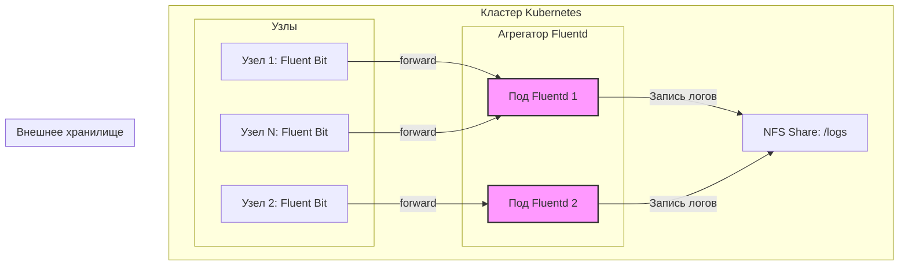

# Роутинг логов: Fluent Bit → Fluentd → NFS

> **Примечание:** Данный файл описывает практический сценарий использования гибридной архитектуры. Базовые концепции и сравнение инструментов приведены в документе [Сравнение Fluentd и Fluent Bit](./fluentbit/fluent_comparison.md).

## Определения

**Fluent Bit** — легковесный агент сбора логов (Log Shipper), оптимизированный для работы на узлах кластера. Использует минимальные ресурсы (50–100Mi RAM) и собирает логи с каждого узла через DaemonSet.

**Fluentd** — полнофункциональный агрегатор логов (Aggregator/Router), используемый для централизованной маршрутизации, сложной обработки и буферизации данных. Поддерживает более 500 плагинов и обеспечивает гибкую маршрутизацию.

**Forward Protocol** — стандартный протокол для передачи логов между Fluent Bit и Fluentd. Работает на порту 24224, поддерживает TLS шифрование и аутентификацию. Формат передачи — это сериализованный массив данных (pack format).

**NFS (Network File System)** — протокол сетевой файловой системы, используемый для внешнего персистентного хранения данных. В Kubernetes используется для shared storage, где несколько подов должны иметь доступ к одним и тем же данным (режим ReadWriteMany — RWX).

**PV (PersistentVolume)** — ресурс в кластере Kubernetes, представляющий физический сегмент хранилища. Создается администратором кластера или динамически через StorageClass.

**PVC (PersistentVolumeClaim)** — запрос пользователя или пода на выделение дискового пространства из доступных PV. Kubernetes автоматически привязывает PVC к подходящему PV.

**Anti-Affinity (Анти-аффинити)** — правила планировщика Kubernetes, предотвращающие размещение подов одной группы на одном и том же узле кластера для обеспечения высокой доступности.

**StatefulSet** — контроллер Kubernetes для управления stateful-приложениями. Гарантирует уникальные имена подов и стабильную сетевую идентичность. Используется для Fluentd, чтобы избежать состояний гонки при записи в NFS.

---

## Основные концепции

### Архитектура решения

Сценарий реализует отказоустойчивую архитектуру, в которой Fluentd выступает промежуточным слоем (Aggregation Layer) между агентами Fluent Bit и внешним хранилищем NFS:



**Преимущества данной архитектуры:**

- **Надежность**: использование дискового буфера (file buffer) во Fluentd защищает от потери данных при кратковременной недоступности NFS.
- **Масштабируемость**: слой агрегации (Fluentd) масштабируется независимо от количества узлов в кластере.
- **Гибкость**: возможность централизованно управлять маршрутизацией (например, дублировать логи в Elasticsearch и S3) без перенастройки всех агентов на узлах.
- **Производительность**: Fluent Bit минимально нагружает узлы (50–100Mi RAM), а тяжелая обработка делегирована Fluentd.

### Ключевые компоненты и требования

| Компонент | Роль | Требования к ресурсам |
|:---|:---|:---|
| **Fluent Bit** | Сбор логов, отправка по протоколу Forward | CPU: 50–100m, RAM: 50–100Mi |
| **Fluentd** | Агрегация, буферизация, запись на диск | CPU: 100–200m, RAM: 200–400Mi |
| **NFS** | Персистентное хранилище (режим RWX) | Зависит от объема входящих данных |

### Протокол Forward: формат передачи

Протокол Forward использует формат datagram с заголовком, содержащим:
- **Tag**: метка для маршрутизации (например, `app.nginx.access`)
- **Timestamp**: время события (Unix timestamp с микросекундами)
- **Record**: само лог-сообщение в формате Map (JSON-подобная структура)

Пример datagram:
```
["app.nginx.access", 1693123456.789012, {"log":"GET /api HTTP/1.1 200 1234","host":"web-0","namespace":"production"}]
```

### Буферизация: memory vs file buffer

Fluentd поддерживает два типа буферов:

| Тип буфера | Преимущества | Недостатки | Использование |
|:---|:---|:---|:---|
| **Memory buffer** | Высокая скорость, низкая латентность | Потеря данных при перезапуске пода | Временные буферы,低 критичные данные |
| **File buffer** | Сохранность данных при сбоях | Низкая скорость (дисковые операции) | Критичные данные, долгосрочная буферизация |

**Рекомендация**: Для NFS-сценариев используйте file buffer, так как NFS может быть недоступен, и memory buffer будет потерян.

### Retry-политика и обработка ошибок

Fluentd поддерживает автоматические повторные попытки при ошибках записи:

- **retry_forever**: бесконечные повторные попытки (для критичных данных)
- **retry_max_times**: максимальное количество повторов (3 по умолчанию)
- **retry_wait**: начальная задержка между попытками (1 секунда)
- **max_retry_wait**: максимальная задержка (60 секунд по умолчанию)
- **exponential_backoff**: экспоненциальное увеличение задержки (2 сек, 4 сек, 8 сек...)

---

## Практические сценарии

### Сценарий: Развертывание Fluentd как центрального агрегатора с записью на NFS

#### Предварительные требования

- Kubernetes кластер версии 1.25+
- kubectl доступ к кластеру
- NFS сервер доступен из кластера (IP: 192.168.1.100)
- Namespace `logging` создан
- Аккаунт для Fluentd с правами записи в NFS

#### Шаг 1: Подготовка хранилища

Для NFS критически важна настройка параметров монтирования для предотвращения зависания процессов при сбоях сети.

1. **Создание PV (PersistentVolume)**:

```yaml
# 01-nfs-pv.yaml
apiVersion: v1
kind: PersistentVolume
metadata:
  name: fluentd-log-storage-pv
spec:
  capacity:
    storage: 50Gi
  accessModes:
    - ReadWriteMany
  persistentVolumeReclaimPolicy: Retain
  mountOptions:
    - nfsvers=4.1
    - hard
    - timeo=600
    - retrans=2
    - rsize=1048576
    - wsize=1048576
  nfs:
    path: /var/k8s-logs
    server: 192.168.1.100
```

**Параметры монтирования NFS:**
- `nfsvers=4.1`: версия протокола (4.1 рекомендуется для отказоустойчивости)
- `hard`: процесс будет ждать восстановления связи с NFS (предотвращает повреждение файлов)
- `timeo=600`: тайм-аут ожидания (600 = 60 секунд)
- `retrans=2`: количество повторных попыток перед ошибкой
- `rsize/wsize`: максимальные размеры блоков для повышения производительности записи

2. **Создание PVC (PersistentVolumeClaim)**:

```yaml
# 02-fluentd-pvc.yaml
apiVersion: v1
kind: PersistentVolumeClaim
metadata:
  name: fluentd-logs-pvc
  namespace: logging
spec:
  accessModes:
    - ReadWriteMany
  resources:
    requests:
      storage: 50Gi
  storageClassName: "" # Указывается, если не используется динамический провижинер
```

**Валидация:**
```bash
kubectl apply -f 01-nfs-pv.yaml
kubectl apply -f 02-fluentd-pvc.yaml
kubectl get pv,pvc -n logging
# → NAME                        CAPACITY   RECLAIM POLICY   STATUS   CLAIM                          STORAGECLASS   AGE
# → fluentd-log-storage-pv      50Gi       Retain           Bound    logging/fluentd-logs-pvc                     5s
```

#### Шаг 2: Конфигурация и запуск Fluentd

1. **Настройка Fluentd (ConfigMap)**:
В конфигурацию добавлена ротация файлов и многопоточность для записи.

```yaml
# 03-fluentd-config.yaml
apiVersion: v1
kind: ConfigMap
metadata:
  name: fluentd-config
  namespace: logging
data:
  fluent.conf: |
    <source>
      @type forward
      port 24224
      bind 0.0.0.0
    </source>

    <match application.**>
      @type file
      path /fluentd/log/application/%Y/%m/%d/#{Socket.gethostname}-app.log
      append true
      <buffer time>
        @type file
        path /fluentd/log/buffer/app
        timekey 1h      # Ротация каждый час
        timekey_wait 5m # Ожидание дозаписи логов за прошлый час
        chunk_limit_size 16m
        flush_thread_count 4 # Параллельная запись для NFS
        retry_forever true
      </buffer>
      <format>
        @type json
      </format>
    </match>
```

**Параметры конфигурации Fluentd:**
- `@type forward`: прием логов по протоколу Forward
- `path`: шаблон пути для файлов с логами (поддерживает временные метки)
- `append true`: дозапись в существующие файлы
- `timekey 1h`: ротация файлов каждый час
- `timekey_wait 5m`: ожидание дозаписи логов за прошлый час перед ротацией
- `chunk_limit_size 16m`: максимальный размер чанка (рекомендуется для NFS)
- `flush_thread_count 4`: параллельная запись для повышения производительности
- `retry_forever true`: бесконечные повторные попытки при ошибках

2. **Развертывание (StatefulSet)**:
В Kubernetes для процессов, пишущих данные на диск (особенно в общие файловые системы вроде NFS), строго рекомендуется использовать **StatefulSet** вместо Deployment. Это предотвращает состояния гонки (race conditions) при параллельной записи в один файл из разных подов, так как каждому поду можно выделить собственную поддиректорию или гарантировать уникальное имя.

Важно настроить `securityContext`, чтобы Fluentd имел права на запись в NFS (обычно используется UID 1000).

```yaml
# 04-fluentd-statefulset.yaml
apiVersion: apps/v1
kind: StatefulSet
metadata:
  name: fluentd-aggregator
  namespace: logging
spec:
  serviceName: "fluentd-aggregator"
  replicas: 2
  selector:
    matchLabels:
      app: fluentd-aggregator
  template:
    metadata:
      labels:
        app: fluentd-aggregator
    spec:
      securityContext:
        fsGroup: 1000 # Соответствует GID во Fluentd образе
      affinity:
        podAntiAffinity:
          requiredDuringSchedulingIgnoredDuringExecution:
          - labelSelector:
              matchExpressions:
              - key: app
                operator: In
                values:
                - fluentd-aggregator
            topologyKey: "kubernetes.io/hostname"
      containers:
      - name: fluentd
        image: fluent/fluentd:v1.17-debian
        volumeMounts:
        - name: log-storage
          mountPath: /fluentd/log
        resources:
          limits:
            memory: 512Mi
          requests:
            cpu: 100m
            memory: 256Mi
      volumes:
      - name: log-storage
        persistentVolumeClaim:
          claimName: fluentd-logs-pvc
```

**Валидация:**
```bash
kubectl apply -f 03-fluentd-config.yaml
kubectl apply -f 04-fluentd-statefulset.yaml
kubectl get statefulset -n logging
# → NAME                  READY   AGE
# → fluentd-aggregator    2/2     30s

kubectl get pods -n logging -l app=fluentd-aggregator
# → NAME                    READY   STATUS    RESTARTS   AGE
# → fluentd-aggregator-0    1/1     Running   0          30s
# → fluentd-aggregator-1    1/1     Running   0          30s
```

#### Шаг 3: Настройка агентов Fluent Bit (YAML-формат)

В версии 3.x рекомендуется использовать YAML для конфигурации.

```yaml
# fluent-bit-output.yaml
pipeline:
    outputs:
        - name:  forward
          match: "*"
          host:  fluentd-aggregator.logging.svc.cluster.local
          port:  24224
          # Включение дисковой буферизации перед отправкой
          storage.type: filesystem
          retry_limit:  false
```

**Валидация:**
```bash
kubectl apply -f fluent-bit-output.yaml
kubectl logs -n logging -l app=fluent-bit --tail=20
# → [2026/09/02 10:00:00] [ info] [output:forward:forward.0] worker #0 started
# → [2026/09/02 10:00:00] [ info] [output:forward:forward.0] worker #1 started
```

#### Шаг 4: Проверка работоспособности

1. **Генерация тестового лога:**
```bash
kubectl run test-pod --image=nginx --restart=Never -n logging
kubectl logs test-pod -n logging
```

2. **Проверка наличия лога в Fluentd:**
```bash
kubectl exec fluentd-aggregator-0 -n logging -- ls -la /fluentd/log/application/$(date +%Y/%m/%d)/
# → -rw-r--r-- 1 root root  123 Sep  2 10:05 fluentd-aggregator-0-app.log
```

3. **Проверка наличия лога в NFS:**
```bash
kubectl exec fluentd-aggregator-0 -n logging -- cat /fluentd/log/application/$(date +%Y/%m/%d)/fluentd-aggregator-0-app.log | tail -5
# → {"log":"GET / HTTP/1.1 200 612","stream":"stdout","time":"2026-09-02T10:05:00.000000000Z"}
```

#### Шаг 5: Настройка мониторинга

Добавьте Prometheus endpoint для сбора метрик Fluentd:

```yaml
# 05-fluentd-service.yaml
apiVersion: v1
kind: Service
metadata:
  name: fluentd-aggregator
  namespace: logging
  labels:
    app: fluentd-aggregator
  annotations:
    prometheus.io/scrape: "true"
    prometheus.io/port: "24220"
    prometheus.io/path: "/metrics"
spec:
  ports:
  - name: forward
    port: 24224
    targetPort: 24224
  - name: metrics
    port: 24220
    targetPort: 24220
  selector:
    app: fluentd-aggregator
```

**Ключевые метрики для мониторинга:**
- `fluentd_output_status_num_records_total` — количество отправленных записей
- `fluentd_output_status_retry_count` — количество повторных попыток
- `fluentd_buffer_statusqueued_chunks` — количество чанков в очереди
- `fluentd_output_status_write_count` — количество операций записи

---

## Дополнительная информация

### Безопасность и права доступа

При работе с NFS часто возникают проблемы с правами доступа:

- **Root Squash**: если на стороне NFS сервера включен `root_squash`, поды, работающие от root, не смогут писать. Используйте `runAsUser` и `fsGroup`.
- **Identity**: убедитесь, что UID/GID внутри контейнера и на сервере NFS согласованы.

**Пример настройки безопасности:**
```yaml
securityContext:
  runAsUser: 1000      # UID Fluentd
  runAsGroup: 1000     # GID Fluentd
  fsGroup: 1000        # GID для NFS
```

**Проверка прав на NFS:**
```bash
# Проверка доступа к NFS из пода
kubectl exec fluentd-aggregator-0 -n logging -- touch /fluentd/log/test.txt
kubectl exec fluentd-aggregator-0 -n logging -- rm /fluentd/log/test.txt
# → Если команда выполнена успешно — права корректны
```

### Оптимизация производительности

- **Async Write**: если NFS сервер поддерживает асинхронную запись (`async` в `/etc/exports`), это значительно ускорит Fluentd, но повысит риск потери данных при сбое питания сервера.
- **Flush Threads**: увеличение `flush_thread_count` во Fluentd позволяет нивелировать задержки (latency) сетевой файловой системы за счет параллельной записи чанков.
- **Размер чанка**: оптимальный размер чанка для NFS — 16MB (компромисс между производительностью и надежностью).
- **Тайм-аут NFS**: увеличьте `timeo=600` при нестабильной сети.

**Рекомендации по производительности NFS:**
| Параметр | Значение | Описание |
|:---|:---|:---|
| `rsize` | 1048576 (1MB) | Максимальный размер блока чтения |
| `wsize` | 1048576 (1MB) | Максимальный размер блока записи |
| `timeo` | 600 (60 сек) | Тайм-аут ожидания |
| `retrans` | 2 | Количество повторных попыток |
| `nfsvers` | 4.1 | Версия протокола (отказоустойчивость) |

### Ротация и очистка

Fluentd сам создает структуру каталогов (например, `/2024/07/24/`), но он **не удаляет** старые файлы.

- Рекомендуется настроить `CronJob` в кластере или `logrotate` на NFS-сервере для удаления логов старше N дней.
- Пример команды для очистки: `find /var/k8s-logs -type f -mtime +30 -delete`.

**Пример CronJob для очистки:**
```yaml
apiVersion: batch/v1
kind: CronJob
metadata:
  name: log-cleanup
  namespace: logging
spec:
  schedule: "0 2 * * *"  # Ежедневно в 2:00
  jobTemplate:
    spec:
      template:
        spec:
          containers:
          - name: cleaner
            image: busybox
            command:
            - /bin/sh
            - -c
            - find /logs -type f -mtime +30 -delete
            volumeMounts:
            - name: log-storage
              mountPath: /logs
          volumes:
          - name: log-storage
            persistentVolumeClaim:
              claimName: fluentd-logs-pvc
          restartPolicy: OnFailure
```

### Типичные ошибки и их решения

| Ошибка | Причина | Решение |
|:---|:---|:---|
| `Connection refused` | Fluentd не доступен | Проверьте статус подов: `kubectl get pods -n logging` |
| `Permission denied` | NFS права доступа | Проверьте `fsGroup` и `runAsUser` в StatefulSet |
| `No space left on device` | NFS заполнен | Расширьте PV или очистите старые логи |
| `Stale file handle` | NFS сервер перезапущен | Перемонтируйте NFS или перезапустите Fluentd |
| `Buffer overflow` | Fluentd не успевает обрабатывать | Увеличьте `chunk_limit_size` или `flush_thread_count` |

**Диагностика:**
```bash
# Проверка логов Fluentd
kubectl logs fluentd-aggregator-0 -n logging --tail=50

# Проверка доступности NFS из пода
kubectl exec fluentd-aggregator-0 -n logging -- ls -la /fluentd/log/

# Проверка состояния буфера
kubectl exec fluentd-aggregator-0 -n logging -- ls -la /fluentd/log/buffer/app/
```

### Масштабирование

- **Fluentd**: увеличьте количество реплик StatefulSet при росте нагрузки. Fluentd масштабируется горизонтально.
- **Fluent Bit**: DaemonSet автоматически масштабируется с добавлением узлов.
- **NFS**: при увеличении объема данных рассмотрите использование NFS v4.1 с multiple servers или переход на Ceph/MinIO.

**Пороговые значения для масштабирования:**
| Метрика | Порог | Действие |
|:---|:---|:---|
| CPU Fluentd | >70% | Увеличьте ресурсы или добавьте реплики |
| Память Fluentd | >80% | Увеличьте limits.memory |
| Очередь буфера | >1000 чанков | Увеличьте flush_thread_count |
| Ошибки NFS | >5 в минуту | Проверьте сетевую стабильность |

### Смежные темы

- [Хранение данных: PV и PVC](../../Storage/pv_and_pvc.md).
- [Управление размещением подов: Affinity](../../Scheduling/affinity.md).
- [Буферизация во Fluent Bit](./fluentbit/buffering_routing.md).
