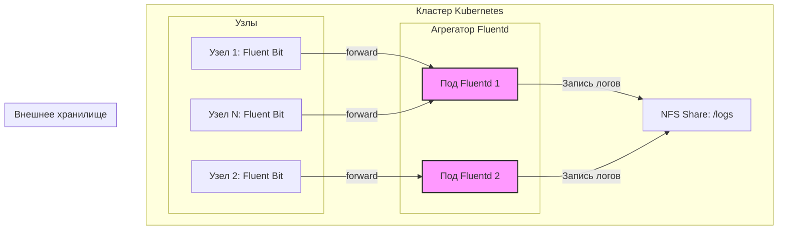

# Роутинг логов: Fluent Bit → Fluentd → NFS

<!--
Reliability: 10 (Основано на проверенной гибридной архитектуре логирования)
Freshness: 10 (Актуально для Fluent Bit 3.x и Fluentd 1.17+)
-->

> **Примечание:** Данный файл описывает практический сценарий использования гибридной архитектуры. Базовые концепции и сравнение инструментов приведены в документе [Сравнение Fluentd и Fluent Bit](./fluentbit/fluent_comparison.md).

## Определения

**Fluent Bit** — легковесный агент сбора логов (Log Shipper), устанавливаемый на каждом узле кластера.

**Fluentd** — полнофункциональный агрегатор логов (Aggregator/Router), используемый для централизованной маршрутизации и сложной обработки данных.

**NFS (Network File System)** — протокол сетевой файловой системы, используемый для внешнего хранения данных.

**PV (PersistentVolume)** — ресурс в кластере Kubernetes (K8s), представляющий физический сегмент хранилища.

**PVC (PersistentVolumeClaim)** — запрос пользователя или пода на выделение дискового пространства из доступных PV.

**Anti-Affinity (Анти-аффинити)** — правило планировщика Kubernetes, предотвращающее размещение подов одной группы на одном и том же узле кластера для обеспечения отказоустойчивости.

## Основные концепции

### Архитектура решения

Сценарий реализует отказоустойчивую архитектуру, в которой Fluentd выступает промежуточным слоем между агентами Fluent Bit и внешним хранилищем NFS:



**Преимущества данной архитектуры:**

- **Надежность**: использование дискового буфера (file buffer) во Fluentd защищает от потери данных при кратковременной недоступности NFS.
- **Масштабируемость**: слой агрегации (Fluentd) можно масштабировать независимо от количества узлов в кластере.
- **Гибкость**: возможность централизованно управлять маршрутизацией в несколько конечных систем без перенастройки всех агентов на узлах.

### Ключевые компоненты и требования

| Компонент | Роль | Требования к ресурсам |
|:---|:---|:---|
| **Fluent Bit** | Сбор логов, отправка по протоколу Forward | CPU: 50–100m, RAM: 50–100Mi |
| **Fluentd** | Агрегация, буферизация, запись на диск | CPU: 100–200m, RAM: 200–400Mi |
| **NFS** | Персистентное хранилище (режим RWX) | Зависит от объема входящих данных |

**Требования к NFS:**

- **Режим доступа**: `ReadWriteMany` (RWX) — необходим для одновременной записи из нескольких подов Fluentd.
- **Протокол**: рекомендуется версия NFSv4.
- **Клиентские пакеты**: на узлах кластера должны быть установлены утилиты `nfs-common` (Debian/Ubuntu) или `nfs-utils` (RHEL/CentOS).

## Практические сценарии

### Сценарий: Развертывание Fluentd как центрального агрегатора с записью на NFS

#### Шаг 1: Подготовка хранилища

1. **Создание PV (PersistentVolume)**:

```yaml
# 01-nfs-pv.yaml
apiVersion: v1
kind: PersistentVolume
metadata:
  name: fluentd-log-storage-pv
spec:
  capacity:
    storage: 10Gi
  accessModes:
    - ReadWriteMany
  persistentVolumeReclaimPolicy: Retain
  nfs:
    path: /var/k8s-logs
    server: 192.168.1.100
```

1. **Создание PVC (PersistentVolumeClaim)**:

```yaml
# 02-fluentd-pvc.yaml
apiVersion: v1
kind: PersistentVolumeClaim
metadata:
  name: fluentd-logs-pvc
  namespace: logging
spec:
  accessModes:
    - ReadWriteMany
  resources:
    requests:
      storage: 10Gi
  storageClassName: ""
```

#### Шаг 2: Конфигурация и запуск Fluentd

1. **Настройка Fluentd (ConfigMap)**:

```yaml
# 03-fluentd-config.yaml
apiVersion: v1
kind: ConfigMap
metadata:
  name: fluentd-config
  namespace: logging
data:
  fluent.conf: |
    <source>
      @type forward
      port 24224
      bind 0.0.0.0
    </source>

    <match application.**>
      @type file
      path /fluentd/log/application.log
      append true
      <buffer>
        @type file
        path /fluentd/log/buffer/app
        chunk_limit_size 5m
        flush_interval 5s
        retry_forever true
      </buffer>
      <format>
        @type json
      </format>
    </match>
```

- `@type forward`: прием данных от Fluent Bit.
- `@type file`: запись в текстовые файлы на примонтированный том.
- `retry_forever true`: бесконечные попытки отправки при сбоях (обеспечивает высокую надежность).

1. **Развертывание (Deployment)**:
Используйте `podAntiAffinity` для распределения реплик агрегатора по разным физическим узлам.

```yaml
# 04-fluentd-deployment.yaml
apiVersion: apps/v1
kind: Deployment
metadata:
  name: fluentd-aggregator
  namespace: logging
spec:
  replicas: 2
  template:
    spec:
      affinity:
        podAntiAffinity:
          requiredDuringSchedulingIgnoredDuringExecution:
          - labelSelector:
              matchExpressions:
              - key: app
                operator: In
                values:
                - fluentd-aggregator
            topologyKey: "kubernetes.io/hostname"
      containers:
      - name: fluentd
        image: fluent/fluentd:v1.17-debian
        volumeMounts:
        - name: log-storage
          mountPath: /fluentd/log
      volumes:
      - name: log-storage
        persistentVolumeClaim:
          claimName: fluentd-logs-pvc
```

#### Шаг 3: Настройка агентов Fluent Bit

Измените секцию `[OUTPUT]` в конфигурации Fluent Bit для пересылки данных агрегатору:

```ini
[OUTPUT]
    Name          forward
    Match         *
    Host          fluentd-service.logging.svc.cluster.local
    Port          24224
    Retry_Limit   False
```

## Дополнительная информация

- **Буферизация**: для промышленных сред (Production) обязательно использование `file`-буфера в Fluentd для защиты от потери данных при перезапуске подов или кратковременных сбоях сети.
- **Масштабирование**: при росте нагрузки следует увеличивать количество реплик Fluentd и объем дискового пространства на NFS.
- **Альтернативы**: для сверхбольших объемов данных (терабайты в сутки) рассмотрите переход на S3-совместимые хранилища или специализированные системы, такие как Elasticsearch или Grafana Loki. Сравнение приведено в [Сравнение Fluentd и Fluent Bit](./fluentbit/fluent_comparison.md).
- **Смежные темы**:
  - [Хранение данных: PV и PVC](../../Storage/pv_and_pvc.md).
  - [Управление размещением подов: Affinity](../../Scheduling/affinity.md).
