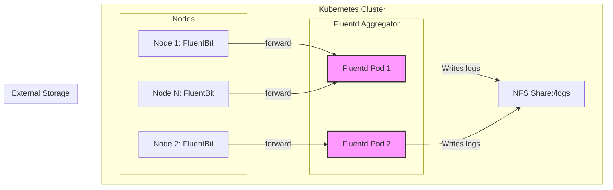

# Роутинг логов: Fluent Bit → Fluentd → NFS

> **Примечание:** Данный файл описывает практический сценарий использования гибридной архитектуры. Базовые концепции и сравнение инструментов — в [Сравнение Fluentd и Fluent Bit](./fluentbit/fluent_comparison.md).

## Определения

- **Fluent Bit**: Легковесный агент сбора логов (log shipper), установленный на каждом узле кластера — [Сравнение Fluentd и Fluent Bit](./fluentbit/fluent_comparison.md).
- **Fluentd**: Мощный агрегатор логов (aggregator/router) для центральной маршрутизации и сложной обработки.
- **NFS (Network File System)**: Сетевая файловая система для внешнего хранения логов.
- **PersistentVolume (PV)**: Ресурс Kubernetes, представляющий физическое хранилище — [Хранение данных: PV, PVC и StorageClass](../../Storage/pv_and_pvc.md).
- **PersistentVolumeClaim (PVC)**: Запрос пода на выделение хранилища — [Хранение данных: PV, PVC и StorageClass](../../Storage/pv_and_pvc.md).
- **Pod Anti-Affinity**: Правило планирования, запрещающее размещение подов на одном узле — [Управление размещением подов: Affinity и Anti-Affinity](../../Scheduling/affinity.md).

## Базовые концепции

### Архитектура решения

Сценарий реализует отказоустойчивую архитектуру, где Fluentd выступает промежуточным агрегатором между FluentBit и NFS:



**Преимущества архитектуры:**

- **Надежность**: Fluentd с file-буфером защищает от потери логов при недоступности NFS.
- **Масштабируемость**: Fluentd можно масштабировать независимо от FluentBit.
- **Гибкость**: Централизованное управление маршрутизацией в несколько хранилищ.

### Ключевые компоненты

| Компонент | Роль | Требования к ресурсам |
|-----------|------|----------------------|
| **Fluent Bit** | Сбор логов с узлов, отправка в Fluentd | CPU: 50-100m, RAM: 50-100Mi |
| **Fluentd** | Агрегация, буферизация, запись в NFS | CPU: 100-200m, RAM: 200-400Mi |
| **NFS** | Персистентное хранилище с доступом ReadWriteMany | Зависит от объема логов |

### Требования к NFS

- **Режим доступа**: `ReadWriteMany` (RWX) — несколько подов Fluentd должны писать в одни файлы.
- **Протокол**: NFSv4 или новее.
- **Пакеты на узлах**: `nfs-common` (Debian/Ubuntu) или `nfs-utils` (RHEL/CentOS).

## Практические сценарии

### Сценарий: Развертывание Fluentd как центрального агрегатора с хранением на NFS

**Цель**: Организовать надежный конвейер логов с буферизацией и хранением на NFS.

#### Шаг 1: Настройка хранилища (NFS)

1. **Подготовка NFS-сервера**: Создайте экспортируемую директорию (например, `/var/k8s-logs`) на NFS-сервере.

2. **Создайте PersistentVolume (PV)**:

    ```yaml
    # 01-nfs-pv.yaml
    apiVersion: v1
    kind: PersistentVolume
    metadata:
      name: fluentd-log-storage-pv
    spec:
      capacity:
        storage: 10Gi
      accessModes:
        - ReadWriteMany
      persistentVolumeReclaimPolicy: Retain
      nfs:
        path: /var/k8s-logs
        server: 192.168.1.100
    ```

3. **Создайте PersistentVolumeClaim (PVC)**:

    ```yaml
    # 02-fluentd-pvc.yaml
    apiVersion: v1
    kind: PersistentVolumeClaim
    metadata:
      name: fluentd-logs-pvc
      namespace: logging
    spec:
      accessModes:
        - ReadWriteMany
      resources:
        requests:
          storage: 10Gi
      storageClassName: ""
    ```

4. **Примените манифесты**:

    ```bash
    kubectl create ns logging
    kubectl apply -f 01-nfs-pv.yaml
    kubectl apply -f 02-fluentd-pvc.yaml
    kubectl get pvc -n logging  # Статус: Bound
    ```

#### Шаг 2: Развертывание Fluentd

1. **Создайте ConfigMap с конфигурацией Fluentd**:

    ```yaml
    # 03-fluentd-config.yaml
    apiVersion: v1
    kind: ConfigMap
    metadata:
      name: fluentd-config
      namespace: logging
    data:
      fluent.conf: |
        <source>
          @type forward
          port 24224
          bind 0.0.0.0
        </source>

        <match example-app.**>
          @type file
          path /fluentd/log/example-app.log
          append true
          <buffer>
            @type file
            path /fluentd/log/buffer/es
            chunk_limit_size 5m
            flush_interval 5s
            retry_forever true
          </buffer>
          <format>
            @type json
          </format>
        </match>

        <match syslog.**>
          @type file
          path /fluentd/log/syslog.log
          append true
          <buffer>
            @type file
            path /fluentd/log/buffer/syslog
            chunk_limit_size 5m
            flush_interval 5s
            retry_forever true
          </buffer>
          <format>
            @type json
          </format>
        </match>
    ```

    **Параметры:** `@type forward` — прием логов, `@type file` — вывод в файл, `append true` — запись нескольких реплик в один файл, `@type file` в буфере — надежная буферизация на диск — [Сравнение Fluentd и Fluent Bit](./fluentbit/fluent_comparison.md#буферизация-и-надежность), `retry_forever true` — бесконечные попытки.

2. **Создайте Deployment для Fluentd**:

    ```yaml
    # 04-fluentd-deployment.yaml
    apiVersion: apps/v1
    kind: Deployment
    metadata:
      name: fluentd-router
      namespace: logging
    spec:
      replicas: 2
      selector:
        matchLabels:
          app: fluentd-router
      template:
        metadata:
          labels:
            app: fluentd-router
        spec:
          affinity:
            podAntiAffinity:
              requiredDuringSchedulingIgnoredDuringExecution:
              - labelSelector:
                  matchExpressions:
                  - key: app
                    operator: In
                    values:
                    - fluentd-router
                topologyKey: "kubernetes.io/hostname"
          containers:
          - name: fluentd
            image: fluent/fluentd:v1.17-debian
            resources:
              requests:
                cpu: 100m
                memory: 200Mi
              limits:
                memory: 400Mi
            ports:
            - containerPort: 24224
            volumeMounts:
            - name: config-volume
              mountPath: /fluentd/etc
            - name: log-storage
              mountPath: /fluentd/log
          volumes:
          - name: config-volume
            configMap:
              name: fluentd-config
          - name: log-storage
            persistentVolumeClaim:
              claimName: fluentd-logs-pvc
    ```

    **Параметры:** `replicas: 2` — отказоустойчивость, `podAntiAffinity` — распределение по узлам — [Управление размещением подов: Affinity и Anti-Affinity](../../Scheduling/affinity.md), `memory limits: 400Mi` — защита от OOMKilled.

3. **Создайте Service для Fluentd**:

    ```yaml
    # 05-fluentd-service.yaml
    apiVersion: v1
    kind: Service
    metadata:
      name: fluentd-service
      namespace: logging
    spec:
      selector:
        app: fluentd-router
      ports:
      - name: forward-port
        protocol: TCP
        port: 24224
        targetPort: 24224
    ```

4. **Примените манифесты**:

    ```bash
    kubectl apply -f 03-fluentd-config.yaml
    kubectl apply -f 04-fluentd-deployment.yaml
    kubectl apply -f 05-fluentd-service.yaml
    ```

#### Шаг 3: Перенастройка FluentBit

Измените конфигурацию FluentBit для отправки логов на Fluentd вместо Elasticsearch:

```ini
[OUTPUT]
    Name      forward
    Match     *
    Host      fluentd-service.logging.svc.cluster.local
    Port      24224
    Retry_Limit False
```

Примените изменения и перезапустите FluentBit:

```bash
kubectl rollout restart daemonset/fluent-bit -n logging
```

#### Шаг 4: Проверка

1. Запустите тестовое приложение для генерации логов.
2. Проверьте файлы на NFS-сервере (`/var/k8s-logs`): должны появиться `example-app.log` и `syslog.log`.
3. Убедитесь, что поды Fluentd распределены по узлам:

    ```bash
    kubectl get pods -n logging -o wide
    ```

## Дополнительная информация

- **Буферизация**: Для production рекомендуется использовать `file`-буфер в Fluentd вместо `memory` — это защищает от потери данных при перезапуске подов.
- **Масштабирование**: При увеличении объема логов увеличьте `replicas` Fluentd и размер NFS-хранилища.
- **Мониторинг**: Отслеживайте потребление ресурсов подами Fluentd и размер буферов.
- **Альтернативы NFS**: Для больших объемов рассмотрите S3-совместимые хранилища или специализированные решения (Elasticsearch, Loki) — [Сравнение Fluentd и Fluent Bit](./fluentbit/fluent_comparison.md).
- **Безопасность**: Для production включите TLS для протокола Forward и настройте аутентификацию между FluentBit и Fluentd.
