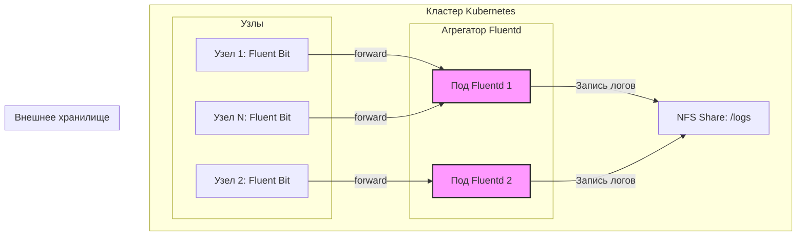

# Роутинг логов: Fluent Bit → Fluentd → NFS

> **Примечание:** Данный файл описывает практический сценарий использования гибридной архитектуры. Базовые концепции и сравнение инструментов приведены в документе [Сравнение Fluentd и Fluent Bit](./fluentbit/fluent_comparison.md).

## Определения

**Fluent Bit** — легковесный агент сбора логов (Log Shipper), оптимизированный для работы на узлах кластера.

**Fluentd** — полнофункциональный агрегатор логов (Aggregator/Router), используемый для централизованной маршрутизации, сложной обработки и буферизации данных.

**NFS (Network File System)** — протокол сетевой файловой системы, используемый для внешнего персистентного хранения данных.

**PV (PersistentVolume)** — ресурс в кластере Kubernetes, представляющий физический сегмент хранилища.

**PVC (PersistentVolumeClaim)** — запрос пользователя или пода на выделение дискового пространства из доступных PV.

**Anti-Affinity (Анти-аффинити)** — правила планировщика Kubernetes, предотвращающие размещение подов одной группы на одном и том же узле кластера для обеспечения высокой доступности.

---

## Основные концепции

### Архитектура решения

Сценарий реализует отказоустойчивую архитектуру, в которой Fluentd выступает промежуточным слоем (Aggregation Layer) между агентами Fluent Bit и внешним хранилищем NFS:



**Преимущества данной архитектуры:**

- **Надежность**: использование дискового буфера (file buffer) во Fluentd защищает от потери данных при кратковременной недоступности NFS.
- **Масштабируемость**: слой агрегации (Fluentd) масштабируется независимо от количества узлов в кластере.
- **Гибкость**: возможность централизованно управлять маршрутизацией (например, дублировать логи в Elasticsearch и S3) без перенастройки всех агентов на узлах.

### Ключевые компоненты и требования

| Компонент | Роль | Требования к ресурсам |
|:---|:---|:---|
| **Fluent Bit** | Сбор логов, отправка по протоколу Forward | CPU: 50–100m, RAM: 50–100Mi |
| **Fluentd** | Агрегация, буферизация, запись на диск | CPU: 100–200m, RAM: 200–400Mi |
| **NFS** | Персистентное хранилище (режим RWX) | Зависит от объема входящих данных |

---

## Практические сценарии

### Сценарий: Развертывание Fluentd как центрального агрегатора с записью на NFS

#### Шаг 1: Подготовка хранилища

Для NFS критически важна настройка параметров монтирования для предотвращения зависания процессов при сбоях сети.

1. **Создание PV (PersistentVolume)**:

```yaml
# 01-nfs-pv.yaml
apiVersion: v1
kind: PersistentVolume
metadata:
  name: fluentd-log-storage-pv
spec:
  capacity:
    storage: 50Gi
  accessModes:
    - ReadWriteMany
  persistentVolumeReclaimPolicy: Retain
  mountOptions:
    - nfsvers=4.1
    - hard
    - timeo=600
    - retrans=2
    - rsize=1048576
    - wsize=1048576
  nfs:
    path: /var/k8s-logs
    server: 192.168.1.100
```

- `hard`: процесс будет ждать восстановления связи с NFS (предотвращает повреждение файлов).
- `rsize/wsize`: максимальные размеры блоков для повышения производительности записи.

1. **Создание PVC (PersistentVolumeClaim)**:

```yaml
# 02-fluentd-pvc.yaml
apiVersion: v1
kind: PersistentVolumeClaim
metadata:
  name: fluentd-logs-pvc
  namespace: logging
spec:
  accessModes:
    - ReadWriteMany
  resources:
    requests:
      storage: 50Gi
  storageClassName: "" # Указывается, если не используется динамический провижинер
```

#### Шаг 2: Конфигурация и запуск Fluentd

1. **Настройка Fluentd (ConfigMap)**:
В конфигурацию добавлена ротация файлов и многопоточность для записи.

```yaml
# 03-fluentd-config.yaml
apiVersion: v1
kind: ConfigMap
metadata:
  name: fluentd-config
  namespace: logging
data:
  fluent.conf: |
    <source>
      @type forward
      port 24224
      bind 0.0.0.0
    </source>

    <match application.**>
      @type file
      path /fluentd/log/application/%Y/%m/%d/app.log
      append true
      <buffer time>
        @type file
        path /fluentd/log/buffer/app
        timekey 1h      # Ротация каждый час
        timekey_wait 5m # Ожидание дозаписи логов за прошлый час
        chunk_limit_size 16m
        flush_thread_count 4 # Параллельная запись для NFS
        retry_forever true
      </buffer>
      <format>
        @type json
      </format>
    </match>
```

1. **Развертывание (Deployment)**:
Важно настроить `securityContext`, чтобы Fluentd имел права на запись в NFS (обычно используется UID 1000).

```yaml
# 04-fluentd-deployment.yaml
apiVersion: apps/v1
kind: Deployment
metadata:
  name: fluentd-aggregator
  namespace: logging
spec:
  replicas: 2
  template:
    spec:
      securityContext:
        fsGroup: 1000 # Соответствует GID во Fluentd образе
      affinity:
        podAntiAffinity:
          requiredDuringSchedulingIgnoredDuringExecution:
          - labelSelector:
              matchExpressions:
              - key: app
                operator: In
                values:
                - fluentd-aggregator
            topologyKey: "kubernetes.io/hostname"
      containers:
      - name: fluentd
        image: fluent/fluentd:v1.17-debian
        volumeMounts:
        - name: log-storage
          mountPath: /fluentd/log
        resources:
          limits:
            memory: 512Mi
          requests:
            cpu: 100m
            memory: 256Mi
      volumes:
      - name: log-storage
        persistentVolumeClaim:
          claimName: fluentd-logs-pvc
```

#### Шаг 3: Настройка агентов Fluent Bit (YAML-формат)

В версии 3.x рекомендуется использовать YAML для конфигурации.

```yaml
# fluent-bit-output.yaml
pipeline:
    outputs:
        - name:  forward
          match: "*"
          host:  fluentd-aggregator.logging.svc.cluster.local
          port:  24224
          # Включение дисковой буферизации перед отправкой
          storage.type: filesystem
          retry_limit:  false
```

---

## Дополнительная информация

### Безопасность и права доступа
При работе с NFS часто возникают проблемы с правами доступа.
- **Root Squash**: если на стороне NFS сервера включен `root_squash`, поды, работающие от root, не смогут писать. Используйте `runAsUser` и `fsGroup`.
- **Identity**: убедитесь, что UID/GID внутри контейнера и на сервере NFS согласованы.

### Оптимизация производительности
- **Async Write**: если NFS сервер поддерживает асинхронную запись (`async` в `/etc/exports`), это значительно ускорит Fluentd, но повысит риск потери данных при сбое питания сервера.
- **Flush Threads**: увеличение `flush_thread_count` во Fluentd позволяет нивелировать задержки (latency) сетевой файловой системы за счет параллельной записи чанков.

### Ротация и очистка
Fluentd сам создает структуру каталогов (например, `/2024/07/24/`), но он **не удаляет** старые файлы.
- Рекомендуется настроить `CronJob` в кластере или `logrotate` на NFS-сервере для удаления логов старше N дней.
- Пример команды для очистки: `find /var/k8s-logs -type f -mtime +30 -delete`.

### Смежные темы
- [Хранение данных: PV и PVC](../../Storage/pv_and_pvc.md).
- [Управление размещением подов: Affinity](../../Scheduling/affinity.md).
- [Буферизация во Fluent Bit](./fluentbit/buffering_routing.md).
