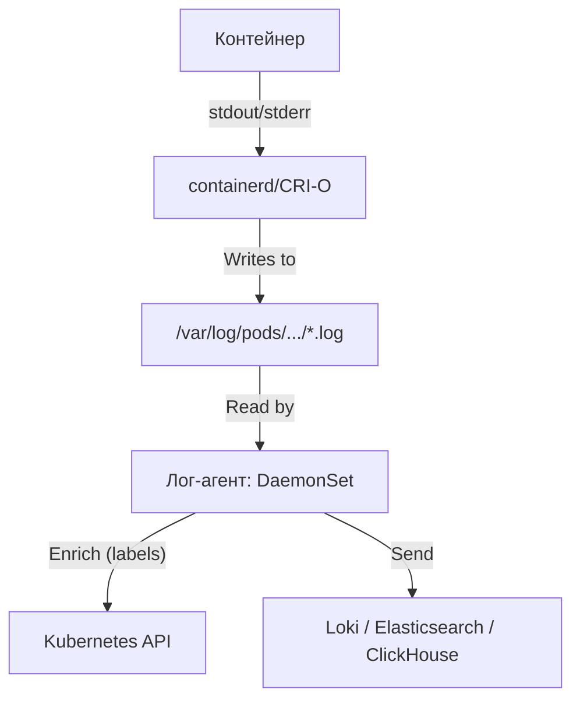

# Архитектура наблюдаемости в Kubernetes

## Определения

**Наблюдаемость (Observability)** — способность понимать внутреннее состояние системы на основе её внешних данных (сигналов). В отличие от классического мониторинга, который отвечает на вопрос "Работает ли система?", наблюдаемость позволяет понять "Почему она ведет себя именно так?".

**Основные сигналы телеметрии:**
- **Метрики** — агрегированные числовые данные (временные ряды).
- **Логи** — детализированные записи событий.
- **Трассировки (Traces)** — путь прохождения запроса через распределенную систему.
- **Профили (Profiles)** — данные об использовании ресурсов (CPU/память) на уровне кода.

**OpenTelemetry (OTel)** — индустриальный стандарт и набор инструментов для унифицированного сбора всех типов сигналов телеметрии. Проект **CNCF**, получивший статус **Graduated** (с мая 2026), что закрепило OTel как де-факто стандарт наблюдаемости.

Подробно о концепциях: **[Observability Definitions](../../Concepts/Observability_and_Monitoring/observability_definitions.md)** и **[Four Pillars of Observability](../../Concepts/Observability_and_Monitoring/four_pillars_of_observability.md)**.

## Основные концепции

### Уровни наблюдаемости в Kubernetes

| Уровень | Объект | Инструменты / Методы |
| :--- | :--- | :--- |
| **Бизнес** | Сценарии пользователей | Custom Metrics, OTel SDK |
| **Приложения** | Микросервисы | OTel Auto-instrumentation, Service Mesh |
| **Сетевой** | Трафик между подами | eBPF (Cilium/Hubble), Pixie |
| **Кластер** | Компоненты управления | `apiserver`, `etcd`, `scheduler` |
| **Инфраструктура** | Ноды и ядро | Node Exporter, eBPF (Falco, Tetragon) |

### Унифицированный пайплайн (OpenTelemetry)
Современная архитектура (2026) строится вокруг **OTel Collector** как транзитной шины для всех сигналов.
- **Agent (DaemonSet)**: Собирает данные и системные метрики eBPF с каждого узла, выполняет первичную агрегацию и буферизацию рядом с источником.
- **Sidecar**: Разворачивается в том же поде, что и приложение, для сбора локального контекста и трассировок.
- **Gateway (Deployment)**: Центральный кластер коллекторов. Агрегирует данные от агентов, выполняет фильтрацию PII, дедупликацию, обогащение метаданными (pod, namespace, node, cluster) и маршрутизацию в несколько бэкендов по протоколу **OTLP**.
- **Преимущество**: Отсутствие привязки к конкретному вендору (vendor lock-in) и единая точка управления пайплайнами.
- **Распределения (Distributions)**: Помимо стандартного `opentelemetry-collector`, в 2026 году актуальны специализированные сборки: **Grafana Alloy** (нативный для экосистемы Grafana: Loki, Tempo, Mimir), **otel-collector-contrib** (широкий набор приемников/экспортеров), **Fluent Bit** с OTLP-выходом для логов.

### Логирование в Kubernetes (Logging Architecture)

В Kubernetes нет встроенного централизованного хранилища логов. Официальная модель: контейнеры пишут в **stdout/stderr**, рантайм захватывает эти потоки, а инфраструктура сбора логов (Logging Pipeline) занимается их агрегацией.

#### 1. Уровни логирования и пути хранения

На каждой ноде логи контейнеров хранятся по пути:
- `/var/log/containers/<pod>_<namespace>_<container>-<id>.log` (символические ссылки)
- `/var/log/pods/<namespace>_<pod>_<uid>/<container>/<n>.log` (реальные файлы)

**Роль Kubelet:**
Kubelet отвечает за ротацию логов на узле (по умолчанию — 10 МБ на файл, хранение 5 старых копий). Параметры ротации настраиваются флагами `--container-log-max-size` и `--container-log-max-files` (или полями `containerLogMaxSize` / `containerLogMaxFiles` в `kubelet-config`). Если агент сбора логов не успеет прочитать лог до ротации или удаления пода, данные будут потеряны, поэтому агент должен читать файлы непрерывно и буферизовать отправку.

#### 2. Архитектура сбора логов на уровне кластера



**Выбор агента сбора логов (2026):**

| Агент | Специфика | Статус |
| :--- | :--- | :--- |
| **Fluent Bit** | Легковесный (C-ядро), высокая пропускная способность, широкий набор плагинов | Актуален |
| **Grafana Alloy** | Нативный агент экосистемы Grafana, собирает метрики + логи + трейсы, экспорт в Loki/Tempo/Mimir по OTLP | Рекомендуется для стеков Grafana (заменяет устаревший Promtail) |
| **Vector** | Высокая производительность, мощный язык конфигурации (VRL), поддержка ClickHouse | Актуален |
| **Fluentd** | Медленнее Fluent Bit, но богаче экосистема плагинов | Легаси для новых инсталляций |
| **OpenTelemetry Collector (logs pipeline)** | Унификация логов с метриками и трассами в едином пайплайне | Актуален |

#### 3. Команды диагностики: kubectl logs

| Команда | Назначение |
| :--- | :--- |
| `kubectl logs <pod>` | Просмотр логов пода. |
| `kubectl logs -f <pod>` | Стриминг логов в реальном времени. |
| `kubectl logs <pod> --previous` | Логи **предыдущего** (упавшего) экземпляра контейнера (критично для CrashLoopBackOff). |
| `kubectl logs -l app=nginx --prefix` | Просмотр логов всех подов с меткой `app=nginx` с указанием имени пода. |
| `kubectl logs <pod> --timestamps=true` | Добавить временные метки к выводу. |
| `kubectl logs -l app=nginx --all-containers` | Просмотр логов всех контейнеров внутри подов (включая init-контейнеры). |
| `kubectl events` (ранее `kubectl get events`) | Просмотр событий кластера (schedulling, probe failures, OOMKill) с типами Warning/Normal. |
| `kubectl get events --field-selector reason=OOMKilling` | Фильтрация событий по конкретной причине. |

#### 5. События кластера (Events) и аудит

**События (Events)** — короткие записи о действиях объектов (`kubectl events`), помогают диагностировать проблемы на уровне планирования и жизненного цикла подов (нехватка ресурсов, провал ImagePull, OOMKill, crash из-за неготовых готовых зонд).

**Аудит-логи (Audit Logs)** — отдельный от контейнерных логов уровень: журнал всех API-запросов к `kube-apiserver` (кто, когда и к какому ресурсу обращался). Включается через `--audit-log-path` и `audit-policy`. Ключевые уровни детализации: `None`, `Metadata`, `Request`, `RequestResponse`. Критичен для безопасной наблюдаемости доступа к секретам и ролевым объектам.

```bash
# Пример: включение аудита через конфигурацию apiserver
kube-apiserver --audit-log-path=/var/log/audit.log --audit-policy-file=/etc/kubernetes/audit-policy.yaml
```

#### 4. Проблемы и решения

- **CrashLoopBackOff:** Логи исчезают при перезапуске. Используйте флаг `--previous` или централизованную систему (Loki).
- **Сайдкар-логирование:** Если приложение пишет в файлы внутри контейнера, используйте **sidecar-контейнер**, который читает этот файл и перенаправляет в свой `stdout`.
- **Высокая нагрузка:** Fluent Bit может потреблять много CPU при парсинге JSON. Решение: использовать `Structured Metadata` в Loki 3.x для уменьшения количества индексов.

### Глубокая видимость через eBPF
eBPF позволяет получать данные напрямую из ядра Linux без модификации приложений:
- **Сетевая наблюдаемость**: Видимость L7-протоколов (HTTP, gRPC, DB) без sidecar-контейнеров.
- **Непрерывное профилирование**: Поиск "горячих" участков кода (Parca, Pyroscope).
- **Безопасность**: Отслеживание подозрительных системных вызовов в реальном времени.

## Проактивный инструментарий (Proactive Toolkit)

Эффективное управление производительностью требует комбинации инструментов наблюдения, позволяющих диагностировать проблему до того, как она приведет к сбою.

### Три столпа наблюдаемости (и профилирование)

1.  **Метрики (Prometheus & Grafana):**
    *   **Роль:** Сообщают, *что* произошло (например, «задержка выросла», «ЦП ограничен»).
    *   **Инструменты:** **Prometheus** (хранилище временных рядов), **Grafana** (визуализация), экспортеры (`kube-state-metrics`, `node-exporter`).
    *   **Методология:** Визуализация всплесков задержки одновременно с графиками троттлинга CPU позволяет мгновенно найти корреляцию.

2.  **Журналы (Loki или EFK):**
    *   **Роль:** Сообщают, *почему* это произошло (конкретные ошибки, предупреждения, стеки вызовов).
    *   **Инструменты:** **Loki** (современный, нативный для Grafana), **EFK** (Elasticsearch, Fluentd, Kibana).
    *   **Преимущество:** Централизованный поиск по всем подам в одном месте.

3.  **Трассировки (OpenTelemetry & Jaeger):**
    *   **Роль:** Показывают путь запроса в микросервисной архитектуре. Помогают найти, какой именно сервис является «бутылочным горлышком».
    *   **Инструменты:** **OpenTelemetry (OTel)** для генерации данных, **Jaeger** или **Zipkin** для визуализации каскадных диаграмм вызовов.

4.  **Профилирование и APM (Application Performance Monitoring):**
    *   **Роль:** Глубокий анализ кода. Показывает, какая конкретно функция или строка кода потребляет ресурсы.
    *   **Инструменты:** **pprof** (Go), **JProfiler** (Java), **Pyroscope** (Continuous Profiling). Инструменты APM (**Datadog**, **New Relic**) часто объединяют все вышеперечисленное.

### Продвинутая автоматизация
* **Vertical Pod Autoscaler (VPA):** Анализирует прошлую нагрузку и автоматически подбирает оптимальные `requests` и `limits` («right-sizing»).
* **KEDA (Event-driven Autoscaling):** Расширяет HPA, позволяя масштабироваться по внешним событиям (Kafka, RabbitMQ, AWS SQS), что идеально для архитектур EDA.

---

### Совет для собеседования (Наблюдаемость)

**Вопрос:** Как бы вы отладили проблему с высокой задержкой запроса, который проходит через пять различных микросервисов?
**Ответ:** Это идеальный сценарий для использования **распределенной трассировки**. Сопоставлять логи пяти разных сервисов вручную крайне сложно и неэффективно. С помощью такого инструмента, как **Jaeger**, я могу найти идентификатор трассировки (`trace_id`) медленного запроса и увидеть единое унифицированное представление всего его пути. На каскадной диаграмме будет четко видно, сколько времени занял каждый вызов сервиса, базы данных или внешнего API. Это позволяет мгновенно локализовать «бутылочное горлышко» (например, если один из сервисов в цепочке занимает 2 секунды, а остальные — по 50 мс).

## Практические сценарии

### Выбор стека хранения (Бэкенды)

**Стек Grafana LGTM (Loki, Grafana, Tempo, Mimir):**
- **Mimir**: Масштабируемые метрики.
- **Loki**: Дешевое хранение логов (индексирует только метаданные).
- **Tempo**: Распределенные трассировки.
- **Плюс**: Идеальная корреляция — переход от графика к логам и трассе в один клик.

**Стек VictoriaMetrics:**
- **VictoriaMetrics**: Самое эффективное хранилище метрик (низкое потребление RAM/Disk).
- **VictoriaLogs**: Высокопроизводительный бэкенд для логов.
- **Плюс**: Простота эксплуатации и минимальные затраты на инфраструктуру (FinOps).

### Ключевые компоненты для мониторинга

| Компонент | Что отслеживать | Ссылка |
| :--- | :--- | :--- |
| **Инфраструктура** | Загрузка ЦП, использование памяти, дисковые операции | Node Exporter |
| **Control Plane** | Latency API, etcd health, состояние планировщика | **[kube-apiserver](./kube_apiserver_monitoring.md)** |
| **Рабочие нагрузки** | Состояние подов (Pod health), перезапуски, Readiness/Liveness | `kube-state-metrics` |
| **Ресурсы** | CPU/RAM на уровне подов (для HPA/VPA/FinOps) | **[Metrics Server](./metrics-server.md)** |
| **Внутренняя сеть** | Ошибки L7, задержки сервисов | **[Netdata](./netdata.md)** / Cilium |

## Рекомендации и лучшие практики

### Управление стоимостью (FinOps)
1. **Sampling (Сэмплирование)**: Не сохраняйте 100% трасс. Оставляйте только ошибки и запросы с высокой задержкой.
2. **Агрегация**: Схлопывайте высокочастотные метрики на уровне OTel Collector.
3. **Retention**: Метрики (1 год+), Логи (14–30 дней), Трассы (7 дней).

### Эффективный алертинг
- **SLO-driven**: Алертите не по загрузке CPU, а по бюджету ошибок (Error Budget) и задержкам, влияющим на пользователя.
- **Интеллектуальный анализ**: Используйте корреляцию логов и метрик для автоматического поиска первопричины (RCA).

## Дополнительная информация

### Смежные темы
- **[OpenTelemetry: Обзор](../../OpenTelemetry/opentelemetry_overview.md)** — стандарт сбора сигналов, OTLP и сборки Collector.
- **[Grafana Loki](../../Loki/loki_overview.md)** — архитектура сбора логов и современные агенты (Alloy).
- **[Monitoring Methodologies](../../Concepts/Observability_and_Monitoring/monitoring_methodologies.md)** — методологии USE, RED, Golden Signals.
