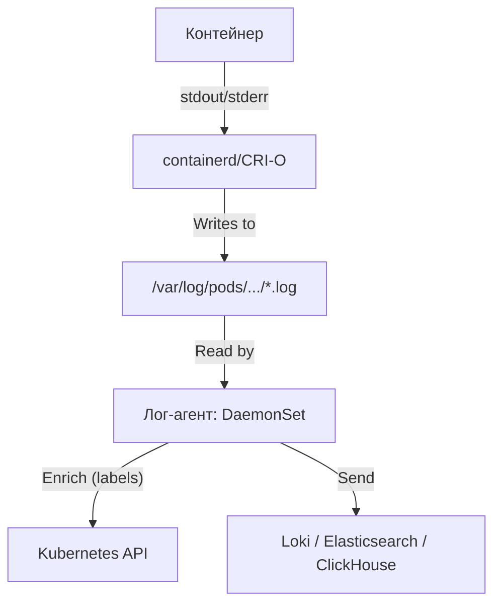

# Архитектура наблюдаемости в Kubernetes

## Определения

**Наблюдаемость (Observability)** — способность понимать внутреннее состояние системы на основе её внешних данных (сигналов). В отличие от классического мониторинга, который отвечает на вопрос "Работает ли система?", наблюдаемость позволяет понять "Почему она ведет себя именно так?".

**Основные сигналы телеметрии:**
- **Метрики** — агрегированные числовые данные (временные ряды).
- **Логи** — детализированные записи событий.
- **Трассировки (Traces)** — путь прохождения запроса через распределенную систему.
- **Профили (Profiles)** — данные об использовании ресурсов (CPU/память) на уровне кода.

**OpenTelemetry (OTel)** — индустриальный стандарт и набор инструментов для унифицированного сбора всех типов сигналов телеметрии. Проект **CNCF**, получивший статус **Graduated** (с мая 2026), что закрепило OTel как де-факто стандарт наблюдаемости.

**SLI/SLO/SLA** — фундаментальные SRE-концепции, лежащие в основе алертинга:
- **SLI (Service Level Indicator)** — метрика, измеряющая качество (например, доля успешных HTTP-запросов).
- **SLO (Service Level Objective)** — целевое значение SLI (например, 99.9% успешных запросов за 30 дней).
- **SLA (Service Level Agreement)** — формальное соглашение с пользователем о последствиях невыполнения SLO (штрафы, компенсации).
- **Error Budget** — допустимая доля отказов (100% минус SLO). Используется как основа для принятия решений о релизах.

**Burn Rate** — скорость "сжигания" error budget. Применяется в multi-window SLO-алертах (подход из SRE workbook Google): если за короткое окно расход бюджета аномально высок — alert.

**Cardinality (кардинальность)** — количество уникальных комбинаций значений метки (label). Высокая кардинальность (например, `pod_name`, `user_id`) приводит к взрывному росту временного ряда и деградации хранилища. Критическое правило Prometheus/Loki: лейблы — только **low-cardinality** (`namespace`, `container`, `app`, `severity`).

Подробно о концепциях: **[Observability Definitions](../../Concepts/Observability_and_Monitoring/observability_definitions.md)** и **[Four Pillars of Observability](../../Concepts/Observability_and_Monitoring/four_pillars_of_observability.md)**.

## Основные концепции

### Уровни наблюдаемости в Kubernetes

| Уровень | Объект | Инструменты / Методы |
| :--- | :--- | :--- |
| **Бизнес** | Сценарии пользователей | Custom Metrics, OTel SDK |
| **Приложения** | Микросервисы | OTel Auto-instrumentation, Service Mesh |
| **Сетевой** | Трафик между подами | eBPF (Cilium/Hubble), Pixie |
| **Кластер** | Компоненты управления | `apiserver`, `etcd`, `scheduler` |
| **Инфраструктура** | Ноды и ядро | Node Exporter, eBPF (Falco, Tetragon) |

### Унифицированный пайплайн (OpenTelemetry)
Современная архитектура (2026) строится вокруг **OTel Collector** как транзитной шины для всех сигналов.
- **Agent (DaemonSet)**: Собирает данные и системные метрики eBPF с каждого узла, выполняет первичную агрегацию и буферизацию рядом с источником.
- **Sidecar**: Разворачивается в том же поде, что и приложение, для сбора локального контекста и трассировок.
- **Gateway (Deployment)**: Центральный кластер коллекторов. Агрегирует данные от агентов, выполняет фильтрацию PII, дедупликацию, обогащение метаданными (pod, namespace, node, cluster) и маршрутизацию в несколько бэкендов по протоколу **OTLP**.
- **Преимущество**: Отсутствие привязки к конкретному вендору (vendor lock-in) и единая точка управления пайплайнами.
- **Распределения (Distributions)**: Помимо стандартного `opentelemetry-collector`, в 2026 году актуальны специализированные сборки: **Grafana Alloy** (нативный для экосистемы Grafana: Loki, Tempo, Mimir), **otel-collector-contrib** (широкий набор приемников/экспортеров), **Fluent Bit** с OTLP-выходом для логов.

#### Полный пайплайн обработки сигнала (Receivers → Processors → Exporters)

```yaml
# otel-collector-config.yaml (фрагмент)
receivers:
  otlp:
    protocols:
      grpc:
        endpoint: 0.0.0.0:4317
      http:
        endpoint: 0.0.0.0:4318
  kubeletstats:
    endpoint: "${env:K8S_NODE_NAME}:10250"
    insecure: true
  filelog:
    include:
      - /var/log/pods/*/*/*.log
    operators:
      - type: json_parser

processors:
  batch:           # объединение запросов (снижает нагрузку на бэкенд)
    timeout: 5s
    send_batch_size: 8192
  memory_limiter:  # защита от OOM коллектора
    limit_mib: 512
    spike_limit_mib: 128
  attributes/cluster: # обогащение
    actions:
      - key: k8s.cluster.name
        value: prod-eu-1
        action: insert
  filter/healthcheck:
    metrics:
      exclude:
        match_type: regexp
        metric_names: [".*health.*"]

exporters:
  prometheusremotewrite:
    endpoint: "http://mimir:9009/api/v1/push"
  loki:
    endpoint: "http://loki:3100/loki/api/v1/push"
  otlp/tempo:
    endpoint: tempo:4317
    tls:
      insecure: true

service:
  pipelines:
    metrics:
      receivers: [otlp, kubeletstats]
      processors: [memory_limiter, batch, attributes/cluster]
      exporters: [prometheusremotewrite]
    logs:
      receivers: [otlp, filelog]
      processors: [memory_limiter, batch]
      exporters: [loki]
    traces:
      receivers: [otlp]
      processors: [memory_limiter, batch]
      exporters: [otlp/tempo]
```

**Принципы конфигурации коллектора:**
- **`memory_limiter`** обязателен первым в цепочке — защищает процесс от OOM.
- **`batch`** ставится в конце — увеличивает пропускную способность за счёт упаковки записей.
- **Tail-based sampling** для трейсов (в `tail_sampling` процессоре) — оставлять 100% ошибок и медленных запросов, а успешные сэмплировать (например, 1%).
- **`filter`**/`attributes` — управление cardinality и стоимостью.

### Логирование в Kubernetes (Logging Architecture)

В Kubernetes нет встроенного централизованного хранилища логов. Официальная модель: контейнеры пишут в **stdout/stderr**, рантайм захватывает эти потоки, а инфраструктура сбора логов (Logging Pipeline) занимается их агрегацией.

#### 1. Уровни логирования и пути хранения

На каждой ноде логи контейнеров хранятся по пути:
- `/var/log/containers/<pod>_<namespace>_<container>-<id>.log` (символические ссылки)
- `/var/log/pods/<namespace>_<pod>_<uid>/<container>/<n>.log` (реальные файлы)

**Роль Kubelet:**
Kubelet отвечает за ротацию логов на узле (по умолчанию — 10 МБ на файл, хранение 5 старых копий). Параметры ротации настраиваются флагами `--container-log-max-size` и `--container-log-max-files` (или полями `containerLogMaxSize` / `containerLogMaxFiles` в `kubelet-config`). Если агент сбора логов не успеет прочитать лог до ротации или удаления пода, данные будут потеряны, поэтому агент должен читать файлы непрерывно и буферизовать отправку.

**Структурированные логи (Structured Logging):**
Современная практика — писать JSON в stdout вместо текста. Это позволяет парсить поля без regex и строить запросы в Loki/Elasticsearch по конкретным полям без полнотекстового поиска.

```python
# Python (stdlib logging + json)
import logging, json, sys, time

class JsonFormatter(logging.Formatter):
    def format(self, record):
        payload = {
            "ts": time.strftime("%Y-%m-%dT%H:%M:%SZ", time.gmtime(record.created)),
            "level": record.levelname,
            "msg": record.getMessage(),
            "logger": record.name,
            "trace_id": getattr(record, "trace_id", None),
        }
        if record.exc_info:
            payload["exception"] = self.formatException(record.exc_info)
        return json.dumps(payload, ensure_ascii=False)

handler = logging.StreamHandler(sys.stdout)
handler.setFormatter(JsonFormatter())
logging.basicConfig(level=logging.INFO, handlers=[handler])
logging.info("request_completed", extra={"trace_id": "abc123"})
# stdout: {"ts":"2026-09-03T12:00:00Z","level":"INFO","msg":"request_completed","logger":"root","trace_id":"abc123"}
```

```go
// Go (slog из stdlib)
logger := slog.New(slog.NewJSONHandler(os.Stdout, nil))
logger.Info("request completed",
    "trace_id", traceID,
    "duration_ms", elapsed.Milliseconds(),
    "status", 200,
)
// stdout: {"time":"2026-09-03T12:00:00Z","level":"INFO","msg":"request completed","trace_id":"...","duration_ms":42,"status":200}
```

**Согласование уровней логирования:**
| Стандарт | Уровни (от наименее до наиболее подробного) |
| :--- | :--- |
| **syslog (RFC 5424)** | emerg, alert, crit, err, warning, notice, info, debug |
| **klog (k8s)** | `-v=0..10` (verbosity, инвертированная шкала) |
| **Python `logging`** | DEBUG, INFO, WARNING, ERROR, CRITICAL |
| **Loki/EFK labels** | `trace`, `debug`, `info`, `warn`, `error`, `fatal` |

В `Pod.spec` можно задать переменную `LEVEL=info` или передать её через `Downward API`/конфигмап, чтобы регулировать детализацию без пересборки образа.

#### 2. Архитектура сбора логов на уровне кластера



**Выбор агента сбора логов (2026):**

| Агент | Специфика | Статус |
| :--- | :--- | :--- |
| **Fluent Bit** | Легковесный (C-ядро), высокая пропускная способность, широкий набор плагинов | Актуален |
| **Grafana Alloy** | Нативный агент экосистемы Grafana, собирает метрики + логи + трейсы, экспорт в Loki/Tempo/Mimir по OTLP | Рекомендуется для стеков Grafana (заменяет устаревший Promtail) |
| **Vector** | Высокая производительность, мощный язык конфигурации (VRL), поддержка ClickHouse | Актуален |
| **Fluentd** | Медленнее Fluent Bit, но богаче экосистема плагинов | Легаси для новых инсталляций |
| **OpenTelemetry Collector (logs pipeline)** | Унификация логов с метриками и трассами в едином пайплайне | Актуален |

#### 3. Команды диагностики: kubectl logs

| Команда | Назначение |
| :--- | :--- |
| `kubectl logs <pod>` | Просмотр логов пода. |
| `kubectl logs -f <pod>` | Стриминг логов в реальном времени. |
| `kubectl logs <pod> --previous` | Логи **предыдущего** (упавшего) экземпляра контейнера (критично для CrashLoopBackOff). |
| `kubectl logs -l app=nginx --prefix` | Просмотр логов всех подов с меткой `app=nginx` с указанием имени пода. |
| `kubectl logs <pod> --timestamps=true` | Добавить временные метки к выводу. |
| `kubectl logs -l app=nginx --all-containers` | Просмотр логов всех контейнеров внутри подов (включая init-контейнеры). |
| `kubectl logs <pod> -c <container>` | Логи конкретного контейнера в поде с несколькими контейнерами. |
| `kubectl logs <pod> --since=10m` | Только за последние 10 минут (поддерживает `--since-time=<RFC3339>`). |
| `kubectl logs <pod> --tail=100` | Только последние N строк. |
| `kubectl logs <pod> --byte-limit=50000` | Ограничение объёма вывода (защита от OOM на стороне kubectl). |
| `kubectl events` (ранее `kubectl get events`) | Просмотр событий кластера (schedulling, probe failures, OOMKill) с типами Warning/Normal. |
| `kubectl get events --field-selector reason=OOMKilling` | Фильтрация событий по конкретной причине. |
| `kubectl events --for=pod/<name>` | События, относящиеся к конкретному поду (с Kubernetes 1.29+). |
| `stern <pattern>` | Мультиплексный стрим логов с подсветкой (из проекта stern). |
| `kubetail <pod>` | Лёгкая утилита с цветовой дифференциацией подов. |

**Типичные сценарии:**

```bash
# Все упавшие поды в namespace с их последней ошибкой
kubectl get pods -n prod -o json | \
  jq -r '.items[] | select(.status.phase != "Running") | .metadata.name' | \
  while read p; do
    echo "=== $p ==="
    kubectl logs -n prod "$p" --previous --tail=20 2>/dev/null
  done

# Стрим логов всех подов приложения с меткой и временем
kubectl logs -f -l app=checkout --timestamps=true --max-log-requests=10

# Логи init-контейнера (причина зависшего старта пода)
kubectl logs <pod> -c init-migrations
```

**Распространённые ошибки и их диагностика:**

| Симптом | Вероятная причина | Диагностика |
| :--- | :--- | :--- |
| `Error from server (BadRequest): container "..." in pod "..." is waiting to start` | Контейнер ещё не стартовал | `kubectl get pod <p> -o jsonpath='{.status.containerStatuses[*].state}'` |
| `previous terminated container not found in pod` | Контейнер никогда не падал | `kubectl describe pod <p>` (Events) |
| Пустой вывод `kubectl logs` | Приложение пишет в файл, а не stdout — нужен sidecar | `kubectl exec -it <p> -- ls -la /var/log/app/` |
| `rpc error: code = Unavailable` | Проблема с kubelet/CRI | `kubectl get nodes`, `journalctl -u kubelet` |
| `is terminated` без `reason` | Контейнер ещё не завершён | Подождать или `kubectl logs --follow` |

#### 5. События кластера (Events) и аудит

**События (Events)** — короткие записи о действиях объектов (`kubectl events`), помогают диагностировать проблемы на уровне планирования и жизненного цикла подов (нехватка ресурсов, провал ImagePull, OOMKill, crash из-за неготовых готовых зонд).

```bash
# События с сортировкой по времени и только Warning
kubectl get events -A --sort-by=.lastTimestamp \
  --field-selector type=Warning

# События конкретного пода
kubectl events --for=pod/web-7f8b9c --types=Warning,Normal

# JSON-вывод для парсинга
kubectl get events -o json | jq '.items[] | {reason, type, message, involvedObject}'
```

**Полный список типов событий Control Plane:**

| Reason | Источник | Описание |
| :--- | :--- | :--- |
| `OOMKilled` | kubelet | Контейнер превысил memory limit |
| `CrashLoopBackOff` | kubelet | Контейнер падает сразу после старта |
| `ImagePullBackOff` / `ErrImagePull` | kubelet | Не удаётся скачать образ (registry, auth, network) |
| `FailedScheduling` | scheduler | Не хватает ресурсов/taints/affinity |
| `FailedMount` | kubelet | Не удалось смонтировать PV/ConfigMap/Secret |
| `Unhealthy` / `ProbeFailed` | kubelet | Liveness/Readiness probe вернул ошибку |
| `BackOff` | kubelet | Backoff рестарта после серии падений |
| `Preempting` | scheduler | Под вытесняется другим с более высоким приоритетом |
| `Evicted` | kubelet | Под вытеснен (node-pressure, disk-pressure) |
| `NodeNotReady` / `NodeReady` | controller | Переход состояния ноды |
| `SuccessfulCreate` / `FailedCreate` | replicaset/job | Создание/неудача Pod/Job |

**TTL событий:** По умолчанию события хранятся в etcd 1 час. Для длительного хранения нужен отдельный event-exporter (например, `k8s-event-exporter`, отправляющий события в Loki/Prometheus). Изменение через `kube-apiserver --event-ttl=2h`.

**Аудит-логи (Audit Logs)** — отдельный от контейнерных логов уровень: журнал всех API-запросов к `kube-apiserver` (кто, когда и к какому ресурсу обращался). Включается через `--audit-log-path` и `audit-policy`. Ключевые уровни детализации: `None`, `Metadata`, `Request`, `RequestResponse`. Критичен для безопасной наблюдаемости доступа к секретам и ролевым объектам.

```bash
# Пример: включение аудита через конфигурацию apiserver
kube-apiserver --audit-log-path=/var/log/audit.log --audit-policy-file=/etc/kubernetes/audit-policy.yaml
```

**Пример минимальной Audit Policy:**

```yaml
# /etc/kubernetes/audit-policy.yaml
apiVersion: audit.k8s.io/v1
kind: Policy
rules:
  # Пустое правило — отключает аудит по умолчанию
  - level: None
  # Логируем все запросы к Secrets на уровне Metadata
  - level: Metadata
    resources:
      - group: ""
        resources: ["secrets", "configmaps"]
  # Логируем все Exec/Portforward (критично для post-compromise расследований)
  - level: RequestResponse
    verbs: ["create", "update", "patch", "delete"]
    resources:
      - group: ""
        resources: ["pods/exec", "pods/portforward", "pods/attach"]
  # Изменения RBAC
  - level: RequestResponse
    resources:
      - group: "rbac.authorization.k8s.io"
        resources: ["roles", "rolebindings", "clusterroles", "clusterrolebindings"]
```

**Бэкенды для аудита:**
- **Log file** (`--audit-log-path`) — простой файл с ротацией через `--audit-log-maxage`, `--audit-log-maxbackup`, `--audit-log-maxsize`.
- **Webhook** (`--audit-webhook-config-file`) — отправка на внешний сервис (например, SIEM).
- **Dynamic backend** (`--audit-dynamic-configuration`) — горячая перезагрузка политики без рестарта apiserver (рекомендуется для прода).

#### 4. Проблемы и решения

- **CrashLoopBackOff:** Логи исчезают при перезапуске. Используйте флаг `--previous` или централизованную систему (Loki).
- **Сайдкар-логирование:** Если приложение пишет в файлы внутри контейнера, используйте **sidecar-контейнер**, который читает этот файл и перенаправляет в свой `stdout`.
- **Высокая нагрузка:** Fluent Bit может потреблять много CPU при парсинге JSON. Решение: использовать `Structured Metadata` в Loki 3.x для уменьшения количества индексов.
- **Потеря логов при rotation:** Если агент не успевает читать файлы, уменьшите агрессивность ротации kubelet (`containerLogMaxSize`) или увеличьте `read_from_head`/буферизацию агента.
- **Multi-tenancy:** Логи одного namespace не должны утекать в дашборды другого. Решение — Loki multi-tenant либо отдельные LogQL-запросы с фильтром `{namespace="..."}` на уровне Grafana.

### Сбор метрик: Prometheus, kube-state-metrics, cAdvisor

Метрическая подсистема Kubernetes построена по pull-модели: Prometheus опрашивает эндпоинты `/metrics` у приложений и экспортёров.

#### cAdvisor (встроен в kubelet)
`cAdvisor` встроен в каждый kubelet и предоставляет метрики использования ресурсов контейнерами (CPU, память, сеть, FS) на эндпоинте `/metrics/cadvisor` (по умолчанию выключен с Kubernetes 1.18+, теперь `/metrics/resource`). Ключевые метрики:
- `container_cpu_usage_seconds_total`
- `container_memory_working_set_bytes`
- `container_network_receive_bytes_total`

Включение: `--kubelet-arg="--cadvisor-port=4194"` (устаревший) или современный путь через `metric-provider` в kubelet-config.

#### kube-state-metrics
Генерирует метрики о состоянии объектов Kubernetes (не контейнеров — это cAdvisor). Примеры:

| Метрика | Описание |
| :--- | :--- |
| `kube_pod_status_phase` | Фаза пода (`Running`, `Pending`, `Failed`) |
| `kube_pod_container_status_restarts_total` | Количество рестартов контейнера |
| `kube_pod_container_status_waiting_reason` | Причина ожидания (CrashLoopBackOff, ImagePullBackOff, ...) |
| `kube_node_status_condition` | Состояние ноды (`Ready`, `MemoryPressure`, ...) |
| `kube_deployment_spec_replicas` / `kube_deployment_status_replicas_available` | Желаемые/доступные реплики |
| `kube_job_status_failed` / `kube_job_status_succeeded` | Состояние Job |

Установка: `helm install kube-state-metrics prometheus-community/kube-state-metrics -n monitoring`.

#### node-exporter
Экспортирует метрики хост-системы (CPU, память, диск, сеть, systemd, entropy, процессы). Используется DaemonSet с hostPID/hostNetwork.

#### kube-prometheus-stack (эталонная установка)
Helm-чарт `prometheus-community/kube-prometheus-stack` деплоит весь стек:
- **Prometheus Operator** — управление CRD (`Prometheus`, `ServiceMonitor`, `PodMonitor`, `PrometheusRule`, `Alertmanager`).
- **Prometheus** — хранилище метрик (с TSDB).
- **Alertmanager** — маршрутизация алертов.
- **Grafana** — визуализация.
- **node-exporter, kube-state-metrics** — экспортёры.
- **Набор dashboards и recording rules**.

```bash
helm repo add prometheus-community https://prometheus-community.github.io/helm-charts
helm install kube-prom prometheus-community/kube-prometheus-stack \
  -n monitoring --create-namespace
```

#### Custom Resource Definitions (CRD) от Prometheus Operator

**ServiceMonitor** — описывает, как Prometheus должен снимать метрики с сервиса:

```yaml
apiVersion: monitoring.coreos.com/v1
kind: ServiceMonitor
metadata:
  name: myapp-monitor
  labels:
    release: kube-prom   # селектор Prometheus
spec:
  selector:
    matchLabels:
      app: myapp
  endpoints:
    - port: http         # имя порта в Service
      path: /metrics
      interval: 30s
      scrapeTimeout: 10s
      honorLabels: true   # сохранять оригинальные labels (иначе перезаписываются)
  namespaceSelector:
    any: true            # искать сервис во всех namespace
```

**PodMonitor** — аналогично, но для пода (полезно, когда у сервиса нет стабильного `ClusterIP` или нужен прямой scrape по pod IP):

```yaml
apiVersion: monitoring.coreos.com/v1
kind: PodMonitor
metadata:
  name: myapp-pod-monitor
spec:
  selector:
    matchLabels:
      app: myapp
  podMetricsEndpoints:
    - port: metrics
      interval: 15s
```

**PrometheusRule** — описание alerting/recording rules:

```yaml
apiVersion: monitoring.coreos.com/v1
kind: PrometheusRule
metadata:
  name: k8s.rules
spec:
  groups:
    - name: kubernetes-apps
      interval: 30s
      rules:
        - alert: KubePodCrashLooping
          expr: rate(kube_pod_container_status_restarts_total[10m]) > 0
          for: 10m
          labels:
            severity: warning
          annotations:
            summary: "Pod {{ $labels.namespace }}/{{ $labels.pod }} crash-looping"
            description: "Pod has restarted {{ $value }} times in last 10m"
            runbook_url: "https://wiki/runbooks/k8s-crashloop"
        - alert: KubePodNotReady
          expr: kube_pod_status_phase{phase="Running"} != 1
                and on(namespace, pod) kube_pod_status_phase{phase="Pending"} == 1
          for: 15m
          labels:
            severity: warning
        # Recording rule для SLO
        - record: slo:http_request_duration_seconds:p99
          expr: histogram_quantile(0.99, sum by (le) (rate(http_request_duration_seconds_bucket[5m])))
```

#### Метрики приложений и четыре golden signals:

| Сигнал | Имя метрики (Prometheus convention) | Тип |
| :--- | :--- | :--- |
| **Latency** | `http_request_duration_seconds` | Histogram |
| **Traffic** | `http_requests_total` | Counter |
| **Errors** | `http_requests_total{status=~"5.."}` | Counter (фильтр) |
| **Saturation** | `process_cpu_seconds_total`, `container_memory_working_set_bytes` | Counter/Gauge |

Для подсчёта p99 по histogram:
```promql
histogram_quantile(0.99,
  sum by (le, service) (rate(http_request_duration_seconds_bucket[5m])))
```

#### Annotation-based discovery
Альтернатива CRD — аннотации на подах/сервисах:
```yaml
metadata:
  annotations:
    prometheus.io/scrape: "true"
    prometheus.io/port: "8080"
    prometheus.io/path: "/metrics"
```
Устаревший подход (до Operator), но всё ещё встречается в унаследованных конфигурациях.

#### Probes как источник телеметрии
Liveness/Readiness/Startup probes — это не только механизм self-healing, но и источник событий (`Unhealthy`, `ProbeFailed`). Включайте `httpGet` probes с осмысленными endpoint'ами (`/healthz`, `/readyz`), избегайте `tcpSocket` (не проверяет логику приложения).

### Распределённые трассировки в Kubernetes

Трассировки (traces) незаменимы при диагностике latency и цепочек вызовов между микросервисами.

**OpenTelemetry SDK** — современный стандарт инструментации (заменяет OpenTracing + OpenCensus):

```python
# Python: ручная инструментация
from opentelemetry import trace
from opentelemetry.sdk.trace import TracerProvider
from opentelemetry.sdk.trace.export import BatchSpanProcessor
from opentelemetry.exporter.otlp.proto.grpc.trace_exporter import OTLPSpanExporter

provider = TracerProvider()
processor = BatchSpanProcessor(OTLPSpanExporter(endpoint="http://otel-collector:4317"))
provider.add_span_processor(processor)
trace.set_tracer_provider(provider)

tracer = trace.get_tracer(__name__)
with tracer.start_as_current_span("process-order") as span:
    span.set_attribute("order.id", order_id)
    # ... бизнес-логика
```

```bash
# Auto-instrumentation без изменения кода (Python)
opentelemetry-instrument --service_name=checkout \
  --exporter_otlp_endpoint=http://otel-collector:4317 \
  python app.py

# Для Java — java-агент:
java -javaagent:opentelemetry-javaagent.jar \
  -Dotel.service.name=order-service \
  -Dotel.exporter.otlp.endpoint=http://otel-collector:4317 \
  -jar app.jar
```

**Распространение контекста (Context Propagation):**
Чтобы трасса склеилась через микросервисы, пропагируйте заголовки `traceparent`/`tracestate` (W3C Trace Context) между всеми хопами:
- **HTTP** — middleware/framework (Otter для Python, OTEL Middleware для Express).
- **gRPC** — автоматически через интерсепторы.
- **Kafka/RabbitMQ** — пропагатор должен быть настроен на продюсере/консьюмере; трасса связывается через header'ы сообщений.
- **DNS** — отсутствует; корреляция только через application context.

**Head-based vs Tail-based sampling:**
| Подход | Когда применять |
| :--- | :--- |
| **Head-based** | На стороне SDK/агента — решает сэмплировать или нет ДО генерации span. Подходит для высокого RPS (решение быстрое). |
| **Tail-based** | На стороне коллектора — анализирует полную трассу ПОСЛЕ сборки. Позволяет сохранить 100% ошибок и медленных запросов. Требует больше CPU/RAM. |

Рекомендуемая комбинация: head-based sampling 1–10% для успешных запросов + tail-based "sample on error/latency > p95" в OTel Collector (`tail_sampling` процессор).

**Бэкенды трассировок:**
- **Jaeger** — зрелый, CNCF Graduated.
- **Tempo** — экономичный (использует object storage), нативен для Grafana.
- **Zipkin** — легковесный, исторический стандарт Twitter.
- **SigNoz** — OpenTelemetry-native, альтернатива Datadog.

### Профилирование (Continuous Profiling)
Профили дают ответ на вопрос "какая конкретно строка кода потребляет CPU/RAM/аллокации". Это **4-й столп** наблюдаемости.

| Инструмент | Язык | Особенности |
| :--- | :--- | :--- |
| **Pyroscope** | Go, Python, Java, Node, Ruby, .NET | Pull-модель, интеграция с Grafana |
| **Parca** | Любой (eBPF-based) | Zero-instrumentation, автоопределение символов |
| **pprof (Go)** | Go | Стандарт де-факто, экспорт через `net/http/pprof` |
| **async-profiler** | Java | Low-overhead sampling |
| **bpftrace / Pixie** | Любой | eBPF-based, без инструментации |

```bash
# Go: экспорт pprof через HTTP endpoint
import _ "net/http/pprof"
go func() { http.ListenAndServe("localhost:6060", nil) }()

# Захват CPU-профиля
go tool pprof http://localhost:6060/debug/pprof/profile?seconds=30

# Flamegraph
go tool pprof -http=:8081 http://localhost:6060/debug/pprof/profile?seconds=30
```

### Глубокая видимость через eBPF
eBPF позволяет получать данные напрямую из ядра Linux без модификации приложений:
- **Сетевая наблюдаемость**: Видимость L7-протоколов (HTTP, gRPC, DB) без sidecar-контейнеров.
- **Непрерывное профилирование**: Поиск "горячих" участков кода (Parca, Pyroscope).
- **Безопасность**: Отслеживание подозрительных системных вызовов в реальном времени.

| Проект | Назначение |
| :--- | :--- |
| **Cilium / Hubble** | Сеть, L7 visibility, service mesh |
| **Falco** | Runtime threat detection (CNCF Graduated) |
| **Tetragon** | eBPF-based security observability (от Cilium) |
| **Pixie (New Relic)** | Auto-instrumentation приложений через eBPF |
| **bpftrace** | Custom трассировка ядра, one-liners |
| **Inspektor Gadget** | Набор eBPF-инструментов для отладки в K8s |

```bash
# Inspektor Gadget: трассировка всех TCP connect() из пода
kubectl gadget run trace_tcp_connect:latest \
  --pod my-pod -n prod
```

### Node Problem Detector (NPD)
Предоставляет события о проблемах на уровне ОС/железа, которые kubelet не видит:
- Диск `ReadOnly` (ext4 remount)
- Linux kernel oops / panic
- Network interfaces down
- Zombie процессы
- Bridge/NFS проблемы

Установка как DaemonSet. Генерирует события (Events) и условия (`NodeCondition`), которые видны в `kubectl describe node`. Алертинг через `KubeNodeNotReady` правила в Prometheus.

### Alertmanager: маршрутизация и подавление алертов

**Alertmanager** принимает алерты от Prometheus и отвечает за:
- **Группировку (grouping)** — несколько алертов с одинаковым `alertname` + `cluster` + `service` объединяются в одно уведомление.
- **Маршрутизацию (routing)** — на основе лейблов отправляет в разные получатели (Slack, PagerDuty, email, webhook).
- **Подавление (inhibit_rules)** — если горит нода, подавляются алерты о её подах.
- **Silence** — временное отключение алертов на время maintenance.

**Пример минимального конфига:**

```yaml
# alertmanager-config.yaml
global:
  resolve_timeout: 5m

route:
  receiver: 'default-slack'
  group_by: ['alertname', 'cluster', 'service']
  group_wait: 30s
  group_interval: 5m
  repeat_interval: 4h
  routes:
    - matchers:
        - severity="critical"
      receiver: 'pagerduty'
      group_wait: 10s
    - matchers:
        - alertname="Watchdog"
      receiver: 'blackhole'

inhibit_rules:
  - source_matchers: [severity="critical"]
    target_matchers: [severity="warning"]
    equal: [namespace, alertname]

receivers:
  - name: 'default-slack'
    slack_configs:
      - api_url: 'https://hooks.slack.com/services/XXX'
        channel: '#alerts'
  - name: 'pagerduty'
    pagerduty_configs:
      - service_key: '<integration-key>'
  - name: 'blackhole'
```

**Принципы хорошего алерта (Google SRE):**
1. **Алертите на user-impacting проблемы**, а не на симптомы (`CPU > 80%` — плохо, `p99 latency > 500ms` — хорошо).
2. **Каждый алерт должен иметь runbook_url** в annotations.
3. **Severity лейблы**: `critical` (page немедленно), `warning` (Slack), `info` (только дашборд).
4. **Избегайте flapping**: используйте `for: 5m` для дешёвой стабилизации.
5. **Multi-window burn rate** для SLO: одновременно 2 коротких и 1 длинное окно для высокой точности.

```promql
# Multi-window, multi-burn-rate (SRE workbook)
- alert: HighErrorBudgetBurn
  expr: |
    (sum(rate(http_requests_total{status=~"5.."}[5m])) by (service)
     / sum(rate(http_requests_total[5m])) by (service)) > (14.4 * 0.001)
    and
    (sum(rate(http_requests_total{status=~"5.."}[1h])) by (service)
     / sum(rate(http_requests_total[1h])) by (service)) > (14.4 * 0.001)
  for: 2m
  labels:
    severity: critical
  annotations:
    summary: "SLO burn rate high for {{ $labels.service }}"
    runbook_url: "https://wiki/runbooks/slo-burn"
```

## Проактивный инструментарий (Proactive Toolkit)

Эффективное управление производительностью требует комбинации инструментов наблюдения, позволяющих диагностировать проблему до того, как она приведет к сбою.

### Три столпа наблюдаемости (и профилирование)

1.  **Метрики (Prometheus & Grafana):**
    *   **Роль:** Сообщают, *что* произошло (например, «задержка выросла», «ЦП ограничен»).
    *   **Инструменты:** **Prometheus** (хранилище временных рядов), **Grafana** (визуализация), экспортеры (`kube-state-metrics`, `node-exporter`).
    *   **Методология:** Визуализация всплесков задержки одновременно с графиками троттлинга CPU позволяет мгновенно найти корреляцию.

2.  **Журналы (Loki или EFK):**
    *   **Роль:** Сообщают, *почему* это произошло (конкретные ошибки, предупреждения, стеки вызовов).
    *   **Инструменты:** **Loki** (современный, нативный для Grafana), **EFK** (Elasticsearch, Fluentd, Kibana).
    *   **Преимущество:** Централизованный поиск по всем подам в одном месте.

3.  **Трассировки (OpenTelemetry & Jaeger):**
    *   **Роль:** Показывают путь запроса в микросервисной архитектуре. Помогают найти, какой именно сервис является «бутылочным горлышком».
    *   **Инструменты:** **OpenTelemetry (OTel)** для генерации данных, **Jaeger** или **Zipkin** для визуализации каскадных диаграмм вызовов.

4.  **Профилирование и APM (Application Performance Monitoring):**
    *   **Роль:** Глубокий анализ кода. Показывает, какая конкретно функция или строка кода потребляет ресурсы.
    *   **Инструменты:** **pprof** (Go), **JProfiler** (Java), **Pyroscope** (Continuous Profiling). Инструменты APM (**Datadog**, **New Relic**) часто объединяют все вышеперечисленное.

### Продвинутая автоматизация
* **Vertical Pod Autoscaler (VPA):** Анализирует прошлую нагрузку и автоматически подбирает оптимальные `requests` и `limits` («right-sizing»).
* **KEDA (Event-driven Autoscaling):** Расширяет HPA, позволяя масштабироваться по внешним событиям (Kafka, RabbitMQ, AWS SQS), что идеально для архитектур EDA.

---

### Совет для собеседования (Наблюдаемость)

**Вопрос:** Как бы вы отладили проблему с высокой задержкой запроса, который проходит через пять различных микросервисов?
**Ответ:** Это идеальный сценарий для использования **распределенной трассировки**. Сопоставлять логи пяти разных сервисов вручную крайне сложно и неэффективно. С помощью такого инструмента, как **Jaeger**, я могу найти идентификатор трассировки (`trace_id`) медленного запроса и увидеть единое унифицированное представление всего его пути. На каскадной диаграмме будет четко видно, сколько времени занял каждый вызов сервиса, базы данных или внешнего API. Это позволяет мгновенно локализовать «бутылочное горлышко» (например, если один из сервисов в цепочке занимает 2 секунды, а остальные — по 50 мс).

## Практические сценарии

### Выбор стека хранения (Бэкенды)

**Стек Grafana LGTM (Loki, Grafana, Tempo, Mimir):**
- **Mimir**: Масштабируемые метрики.
- **Loki**: Дешевое хранение логов (индексирует только метаданные).
- **Tempo**: Распределенные трассировки.
- **Плюс**: Идеальная корреляция — переход от графика к логам и трассе в один клик.

**Стек VictoriaMetrics:**
- **VictoriaMetrics**: Самое эффективное хранилище метрик (низкое потребление RAM/Disk).
- **VictoriaLogs**: Высокопроизводительный бэкенд для логов. Подробнее о развёртывании: [VictoriaLogs в Kubernetes](./victorialogs_k8s_setup.md).
- **Плюс**: Простота эксплуатации и минимальные затраты на инфраструктуру (FinOps).

### Ключевые компоненты для мониторинга

| Компонент | Что отслеживать | Ссылка |
| :--- | :--- | :--- |
| **Инфраструктура** | Загрузка ЦП, использование памяти, дисковые операции | Node Exporter |
| **Control Plane** | Latency API, etcd health, состояние планировщика | **[kube-apiserver](./kube_apiserver_monitoring.md)** |
| **Рабочие нагрузки** | Состояние подов (Pod health), перезапуски, Readiness/Liveness | `kube-state-metrics` |
| **Ресурсы** | CPU/RAM на уровне подов (для HPA/VPA/FinOps) | **[Metrics Server](./metrics-server.md)** |
| **Внутренняя сеть** | Ошибки L7, задержки сервисов | **[Netdata](./netdata.md)** / Cilium |

## Рекомендации и лучшие практики

### Управление стоимостью (FinOps)
1. **Sampling (Сэмплирование)**: Не сохраняйте 100% трасс. Оставляйте только ошибки и запросы с высокой задержкой.
2. **Агрегация**: Схлопывайте высокочастотные метрики на уровне OTel Collector.
3. **Retention**: Метрики (1 год+), Логи (14–30 дней), Трассы (7 дней).

### Правила лейблов Loki (high vs low cardinality)

Loki индексирует только **stream labels** (источник логов), а не содержимое. Неправильный выбор лейблов — главная причина взрывного роста хранилища и медленных запросов.

**High-cardinality (ЗАПРЕЩЕНО как labels, переносите в Structured Metadata):**
- `pod_name`, `pod_ip`, `container_id`, `node_name`
- `request_id`, `user_id`, `trace_id`
- `url_path` (если эндпоинтов тысячи), `query_params`

**Low-cardinality (рекомендуется):**
- `namespace`, `app` (label приложения), `container`
- `component`, `pod_template_hash`
- `level` (`info`, `warn`, `error`)
- `cluster`, `region`, `env`

**Правила:**
- **Стримы ≤ 100k** на кластер. Больше — замедление запросов.
- **Structured Metadata** (Loki 3.0+) — пары ключ/значение без индексации. Идеально для `trace_id`, `user_id`.
- **Pipeline stages** в Alloy: `logql` для извлечения, `labeldrop` для удаления высококардинальных.

```alloy
// alloy-config.alloy (фрагмент)
loki.source.file "app" {
  targets = [
    {__path__ = "/var/log/pods/*/*/*.log", job = "app"},
  ]
}
loki.processing "default" {
  forward_to = [loki.write.local.receiver]
  stage.json {
    expressions = {
      level = "level",
      trace_id = "trace_id",
      user_id  = "user_id",
    }
  }
  stage.labels {
    values = {
      level = "level",
    }
  }
  stage.structured_metadata {
    values = {
      trace_id = "trace_id",
      user_id  = "user_id",
    }
  }
}
```

### Эффективный алертинг
- **SLO-driven**: Алертите не по загрузке CPU, а по бюджету ошибок (Error Budget) и задержкам, влияющим на пользователя.
- **Интеллектуальный анализ**: Используйте корреляцию логов и метрик для автоматического поиска первопричины (RCA).

## Дополнительная информация

### Смежные темы
- **[OpenTelemetry: Обзор](../../OpenTelemetry/opentelemetry_overview.md)** — стандарт сбора сигналов, OTLP и сборки Collector.
- **[Grafana Loki](../../Loki/loki_overview.md)** — архитектура сбора логов и современные агенты (Alloy).
- **[Alertmanager](../../Prometheus/alertmanager.md)** — маршрутизация алертов, inhibit rules и silences.

### Чек-лист внедрения observability

1. **Базовый уровень (минимум для production-ready):**
   - [ ] Prometheus + Alertmanager с базовыми правилами (KubePodCrashLooping, KubeNodeNotReady)
   - [ ] Лог-агент DaemonSet (Alloy/Fluent Bit) с централизованным хранилищем (Loki/EFK)
   - [ ] Grafana с дефолтным дашбордом kube-prometheus-stack
   - [ ] kube-state-metrics и node-exporter
   - [ ] Аудит apiserver с записью в SIEM
   - [ ] Структурированные логи (JSON) во всех приложениях

2. **Продвинутый уровень (для зрелых платформ):**
   - [ ] OTel Collector как единая шина для метрик/логов/трейсов
   - [ ] Распределённые трейсы (OpenTelemetry SDK) для критичных сервисов
   - [ ] SLO с multi-window burn-rate алертами
   - [ ] Continuous profiling для hot-path сервисов
   - [ ] eBPF-инструменты для сетевой и security видимости (Cilium/Hubble, Tetragon)
   - [ ] Node Problem Detector
   - [ ] Event exporter с долгосрочным хранением событий
   - [ ] Dashboards SLO/SLI для пользовательских journey
   - [ ] Runbook automation: алерт → ссылка на playbook → автогенерация тикета
