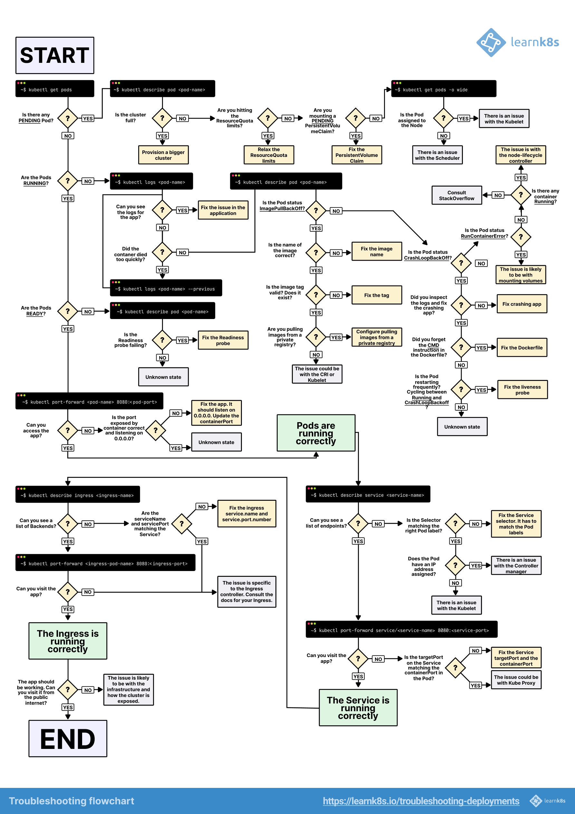

## Визуальная схема поиска неисправностей



---

## 0. Анализ состояния ресурсов с помощью kubectl describe

Команда `kubectl describe` — это основной инструмент для получения подробной, человекочитаемой информации о состоянии и конфигурации любого ресурса в Kubernetes. В отличие от `kubectl get -o yaml`, который показывает только спецификацию, `describe` добавляет к ней текущий статус, недавние события и другую полезную диагностическую информацию.

**Синтаксис:**
```bash
kubectl describe <тип-ресурса> <имя-ресурса> [флаги]
```
```
Containers:
  nginx:
    Container ID:   containerd://...
    Image:          nginx
    Image ID:       docker.io/library/nginx@sha256:...
    Port:           <none>
    Host Port:      <none>
    State:          Running
      Started:      <время-запуска>
    Ready:          True
    Restart Count:  0
    Environment:    <none>
    Mounts:
      /var/run/secrets/kubernetes.io/serviceaccount from kube-api-access-xyz (ro)
```

**Ключевые поля:**

*   `Image`: Образ контейнера, который используется.
*   `State`: Текущее состояние контейнера (`Running`, `Waiting`, `Terminated`).
*   `Ready`: Показывает, прошла ли readiness-проба (`True` или `False`). Если `False`, под не будет получать трафик от сервиса.
*   `Restart Count`: **Критически важное поле.** Если это число больше 0, значит, контейнер перезапускался. Это прямой индикатор наличия проблемы.
*   `Last State: Terminated`: (Не показано на скриншоте, но появляется под `State` для перезапускавшихся контейнеров). Содержит причину (`Reason`) и код выхода (`Exit Code`) последнего завершения. `OOMKilled` (нехватка памяти) или `Error` — самые частые причины.
*   `Environment`: Переменные окружения, переданные в контейнер.
*   `Mounts`: Смонтированные тома (volumes), включая секреты, ConfigMaps и PersistentVolumes.

### Секция Events (События)

В самом низу вывода `kubectl describe` находится секция `Events`. Это, возможно, самая важная часть для диагностики. Она представляет собой хронологический список событий, связанных с ресурсом: от назначения пода на узел (`Scheduled`) и загрузки образа (`Pulling image`) до сбоев проб работоспособности (`Liveness probe failed`) или нехватки ресурсов. **Всегда проверяйте эту секцию в первую очередь при возникновении проблем.**

## 1. Анализ логов с помощью kubectl logs

После `describe`, команда `kubectl logs` является вторым по важности инструментом для диагностики проблем с подами. Она позволяет просматривать стандартный вывод (stdout) и стандартные ошибки (stderr) процессов, запущенных внутри контейнеров.

**Синтаксис:**
```bash
kubectl logs <имя-пода> [-c <имя-контейнера>] [флаги]
```
Если в поде только один контейнер, его имя можно не указывать.

### Ключевые флаги и примеры

*   **Просмотр логов предыдущего, упавшего контейнера (`--previous`):**
    Это **самый важный флаг** при анализе циклических сбоев (`CrashLoopBackOff`). Он показывает логи контейнера непосредственно перед его последним завершением.
    ```bash
    kubectl logs my-app-pod-xyz --previous
    ```

*   **Стриминг логов в реальном времени (`--follow` или `-f`):**
    Позволяет следить за логами в реальном времени, как `tail -f` в Linux.
    ```bash
    kubectl logs -f my-app-pod-xyz
    ```

*   **Ограничение количества выводимых строк (`--tail`):**
    Полезно для получения только последних сообщений, чтобы избежать вывода огромного объема текста.
    ```bash
    # Показать последние 50 строк лога
    kubectl logs --tail=50 my-app-pod-xyz
    ```

*   **Фильтрация логов с помощью `grep`:**
    Для поиска конкретных ошибок или сообщений можно комбинировать `kubectl logs` с `grep`.
    ```bash
    kubectl logs my-app-pod-xyz | grep -i "error"
    ```

*   **Просмотр логов всех контейнеров в поде (`--all-containers`):**
    Удобно, когда в поде несколько контейнеров (например, основной и sidecar).
    ```bash
    kubectl logs -f my-multi-container-pod --all-containers
    ```

*   **Фильтрация по метке (`-l`):**
    Очень удобно для просмотра логов всех подов, принадлежащих одному приложению или сервису.
    ```bash
    kubectl logs -l app=my-app
    ```

*   **Ограничение количества запрашиваемых логов с нескольких подов (`--max-log-requests`):**
    При использовании селектора по меткам, этот флаг ограничивает количество подов, с которых одновременно запрашиваются логи.
    ```bash
    kubectl logs -l app=my-app --max-log-requests 10
    ```

*   **Просмотр логов за определенный период (`--since`):**
    Показывает логи за указанный промежуток времени (например, `10s`, `5m`, `2h`).
    ```bash
    kubectl logs my-pod --since=10m
    ```

Эффективное использование `kubectl logs` в сочетании с `kubectl describe` позволяет диагностировать подавляющее большинство проблем на уровне подов.

### Предоставление доступа к логам (RBAC)

Чтобы разрешить пользователям или сервисным аккаунтам просматривать логи, но не давать им полного доступа к подам (например, через `exec`), можно создать специальную роль `Role`.

Это полезно для разработчиков или систем мониторинга, которым нужен только доступ к логам.

```yaml
apiVersion: rbac.authorization.k8s.io/v1
kind: Role
metadata:
  namespace: default
  name: log-reader
rules:
- apiGroups: [""]
  # "pods/log" - это специальный subresource для доступа к логам
  resources: ["pods", "pods/log"]
  verbs: ["get", "list"]
```
После создания этой роли, ее можно привязать к пользователю или сервисному аккаунту с помощью `RoleBinding`.

## 2. Пошаговая диагностика перезапуска пода

Когда под (Pod) в Kubernetes неожиданно перезапускается, особенно под высокой нагрузкой, это почти всегда указывает на одну из двух основных причин: нехватку ресурсов или сбой проверок работоспособности.

Ниже представлен систематический подход к диагностике этой проблемы.

### Шаг 1: Определите причину последнего перезапуска

Самый первый и важный шаг — посмотреть на статус пода, чтобы понять, почему он был завершен.

```bash
kubectl describe pod <имя-пода> -n <пространство-имен>
```

В выводе этой команды ищите секцию `Containers`, а в ней — `Last State: Terminated`.

1.  **Проверьте `Reason`:**
    *   `OOMKilled` (Out of Memory): **Самая частая причина.** Контейнер попытался использовать больше памяти, чем ему было выделено (`limits.memory`), и был принудительно завершен ядром.
    *   `Error`: Общая ошибка. Приложение внутри контейнера завершилось с ненулевым кодом выхода.
    *   `Completed`: Процесс в контейнере успешно завершился (код выхода 0). Это нормальное поведение для `Job` или `CronJob`, но не для долгоживущего сервиса (например, веб-сервера).

2.  **Проверьте `Exit Code`:**
    *   `Exit Code: 137`: Это сигнал `SIGKILL`. В 99% случаев в Kubernetes это означает `OOMKilled`. `137 = 128 + 9`, где 9 — это сигнал KILL.
    *   `Exit Code: 139`: Это сигнал `SIGSEGV` (Segmentation Fault). Указывает на ошибку в самом приложении (например, обращение к невалидной области памяти).
    *   `Exit Code: 1`: Общая ошибка, которую вернуло приложение.
    *   `Exit Code: 0`: Успешное завершение.

### Шаг 2: Проанализируйте логи контейнера

Если причина не `OOMKilled`, скорее всего, проблема в самом приложении.

```bash
# Посмотреть логи текущего, работающего экземпляра
kubectl logs <имя-пода>

# Посмотреть логи предыдущего, "упавшего" экземпляра
kubectl logs <имя-пода> --previous
```

Флаг `--previous` критически важен, так как он позволяет заглянуть в логи контейнера прямо перед его падением. Ищите в логах ошибки, исключения (stack traces) или любые сообщения, которые могут объяснить причину сбоя.

### Шаг 3: Проверьте использование ресурсов и лимиты

Если причина перезапуска — `OOMKilled`, необходимо проанализировать, как под использует ресурсы.

1.  **Посмотрите на текущее потребление:**
    ```bash
    kubectl top pod <имя-пода>
    ```
    Сравните это значение с лимитами, указанными в `kubectl describe pod`.

2.  **Проанализируйте `requests` и `limits`:**
    *   **`requests.memory`**: Гарантированное количество памяти для пода.
    *   **`limits.memory`**: Максимальное количество памяти, которое может использовать под.
    Если потребление памяти приближается к `limits.memory`, риск `OOMKilled` резко возрастает.

    **Решение:**
    *   **Оптимизировать приложение:** Уменьшить потребление памяти.
    *   **Увеличить лимиты:** Если приложение действительно требует больше памяти, увеличьте `limits.memory` в спецификации пода.
    *   Подробнее см. [Управление ресурсами: Requests, Limits, Quotas и QoS](../Scheduling/qos_limit_and_requests.md).

### Шаг 4: Проверьте Liveness Probe

Если `Exit Code` не `137` и в логах нет очевидных ошибок, возможно, проблема в проверке жизнеспособности (`livenessProbe`). Если проба не проходит несколько раз подряд, Kubernetes принудительно перезапускает контейнер.

В выводе `kubectl describe pod` ищите секцию **Events**. При сбое `livenessProbe` вы увидите события, похожие на это:

```
Warning  Unhealthy  ...  Liveness probe failed: HTTP probe failed with statuscode: 500
```

**Возможные проблемы с Liveness Probe:**
*   **Слишком агрессивные тайм-ауты:** Приложение под нагрузкой не успевает ответить за `timeoutSeconds`.
*   **Неправильный эндпоинт:** Проба стучится по неверному пути или порту.
*   **Зависимость от внешних систем:** Проба проверяет соединение с базой данных, которая может быть недоступна.

**Решение:**
*   Увеличьте `initialDelaySeconds`, `periodSeconds` и `timeoutSeconds`.
*   Убедитесь, что эндпоинт пробы (`/healthz`, `/live`) работает корректно и быстро.
*   Подробнее см. [Реализация проверок работоспособности (Health Checks) и проб (Probes)](#10-реализация-проверок-работоспособности-health-checks-и-проб-probes).

### Шаг 5: Проверьте состояние узла (Node)

Иногда под может быть выселен (`Evicted`) с узла из-за нехватки ресурсов на самом узле.

```bash
kubectl describe node <имя-узла>
```

Ищите в секции **Conditions** статусы `MemoryPressure` или `DiskPressure`. Если они `True`, это означает, что узел находится под давлением, и `kubelet` может начать выселять поды для освобождения ресурсов.

Подробнее см. [Устранение неполадок: Pod в статусе Evicted](#12-устранение-неполадок-pod-в-статусе-evicted).


## 3. Исправление ошибок CrashLoopBackOff в модулях

Одна из самых распространённых и неприятных проблем в Kubernetes — это постоянные сбои пода при перезапуске. Эта ситуация известна как ошибка CrashLoopBackOff. Это происходит, когда контейнер не запускается корректно, и Kubernetes постоянно пытается перезапустить его, что приводит к циклу сбоев.

#### Шаг 1: Перечислите все модули

Первым шагом в отладке этой ошибки является получение общего обзора всех модулей, запущенных в вашем пространстве имён. Это можно сделать с помощью следующей команды:

```
kubectl get pods
```

Здесь будут отображаться статус, количество перезапусков и возраст каждого модуля. Модули со статусом `CrashLoopBackOff` ясно указывают на проблему, требующую немедленного внимания.

#### Шаг 2: Опишите затронутый модуль

После того, как вы определили проблемный модуль, используйте команду `describe` для проверки его внутренних деталей:

```
kubectl describe pod <pod-name>
```

Здесь вы найдете информацию о конфигурации, недавних событиях и сообщения, которые могут указывать на причину сбоя. Обратите особое внимание на **раздел «События»**, который может помочь выявить такие проблемы, как сбой при загрузке образов, отсутствие конфигурации или ошибки разрешений.

#### Шаг 3: Проверка журналов контейнера

Журналы необходимы для понимания того, что пошло не так внутри контейнера. Чтобы получить доступ к журналам модуля, используйте следующую команду:

```
kubectl logs <pod-name> --previous
```

Если модуль откажет до начала создания журналов, вы можете обнаружить, что журналы пусты. В таких случаях используйте флаг `--previous` для проверки журналов последнего отказавшего экземпляра контейнера. Это часто позволяет выявить первопричину, особенно если контейнер был закрыт до каких-либо значимых действий.

**Пример сценария**:

Давайте рассмотрим практический пример:

1.  Выполните `kubectl get pods` и наблюдайте за результатом:

```
kubectl get pods
my-webapp-pod   0/1   CrashLoopBackOff   5 (2m ago)
```

Под `my-webapp-pod` постоянно зависает.

2. Попробуйте описать модуль:

```
kubectl describe pod my-webapp-pod
```

Если это не принесло никакой полезной информации, проблема может быть в журналах контейнера.

3. Проверьте логи предыдущего экземпляра:

```
kubectl logs my-webapp-pod --previous
Error: DATABASE_URL environment variable is not set
Process exiting with code 1
```

Журналы показывают, что переменная окружения `DATABASE_URL` отсутствовала. Это объясняет сбой контейнера. Приложение внутри ожидало конфигурацию, которая не была предоставлена.

Ошибки CrashLoopBackOff часто возникают из-за ошибок конфигурации, таких как отсутствие переменных окружения, неверные команды или сбой в работе зависимостей. Систематически проверяя модули, описывая их события и просматривая журналы (в том числе журналы предыдущих экземпляров контейнеров), вы можете эффективно определить и устранить основную причину.

## 4. Устранение неполадок при развертывании Kubernetes: ImagePullBackOff

Когда Kubernetes не может извлечь образ контейнера из-за проблем с аутентификацией или неправильного имени образа, он запускает ошибку `ImagePullBackOff`.

#### Шаг 1: Определите проблемные развертывания

Начните с проверки статуса ваших развертываний:

```
kubectl get deployments
```

Эта команда отображает все развёртывания и количество их реплик. Обратите особое внимание на **столбец «ГОТОВО»**. Например, статус «0/3» означает, что ни один из модулей не запускается успешно, что указывает на проблему на уровне модуля, а не самого приложения.

Для более глубокого понимания выполните следующее:

```
kubectl describe deployment <deployment-name>
```

Это предоставляет подробные данные о развертывании, включая шаблон модуля, условия и последние события. Вы можете увидеть сообщения типа «ReplicaSet failed to create pods» (Не удалось создать модули ReplicaSet), которые могут указывать на наличие проблем.

#### Шаг 2: Мониторинг статуса и истории внедрения

Чтобы отслеживать процесс развертывания в режиме реального времени:

```
kubectl rollout status deployment <deployment-name>
```

Чтобы просмотреть историю развертываний:

```
kubectl rollout history deployment <deployment-name>
```

Используйте это, чтобы определить, в какой версии возникла проблема, и сравнить ее с предыдущими рабочими версиями.

#### Шаг 3: Выясните основную причину ImagePullBackOff

Давайте перечислим модули и выявим ошибку:

```
kubectl get pods
my-app-7d4b8c8f-xyz   0/1   ImagePullBackOff   0   2m
```

Теперь осмотрите неисправный модуль:

```
kubectl describe pod my-app-7d4b8c8f-xyz
Failed to pull image "private-registry.com/my-app:v1.2.3":
Error response from daemon: pull access denied for private-registry.com/my-app
```

Это означает, что Kubernetes не может получить доступ к частному реестру контейнеров из-за отсутствующих или недействительных учетных данных.

#### Шаг 4: Исправление ImagePullBackOff с помощью секретов

Чтобы решить эту проблему, создайте секрет Kubernetes для безопасного хранения ваших личных учетных данных реестра:

```
kubectl create secret docker-registry my-registry-secret \
  --docker-server=private-registry.com \
  --docker-username=myuser \
  --docker-password=mypassword \
  --docker-email=my@email.com
```

Теперь исправьте свое развертывание, чтобы оно ссылалось на секрет:

```
kubectl patch deployment my-app -p '{"spec":{"template":{"spec":{"imagePullSecrets":[{"name":"my-registry-secret"}]}}}}'
```

После установки исправления Kubernetes повторно запустит развертывание, используя правильные учётные данные. Вы можете отслеживать процесс развертывания с помощью:

```
kubectl rollout status deployment my-app
```

## 5. Устранение неполадок Kubernetes: исправление ошибок NotReady Node

Одна из наиболее распространенных проблем Kubernetes — это статус `NotReady` на узле, который блокирует планирование модулей и нарушает рабочие нагрузки.
Если kubelet на узле не может связаться с сервером или узел не проходит проверки работоспособности, появляется статус `NotReady`, препятствующий планированию модулей, что часто приводит к простою приложения.

#### Шаг 1: Проверка статуса узла

Сначала проверьте состояние всех узлов:

```
kubectl get nodes -o wide
```

Эта команда выводит список всех узлов кластера, показывая их состояние, время выполнения контейнера, IP-адреса и сведения об ОС. Флаг `-o wide` предоставляет дополнительный контекст, помогая выявлять проблемы на уровне узлов, такие как несоответствия ОС или шаблоны расположения узлов (например, сбои, специфичные для подсети).

#### Шаг 2: Проверка состояния узла и проблем

Используйте следующую команду для получения подробного представления о емкости ресурсов и работоспособности узла:

```
kubectl describe node <node-name> | grep -A 5 "Capacity\|Allocatable"
```

Это покажет, находятся ли выделяемые узлу ресурсы в пределах лимита или используются чрезмерно.

Например, предположим, что у вас есть узел, показывающий статус `NotReady`:

```
kubectl get nodes
worker-node-1   NotReady     5d   v1.28.0
```

#### Шаг 3: Для дальнейшего исследования

```
kubectl describe node worker-node-1
Conditions:
Type             Status  LastHeartbeatTime   LastTransitionTime   Reason                 Message
DiskPressure     True    Mon, 01 Jan 2024    Mon, 01 Jan 2024     KubeletHasDiskPressure kubelet has disk pressure
```

**Устранение проблем с давлением на диск**

В этом случае узел обычно сообщает о перегрузке диска из-за того, что разделы или журналы занимают слишком много места.

Чтобы решить эту проблему, очистите системные журналы с помощью:

```
sudo journalctl --vacuum-time=3d
```

Это удалит журналы старше 3 дней и освободит место на диске, помогая kubelet вернуть узел в состояние `Ready`.

## 6. Устранение неполадок с высоким потреблением ресурсов: решение ошибок OOMKilled

Когда контейнер превышает свой выделенный лимит памяти, Kubernetes принудительно завершает его, что приводит к ошибке `OOMKilled`. Это может вызвать вытеснение подов, простой приложения или серьезное снижение производительности.

#### Шаг 1: Проверка использования ресурсов

Чтобы определить узлы и поды с высоким потреблением памяти:

```
kubectl top nodes
```

Эта команда предоставляет использование ресурсов в реальном времени по узлам. Если узел использует более 80% своей памяти, он может быть подвержен риску ошибок OOMKilled.

Вы также можете просмотреть использование ресурсов на уровне подов и отсортировать по CPU или памяти:

```
kubectl top pods --all-namespaces --sort-by=cpu
kubectl top pods --all-namespaces --sort-by=memory
```

Эти команды помогут вам точно определить самые ресурсоемкие поды в кластере.

#### Шаg 2: Изучение квот, лимитов и автомасштабирования ресурсов

Понимание и мониторинг лимитов ресурсов имеет важное значение. Чтобы проверить квоты во всех пространствах имен:

```
kubectl describe quota --all-namespaces
```

Утечка памяти часто проявляется как постепенное увеличение использования памяти со временем. Вы можете отслеживать потребление памяти пода в реальном времени каждые 5 секунд, используя:

```
watch -n 5 'kubectl top pod memory-hungry-app'
```

Это поможет вам обнаружить утечки памяти или постепенно увеличивающееся использование памяти.

#### Шаг 3: Проверка запросов и лимитов ресурсов пода

Если у подов отсутствуют лимиты памяти, они могут потреблять чрезмерные ресурсы, потенциально затрагивая другие рабочие нагрузки. Чтобы проверить запросы и лимиты ресурсов:

```
kubectl describe pod memory-hungry-app | grep -A 10 "Requests\|Limits"
```

Это полезный трюк для определения того, у каких подов отсутствуют надлежащие ограничения памяти.

Чтобы предотвратить ошибки OOMKilled и автоматически сбалансировать использование ресурсов, вы можете настроить Horizontal Pod Autoscaling (HPA).

**Совет:** Используйте автомасштабирование для управления пиками ресурсов. Например, для автомасштабирования развертывания на основе 70% использования CPU:

```
kubectl autoscale deployment my-app --cpu-percent=70 --min=2 --max=10
```

Вы можете проверить, активно ли автомасштабирование и правильно ли оно функционирует:

```
kubectl get hpa
kubectl describe hpa my-app
```

Проактивное управление лимитами ресурсов и включение автомасштабирования помогают предотвратить ошибки OOMKilled и обеспечивают более плавную работу приложений.

## 7. Устранение неполадок с хранилищем Kubernetes: решение ошибок PVC в состоянии Pending

Статус *PersistentVolumeClaim (PVC) Pending* — это распространенная проблема с хранилищем в Kubernetes, которая мешает приложениям получать доступ к постоянным данным. Обычно это происходит из-за неправильно настроенных классов хранения, отсутствия провижинеров томов или недостаточного доступного хранилища в кластере.

#### Шаг 1: Проверка статуса PV и PVC

Начните с перечисления всех Persistent Volumes (PV) и Persistent Volume Claims (PVC) во всех пространствах имен. Эта команда предоставляет обзор их статуса, режимов доступа, емкости и того, связаны ли они:

```
kubectl get pv,pvc --all-namespaces
```

#### Шаг 2: Устранение проблем с монтированием

Чтобы дополнительно исследовать несвязанный PVC, застрявший в состоянии *Pending*, используйте следующую команду:

```
kubectl describe pvc <pvc-name>
```

Проверьте раздел **Events** внизу вывода. Он часто раскрывает основную причину, такую как:
- Нет подходящего `PersistentVolume`
- Несоответствие класса хранения
- Недостаточная емкость
- Отсутствует провижинер

#### Шаг 3: Проверка классов хранения

Неправильные или несуществующие классы хранения — частая причина. Перечислите все доступные классы хранения:

```
kubectl get storageclass
```

Затем опишите конкретный, чтобы проверить детали, такие как провижинер и параметры:

```
kubectl describe storageclass <storageclass-name>
```

Убедитесь, что ваш PVC ссылается на действительный, правильно настроенный класс хранения. Если указанный провижинер не существует или написан с ошибкой, том не будет предоставлен.

#### Шаг 4: Распространенные ошибки и их решение

Предположим, вы определили PVC, который ссылается на класс хранения с именем `fast-ssd`, но он не может быть предоставлен. Выполните:

```
kubectl describe pvc my-data-pvc
```

Вы можете увидеть ошибку вроде:
```
Warning  ProvisioningFailed  3m     persistentvolume-controller
storageclass.storage.k8s.io "fast-ssd" not found
```

Теперь перечислите все доступные классы хранения для подтверждения:
```
kubectl get storageclass
```
Если `fast-ssd` отсутствует, но существует `gp2` или `standard`, обновите ваш PVC, чтобы использовать действительный класс.

## 8. Использование журналов событий и аудита: Глубокий анализ системы

Kubernetes предоставляет два мощных инструмента для отладки: события и журналы аудита. Они помогают отслеживать, что произошло, когда это произошло и почему, предоставляя вам временную шкалу системных действий для анализа первопричин.

#### Шаг 1: Понимание событий Kubernetes

События в Kubernetes записывают то, что происходит внутри кластера. Вы можете перечислить события во всех пространствах имен и отсортировать их по времени создания, чтобы увидеть самую последнюю активность внизу. Это помогает сопоставить проблемы с недавним поведением системы.

Для просмотра всех событий, отсортированных по времени:
```
kubectl get events --all-namespaces --sort-by='.metadata.creationTimestamp'
```

Чтобы отфильтровать события, произошедшие после определенного времени:
```
kubectl get events --field-selector='lastTimestamp>2023-10-01T10:00:00Z'
```

Чтобы просмотреть только события типа Warning (которые часто указывают на потенциальные проблемы):
```
kubectl get events --field-selector type=Warning
```

Вы также можете отслеживать события в реальном времени, используя флаг `--watch`. Это полезно, когда вы активно устраняете неполадки и хотите немедленно наблюдать, что происходит после развертывания или изменения ресурсов:
```
kubectl get events --watch
```

Если вы исследуете конкретный под, развертывание или сервис, вы можете отфильтровать события, чтобы сосредоточиться только на этом объекте. Например:
```
kubectl get events --field-selector involvedObject.name=my-pod
```

В случае, если вы имеете дело с подами, которые не могут быть запланированы, вы можете отфильтровать события с причиной “FailedScheduling”. Это покажет, почему Kubernetes не смог разместить под на узле, например, из-за недостаточных ресурсов или конфликтов сродства:
```
kubectl get events --field-selector reason=FailedScheduling
```

#### Шаг 2: Использование журналов аудита для углубленного устранения неполадок

В то время как события помогают вам понять, что происходит, журналы аудита позволяют вам увидеть, **кто что сделал** на уровне API — это необходимо для расследований безопасности или при отслеживании административных действий.

Журналы аудита не включены по умолчанию. Чтобы включить их, вы должны настроить политику аудита. Вот пример конфигурации политики аудита, которая захватывает подробные журналы для основных ресурсов, таких как поды, сервисы, развертывания и т.д.:
```yaml
apiVersion: audit.k8s.io/v1
kind: Policy
rules:
- level: RequestResponse
  resources:
  - group: ""
    resources: ["pods", "services"]
  - group: "apps"
    resources: ["deployments", "replicasets"]
- level: Request
  resources:
  - group: ""
    resources: ["configmaps", "secrets"]
```

После настройки журналы аудита могут помочь вам отследить проблемы, показывая детали, такие как:
- Какой пользователь сделал запрос API
- С какого IP-адреса
- Используемый HTTP-глагол (например, GET, POST, DELETE)
- Затронутый ресурс (например, под, развертывание)
- Временная метка действия
- Успешность запроса

**Пример:** Журнал аудита может показать, что под был удален в определенное время, определенным администратором, с определенного IP-адреса. Этот уровень прозрачности имеет решающее значение при диагностике проблем, вызванных случайными или несанкционированными изменениями.

## 9. Использование Kubernetes Dashboard и визуальных инструментов

Хотя инструменты командной строки, такие как `kubectl`, предлагают мощные способы проверки вашего кластера Kubernetes, визуальные инструменты упрощают управление кластером, особенно при выявлении закономерностей в метриках, журналах и событиях.

#### Шаг 1: Обзор Kubernetes Dashboard

Kubernetes Dashboard — это веб-интерфейс пользователя, который позволяет вам визуально управлять ресурсами кластера. Он предоставляет подробную информацию о развертываниях, использовании ресурсов, журналах и событиях, что упрощает диагностику проблем без необходимости выполнять несколько команд CLI.

По умолчанию Dashboard не устанавливается в производственных средах из-за соображений безопасности. Однако его можно развернуть вручную следующим образом:

1.  **Развертывание Dashboard:** Выполните следующую команду, чтобы применить рекомендуемую конфигурацию:
    ```
    kubectl apply -f https://raw.githubusercontent.com/kubernetes/dashboard/v2.7.0/aio/deploy/recommended.yaml
    ```
2.  **Создание сервисного аккаунта для доступа:**
    ```
    kubectl create serviceaccount dashboard-admin -n kubernetes-dashboard
    kubectl create clusterrolebinding dashboard-admin --clusterrole=cluster-admin --serviceaccount=kubernetes-dashboard:dashboard-admin
    ```
3.  **Генерация токена доступа:**
    ```
    kubectl create token dashboard-admin -n kubernetes-dashboard
    ```

После развертывания Dashboard позволяет вам:
- Мониторить использование CPU и памяти с течением времени
- Визуализировать временные шкалы событий
- Исследовать отношения между ресурсами Kubernetes
- Просматривать журналы приложений прямо в браузере

**Пример использования:**
Предположим, ваше приложение испытывает периодические сбои. Dashboard может показать, что пики использования CPU совпадают с этими сбоями, а журнал событий показывает, что поды получают OOMKilled. Такую закономерность легче выявить визуально, чем читая необработанные журналы CLI.

## 10. Реализация проверок работоспособности (Health Checks) и проб (Probes)

Проверки работоспособности в Kubernetes функционируют аналогично плановым медицинским осмотрам, помогая выявлять проблемы на ранней стадии и обеспечивая, чтобы все работало как ожидалось.

Kubernetes использует *пробы* для мониторинга работоспособности и доступности ваших контейнеров приложений. Эти пробы позволяют кластеру обнаруживать проблемы и предпринимать автоматические действия, такие как перезапуск контейнеров или прекращение маршрутизации трафика, когда это необходимо.

#### Понимание проб Readiness и Liveness

Kubernetes предоставляет три типа проб, каждый из которых выполняет определенную роль в поддержании работоспособности контейнера:
1.  **Liveness Probe**: Проверяет, работает ли еще контейнер. Если он неоднократно выходит из строя, Kubernetes перезапускает контейнер.
2.  **Readiness Probe**: Проверяет, готов ли контейнер принимать трафик. Если эта проверка не удается, контейнер временно удаляется из конечных точек сервиса.
3.  **Startup Probe**: Предоставляет контейнерам дополнительное время для завершения их логики запуска, прежде чем начнутся другие пробы. Это полезно для приложений с более длительным временем загрузки.

**Пример: Конфигурация всех трех проб**

Ниже приведен пример конфигурации, который объединяет все три типа проб в одном развертывании:
```yaml
apiVersion: apps/v1
kind: Deployment
metadata:
  name: web-application
spec:
  replicas: 3
  selector:
    matchLabels:
      app: web-application
  template:
    metadata:
      labels:
        app: web-application
    spec:
      containers:
      - name: web-app
        image: my-app:v1.2.3
        ports:
        - containerPort: 8080

        # Startup probe - дает приложению время на инициализацию
        startupProbe:
          httpGet:
            path: /health/startup
            port: 8080
          initialDelaySeconds: 10
          periodSeconds: 5
          timeoutSeconds: 3
          failureThreshold: 30  # 30 * 5 = 150 секунд на запуск
          successThreshold: 1

        # Liveness probe - перезапускает контейнер, если он нездоров
        livenessProbe:
          httpGet:
            path: /health/live
            port: 8080
          initialDelaySeconds: 30
          periodSeconds: 10
          timeoutSeconds: 5
          failureThreshold: 3
          successThreshold: 1

        # Readiness probe - удаляет из сервиса, если не готов
        readinessProbe:
          httpGet:
            path: /health/ready
            port: 8080
          initialDelaySeconds: 5
          periodSeconds: 5
          timeoutSeconds: 3
          failureThreshold: 3
          successThreshold: 1

        resources:
          requests:
            memory: "256Mi"
            cpu: "250m"
          limits:
            memory: "512Mi"
            cpu: "500m"
```

**Как эти пробы работают вместе**
-   **Startup Probe**: Проверяется первым. Он выполняется каждые 5 секунд, позволяя до 150 секунд приложению завершить задачи запуска, такие как инициализация баз данных или загрузка конфигураций. В это время другие пробы приостановлены.
-   **Liveness Probe**: Как только проба запуска завершается успешно, в дело вступает проба живучести. Она гарантирует, что контейнер остается работоспособным. Если проверка не удается три раза подряд, Kubernetes автоматически перезапускает контейнер.
-   **Readiness Probe**: Гарантирует, что контейнер готов к обработке входящего трафика. Если проверка не удается (например, из-за временного сбоя базы данных), Kubernetes временно удаляет под из балансировщика нагрузки, не перезапуская его.

## 11. Продвинутые методы отладки

Хотя стандартные методы отладки Kubernetes решают многие повседневные проблемы, бывают случаи, когда требуются более продвинутые методы, особенно для диагностики сложных узких мест в производительности, неожиданного поведения приложений или глубоких проблем на уровне сети, которые не могут решить базовые инструменты.

#### Шаг 1: Использование эфемерных контейнеров для отладки в реальном времени

Эфемерные контейнеры — это мощный способ устранения неполадок в работающих приложениях без перезапуска подов или изменения их состояния. Они позволяют временно внедрить отладочный контейнер в работающий под, что идеально подходит для отладки в производственной среде, где время безотказной работы имеет решающее значение.

*   **Подключение к конкретному контейнеру (`--target`):**

    ```bash
    # Запуск базового отладочного контейнера в работающем поде
    kubectl debug <pod-name> -it --image=busybox --target=<container-name>
    ```

*   **Подключение к контейнеру приложения с кастомным именем отладочного контейнера:**

    ```bash
    # Подключаемся к контейнеру 'app' и называем отладочный контейнер 'debugger'
    kubectl debug -it -c debugger --image=busybox --target=app ${POD_NAME}
    ```

*   **Практический пример: Расследование сетевой проблемы**
    Представьте, что ваше веб-приложение сталкивается с периодическими проблемами с подключением. Вы можете подключить отладочный контейнер с сетевыми инструментами, такими как `netshoot`:

    ```bash
    kubectl debug web-app-7d4b8c9f-xyz -it --image=nicolaka/netshoot --target=web-app
    ```

    Внутри отладочного контейнера теперь можно проверить сетевое подключение:
    ```bash
    ping database-service
    nslookup database-service
    ```

#### Шаг 2: Использование `kubectl debug` для более широких сценариев

Команда `kubectl debug` также поддерживает более сложные операции, помимо эфемерных контейнеров:

*   **Создание полной отладочной копии пода:**

    ```bash
    # Создать отладочную копию пода, заменив образ и команду
    kubectl debug web-app-7d4b8c9f-xyz --copy-to=web-app-debug --set-image=web-app=ubuntu -- sleep 1d
    
    # Зайти в новый отладочный под
    kubectl exec -it web-app-debug -- bash
    ```

*   **Создание копии пода с общим пространством процессов:**

    ```bash
    # Создать отладочную копию пода с общим PID namespace
    kubectl debug -it -c debugger --image=busybox --copy-to=test-pod --share-processes ${POD_NAME}
    ```
    Этот отладочный под является отдельной сущностью: он не принадлежит исходному `Deployment` (имеет `Labels: <none>`) и не получает трафик от `Service`. Флаг `--share-processes` позволяет видеть все процессы из всех контейнеров исходного пода (например, с помощью `ps aux`).

*   **Отладка на уровне узла**: Вы можете запустить привилегированный под на узле для расследования проблем на уровне узла:

    ```bash
    kubectl debug node/worker-node-1 -it --image=ubuntu
    ```

    Внутри привилегированного контейнера вы можете получить доступ к файловой системе и службам хоста:
    ```bash
    chroot /host bash
    systemctl status kubelet
    journalctl -u kubelet -f
    ```

#### Шаг 3: Включение общего пространства имен процессов (Share Process Namespace)

Для постоянной возможности отладки процессов во всех контейнерах пода, можно включить общее пространство имен процессов на уровне спецификации пода. Это делается с помощью поля `shareProcessNamespace: true`.

**Важно:** Это изменение приведет к перезапуску пода.

```bash
kubectl patch deployment example --patch 'spec:
  template:
    spec:
      shareProcessNamespace: true'
```

После этого, зайдя в любой контейнер пода (`kubectl exec`), вы сможете видеть процессы всех остальных контейнеров этого пода.

Подробнее в [официальной документации](https://kubernetes.io/docs/tasks/configure-pod-container/share-process-namespace/).

**Почему эти методы важны**
Продвинутая отладка — это не просто наличие дополнительных команд; это гибкость доступа к низкоуровневым деталям без влияния на производственные рабочие нагрузки. С помощью эфемерных контейнеров, доступа на уровне узла и полного дублирования подов вы можете устранять практически любые проблемы в реальном времени и в контексте, минимизируя догадки и время простоя.

## 12. Устранение неполадок: Pod в статусе Evicted

Статус `Evicted` означает, что Kubernetes принудительно выселил под с узла (Node). Это почти всегда происходит из-за нехватки ресурсов на самом узле.

### Шаг 1: Выяснить причину выселения

Самая важная команда, которую нужно выполнить в первую очередь:

```bash
kubectl describe pod <имя-вашего-пода>
```

Прокрутите вывод до секции **Events**. Там вы найдете точную причину выселения. Чаще всего сообщение будет выглядеть так:

```
Warning  Evicted  ...  The node was low on resource: memory.
```

Основные причины выселения:
*   **Нехватка памяти (`memory`)**: Самая частая причина.
*   **Нехватка места на диске (`disk`)**: Происходит, когда узел исчерпывает дисковое пространство, часто из-за логов или образов Docker.
*   **Нехватка PID (`pid`)**: Реже, но случается, если на узле заканчиваются доступные идентификаторы процессов.

### Шаг 2: Проанализировать состояние узла

После того как вы определили проблемный узел из `describe pod`, проверьте его состояние:

```bash
kubectl describe node <имя-узла>
```

Обратите внимание на секцию **Conditions**. Если узел испытывает нехватку ресурсов, вы увидите статусы `True` для таких условий, как:
*   `MemoryPressure`
*   `DiskPressure`
*   `PIDPressure`

### Шаг 3: Найти "виновника"

Ваш под мог быть выселен не по своей вине, а из-за другого, более "жадного" пода на том же узле.

Используйте `kubectl top` для анализа потребления ресурсов:

```bash
# Посмотреть потребление ресурсов подами на всех узлах, отсортировав по памяти
kubectl top pods --all-namespaces --sort-by=memory

# Посмотреть потребление ресурсов самими узлами
kubectl top nodes
```

Это поможет вам найти поды, которые потребляют аномально много памяти или CPU, и которые могли вызвать нехватку ресурсов на узле.

### Почему был выселен именно этот под? (QoS)

Kubernetes решает, какой под выселить, на основе **классов качества обслуживания (QoS)**:

1.  **`BestEffort`** (не заданы `requests` и `limits`): **Выселяются первыми.**
2.  **`Burstable`** (заданы `requests`, но они меньше `limits`): Выселяются вторыми.
3.  **`Guaranteed`** (`requests` равны `limits`): **Выселяются в последнюю очередь.**

Скорее всего, ваш под имел более низкий приоритет (QoS), чем его "соседи" по узлу.

### Что делать дальше? (Решение и профилактика)

1.  **Удалить выселенный под:**
    Выселенный под не удаляется автоматически. Его нужно удалить вручную, после чего Deployment или ReplicaSet создаст новый, здоровый под (на другом, более свободном узле).
    ```bash
    kubectl delete pod <имя-выселенного-пода>
    ```

2.  **Настроить `requests` и `limits`:**
    Это **самое важное** превентивное действие. Всегда указывайте запросы и лимиты ресурсов для ваших контейнеров. Это позволяет Kubernetes правильно планировать поды и присваивать им адекватный класс QoS.

    *Пример для `Burstable` (рекомендуется для большинства приложений):*
    ```yaml
    resources:
      requests:
        memory: "256Mi"
        cpu: "250m"
      limits:
        memory: "512Mi"
        cpu: "500m"
    ```

3.  **Увеличить ресурсы узла:** Если проблема повторяется, возможно, вашим узлам просто не хватает мощности. Рассмотрите возможность увеличения их CPU или памяти.

4.  **Настроить автомасштабирование:**
    *   **Horizontal Pod Autoscaler (HPA):** Автоматически увеличивает количество реплик вашего приложения при росте нагрузки.
    *   **Cluster Autoscaler:** Автоматически добавляет новые узлы в кластер, если существующих ресурсов не хватает для размещения всех подов.

### Менее частая причина: Taints

Иногда под может быть выселен, если на узел добавляется "отравление" (taint) с эффектом `NoExecute`, а у пода нет соответствующей "терпимости" (`toleration`). Это также будет видно в выводе `kubectl describe pod`.

## 13. Паттерн Logging Sidecar

Паттерн "Logging Sidecar" — это один из фундаментальных подходов к управлению логами в Kubernetes. Его суть заключается в добавлении в под дополнительного, вспомогательного контейнера (сайдкара), который занимается исключительно сбором и отправкой логов основного приложения.

**Как это работает:**

1.  **Основное приложение** пишет свои логи не в `stdout`/`stderr`, а в один или несколько файлов внутри контейнера.
2.  **Общий том (`Volume`)**: Между основным контейнером и сайдкаром создается общий том, обычно `emptyDir`.
3.  **Монтирование**: Этот том монтируется в оба контейнера. Основное приложение пишет в него логи, а сайдкар — читает из него.
4.  **Сайдкар-контейнер**: В качестве сайдкара используется легковесный агент для сбора логов (например, `fluent-bit`, `vector` или даже `busybox` с командой `tail`). Он "подхватывает" логи из общего тома и пересылает их в централизованную систему хранения и анализа логов (например, Elasticsearch, Loki, Splunk).

**Пример манифеста:**

```yaml
apiVersion: v1
kind: Pod
metadata:
  name: example
spec:
  volumes:
  # 1. Создаем общий том для логов
  - name: log-volume
    emptyDir: {}

  containers:
  # Основной контейнер приложения
  - name: main-container
    image: example-app
    volumeMounts:
    # 2. Монтируем том в основной контейнер, чтобы писать в него логи
    - name: log-volume
      mountPath: /logs

  # Сайдкар-контейнер для сбора логов
  - name: sidecar-container
    image: busybox # В реальной жизни это будет fluent-bit, vector и т.д.
    command: ["sh", "-c", "tail -f /logs/app.log"]
    volumeMounts:
    # 3. Монтируем тот же том в сайдкар, чтобы читать из него логи
    - name: log-volume
      mountPath: /logs
```

**Преимущества паттерна:**

*   **Разделение ответственности**: Основное приложение не заботится о том, куда и как отправлять логи. Его задача — просто писать их в файл.
*   **Гибкость**: Можно легко заменить агент сбора логов (например, перейти с `fluent-bit` на `vector`), не меняя основной контейнер.
*   **Унификация**: Все логи в кластере собираются и обрабатываются единообразно, независимо от того, на каком языке написано приложение.
*   **Надежность**: Если центральная система логирования временно недоступна, это не влияет на работу основного приложения.

Популярные инструменты для реализации logging sidecar: **Fluent-bit**, **Logstash**, **Vector**.

## 14. Доступ к API-серверу с помощью kubectl proxy

Команда `kubectl proxy` создает прокси-сервер между вашей локальной машиной и API-сервером Kubernetes. Это позволяет напрямую обращаться к API с помощью `curl`, `wget` или браузера без необходимости аутентификации для каждого запроса. `kubectl` обрабатывает аутентификацию за вас.

Это полезно для:
*   Изучения Kubernetes API.
*   Отладки и выполнения сложных запросов к API.
*   Доступа к веб-интерфейсам, которые работают через API-сервер.

**Синтаксис:**

```bash
kubectl proxy [--port=8001]
```
По умолчанию прокси запускается на порту 8001.

**Пример:**

1.  **Запустить прокси в терминале:**
    ```bash
    kubectl proxy
    # Starting to serve on 127.0.0.1:8001
    ```

2.  **В другом терминале выполнить запрос к API:**
    Например, чтобы получить список всех узлов в кластере:
    ```bash
    curl http://localhost:8001/api/v1/nodes
    ```
Команда `proxy` работает до тех пор, пока вы не остановите ее (например, с помощью `Ctrl+C`).

## 15. Доступ к приложениям с помощью kubectl port-forward

Команда `kubectl port-forward` — это мощный инструмент для отладки, который позволяет пробросить один или несколько локальных портов на порт пода (Pod). Это дает возможность подключиться к приложению, работающему в кластере, так, как если бы оно работало на вашей локальной машине (`localhost`).

Это особенно полезно для:
*   Отладки приложения, к которому нет прямого доступа извне.
*   Подключения к базе данных, работающей в кластере, с помощью локального GUI-клиента.
*   Временного доступа к веб-интерфейсу внутреннего сервиса.

**Синтаксис:**

```bash
kubectl port-forward <ТИП>/<ИМЯ> [ЛОКАЛЬНЫЙ_ПОРТ:]ПОРТ_ПОДА
```

*   **`ТИП/ИМЯ`**: Тип и имя ресурса. Чаще всего это `pod/<имя-пода>`, но можно использовать и `deployment/<имя-деплоя>` или `service/<имя-сервиса>`.
*   **`ПОРТ_ПОДА`**: Порт, который слушает приложение внутри пода.
*   **`ЛОКАЛЬНЫЙ_ПОРТ`**: Порт на вашей локальной машине, который будет проброшен. Если не указан, выбирается случайный свободный порт.

**Примеры:**

1.  **Пробросить локальный порт 8080 на порт 80 пода `my-pod`:**

    ```bash
    kubectl port-forward pod/my-pod 8080:80
    ```
    После выполнения этой команды, вы можете открыть в браузере `http://localhost:8080` и получить доступ к приложению, работающему на 80-м порту пода `my-pod`.

2.  **Пробросить порт на ресурс Deployment:**
    `kubectl` автоматически выберет один из подов, управляемых этим деплойментом.

    ```bash
    kubectl port-forward deployment/my-deployment 8080:80
    ```

3.  **Пробросить на случайный локальный порт:**
    Если вы не хотите указывать локальный порт вручную, `kubectl` выберет его сам.

    ```bash
    # kubectl выведет, какой порт он выбрал
    kubectl port-forward pod/my-pod :5000
    # Forwarding from 127.0.0.1:63753 -> 5000
    ```

4.  **Указать IP-адрес для прослушивания:**
    По умолчанию `port-forward` слушает только на `localhost`. Чтобы сделать его доступным с других машин в вашей локальной сети, можно указать `--address`.

    ```bash
    kubectl port-forward --address 0.0.0.0 pod/my-pod 8080:80
    ```
    **Внимание:** Это может быть небезопасно, так как открывает доступ к вашему поду для всех, кто может достучаться до вашего IP.

### Как это работает под капотом

Команда `kubectl port-forward` не просто открывает TCP-сокет. Она работает через API-сервер Kubernetes, используя протокол SPDY (в старых версиях) или WebSocket (в новых, начиная с v1.30) для туннелирования трафика.

1.  `kubectl` отправляет `POST` запрос к API-серверу на специальный эндпоинт пода: `/api/v1/namespaces/<namespace>/pods/<pod-name>/portforward`.
2.  API-сервер "пробрасывает" этот запрос до `kubelet` на узле, где запущен под.
3.  `kubelet` открывает прямое соединение с портом пода.
4.  Соединение между `kubectl` и API-сервером обновляется до потокового (WebSocket/SPDY), и весь трафик начинает туннелироваться через него.

Этот механизм использует заголовок `X-Stream-Protocol-Version` для согласования версии протокола потоковой передачи.

### Предоставление доступа для `port-forward` (RBAC)

Как и `exec`, возможность использовать `port-forward` контролируется через RBAC. Чтобы разрешить пользователю пробрасывать порты, ему нужно предоставить права на специальный подресурс `pods/portforward`.

**Пример `Role` для доступа к `port-forward`:**

```yaml
kind: Role
apiVersion: rbac.authorization.k8s.io/v1
metadata:
  namespace: my-namespace
  name: allow-port-forward
rules:
- apiGroups: [""]
  resources: ["pods", "pods/portforward"]
  verbs: ["get", "list", "create"]
```
Эта роль позволяет пользователю получать список подов и создавать `port-forward` соединения к ним в неймспейсе `my-namespace`.

Команда `port-forward` работает до тех пор, пока вы не остановите ее (например, с помощью `Ctrl+C`).

## 16. Выполнение команд внутри контейнеров с kubectl exec

Команда `kubectl exec` является одним из самых важных инструментов для интерактивной отладки. Она позволяет выполнить команду внутри уже запущенного контейнера в поде. Чаще всего ее используют для получения доступа к командной оболочке (shell) внутри контейнера.

**Синтаксис:**

```bash
kubectl exec [POD_NAME] -it -- [COMMAND]
```

*   **`POD_NAME`**: Имя пода, в котором нужно выполнить команду.
*   **`-i`/`--stdin`**: (Keep stdin open). Позволяет передавать ввод в контейнер. Необходимо для интерактивных сессий.
*   **`-t`/`--tty`**: (Allocate a pseudo-TTY). Выделяет псевдо-терминал, что делает сессию похожей на обычное SSH-подключение. Для интерактивного доступа почти всегда используется вместе с `-i` (сокращенно `-it`).
*   **`--`**: Двойное тире разделяет команду `kubectl` от команды, которую нужно выполнить внутри контейнера. Это предотвращает путаницу с флагами.
*   **`[COMMAND]`**: Команда для выполнения. Если не указана, обычно используется оболочка по умолчанию из образа контейнера.

**Ключевые флаги:**

*   `-c, --container <имя-контейнера>`: Явно указывает имя контейнера, если в поде их несколько (например, основной контейнер и сайдкар).

**Примеры:**

1.  **Получить интерактивный доступ к оболочке `/bin/bash` в поде `nginx`:**

    ```bash
    kubectl exec -it nginx -- /bin/bash
    ```

2.  **Выполнить одну команду (просмотр конфигурации) без интерактивной сессии:**

    ```bash
    kubectl exec my-example-pod -- cat /etc/nginx/nginx.conf
    ```

### Копирование файлов: kubectl cp

Часто во время отладки требуется скопировать файлы с локальной машины в под или наоборот. Для этого используется команда `kubectl cp`.

**Синтаксис:**

```bash
# Копирование из пода на локальную машину
kubectl cp <пространство-имен>/<имя-пода>:<путь-в-поде> <локальный-путь>

# Копирование с локальной машины в под
kubectl cp <локальный-путь> <пространство-имен>/<имя-пода>:<путь-в-поде>
```

**Примеры:**

1.  **Скопировать файл `file.txt` из пода `my-pod` в текущую директорию на локальной машине:**

    ```bash
    kubectl cp default/my-pod:/path/to/file.txt .
    ```

2.  **Скопировать файл `file.txt` с локальной машины в под `my-pod`:**

    ```bash
    kubectl cp file.txt default/my-pod:/path/to/file.txt
    ```

### Предоставление доступа для `exec` (RBAC)

По соображениям безопасности, возможность выполнять команды внутри пода (`exec`) должна строго контролироваться. Для предоставления таких прав используется RBAC (Role-Based Access Control).

Чтобы разрешить пользователю или сервисному аккаунту использовать `exec`, необходимо создать `Role` (или `ClusterRole`), которая предоставляет право `create` для специального подресурса `pods/exec`.

**Пример `Role` для доступа к `exec`:**

```yaml
apiVersion: rbac.authorization.k8s.io/v1
kind: Role
metadata:
  namespace: default
  name: pod-exec
rules:
- apiGroups: [""]
  resources: ["pods/exec"]
  verbs: ["create"]
```

После создания этой роли, ее можно привязать к нужному пользователю с помощью `RoleBinding`.

## 17. Сбор и анализ Core Dumps

Когда приложение аварийно завершается (например, из-за ошибки сегментации - `SIGSEGV`), операционная система может создать **core dump** — файл, содержащий снимок памяти процесса в момент сбоя. Анализ core dump'а с помощью отладчика (например, `gdb` или `delve` для Go) является мощным инструментом для пост-мортем анализа и выявления первопричины сбоя.

В Kubernetes для сбора core dumps требуется специальная настройка, так как поды по умолчанию не имеют доступа к хостовой системе для сохранения файлов и не имеют необходимых привилегий.

### Настройка пода для сбора Core Dumps

Основная идея — использовать `initContainer` для настройки ядра внутри PID namespace пода, чтобы оно сохраняло core dumps в общий том, который также монтируется к основному контейнеру.

**Пример полной спецификации пода:**

```yaml
apiVersion: v1
kind: Pod
metadata:
  name: crashy-app
spec:
  # 1. InitContainer для настройки ядра
  initContainers:
  - name: configure-core-dumps
    image: busybox:latest
    command:
    - "/bin/sh"
    - "-c"
    - "sysctl -w kernel.core_pattern='/var/core-dumps/core.%e.%p.%t' && ulimit -c unlimited"
    securityContext:
      privileged: true # Требуются привилегии для изменения sysctl
    volumeMounts:
    - name: core-dump-volume
      mountPath: /var/core-dumps

  # 2. Основной контейнер приложения
  containers:
  - name: app
    image: your-crashy-app:1.0.0
    volumeMounts:
    - name: core-dump-volume
      mountPath: /var/core-dumps
    env:
    - name: CORE_DUMP_PATH
      value: "/var/core-dumps" # Некоторые приложения нужно информировать, куда писать дампы

  # 3. Общий том для хранения дампов
  volumes:
  - name: core-dump-volume
    persistentVolumeClaim:
      claimName: core-dump-pvc
```

**Объяснение:**

1.  **`initContainer` (`configure-core-dumps`):**
    *   Запускается перед основным контейнером.
    *   Имеет `privileged: true`, что дает ему права на изменение параметров ядра.
    *   Выполняет `sysctl -w kernel.core_pattern=...`, чтобы указать ядру сохранять core dumps в директорию `/var/core-dumps` внутри пода. Шаблон имени файла включает имя исполняемого файла (`%e`), PID (`%p`) и время (`%t`).
    *   `ulimit -c unlimited` снимает ограничение на размер файла core dump.

2.  **Основной контейнер (`app`):**
    *   Монтирует тот же том `core-dump-volume` в `/var/core-dumps`.
    *   Когда приложение внутри этого контейнера падает, ядро (настроенное init-контейнером) сохраняет core dump в эту директорию.

3.  **Том (`core-dump-volume`):**
    *   Использует `PersistentVolumeClaim`, чтобы дампы сохранялись на постоянном хранилище и не были утеряны после удаления или перезапуска пода.

### Анализ Core Dump

После сбоя приложения вы можете найти файлы дампов в вашем `PersistentVolume`.

```bash
# Пример падения Go-приложения
panic: runtime error: invalid memory address or nil pointer dereference
[signal SIGSEGV: segmentation violation code=0x1 addr=0x0 pc=0x91168]

Aborted (core dumped)

# Файлы дампов на PV
$ ls -lh /var/core-dumps/
total 4.5M
-rw------- 1 root root 39M May  5 20:49 core.example.2848.1746478967
-rw------- 1 root root 39M May  5 20:50 core.example.2104.1746471841
```

Эти файлы можно скопировать и проанализировать с помощью соответствующего отладчика.

## 18. Удаленная отладка с Delve

Удаленная отладка позволяет подключиться отладчиком с вашей локальной машины к процессу, запущенному внутри пода в Kubernetes. Это дает возможность ставить точки останова (breakpoints), пошагово выполнять код, инспектировать переменные и состояние приложения в реальном времени, как если бы вы запускали его локально.

Этот метод особенно полезен для отладки сложных проблем, которые проявляются только в окружении кластера. Рассмотрим пример для приложения на Go с использованием отладчика `Delve`.

### Шаг 1: Подготовка Docker-образа

Ключевой момент — это включение отладчика `Delve` (`dlv`) непосредственно в образ вашего приложения и запуск приложения через него.

**Пример многостадийного `Dockerfile`:**

```dockerfile
# Стадия сборки
FROM golang:1.24-alpine AS builder

WORKDIR /app
# Устанавливаем Delve
RUN go install github.com/go-delve/delve/cmd/dlv@v1.24
COPY . .
# Собираем приложение
RUN go build -o server .

# Финальная стадия
FROM alpine:3
WORKDIR /app
# Копируем бинарный файл приложения и Delve из сборщика
COPY --from=builder /app/server .
COPY --from=builder /go/bin/dlv .

EXPOSE 8080

# Запускаем приложение через Delve
# Delve будет слушать на порту 40000
CMD ["./dlv", "--headless=true", "--accept-multiclient", "--continue", "--listen=0.0.0.0:40000", "--api-version=2", "exec", "./server", "--log"]
```

**Объяснение `CMD`:**
*   `./dlv`: Запускает отладчик Delve.
*   `--headless=true`: Запускает Delve в "безголовом" режиме, то есть как сервер отладки.
*   `--listen=0.0.0.0:40000`: Указывает Delve принимать подключения отладчика на порту `40000` со всех сетевых интерфейсов.
*   `--accept-multiclient`: Позволяет подключаться и отключаться несколько раз.
*   `--continue`: Сразу продолжает выполнение программы после запуска (не останавливается на входе).
*   `exec ./server`: Указывает Delve запустить бинарный файл вашего приложения `./server`.

### Шаг 2: Проброс порта

После того как под с таким образом запущен, вам нужно пробросить локальный порт на порт отладчика (`40000`) в поде. Для этого используется `kubectl port-forward`.

```bash
kubectl port-forward pod/example-pod 40000:40000
```
Эта команда пробрасывает ваш локальный порт `40000` на порт `40000` пода `example-pod`.

### Шаг 3: Подключение из IDE

Теперь все готово. Вы можете настроить удаленную отладку в вашей любимой IDE (GoLand, VS Code и т.д.), указав ей подключиться к отладчику по адресу `localhost:40000`. После подключения вы сможете полноценно отлаживать ваше приложение, работающее в Kubernetes.

## 19. Отладка проблем с правами доступа с помощью strace

Часто при использовании безопасных практик, таких как запуск контейнеров от имени non-root пользователя и с read-only файловой системой, возникают проблемы с правами доступа. `strace` — это мощный инструмент для диагностики таких проблем, так как он позволяет отследить все системные вызовы, которые делает приложение, и увидеть, какой именно вызов завершается с ошибкой "Permission Denied".

Рассмотрим реальный сценарий: Python-сервер в `distroless` образе падает при запуске.

### Шаг 1: Описание проблемы (Манифест)

Приложение запускается с пользователем `2000` и монтирует том в `/app`.

```yaml
apiVersion: v1
kind: Pod
metadata:
  name: web-server
spec:
  # InitContainer для установки прав на директорию
  initContainers:
  - name: init-app-permissions
    image: busybox:latest
    command: ["/bin/sh", "-c", "chown -R 2000:2000 /app && chmod -R 700 /app"]
    volumeMounts:
    - name: app-volume
      mountPath: /app

  # Основной контейнер
  containers:
  - name: app
    image: gcr.io/distroless/python3-debian11
    workingDir: /app
    command:
      - "python"
      - "-m"
      - "http.server"
      - "8000"
    securityContext:
      runAsUser: 2000
      runAsGroup: 2000
      readOnlyRootFilesystem: true
      # Для использования strace напрямую в контейнере, нужна эта capability:
      capabilities:
        add: ["SYS_PTRACE"]
    volumeMounts:
    - name: app-volume
      mountPath: /app

  volumes:
  - name: app-volume
    emptyDir: {}
```
*Примечание: `initContainer` здесь решает проблему, подготавливая директорию `/app` для non-root пользователя. Мы используем `strace` чтобы *диагностировать* проблему, если бы `initContainer` был настроен неверно или отсутствовал.*

### Шаг 2: Диагностика с помощью `kubectl debug` и `strace`

Чтобы использовать `strace`, отладочному контейнеру нужны повышенные привилегии. Проще всего это сделать, используя профиль `sysadmin` в `kubectl debug`.

1.  **Запускаем отладочный контейнер:**
    Мы подключаемся к проблемному поду, создавая эфемерный контейнер с `alpine` (где есть `strace`) и профилем `sysadmin`.

    ```bash
    kubectl debug -it -c debugger --target=app --image=alpine ${POD_NAME} --profile=sysadmin
    ```

2.  **Запускаем `strace`:**
    Внутри отладочного контейнера мы находим PID основного процесса (обычно `1`) и запускаем `strace`, чтобы отследить системные вызовы, которые завершаются с ошибкой (`-e status=failed`).

    ```bash
    / # strace -f -e status=failed -p 1
    strace: Process 1 attached
    [pid   35] openat(AT_FDCWD, "/", O_RDONLY|O_NONBLOCK|O_CLOEXEC|O_DIRECTORY) = -1 EACCES (Permission denied)
    ...
    ```

**Анализ вывода:**
Вывод `strace` ясно показывает, что процесс с PID `35` (дочерний процесс нашего Python-сервера) пытается открыть корневую директорию `/` и получает ошибку `EACCES (Permission denied)`. Это происходит потому, что мы установили `readOnlyRootFilesystem: true`, а приложение по какой-то причине пытается что-то сделать в корне. В данном (гипотетическом) случае, это и есть источник проблемы.

### Шаг 3: Решение

В нашем исходном примере проблема с правами на директорию `/app` была решена с помощью `initContainer`, который заранее установил владельца (`chown`) и права (`chmod`) на эту директорию. Если бы `initContainer` отсутствовал, `strace` показал бы ошибку записи в `/app`, и решением было бы добавление этого `initContainer`.

## 20. Сетевая отладка с помощью tcpdump и netshoot

Когда нужно проанализировать сетевой трафик пода, `tcpdump` является незаменимым инструментом. Однако, для его работы часто требуются привилегии, которые нежелательно предоставлять в продуктивной среде.

`kubectl debug` в сочетании со специальными образами для сетевой отладки, такими как `nicolaka/netshoot`, позволяет проводить диагностику безопасно.

### Безопасный запуск tcpdump

Используя `kubectl debug` с профилем `restricted`, можно запустить отладочный контейнер с минимально необходимыми правами.

```bash
kubectl debug -it -c debugger --target=app --image=nicolaka/netshoot ${POD_NAME} --profile=restricted
```

*   `--image=nicolaka/netshoot`: Использует образ, содержащий огромное количество утилит для сетевой диагностики (`tcpdump`, `ping`, `dig`, `netstat` и др.).
*   `--profile=restricted`: Применяет к отладочному контейнеру строгие ограничения безопасности.

### Применяемый Security Context

Если проверить `securityContext` созданного эфемерного контейнера, можно увидеть, насколько он ограничен:

```bash
kubectl get pod ${POD_NAME} -o jsonpath='{.spec.ephemeralContainers[0].securityContext}' | jq
```

```json
{
  "allowPrivilegeEscalation": false,
  "capabilities": {
    "drop": [
      "ALL"
    ]
  },
  "runAsNonRoot": true,
  "seccompProfile": {
    "type": "RuntimeDefault"
  }
}
```
*   `allowPrivilegeEscalation: false`: Запрещает повышение привилегий.
*   `"drop": ["ALL"]`: Отбрасывает все Linux capabilities.
*   `runAsNonRoot: true`: Гарантирует, что контейнер запускается не от имени root.
*   `seccompProfile: "RuntimeDefault"`: Применяет стандартный, безопасный профиль `seccomp`.

Даже с такими строгими ограничениями, инструменты из образа `netshoot` (включая `tcpdump`) остаются функциональными для большинства сценариев отладки, позволяя безопасно инспектировать сетевой трафик пода.

## 21. Устранение неполадок: Pod в статусе Terminating

Иногда поды не могут завершить свою работу и "зависают" в состоянии `Terminating`. Обычно это связано с проблемами размонтирования томов.

Подробнее см. [Устранение проблемы: под завис в состоянии Terminating](./pod_stuck_in_terminating_state.md).
