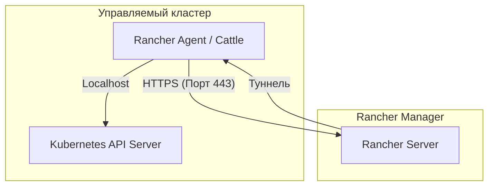

# RKE в Rancher

## Определения

**RKE1 (Rancher Kubernetes Engine)** — сертифицированный дистрибутив Kubernetes от Rancher Labs, работающий на базе Docker. Подробное описание установки через CLI доступно в [основном разделе RKE](../Installation/RKE/index.md).

**RKE2 (RKE Government)** — следующее поколение дистрибутива RKE, ориентированное на безопасность (FIPS-совместимость, hardened-компоненты). В отличие от RKE1, не требует Docker и использует архитектуру, близкую к K3s.

**Rancher Agent** — специализированный компонент (набор контейнеров в RKE1 или системный сервис в RKE2), разворачиваемый на узлах кластера для обеспечения связи с Rancher Manager (Server).

**Cattle Cluster Agent** — основной агент внутри кластера, отвечающий за связь с API-сервером Kubernetes и выполнение команд от Rancher.

## Базовые концепции

### Архитектура связи через агенты

Rancher использует модель "обратного подключения", что позволяет управлять кластерами, находящимися за NAT или Firewall.

**Ключевые особенности:**

* **Инициация соединения:** Агент всегда первым инициирует соединение с Rancher Server по порту **443 (HTTPS)**. Это исключает необходимость открывать входящие порты на стороне кластера.
* **Автономность:** Если связь с Rancher Manager прервется, кластер продолжит работу. Rancher необходим только для управления, мониторинга и централизованной аутентификации.
* **Сетевые требования:** Для корректной работы узлы должны иметь доступ к Rancher Server по 443 порту, а Rancher Server должен иметь доступ к API-серверу (порт **6443**) только в случае "импортированных" кластеров (без туннелирования).

## Практические сценарии

### Создание кластера через Rancher UI

Платформа поддерживает три основных сценария развертывания RKE-кластеров:

1. **Custom Cluster (Регистрация узлов):**
   * Создается пустой шаблон в UI.
   * Rancher генерирует команду `docker run ...` (RKE1) или `curl ...` (RKE2).
   * Команда выполняется вручную на подготовленных Linux-узлах.
2. **Cloud Provider Provisioning:**
   * Rancher использует API облака (AWS, vSphere, DigitalOcean) для создания виртуальных машин.
   * Автоматически устанавливает Docker/RKE2 и настраивает кластер.
3. **Imported Cluster:**
   * Подключение существующего кластера (например, EKS или bare-metal kubeadm).
   * В кластер устанавливается только Cattle Agent.

### Управление узлами и ролями

При создании RKE-кластера необходимо распределить роли между узлами:
* **etcd:** Хранилище состояния. Минимум 3 узла для отказоустойчивости.
* **Control Plane:** Компоненты управления (API, Scheduler, Controller Manager).
* **Worker:** Узлы для запуска пользовательских приложений.

### Развертывание приложений (Workloads)

Rancher предоставляет абстракцию над стандартными ресурсами Kubernetes:
1. **Проекты (Projects):** Группировка нескольких Namespace для совместного управления квотами и RBAC.
2. **Deployments:** Упрощенный интерфейс для создания Deployment, StatefulSet или DaemonSet.
3. **Сервисы и Ingress:** Визуальная настройка балансировки трафика.

## Дополнительная информация

Для глубокого изучения RKE вне контекста Rancher используйте следующие разделы:

* [Установка RKE через CLI](../Installation/RKE/rke_management_scenarios.md) — для сценариев Infrastructure as Code.
* [Настройка доступа через kubectl](../Installation/RKE/rke_kubectl_setup.md) — работа с API напрямую.
* [Обзор платформы Rancher](./rancher_overview.md) — общие принципы работы.

**Внешние ресурсы:**

* [Официальная документация Rancher Manager](https://ranchermanager.docs.rancher.com/)
* [Документация RKE2 (RKE Government)](https://docs.rke2.io/)
* [Матрица поддержки дистрибутивов](https://www.suse.com/suse-rancher/support-matrix/)
