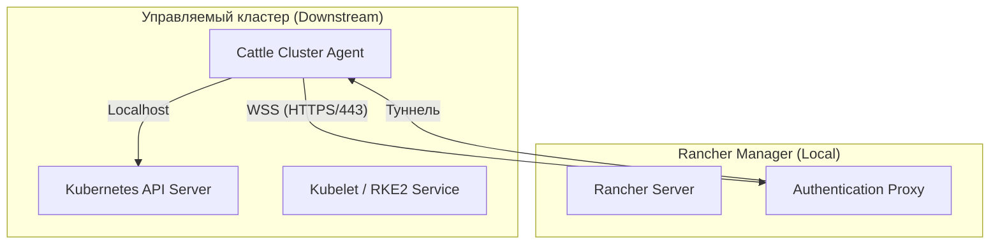

# RKE в Rancher

## Определения

**RKE2 (RKE Government)** — основной дистрибутив Kubernetes в экосистеме Rancher (начиная с v2.6+). Фокусируется на безопасности и простоте эксплуатации. Использует `containerd` и архитектуру статических подов. Соответствует стандартам FIPS и CIS Hardening.

**RKE1 (Legacy)** — оригинальный дистрибутив Rancher Kubernetes Engine, работающий на базе Docker. **Статус на 2026 г.: End of Life (EOL).** Поддержка прекращена 31 июля 2025 года. Использование рекомендуется только для поддержки устаревших сред с обязательным планом миграции на RKE2.

**Rancher Agent** — бинарный файл или набор контейнеров, обеспечивающий коммуникацию между управляемым узлом и Rancher Manager. В RKE2 работает как системный сервис.

**Cattle Cluster Agent** — компонент внутри кластера, который туннелирует запросы от Rancher к Kubernetes API и управляет жизненным циклом ресурсов (Workloads).

## Базовые концепции

### Архитектура связи через агенты

Rancher реализует модель "обратного подключения", позволяющую управлять кластерами за NAT или Firewall без открытия входящих портов.

**Ключевые особенности:**

* **Туннелирование:** Все управление идет через WebSocket-соединение, инициированное агентом. Rancher не требует прямой сетевой доступности API-сервера управляемого кластера (кроме сценария Import).
* **Автономность:** При потере связи с Rancher Server нагрузки в кластере продолжают работать. Недоступными становятся только функции управления через UI и централизованная аутентификация.
* **Сетевые требования:** Узлы должны иметь исходящий доступ к Rancher Server по порту **443 (HTTPS)**.

### Типы провайдеров (Provisioning)

1.  **Node Drivers (Cloud Provisioning):** Rancher напрямую управляет жизненным циклом ВМ через API облака (vSphere, AWS EC2, Azure, OpenStack). Rancher сам устанавливает ОС (через Cloud-init) и RKE2.
2.  **Custom Nodes:** Пользователь сам готовит ОС и запускает команду регистрации (Registration Command). Rancher устанавливает только RKE2 и агенты.
3.  **Imported Clusters:** Подключение существующих кластеров (Kubeadm, EKS, AKS). Rancher управляет только Workloads, но не жизненным циклом самого Kubernetes (обновление версии K8s выполняется внешними средствами).

## Практические сценарии

### Создание и настройка RKE2 кластера

При развертывании через Rancher UI доступны следующие настройки:

*   **System Scans:** Автоматическое выполнение CIS Benchmark по расписанию.
*   **Cloud Provider Integration:** Настройка In-tree или External облачных провайдеров для управления StorageClass и LoadBalancer.
*   **Drain/Cordon:** Настройка поведения узлов при обновлении (количество одновременно обновляемых узлов, таймауты завершения подов).

### Управление снимками и восстановление (Backup & Restore)

Rancher предоставляет встроенный механизм управления `etcd-snapshots` для RKE2:

1.  **Локальные снимки:** Сохраняются на узлах с ролью `etcd` в `/var/lib/rancher/rke2/server/db/snapshots`.
2.  **S3 Backup:** Нативная поддержка выгрузки снимков в S3-совместимые хранилища. Настраивается в параметрах кластера в UI.
3.  **Восстановление:** Выполняется через UI (Cluster Management → Snapshot → Restore). При восстановлении можно выбрать стратегию (только etcd или etcd + Kubernetes Version).

### Обновление кластера (Upgrading)

Процесс обновления версии Kubernetes в RKE2-кластере выполняется "постепенно" (Rolling Update):
1.  Обновляются узлы Control Plane (по одному).
2.  Затем обновляются Worker-узлы согласно заданной стратегии (Concurrency).
3.  Для RKE2 Rancher использует `system-upgrade-controller` внутри кластера.

### Безопасность и CIS Scans

Rancher интегрирован с инструментом `rancher-cis-benchmark`. 
*   Позволяет запускать проверки на соответствие профилям `rke2-cis-1.x` или `permissive`.
*   Отчеты доступны в формате PDF/CSV прямо в интерфейсе Rancher.
*   Рекомендуется настраивать алертинг при падении уровня комплаенса ниже заданного порога.

## Дополнительная информация

### Миграция с RKE1 на RKE2

Прямое обновление (In-place Upgrade) с RKE1 на RKE2 невозможно из-за смены Docker на containerd и изменения структуры путей.
**Рекомендуемый путь:**
1. Развернуть новый кластер RKE2.
2. Перенести данные приложений.
3. Переключить DNS/Ingress.

---

**См. также:**

* [Установка RKE через CLI](../Installation/RKE/rke_management_scenarios.md) — управление Legacy-кластерами.
* [Настройка доступа через kubectl](../Installation/RKE/rke_kubectl_setup.md) — получение Kubeconfig.
* [Обзор платформы Rancher](./rancher_overview.md) — общая архитектура Management Server.

**Внешние ресурсы:**

* [Rancher Manager Documentation](https://ranchermanager.docs.rancher.com/)
* [RKE2 (RKE Government) Docs](https://docs.rke2.io/)
* [SUSE Rancher Support Matrix](https://www.suse.com/suse-rancher/support-matrix/)
