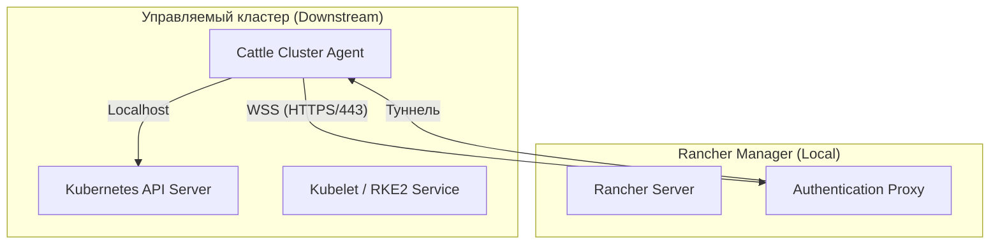

# RKE в Rancher

> [!NOTE]
> Данный документ является центральным источником по **RKE2** — современному дистрибутиву Kubernetes в экосистеме Rancher. Устаревший **RKE1** (Docker-ориентированный) рассматривается здесь только в контексте миграции; подробности по его администрированию через RKE CLI вынесены в раздел [Installation/RKE](../Installation/RKE/index.md).

## Определения

**RKE2 (RKE Government)** — основной дистрибутив Kubernetes в экосистеме Rancher (начиная с v2.6+). Фокусируется на безопасности и простоте эксплуатации. Использует `containerd` и архитектуру статических подов. Соответствует стандартам FIPS и CIS Hardening. Технически является форком [K3s](https://docs.k3s.io/) с заменой эмбеддед-хранилища (`sqlite`) на полноценный `etcd` и включением только production-ориентированных компонентов.

**RKE1 (Legacy)** — оригинальный дистрибутив Rancher Kubernetes Engine, работающий на базе Docker. **Статус на 2026 г.: End of Life (EOL).** Поддержка прекращена 31 июля 2025 года. Использование рекомендуется только для поддержки устаревших сред с обязательным планом миграции на RKE2.

**Rancher Agent** — бинарный файл или набор контейнеров, обеспечивающий коммуникацию между управляемым узлом и Rancher Manager. В RKE2 работает как системный сервис.

**Cattle Cluster Agent** — компонент внутри кластера, который туннелирует запросы от Rancher к Kubernetes API и управляет жизненным циклом ресурсов (Workloads).

**RKE2 Server** — процесс, запускающий оба уровня компонентов: *Control Plane* (API Server, Scheduler, Controller Manager, etcd) и, при необходимости, *Worker*. Аналог `k3s server` / `kubeadm control-plane`.

**RKE2 Agent** — процесс, выполняющий роль *Worker*-узла (Kubelet, Kube-Proxy, CNI) и подключающийся к Server по протоколу Kubernetes API.

**Static Pod (Статический под)** — под, манифест которого располагается напрямую в директории kubelet (`/var/lib/rancher/rke2/agent/pod-manifests`), а не создается через API-сервер. На этой архитектуре построен весь RKE2: control plane не зависит от API-сервера на этапе запуска.

## Базовые концепции

### Принцип работы RKE2

В отличие от RKE1, где каждый компонент control plane запускался отдельным Docker-контейнером, RKE2 разворачивает все компоненты как **статический под** через Kubelet, что обеспечивает:

- **Отсутствие зависимости от Docker:** единственный рантайм — `containerd` (встроен в дистрибутив, версия v2.3.x в актуальных релизах 2026 г.).
- **Идемпотентность и самовосстановление:** компоненты перезапускаются Kubelet'ом; отказ одного не требует ручного вмешательства.
- **Единый бинарник:** и Server, и Agent поставляются одним исполняемым файлом `rke2`, что упрощает установку в офлайн/air-gapped средах.

**Стандартные пути RKE2:**

| Путь | Назначение |
| :--- | :--- |
| `/etc/rancher/rke2/config.yaml` | Главный конфигурационный файл Server/Agent |
| `/var/lib/rancher/rke2/server/` | Данные Control Plane (включая etcd, токены, сертификаты) |
| `/var/lib/rancher/rke2/agent/` | Данные Kubelet, CNI, статические манифесты подов |
| `/var/lib/rancher/rke2/server/db/snapshots/` | Локальные снимки etcd |
| `/var/lib/rancher/rke2/server/token` | Secret-токен для подключения новых узлов |

### Архитектура связи через агенты

Rancher реализует модель "обратного подключения", позволяющую управлять кластерами за NAT или Firewall без открытия входящих портов.



**Ключевые особенности:**

* **Туннелирование:** Все управление идет через WebSocket-соединение, инициированное агентом. Rancher не требует прямой сетевой доступности API-сервера управляемого кластера (кроме сценария Import).
* **Автономность:** При потере связи с Rancher Server нагрузки в кластере продолжают работать. Недоступными становятся только функции управления через UI и централизованная аутентификация.
* **Сетевые требования:** Узлы должны иметь исходящий доступ к Rancher Server по порту **443 (HTTPS)**.
* **Механизм туннелирования:** `cattle-cluster-agent` устанавливает защищенный `TLS`-туннель (`wss://`) к серверу Rancher. Запросы из UI / kubectl адресуются через этот туннель к `kube-api` на localhost управляемого кластера. Для узлов, не способных держать постоянное соединение (например, за строгим прокси), применяются фоновые механизмы переподключения с экспоненциального backoff.

### Типы провайдеров (Provisioning)

1.  **Node Drivers (Cloud Provisioning):** Rancher напрямую управляет жизненным циклом ВМ через API облака (vSphere, AWS EC2, Azure, OpenStack). Rancher сам устанавливает ОС (через Cloud-init) и RKE2.
2.  **Custom Nodes:** Пользователь сам готовит ОС и запускает команду регистрации (Registration Command). Rancher устанавливает только RKE2 и агенты.
3.  **Imported Clusters:** Подключение существующих кластеров (Kubeadm, EKS, AKS). Rancher управляет только Workloads, но не жизненным циклом самого Kubernetes (обновление версии K8s выполняется внешними средствами).

### Сравнение RKE1 и RKE2 (ключевые отличия)

| Аспект | RKE1 | RKE2 |
| :--- | :--- | :--- |
| **Рантайм** | Docker Engine | containerd (встроенный) |
| **Запуск control plane** | Docker-контейнеры | Статические поды через Kubelet |
| **Конфигурация** | Один файл `cluster.yml` + `rke up` | `/etc/rancher/rke2/config.yaml` + сервис |
| **Управление узлами** | SSH извне | Локальный запуск сервисов `rke2-server` / `rke2-agent` |
| **etcd** | Отдельные контейнеры | Статический под (встроен) |
| **Безопасность** | Базовая | CIS Hardened / FIPS по умолчанию |
| **Статус** | EOL 31.07.2025 | Актуальный (v1.36.x в 2026) |

### Компоненты внутри кластера (bundled add-ons)

RKE2 поставляется с предустановленным набором компонентов, управляемых через встроенный **Helm-контроллер** (аналог `helm-controller` из K3s). В актуальных версиях 2026 г. (K8s v1.36):

- **CoreDNS** — кластерный DNS.
- **Metrics Server** — источник метрик для HPA / `kubectl top`.
- **Ingress Controller:** до K8s v1.35 — `ingress-nginx`; **начиная с v1.36 — по умолчанию `Traefik`** (проект `ingress-nginx` был выведен из эксплуатации upstream в марте 2026 г.). Существующие кластеры сохраняют свой ingress при обновлении, чтобы не ломать конфигурации.
- **etcd** — распределённый key-value стор для состояния кластера (подробнее — в разделе про etcd ниже).
- **CNI:** по умолчанию **Canal** (Flannel + Calico для Network Policies), FIPS-совместимый; доступны альтернативы: Calico, Cilium, Flannel, Weave, Multus.

**Подробнее о базовых компонентах Kubernetes** — в документе [Архитектура Control Plane](../Concepts/control_plane_architecture.md).

### Роль etcd в RKE2

etcd является единственным хранилищем состояния кластера RKE2 (в этом главное отличие от K3s, где по умолчанию используется встроенная SQLite-база). Практические выводы:

- Для **production** требуется нечётное количество etcd-узлов (1, 3, 5) для обеспечения кворума.
- **etcd должен располагаться на SSD/NVMe** — высокая задержка дискового I/O напрямую влияет на стабильность всего кластера (см. рекомендации в [Установка Rancher Server](./rancher_installation.md#тюнинг-etcd-критично)).
- Снимки etcd — основной способ резервного копирования состояния кластера (раздел ниже).
- **Токен кластера** (`/var/lib/rancher/rke2/server/token`) требуется не только для подключения новых узлов, но и для **шифрования bootstrap-данных** в datastore и для **восстановления из снимка** — обязательно сохраняйте его копию.

**Глубокие материалы по etcd:** [Архитектура и концепции etcd](../../etcd/architecture-and-concepts.md), [Интеграция etcd с Kubernetes](../../etcd/kubernetes_integration.md), [Стратегии резервного копирования etcd](../../etcd/backup_strategies.md), [Аварийное восстановление etcd](../../etcd/emergency_recovery.md).

### FedRAMP / FIPS

RKE2 может собираться в **FIPS-совместимой** конфигурации, что необходимо для государственных (Government) стандартов и ряда регуляторных требований. Эта возможность отражена в самом названии "RKE Government" и поддерживается Rancher в вариантах развертывания для требующих соответствия FIPS сред.

## Практические сценарии

### Подготовка узлов перед регистрацией

Перед запуском команды регистрации (Custom Nodes) подготовьте узел:

```bash
# Обновите систему и установите базовые пакеты
sudo apt-get update && sudo apt-get install -y curl tar rsync

# Отключите/замаскируйте swap (рекомендуется для Kubernetes)
sudo swapoff -a
# Для постоянного отключения добавьте в /etc/fstab комментарий к swap-строке

# Убедитесь, что модули ядра загружены (для ipvs/overlay)
sudo modprobe overlay
sudo modprobe br_netfilter

# Отключите firewalld — несовместим с CNI-плагинами (требование Rancher)
sudo systemctl disable --now firewalld 2>/dev/null || true
```

> **Примечание:** Точные требования к ядру и набор пакетов зависят от дистрибутива и версии OS. Свежий набор команд всегда генерируется в Rancher UI перед копированием Registration Command.

### Создание и настройка RKE2 кластера

При развертывании через Rancher UI доступны следующие настройки:

*   **System Scans:** Автоматическое выполнение CIS Benchmark по расписанию.
*   **Cloud Provider Integration:** Настройка In-tree или External облачных провайдеров для управления StorageClass и LoadBalancer.
*   **Drain/Cordon:** Настройка поведения узлов при обновлении (количество одновременно обновляемых узлов, таймауты завершения подов).
*   **Network (CNI):** выбор между Canal (по умолчанию), Calico, Cilium, Flannel, Weave.
*   **etcd Backup:** настройка расписания локальных и S3-снимков (см. ниже).
*   **Registries:** конфигурация private registries для air-gapped сред через `registries.yaml`.

**Регистрация Custom Node (пример команд, генерируемых Rancher):**

```bash
# Управляемый (Custom) кластер: запускается на подготовленной OS
curl --insecure -fL https://<rancher-host>/system-agent-install.sh | sudo sh -s - \
  --server https://<rancher-host> \
  --label 'cattle.io/os=linux' \
  --etcd --controlplane --worker \
  --token <cluster-token> \
  --ca-checksum <checksum>
```

Параметры:
- `--etcd`, `--controlplane`, `--worker` — роли узла; могут комбинироваться (например, `--etcd --controlplane` для control plane, `--worker` для worker-only).
- `--token` — токен, сгенерированный Rancher для конкретного кластера.
- `--ca-checksum` — контрольная сумма CA-сертификата Rancher для защиты от подмены (Man-in-the-Middle).
- `system-agent-install.sh` — скрипт, который устанавливает RKE2 и конфигурирует узлы под управление Rancher.

**Прямая установка RKE2 (автономно, вне Rancher):**

```bash
# Сервер (control plane + etcd)
curl -sfL https://get.rke2.io | sudo sh -
sudo systemctl enable --now rke2-server.service

# Агент (worker) — требует адрес и токен сервера
curl -sfL https://get.rke2.io | INSTALL_RKE2_TYPE="agent" sudo sh -
```

**Пример `/etc/rancher/rke2/config.yaml`:**

```yaml
token: <server-token>              # токен подключения к кластеру
server: https://192.168.1.10:9345  # адрес Server (только для agent)
tls-san:
  - rancher.example.com            # дополнительные SAN для сертификата (для kubectl/Ingress)
cni: canal                         # выбор CNI: canal|calico|cilium|flannel|weave|multus
etcd-expose-metrics: true          # экспорт метрик etcd для мониторинга
disable:
  - rke2-ingress-nginx             # пример отключения встроенного компонента
write-kubeconfig-mode: "0644"      # права на kubeconfig (по умолчанию 0600)
```

### Получение kubeconfig

Для прямого доступа к RKE2-кластеру из-под управления Rancher используйте Kubeconfig, генерируемый в UI (**Cluster Management → кластер → Kubeconfig File**) — он перенаправляет запросы через туннель `cattle-cluster-agent`. На узле автономного RKE2 конфиг доступен по пути `/etc/rancher/rke2/rke2.yaml`.

```bash
# На автономном кластере
kubectl --kubeconfig /etc/rancher/rke2/rke2.yaml get nodes
```

**Подробнее о работе с kubeconfig** — в [Настройка доступа через kubectl](../Installation/RKE/rke_kubectl_setup.md) и [Kubeconfig: Подключение к кластеру](../Operations/kubeconfig_and_connection.md).

### Управление снимками и восстановление (Backup & Restore)

Rancher предоставляет встроенный механизм управления `etcd-snapshots` для RKE2:

1.  **Локальные снимки:** Сохраняются на узлах с ролью `etcd` в `/var/lib/rancher/rke2/server/db/snapshots`.
2.  **S3 Backup:** Нативная поддержка выгрузки снимков в S3-совместимые хранилища. Настраивается в параметрах кластера в UI. Для Rancher-управляемых кластеров используется встроенный контроллер снимков (работает по CRD-объектам `etcdsnapshot` RKE2), определяющий расписание, ретеншн и хранение (Local / S3).
3.  **Восстановление:** Выполняется через UI (Cluster Management → Snapshot → Restore). При восстановлении можно выбрать стратегию (только etcd или etcd + Kubernetes Version).

**Рекомендации по резервному копированию (Best Practices):**

- Настройте **внешнее (S3) хранилище снимков** — локальные снимки не защищают от потери узла/диска.
- Храните **копию токена кластера** (`server/token`) — без него восстановление из снимка невозможно.
- Для восстановления **Management-кластера** (самого Rancher Server) используйте пакет `rancher-backup` (на основе Velero), а не снимки downstream-кластеров — см. [Установка Rancher Server](./rancher_installation.md#жизненный-цикл-и-миграция).

**Прямые CLI-команды (автономный RKE2, вне Rancher):**

```bash
# Ручное создание снимка etcd
sudo rke2 etcd-snapshot save --name backup-$(date +%F)

# Просмотр списка снимков
sudo rke2 etcd-snapshot list

# Восстановление из снимка (прервёт работу control plane)
sudo rke2 etcd-snapshot restore --name backup-2026-08-29
sudo systemctl restart rke2-server.service
```

> **Важно:** восстановление из снимка — деструктивная операция, выполняемая на остановленном кластере (в Rancher UI при выборе Restore все etcd-узлы переинициализируются). Обязательно делайте резервную копию текущего состояния перед восстановлением.

### Обновление кластера (Upgrading)

Процесс обновления версии Kubernetes в RKE2-кластере выполняется "постепенно" (Rolling Update):
1.  Обновляются узлы Control Plane (по одному).
2.  Затем обновляются Worker-узлы согласно заданной стратегии (Concurrency).
3.  Для RKE2 Rancher использует `system-upgrade-controller` внутри кластера.

**Подробнее:**

- В Rancher-управляемых кластерах обновление запускается выбором новой версии K8s в UI (**Cluster Management → Edit Config → Kubernetes Version**). Rancher через Cluster API изменяет план развертывания, а `system-upgrade-controller` (план `rke2-upgrade`) последовательно обновляет узлы.
- Настройки **Drain/Cordon** определяют, сколько узлов обновляется одновременно и каковы таймауты завершения подов — это критично для минимизации простоя.
- **Версии:** Rancher 2.13.x поддерживает RKE2 в диапазоне **v1.32 – v1.34** (по данным support matrix 2026 г.); актуальный upstream-релиз RKE2 — **v1.36.x**. Для production Rancher рекомендует использовать канал `stable`, а не `latest`.
- **General-механика обновления Kubernetes** (drain, cordon, порядок ролей) описана в документе [Обновление кластеров](../Operations/upgrading_clusters.md), а управление недоступностью узлов — в [Обслуживание узлов](../Operations/node_maintenance.md).

### Масштабирование узлов

- **Вертикальное (CPU/RAM):** изменение ресурсов узла не требует переконфигурации кластера.
- **Горизонтальное:** добавление Worker-узла выполняется регистрацией нового Custom Node (те же шаги, что и при первичном развертывании) либо через Node Driver. Перемещение роли (например, worker → controlplane+etcd) через Rancher требует повторной регистрации с нужным набором ролей.
- **Автоскейлинг:** RKE2 сам не содержит автомасштабирования узлов; его реализуют внешние механизмы (Cluster Autoscaler поверх Node Driver / облака).

### Безопасность и CIS Scans

Rancher интегрирован с инструментом `rancher-cis-benchmark`. 
*   Позволяет запускать проверки на соответствие профилям `rke2-cis-1.x` или `permissive`.
*   Отчеты доступны в формате PDF/CSV прямо в интерфейсе Rancher.
*   Рекомендуется настраивать алертинг при падении уровня комплаенса ниже заданного порога.

**Пояснение:**
- `rancher-cis-benchmark` разворачивает внутри кластера набор проверок, реализованных поверх `kube-bench` (см. [kube-bench](../Security/kube-bench.md)), и позволяет выполнять их по расписанию (**System Scans**) или по запросу.
- Профиль `rke2-cis-1.x` применяет CIS Kubernetes Benchmark для дистрибутива RKE2; профиль `permissive` пропускает проверки, конфликтующие с типовой эксплуатацией (например, заведомо неисполнимые в конкретной среде).
- **Hardening:** RKE2 уже поставляется CIS Hardened по умолчанию (запуск статических подов, синтетические политики). Дополнительный аудит через `rancher-cis-benchmark` подтверждает соответствие и выявляет деградацию конфигурации с течением времени.
- Для интеграции с внешними системами алертинга настройте правила оповещений в [rancher-monitoring](./rancher_monitoring.md) на основе статуса сканов (`ClusterScanStatus`).

### Мониторинг RKE2

- Метрики компонентов RKE2 (kubelet, API Server, etcd) собираются через стек `rancher-monitoring` (Prometheus) — см. [Мониторинг в Rancher](./rancher_monitoring.md).
- Для etcd обязательно включите `etcd-expose-metrics: true` в конфиге кластера и настройте дашборды на метрики `etcd_*` (кворум, лидерство, fsync latency).
- **Диагностика состояния контроля кластера**, а не отдельного RKE2-процесса, описана в [Архитектура Control Plane](../Concepts/control_plane_architecture.md).

### Поиск и устранение неисправностей (Troubleshooting)

**Узел не регистрируется (NotReady / регистрация зависает):**
- Проверьте исходящую сетевую доступность к Rancher по порту 443: `nc -vz <rancher-host> 443`.
- Проверьте логи агента:
  ```bash
  sudo journalctl -u rke2-agent -n 100 --no-pager
  sudo journalctl -u rke2-server -n 100 --no-pager   # на control plane
  ```
- Убедитесь, что token верный и соответствует кластеру (сверьте `server/token`).

**Проблемы с containerd / runtime:**
- Проверьте статус и логи:
  ```bash
  systemctl status containerd
  journalctl -u containerd -n 100 --no-pager | grep -i error
  ```
- Полный набор сценариев (недоступный сокет, OOM, неправильный `sandbox_image`, драйвер cgroups) описан в [Проблемы рантайма](../Troubleshooting/Common_Errors/NodeUnavailability/runtime_issues.md) и [Проблемы kubelet](../Troubleshooting/Common_Errors/NodeUnavailability/kubelet_issues.md).

**Проблемы с etcd (потеря кворума):**
- Используйте утилиты `etcdctl` на узле:
  ```bash
  sudo rke2 etcd-snapshot list          # состояние снимков
  sudo journalctl -u rke2-server | grep -i -E "etcd|member|leader"
  ```
- Диагностика и восстановление кворума — в [Аварийное восстановление etcd](../../etcd/emergency_recovery.md) и [Проблемы etcd (troubleshooting)](../../etcd/troubleshooting.md).

**Потеря kubeconfig / доступности API через туннель:**
- Перезапустите deployment `cattle-cluster-agent`:
  ```bash
  kubectl -n cattle-system rollout restart deployment/cattle-cluster-agent
  ```
- Проверьте поды агентов: `kubectl -n cattle-system get pods`.

**Сертификаты:** ротация сертификатов RKE2-кластера в Rancher выполняется из UI (Cluster Management → Edit Config → Rotate Certificates / Rotate Encryption Key). Ручная ротация через CLI RKE2 — `rke2 certificate rotate` (см. официальную документацию; утилита `rke` из RKE1 здесь неприменима).

## Дополнительная информация

### Миграция с RKE1 на RKE2

Прямое обновление (In-place Upgrade) с RKE1 на RKE2 невозможно из-за смены Docker на containerd и изменения структуры путей.
**Рекомендуемый путь:**
1. Развернуть новый кластер RKE2.
2. Перенести данные приложений.
3. Переключить DNS/Ingress.

**Подробные шаги миграции** (подготовка, сеть, Velero/Rancher Backup для переноса объектов и PV) описаны в [RKE: Основные концепции](../Installation/RKE/rke_concepts.md#жизненный-цикл-и-стратегия-миграции) и [Обзор платформы Rancher](./rancher_overview.md#переход-с-устаревших-решений).

### Актуальность и жизненный цикл (2026)

- **RKE2:** актуальные версии на 2026 г. — v1.35 / v1.36 (upstream); версия для новых кластеров выбирается из списка Rancher (KDM). RKE2 v1.36 перешёл на **Traefik** как ingress по умолчанию.
- **Rancher:** поддерживает RKE2 в диапазоне v1.32–v1.34 (2.13.x); версия 2.14 GA — апрель 2026 г. Поддержка RKE1 прекращена в Rancher 2.12+.
- **Рекомендации:** для production используйте канал `stable`; всегда сверяйте версии с [SUSE Support Matrix](https://www.suse.com/suse-rancher/support-matrix/) («lowest/highest certified») перед обновлением.

### Ключевые ресурсы

- **CLI RKE2:** бинарник `rke2` (subcommands: `server`, `agent`, `etcd-snapshot`, `certificate`, `token`).
- Реальные версии компонентов и CNI всегда указываются в release notes релиза RKE2 — не полагайтесь на устаревшие таблицы.

---

**См. также:**

* [Установка RKE через CLI](../Installation/RKE/rke_management_scenarios.md) — управление Legacy-кластерами.
* [Настройка доступа через kubectl](../Installation/RKE/rke_kubectl_setup.md) — получение Kubeconfig.
* [Обзор платформы Rancher](./rancher_overview.md) — общая архитектура Management Server.

**Внешние ресурсы:**

* [Rancher Manager Documentation](https://ranchermanager.docs.rancher.com/)
* [RKE2 (RKE Government) Docs](https://docs.rke2.io/)
* [SUSE Rancher Support Matrix](https://www.suse.com/suse-rancher/support-matrix/)
