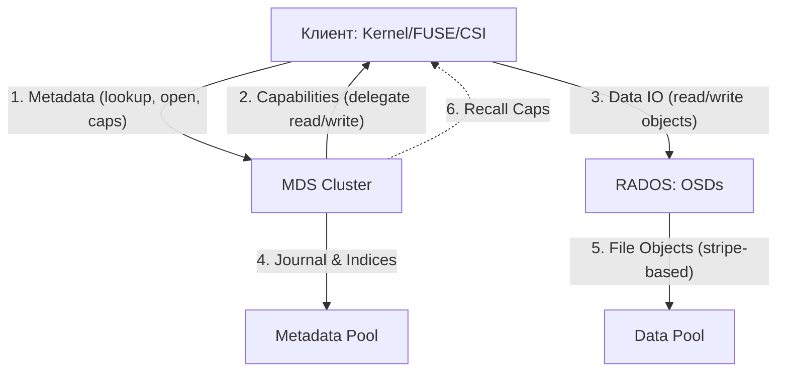

# CephFS: Определения и основные концепции

Документ является фундаментальным источником для понимания архитектуры, механизмов работы и ключевых терминов распределенной файловой системы CephFS. Содержит определения всех уровней стека — от RADOS до клиентов — и базовые концепции, необходимые для эксплуатации CephFS в контексте DevOps/SRE/sysadmin.

---

## Определения

### Уровень RADOS (базовый слой хранения)

**RADOS (Reliable Autonomic Distributed Object Store)** — интеллектуальная распределенная объектная подсистема, лежащая в основе всех интерфейсов Ceph (RBD, CephFS, RGW). Обеспечивает репликацию, обнаружение ошибок, самовосстановление и автоматическую балансировку данных между OSD. RADOS гарантирует строгую консистентность на уровне объектов.

**OSD (Object Storage Daemon)** — демон, отвечающий за хранение объектов данных на физическом диске. Каждый OSD управляет одним блочным устройством, выполняет репликацию/восстановление данных, scrubs (проверку целостности) и взаимодействует с клиентами напрямую для операций ввода-вывода.

**Pool (Пул)** — логический раздел для хранения объектов с собственными настройками: коэффициент репликации (`size`), минимальное число реплик для записи (`min_size`), количество Placement Groups (`pg_num`) и CRUSH-правило размещения. Пулы изолируют данные друг от друга и позволяют задавать разные политики хранения для метаданных и данных.

**Placement Group (PG)** — внутренняя абстракция, на которую делится пул. PG распределяются по OSD через алгоритм CRUSH. Клиент вычисляет местоположение объекта детерминированно: `object_id → PG → набор OSD`. Правильный расчет PG критичен для производительности и равномерности нагрузки.

**Erasure Coding (EC, коды стирания)** — метод хранения данных, при котором объект разбивается на `k` данныхых фрагментов и генерируется `m` контрольных фрагментов (паритет). Позволяет выдерживать выход из строя `m` OSD без потери данных, потребляя `(k+m)/k` места вместо коэффициента репликации. Для CephFS/data пулов используется с параметром `allow_ec_overwrites`, что обеспечивает POSIX-совместимость.

**CRUSH (Controlled Replication Under Scalable Hashing)** — алгоритм распределения данных, позволяющий клиентам вычислять местоположение объектов без обращения к центральному серверу. CRUSH использует иерархическую топологию кластера (root → datacenter → rack → host → osd) и заданные правила для размещения реплик/EC-фрагментов в разных.failure domains.

**BlueStore** — стандартный backend OSD. Пишет данные напрямую на блочное устройство, минуя файловую систему ОС. Использует RocksDB для хранения метаданных и WAL (Write Ahead Log) для обеспечения durability.

### Уровень CephFS (файловая система)

**CephFS (Ceph File System)** — POSIX-совместимая распределенная файловая система, построенная поверх RADOS. Предоставляет иерархическое представление данных и поддерживает совместный доступ множества клиентов на чтение и запись. В отличие от RBD (блочное) и RGW (объектное), CephFS обеспечивает полную семантику POSIX: иерархию каталогов, права доступа, hard links, symbolic links, расширенные атрибуты.

**MDS (Metadata Server)** — демон, отвечающий за управление пространством имен (иерархией каталогов) и метаданными (права, владельцы, timestamps, размеры файлов). MDS не хранит данные файлов, а лишь указывает, в каких объектах RADOS они находятся. MDS хранит метаданные в оперативной памяти (кэш inodes/dentries) и_journal_ (MDLog) для durability.

**MDLog (Metadata Journal)** — журнал операций с метаданными, обеспечивающий durability. Каждый MDS записывает изменения в MDLog перед применением к индексам. Используется для восстановления после сбоев и репликации данных между активным и standby MDS. Journal записывается на отдельный пул (обычно метаданный) и проигрывается при запуске MDS.

**MDS Rank (Ранг)** — логический экземпляр MDS в кластере. Нумерация начинается с 0. Количество рангов (`max_mds`) определяет степень параллелизма обработки метаданных. Каждый ранг управляет непрерывным поддеревом каталогов (subtree) и имеет собственный журнал.

**Capabilities (Caps)** — интеллектуальный механизм делегирования прав от MDS к клиентам. Позволяет клиентам безопасно кэшировать данные и метаданные локально, выполняя операции (чтение, запись, изменение атрибутов) без синхронного обращения к MDS. Caps делятся на типы:

| Caps | Право | Описание |
|------|-------|----------|
| `p` | pin | Клиент удерживает inode в кэше |
| `r` | read | Клиент может кэшировать данные для чтения |
| `w` | write | Клиент может кэшировать данные для записи (буферизация) |
| `s` | shared | Права на общие атрибуты (права доступа, владелец) |
| `x` | exclusive | Монопольные права на изменение атрибутов |

Если второй клиент запрашивает доступ к тому же файлу, MDS инициирует **Caps Recall**, заставляя первый клиент сбросить грязные данные на OSD и вернуть права. Реколл является блокирующей операцией для клиента до завершения.

**Subvolumes (Субтомы)** — логическая абстракция над каталогами CephFS, ставшая стандартом для Kubernetes CSI. Представляют собой независимые директории с автоматизированным управлением квотами, снапшотами и путями доступа. Управляются через модуль `volumes` (CLI: `ceph fs subvolume ...`).

**Subvolumegroup (Группа субтомов)** — контейнер для логической группировки субтомов. Позволяет применять общие политики (квоты, снапшоты) ко всем субтомам в группе одновременно. Все субтомы в группе разделяют общее пространство имен для снапшотов.

**File Layout (Макет файла)** — параметры, определяющие, как файл разбивается на объекты RADOS: размер полосы (stripe unit), ширина полосы (stripe count) и целевой пул данных. Параметры layout задаются при создании файла или на уровне директории через расширенные атрибуты.

**Stripe Unit** — минимальный блок данных, записываемый в один объект RADOS. По умолчанию 4 МБ. Файл разбивается на полосы заданного размера, каждая из которых записывается в отдельный объект. Увеличение stripe unit снижает количество объектов и overhead метаданных, но увеличивает минимальный размер I/O.

**Pinning (Привязка)** — механизм жесткого закрепления части дерева каталогов за конкретным MDS в Multi-Active конфигурациях. Предотвращает нежелательную миграцию метаданных. Существует статическая (ручная) и эфемерная (автоматическая) привязка.

**Quota (Квота)** — ограничение на использование ресурсов на уровне директории или субтома. CephFS поддерживает два типа квот: `max_bytes` (объем данных) и `max_files` (количество файлов). Квоты являются **cooperative** — проверяются клиентами локально перед записью, что допускает временное превышение (до ~30 секунд).

**Cooperative Quotas** — модель проверки квот, при которой клиент проверяет лимит локально перед каждой операцией записи. Задержка обновления обусловлена тем, что MDS асинхронно оповещает клиента об изменениях состояния. Для строгих лимитов необходимо additional application-level проверки.

---

## Основные концепции

### Архитектура и потоки данных

Взаимодействие компонентов CephFS разделено на два независимых канала:

1. **Канал метаданных**: Клиент ↔ MDS. Клиент запрашивает у MDS Capabilities для inode (разрешения на чтение/запись/кэширование). MDS отвечает, какие права делегированы, и клиент выполняет операции локально, пока не понадобится обновить состояние.
2. **Канал данных**: Клиент ↔ OSD. На основе полученных от MDS Layouts клиент напрямую читает/пишет объекты файлов в пулы RADOS. МDS не участвует в передаче данных — это ключевое отличие от классических NAS.



**Производительность**: Канал метаданных обрабатывает операции управления (open, close, stat, rename), а канал данных — bulk I/O (read, write). Поскольку MDS не участвует в передаче данных, пропускная способность CephFS масштабируется линейно с количеством OSD.

### Запись данных (Write Path)

При записи файла в CephFS происходят следующие шаги:

1. Клиент отправляет запрос `open` на MDS и получает Capabilities (`w` — право на запись).
2. Клиент вычисляет местоположение объектов на основе File Layout (stripe unit, stripe count).
3. Клиент записывает данные напрямую в OSD (объектыRADOS) через CRUSH.
4. При `fsync` или закрытии файла клиент подтверждает запись через MDS.

Если клиент не имеет `w` caps (например, другой клиент удерживает exclusive lock), MDS запрашивает recall у текущего владельца и выдает права новому клиенту. Это обеспечивает строгую когерентность данных.

### Кэширование и Capabilities Recall

Механика Caps Recall — ключевой элемент производительности и когерентности CephFS:

1. Клиент открывает файл → получает Caps от MDS.
2. Клиент кэширует данные (read/write) локально в page cache.
3. При обращении другого клиента к тому же файлу → MDS инициирует Caps Recall.
4. Первый клиент сбрасывает грязные данные (flush) на OSD и возвращает Caps.
5. MDS выдает новые Caps второму клиенту.

Если клиент не возвращает Caps вовремя (зависание или сетевые проблемы), MDS может пометить его как "stale" и принудительно разорвать сессию.

### Отказоустойчивость и масштабирование MDS

**Standby-Replay**: Обязательная настройка для критических ФС. Резервный MDS постоянно проигрывает journal активного, обеспечивая переключение за < 5 секунд. Режим активируется через `ceph fs set <fs> allow_standby_replay true`.

**Multi-Active MDS**: Использование нескольких активных рангов (Ranks) через `max_mds`. Эффективно при наличии независимых деревьев каталогов (разные проекты, пользователи). Увеличение `max_mds` выше 4-8 редко дает линейный прирост из-за накладных расходов на координацию. Не рекомендуется для workload с интенсивным `rename` между директориями.

**Динамическая балансировка**: Балансировщик MDS анализирует нагрузку (открытые файлы, запросы/сек) и мигрирует поддеревья между рангами. Работает на эвристике, учитывающей структуру каталогов.

**Ephemeral Pinning**: Автоматический механизм распределения поддиректорий крупного каталога по разным MDS. Два режима: `distributed` (равномерное) и `random` (случайное). Идеален для `/home` с тысячами пользователей.

### Хранение в RADOS

**Metadata Pool**: Содержит журнал операций (MDLog) и индексы иерархии (dinodes, dentries). Требует максимальной производительности (NVMe) и низкой задержки. Всегда используется репликация (size=3), Erasure Coding не применим из-за мелких random I/O.

**Data Pool**: Содержит содержимое файлов. Может использовать **Erasure Coding (EC)** с параметром `allow_ec_overwrites`, что позволяет экономить место (коэффициент 1.5x вместо 3x при EC 4+2) при сохранении POSIX-совместимости. Выбор между репликацией и EC зависит от требований к производительности и бюджета.

**Несколько Data Pool**: CephFS поддерживает несколько пулов данных с разными параметрами. Это позволяет размещать горячие данные (NVMe, репликация) и холодные данные (HDD, EC) в рамках одной файловой системы.

### Восстановление после сбоев (Failover)

При падении активного MDS:

1. Standby MDS обнаруживает отсутствие активного (через heartbeat).
2. Standby проигрывает journal активного для восстановления состояния.
3. Standby становится активным и принимает управление поддеревом каталогов.
4. Клиенты переподключаются к новому MDS (автоматически через мониторы).

Время переключения зависит от:
- Режима Standby-Replay (< 5 сек — journal уже проигран).
- Обычного Standby (10-30 сек — journal проигрывается с нуля).
- Размера journal и задержки сети.

---

## Практические сценарии

### Анализ состояния ФС

```bash
# Текущая нагрузка и активные MDS
ceph fs status
# → mycephfs
# → =====  =====  =====
# → E  0/0/1  up

# Проверка распределения метаданных по рангам
ceph mds stat
# → mycephfs:1 {0:up=active} 2:up=standby

# Детальный дамп (пулы, MDS, клиенты, кэш)
ceph fs dump

# Просмотр конфигурации ФС
ceph fs get mycephfs
# → Метаданные: max_mds, allow_standby_replay, ms_mode, etc.

# Просмотр активных сессий клиентов и их Caps
ceph tell mds.0 session ls
# → [{"id": 12345, "client_metadata": {...}, "caps": {...}}]

# Просмотр операций в реальном времени (diagnosing зависания)
ceph tell mds.0 ops
```

### Проверка пулов и PG

```bash
# Список пулов с деталями (тип, PG, application)
ceph osd pool ls detail | grep cephfs
# → pool 1 'cephfs_metadata' ... application cephfs
# → pool 2 'cephfs_data' ... application cephfs

# Статус PG для пулов CephFS
ceph pg dump | grep cephfs
```

### Быстрая диагностика проблем

```bash
# Проверка здоровья кластера
ceph health detail
# → HEALTH_OK или описание проблем

# Проверка использования дисков
ceph osd df tree

# Проверка производительности OSD
ceph osd perf

# Просмотр ошибок в логах MDS
journalctl -u ceph-mds@<hostname> -f --no-pager | grep -i "error\|warn\|fail"
```

---

## Дополнительная информация

### Сравнение методов доступа

| Характеристика | Kernel Driver (Рекомендуется) | FUSE Client |
| :--- | :--- | :--- |
| **Производительность** | Высокая (без context switch, прямой I/O) | Средняя (накладные расходы VFS → FUSE → RADOS) |
| **Версия Ceph** | Зависит от ядра Linux (все версии ≥ 4.x) | Всегда актуальна с пакетом `ceph-fuse` |
| **Кэширование** | Поддержка `quota-awareness` (ядро 5.15+) | Полная поддержка всех расширенных атрибутов |
| **Память** | Использует page cache ядра | Отдельный процесс с собственным кэшем |
| **Mount options** | `ms_mode=`, `noatime`, `rwbdir=` | `-r` (root path), `-k` (keyring) |

### Основные ограничения CephFS

- **Cooperative Quotas**: Квоты могут быть временно превышены (до ~30 секунд). Не подходят для строгих лимитов billing или tenant isolation без дополнительных проверок на уровне приложения.
- **Kernel Driver < 5.15**: Не поддерживает `quota-awareness`. Для полной функциональности квот требуется Linux 5.15+.
- **Multi-active MDS**: Не эффективен для workload с интенсивным `rename` между поддеревьями. Увеличение `max_mds` > 4-8 редко дает линейный прирост.
- **Scrubbing**: Во время активного scrub возможен рост задержки для клиентов. Планируйте scrub в периоды низкой нагрузки.
- **NFS Gateway**: Добавляет задержку и ограничивает максимальную производительность. Используйте только когда Kernel/FUSE недоступны.
- **Объекты малого размера**: Для файлов < stripe unit (по умолчанию 4 МБ) создаются отдельные объекты RADOS, что увеличивает overhead метаданных.
- **Эффект "thundering herd"**: При одновременном открытии одного файла сотнями клиентов MDS может оказаться узким местом из-за массового recall Caps.

### Особенности работы со снапшотами

Снапшоты CephFS работают на уровне директорий (directory-level snapshots). Создание снапшота в `/A` не влияет на файлы в `/B`. При удалении снапшота в современных версиях (v16+) используется фоновая очистка, которая не блокирует основной ввод-вывод. Управление снапшотами — через `snap_schedule` (автоматические) или `snap-snapshot` (ручные). Подробности — в [Практических сценариях](./practical_scenarios.md).

### Версии Ceph и рекомендации

| Версия | Кодовое имя | Статус (2026) | Особенности CephFS |
|--------|-------------|---------------|-------------------|
| **21.x** | **Umbrella** | Stable / Latest | Оптимизация crimson OSD, улучшенный mclock |
| **20.x** | **Tentacle** | Maintenance | Оптимизация NVMe для метаданных |
| **19.x** | **Squid** | End of Life | Базовая поддержка EC overwrites |
| **18.x** | **Reef** | End of Life | Multi-active MDS стабилен |

> Для новых инсталляций в 2026 году рекомендуется **Umbrella (21.x)** или **Tentacle (20.x)**.

### Ссылки

- [Практические сценарии CephFS](./practical_scenarios.md) — создание ФС, субтомы, монтирование, снапшоты.
- [Продвинутые темы CephFS](./advanced_topics.md) — тюнинг MDS, кэширование, scrubbing, ephemeral pinning.
- [Обзор Ceph](../ceph_overview.md) — общая архитектура RADOS, CRUSH, интерфейсы.
- [Администрирование Ceph](../Administration/index.md) — управление кластером, мониторинг, операции.
