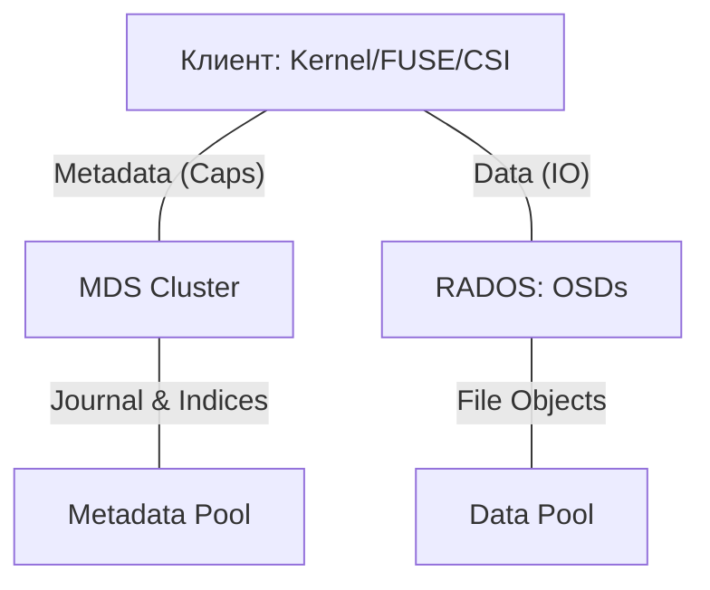

# CephFS: Определения и основные концепции

## Определения

**CephFS (Ceph File System)** — POSIX-совместимая распределенная файловая система, построенная поверх объектного хранилища Ceph (RADOS). Она предоставляет иерархическое представление данных и поддерживает совместный доступ множества клиентов на чтение и запись.

**MDS (Metadata Server)** — демон, отвечающий за управление пространством имен (иерархией каталогов) и метаданными (права, владельцы, timestamps). MDS не хранит данные файлов, а лишь указывает, в каких объектах RADOS они находятся.

**Capabilities (Caps)** — интеллектуальный механизм делегирования прав от MDS к клиентам. Позволяет клиентам безопасно кэшировать данные и метаданные локально, выполняя операции (например, чтение или изменение размера файла) без синхронного обращения к MDS.

**Subvolumes (Субвольюмы)** — логическая абстракция над каталогами CephFS, ставшая стандартом в 2026 году для Kubernetes CSI. Представляют собой независимые директории с автоматизированным управлением квотами, снапшотами и путями доступа.

**File Layout (Макет файла)** — параметры, определяющие, как файл разбивается на объекты, какой размер имеет каждый блок (stripe unit) и в какой пул RADOS направляются данные.

**Pinning (Привязка)** — механизм жесткого закрепления части дерева каталогов за конкретным MDS в Multi-Active конфигурациях для предотвращения нежелательной миграции метаданных.

---

## Основные концепции

### Архитектура и потоки данных

Взаимодействие компонентов CephFS разделено на два канала:
1.  **Канал метаданных**: Клиент ↔ MDS. Обмен информацией о структуре ФС и получение Capabilities.
2.  **Канал данных**: Клиент ↔ OSD. Прямое чтение и запись объектов файлов в пулы RADOS на основе полученных от MDS макетов (Layouts).



### Механика работы Capabilities (Caps)

Caps делятся на несколько типов, определяющих, что клиент может делать локально:
*   **`p` (pin)**: Клиент удерживает inode в кэше.
*   **`r` (read)**: Клиент может кэшировать данные для чтения.
*   **`w` (write)**: Клиент может кэшировать данные для записи (буферизация).
*   **`s` (shared)**: Права на общие атрибуты (права доступа, владелец).
*   **`x` (exclusive)**: Монопольные права на изменение атрибутов.

Если второй клиент запрашивает доступ к тому же файлу, MDS инициирует **Caps Recall**, заставляя первый клиент сбросить грязные данные на OSD и вернуть права.

### Отказоустойчивость и масштабирование MDS

На 2026 год (версии **Tentacle**, **Umbrella**) рекомендуются следующие практики:
*   **Standby-Replay**: Обязательная настройка для критических ФС. Резервный MDS постоянно проигрывает журнал активного, обеспечивая переключение за < 5 секунд.
*   **Multi-Active MDS**: Использование нескольких активных рангов (Ranks). Эффективно при наличии независимых деревьев каталогов (например, разные проекты).
*   **mclock Scheduler**: В современных версиях планировщик `mclock` на OSD автоматически приоритизирует трафик метаданных MDS над фоновым восстановлением данных.

### Хранение в RADOS

*   **Metadata Pool**: Содержит журнал операций (Journal) и индексы иерархии. Требует максимальной производительности (NVMe) и низкой задержки.
*   **Data Pools**: Содержат само содержимое файлов. Могут использовать **Erasure Coding (EC)** с параметром `allow_ec_overwrites`, что позволяет значительно экономить место при сохранении POSIX-совместимости.

---

## Практические сценарии

### Анализ состояния ФС

```bash
# Текущая нагрузка и активные MDS
ceph fs status

# Проверка распределения метаданных по рангам
ceph mds stat

# Просмотр активных сессий клиентов и их Caps
ceph tell mds.0 session ls
```

---

## Дополнительная информация

### Сравнение методов доступа

| Характеристика | Kernel Driver (Рекомендуется) | FUSE Client |
| :--- | :--- | :--- |
| **Производительность** | Высокая (без context switch) | Средняя (накладные расходы VFS) |
| **Версия Ceph** | Зависит от ядра Linux | Всегда актуальна с пакетом `ceph-fuse` |
| **Особенности** | Поддержка `quota-awareness` (5.15+) | Полная поддержка всех расширенных атрибутов |

### Особенности работы со снапшотами

Снапшоты CephFS работают на уровне директорий (directory-level snapshots). Создание снапшота в `/A` не влияет на файлы в `/B`. При удалении снапшота в версиях v20+ используется фоновая очистка, которая не блокирует основной ввод-вывод.

### Ссылки
- [Практические сценарии CephFS](./practical_scenarios.md) — монтирование и настройка.
- [Продвинутые темы CephFS](./advanced_topics.md) — тюнинг MDS и кэширования.
- [Обзор Ceph](../ceph_overview.md) — общая архитектура RADOS.
