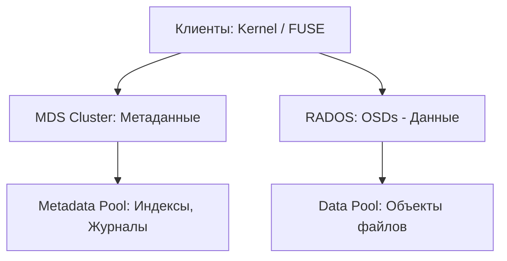

# CephFS: Определения и основные концепции

## Определения

**CephFS (Ceph File System)** — POSIX-совместимая распределенная файловая система, построенная поверх объектного хранилища Ceph (RADOS). В отличие от RBD, CephFS позволяет множеству клиентов одновременно работать с одними и теми же данными на чтение и запись (Shared File System).

**MDS (Metadata Server)** — специализированный демон, управляющий иерархией каталогов и метаданными файлов (права доступа, владельцы, временные метки, расположение блоков данных). MDS не участвует в передаче самих данных между клиентом и OSD.

**Capabilities (Caps)** — механизм предоставления клиенту определенных прав на метаданные и кэширование данных. Например, `p` (pin), `r` (read), `w` (write), `s` (shared). Это позволяет клиентам выполнять многие операции локально без постоянного обращения к MDS.

**Subvolumes (Субвольюмы)** — логическая абстракция над каталогами CephFS, используемая в Kubernetes CSI для изоляции данных разных PersistentVolumes. Субвольюмы позволяют независимо управлять квотами и снапшотами для каждого тома.

**Quota (Квота)** — ограничение на максимальный объем данных (`max_bytes`) или количество файлов (`max_files`) внутри каталога.

**Snapshot (Снапшот)** — неизменяемая копия состояния каталога и всех его подкаталогов в определенный момент времени. Снапшоты в CephFS создаются практически мгновенно и хранятся в скрытых директориях `.snap`.

---

## Основные концепции

### Архитектура CephFS

Система состоит из трех основных уровней:
1. **Клиенты (Kernel/FUSE)**: Используют POSIX API для доступа к ФС.
2. **MDS Cluster**: Управляет метаданными. Может состоять из нескольких активных узлов для масштабирования производительности.
3. **RADOS (OSDs & Monitors)**: Хранит данные (Data Pool) и метаданные (Metadata Pool).



### Метаданные и отказоустойчивость MDS

Метаданные CephFS хранятся в RADOS, но активно кэшируются в оперативной памяти MDS для обеспечения высокой производительности.

*   **HA Стратегии**:
    *   **Active/Standby**: Один MDS активен, остальные ждут сбоя.
    *   **Standby-Replay**: Standby-узел постоянно "читает" журнал активного MDS, что сокращает время переключения (failover) с минут до нескольких секунд.
    *   **Multi-Active MDS**: Позволяет распределять иерархию ФС по нескольким активным MDS (рангам). Рекомендуется при количестве файлов > 100 млн.
*   **Требования к ресурсам (2025)**:
    *   **CPU**: MDS критичен к частоте ядра (GHz), так как обработка метаданных во многом однопоточная.
    *   **RAM**: Минимум 8–16 ГБ на один MDS. Лимит кэша задается через `mds_cache_memory_limit`.
    *   **Диски**: Пул метаданных (`cephfs_metadata`) **обязательно** должен располагаться на NVMe/SSD.

### Работа с пространством и квотами

*   **Квоты**: Применяются на уровне MDS и клиентов. Существует задержка (до 30-60 сек) между превышением лимита и остановкой записи, так как клиенты обмениваются информацией о квотах периодически.
*   **Снапшоты**: Доступны через скрытую папку `.snap` в любом каталоге. Например, `ls /mnt/cephfs/project/.snap/snapshot1/`.
*   **Layouts**: CephFS позволяет задавать разные пулы данных для разных каталогов, что удобно для разделения "горячих" и "холодных" данных.

### Модель доступа и безопасность

Используется система **CephX**. Доступ можно ограничить:
*   На уровне всей ФС.
*   На уровне конкретного пути (Path-based access).
*   На уровне пулов данных.

---

## Практические сценарии

### Проверка состояния компонентов

```bash
# Общий статус файловой системы
ceph fs status

# Детальный статус MDS
ceph mds stat

# Список созданных субвольюмов (через CSI)
ceph fs subvolume ls <fs_name> --group_name <group_name>

# Проверка сессий клиентов
ceph tell mds.a session ls
```

---

## Дополнительная информация

### Выбор клиента

| Тип | Преимущества | Недостатки |
|-----|--------------|------------|
| **Kernel Driver** | Максимальная скорость, интеграция с VFS Linux. | Зависимость от версии ядра (рекомендуется 5.15+). |
| **FUSE** | Независимость от ядра, поддержка квот на стороне клиента. | Высокие накладные расходы на переключение контекста. |

### Ограничения и особенности

- **Снапшоты + Multi-MDS**: Совместное использование требует осторожности, возможны деградации производительности при массовом удалении снапшотов.
- **Видимый размер**: Команда `df -h` показывает доступный объем всего кластера (с учетом репликации), а не конкретной квоты, если клиент не поддерживает `quota-awareness`.
- **Hard links**: Не поддерживаются между субвольюмами или разными файловыми системами.

### Ссылки
- [Практические сценарии CephFS](./practical_scenarios.md)
- [Оптимизация и продвинутые темы](./advanced_topics.md)
- [Обзор Ceph](../ceph_overview.md)
