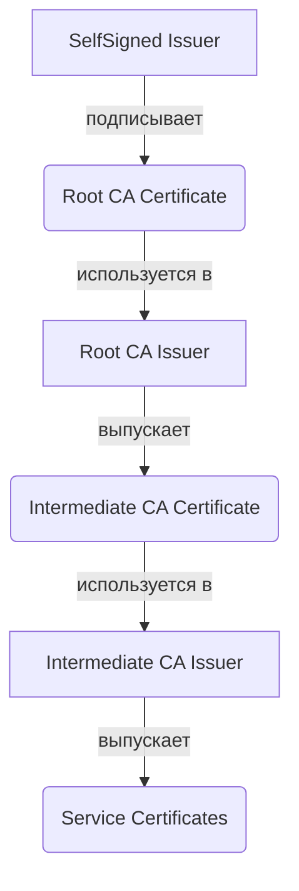

# Приватный CA для внутренних сервисов

## Определения

**Приватный CA (Private CA)** — собственный центр сертификации, развернутый внутри инфраструктуры (обычно в Kubernetes) для выпуска сертификатов, доверенных только внутри периметра организации. Используется для обеспечения безопасности межсервисного взаимодействия (mTLS), шифрования внутреннего трафика и аутентификации компонентов.

**Intermediate CA (Промежуточный CA)** — удостоверяющий центр второго (или более) уровня, подписанный корневым (Root) CA. Позволяет изолировать корневой ключ и делегировать полномочия по выпуску конечных сертификатов.

**trust-manager** — официальный аддон для cert-manager, предназначенный для дистрибуции доверия в кластере. Он автоматически распространяет публичные части сертификатов (CA bundles) в ConfigMap по всем необходимым Namespaces.

**mTLS (Mutual TLS)** — механизм взаимной аутентификации, при котором и клиент, и сервер проверяют сертификаты друг друга. Private CA является фундаментом для построения mTLS в кластере.

---

## Основные концепции

### Иерархия доверия (2-Tier Architecture)

В современных инфраструктурах (2026+) стандартом является двухуровневая (или многоуровневая) схема, минимизирующая риск компрометации корневого ключа:

1.  **Root Layer:** Создается один раз. Корневой Issuer (`selfsigned`) выпускает Root CA.
2.  **Intermediate Layer:** Промежуточный Issuer (тип `ca`) выпускает сертификаты для конкретных доменов или команд.
3.  **End-Entity Layer:** Приложения получают сертификаты от Intermediate Issuer.

### Дистрибуция доверия через trust-manager

Для того чтобы поды доверяли внутреннему CA, его публичная часть должна быть добавлена в системное хранилище (Trust Store) контейнера.

1.  **Ресурс Bundle:** Основной CRD trust-manager, в котором описываются источники (Secrets, ConfigMaps) и целевой ConfigMap.
2.  **Cluster-wide Sync:** trust-manager отслеживает изменения в источниках и автоматически обновляет целевой ConfigMap во всех Namespace.
3.  **Монтирование:** Приложения монтируют этот ConfigMap (например, в `/etc/ssl/certs/ca-certificates.crt`) для верификации цепочки.

### Стандарты безопасности 2026

-   **Алгоритмы:** Полный переход на **Ed25519** и **ECDSA (P-256/384)**. RSA считается устаревшим для внутренних mTLS-сценариев из-за высокого потребления ресурсов.
-   **Ротация ключей:** Использование `rotationPolicy: Always` обязательно для всех уровней иерархии, кроме Root CA (где ротация выполняется вручную по регламенту).
-   **Сроки действия:** Внутренние сертификаты сервисов имеют короткий TTL (от 24 часов до 7 дней) для минимизации ущерба при утечке.

---

## Практические сценарии

Детальные манифесты и пошаговые инструкции вынесены в специализированные разделы:

-   **[Сценарии Private CA](./scenarios.md)** — базовая иерархия, mTLS, настройка trust-manager Bundle.
-   **[Операции и обслуживание](./operations.md)** — ротация корневого CA (Zero Downtime), проверка цепочек, диагностика.
-   **[Установка cert-manager](../installation.md)** — параметры Helm для включения trust-manager.

---

## Дополнительная информация

### Сравнение Private CA и Kubernetes CA

| Характеристика | Приватный CA (cert-manager) | CA кластера (K8s API) |
| :--- | :--- | :--- |
| **Назначение** | Приложения, mTLS, базы данных | Системные компоненты (API, Kubelet) |
| **Жизненный цикл** | Полностью управляемый через CRD | Привязан к жизненному циклу кластера |
| **Гибкость** | Любое количество иерархий и Issuer | Одна жесткая цепочка доверия |
| **Изоляция** | Высокая (Root CA может быть оффлайн) | Низкая (Root CA на Master-узлах) |
| **Доступность** | Доступен через Ingress/Gateway API | Ограничен внутренними нуждами |

### Особенности работы с trust-manager

Использование ресурса `Bundle` позволяет объединять несколько источников доверия в один файл. Это критично при миграциях (когда нужно доверять и старому, и новому CA) или при работе с внешними сервисами, использующими публичные сертификаты (Let's Encrypt).

### Смотрите также

-   **[Cert-manager: Определения](../definitions.md)** — базовая структура ресурсов (Issuer, Certificate).
-   **[Cert-manager: Администрирование](../Administration/index.md)** — мониторинг и общие операции.
-   **[Let's Encrypt](../LetsEncrypt/index.md)** — работа с внешними публичными CA.
-   **[PKI — обзор и концепции](../../../../Security/Concepts/pki_overview.md)** — теоретическая база по иерархиям доверия.
