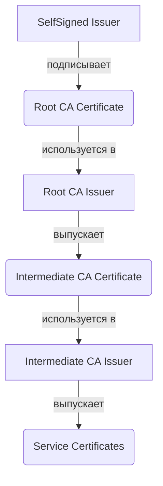

# Приватный CA для внутренних сервисов

## Определения

**Приватный CA (Private CA)** — собственный центр сертификации, развернутый внутри инфраструктуры (обычно в Kubernetes) для выпуска сертификатов, доверенных только внутри периметра организации. Используется для обеспечения безопасности межсервисного взаимодействия (mTLS), шифрования внутреннего трафика и аутентификации компонентов.

**Root CA (Корневой CA)** — удостоверяющий центр верхнего уровня в иерархии доверия. Является фундаментом доверия для всей PKI-инфраструктуры. Его закрытый ключ должен храниться максимально изолированно (офлайн, HSM). В cert-manager создается через `SelfSigned Issuer` один раз и далее ротируется вручную по регламенту.

**Intermediate CA (Промежуточный CA)** — удостоверяющий центр второго (или более) уровня, подписанный корневым (Root) CA. Позволяет изолировать корневой ключ и делегировать полномочия по выпуску конечных сертификатов. В cert-manager выпускается через `CA Issuer`, ссылающийся на Secret с корневым сертификатом.

**SelfSigned Issuer** — тип Issuer в cert-manager, который выпускает самоподписанные сертификаты. Используется для создания корневого (Root) CA — первого звена в иерархии доверия. Не требует внешних CA или сервисов.

**CA Issuer** — тип Issuer в cert-manager, который выпускает сертификаты, подписанные существующим CA. Ссылается на Kubernetes Secret, содержащий пару ключей (`tls.crt` + `tls.key`) вышестоящего CA. Используется для промежуточных и конечных сертификатов.

**trust-manager** — официальный аддон для cert-manager, предназначенный для дистрибуции доверия в кластере. Автоматически распространяет публичные части сертификатов (CA bundles) в ConfigMap по всем необходимым Namespace.

**mTLS (Mutual TLS)** — механизм взаимной аутентификации, при котором и клиент, и сервер проверяют сертификаты друг друга. Private CA является фундаментом для построения mTLS в кластере.

**Issuer vs ClusterIssuer** — базовое различие в scope действия:
- `Issuer` привязан к конкретному Namespace и выпускает сертификаты только для объектов в этом же Namespace.
- `ClusterIssuer` — глобальный ресурс кластера, доступный из любого Namespace. Рекомендуется для общих CA (общекластерная mTLS-инфраструктура).

---

## Основные концепции

### Иерархия доверия (2-Tier Architecture)

В современных инфраструктурах (2026+) стандартом является двухуровневая (или многоуровневая) схема, минимизирующая риск компрометации корневого ключа:



1.  **Root Layer:** Создается один раз. Корневой Issuer (`selfsigned`) выпускает Root CA.
2.  **Intermediate Layer:** Промежуточный Issuer (тип `ca`) выпускает сертификаты для конкретных доменов или команд.
3.  **End-Entity Layer:** Приложения получают сертификаты от Intermediate Issuer.

### Дистрибуция доверия через trust-manager

Для того чтобы поды доверяли внутреннему CA, его публичная часть должна быть добавлена в системное хранилище (Trust Store) контейнера.

1.  **Ресурс Bundle:** Основной CRD trust-manager, в котором описываются источники (Secrets, ConfigMaps) и целевой ConfigMap.
2.  **Cluster-wide Sync:** trust-manager отслеживает изменения в источниках и автоматически обновляет целевой ConfigMap во всех Namespace.
3.  **Монтирование:** Приложения монтируют этот ConfigMap (например, в `/etc/ssl/certs/ca-certificates.crt`) для верификации цепочки.

### Безопасность корневого ключа

Корневой ключ (Root CA private key) — самый чувствительный актив в PKI-инфраструктуре. Его компрометация позволяет выпустить любой сертификат от имени вашей организации.

**Рекомендации по хранению:**

| Метод | Уровень безопасности | Применение | Интеграция с cert-manager |
| :--- | :--- | :--- | :--- |
| **HSM (Hardware Security Module)** | Максимальный | Production, compliance (PCI DSS, SOC 2) | Vault PKI + HSM backend |
| **TPM (Trusted Platform Module)** | Высокий | Серверы с TPM 2.0 | Vault transit engine + TPM |
| **Оффлайн-машина** | Высокий | Корпоративные среды без HSM | Ручной выпуск Intermediate CA |
| **Kubernetes Secret + RBAC** | Средний | Development, small-scale production | Нативный CA Issuer |
| **etcd (без шифрования)** | Низкий | Только dev/test, Never production | Не рекомендуется |

#### HSM (Hardware Security Module)

HSM — аппаратное устройство для хранения и использования криптографических ключей. Приватный ключ никогда не покидает устройство — все операции подписи выполняются внутри HSM.

**Интеграция с cert-manager через Vault PKI:**

```text
cert-manager → Vault PKI Engine → Vault HSM Backend → Физический HSM (YubiHSM, CloudHSM, Thales)
```

- **CloudHSM (AWS):** Vault подключается через PKCS#11 interface.
- **Azure Dedicated HSM:** Vault использует Managed HSM backend.
- **Google Cloud HSM:** Vault подключается через Cloud KMS с HSM protection level.
- **YubiHSM 2:** Локальный HSM для небольших сред, поддержка PKCS#11.

**Практические меры:**
- Root CA Secret должен быть доступен ТОЛЬКО ServiceAccount cert-manager.
- Ограничьте `resourceNames` для Secret через RBAC.
- Настройте алертинг на любой доступ к Secret с корневым ключом.
- Не храните `ca.key` в GitOps-репозиториях — используйте External Secrets Operator или Vault.
- Для compliance (PCI DSS, SOC 2) используйте HSM для хранения Root CA ключа.

### Выбор алгоритма ключа (Decision Guide)

| Сценарий | Алгоритм | Размер ключа | Обоснование |
| :--- | :--- | :--- | :--- |
| **Root CA** | RSA или ECDSA | RSA 4096 / ECDSA P-384 | Максимальная совместимость, долгий срок жизни |
| **Intermediate CA** | Ed25519 или ECDSA | Ed25519 / ECDSA P-256 | Баланс безопасности и производительности |
| **Service mTLS** | Ed25519 | - | Максимальная скорость для короткоживущих сертификатов |
| **Java/Kafka** | RSA 2048 | 2048 | Требование совместимости со старыми JVM |
| **Внешние CA** | RSA 4096 | 4096 | Требование внешних стандартов |

> **Важно:** В 2026 году Ed25519 является предпочтительным выбором для внутренних mTLS-сценариев. RSA считается устаревшим из-за высокого потребления ресурсов при同等ной безопасности.

### Жизненный цикл и ротация

| Тип ресурса | Рекомендуемый TTL | Окно продления (`renewBefore`) | Политика ключа |
| :--- | :--- | :--- | :--- |
| **Root CA** | 5–10 лет | 1 год | RSA 4096 / ECDSA 384 |
| **Intermediate CA** | 1 год | 30–60 дней | Ed25519 / ECDSA 256 |
| **Service (mTLS)** | 7–30 дней | 2–5 дней | Ed25519 (Always rotate) |

**Ключевые правила:**
- `rotationPolicy: Always` обязателен для всех уровней, кроме Root CA.
- Root CA ротируется вручную по регламенту (не автоматически).
- При ротации Intermediate CA рекомендуется немедленно перевыпустить все зависимые сертификаты через `cmctl renew --all`.

### Мониторинг и алертинг

Для обеспечения надежности Private CA необходимо отслеживать метрики cert-manager в Prometheus:

| Метрика | Описание | Порог алерта |
| :--- | :--- | :--- |
| `certmanager_certificate_expiration_timestamp_seconds` | Время истечения | <14 дней для сервисов, <90 дней для CA |
| `certmanager_certificate_ready_status` | Статус готовности | == 0 (немедленное вмешательство) |
| `certmanager_certificate_renewal_timestamp_seconds` | Время следующего продления | Мониторинг пропущенных окон |

Настройка алертов детально описана в [Administration/operations.md](../Administration/operations.md).

---

## Практические сценарии

Детальные манифесты и пошаговые инструкции вынесены в специализированные разделы:

-   **[Сценарии Private CA](./scenarios.md)** — базовая иерархия, mTLS, настройка trust-manager Bundle.
-   **[Операции и обслуживание](./operations.md)** — ротация корневого CA (Zero Downtime), проверка цепочек, диагностика.
-   **[Установка cert-manager](../installation.md)** — параметры Helm для включения trust-manager.

### Decision Guide: Какой сценарий выбрать?

| Задача | Рекомендуемый сценарий | Файл |
| :--- | :--- | :--- |
| Новый кластер, нет CA | Сценарий 4 (Bootstrap) | scenarios.md |
| Делегирование командам | Сценарий 1 (2-Tier) | scenarios.md |
| Доставка CA всем подам | Сценарий 2 (trust-manager) | scenarios.md |
| Java/Kafka/ES интеграция | Сценарий 3 (JKS/PKCS12) | scenarios.md |
| Ротация Root CA | Операции (Zero Downtime) | operations.md |
| Диагностика проблем | cmctl + openssl verify | operations.md |

### Быстрая проверка иерархии

После развертывания убедитесь, что цепочка доверия работает корректно:

```bash
# 1. Проверка состояния всех Certificate в кластере
kubectl get certificates -A

# 2. Проверка полной цепочки выпуска для конкретного сервиса
cmctl status certificate my-app-tls -n production

# 3. Верификация цепочки через openssl
openssl verify -CAfile <(kubectl get secret root-ca-secret -o jsonpath='{.data.ca\.crt}' | base64 -d) \
  -untrusted <(kubectl get secret intermediate-ca-secret -o jsonpath='{.data.tls\.crt}' | base64 -d) \
  <(kubectl get secret service-tls-secret -o jsonpath='{.data.tls\.crt}' | base64 -d)
# → OK

# 4. Проверка формата ключа
kubectl get secret service-tls-secret -o jsonpath='{.data.tls\.key}' | base64 -d | openssl pkey -noout -text
```

---

## Дополнительная информация

### Сравнение Private CA и Kubernetes CA

| Характеристика | Приватный CA (cert-manager) | CA кластера (K8s API) |
| :--- | :--- | :--- |
| **Назначение** | Приложения, mTLS, базы данных | Системные компоненты (API, Kubelet) |
| **Жизненный цикл** | Полностью управляемый через CRD | Привязан к жизненному циклу кластера |
| **Гибкость** | Любое количество иерархий и Issuer | Одна жесткая цепочка доверия |
| **Изоляция** | Высокая (Root CA может быть оффлайн) | Низкая (Root CA на Master-узлах) |
| **Доступность** | Доступен через Ingress/Gateway API | Ограничен внутренними нуждами |
| **Managed K8s** | Полная поддержка | **Недоступен** (EKS, GKE, AKS не дают `ca.key`) |

### Особенности работы с trust-manager

Использование ресурса `Bundle` позволяет объединять несколько источников доверия в один файл. Это критично при миграциях (когда нужно доверять и старому, и новому CA) или при работе с внешними сервисами, использующими публичные сертификаты (Let's Encrypt).

**Пример Bundle с несколькими источниками:**
```yaml
apiVersion: trust.cert-manager.io/v1alpha2
kind: Bundle
metadata:
  name: mixed-trust-bundle
spec:
  sources:
  - useDefaultCAs: true        # Системные сертификаты (включая Let's Encrypt)
  - secret:
      name: root-ca-v1-secret  # Старый внутренний CA
      key: ca.crt
  - secret:
      name: root-ca-v2-secret  # Новый внутренний CA
      key: ca.crt
  - configMap:
      name: corporate-ca-bundle  # Корпоративный CA
      key: ca.crt
```

### Интеграция с другими инструментами

| Инструмент | Интеграция | Назначение |
| :--- | :--- | :--- |
| **HashiCorp Vault** | Issuer (Vault PKI) | Продвинутое управление ключами, HSM, audit |
| **Step-CA (Smallstep)** | Issuer (ACME) | Легковесный CA для air-gapped и простых сред |
| **SPIFFE/SPIRE** | Сервисная Identity | mTLS для service mesh (Istio, Linkerd) |
| **External Secrets Operator** | Secret Management | Синхронизация CA из внешних хранилищ |
| **Prometheus/Grafana** | Мониторинг | Алертинг на истечение сертификатов |
| **Service Mesh (Istio/Linkerd)** | External CA | Единая PKI для mesh и приложений |

### Частые ошибки и решения

| Проблема | Причина | Решение |
| :--- | :--- | :--- |
| `X509: certificate signed by unknown authority` | CA не доставлен в Trust Store пода | Проверить Bundle в trust-manager и монтирование |
| `Invalid Intermediate Chain` | Intermediate CA не имеет `isCA: true` | Добавить `isCA: true` в Certificate |
| `Algorithm mismatch` | Ed25519 сертификат подписан RSA Issuer | Привести алгоритмы в иерархии к единому стандарту |
| `Secret not updated` | Зависший `CertificateRequest` | Очистить: `kubectl delete certificaterequest -l ...` |
| `Order not found` | ACME-сервер не отвечает | Проверить сетевую доступность и rate limits |

> **Подробнее:** Решение проблем описано в [Administration/troubleshooting.md](../Administration/troubleshooting.md) и [operations.md](./operations.md).

### Смотрите также

-   **[Cert-manager: Определения](../definitions.md)** — базовая структура ресурсов (Issuer, Certificate).
-   **[Cert-manager: Администрирование](../Administration/index.md)** — мониторинг и общие операции.
-   **[RBAC-примеры](../Administration/rbac_examples.md)** — Role/ClusterRole для CA-секретов и issuer management.
-   **[Cert-manager: Интеграция с Vault PKI](./vault_integration.md)** — настройка Vault как CA для cert-manager.
-   **[Cert-manager: Интеграция с Step-CA](./step_ca_integration.md)** — легковесная альтернатива Vault.
-   **[Интеграция с Service Mesh (Istio/Linkerd)](./service_mesh_integration.md)** — cert-manager как CA для service mesh.
-   **[Мультикластерный PKI](./multi_cluster_pki.md)** — управление доверием между кластерами.
-   **[Disaster Recovery Runbook](./disaster_recovery_runbook.md)** — восстановление PKI после инцидентов.
-   **[PKI — обзор и концепции](../../../../Security/Concepts/pki_overview.md)** — теоретическая база по иерархиям доверия.
