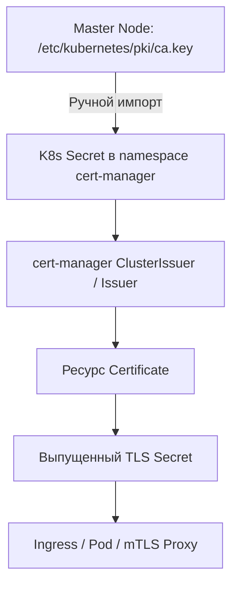

# Использование CA кластера для внутренних сертификатов

## Определения

**CA кластера (Kubernetes Cluster CA)** — корневой центр сертификации Kubernetes, который по умолчанию создается при развертывании кластера (например, через `kubeadm`). Файлы сертификата и ключа обычно расположены в `/etc/kubernetes/pki/ca.crt` и `ca.key` на мастер-узлах. Этот CA является корнем доверия для всех внутренних компонентов: `kubelet`, `kube-apiserver`, `etcd`, а также для проверки подписей Admission Webhooks.

**Применение:** Выпуск внутренних TLS-сертификатов для Ingress-ресурсов, реализации mTLS между микросервисами и защиты внутренних API, которым должны доверять инфраструктурные компоненты кластера.

**Связанные темы:**

- **[Приватный CA (self-signed): Сценарии](./Private_CA/scenarios.md)** — создание иерархии доверия, независимой от Control Plane
- **[Troubleshooting cert-manager](./Administration/troubleshooting.md)** — диагностика проблем выпуска и статусов ресурсов
- **[Операции приватного CA](./Private_CA/operations.md)** — ротация, проверка цепочек доверия и кодировок

---

## Основные концепции

### Отличия от приватного CA (self-signed)

| Аспект | CA кластера | Приватный CA (self-signed) |
| :--- | :--- | :--- |
| **Источник доверия** | `/etc/kubernetes/pki/ca.crt` | Новый Root CA, созданный в cert-manager |
| **Доступ к ключу** | Требуется физический доступ к Control Plane | Только через Kubernetes API (Secret) |
| **Доверие** | Автоматическое для всех компонентов K8s | Только для явно настроенных систем |
| **Жизненный цикл** | Совпадает с циклом жизни кластера | Полностью независимый и настраиваемый |
| **Риски** | **Критические:** Компрометация ключа позволяет захватить весь кластер | **Изолированные:** Влияет только на прикладной уровень |
| **Сложность** | Средняя (требует прав администратора узла) | Низкая (полная автоматизация) |
| **Managed K8s** | **Недоступен** (EKS, GKE, AKS не дают `ca.key`) | Полная поддержка |

### Архитектура взаимодействия



### Критичные требования безопасности

- **Хранение `ca.key`:** Закрытый ключ CA кластера — самый чувствительный актив инфраструктуры. Его утечка позволяет выпустить сертификат с правами `system:masters`. Secret с этим ключом должен находиться только в защищенном namespace (обычно `cert-manager`) и быть исключен из обычных бекапов.
- **RBAC и аудит:** Необходимо жестко ограничить права на чтение Secret с ключом через `resourceNames`. Любой доступ к этому ресурсу должен фиксироваться в Audit Log кластера.
- **Минимизация использования:** В Production-средах рекомендуется использовать CA кластера только для системных нужд (Admission Webhooks, Aggregation Layer), а для приложений развертывать отдельную иерархию через `selfSigned` Issuer.
- **Blast Radius (Радиус поражения):** При использовании Cluster CA для приложений, любая уязвимость в процессе выпуска сертификатов может потенциально привести к компрометации корневого доверия всего кластера.

---

## Практические сценарии

### Сценарий 1: Базовый выпуск сертификата для Ingress

**Цель:** Использовать существующий CA кластера для подписи сертификата внутреннего веб-сервиса, чтобы инфраструктурные компоненты (например, прокси) ему доверяли.

#### Шаг 1: Создание Secret с CA кластера

> **Внимание:** Требуется доступ к мастер-узлу и права `sudo` для чтения `/etc/kubernetes/pki/`.

```bash
# Выполняется на мастер-узле или через копирование файлов
kubectl create secret tls kubernetes-ca-secret \
  --cert=/etc/kubernetes/pki/ca.crt \
  --key=/etc/kubernetes/pki/ca.key \
  -n cert-manager
```

**Важные уточнения:**
- Операция требует прав `cluster-admin`.
- Secret создается в namespace, где запущен `cert-manager` (для использования в `ClusterIssuer`).
- Если ключ зашифрован, он должен быть расшифрован перед созданием Secret.

#### Шаг 2: Создание Issuer

```yaml
apiVersion: cert-manager.io/v1
kind: Issuer
metadata:
  name: kubernetes-ca-issuer
  namespace: cert-manager
spec:
  ca:
    secretName: kubernetes-ca-secret
```

> **Примечание:** `Issuer` работает только в своем namespace. Для возможности выпуска сертификатов в любом namespace используйте `ClusterIssuer` (см. Сценарий 2).

#### Шаг 3: Запрос сертификата

```yaml
apiVersion: cert-manager.io/v1
kind: Certificate
metadata:
  name: internal-services-tls
  namespace: monitoring
spec:
  secretName: internal-services-secret
  duration: 2160h          # 90 дней
  renewBefore: 360h        # 15 дней
  issuerRef:
    name: kubernetes-ca-issuer
    kind: Issuer
    group: cert-manager.io
  dnsNames:
    - netdata.k8s.local
    - grafana.k8s.local
    - prometheus.k8s.local
  privateKey:
    rotationPolicy: Always # Рекомендуется для безопасности в 2026 году
```

#### Шаг 4: Использование в Ingress

```yaml
apiVersion: networking.k8s.io/v1
kind: Ingress
metadata:
  name: netdata-ingress
  namespace: monitoring
  annotations:
    cert-manager.io/issuer: "kubernetes-ca-issuer"
spec:
  ingressClassName: nginx
  tls:
    - hosts:
        - netdata.k8s.local
      secretName: internal-services-secret
  rules:
    - host: netdata.k8s.local
      http:
        paths:
          - path: /
            pathType: Prefix
            backend:
              service:
                name: netdata
                port:
                  number: 19999
```

---

### Сценарий 2: ClusterIssuer для общекластерного доступа

**Цель:** Сделать подпись через CA кластера доступной для всех разработчиков и пространств имен.

```yaml
apiVersion: cert-manager.io/v1
kind: ClusterIssuer
metadata:
  name: kubernetes-cluster-ca
spec:
  ca:
    secretName: kubernetes-ca-secret  # Секрет должен лежать в namespace cert-manager
```

**Пример использования из произвольного namespace:**

```yaml
apiVersion: cert-manager.io/v1
kind: Certificate
metadata:
  name: my-app-cert
  namespace: dev-team-alpha
spec:
  secretName: my-app-tls
  duration: 8760h           # 1 год
  renewBefore: 720h         # 30 дней
  issuerRef:
    name: kubernetes-cluster-ca
    kind: ClusterIssuer
  dnsNames:
    - my-app.dev-team-alpha.svc.cluster.local
```

---

### Сценарий 3: mTLS между сервисами

**Цель:** Настройка взаимной аутентификации, где и клиент, и сервер проверяют сертификаты друг друга по корневому CA кластера.

#### Сертификат серверной части

```yaml
apiVersion: cert-manager.io/v1
kind: Certificate
metadata:
  name: backend-server-cert
  namespace: production
spec:
  secretName: backend-server-tls
  issuerRef:
    name: kubernetes-cluster-ca
    kind: ClusterIssuer
  dnsNames:
    - backend.production.svc
    - backend.production.svc.cluster.local
  usages:
    - server auth
    - digital signature
    - key encipherment
```

#### Сертификат клиентской части

```yaml
apiVersion: cert-manager.io/v1
kind: Certificate
metadata:
  name: backend-client-cert
  namespace: production
spec:
  secretName: backend-client-tls
  issuerRef:
    name: kubernetes-cluster-ca
    kind: ClusterIssuer
  dnsNames:
    - frontend.production.svc
  usages:
    - client auth
```

#### Монтирование в Pod (Пример)

```yaml
apiVersion: v1
kind: Pod
metadata:
  name: backend-app
spec:
  containers:
    - name: app
      image: my-app:latest
      volumeMounts:
        - name: tls-certs
          mountPath: /etc/tls
          readOnly: true
  volumes:
    - name: tls-certs
      secret:
        secretName: backend-server-tls
```

---

### Сценарий 4: Дистрибуция доверия через trust-manager

В современных архитектурах (2026+) ручное копирование `ca.crt` в образы или ConfigMap считается устаревшим. Используйте расширение **trust-manager** для автоматической доставки публичной части CA кластера во все пространства имен.

```yaml
apiVersion: trust.cert-manager.io/v1alpha2
kind: ClusterBundle
metadata:
  name: kubernetes-ca-bundle
spec:
  sources:
    - secret:
        name: kubernetes-ca-secret
        key: ca.crt
  target:
    configMap:
      key: "cluster-ca.crt" # Будет создан во всех Namespaces автоматически
```

---

## Дополнительная информация

### Проверка цепочки доверия

Для ручной верификации соответствия сертификата корневому CA используйте следующие команды:

```bash
# 1. Извлечение CA из секрета
kubectl get secret kubernetes-ca-secret -n cert-manager \
  -o jsonpath='{.data.ca\.crt}' | base64 -d > cluster-ca.crt

# 2. Извлечение сертификата сервиса
kubectl get secret internal-services-secret -n monitoring \
  -o jsonpath='{.data.tls\.crt}' | base64 -d > service.crt

# 3. Проверка соответствия через openssl
openssl verify -CAfile cluster-ca.crt service.crt
# Ожидаемый результат: service.crt: OK
```

### Безопасность и риски

| Риск | Описание | Мера противодействия |
| :--- | :--- | :--- |
| **Утечка `ca.key`** | Полная компрометация PKI кластера. | Ротация CA кластера через `kubeadm certs renew` (сложная процедура). |
| **Service Compromise** | Использование одного сертификата для всех сервисов. | Принцип "Один сервис — один Certificate" с уникальными SAN. |
| **Отсутствие ротации** | Устаревание ключей и уязвимость к брутфорсу. | Использование `rotationPolicy: Always` в ресурсах Certificate. |
| **Широкий доступ** | Слишком много людей могут читать TLS секреты. | Внедрение RBAC и использование External Secrets / Vault. |

### Частые ошибки и их решение

| Ошибка | Причина | Решение |
| :--- | :--- | :--- |
| `Permission denied` к `/etc/kubernetes/pki/` | Попытка чтения под обычным пользователем. | Выполняйте команды под `root` или используйте `sudo` на мастере. |
| Certificate в статусе `Pending` | Secret `kubernetes-ca-secret` не найден. | Проверьте наличие секрета именно в namespace контроллера `cert-manager`. |
| `Unknown Authority` в приложении | Приложение не знает о корневом CA. | Импортируйте `ca.crt` в доверенное хранилище (Java Truststore, OS bundles). |
| Конфликт при апгрейде кластера | CA кластера обновился, а секрет в cert-manager остался старым. | Обновите `kubernetes-ca-secret` вручную после ротации CA через `kubeadm`. |
