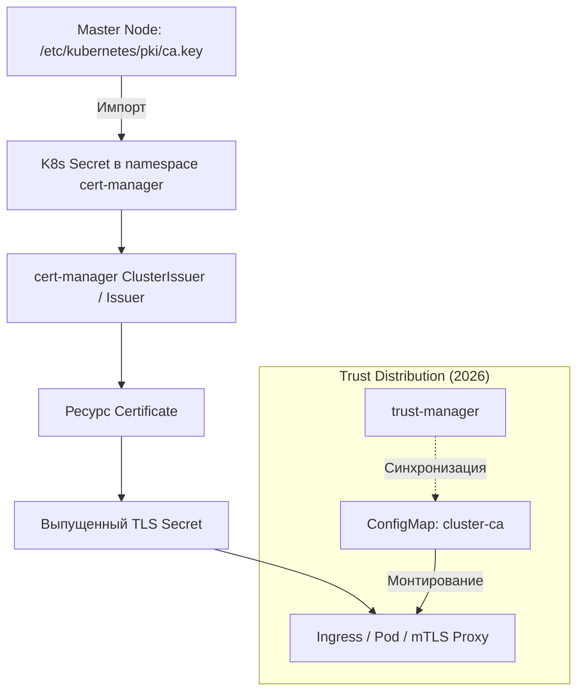

# Использование CA кластера для внутренних сертификатов

## Определения

**CA кластера (Kubernetes Cluster CA)** — корневой центр сертификации Kubernetes, который создается при инициализации Control Plane (например, через `kubeadm init`). Он является фундаментом доверия для всех внутренних процессов кластера: аутентификации узлов (`kubelet`), работы API-сервера, `etcd` и проверки Admission Webhooks.

**Файлы на мастер-узлах:**
- `/etc/kubernetes/pki/ca.crt` — публичный сертификат.
- `/etc/kubernetes/pki/ca.key` — закрытый ключ (наивысший уровень секретности).

**Применение в cert-manager:** Выпуск внутренних TLS-сертификатов для Ingress, mTLS и защиты внутренних API, которым должны доверять инфраструктурные компоненты кластера "из коробки".

**Связанные темы:**
- **[Приватный CA (Private PKI): Обзор](./Private_CA/index.md)** — архитектура независимых иерархий доверия.
- **[Cert-manager: Определения](./definitions.md)** — базовые ресурсы (Issuer, Certificate).
- **[Troubleshooting cert-manager](./Administration/troubleshooting.md)** — диагностика проблем выпуска.

---

## Основные концепции

### Отличия от приватного CA (self-signed)

| Аспект | CA кластера | Приватный CA (self-signed) |
| :--- | :--- | :--- |
| **Источник доверия** | `/etc/kubernetes/pki/ca.crt` | Новый Root CA в cert-manager |
| **Доступ к ключу** | Физический доступ к Control Plane | Через Kubernetes API (Secret) |
| **Доверие** | Автоматическое для всех компонентов K8s | Только для явно настроенных систем |
| **Жизненный цикл** | Совпадает с циклом жизни кластера | Полностью независимый |
| **Риски** | **Критические:** Захват кластера при утечке ключа | **Изолированные:** Только прикладной уровень |
| **Managed K8s** | **Недоступен** (EKS, GKE, AKS не дают `ca.key`) | Полная поддержка |

### Сравнение с нативным Kubernetes CSR API

| Аспект | Kubernetes CSR API | cert-manager (Cluster CA) |
| :--- | :--- | :--- |
| **Автоматизация** | Требует ручного одобрения запросов | Полностью автоматический цикл (Auto-renewal) |
| **Управление** | Низкоуровневые CSR ресурсы | Декларативные ресурсы `Certificate` |
| **Интеграция** | Ограничена системными нуждами | Ingress, Gateway API, Service Mesh |

### Архитектура взаимодействия



### Критичные требования безопасности

- **Хранение `ca.key`:** Закрытый ключ CA кластера — самый чувствительный актив. Его утечка позволяет выпустить сертификат с правами `system:masters`. Secret должен быть доступен ТОЛЬКО ServiceAccount-у cert-manager.
- **RBAC и аудит:** Ограничьте `resourceNames` для секретов. Любой доступ к `ca.key` должен вызывать критический алерт в SIEM/Audit Log.
- **Blast Radius:** При использовании Cluster CA для приложений любая уязвимость в процессе выпуска может скомпрометировать корневое доверие всей инфраструктуры.

---

## Практические сценарии

### Сценарий 1: Базовый выпуск сертификата для Ingress

**Цель:** Использовать CA кластера для подписи сертификата внутреннего сервиса.

#### Шаг 1: Создание Secret с CA кластера
Выполняется на мастер-узле (требуется `sudo` для чтения `/etc/kubernetes/pki/`):

```bash
sudo kubectl create secret tls kubernetes-ca-secret \
  --cert=/etc/kubernetes/pki/ca.crt \
  --key=/etc/kubernetes/pki/ca.key \
  -n cert-manager \
  --dry-run=client -o yaml | kubectl apply -f -
```

#### Шаг 2: Создание Issuer

```yaml
apiVersion: cert-manager.io/v1
kind: Issuer
metadata:
  name: kubernetes-ca-issuer
  namespace: cert-manager
spec:
  ca:
    secretName: kubernetes-ca-secret
```

#### Шаг 3: Запрос сертификата (ECDSA P-256)

```yaml
apiVersion: cert-manager.io/v1
kind: Certificate
metadata:
  name: internal-service-tls
  namespace: monitoring
spec:
  secretName: internal-service-secret
  duration: 2160h          # 90 дней
  renewBefore: 360h        # 15 дней
  issuerRef:
    name: kubernetes-ca-issuer
    kind: Issuer
  dnsNames:
    - grafana.k8s.local
  privateKey:
    algorithm: ECDSA
    size: 256
    rotationPolicy: Always # Рекомендуется для безопасности в 2026 году
```

---

### Сценарий 2: ClusterIssuer для общекластерного доступа

**Цель:** Сделать подпись через CA кластера доступной для всех Namespaces.

```yaml
apiVersion: cert-manager.io/v1
kind: ClusterIssuer
metadata:
  name: kubernetes-cluster-ca
spec:
  ca:
    secretName: kubernetes-ca-secret # Секрет в namespace cert-manager
```

---

### Сценарий 3: mTLS между сервисами

**Цель:** Взаимная аутентификация компонентов по корневому CA кластера.

#### Сертификаты сторон
- **Server:** `usages: [server auth, digital signature, key encipherment]`
- **Client:** `usages: [client auth]`

```yaml
# Пример клиентского сертификата
apiVersion: cert-manager.io/v1
kind: Certificate
metadata:
  name: backend-client-cert
  namespace: production
spec:
  secretName: backend-client-tls
  issuerRef:
    name: kubernetes-cluster-ca
    kind: ClusterIssuer
  dnsNames:
    - frontend.production.svc
  usages:
    - client auth
```

---

### Сценарий 4: Дистрибуция доверия через trust-manager

В 2026 году ручное копирование `ca.crt` устарело. Используйте расширение **trust-manager**.

```yaml
apiVersion: trust.cert-manager.io/v1alpha2
kind: Bundle
metadata:
  name: kubernetes-ca-bundle
spec:
  sources:
    - secret:
        name: kubernetes-ca-secret
        key: ca.crt
  target:
    configMap:
      key: "cluster-ca.crt" # Будет создан во всех Namespaces автоматически
```

---

### Сценарий 5: Автоматическая синхронизация CA (CronJob)

При обновлении сертификатов кластера (`kubeadm certs renew`), Secret в cert-manager нужно обновлять.

```yaml
apiVersion: batch/v1
kind: CronJob
metadata:
  name: ca-sync
  namespace: cert-manager
spec:
  schedule: "0 0 1 * *" # Ежемесячно
  jobTemplate:
    spec:
      template:
        spec:
          hostNetwork: true
          containers:
          - name: sync
            image: bitnami/kubectl:latest
            command: ["/bin/sh", "-c"]
            args:
            - |
              kubectl create secret tls kubernetes-ca-secret \
                --cert=/etc/kubernetes/pki/ca.crt \
                --key=/etc/kubernetes/pki/ca.key \
                -n cert-manager --dry-run=client -o yaml | kubectl apply -f -
            volumeMounts:
            - name: pki
              mountPath: /etc/kubernetes/pki
              readOnly: true
          volumes:
          - name: pki
            hostPath:
              path: /etc/kubernetes/pki
          restartPolicy: OnFailure
```

---

## Дополнительная информация

### Мониторинг и метрики

| Метрика | Описание | PromQL для алерта |
| :--- | :--- | :--- |
| `certmanager_certificate_ready_status` | Статус сертификата | `certmanager_certificate_ready_status == 0` |
| `certmanager_certificate_expiration_timestamp_seconds` | Время до истечения | `(val - time()) / 86400 < 15` |

### Безопасность и риски

| Риск | Описание | Мера противодействия |
| :--- | :--- | :--- |
| **Утечка `ca.key`** | Полная компрометация PKI. | Ротация CA через `kubeadm certs renew`. |
| **Service Compromise** | Использование одного сертификата везде. | Принцип "Один сервис — один Certificate". |
| **Широкий доступ** | Чтение секретов всеми пользователями. | RBAC и использование External Secrets / Vault. |

### Частые ошибки

| Ошибка | Причина | Решение |
| :--- | :--- | :--- |
| `Permission denied` к `/etc/kubernetes/pki/` | Недостаточно прав. | Используйте `sudo` или CronJob с `hostPath`. |
| `Unknown Authority` в приложении | Приложение не знает о CA. | Используйте `trust-manager` для доставки `ca.crt`. |
| Конфликт при апгрейде кластера | CA обновился, Secret — нет. | Используйте автоматическую синхронизацию (Сценарий 5). |
