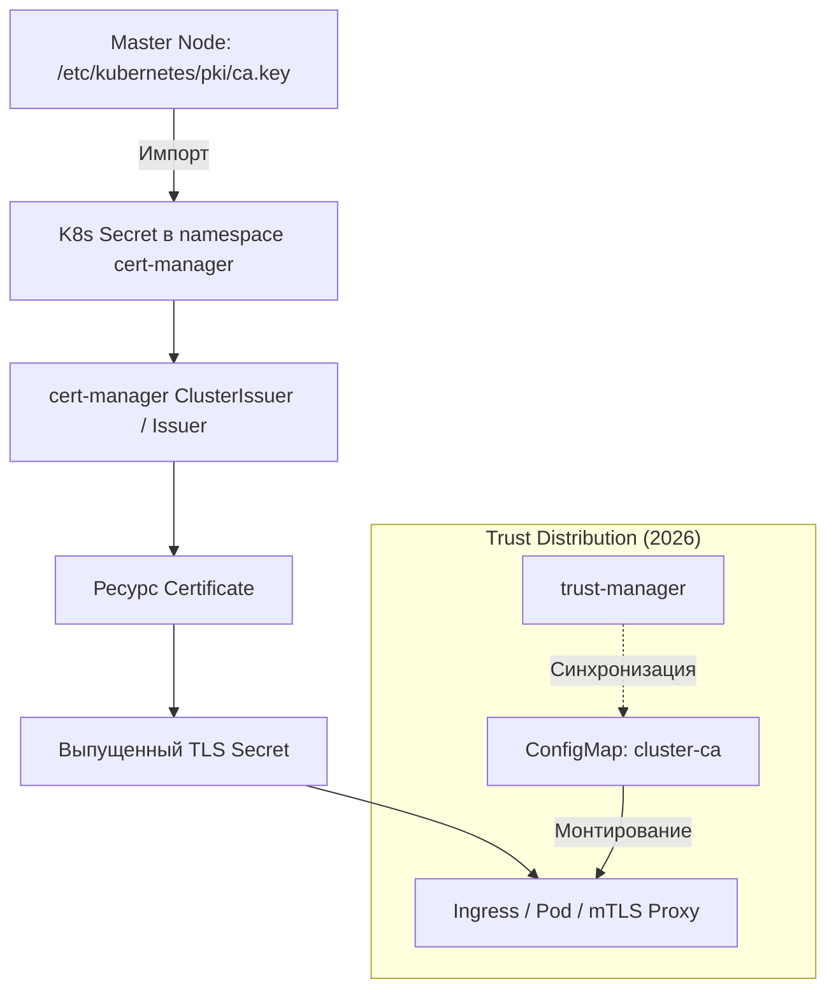

# Использование CA кластера для внутренних сертификатов

## Определения

**CA кластера (Kubernetes Cluster CA)** — корневой центр сертификации Kubernetes, который создается при инициализации Control Plane (например, через `kubeadm init`). Он является фундаментом доверия для всех внутренних процессов кластера: аутентификации узлов (`kubelet`), работы API-сервера, `etcd` и проверки Admission Webhooks.

**Intermediate CA (Промежуточный CA)** — сертификат, подписанный Root CA кластера и используемый для подписи прикладных сертификатов. Позволяет изолировать корень доверия: компрометация промежуточного ключа не требует ротации Root CA. В cert-manager создается как ресурс `Certificate` с `isCA: true` и usage `cert sign`.

**Применение в cert-manager:** Выпуск внутренних TLS-сертификатов для Ingress, mTLS и защиты внутренних API, которым должны доверять инфраструктурные компоненты кластера "из коробки".

### Компоненты PKI кластера

Все файлы инфраструктуры открытых ключей хранятся в `/etc/kubernetes/pki/` на каждом Control Plane узле:

| Файл | Назначение | Кем подписывается |
| :--- | :--- | :--- |
| `ca.crt` / `ca.key` | Корневой CA кластера (Root CA) | Self-signed (при `kubeadm init`) |
| `apiserver.crt` / `apiserver.key` | Сертификат API-сервера (порт 6443) | `ca.crt` |
| `apiserver-kubelet-client.crt` | Клиентский сертификат API -> Kubelet | `ca.crt` |
| `apiserver-etcd-client.crt` | Клиентский сертификат API -> etcd | `etcd/ca.crt` |
| `sa.key` / `sa.pub` | Подпись ServiceAccount токенов | N/A (asymmetric key pair) |
| `front-proxy-ca.crt` | CA для агрегированного API-слоя | Self-signed |
| `front-proxy-client.crt` | Клиент для агрегированного API | `front-proxy-ca.crt` |
| `etcd/ca.crt` / `etcd/ca.key` | Корневой CA для кластера etcd | Self-signed |
| `etcd/server.crt` | Сертификат узла etcd | `etcd/ca.crt` |
| `etcd/peer.crt` | Взаимодействие узлов etcd | `etcd/ca.crt` |
| `etcd/healthcheck-client.crt` | Клиентский сертификат для проверки здоровья etcd | `etcd/ca.crt` |

> **Важно:** Файлы `ca.key`, `sa.key` и `etcd/ca.key` — наиболее чувствительные активы. Их утечка позволяет выпустить сертификат с любыми полномочиями. Подробнее об управлении PKI: [Управление сертификатами Kubernetes](../../Operations/certificate_management.md).

**Связанные темы:**
- **[Приватный CA (Private PKI): Обзор](./Private_CA/index.md)** — архитектура независимых иерархий доверия.
- **[Cert-manager: Определения](./definitions.md)** — базовые ресурсы (Issuer, Certificate).
- **[Troubleshooting cert-manager](./Administration/troubleshooting.md)** — диагностика проблем выпуска.

---

## Основные концепции

### Отличия от приватного CA (self-signed)

| Аспект | CA кластера | Приватный CA (self-signed) |
| :--- | :--- | :--- |
| **Источник доверия** | `/etc/kubernetes/pki/ca.crt` | Новый Root CA в cert-manager |
| **Доступ к ключу** | Физический доступ к Control Plane | Через Kubernetes API (Secret) |
| **Доверие** | Автоматическое для всех компонентов K8s | Только для явно настроенных систем |
| **Жизненный цикл** | Совпадает с циклом жизни кластера | Полностью независимый |
| **Риски** | **Критические:** Захват кластера при утечке ключа | **Изолированные:** Только прикладной уровень |
| **Managed K8s** | **Недоступен** (EKS, GKE, AKS не дают `ca.key`) | Полная поддержка |

### Сравнение с нативным Kubernetes CSR API

| Аспект | Kubernetes CSR API | cert-manager (Cluster CA) |
| :--- | :--- | :--- |
| **Автоматизация** | Требует ручного одобрения запросов | Полностью автоматический цикл (Auto-renewal) |
| **Управление** | Низкоуровневые CSR ресурсы | Декларативные ресурсы `Certificate` |
| **Интеграция** | Ограничена системными нуждами | Ingress, Gateway API, Service Mesh |

### Архитектура взаимодействия



### Жизненный цикл Root CA кластера

Корневой CA кластера создается один раз при инициализации Control Plane иlivingstет на протяжении всей жизни кластера. Понимание его жизненного цикла критично для планирования ротации и бэкапов.

**Инициализация:**
1. `kubeadm init` генерирует самоподписанный Root CA (`ca.crt` + `ca.key`)
2. На его основе подписываются все компонентные сертификаты (apiserver, etcd, front-proxy)
3. CA distributes на все Control Plane узлы через `kubeadm join`

**Ротация:**
- **Листовые сертификаты** (apiserver, etcd, front-proxy) ротируются через `kubeadm certs renew all`
- **Root CA (`ca.crt`, `etcd/ca.crt`, `front-proxy-ca.crt`)** — **НЕ ротируются** автоматически. Это осознанное ограничение: замена корня доверия требует ручного вмешательства и распространения нового CA на все узлы
- При ротации Root CA используется **Dual CA**模式 (см. следующий раздел)

**Потеря `ca.key`:**
- Без резервной копии — **единственный выход**: полная реинициализация кластера с новым CA
- С бэкапом: восстановление `ca.key` + `ca.crt`, ручное обновление на всех узлах, перезапуск компонентов
- Подробнее: [Управление сертификатами](../../Operations/certificate_management.md#потеря-ca.key)

### Dual CA (Смешанный CA)

При ротации корневого CA кластера возникает переходный период, когда **старый и новый CA работают параллельно**. Это называется "смешанный CA" или "dual CA".

**Когда это необходимо:**
- Плановая ротация Root CA по политике безопасности (например, каждые 2 года)
- Экстренная ротация при подозрении на компрометацию `ca.key`
- Миграция с Self-Signed CA на Intermediate CA (подписанный внешним корнем)

**Механизм работы:**
1. Создается новый Root CA (новый `ca.key` + `ca.crt`)
2. Новый CA подписывает все компонентные сертификаты
3. На Control Plane узлах befinden się **оба CA** (старый + новый) в信任 stores
4. После обновления всех компонентов старый CA удаляется

**Ограничение kubelet:** `kubelet` не перечитывает CA без restart. При ротации Root CA требуется rolling restart всех узлов кластера.

> Подробнее о процедуре dual CA: [Ротация Root CA](../../Operations/certificate_management.md#ротация-root-ca) и [Экстренная ротация](./Private_CA/operations.md#экстренная-ротация-при-компрометации).

### Blast Radius анализа

Использование CA кластера для прикладных сертификатов расширяет зону поражения (blast radius) при компрометации:

| Сценарий | Blast Radius | Восстановление |
| :--- | :--- | :--- |
| **Утечка `ca.key`** | Полная компрометация PKI. Выпуск сертификатов с правами `system:masters`. | Ручная ротация Root CA + restart всех компонентов |
| **Компрометация прикладного сервиса** | Если сервис использует сертификат, подписанный Cluster CA, атакующий может подделать любой внутренний сертификат | Ротация Root CA (если key скомпрометирован) или перевыпуск сертификата сервиса |
| **Утечка Intermediate CA key** | Компрометированы только сертификаты, подписанные этим Intermediate | Ротация Intermediate CA, Root CA не затронут |
| **Ротация Root CA** | Временный downtime ( секунды-минуты) для компонентов, не перечитавших CA | Rolling restart |

**Рекомендация:** Используйте Cluster CA только для инфраструктурных компонентов (Ingress, Gateway, monitoring). Для прикладных сервисов создавайте **независимый Private CA** через cert-manager — это изолирует blast radius. Подробнее: [Приватный CA](./Private_CA/index.md).

### Критичные требования безопасности

- **Хранение `ca.key`:** Закрытый ключ CA кластера — самый чувствительный актив. Его утечка позволяет выпустить сертификат с правами `system:masters`. Secret должен быть доступен ТОЛЬКО ServiceAccount-у cert-manager.
- **RBAC и аудит:** Ограничьте `resourceNames` для секретов. Любой доступ к `ca.key` должен вызывать критический алерт в SIEM/Audit Log.
- **Blast Radius:** При использовании Cluster CA для приложений любая уязвимость в процессе выпуска может скомпрометировать корневое доверие всей инфраструктуры. Используйте [Private CA](./Private_CA/index.md) для изоляции прикладного уровня.
- **Бэкап PKI:** Регулярно резервное копируйте `/etc/kubernetes/pki/` (особенно `ca.key`, `sa.key`, `etcd/ca.key`). Храните бэкап в защищенном месте (offline/HSM). Автоматизируйте бэкап через cron на каждом Control Plane узле.

---

## Подготовка

Перед выполнением сценариев убедитесь в наличии следующих компонентов:

| Компонент | Минимальная версия | Проверка |
| :--- | :--- | :--- |
| **Kubernetes** | 1.25+ | `kubectl version --short` |
| **cert-manager** | 1.21+ | `kubectl get pods -n cert-manager` |
| **trust-manager** (для сценария 4) | 0.6+ | `kubectl get pods -n cert-manager -l app.kubernetes.io/name=trust-manager` |
| **Доступ к Control Plane** | root/sudo | Доступ к `/etc/kubernetes/pki/` на мастер-узле |
| **Gateway API CRD** (для сценария 6) | v1.1.0+ | `kubectl get crd gateways.gateway.networking.k8s.io` |

> **Установка cert-manager и trust-manager:** [Установка cert-manager](./installation.md).

---

## Практические сценарии

### Сценарий 1: Базовый выпуск сертификата для Ingress

**Цель:** Использовать CA кластера для подписи сертификата внутреннего сервиса.

#### Шаг 1: Создание Secret с CA кластера
Выполняется на мастер-узле (требуется `sudo` для чтения `/etc/kubernetes/pki/`):

```bash
sudo kubectl create secret tls kubernetes-ca-secret \
  --cert=/etc/kubernetes/pki/ca.crt \
  --key=/etc/kubernetes/pki/ca.key \
  -n cert-manager \
  --dry-run=client -o yaml | kubectl apply -f -
```

#### Шаг 2: Создание Issuer

```yaml
apiVersion: cert-manager.io/v1
kind: Issuer
metadata:
  name: kubernetes-ca-issuer
  namespace: cert-manager
spec:
  ca:
    secretName: kubernetes-ca-secret
```

#### Шаг 3: Запрос сертификата (ECDSA P-256)

```yaml
apiVersion: cert-manager.io/v1
kind: Certificate
metadata:
  name: internal-service-tls
  namespace: monitoring
spec:
  secretName: internal-service-secret
  duration: 2160h          # 90 дней
  renewBefore: 360h        # 15 дней
  issuerRef:
    name: kubernetes-ca-issuer
    kind: Issuer
  dnsNames:
    - grafana.k8s.local
  usages:
    - server auth
    - digital signature
    - key encipherment
  privateKey:
    algorithm: ECDSA
    size: 256
    rotationPolicy: Always # Рекомендуется для безопасности в 2026 году
```

> **Альтернатива (ECDSA P-384):** Для повышенной безопасности замените `size: 256` на `size: 384`. P-384 обеспечивает 192-битный уровень безопасности (equivalent RSA 7680 бит). Минимальная поддержка: OpenSSL 3.0+.

#### Шаг 4: Валидация

```bash
# Проверка создания Secret
kubectl get secret internal-service-secret -n monitoring

# Просмотр сертификата
kubectl get secret internal-service-secret -n monitoring -o jsonpath='{.data.tls\.crt}' | base64 -d | openssl x509 -text -noout | head -20

# Проверка цепочки доверия
kubectl get secret internal-service-secret -n monitoring -o jsonpath='{.data.tls\.crt}' | base64 -d > /tmp/cert.pem
openssl verify -CAfile /etc/kubernetes/pki/ca.crt /tmp/cert.pem
# → OK

# Проверка статуса cert-manager
kubectl get certificate internal-service-tls -n monitoring
# → READY: True
```

#### Очистка

```bash
kubectl delete certificate internal-service-tls -n monitoring
kubectl delete issuer kubernetes-ca-issuer -n cert-manager
kubectl delete secret kubernetes-ca-secret -n cert-manager
```

---

### Сценарий 2: ClusterIssuer для общекластерного доступа

**Цель:** Сделать подпись через CA кластера доступной для всех Namespaces.

```yaml
apiVersion: cert-manager.io/v1
kind: ClusterIssuer
metadata:
  name: kubernetes-cluster-ca
spec:
  ca:
    secretName: kubernetes-ca-secret # Секрет в namespace cert-manager
```

---

### Сценарий 3: mTLS между сервисами

**Цель:** Взаимная аутентификация компонентов по корневому CA кластера.

В mTLS обе стороны (клиент и сервер) представляют сертификаты, подписанные одним CA. Это обеспечивает не только шифрование канала, но и взаимную проверку личности.

#### Шаг 1: Сертификат сервера

```yaml
apiVersion: cert-manager.io/v1
kind: Certificate
metadata:
  name: backend-server-cert
  namespace: production
spec:
  secretName: backend-server-tls
  issuerRef:
    name: kubernetes-cluster-ca
    kind: ClusterIssuer
  dnsNames:
    - backend.production.svc
    - backend.production.svc.cluster.local
  usages:
    - server auth
    - digital signature
    - key encipherment
  privateKey:
    algorithm: ECDSA
    size: 256
    rotationPolicy: Always
```

#### Шаг 2: Сертификат клиента

```yaml
apiVersion: cert-manager.io/v1
kind: Certificate
metadata:
  name: frontend-client-cert
  namespace: production
spec:
  secretName: frontend-client-tls
  issuerRef:
    name: kubernetes-cluster-ca
    kind: ClusterIssuer
  dnsNames:
    - frontend.production.svc
  usages:
    - client auth
    - digital signature
    - key encipherment
  privateKey:
    algorithm: ECDSA
    size: 256
    rotationPolicy: Always
```

#### Шаг 3: Валидация

```bash
# Проверка сертификата сервера
kubectl get secret backend-server-tls -n production -o jsonpath='{.data.tls\.crt}' | base64 -d | openssl x509 -text -noout | grep -A2 "Subject Alternative Name"
# → DNS:backend.production.svc, DNS:backend.production.svc.cluster.local

# Проверка сертификата клиента
kubectl get secret frontend-client-tls -n production -o jsonpath='{.data.tls\.crt}' | base64 -d | openssl x509 -text -noout | grep "Extended Key Usage"
# → TLS Web Client Authentication

# Проверка цепочки доверия для обоих
kubectl get secret backend-server-tls -n production -o jsonpath='{.data.tls\.crt}' | base64 -d > /tmp/server.pem
openssl verify -CAfile /etc/kubernetes/pki/ca.crt /tmp/server.pem
# → OK

kubectl get secret frontend-client-tls -n production -o jsonpath='{.data.tls\.crt}' | base64 -d > /tmp/client.pem
openssl verify -CAfile /etc/kubernetes/pki/ca.crt /tmp/client.pem
# → OK
```

> **Примечание:** В реальных сценариях mTLS настраивается на уровне прокси (Envoy, Linkerd, Istio) или приложения. Примеры выше показывают только выпуск сертификатов. Подробнее о mTLS в Kubernetes: [TLS и mTLS в Kubernetes](../../Security/tls_and_mtls_in_kubernetes.md).

---

### Сценарий 4: Дистрибуция доверия через trust-manager

В 2026 году ручное копирование `ca.crt` устарело. Используйте расширение **trust-manager**.

```yaml
apiVersion: trust.cert-manager.io/v1alpha2
kind: Bundle
metadata:
  name: kubernetes-ca-bundle
spec:
  sources:
    - secret:
        name: kubernetes-ca-secret
        key: ca.crt
  target:
    configMap:
      key: "cluster-ca.crt" # Будет создан во всех Namespaces автоматически
```

---

### Сценарий 5: Автоматическая синхронизация CA (CronJob)

При обновлении сертификатов кластера (`kubeadm certs renew`), Secret в cert-manager нужно обновлять. Этот CronJob синхронизирует и `ca.crt`, и `ca.key`.

```yaml
apiVersion: batch/v1
kind: CronJob
metadata:
  name: ca-sync
  namespace: cert-manager
spec:
  schedule: "0 0 1 * *" # Ежемесячно
  jobTemplate:
    spec:
      template:
        spec:
          hostNetwork: true
          containers:
          - name: sync
            image: bitnami/kubectl:latest
            command: ["/bin/sh", "-c"]
            args:
            - |
              set -e
              echo "[$(date)] Начало синхронизации CA кластера..."

              # Обновление Secret с TLS (ca.crt + ca.key)
              kubectl create secret tls kubernetes-ca-secret \
                --cert=/etc/kubernetes/pki/ca.crt \
                --key=/etc/kubernetes/pki/ca.key \
                -n cert-manager --dry-run=client -o yaml | kubectl apply -f -

              # Обновление ConfigMap с ca.crt (для trust-manager Bundle)
              kubectl create configmap kubernetes-ca.crt \
                --from-file=ca.crt=/etc/kubernetes/pki/ca.crt \
                -n cert-manager --dry-run=client -o yaml | kubectl apply -f -

              echo "[$(date)] Синхронизация завершена успешно."
            volumeMounts:
            - name: pki
              mountPath: /etc/kubernetes/pki
              readOnly: true
          volumes:
          - name: pki
            hostPath:
              path: /etc/kubernetes/pki
          restartPolicy: OnFailure
```

> **Примечание:** ConfigMap `kubernetes-ca.crt` используется как источник для `trust-manager` Bundle (см. Сценарий 4). При обновлении CA cert-manager автоматически перевыпустит все сертификаты, ссылающиеся на этот Issuer.

#### Валидация

```bash
# Проверка последнего запуска
kubectl get jobs -n cert-manager -l job-name=ca-sync --sort-by=.status.completionTime

# Просмотр логов последнего Job
kubectl logs -n cert-manager -l job-name=ca-sync --tail=20

# Проверка, что Secret обновлен
kubectl get secret kubernetes-ca-secret -n cert-manager -o jsonpath='{.metadata.creationTimestamp}'
# → Должна совпадать с датой последнего запуска CronJob
```

---

## Дополнительная информация

### Мониторинг и метрики

| Метрика | Описание | PromQL для алерта |
| :--- | :--- | :--- |
| `certmanager_certificate_ready_status` | Статус сертификата | `certmanager_certificate_ready_status == 0` |
| `certmanager_certificate_expiration_timestamp_seconds` | Время до истечения | `(val - time()) / 86400 < 15` |

### Безопасность и риски

| Риск | Описание | Мера противодействия |
| :--- | :--- | :--- |
| **Утечка `ca.key`** | Полная компрометация PKI. | Ротация CA через `kubeadm certs renew`. |
| **Service Compromise** | Использование одного сертификата везде. | Принцип "Один сервис — один Certificate". |
| **Широкий доступ** | Чтение секретов всеми пользователями. | RBAC и использование External Secrets / Vault. |

### Частые ошибки

| Ошибка | Причина | Решение |
| :--- | :--- | :--- |
| `Permission denied` к `/etc/kubernetes/pki/` | Недостаточно прав. | Используйте `sudo` или CronJob с `hostPath`. |
| `Unknown Authority` в приложении | Приложение не знает о CA. | Используйте `trust-manager` для доставки `ca.crt`. |
| Конфликт при апгрейде кластера | CA обновился, Secret — нет. | Используйте автоматическую синхронизацию (Сценарий 5). |
