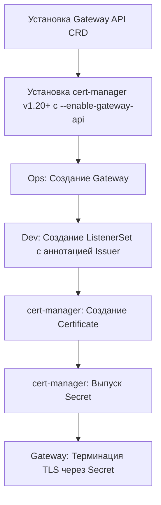

# Интеграция Cert-manager с Gateway API: Определения и концепции

## Определения

**Gateway API** — современный стандарт Kubernetes для управления трафиком (L4/L7), заменяющий Ingress API. Предоставляет ролевую модель разделения ответственности между инфраструктурой и приложениями. Подробное описание: [Gateway API: Определения](../../../Networking/gateway_api/definitions.md).

**cert-manager (v1.20+)** — нативный контроллер Kubernetes для автоматизации выпуска и обновления TLS-сертификатов. В контексте Gateway API работает через `gateway-shim` (автоматизация через аннотации) или через прямое управление ресурсами `Certificate`.

**ListenerSet (v1.20+ Alpha/Beta)** — новый ресурс в Gateway API, позволяющий делегировать управление слушателями (включая TLS) от владельца Gateway (Ops) владельцам приложений (Dev). Является основным способом обеспечения Self-Service TLS в мультитенентных кластерах.

**ReferenceGrant** — ресурс Gateway API, разрешающий перекрестные ссылки между пространствами имен (например, когда Gateway в `infra` ссылается на Secret или Certificate в `app-namespace`).

**Интеграция с cert-manager:** поддержка включается флагом `--enable-gateway-api` в контроллере cert-manager. Требуется предварительная установка Gateway API CRD.

---

## Основные концепции

### Поток работы при интеграции (Self-Service TLS)

В 2026 году стандартным подходом является использование **ListenerSet** для изоляции прав.



### Методы управления сертификатами

| Аспект | Gateway-shim (Аннотации) | Явные Certificate (Рекомендуется) |
| :--- | :--- | :--- |
| **Управление** | Автоматическое через аннотации на Gateway/ListenerSet | Декларативное через CRD `Certificate` |
| **Гибкость** | Ограничена (только базовые параметры) | Полная (алгоритмы, ротация, дополнительные DNS) |
| **Сложность** | Низкая (минимум манифестов) | Средняя (требуется отдельный ресурс) |
| **SSoT** | Ресурс Gateway/ListenerSet | Ресурс Certificate |
| **Кросс-неймспейс** | Затруднено без ReferenceGrant | Полная поддержка через ReferenceGrant |

### Безопасность и ReferenceGrant

Если сертификат (Secret) находится в одном пространстве имен, а Gateway в другом, **обязательно** создание `ReferenceGrant`:

```yaml
apiVersion: gateway.networking.k8s.io/v1beta1
kind: ReferenceGrant
metadata:
  name: allow-gateway-to-certs
  namespace: app-namespace
spec:
  from:
  - group: gateway.networking.k8s.io
    kind: Gateway
    namespace: infra-namespace
  to:
  - group: ""
    kind: Secret
```

### Особенности интеграции v1.20

1. **Feature Gate ListenerSets:** Требует явного включения в cert-manager для поддержки динамического Self-Service.
2. **Dedicated Challenge Gateway:** Для проверок HTTP-01 рекомендуется выделенный шлюз, чтобы избежать смешивания трафика проверок с продуктовым.
3. **Статус-фидбек:** Ошибки выпуска сертификатов теперь транслируются напрямую в `status.conditions` ресурсов Gateway и ListenerSet.

---

## Практические сценарии

Подробные примеры настройки и манифесты (TLS Termination, Wildcard, ListenerSet) доступны в специализированном руководстве:

- **[Практические сценарии](./practical_scenarios.md)**

---

## Дополнительная информация

### Версии и совместимость (на июль 2026 г.)

| Компонент | Минимальная версия | Рекомендуемая | Примечание |
| :--- | :--- | :--- | :--- |
| **cert-manager** | 1.13+ | **1.20.2** | Поддержка ListenerSet и ARI |
| **Gateway API CRD** | v1.0+ | **v1.5.0** | Требуется Standard install |
| **Kubernetes** | 1.25+ | **1.30+** | Поддержка современных API-каналов |

### Надёжность и свежесть данных

- **Оценка надёжности:** 10 (SSoT: cert-manager.io + верификация через Web-поиск 2026).
- **Класс актуальности:** Инструментальный (обновление требуется при выходе мажорных версий cert-manager или Gateway API).
- **Последняя проверка:** Июль 2026.

### Смотрите также

- **[Gateway API: Дополнительные темы](./advanced_topics.md)** — диагностика и Hostname-конфликт.
- **[Cert-manager: Определения](../../definitions.md)** — базовые концепции Issuer и Certificate.
- **[Gateway API: Определения](../../../Networking/gateway_api/definitions.md)** — общие принципы маршрутизации.
