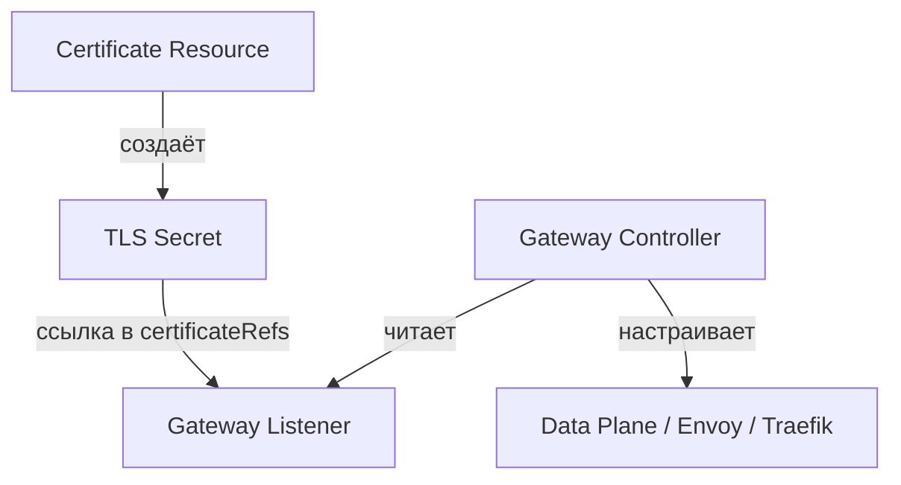

# Интеграция Cert-manager с Gateway API: Практические сценарии

## Определения

**TLS Termination** — режим Gateway, при котором TLS-трафик расшифровывается на шлюзе и передаётся бэкенду в открытом виде (или через новое защищенное соединение).

**TLS Passthrough** — режим, при котором TLS-трафик передаётся напрямую бэкенду без расшифровки на шлюзе (требуется `TLSRoute`, статус: `v1alpha2`). cert-manager в этом процессе не участвует.

**gateway-shim** — механизм в cert-manager, позволяющий автоматически выпускать TLS-сертификаты на основе аннотаций в ресурсах `Gateway` или `HTTPRoute` (аналог аннотаций Ingress).

**Wildcard-сертификат** — единый сертификат для всех поддоменов (например, `*.example.com`). Требует DNS-01 solver.

**ReferenceGrant** — ресурс Gateway API, разрешающий перекрестные ссылки между пространствами имен (например, использование Secret из `app` в Gateway из `infra`).

---

## Основные концепции

### Подготовительные шаги

Перед внедрением сценариев необходимо убедиться в выполнении следующих условий:

1. **Установка Gateway API CRD:**
   ```bash
   kubectl apply -f https://github.com/kubernetes-sigs/gateway-api/releases/download/v1.1.0/standard-install.yaml
   ```
2. **Установка cert-manager с поддержкой Gateway API:**
   Поддержка включается флагом `--enable-gateway-api=true`. Подробно: [Установка cert-manager](../../installation.md).
3. **Создание ClusterIssuer:** Настроенный ACME-issuer (Let's Encrypt или внутренний Vault).

### Архитектура интеграции



---

## Практические сценарии

### Сценарий 1: Базовый Gateway с TLS Termination (Явный Certificate)

**Цель:** Использование выделенного ресурса `Certificate` для максимального контроля.

**Certificate:**
```yaml
apiVersion: cert-manager.io/v1
kind: Certificate
metadata:
  name: gateway-tls
  namespace: default
spec:
  secretName: gateway-tls-secret
  issuerRef:
    name: letsencrypt-prod
    kind: ClusterIssuer
  dnsNames:
    - api.example.com
  duration: 2160h
  renewBefore: 360h
```

**Gateway:**
```yaml
apiVersion: gateway.networking.k8s.io/v1
kind: Gateway
metadata:
  name: example-gateway
  namespace: default
spec:
  gatewayClassName: traefik
  listeners:
  - name: https
    protocol: HTTPS
    port: 443
    hostname: api.example.com
    tls:
      mode: Terminate
      certificateRefs:
      - name: gateway-tls-secret
        namespace: default
  allowedRoutes:
    namespaces:
      from: Same
```

---

### Сценарий 2: Автоматический выпуск через аннотации (gateway-shim)

**Цель:** Упрощенное управление в стиле Ingress. cert-manager сам создаст ресурс `Certificate`.

```yaml
apiVersion: gateway.networking.k8s.io/v1
kind: Gateway
metadata:
  name: auto-tls-gateway
  namespace: default
  annotations:
    cert-manager.io/cluster-issuer: letsencrypt-prod
spec:
  gatewayClassName: envoy-gateway
  listeners:
  - name: https
    hostname: "app.example.com"
    port: 443
    protocol: HTTPS
    tls:
      mode: Terminate
      certificateRefs:
      - name: app-tls-secret # Secret будет создан автоматически
    allowedRoutes:
      namespaces:
        from: All
```

---

### Сценарий 3: Несколько HTTPS-слушателей с разными сертификатами

**Цель:** Один Gateway обслуживает несколько доменов с индивидуальными сертификатами.

```yaml
apiVersion: gateway.networking.k8s.io/v1
kind: Gateway
metadata:
  name: multi-tls-gateway
  namespace: default
spec:
  gatewayClassName: traefik
  listeners:
  - name: https-main
    hostname: main.example.com
    protocol: HTTPS
    port: 443
    tls:
      mode: Terminate
      certificateRefs: [{name: main-tls-secret}]
  - name: https-api
    hostname: api.example.com
    protocol: HTTPS
    port: 443
    tls:
      mode: Terminate
      certificateRefs: [{name: api-tls-secret}]
  allowedRoutes:
    namespaces:
      from: Same
```

---

### Сценарий 4: Wildcard-сертификат (DNS-01)

**Цель:** Использование одного сертификата для всех поддоменов. Требует DNS-01 челлендж.

```yaml
apiVersion: cert-manager.io/v1
kind: Certificate
metadata:
  name: wildcard-tls
  namespace: default
spec:
  secretName: wildcard-tls-secret
  issuerRef: {name: cloudflare-dns-issuer, kind: ClusterIssuer}
  dnsNames: ["example.com", "*.example.com"]
---
apiVersion: gateway.networking.k8s.io/v1
kind: Gateway
metadata:
  name: wildcard-gateway
  namespace: default
spec:
  gatewayClassName: traefik
  listeners:
  - name: https
    protocol: HTTPS
    port: 443
    tls:
      mode: Terminate
      certificateRefs: [{name: wildcard-tls-secret}]
  allowedRoutes:
    namespaces: {from: All}
```

---

### Сценарий 5: Кросс-неймспейс доступ (ReferenceGrant)

**Цель:** Использовать сертификат из namespace `app-team` в шлюзе `infra-system`.

**ReferenceGrant (в namespace app-team):**
```yaml
apiVersion: gateway.networking.k8s.io/v1beta1
kind: ReferenceGrant
metadata:
  name: allow-infra-gateway
  namespace: app-team
spec:
  from:
  - group: gateway.networking.k8s.io
    kind: Gateway
    namespace: infra-system
  to:
  - group: ""
    kind: Secret
    name: app-tls-secret
```

**Gateway (в namespace infra-system):**
```yaml
# ... фрагмент
    tls:
      mode: Terminate
      certificateRefs:
      - name: app-tls-secret
        namespace: app-team
```

---

### Сценарий 6: Self-Service TLS через ListenerSet (cert-manager v1.20+)

**Цель:** Делегировать управление TLS команде разработки без прав на основной Gateway.

```yaml
apiVersion: gateway.networking.k8s.io/v1alpha1
kind: ListenerSet
metadata:
  name: dev-listeners
  namespace: dev-namespace
  annotations:
    cert-manager.io/cluster-issuer: letsencrypt-prod
spec:
  parentRef:
    name: shared-gateway
    namespace: infra-namespace
  listeners:
  - name: https-dev
    hostname: "dev.example.com"
    port: 443
    protocol: HTTPS
    tls:
      mode: Terminate
      certificateRefs: [{name: dev-tls-secret}]
```

---

### Сценарий 7: TLS Passthrough (mTLS)

**Цель:** Передача зашифрованного трафика напрямую бэкенду.

```yaml
apiVersion: gateway.networking.k8s.io/v1
kind: Gateway
metadata:
  name: passthrough-gateway
spec:
  listeners:
  - name: tls-passthrough
    protocol: TLS
    port: 443
    tls: {mode: Passthrough}
---
apiVersion: gateway.networking.k8s.io/v1alpha2
kind: TLSRoute
metadata:
  name: mtls-route
spec:
  parentRefs: [{name: passthrough-gateway}]
  rules:
  - backendRefs: [{name: mtls-service, port: 8443}]
```

---

### Сценарий 8: HTTP-to-HTTPS Redirect

**Цель:** Принудительный редирект через нативный фильтр Gateway API.

```yaml
apiVersion: gateway.networking.k8s.io/v1
kind: HTTPRoute
metadata:
  name: https-redirect
spec:
  parentRefs:
  - name: main-gateway
    sectionName: http-80
  rules:
  - filters:
    - type: RequestRedirect
      requestRedirect: {scheme: https, statusCode: 301}
```

---

## Дополнительная информация

### Надёжность и актуальность

- **Оценка надёжности:** 10 (SSoT: cert-manager.io + Gateway API Spec v1.1).
- **Класс актуальности:** Инструментальный (Kubernetes 1.30+, cert-manager 1.20+).
- **Последняя проверка:** Июль 2026.

### Смотрите также

- **[Определения и концепции](./definitions_and_concepts.md)** — база Gateway API.
- **[Дополнительные темы](./advanced_topics.md)** — диагностика и отладка.
- **[Cert-manager: Определения](../../definitions.md)** — детали работы Issuer и Certificate.
