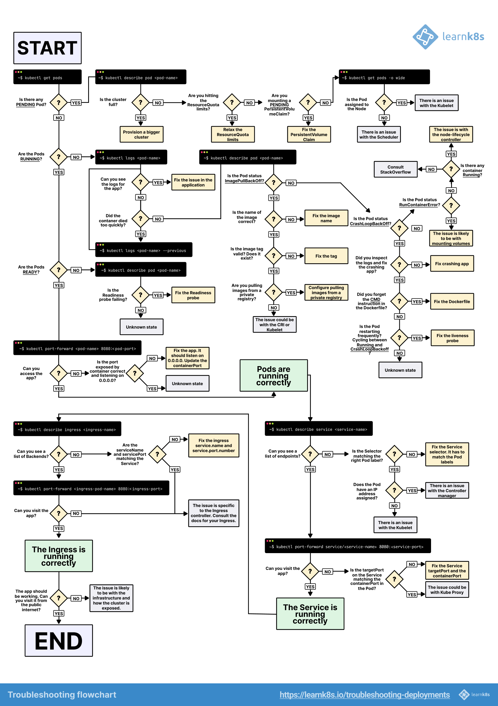

# Поиск и устранение неисправностей в Kubernetes: Обзор

Эта заметка описывает общие подходы, инструменты и методики для диагностики и решения проблем в кластере Kubernetes.

Для получения информации о конкретных распространенных ошибках (таких как `CrashLoopBackOff`, `ImagePullBackOff`, `Pending` и др.) обратитесь к справочнику: **[Распространенные ошибки в Kubernetes и их решения](./common_errors.md)**.

## Визуальная схема поиска неисправностей



---

## 1. Основные инструменты командной строки

### 1.1. `kubectl describe`: Первый шаг диагностики

Команда `kubectl describe` — это основной инструмент для получения подробной, человекочитаемой информации о состоянии любого ресурса. В отличие от `kubectl get -o yaml`, `describe` добавляет к спецификации текущий статус, недавние события и другую полезную диагностическую информацию.

**Синтаксис:**
`kubectl describe <тип-ресурса> <имя-ресурса>`

**На что обращать внимание в выводе:**
*   **`State` / `Last State`:** Текущее и предыдущее состояние контейнера.
*   **`Reason`:** Причина последнего завершения (например, `OOMKilled`, `Error`, `Completed`).
*   **`Exit Code`:** Код выхода процесса. `137` почти всегда означает `OOMKilled`. Ненулевой код указывает на ошибку.
*   **`Restart Count`:** **Критически важное поле.** Если это число больше 0, значит, контейнер перезапускался, что является прямым индикатором проблемы.
*   **`Events`:** Хронологический список событий, связанных с ресурсом. **Всегда проверяйте эту секцию в первую очередь.**

### 1.2. `kubectl logs`: Анализ логов приложения

Команда `kubectl logs` позволяет просматривать стандартный вывод (`stdout`) и ошибки (`stderr`) процессов, запущенных в контейнерах.

**Ключевые флаги:**
*   `--previous` (`-p`): **Самый важный флаг** при анализе циклических сбоев (`CrashLoopBackOff`). Показывает логи контейнера непосредственно перед его последним падением.
*   `--follow` (`-f`): Стриминг логов в реальном времени.
*   `--tail=<N>`: Показать последние N строк лога.
*   `--all-containers`: Показать логи всех контейнеров в поде.
*   `-l <метка>`: Показать логи всех подов с указанной меткой.
*   `--since=<время>`: Показать логи за указанный период (например, `10m`, `1h`).

### 1.3. `kubectl exec`: Выполнение команд внутри контейнера

Позволяет получить интерактивный доступ к оболочке (`shell`) внутри уже запущенного контейнера для "живой" отладки.

**Синтаксис:**
`kubectl exec -it <имя-пода> -- /bin/bash`

*   `-it` используется для интерактивных сессий.
*   `--` отделяет команду `kubectl` от команды, выполняемой внутри контейнера.
*   `-c <имя-контейнера>` для подов с несколькими контейнерами.

### 1.4. `kubectl port-forward`: Доступ к приложению

Пробрасывает порт с локальной машины на порт пода, позволяя подключиться к приложению так, как если бы оно работало на `localhost`. Незаменимо для отладки внутренних сервисов или подключения к базе данных.

**Синтаксис:**
`kubectl port-forward pod/<имя-пода> 8080:80`

### 1.5. `kubectl debug`: Продвинутая отладка

Команда `kubectl debug` позволяет подключать к работающим подам **эфемерные контейнеры** с набором отладочных инструментов (`netshoot`, `busybox`), не перезапуская и не изменяя основной под. Это безопасный способ диагностики в production-среде.

**Пример:**
```bash
# Подключить контейнер с сетевыми утилитами к поду my-pod
kubectl debug -it my-pod --image=nicolaka/netshoot --target=app-container
```
Это позволяет запускать `tcpdump`, `ping`, `nslookup` и другие утилиты в сетевом пространстве имен проблемного пода.

---

## 2. Продвинутые техники отладки

### 3.1. Сбор и анализ Core Dumps

Когда приложение аварийно завершается (например, с ошибкой сегментации), можно настроить Kubernetes на сохранение **core dump** (снимка памяти процесса) для последующего анализа.

*   **Механизм:** Используется `initContainer` с привилегиями (`privileged: true`) для изменения параметров ядра (`kernel.core_pattern`, `ulimit`) и сохранения дампов в общий том (`PersistentVolume`).
*   **Анализ:** Дампы анализируются с помощью отладчиков, таких как `gdb` (для C/C++) или `delve` (для Go).

### 3.2. Удаленная отладка с Delve (для Go)

Позволяет подключиться отладчиком с локальной машины к процессу, запущенному внутри пода.

*   **Механизм:**
    1.  В `Dockerfile` приложения `Delve` (`dlv`) устанавливается и используется для запуска приложения в режиме сервера отладки.
    2.  Через `kubectl port-forward` порт отладчика пробрасывается на локальную машину.
    3.  IDE (GoLand, VS Code) подключается к `localhost:<port>` для пошаговой отладки, инспекции переменных и т.д.

### 3.3. Отладка проблем с правами доступа с помощью `strace`

`strace` отслеживает системные вызовы приложения и помогает диагностировать ошибки прав доступа (`Permission Denied`), особенно в контейнерах с `readOnlyRootFilesystem`.

*   **Механизм:** Используется `kubectl debug` для подключения к поду отладочного контейнера (например, `alpine`) с повышенными привилегиями (`--profile=sysadmin`), откуда запускается `strace` для отслеживания основного процесса приложения.
    ```bash
    # Запуск отладочного контейнера
    kubectl debug -it -c debugger --target=app --image=alpine ${POD_NAME} --profile=sysadmin
    # Внутри отладчика: отслеживаем сбои системных вызовов
    strace -f -e status=failed -p 1
    ```
