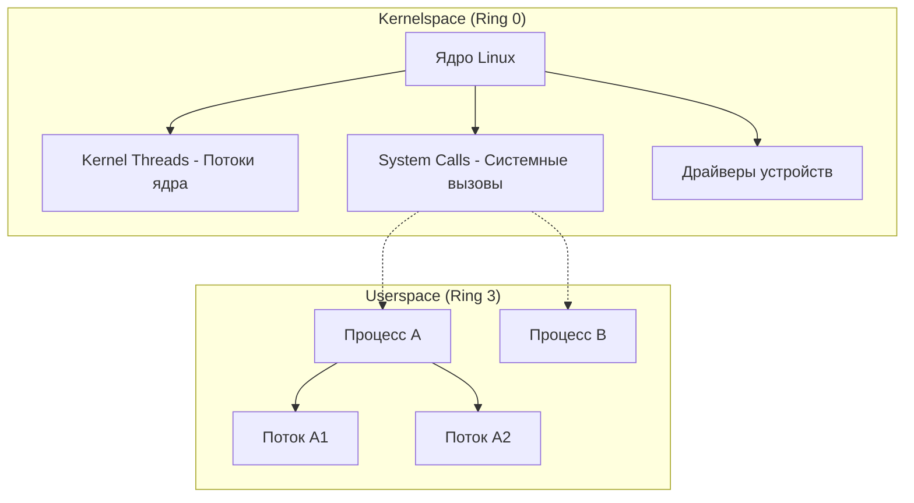

# Процессы в Linux: Определения

## Определения

### Userspace и Kernelspace

Операционная система Linux разделяет работу на два фундаментальных режима выполнения кода: **Userspace (пространство пользователя)** и **Kernelspace (пространство ядра)**. Это разделение основано на аппаратных уровнях защиты процессора (Ring 0 и Ring 3) и критически важно для обеспечения стабильности и безопасности системы.

| Характеристика | Userspace (Пространство пользователя) | Kernelspace (Пространство ядра) |
| :--- | :--- | :--- |
| **Что выполняется?** | Прикладные программы, пользовательские оболочки, библиотеки | Ядро ОС, драйверы устройств, системные модули |
| **Уровень привилегий** | Низкий (Ring 3). Процессы изолированы и ограничены | Максимальный (Ring 0). Полный доступ к ресурсам |
| **Доступ к железу** | Только опосредованно через системные вызовы | Прямой и неограниченный доступ к оборудованию |
| **Память** | Изолированное виртуальное адресное пространство | Единое общее адресное пространство ядра |
| **Отказоустойчивость** | Сбой приложения завершает только этот процесс | Сбой в ядре ведет к краху всей системы (Kernel Panic) |

### Процесс

**Процесс** — это экземпляр выполняемой программы в памяти. Он является основной единицей изоляции в Linux и обладает собственным виртуальным адресным пространством, системными ресурсами (файловые дескрипторы, переменные окружения), контекстом безопасности и уникальным идентификатором **PID (Process Identifier)**.

Изоляция процессов обеспечивается двумя ключевыми механизмами ядра:

- **[Namespaces (Пространства имён)](../namespaces.md)** — изолируют видимость системных ресурсов (сеть, процессы, точки монтирования).
- **[Cgroups (Контрольные группы)](../cgroups.md)** — ограничивают потребление ресурсов (CPU, Memory, I/O).

### Поток (Thread)

**Поток** — это наименьшая единица выполнения, которой может управлять планировщик ядра. Потоки одного процесса разделяют общее адресное пространство и системные ресурсы, что обеспечивает высокую скорость взаимодействия, но требует механизмов синхронизации для предотвращения состояний гонки.

### Системные вызовы (System Calls)

**Системный вызов** — это программный интерфейс, через который процессы в Userspace запрашивают у ядра выполнение привилегированных операций (чтение файла, создание процесса, отправка данных по сети). Подробное описание см. в разделе [**Интерфейсы ядра Linux**](../kernel/kernel_interfaces.md).

## Основные концепции

### Иерархия выполнения задач

В Linux фундаментальной единицей планирования является **"задача" (task)**. Ядро не делает жесткого различия между процессами и потоками на низком уровне — обе сущности представлены структурой `task_struct`.



### Преимущества разделения Userspace/Kernelspace

1. **Безопасность:** Ошибка или вредоносный код в приложении не могут напрямую повредить ядро или данные других процессов.
2. **Управление ресурсами:** Ядро выступает в роли арбитра, проверяя права доступа и предотвращая конфликты при одновременном доступе к оборудованию.
3. **Абстракция:** Приложениям не нужно знать специфику работы конкретных моделей дисков или сетевых карт — они работают через унифицированный интерфейс системных вызовов.

## Практические сценарии

### Идентификация типов задач в системе

Вы можете легко отличить пользовательские процессы от потоков ядра с помощью стандартных утилит:

```bash
# Просмотр пользовательских процессов (Userspace)
ps aux | less

# Просмотр потоков ядра (Kernelspace)
# Потоки ядра традиционно отображаются в квадратных скобках
ps -ef | grep "\["

# Анализ системных вызовов процесса (взаимодействие с ядром)
# Подробнее: [Трассировка и отладка](../../Diagnostics/Troubleshooting/tracing_and_debugging.md)
strace -p <PID>
```

### Проверка уровней привилегий (Rings)

Хотя современные процессоры поддерживают 4 уровня защиты (0–3), Linux использует только два:

- **Ring 0:** Для ядра и драйверов.
- **Ring 3:** Для всего пользовательского кода.

Это упрощает архитектуру и переносимость ядра на различные процессорные архитектуры.

## Дополнительная информация

### Почему процессы не могут напрямую обращаться к ядру

Если бы процессы Userspace имели прямой доступ к оборудованию, это привело бы к:

- **Хаосу:** Два процесса могли бы одновременно пытаться отправить разные данные в один и тот же сектор диска.
- **Уязвимостям:** Один процесс мог бы прочитать пароли другого процесса напрямую из физической памяти.
- **Нестабильности:** Любая ошибка в браузере или текстовом редакторе приводила бы к полной остановке (зависанию) всего компьютера.

Системные вызовы являются контролируемыми "воротами", где ядро валидирует каждый запрос перед его выполнением.

### Связанные темы

- [**Утилита `ps`**](../../Diagnostics/Processes/ps.md) — основной инструмент мониторинга процессов.
- [**Создание процессов: Fork и Exec**](./basic_concepts.md#методы-создания-процессов) — как рождаются новые задачи.
- [**Интерфейсы ядра Linux**](../kernel/kernel_interfaces.md) — подробный разбор syscalls, procfs и sysfs.
- [**Пространства имён (Namespaces)**](../namespaces.md) — механизмы изоляции.
- [**Контрольные группы (Cgroups)**](../cgroups.md) — механизмы ограничения ресурсов.
