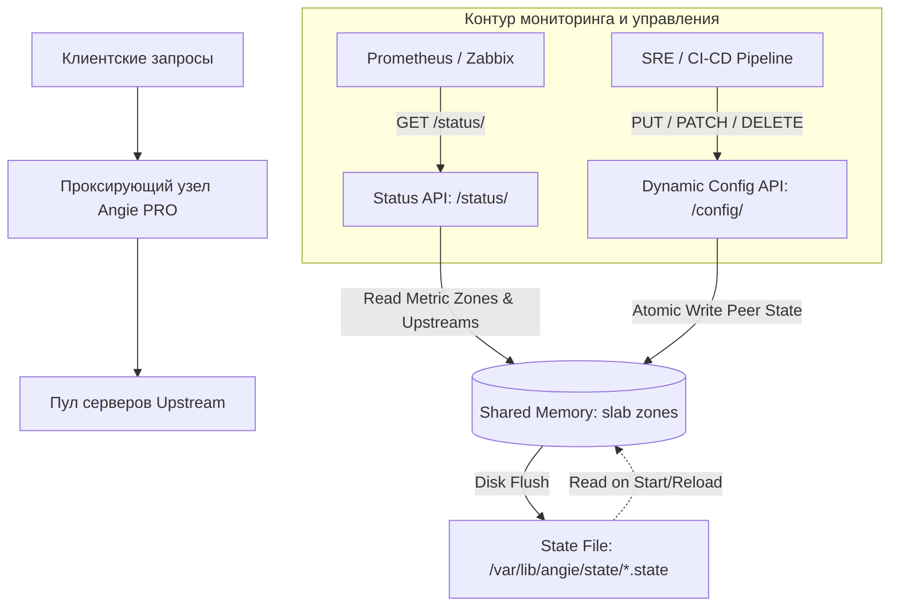
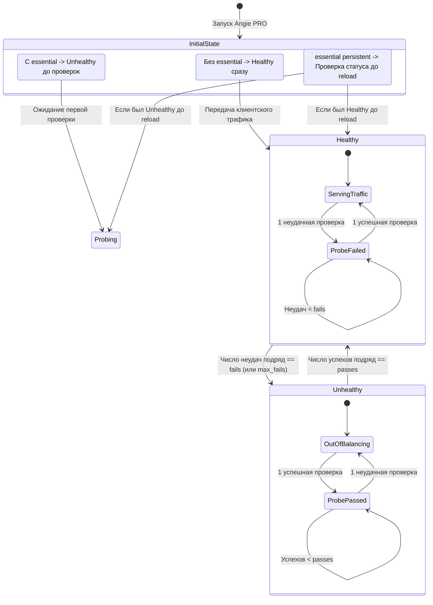

# Мониторинг Angie — возможности Angie Pro

**Актуально для:** Angie PRO 1.12.x

## Определения

**Angie Pro** — коммерческая редакция веб-сервера и обратного прокси-сервера Angie, ориентированная на эксплуатацию в высоконагруженных и критически важных инфраструктурах предприятий (DevOps, SRE, системное администрирование on-premise и bare-metal). Обеспечивает полную конфигурационную и бинарную совместимость с Angie Open Source (OSS), дополняя ее динамическим управлением пулами серверов без перезагрузки процессов, нативными активными проверками состояния бэкендов, расширенными алгоритмами балансировки, очередями запросов, кластерной синхронизацией разделяемой памяти и веб-панелью управления Console Pro.

**Dynamic Configuration API** — программный RESTful-интерфейс (модуль `ngx_http_api_module` с префиксом пути `/config/`), позволяющий в реальном времени выполнять атомарные операции изменения конфигурации (CRUD) над отдельными пирами апстримов в модулях `http` и `stream` с помощью HTTP-методов `GET`, `PUT`, `PATCH` и `DELETE` без выполнения `reload` или `restart`.

**State File (Файл состояния)** — файл на дисковой подсистеме (директива `state` в блоке `upstream`), в который Angie PRO атомарно фиксирует изменения состава и параметров апстрима, внесенные администратором через Dynamic Configuration API. Обеспечивает сохранение динамического состояния пула серверов при перезапуске сервера или перезагрузке операционной системы.

**Upstream Probe** — нативный модуль активных проверок жизнеспособности серверов (`ngx_http_upstream_probe_module` для HTTP и `ngx_stream_upstream_probe_module` для L4 Stream). Регулярно отправляет диагностические зонды на бэкенды независимо от входящего клиентского трафика. Позволяет выводить деградировавшие серверы из балансировки до того, как на них поступят запросы пользователей. Поддерживает гибкие условия валидации через переменные (`test=`), пороги срабатывания (`fails`, `passes`), режимы сканирования (`always`, `idle`, `onfail`) и защитные механизмы ввода серверов в строй (`essential`, `persistent`).

**Dynamic Feedback** — алгоритм адаптивной балансировки нагрузки (директива `feedback`), динамически корректирующий вес серверов на основе данных об их производительности (утилизация CPU, память, внутренняя задержка), передаваемых самими бэкендами в заголовках ответов. Использует экспоненциально взвешенное скользящее среднее для исключения резких скачков весов.

**Очередь запросов (Request Queue)** — механизм буферизации клиентских запросов в Angie PRO (директива `queue` в блоке `upstream`), активирующийся при исчерпании лимита `max_conns` на всех серверах группы. Предотвращает мгновенный возврат ошибок `502 Bad Gateway` во время кратковременных всплесков трафика, удерживая запросы в очереди заданное время.

**Bind Conn** — механизм жесткой привязки клиентского TCP-соединения к исходящему соединению с проксируемым сервером (директива `bind_conn` в блоке `upstream`). Необходим для корректной работы stateful-протоколов аутентификации на базе соединений, таких как NTLM (Microsoft Exchange, SharePoint, корпоративные сервисы Active Directory).

**Backup Switch** — директива управления резервными серверами (директива `backup_switch` в блоке `upstream`), позволяющая зафиксировать переключение на резервную группу серверов на постоянной основе или на заданный интервал времени (`permanent=time`), предотвращая преждевременный возврат трафика на нестабильные основные узлы.

**Sticky Learn с Remote Action** — расширенный метод привязки пользовательских сессий, поддерживающий делегирование поиска и валидации сессионных связок внешнему сервису/хранилищу (Redis, специализированная служба) через внутренние HTTP-подзапросы (`remote_action` и `remote_result`). Позволяет организовывать горизонтально масштабируемые кластеры балансировщиков с единым источником истины по сессиям.

**Cluster Zone Sync** — технология синхронизации зон разделяемой памяти (`limit_req_zone`, `limit_conn_zone`) между независимыми экземплярами Angie PRO по протоколу TCP через модуль `stream` (директива `zone_sync`). Обеспечивает согласованное применение политик Rate Limiting в распределенной инфраструктуре.

**Console Pro** — расширенная веб-панель мониторинга и администрирования (модуль `ngx_http_console_module`), предоставляющая интерактивный графический интерфейс для управления состоянием серверов в реальном времени (изменение весов, режимы `down`/`drain`), визуализации перцентилей задержек (P50, P90, P99), контроля очередей и детальной инспекции зон разделяемой памяти.

## Базовые концепции

### Ключевые архитектурные различия Angie OSS и Angie PRO

| Компонент / Функция | Angie Open Source (OSS) | Angie PRO | Применение в DevOps / SRE |
|:---|:---|:---|:---|
| **API управления** | Read-Only (`GET`, `HEAD`) к `/status/` | Полноценный Dynamic Configuration API (`GET`, `PUT`, `PATCH`, `DELETE`) к `/config/` | Автоматизация CI/CD, blue-green и canary развертывания без прерывания соединений |
| **Персистентность апстримов** | Нет (только статический файл конфигурации или DNS) | Директива `state` в блоке `upstream` | Сохранение весов и статусов серверов после перезапуска демона |
| **Активные проверки (L7 HTTP)** | Внешний модуль `check` (`upstream_check_module`) в блоке `upstream` | Нативная директива `upstream_probe` в контексте `location` | Глубокий аудит доступности с валидацией тел ответов, переменными и режимами `idle`/`onfail` |
| **Активные проверки (L4 Stream)** | Базовый модуль проверок | Нативная директива `upstream_probe` в контексте `server` stream | Мониторинг баз данных (PostgreSQL, MySQL), очередей сообщений и внутренних TCP/UDP служб |
| **Очереди запросов** | Нет (немедленный возврат ошибки 502 при исчерпании `max_conns`) | Директива `queue` в блоке `upstream` | Сглаживание пиковых нагрузок (burst absorption), защита бэкендов от перегрузки |
| **Балансировка нагрузки** | Round-Robin, Least Conn, Hash, IP Hash, Least Time, Random | Дополнительно: `feedback` (по метрикам от бэкендов) | Саморегулирующиеся пулы приложений с учетом реальной загрузки CPU/RAM бэкендов |
| **Управление резервом** | Возврат на основной пул сразу после восстановления хотя бы одного сервера | Директива `backup_switch` с задержкой `permanent=time` | Предотвращение «мигания» доступности (flapping) при нестабильных первичных серверах |
| **Сквозные соединения (NTLM)** | Нет нативной привязки соединения на уровне upstream | Директива `bind_conn` в блоке `upstream` | Проксирование Microsoft Exchange, SharePoint, RPC over HTTP |
| **Кластерные сессии (Sticky)** | Локальные зоны `cookie`, `route`, `learn` | `sticky learn` с интеграцией во внешнее хранилище (`remote_action`) | Синхронизация пользовательских сессий между несколькими серверами Angie |
| **Кластерная синхронизация зон** | Нет (счетчики изолированы на каждом сервере) | Модуль `stream` `zone_sync` | Глобальный Rate Limiting и DDoS-защита для распределенного кластера |
| **Веб-консоль** | Console Lite (только чтение метрик) | Console Pro (чтение метрик + управление серверами + перцентили) | Оперативный мониторинг инцидентов дежурными инженерами |
| **Контроль лицензии** | Не требуется | Эндпоинт `/status/angie/license` | Автоматизированный аудит сроков действия лицензий в системах мониторинга |

---

### Архитектура динамического управления: разделение `/config/` и `/status/`

В Angie PRO соблюдается четкое разделение между контуром чтения телеметрии и контуром мутации настроек:



1. **Status API (`/status/`):** Доступен как в Angie OSS, так и в Angie PRO. Принимает исключительно методы `GET` и `HEAD`. Возвращает агрегированные метрики, структуру зон разделяемой памяти, статистику соединений, кэша, DNS и пиров апстримов.
2. **Dynamic Configuration API (`/config/`):** Доступен исключительно в Angie PRO. Поддерживает методы `GET`, `PUT`, `PATCH`, `DELETE`. Позволяет выполнять точечные и атомарные изменения состава серверов в разделяемой памяти:
   - `GET` — чтение параметров конфигурации конкретного пира (поддерживает аргумент `defaults=on` для отображения значений по умолчанию).
   - `PUT` — создание нового пира или полная перезапись параметров существующего.
   - `PATCH` — частичное обновление настроек методом слияния JSON (RFC 7386); передача значения `null` сбрасывает параметр к системному значению по умолчанию.
   - `DELETE` — удаление пира из балансировки или сброс параметра к дефолту. Поддерживает параметр `connection_drop=off|on|<ms>` для принудительного разрыва активных соединений с удаляемым узлом.

---

### Механизм персистентности апстримов через `state`

В стандартной модели при перезагрузке процесса мастер считывает конфигурационные файлы с диска. Если веса или статусы серверов менялись на лету через API, после рестарта эти изменения терялись бы без механизма сохранения.

Директива `state` решает эту проблему:
- **Разделяемая память обязательна:** В блоке `upstream` должна быть объявлена разделяемая память (`zone`).
- **Исключительность директивы `server`:** Если в блоке `upstream` указана директива `state`, в нем **не должно быть** статических директив `server`. Весь начальный и последующий пул серверов управляется через Configuration API и читается из указанного файла.
- **Жизненный цикл чтения и записи:**
  1. При старте процесса или перезагрузке конфигурации (`systemctl reload angie`, сигнал `SIGHUP`) Angie считывает файл, указанный в директиве `state`, и инициализирует структуры в разделяемой памяти.
  2. При успешном выполнении запросов `PUT`, `PATCH` или `DELETE` к ветке `/config/` мастер-процесс атомарно записывает обновленный список серверов в файл состояния.
- **Путь размещения:** Официальные пакеты Angie PRO создают стандартную директорию с ограниченными правами доступа: `/var/lib/angie/state/` (для Linux) или `/var/db/angie/state/` (для FreeBSD).

---

### Механика активных проверок (`upstream_probe`)

В отличие от OSS-модуля `check`, директива `upstream_probe` в HTTP располагается в контексте `location`, а в Stream — в контексте `server`. Это позволяет настраивать дифференцированные проверки для одного и того же апстрима в зависимости от протокола или пути вызова:

#### Конечный автомат состояний (State Machine)



- **Критерии вывода из строя:** Сервер помечается как `unhealthy`, если любая из ассоциированных с ним проверок фиксирует подряд число ошибок, равное `fails` (по умолчанию `1`), либо если пассивные проверки фиксируют число ошибок `max_fails`.
- **Критерии восстановления:** Сервер возвращается в балансировку только после того, как **все** назначенные проверки подтвердят успешное прохождение подряд `passes` раз (по умолчанию `1`).
- **Режимы опроса (`mode`):**
  - `always` (по умолчанию) — зонды отправляются на все серверы группы независимо от их текущего статуса.
  - `idle` — зонды отправляются на деградировавшие серверы, а также на исправные серверы, к которым за время `interval` не поступало ни одного пользовательского запроса. Это экономит ресурсы бэкендов при наличии регулярного трафика.
  - `onfail` — зонды отправляются исключительно на серверы в состоянии `unhealthy`. Проверка исправных серверов возлагается на пассивный мониторинг (`max_fails`).
- **Условия проверки (`test=condition`):** Позволяет вычислять строковые выражения из встроенных переменных Angie. Если в результате подстановки переменных получается пустая строка `""` или символ `"0"`, диагностический запрос признается неуспешным.
- **Начальная верификация (`essential` и `persistent`):**
  - Без `essential` сервер при старте сразу начинает получать пользовательский трафик до завершения первого цикла проверок.
  - С параметром `essential` сервер исключен из балансировки до первого успешного подтверждения статуса проверкой.
  - Параметр `persistent` (используется только вместе с `essential`) указывает ядру Angie: если сервер был исправен непосредственно перед командой `reload`, разрешить ему продолжать обслуживание запросов без повторного ожидания зонда.

---

### Алгоритм Dynamic Feedback

Алгоритм `feedback` предназначен для пулов приложений с динамически меняющейся нагрузкой (например, сложные аналитические вычисления, обработка видео, задачи с интенсивным использованием базы данных):

$$\text{Weight}_{\text{eff}} = \text{Weight}_{\text{static}} \times \overline{\text{Feedback}}$$

Текущее значение переменной из заголовка ответа бэкенда интегрируется в экспоненциально взвешенное скользящее среднее (EWMA):

$$S_t = \alpha \cdot X_t + (1 - \alpha) \cdot S_{t-1}$$

где коэффициент сглаживания задается параметром `factor` (от `0` до `99`, по умолчанию `90`):
- При `factor=90`: новое значение оказывает 10% влияния на вес, а предыдущая история — 90%. Это предотвращает лавинообразные колебания (flapping) трафика при секундных всплесках нагрузки.
- Параметр `inverse` инвертирует логику: меньшее значение метрики означает большую производительность и увеличивает вес сервера (актуально для передачи latency или утилизации CPU).
- Параметр `account` привязывает расчет только к ответам, удовлетворяющим условию (например, исключая ошибки 5xx или учитывая только ответы фоновых проверок `$upstream_probe`).

---

### Управление очередями запросов (`queue`)

В условиях высоких пиковых нагрузок кратковременный всплеск клиентских запросов может превысить пропускную способность всех серверов в upstream (`max_conns`). В стандартной архитектуре Angie OSS такие запросы немедленно сбрасываются клиенту с ошибкой `502 Bad Gateway`.

Директива `queue` создает управляемый буфер ожидания на уровне каждого рабочего процесса:
1. Запрос, для которого нет свободных слотов `max_conns`, помещается в очередь FIFO.
2. Как только любой сервер в группе освобождает слот соединения, запрос из очереди немедленно передается на исполнение.
3. Если очередь заполняется до лимита `number` или время нахождения запроса в очереди превышает `timeout` (по умолчанию `60s`), клиенту возвращается код 502.
4. Метрики очереди (`size`, `max_size`, `overflows`, `dropped`) отслеживаются через Status API в блоке `queue`.

---

### Привязка соединений для NTLM (`bind_conn`)

Протокол NTLM-аутентификации (Microsoft Exchange ActiveSync, RPC-over-HTTP, SharePoint) опирается на многоэтапное рукопожатие (Type 1 Negotiate $\to$ Type 2 Challenge $\to$ Type 3 Authenticate), строго привязанное к одному физическому TCP-соединению между клиентом, прокси и бэкендом.

В стандартном режиме обратного прокси каждое HTTP-сообщение может быть маршрутизировано в произвольное keepalive-соединение из пула. Директива `bind_conn` в блоке `upstream` фиксирует выбранное серверное соединение за клиентским на весь период сессии:
- Директива принимает аргумент-условие (`bind_conn $variable;`), активируясь только тогда, когда переменная отлична от `""` и `"0"`.
- В блоке `location` обязательно должны быть включены постоянные соединения: `proxy_http_version 1.1; proxy_set_header Connection "";`.
- В структуре конфигурации `bind_conn` обязана располагаться **строго после** директив выбора метода балансировки и директивы `sticky`.

---

### Кластерная синхронизация сессий (`sticky learn` + `remote_action`)

В корпоративных инфраструктурах высокой доступности (HA) балансировщики Angie PRO объединяются в отказоустойчивые пары или группы (Keepalived / VRRP, Anycast BGP). Стандартный механизм `sticky learn` хранит соответствия «клиент $\to$ бэкенд» локально в оперативной памяти одного узла:

```
[Балансировщик 1 (Angie PRO)] ──┐
                                 ├─► [Внешнее сессионное хранилище (Redis / HTTP API)]
[Балансировщик 2 (Angie PRO)] ──┘
```

Режим `sticky learn ... remote_action=uri remote_result=$variable` (PRO):
1. Балансировщик извлекает идентификатор сессии из запроса пользователя (`lookup=$cookie_sessionid`).
2. При отсутствии локальной записи в разделяемой памяти `zone` (которая работает как L1-кэш) Angie PRO формирует внутренний асинхронный подзапрос к `remote_action` (например, микросервису на базе Redis или БД).
3. Во внешний сервис через заголовки передаются переменные `$sticky_sessid` (идентификатор сессии) и `$sticky_sid` (выбранный сервер).
4. Ответ удаленного хранилища валидирует целевой бэкенд и записывает результат в локальный кэш, предотвращая разрыв сессий при переключении трафика между нодами балансировщиков.

---

### Лицензирование и системные ограничения (`/status/angie/license`)

Angie PRO содержит встроенный контроль лицензии. Начиная с версии 1.11.0 PRO, сервер экспортирует текущее состояние лицензионного ключа через Status API:

```json
{
  "path": "/etc/angie/license.pem",
  "status": "valid",
  "owner": "Enterprise Infrastructure Dept",
  "days_left": 45,
  "since": "2026-01-01",
  "until": "2027-01-01",
  "limits": {
    "worker_processes": 32,
    "worker_connections": 131072
  }
}
```

Возможные значения поля `status`:
- `valid` — лицензия активна, параметры сервера соответствуют ограничениям.
- `grace` — срок действия лицензии истек, действует льготный период (сервер продолжает полноценную обработку трафика).
- `expired` — срок действия лицензии и льготного периода завершен.
- `invalid` — файл лицензии поврежден, не соответствует открытому ключу или сертификату.
- `missing` — файл лицензии отсутствует по указанному пути.
- `pending` — проверка лицензии находится в процессе инициализации.

## Практические сценарии

### Сценарий 1: Динамическое управление пулом серверов с персистентностью в state-файл

**Задача:** Сконфигурировать отказоустойчивый пул бэкендов платежного шлюза без статических директив `server` в файле конфигурации. Все управление составом узлов, весами и выводом на обслуживание выполняется исключительно через Configuration API и сохраняется на диск.

```nginx
# /etc/angie/angie.conf

http {
    # Пул серверов с персистентным состоянием
    upstream payment_backends {
        zone payment_backends 512k;
        # Файл состояния; директивы server внутри блока отсутствуют!
        state /var/lib/angie/state/payment_backends.state;
    }

    # Изолированный виртуальный хост для администрирования и мониторинга
    server {
        listen 127.0.0.1:8888;
        server_name 127.0.0.1;

        # Эндпоинт Dynamic Configuration API (мутирующие операции)
        location /config/ {
            api /config/;
            allow 127.0.0.1;
            allow 10.200.0.0/24; # Сеть управления SRE
            deny all;
        }

        # Эндпоинт Status API (read-only метрики для мониторинга)
        location /status/ {
            api /status/;
            allow 127.0.0.1;
            allow 10.200.0.0/24;
            deny all;
        }
    }

    # Проксирующий виртуальный хост
    server {
        listen 443 ssl;
        server_name payments.internal.company;

        ssl_certificate     /etc/ssl/certs/payments.crt;
        ssl_certificate_key /etc/ssl/private/payments.key;
        ssl_protocols       TLSv1.2 TLSv1.3;

        location / {
            proxy_pass http://payment_backends;
            proxy_http_version 1.1;
            proxy_set_header Connection "";
            proxy_set_header Host $host;
            proxy_set_header X-Real-IP $remote_addr;
            proxy_set_header X-Forwarded-For $proxy_add_x_forwarded_for;
        }
    }
}
```

**Операционные действия через REST API:**

```bash
# 1. Добавление первого первичного сервера в пул (PUT полностью создает запись)
curl -s -X PUT -H "Content-Type: application/json" \
  -d '{"weight": 2, "max_conns": 200, "max_fails": 3, "fail_timeout": 15}' \
  http://127.0.0.1:8888/config/http/upstreams/payment_backends/servers/192.168.10.11:8080
# → {"success":"Created","description":"New configuration API entity \"/config/http/upstreams/payment_backends/servers/192.168.10.11:8080\" was created."}

# 2. Добавление второго сервера
curl -s -X PUT -H "Content-Type: application/json" \
  -d '{"weight": 2, "max_conns": 200, "max_fails": 3, "fail_timeout": 15}' \
  http://127.0.0.1:8888/config/http/upstreams/payment_backends/servers/192.168.10.12:8080
# → {"success":"Created","description":"New configuration API entity \"/config/http/upstreams/payment_backends/servers/192.168.10.12:8080\" was created."}

# 3. Добавление резервного (backup) сервера
curl -s -X PUT -H "Content-Type: application/json" \
  -d '{"backup": true, "max_conns": 100}' \
  http://127.0.0.1:8888/config/http/upstreams/payment_backends/servers/192.168.10.99:8080
# → {"success":"Created","description":"New configuration API entity \"/config/http/upstreams/payment_backends/servers/192.168.10.99:8080\" was created."}

# 4. Просмотр текущей конфигурации пула со значениями по умолчанию
curl -s "http://127.0.0.1:8888/config/http/upstreams/payment_backends/servers?defaults=on" | jq .

# 5. Плавный вывод сервера 192.168.10.11:8080 на обслуживание (режим drain)
# В режиме drain новые сессии не принимаются, активные сессии завершают обслуживание
curl -s -X PUT -d '"drain"' \
  http://127.0.0.1:8888/config/http/upstreams/payment_backends/servers/192.168.10.11:8080/down
# → {"success":"Updated","description":"Existing configuration API entity \"/config/http/upstreams/payment_backends/servers/192.168.10.11:8080/down\" was updated with replacing."}

# 6. Изменение веса сервера 192.168.10.12 через PATCH
curl -s -X PATCH -H "Content-Type: application/json" \
  -d '{"weight": 5}' \
  http://127.0.0.1:8888/config/http/upstreams/payment_backends/servers/192.168.10.12:8080
# → {"success":"Updated","description":"Existing configuration API entity \"/config/http/upstreams/payment_backends/servers/192.168.10.12:8080\" was updated with merging."}

# 7. Удаление сервера из балансировки с принудительным сбросом соединений через 1000 мс
curl -s -X DELETE \
  "http://127.0.0.1:8888/config/http/upstreams/payment_backends/servers/192.168.10.11:8080?connection_drop=1000"
# → {"success":"Deleted","description":"Configuration API entity \"/config/http/upstreams/payment_backends/servers/192.168.10.11:8080\" was deleted."}

# 8. Проверка дискового файла состояния
ls -la /var/lib/angie/state/payment_backends.state
cat /var/lib/angie/state/payment_backends.state
```

---

### Сценарий 2: Активные глубокие проверки состояния серверов (`upstream_probe`)

**Задача:** Организовать многоуровневый мониторинг бэкендов в HTTP и L4 Stream (TCP-прокси для PostgreSQL). Сервер не должен получать клиентский трафик до прохождения проверок (`essential`), а серверы, работавшие до reload, не должны отключаться (`persistent`). Проверка HTTP должна верифицировать статус 200 и валидное тело ответа.

```nginx
# /etc/angie/angie.conf

http {
    upstream api_service {
        zone api_service 256k;
        server 10.10.1.21:8443 max_fails=2 fail_timeout=10s;
        server 10.10.1.22:8443 max_fails=2 fail_timeout=10s;
        server 10.10.1.23:8443 backup;
    }

    # Валидация HTTP-статуса проверки
    map $upstream_status $probe_status_ok {
        200     "1";
        default "0";
    }

    # Проверка тела ответа диагностического эндпоинта
    # Предполагается, что бэкенд возвращает JSON: {"status":"READY","db":"connected"}
    map $upstream_response_body $probe_body_ok {
        ~*"\"status\":\"READY\"" "1";
        default                  "0";
    }

    # Финальное условие: статус 200 И наличие READY в теле
    map "$probe_status_ok:$probe_body_ok" $api_healthy {
        "1:1"   "1";
        default "0";
    }

    server {
        listen 443 ssl;
        server_name api.internal.company;

        ssl_certificate     /etc/ssl/certs/api.crt;
        ssl_certificate_key /etc/ssl/private/api.key;

        location /v2/ {
            proxy_pass https://api_service;
            proxy_http_version 1.1;
            proxy_set_header Connection "";
            proxy_next_upstream error timeout http_502 http_503;

            # Активная проверка состояния узлов
            upstream_probe api_deep_check
                uri=/v2/internal/healthcheck
                interval=3s
                method=GET
                test=$api_healthy
                essential
                persistent
                fails=2
                passes=3
                max_body=64k
                mode=idle;
        }
    }
}

# L4 Stream: активные проверки пула СУБД PostgreSQL
stream {
    upstream postgres_cluster {
        zone postgres_cluster 128k;
        server 10.10.2.11:5432 max_conns=150;
        server 10.10.2.12:5432 max_conns=150;
    }

    # Проверка доступности порта СУБД
    server {
        listen 5432;
        proxy_pass postgres_cluster;
        proxy_timeout 10m;
        proxy_connect_timeout 2s;

        upstream_probe_timeout 1500ms;

        # TCP-зонд с отправкой пакета проверки готовности
        upstream_probe pg_liveness
            port=5432
            interval=5s
            fails=2
            passes=2
            mode=always;
    }
}
```

**Проверка статуса проверок через Status API:**

```bash
# Получение детальной телеметрии пиров и состояния проверок
curl -s http://127.0.0.1:8888/status/http/upstreams/api_service/peers | jq '.[] | {
  server: .server,
  state: .state,
  fails: .health.fails,
  unavailable: .health.unavailable,
  header_time: .health.header_time,
  response_time: .health.response_time
}'
```

---

### Сценарий 3: Адаптивная балансировка `feedback` по метрикам приложения

**Задача:** Сбалансировать нагрузку между гетерогенными серверами (разная вычислительная мощность). Серверы приложений возвращают в HTTP-заголовке `X-App-Latency-Score` текущий внутренний индекс загрузки от 1 (свободен) до 100 (перегружен). Angie PRO должен снижать подачу трафика на узлы с высоким индексом.

```nginx
# /etc/angie/angie.conf

http {
    upstream dynamic_compute_cluster {
        zone dynamic_compute_cluster 256k;

        # Балансировка по переменной $node_score
        # inverse: меньший score = больше вес и приоритет
        # factor=85: сглаживание EWMA (85% старого значения, 15% нового)
        # account=$valid_metric: учитываем только валидные заголовки от рабочих ответов
        feedback variable=$node_score inverse factor=85 account=$valid_metric;

        server srv-compute-01.internal:8080 weight=10;
        server srv-compute-02.internal:8080 weight=10;
        server srv-compute-03.internal:8080 weight=10;
    }

    # Валидация значения заголовка
    map $upstream_http_x_app_latency_score $node_score {
        ~^[0-9]+$ $upstream_http_x_app_latency_score;
        default   100; # При отсутствии заголовка считаем сервер условно нагруженным
    }

    # Исключаем из расчета ответы во время активных проверок и ошибочные ответы
    map "$upstream_status:$upstream_probe" $valid_metric {
        ~^200:$   "1"; # 200 OK от реального клиентского запроса
        default   "0";
    }

    server {
        listen 80;
        server_name compute.internal.company;

        location / {
            proxy_pass http://dynamic_compute_cluster;
            proxy_http_version 1.1;
            proxy_set_header Connection "";

            # Скрываем внутренний диагностический заголовок от внешнего клиента
            proxy_hide_header X-App-Latency-Score;
        }
    }
}
```

---

### Сценарий 4: Защита бэкендов от всплесков трафика через очередь (`queue`)

**Задача:** Предотвратить падение бэкендов legacy-системы при пиках входящих запросов. Каждый сервер физически выдерживает не более 50 одновременных соединений (`max_conns=50`). При исчерпании емкости запросы должны буферизироваться в очереди до 10 секунд вместо немедленной ошибки.

```nginx
# /etc/angie/angie.conf

http {
    upstream legacy_crm_backend {
        zone legacy_crm_backend 256k;

        server 10.50.1.10:8080 max_conns=50;
        server 10.50.1.11:8080 max_conns=50;

        # Метод балансировки: наименьшее число соединений
        least_conn;

        # Очередь ожидания: максимум 500 запросов на воркер, таймаут ожидания 10 секунд
        # Директива queue расположена СТРОГО ПОСЛЕ метода балансировки!
        queue 500 timeout=10s;
    }

    server {
        listen 443 ssl;
        server_name crm.internal.company;

        ssl_certificate     /etc/ssl/certs/crm.crt;
        ssl_certificate_key /etc/ssl/private/crm.key;

        location / {
            proxy_pass http://legacy_crm_backend;
            proxy_http_version 1.1;
            proxy_set_header Connection "";

            # При тайм-ауте очереди клиент получит кастомную страницу 502
            error_page 502 = /errors/overload.html;
        }

        location = /errors/overload.html {
            root /usr/share/angie/html;
            internal;
        }
    }
}
```

**Мониторинг состояния очереди через API:**

```bash
# Инспекция заполнения очереди и отброшенных запросов
curl -s http://127.0.0.1:8888/status/http/upstreams/legacy_crm_backend | jq '.queue'
# → {
# →   "size": 12,
# →   "max_size": 184,
# →   "overflows": 0,
# →   "dropped": 0
# → }
```

---

### Сценарий 5: Сквозное NTLM-проксирование с `bind_conn`

**Задача:** Обеспечить корректное проксирование сервиса Microsoft Exchange / Outlook Web Access, требующего строгой привязки TCP-соединения между клиентом и бэкендом для завершения NTLM-аутентификации.

```nginx
# /etc/angie/angie.conf

http {
    upstream exchange_pool {
        zone exchange_pool 128k;

        server 10.60.0.21:443;
        server 10.60.0.22:443;

        # Привязка клиентского соединения к серверному для NTLM
        # Переменная $ntlm_auth_required активирует привязку при наличии NTLM-заголовков
        bind_conn $ntlm_auth_required;
    }

    # Определение NTLM-рукопожатия в заголовках
    map $http_authorization $ntlm_auth_required {
        ~*^NTLM\s+ "1";
        default     "1"; # Для пула Exchange фиксируем соединения постоянно
    }

    server {
        listen 443 ssl;
        server_name mail.company.com;

        ssl_certificate     /etc/ssl/certs/mail.crt;
        ssl_certificate_key /etc/ssl/private/mail.key;

        location /owa/ {
            proxy_pass https://exchange_pool;
            
            # Обязательные требования для работы bind_conn:
            proxy_http_version 1.1;
            proxy_set_header Connection "";

            proxy_set_header Host $host;
            proxy_set_header X-Real-IP $remote_addr;
            proxy_set_header X-Forwarded-For $proxy_add_x_forwarded_for;
            proxy_set_header X-Forwarded-Proto https;

            # Буферизация заголовков для безопасной передачи NTLM токенов
            proxy_buffer_size 128k;
            proxy_buffers 4 256k;
            proxy_busy_buffers_size 256k;
        }
    }
}
```

---

### Сценарий 6: Кластерная синхронизация сессий (`sticky learn` с `remote_action`)

**Задача:** Два балансировщика Angie PRO работают в режиме активный/активный под управлением VRRP. Пользовательские сессии генерируются бэкендом в cookie `SESSIONID`. При переключении трафика между балансировщиками сессия не должна теряться.

```nginx
# /etc/angie/angie.conf

http {
    upstream app_cluster {
        zone app_cluster 512k;

        server 10.70.1.11:8080 sid=node_a;
        server 10.70.1.12:8080 sid=node_b;

        # Сессионная привязка с обращением к внешнему распределенному хранилищу
        sticky learn
            zone=cluster_sessions:5m
            lookup=$cookie_sessionid
            remote_action=/internal/session_store
            remote_result=$remote_sid
            timeout=2h;
    }

    server {
        listen 80;
        server_name app.internal.company;

        location / {
            proxy_pass http://app_cluster;
            proxy_http_version 1.1;
            proxy_set_header Connection "";
        }

        # Внутренний эндпоинт для связи с внешним кэшем сессий (Redis HTTP Gateway)
        location = /internal/session_store {
            internal;
            proxy_pass http://10.70.0.50:8000/sessions;
            proxy_http_version 1.1;
            proxy_set_header Connection "";

            # Передача идентификаторов в заголовках
            proxy_set_header X-Session-ID $sticky_sessid;
            proxy_set_header X-Proposed-SID $sticky_sid;

            # Захват возвращенного идентификатора сервера из ответа
            # Внешний сервис возвращает заголовок X-Bound-SID: node_a
            # Переменная $remote_sid привязывается к значению
        }
    }
}
```

---

### Сценарий 7: Кластерная синхронизация лимитов `zone_sync` через L4 Stream

**Задача:** Горизонтально масштабируемый кластер из трех серверов Angie PRO (ноды `10.80.0.1`, `10.80.0.2`, `10.80.0.3`) защищает внутренний API от перегрузки. Необходимо применять глобальное ограничение частоты запросов (`limit_req`), синхронизируя счетчики между узлами кластера напрямую по TCP.

```nginx
# /etc/angie/angie.conf на узле node1 (10.80.0.1)

# Блок синхронизации зон в stream
stream {
    # Пул кластерных узлов-пиров
    upstream cluster_peers {
        zone cluster_peers 64k;
        server 10.80.0.2:9000;
        server 10.80.0.3:9000;
    }

    server {
        listen 10.80.0.1:9000;
        zone_sync;
        zone_sync_server cluster_peers;
        
        # Защита трафика синхронизации по IP
        allow 10.80.0.0/24;
        deny all;
    }
}

http {
    # Зона ограничения запросов: 10 запросов в секунду на IP клиента
    # В Angie PRO поддерживается автоматическая синхронизация через stream zone_sync
    limit_req_zone $binary_remote_addr zone=global_api_limit:20m rate=10r/s;

    server {
        listen 80;
        server_name api.company.com;

        location /api/ {
            limit_req zone=global_api_limit burst=20 nodelay;
            proxy_pass http://backend_pool;
        }
    }
}
```

---

### Сценарий 8: Автоматизация мониторинга и алертинга лицензии Angie PRO

**Задача:** Разработать легковесный автономный скрипт для SRE/Sysadmin, запускаемый по cron или systemd-таймеру, который опрашивает `/status/angie/license`, отправляет предупреждения в системный журнал `journald` и завершается с кодом ошибки при приближении к истечению срока действия ($< 14$ дней) или нарушении лимитов.

```bash
#!/usr/bin/env bash
# /usr/local/bin/check_angie_license.sh
set -euo pipefail

API_ENDPOINT="http://127.0.0.1:8888/status/angie/license"
LOG_TAG="angie-license-monitor"

# Запрос статуса лицензии
if ! RESPONSE=$(curl -s --connect-timeout 2 --max-time 5 "${API_ENDPOINT}"); then
    logger -t "${LOG_TAG}" -p user.err "CRITICAL: Не удалось получить ответ от Angie License API: ${API_ENDPOINT}"
    exit 2
fi

STATUS=$(echo "${RESPONSE}" | jq -r '.status // "unknown"')
DAYS_LEFT=$(echo "${RESPONSE}" | jq -r '.days_left // -1')
OWNER=$(echo "${RESPONSE}" | jq -r '.owner // "unspecified"')
MAX_WORKERS=$(echo "${RESPONSE}" | jq -r '.limits.worker_processes // "unlimited"')

# Проверка статуса
if [[ "${STATUS}" != "valid" && "${STATUS}" != "grace" ]]; then
    logger -t "${LOG_TAG}" -p user.crit "CRITICAL: Статус лицензии Angie PRO: '${STATUS}'. Владелец: '${OWNER}'."
    exit 2
fi

# Проверка срока действия
if [[ "${DAYS_LEFT}" -lt 0 ]]; then
    logger -t "${LOG_TAG}" -p user.emerg "EMERGENCY: Срок действия лицензии Angie PRO истек! Статус: ${STATUS}."
    exit 2
elif [[ "${DAYS_LEFT}" -le 7 ]]; then
    logger -t "${LOG_TAG}" -p user.crit "CRITICAL: До окончания лицензии Angie PRO осталось ${DAYS_LEFT} дн. Владелец: ${OWNER}."
    exit 2
elif [[ "${DAYS_LEFT}" -le 14 ]]; then
    logger -t "${LOG_TAG}" -p user.warning "WARNING: До окончания лицензии Angie PRO осталось ${DAYS_LEFT} дн. Владелец: ${OWNER}."
    exit 1
fi

logger -t "${LOG_TAG}" -p user.info "OK: Лицензия Angie PRO действительна (дней осталось: ${DAYS_LEFT}, лимит воркеров: ${MAX_WORKERS})."
exit 0
```

## Операции и команды

Сводка типовых команд CLI и HTTP REST API для повседневного администрирования Angie PRO:

```bash
# 1. Проверка лицензии и лицензионных ограничений инстанса
curl -s http://127.0.0.1:8888/status/angie/license | jq .
# → {
# →   "path": "/etc/angie/license.pem",
# →   "status": "valid",
# →   "owner": "Enterprise SRE Team",
# →   "days_left": 89,
# →   "since": "2026-01-01",
# →   "until": "2027-01-01",
# →   "limits": {
# →     "worker_processes": 32,
# →     "worker_connections": 131072
# →   }
# → }

# 2. Вывод списка всех зарегистрированных серверов в upstream
curl -s http://127.0.0.1:8888/config/http/upstreams/payment_backends/servers | jq .
# → {
# →   "192.168.10.11:8080": {
# →     "weight": 2,
# →     "max_conns": 200,
# →     "max_fails": 3,
# →     "fail_timeout": 15
# →   }
# → }

# 3. Добавление нового сервера в пул с включенным плавным стартом (slow_start)
curl -s -X PUT -H "Content-Type: application/json" \
  -d '{"weight": 5, "max_conns": 300, "slow_start": 30}' \
  http://127.0.0.1:8888/config/http/upstreams/payment_backends/servers/192.168.10.15:8080 | jq .
# → {
# →   "success": "Created",
# →   "description": "New configuration API entity \"/config/http/upstreams/payment_backends/servers/192.168.10.15:8080\" was created."
# → }

# 4. Перевод сервера в режим постоянного вывода (down)
curl -s -X PATCH -H "Content-Type: application/json" \
  -d '{"down": true}' \
  http://127.0.0.1:8888/config/http/upstreams/payment_backends/servers/192.168.10.15:8080 | jq .
# → {
# →   "success": "Updated",
# →   "description": "Existing configuration API entity \"/config/http/upstreams/payment_backends/servers/192.168.10.15:8080\" was updated with merging."
# → }

# 5. Возврат сервера в строй (снятие флага down через передачу null)
curl -s -X PATCH -H "Content-Type: application/json" \
  -d '{"down": null}' \
  http://127.0.0.1:8888/config/http/upstreams/payment_backends/servers/192.168.10.15:8080 | jq .
# → {
# →   "success": "Updated",
# →   "description": "Existing configuration API entity \"/config/http/upstreams/payment_backends/servers/192.168.10.15:8080\" was updated with merging."
# → }

# 6. Сброс параметра к дефолтному значению через DELETE
curl -s -X DELETE \
  http://127.0.0.1:8888/config/http/upstreams/payment_backends/servers/192.168.10.15:8080/max_conns | jq .
# → {
# →   "success": "Reset",
# →   "description": "Configuration API entity \"/config/http/upstreams/payment_backends/servers/192.168.10.15:8080/max_conns\" was reset to default."
# → }

# 7. Инспекция метрик очередей ожидания и пиров в реальном времени
watch -n 1 'curl -s http://127.0.0.1:8888/status/http/upstreams/payment_backends | jq "{queue: .queue, peers_state: [.peers[] | {server: .server, state: .state, active: .selected.current}]}"'
```

## Решение проблем (Troubleshooting)

| Проблема / Симптом | Возможная причина | Диагностика | Решение |
|:---|:---|:---|:---|
| **HTTP 405 Method Not Allowed** при попытке изменения через API | Запрос отправлен в контур телеметрии `/status/` вместо конфигурационного `/config/`, либо в Angie OSS | Проверить метод запроса и URI: `curl -v -X PUT http://127.0.0.1:8888/status/...` | Мутирующие операции (`PUT`, `PATCH`, `DELETE`) поддерживаются **только** в ветке `/config/` с директивой `api /config/;` в версии Angie PRO |
| **HTTP 400 FormatError** («The field is unknown» или «method does not support parameter») | Передан параметр, несовместимый с текущим методом балансировки (например, `backup` при методе `hash` или `random`) | Проверить тело запроса и используемый алгоритм в `upstream` | Использовать параметры, совместимые с методом балансировки. Для методов `hash`/`random` директива `backup` не поддерживается |
| **Ошибка при старте: `state` directive cannot be used with `server`** | В блоке `upstream` одновременно указаны директива `state` и статические серверы `server` | Выполнить проверку синтаксиса: `angie -t` | Удалить все директивы `server` из блока `upstream`. Заполнение пула должно осуществляться через Configuration API |
| **Динамические изменения не сохраняются после рестарта ОС** | Нет прав на запись в директорию state-файлов, либо директория не существует | Проверить логи: `grep "state" /var/log/angie/error.log` и права: `ls -ld /var/lib/angie/state/` | Создать каталог `mkdir -p /var/lib/angie/state/` и выдать права пользователю процесса Angie: `chown -R angie:angie /var/lib/angie/state/` |
| **`upstream_probe` не выполняет проверки серверов** | В блоке `upstream` не объявлена разделяемая память (`zone`), либо директива размещена не в том контексте | Проверить `angie -t` и наличие `zone <name> <size>;` в блоке `upstream` | 1. Добавить `zone <name> 256k;` в `upstream`.<br>2. Убедиться, что для HTTP `upstream_probe` расположена в блоке `location`, а для Stream — в `server` |
| **Все серверы помечены как `unhealthy` сразу после старта** | Задана директива `essential`, а бэкенд отвечает с задержкой или возвращает статус, отличный от условия в `test` | Проверить логи бэкенда и статус ответа: `curl -v http://backend:port/probe_uri` | 1. Проверить выражение в `test=` (оно не должно вычисляться в `""` или `"0"`).<br>2. При необходимости добавить `persistent`, чтобы прогретые серверы не отключались при reload |
| **Ошибка `bind_conn`: сессии NTLM сбрасываются** | 1. Нарушен порядок директив в `upstream`.<br>2. Не отключен заголовок `Connection` в `location` | Проверить конфигурацию `upstream`: `bind_conn` должна быть ниже алгоритма балансировки и `sticky` | 1. Разместить `bind_conn` в самом конце блока `upstream`.<br>2. В `location` указать: `proxy_http_version 1.1; proxy_set_header Connection "";` |
| **Статус лицензии `invalid` или `grace`** | Истек срок действия ключа, либо хост не соответствует ограничениям лицензии | Выполнить: `curl -s http://127.0.0.1:8888/status/angie/license \| jq .` | Заменить файл `/etc/angie/license.pem` на актуальный, проверить права чтения (`chmod 640`, владелец `root:angie`) и выполнить `systemctl reload angie` |

## Рекомендации по безопасности и эксплуатации (Best Practices)

1. **Строгая изоляция контура Configuration API:**
   - Никогда не открывайте локацию с `api /config/;` на внешних сетевых интерфейсах.
   - Размещайте управляющий сокет на локальном адресе `127.0.0.1`, внутреннем Unix-сокете (`listen unix:/run/angie/management.sock;`) или в изолированном VLAN управления.
   - Обязательно применяйте списки контроля доступа `allow`/`deny` и взаимную TLS-аутентификацию (mTLS), если к API обращаются автоматизированные системы оркестрации (Ansible, CI/CD runners).

2. **Безопасность файловой системы для State-файлов:**
   - Директория `/var/lib/angie/state/` должна принадлежать системному пользователю, под которым работают worker-процессы Angie (`chown -R angie:angie /var/lib/angie/state`).
   - Устанавливайте строгие маски доступа: `chmod 700 /var/lib/angie/state` и `chmod 600 /var/lib/angie/state/*.state`. Это исключает подмену состава серверов непривилегированными пользователями ОС.

3. **Сайзинг зон разделяемой памяти (`zone`):**
   - Для пула до 100 серверов с активными проверками и базовой статистикой достаточно зоны размером `256k`.
   - Для масштабных инфраструктур (сотни динамических контейнеров, хранение перцентилей задержек, очереди `queue`) выделяйте от `1m` до `4m` на каждый upstream.

4. **Предотвращение Thundering Herd при восстановлении узлов (`slow_start`):**
   - При возвращении сервера в строй после аварии или деплоя не подавайте на него полную нагрузку мгновенно.
   - Используйте параметр `slow_start=30s` (или `60s`) в параметрах серверов. Это обеспечит плавный рост веса сервера от 0 до номинального, позволяя прогреться пулам соединений к БД и JIT-компиляторам приложения.

5. **Оптимизация сетевых накладных расходов активных проверок:**
   - В нагруженных кластерах переводите проверки в режим `mode=idle` или `mode=onfail`.
   - Режим `idle` исключает паразитный опрос бэкендов, которые и так непрерывно обслуживают реальный клиентский трафик.

6. **Непрерывный мониторинг сроков лицензии:**
   - Настройте интеграцию метрики `days_left` из `/status/angie/license` в Prometheus / Alertmanager.
   - Устанавливайте warning-алерты за 30 дней и critical-алерты за 14 дней до истечения срока действия ключа.

## Дополнительная информация

*   Динамический API Angie PRO обеспечивает полную автоматизацию управления инфраструктурой без перезагрузки процессов (`zero-downtime reconfiguration`).
*   Все изменения, внесенные через Configuration API, мгновенно становятся видны в веб-интерфейсе **Console Pro**, позволяя комбинировать автоматизированное и визуальное управление инцидентами.
*   При миграции с NGINX Plus синтаксис директивы `state` и параметров `upstream_probe` в Angie PRO является нативным и исключает зависимость от внешних сторонних модулей.

---

**См. также:**

- [Работа с конфигурацией и состоянием через API](./angie_monitoring_api.md) — полный справочник по эндпоинтам телеметрии, дереву метрик JSON и параметрам модуля `ngx_http_api_module`.
- [Веб-консоль мониторинга Console Light и Console Pro](./angie_monitoring_console.md) — настройка графической панели визуализации метрик в реальном времени.
- [Интеграция с Prometheus](./angie_monitoring_prometheus.md) — экспорт метрик состояния серверов и очередей в Prometheus.
- [Пользовательские метрики Metric Zone](./angie_monitoring_custom_metrics.md) — агрегация произвольных метрик L7/L4 в разделяемой памяти.
- [Балансировка нагрузки HTTP в Angie](../angie_http_load_balancing.md) — сравнение стандартных и расширенных алгоритмов балансировки трафика.
- [Балансировка и проксирование L4 Stream](../l4_balancing_and_proxying.md) — настройка TCP/UDP балансировки, директива `upstream_probe` в Stream.
- [Защита от DoS-атак и кластерная синхронизация](../High_Load/dos_protection.md) — настройка модуля `zone_sync` в блоке `stream` для распределенных лимитов.
