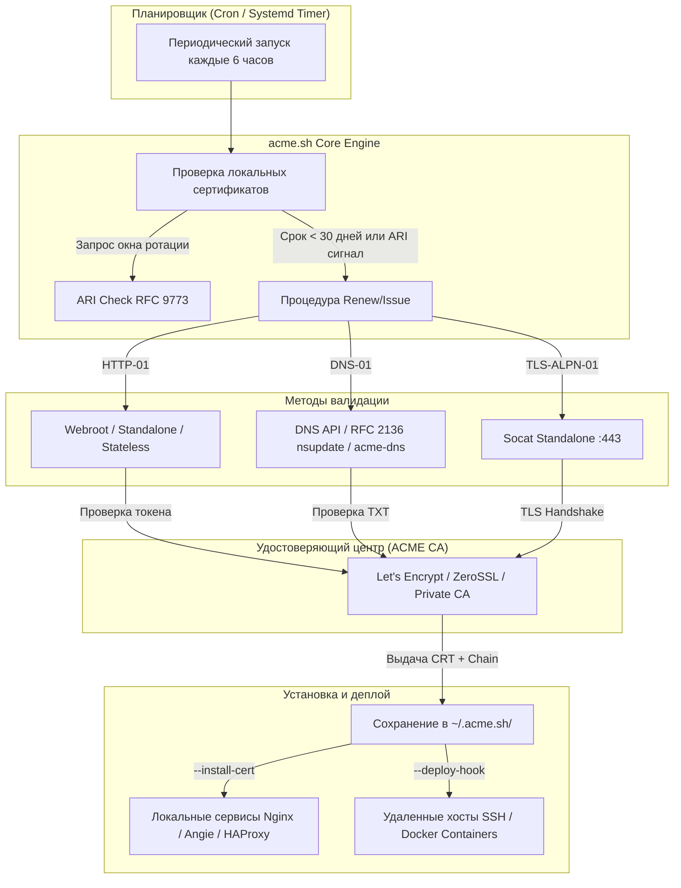
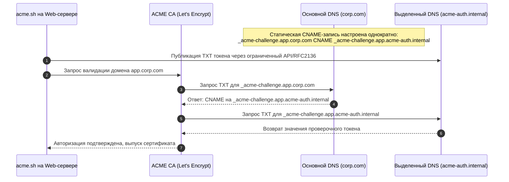

# acme.sh — ACME-клиент для TLS-сертификатов

**Актуально для:** acme.sh 3.1.x

## Определения

**acme.sh** — легковесный, бессерверный ACME-клиент, написанный исключительно на языке командной оболочки POSIX Shell (совместим с bash, dash, sh). Предназначен для автоматизации полного жизненного цикла TLS-сертификатов (выпуск, валидация, установка, ротация и отзыв) в центрах сертификации (CA), поддерживающих протокол ACME.

**ACME (Automated Certificate Management Environment, RFC 8555)** — стандарт протокола взаимодействия между клиентом и удостоверяющим центром, позволяющий автоматически подтверждать владение доменом и выпускать сертификаты X.509 без ручного участия администратора.

**ZeroSSL** — публичный коммерческий CA, поддерживающий протокол ACME. Является центром сертификации по умолчанию в acme.sh начиная с версии 3.0. Предоставляет бесплатные 90-дневные DV-сертификаты с неограниченным выпуском; требует предварительной регистрации аккаунта по email (или связывания عبر EAB — External Account Binding).

**Let's Encrypt** — некоммерческий общественный CA, предоставляющий бесплатные TLS-сертификаты через ACME. Ограничен политиками частоты запросов (rate limits). Используется после явного переключения (`--set-default-ca --server letsencrypt`).

**Private ACME CA (Внутренний CA)** — локальный удостоверяющий центр организации с поддержкой протокола ACME (например, Smallstep `step-ca`, HashiCorp Vault ACME Secrets Engine, Boulder), развернутый в изолированном on-premise контуре для обеспечения шифрования между внутренними микросервисами и балансировщиками без выхода в публичный интернет.

**Webroot (HTTP-01)** — метод валидации владения доменом, при котором ACME-клиент размещает проверочный файл в каталоге `/.well-known/acme-challenge/` существующего веб-сервера (Nginx, Angie, Apache), доступного по протоколу HTTP на стандартном порту 80.

**DNS-01** — метод валидации, при котором клиент публикует проверочный одноразовый токен в TXT-записи `_acme-challenge.<домен>` через API DNS-сервера или утилиту динамического обновления зон (RFC 2136). Единственный метод, поддерживающий выпуск wildcard-сертификатов (`*.example.com`).

**DNS Alias Mode (`--challenge-alias`)** — архитектурный паттерн валидации DNS-01, при котором проверка делегируется через DNS CNAME-запись на отдельный служебный домен или выделенный сервер `acme-dns`. Исключает необходимость передачи привилегированных API-ключей от основной DNS-зоны на конечные серверы приложений.

**DNS Persist (`dns-persist-01`, draft-ietf-acme-dns-persist-01)** — метод авторизации, при котором статическая TXT-запись публикуется в DNS один раз и повторно используется для всех последующих продлений без обращения к API DNS-провайдера.

**TLS-ALPN-01 (RFC 8737)** — метод валидации, при котором проверка выполняется в рамках TLS-рукопожатия на стандартном порту 443 с использованием ALPN-идентификатора протокола `acme-tls/1`. Не требует открытого порта 80.

**Stateless Mode** — режим валидации HTTP-01 без сохранения файлов состояния на локальном диске. Проверочный ответ динамически вычисляется веб-сервером на основе отпечатка открытого ключа учетной записи (Account Thumbprint).

**ARI (Automated Renewal Information, RFC 9773)** — стандартизированный механизм ACME, посредством которого CA передает клиенту рекомендованный временной интервал ротации сертификата. Позволяет заблаговременно обновлять сертификаты при внеплановом отзыве промежуточных центров или технических инцидентах. Включен в acme.sh по умолчанию.

**Deploy Hook** — встроенный или пользовательский скрипт acme.sh, автоматически исполняемый после успешного выпуска или продления сертификата. Обеспечивает дистрибуцию артефактов на удаленные хосты (SSH), в Docker-контейнеры или сетевые балансировщики.

### Сравнение acme.sh и Certbot

| Критерий | acme.sh | Certbot |
| :--- | :--- | :--- |
| **Язык реализации** | Чистый POSIX Shell (bash/sh/dash) | Python 3 |
| **Системные зависимости** | `curl` (или `wget`), `openssl`, базовые утилиты POSIX | Среда Python 3, pip/venv, cryptography, системные библиотеки |
| **Размер на диске** | ~200 КБ (один скрипт) | 50–150 МБ (с зависимостями) |
| **Поддерживаемые DNS API** | 110+ встроенных DNS-коннекторов | ~50 (через отдельные python-плагины) |
| **On-premise DNS (RFC 2136 / BIND)** | Встроено (`dns_nsupdate`) без доп. пакетов | Требуется плагин `certbot-dns-rfc2136` |
| **DNS Alias Mode** | Нативная поддержка (`--challenge-alias`) | Нативная поддержка через CNAME |
| **Корпоративные Private CA** | Поддерживает любые ACME URL (`--server`) | Поддерживает через параметр `--server` |
| **Поддержка ARI (RFC 9773)** | Включена по умолчанию (проверка каждые 6 ч) | Поддерживается в современных версиях |
| **Права суперпользователя** | Не требуются (может работать от любого пользователя) | Как правило, требует root для установки пакетов |
| **CA по умолчанию** | ZeroSSL (переключается на Let's Encrypt) | Let's Encrypt |
| **Путь к хранилищу по умолчанию** | `~/.acme.sh/` | `/etc/letsencrypt/` |

---

## Базовые концепции и архитектура

### Архитектурная модель

acme.sh не является постоянно запущенным демоном. Это модульный скрипт командной строки, который вызывается периодически (через `cron` или `systemd timer`) для проверки сроков действия сертификатов и их плановой ротации.



### Протокольный жизненный цикл ACME (RFC 8555)

1. **Инициализация аккаунта (`newAccount`):** acme.sh генерирует закрытый ключ учетной записи (Account Key) и регистрирует его на ACME-сервере с указанием контактного email.
2. **Создание заказа (`newOrder`):** клиент передает список доменов (SAN), для которых требуется сертификат. CA возвращает URL авторизаций (`authz`).
3. **Выбор и выполнение проверки (Challenge):** клиент выбирает поддерживаемый тип проверки (`http-01`, `dns-01`, `tls-alpn-01`), формирует ответ на основе отпечатка открытого ключа аккаунта и токена проверки, после чего размещает ресурс (файл, DNS TXT-запись) и уведомляет CA о готовности.
4. **Проверка подлинности (Validation):** серверы CA выполняют запросы к домену. При успешном подтверждении авторизация переходит в статус `valid`.
5. **Финализация заказа (`finalize`):** acme.sh локально генерирует закрытый ключ домена (Domain Key), формирует запрос на сертификат (CSR) и отправляет его в CA.
6. **Выпуск и получение сертификата:** CA подписывает сертификат открытым ключом промежуточного центра и возвращает полную цепочку (`fullchain.cer`).

### Структура каталога `~/.acme.sh/`

По умолчанию конфигурация и рабочие данные сохраняются в домашнем каталоге пользователя (`~/.acme.sh/` или `/root/.acme.sh/`):

```text
~/.acme.sh/
├── account.conf                 # Глобальные параметры (CA по умолчанию, email, API-токены)
├── acme.sh                      # Основной исполняемый скрипт
├── acme.sh.env                  # Экспортируемые переменные окружения и пути
├── ca/                          # Сертификаты доверенных промежуточных центров
├── deploy/                      # Коллекция встроенных deploy-хуков (docker, ssh, vault)
├── dnsapi/                      # Коллекция DNS API драйверов (dns_cf, dns_nsupdate, dns_acmedns)
├── notify/                      # Драйверы уведомлений (telegram, mail, slack)
├── example.com/                 # Хранилище RSA-сертификата домена
│   ├── example.com.conf         # Метаданные домена, параметры выпуска и команды reload
│   ├── example.com.csr          # Запрос на подпись сертификата
│   ├── example.com.csr.conf     # Параметры OpenSSL для CSR
│   ├── example.com.key          # Закрытый ключ домена RSA (права 0600)
│   ├── example.com.cer          # Сертификат конечного узла
│   ├── ca.cer                   # Сертификат промежуточного CA
│   └── fullchain.cer            # Полная цепочка (сертификат узла + промежуточные CA)
└── example.com_ecc/             # Хранилище ECDSA-сертификата домена
    ├── example.com.key          # Закрытый ключ ECDSA (P-256 / P-384)
    └── fullchain.cer            # Полная цепочка ECDSA
```

> [!CAUTION]
> Никогда не используйте файлы напрямую из каталога `~/.acme.sh/` в конфигурациях Nginx, HAProxy или других служб. Каталог `~/.acme.sh/` является внутренним состоянием клиента; внутренняя структура каталогов может изменяться. Для публикации сертификатов в рабочие каталоги операционной системы обязательно используйте команду `acme.sh --install-cert`.

### Стратегия Dual-Certificate (ECDSA + RSA)

acme.sh поддерживает параллельное владение и обновление двух независимых сертификатов для одного доменного имени:
- **ECDSA (ключи `ec-256`, `ec-384`):** современный стандарт криптографии на эллиптических кривых. Обеспечивает минимальный размер открытого ключа (256 бит обеспечивают стойкость, сопоставимую с RSA 3072 бит), ускоряет TLS-рукопожатие и снижает утилизацию CPU на высоконагруженных прокси-узлах.
- **RSA (ключи 2048, 4096 бит):** обеспечивает совместимость с устаревшими клиентами, не поддерживающими шифронаборы ECDSA.

При совместном выпуске RSA-сертификат сохраняется в директории `domain.com/`, а ECDSA — в `domain.com_ecc/`. Веб-серверы Nginx и Angie автоматически отдают клиенту предпочтительный сертификат в зависимости от поддерживаемых клиентом алгоритмов шифрования (Cipher Suites).

### DNS Alias Mode (`--challenge-alias`)

В enterprise- и on-premise инфраструктурах размещение мастер-ключей от производственных DNS-зон на внешних веб-серверах создает неприемлемые риски информационной безопасности. Паттерн DNS Alias Mode решает эту проблему за счет разграничения привилегий:



---

## Практические сценарии

### Сценарий 1: Установка acme.sh и инициализация ACME-аккаунта

**Требования к окружению:**
- Дистрибутив Linux (Debian, Ubuntu, AlmaLinux, Rocky Linux, RHEL, Alpine).
- Установленные пакеты `curl`, `openssl`, `cron` (или `systemd`).

#### Вариант А: Установка от непривилегированного пользователя (рекомендуется для безопасности)

Создание сервисного пользователя и изоляция рабочей среды:

```bash
sudo useradd -r -m -d /var/lib/acme -s /bin/bash acme
sudo -u acme -i
curl -s https://get.acme.sh | sh
source ~/.bashrc
acme.sh --version
# → acme.sh v3.1.6
```

#### Вариант Б: Общесистемная установка от пользователя root

```bash
sudo -i
curl -s https://get.acme.sh | sh -s email=admin@example.com
source ~/.bashrc
acme.sh --version
# → acme.sh v3.1.6
```

#### Регистрация аккаунта и выбор центра сертификации

По умолчанию acme.sh использует ZeroSSL. Для переключения на Let's Encrypt и регистрации контактного email:

```bash
# Переключение CA по умолчанию на Let's Encrypt
acme.sh --set-default-ca --server letsencrypt
# → [Wed Oct 14 20:00:00 UTC 2026] Changed default CA to: https://acme-v02.api.letsencrypt.org/directory

# Регистрация учетной записи в Let's Encrypt
acme.sh --register-account -m devops@example.com
# → [Wed Oct 14 20:00:01 UTC 2026] Registering account: https://acme-v02.api.letsencrypt.org/directory
# → [Wed Oct 14 20:00:02 UTC 2026] Registered: {"id":"123456789","status":"valid"}
# → [Wed Oct 14 20:00:02 UTC 2026] Account key is cached to: /var/lib/acme/.acme.sh/ca/acme-v02.api.letsencrypt.org/directory/account.key
```

---

### Сценарий 2: Выпуск сертификата через HTTP-01 Webroot (Nginx / Angie)

Классический сценарий для публичных веб-серверов с открытым входящим портом 80.

#### Шаг 1: Конфигурация Nginx для обслуживания проверочных файлов

В секции `server` для порта 80 настраивается выделенный каталог для ACME-челленджей:

```nginx
# /etc/nginx/conf.d/acme-challenge.conf
server {
    listen 80;
    listen [::]:80;
    server_name example.com www.example.com;

    # Обработка ACME HTTP-01 проверки
    location ^~ /.well-known/acme-challenge/ {
        root /var/www/acme-challenge;
        default_type "text/plain";
        try_files $uri =404;
    }

    # Редирект остального трафика на HTTPS
    location / {
        return 301 https://$host$request_uri;
    }
}
```

Создание директории и применение конфигурации:

```bash
sudo mkdir -p /var/www/acme-challenge/.well-known/acme-challenge
sudo chown -R www-data:www-data /var/www/acme-challenge
sudo chmod -R 755 /var/www/acme-challenge
sudo nginx -t
# → nginx: the configuration file /etc/nginx/nginx.conf syntax is ok
# → nginx: configuration file /etc/nginx/nginx.conf test is successful
sudo systemctl reload nginx
```

#### Шаг 2: Тестовый запуск (Staging Environment)

Перед запросом боевого сертификата проверка выполняется на тестовом сервере Let's Encrypt для предотвращения блокировки по rate limit:

```bash
acme.sh --issue -d example.com -d www.example.com \
    -w /var/www/acme-challenge \
    --test
# → [Wed Oct 14 20:02:10 UTC 2026] Using stage-v02 CA
# → [Wed Oct 14 20:02:11 UTC 2026] Creating domain key
# → [Wed Oct 14 20:02:12 UTC 2026] Multi domain='DNS:example.com,DNS:www.example.com'
# → [Wed Oct 14 20:02:13 UTC 2026] Getting webroot for domain='example.com'
# → [Wed Oct 14 20:02:14 UTC 2026] Verifying: example.com
# → [Wed Oct 14 20:02:16 UTC 2026] Success
# → [Wed Oct 14 20:02:17 UTC 2026] Verifying: www.example.com
# → [Wed Oct 14 20:02:19 UTC 2026] Success
# → [Wed Oct 14 20:02:20 UTC 2026] Verify finished, start to sign.
# → [Wed Oct 14 20:02:22 UTC 2026] Cert success.
```

#### Шаг 3: Выпуск боевого сертификата (ECDSA P-256)

```bash
acme.sh --issue -d example.com -d www.example.com \
    -w /var/www/acme-challenge \
    --keylength ec-256
```

---

### Сценарий 3: Режим Standalone с выделением сетевых привилегий non-root

Используется для почтовых серверов (Postfix/Dovecot), FTP или специализированных шлюзов, где веб-сервер отсутствует, а порт 80 свободен.

Для запуска от непривилегированного пользователя `acme` утилите `socat` назначается возможность биндинга привилегированных портов (<1024):

```bash
# Назначение capability на утилиту socat
sudo setcap 'cap_net_bind_service=+ep' "$(command -v socat)"

# Выпуск сертификата через автономный веб-сервер acme.sh
sudo -u acme acme.sh --issue -d mail.example.com --standalone --keylength ec-256
# → [Wed Oct 14 20:05:01 UTC 2026] Standalone mode.
# → [Wed Oct 14 20:05:02 UTC 2026] Listening on port 80 for domain mail.example.com
# → [Wed Oct 14 20:05:05 UTC 2026] mail.example.com:Verify success
# → [Wed Oct 14 20:05:07 UTC 2026] Cert success.
```

---

### Сценарий 4: On-premise Wildcard через DNS-01 (RFC 2136 DynDNS / BIND9 / PowerDNS)

Для локальных сетей и on-premise инфраструктур, где публичный DNS недоступен или защищен, стандарт RFC 2136 позволяет acme.sh автоматически добавлять TXT-записи через утилиту `nsupdate` с использованием криптографических ключей TSIG.

#### Шаг 1: Генерация TSIG-ключа (на DNS-сервере BIND9)

```bash
tsig-keygen -a hmac-sha256 acme-key > /etc/bind/acme-key.key
```

Содержимое ключа передается в конфигурацию BIND (`named.conf.local`):

```named
key "acme-key" {
    algorithm hmac-sha256;
    secret "hW8Vv57m1uT...=";
};

zone "corp.internal" {
    type master;
    file "/var/lib/bind/db.corp.internal";
    update-policy {
        grant acme-key name _acme-challenge.corp.internal. txt;
        grant acme-key name _acme-challenge.*.corp.internal. txt;
    };
};
```

#### Шаг 2: Выпуск сертификата с хоста acme.sh

```bash
# Экспорт параметров RFC 2136
export NSUPDATE_SERVER="192.168.10.53"
export NSUPDATE_SERVER_PORT="53"
export NSUPDATE_KEY="/etc/ssl/acme/acme-key.key"
export NSUPDATE_ZONE="corp.internal"

# Выпуск wildcard-сертификата
acme.sh --issue --dns dns_nsupdate \
    -d corp.internal \
    -d "*.corp.internal" \
    --keylength ec-256
# → [Wed Oct 14 20:10:00 UTC 2026] Using dns_nsupdate
# → [Wed Oct 14 20:10:02 UTC 2026] Adding TXT record via nsupdate
# → [Wed Oct 14 20:10:06 UTC 2026] The TXT record is updated: Success.
# → [Wed Oct 14 20:10:20 UTC 2026] Checking corp.internal for _acme-challenge.corp.internal
# → [Wed Oct 14 20:10:25 UTC 2026] Success
# → [Wed Oct 14 20:10:28 UTC 2026] Cert success.
```

Параметры `NSUPDATE_*` автоматически сохраняются в `~/.acme.sh/account.conf` и повторно используются при автоматическом продлении.

---

### Сценарий 5: DNS Alias Mode (`--challenge-alias`) с выделенным `acme-dns`

Архитектурный паттерн для периметровых серверов: вместо выдачи серверу доступа к корпоративному DNS настраивается однократная переадресация через CNAME на локальный сервер [acme-dns](https://github.com/joohoi/acme-dns).

#### Шаг 1: Настройка DNS CNAME в корпоративной зоне

В авторитетной зоне домена создается каноническая запись:

```text
_acme-challenge.service.example.com.  IN  CNAME  9a1f2b3c.auth.internal.
```

#### Шаг 2: Регистрация учетной записи в `acme-dns` и выпуск

```bash
export ACMEDNS_BASE_URL="https://auth.internal"
export ACMEDNS_USERNAME="9a1f2b3c-user"
export ACMEDNS_PASSWORD="SecretPasswordGeneratedByAcmeDns"
export ACMEDNS_SUBDOMAIN="9a1f2b3c"

acme.sh --issue \
    -d service.example.com \
    --challenge-alias auth.internal \
    --dns dns_acmedns \
    --keylength ec-256
```

ACME CA проверяет `_acme-challenge.service.example.com`, резолвит CNAME на `auth.internal`, опрашивает сервер `acme-dns` и подтверждает владение доменом.

---

### Сценарий 6: Выпуск сертификатов от внутреннего Private CA (Smallstep step-ca)

В изолированных дата-центрах acme.sh работает с внутренними центрами сертификации (RFC 8555 compliant).

```bash
# Добавление корневого сертификата организации в доверенные (Debian/Ubuntu)
sudo cp /usr/local/share/ca-certificates/internal-root-ca.crt /usr/local/share/ca-certificates/
sudo update-ca-certificates

# Выпуск сертификата через внутренний ACME-эндпоинт
acme.sh --issue \
    -d api.corp.internal \
    -w /var/www/acme-challenge \
    --server https://step-ca.corp.internal/acme/acme/directory \
    --ca-bundle /etc/ssl/certs/ca-certificates.crt \
    --keylength ec-256
# → [Wed Oct 14 20:15:00 UTC 2026] Using ACME server: https://step-ca.corp.internal/acme/acme/directory
# → [Wed Oct 14 20:15:02 UTC 2026] Registering account
# → [Wed Oct 14 20:15:04 UTC 2026] Verifying: api.corp.internal
# → [Wed Oct 14 20:15:05 UTC 2026] Success
# → [Wed Oct 14 20:15:06 UTC 2026] Cert success.
```

---

### Сценарий 7: Установка и развертывание Dual-stack сертификатов (ECDSA + RSA) в Nginx/Angie

Для максимальной производительности современных клиентов (HTTP/2, HTTP/3, TLS 1.3) и гарантированной совместимости со старыми системами выпускаются и подключаются оба типа ключей.

#### Шаг 1: Выпуск обоих типов сертификатов

```bash
# Выпуск ECDSA
acme.sh --issue -d example.com -d www.example.com -w /var/www/acme-challenge --keylength ec-256

# Выпуск RSA
acme.sh --issue -d example.com -d www.example.com -w /var/www/acme-challenge --keylength 2048
```

#### Шаг 2: Установка сертификатов через `--install-cert`

Для разграничения каталогов в acme.sh при обращении к ECDSA обязательно указывается флаг `--ecc`:

```bash
# Подготовка целевой директории
sudo mkdir -p /etc/nginx/ssl/example.com
sudo chmod 750 /etc/nginx/ssl /etc/nginx/ssl/example.com

# Установка ECDSA-сертификата
sudo acme.sh --install-cert -d example.com --ecc \
    --key-file       /etc/nginx/ssl/example.com/example.com.ecc.key \
    --fullchain-file /etc/nginx/ssl/example.com/example.com.ecc.crt \
    --reloadcmd      "systemctl reload nginx"

# Установка RSA-сертификата
sudo acme.sh --install-cert -d example.com \
    --key-file       /etc/nginx/ssl/example.com/example.com.rsa.key \
    --fullchain-file /etc/nginx/ssl/example.com/example.com.rsa.crt \
    --reloadcmd      "systemctl reload nginx"
```

Команда `--install-cert` сохраняет параметры в `~/.acme.sh/example.com/example.com.conf`. При каждом плановом обновлении сертификаты будут автоматически скопированы в `/etc/nginx/ssl/`, после чего выполнится `reloadcmd`.

#### Шаг 3: Конфигурация Nginx / Angie для двух сертификатов

```nginx
# /etc/nginx/conf.d/example.com-tls.conf
server {
    listen 443 ssl default_server;
    listen [::]:443 ssl default_server;
    http2 on;
    server_name example.com www.example.com;

    # 1. Сертификат ECDSA (приоритетный выбор для современных клиентов)
    ssl_certificate     /etc/nginx/ssl/example.com/example.com.ecc.crt;
    ssl_certificate_key /etc/nginx/ssl/example.com/example.com.ecc.key;

    # 2. Сертификат RSA (fallback для клиентов без поддержки ECC)
    ssl_certificate     /etc/nginx/ssl/example.com/example.com.rsa.crt;
    ssl_certificate_key /etc/nginx/ssl/example.com/example.com.rsa.key;

    ssl_protocols TLSv1.2 TLSv1.3;
    ssl_ciphers ECDHE-ECDSA-AES128-GCM-SHA256:ECDHE-RSA-AES128-GCM-SHA256:ECDHE-ECDSA-AES256-GCM-SHA384:ECDHE-RSA-AES256-GCM-SHA384;
    ssl_prefer_server_ciphers off;

    ssl_session_cache shared:SSL:10m;
    ssl_session_timeout 1d;
    ssl_session_tickets off;

    location / {
        root /var/www/html;
        index index.html;
    }
}
```

---

### Сценарий 8: Контейнеризация и Docker (Sidecar-архитектура)

В production-окружениях контейнер `acme.sh` используется в качестве вспомогательного (sidecar) сервиса с общим volume для файлов сертификатов и безопасным взаимодействием с Nginx.

```yaml
# compose.yaml
services:
  web:
    image: nginx:alpine
    container_name: web-frontend
    restart: unless-stopped
    ports:
      - "80:80"
      - "443:443"
    volumes:
      - ./nginx.conf:/etc/nginx/nginx.conf:ro
      - certs-data:/etc/nginx/ssl:ro
      - acme-challenge:/var/www/acme-challenge:ro

  acme:
    image: acmesh-official/acme.sh:latest
    container_name: acme-manager
    restart: unless-stopped
    environment:
      - ACMEDNS_BASE_URL=https://auth.internal
    volumes:
      - acme-state:/acme.sh
      - certs-data:/etc/nginx/ssl
      - acme-challenge:/var/www/acme-challenge
      - /var/run/docker.sock:/var/run/docker.sock:ro
    # Запуск acme.sh в режиме постоянного демона обновления
    entrypoint: >
      sh -c "acme.sh --set-default-ca --server letsencrypt &&
             acme.sh --issue -d example.com -w /var/www/acme-challenge --keylength ec-256 &&
             acme.sh --install-cert -d example.com --ecc
               --key-file /etc/nginx/ssl/example.com.key
               --fullchain-file /etc/nginx/ssl/example.com.crt
               --reloadcmd 'docker kill -s HUP web-frontend' &&
             exec acme.sh --daemon"

volumes:
  certs-data:
  acme-challenge:
  acme-state:
```

---

### Сценарий 9: Кластерное развертывание через SSH Deploy Hook (`deploy/ssh.sh`)

В отказоустойчивых конфигурациях (Keepalived/VRRP или группа балансировщиков HAProxy) сертификаты запрашивает один выделенный узел, после чего распространяет их по защищенному каналу SSH.

```bash
# Настройка переменных окружения для встроенного скрипта deploy/ssh.sh
export DEPLOY_SSH_USER="acme-deploy"
export DEPLOY_SSH_SERVER="lb01.internal lb02.internal"
export DEPLOY_SSH_KEYFILE="/etc/haproxy/ssl/example.com.key"
export DEPLOY_SSH_FULLCHAIN="/etc/haproxy/ssl/example.com.crt"
export DEPLOY_SSH_REMOTE_CMD="sudo /bin/systemctl reload haproxy"

# Деплой сертификата на целевые серверы
acme.sh --deploy -d example.com --ecc --deploy-hook ssh
# → [Wed Oct 14 20:25:00 UTC 2026] Deploying to lb01.internal
# → [Wed Oct 14 20:25:02 UTC 2026] Key copied to /etc/haproxy/ssl/example.com.key
# → [Wed Oct 14 20:25:03 UTC 2026] Fullchain copied to /etc/haproxy/ssl/example.com.crt
# → [Wed Oct 14 20:25:04 UTC 2026] Running remote command: sudo /bin/systemctl reload haproxy
# → [Wed Oct 14 20:25:05 UTC 2026] Success
# → [Wed Oct 14 20:25:05 UTC 2026] Deploying to lb02.internal
# → [Wed Oct 14 20:25:10 UTC 2026] Success
```

---

### Сценарий 10: Автоматизация ротации через Systemd Timer

Хотя acme.sh при установке создает запись в crontab, в инфраструктурах на базе systemd рекомендуется использовать системные таймеры для централизованного журналирования и управления зависимостями.

#### Сервисный юнит (`/etc/systemd/system/acme-renewal.service`)

```ini
[Unit]
Description=acme.sh automated certificate renewal
After=network-online.target
Wants=network-online.target

[Service]
Type=oneshot
User=acme
Group=acme
ExecStart=/var/lib/acme/.acme.sh/acme.sh --cron --home /var/lib/acme/.acme.sh
StandardOutput=journal
StandardError=journal
PrivateTmp=true
ProtectSystem=full
ProtectHome=read-only
ReadWritePaths=/var/lib/acme/.acme.sh /var/www/acme-challenge /etc/nginx/ssl
```

#### Таймер юнит (`/etc/systemd/system/acme-renewal.timer`)

В соответствии с рекомендациями ARI (RFC 9773), проверка выполняется каждые 6 часов со случайной задержкой для устранения одновременных всплесков запросов к CA:

```ini
[Unit]
Description=Run acme.sh renewal check every 6 hours

[Timer]
OnCalendar=00/6:00:00
RandomizedDelaySec=30m
Persistent=true

[Install]
WantedBy=timers.target
```

Активация таймера:

```bash
sudo systemctl daemon-reload
sudo systemctl enable --now acme-renewal.timer
sudo systemctl list-timers acme-renewal.timer
# → NEXT                        LEFT     LAST PASSED UNIT               ACTIVATES
# → Thu 2026-10-15 00:14:22 UTC 4h 10min n/a  n/a    acme-renewal.timer acme-renewal.service
```

---

### Сценарий 11: Мониторинг срока действия через Prometheus Node Exporter Textfile Collector

Скрипт проверяет дату окончания действия всех локальных сертификатов acme.sh и формирует метрики для Prometheus:

```bash
#!/usr/bin/env bash
# /usr/local/bin/acme_cert_metrics.sh
set -euo pipefail

METRICS_DIR="/var/lib/node_exporter/textfile_collector"
TEMP_FILE="${METRICS_DIR}/acme_certs.prom.$$"
ACME_DIR="/var/lib/acme/.acme.sh"

echo "# HELP acme_cert_expiry_timestamp_seconds Certificate expiration timestamp in seconds" > "$TEMP_FILE"
echo "# TYPE acme_cert_expiry_timestamp_seconds gauge" >> "$TEMP_FILE"

now=$(date +%s)

for cert in "$ACME_DIR"/*/*.cer; do
    # Исключаем промежуточные сертификаты CA
    [[ "$cert" == *"ca.cer"* ]] && continue
    domain=$(basename "$(dirname "$cert")")
    
    end_date=$(openssl x509 -enddate -noout -in "$cert" | cut -d= -f2)
    expiry_epoch=$(date -d "$end_date" +%s 2>/dev/null || date -j -f "%b %d %T %Y %Z" "$end_date" +%s)
    
    echo "acme_cert_expiry_timestamp_seconds{domain=\"${domain}\"} ${expiry_epoch}" >> "$TEMP_FILE"
done

mv "$TEMP_FILE" "${METRICS_DIR}/acme_certs.prom"
chmod 644 "${METRICS_DIR}/acme_certs.prom"
```

Правило алертинга Prometheus:

```yaml
# /etc/prometheus/rules/acme_alerts.yaml
groups:
  - name: acme_ssl_alerts
    rules:
      - alert: SSLCertificateExpiringSoon
        expr: (acme_cert_expiry_timestamp_seconds - time()) / 86400 < 15
        for: 6h
        labels:
          severity: warning
        annotations:
          summary: "TLS-сертификат {{ $labels.domain }} истекает через менее чем 15 дней"
          description: "Сертификат для {{ $labels.domain }} не был продлен автоматически. Требуется вмешательство SRE."
```

#### Настройка уведомлений в Telegram

acme.sh поддерживает отправку алертов через встроенный hook `notify`:

```bash
export TELEGRAM_TOKEN="123456789:ABCdefGhIJKlmNoPQRsTUVwxyZ"
export TELEGRAM_CHATID="-1001234567890"

acme.sh --set-notify --notify-hook telegram --notify-level 1
# Уровни уведомлений:
# 0 — отключено
# 1 — уведомлять только об ошибках обновления
# 2 — уведомлять обо всех событиях (успех и ошибка)
```

---

## Операции и команды

### Основные команды CLI

| Команда | Назначение |
| :--- | :--- |
| `acme.sh --issue` | Запрос и выпуск нового сертификата для домена(ов) |
| `acme.sh --renew -d <domain>` | Принудительная проверка и продление конкретного сертификата |
| `acme.sh --renew-all` | Проверка и продление всех зарегистрированных сертификатов |
| `acme.sh --install-cert -d <domain>` | Копирование сертификатов в рабочие каталоги и сохранение reload-команды |
| `acme.sh --deploy -d <domain>` | Дистрибуция сертификата через deploy hook (docker, ssh, vault) |
| `acme.sh --list` | Табличный вывод всех управляемых сертификатов и сроков их действия |
| `acme.sh --info -d <domain>` | Отображение подробных метаданных, типа ключа и хуков для домена |
| `acme.sh --revoke -d <domain>` | Отзыв выпущенного сертификата в удостоверяющем центре |
| `acme.sh --remove -d <domain>` | Удаление домена из расписания обновления acme.sh (без отзыва в CA) |
| `acme.sh --cron` | Режим периодического сканирования и продления (вызывается из планировщика) |
| `acme.sh --register-account` | Создание новой учетной записи на ACME-сервере |
| `acme.sh --set-default-ca` | Смена удостоверяющего центра по умолчанию |
| `acme.sh --set-notify` | Конфигурация канала отправки алертов и уведомлений |
| `acme.sh --upgrade` | Обновление скрипта acme.sh до последнего стабильного релиза |

### Ключевые параметры команды `--issue`

| Параметр | Описание | Пример |
| :--- | :--- | :--- |
| `-d, --domain <name>` | Доменное имя (допустимо указывать многократно для SAN) | `-d example.com -d www.example.com` |
| `--keylength, -k <len>` | Тип и размер ключа: `ec-256`, `ec-384`, `2048`, `4096` | `--keylength ec-256` |
| `-w, --webroot <path>` | Каталог корня веб-сервера для валидации HTTP-01 | `-w /var/www/acme-challenge` |
| `--standalone` | Использование встроенного standalone веб-сервера на порту 80 | `acme.sh --issue -d test.local --standalone` |
| `--httpport <port>` | Переопределение порта для standalone HTTP-01 | `--httpport 8080` |
| `--alpn` | Использование валидации TLS-ALPN-01 на порту 443 | `acme.sh --issue -d test.local --alpn` |
| `--dns <driver>` | Драйвер для прохождения проверки DNS-01 | `--dns dns_nsupdate` |
| `--challenge-alias <domain>` | Делегирование DNS-валидации через CNAME | `--challenge-alias auth.internal` |
| `--server <url>` | Явное указание эндпоинта ACME Directory | `--server https://step-ca.corp/acme/acme/directory` |
| `--test, --staging` | Использование тестового контура CA (без списания rate limits) | `acme.sh --issue -d example.com -w /var/www --test` |
| `--force` | Принудительный перевыпуск сертификата независимо от оставшегося срока | `acme.sh --renew -d example.com --force` |
| `--debug [1-3]` | Уровень детализации отладочного вывода | `--debug 2` |

---

## Диагностика и устранение неполадок

### Диагностический конвейер

При возникновении сбоев процедура локализации выполняется в следующем порядке:
1. Запуск проблемной команды с параметром `--debug 2` для детального лога HTTP REST-запросов и ответов сервера ACME.
2. Проверка доступности портов 80/443 и сетевых фильтров (firewalld, iptables, nftables).
3. Проверка синтаксиса и прав доступа к проверочным каталогам webroot.
4. Верификация корректности DNS-записей через `dig` или `nslookup`.

### Типичные ошибки и способы их устранения

| Симптом / Ошибка | Первопричина | Решение |
| :--- | :--- | :--- |
| `Invalid response ... 404 Not Found` | Веб-сервер не отдает токен из `.well-known/acme-challenge/` либо настроен некорректный root-путь | Проверить блок `location ^~ /.well-known/acme-challenge/`, права `755` на директорию, отсутствие перехватывающих редиректов |
| `Connection refused` на порту 80 | Закрыт порт 80 на внешнем файрволе или служба веб-сервера остановлена | Открыть порт 80 в iptables/nftables; для standalone-режима убедиться, что socat запущен |
| `socat: Permission denied` (порт 80/443) | Запуск acme.sh от non-root пользователя без прав биндинга портов < 1024 | Выполнить `sudo setcap 'cap_net_bind_service=+ep' $(which socat)` |
| `DNS problem: NXDOMAIN looking up TXT` | Задержка репликации DNS между авторитетными серверами или неверная зона в RFC 2136 | Увеличить время ожидания через `--dnssleep 60`; проверить зону через `dig +trace TXT _acme-challenge.<domain>` |
| `urn:ietf:params:acme:error:rateLimited` | Превышен лимит запросов CA (например, 5 неудачных попыток на аккаунт/домен в час у Let's Encrypt) | Использовать параметр `--test` для отладки; ожидать сброса окна лимита (1 час для failed validations) |
| `Cannot find account.conf` | Переменная окружения `HOME` указывает на некорректный каталог | Запускать команду с явным указанием домашнего каталога: `acme.sh --home /var/lib/acme/.acme.sh` |
| `Verification timeout / connection timed out` | CA не может достучаться до сервера из-за GeoIP-блокировок или агрессивных правил WAF/fail2ban | Добавить диапазоны IP-адресов серверов валидации Let's Encrypt в белый список или перейти на DNS-01 |

### Полезные команды для экспресс-диагностики

```bash
# 1. Просмотр полной конфигурации домена
acme.sh --info -d example.com

# 2. Проверка даты окончания и SAN-имен локального сертификата
openssl x509 -in ~/.acme.sh/example.com_ecc/fullchain.cer -noout -text | grep -E "Not After|DNS:"

# 3. Эмуляция проверки HTTP-01 вручную
curl -IL "http://example.com/.well-known/acme-challenge/test-token"

# 4. Проверка распространения TXT-записи для DNS-01
dig +short TXT _acme-challenge.example.com @1.1.1.1

# 5. Проверка статуса системного таймера и логов renewal
systemctl status acme-renewal.timer
journalctl -u acme-renewal.service -n 50 --no-pager
```

---

## Лучшие практики

### 1. Безопасность и принцип наименьших привилегий (Least Privilege)
- **Изолированный пользователь:** не запускайте acme.sh под учетной записью `root` без крайней необходимости. Создавайте выделенного пользователя `acme` с домашним каталогом `/var/lib/acme`.
- **Ограничение Sudoers:** если процессу `acme` требуется перезагружать веб-сервер, настройте точечное правило `sudoers` без пароля только для конкретной команды:
  ```text
  acme ALL=(ALL) NOPASSWD: /bin/systemctl reload nginx, /bin/systemctl reload haproxy
  ```
- **Защита ключей:** права на каталог `~/.acme.sh` должны быть строго ограничены (`chmod 700`), а на приватные ключи — `chmod 600`.

### 2. Защита учетных записей DNS
- **Применение DNS Alias Mode:** избегайте хранения API-токенов с правами на изменение всей производственной зоны на пограничных серверах приложений. Используйте перенаправление CNAME в зону с ограниченными правами или локальный экземпляр `acme-dns`.
- **Разграничение TSIG-ключей:** в BIND9/PowerDNS ограничивайте права TSIG-ключа только префиксом `_acme-challenge.*` с помощью правил `update-policy`.

### 3. Криптографические параметры
- **Приоритет ECDSA (P-256):** для веб-серверов и API по умолчанию выпускайте сертификаты с ключом `ec-256`. Это снижает накладные расходы на шифрование в протоколах TLS 1.3 и HTTP/3.
- **Поддержка Dual-Certificate:** на публичных шлюзах с широкой клиентской аудиторией разворачивайте пары ECDSA + RSA через независимые вызовы `--install-cert`.

### 4. Отказоустойчивость и Disaster Recovery
- **Резервное копирование аккаунта:** создавайте резервную копию каталога `~/.acme.sh/` (включая `account.conf` и ключи аккаунтов). Потеря ключа аккаунта при использовании EAB или корпоративного CA потребует ручного перевыпуска учетных записей.
- **Архитектура кластеров:** никогда не запускайте независимый выпуск одинаковых сертификатов на нескольких параллельных узлах балансировки — это приводит к исчерпанию лимитов Let's Encrypt (Duplicate Certificate limit: 50 в неделю). Реализуйте модель с одним узлом-издателем и дистрибуцией артефактов через SSH Deploy Hook или систему управления конфигурациями (Ansible).

### 5. Мониторинг и наблюдаемость
- **Двухконтурный контроль:** совмещайте внутренний мониторинг срока действия сертификатов (Prometheus Textfile Collector) с внешним синтетическим мониторингом через Prometheus Blackbox Exporter (`probe_ssl_earliest_cert_expiry`).

---

## Дополнительная информация

**Связанные документы базы знаний:**
- [Let's Encrypt и Certbot — HTTPS для веб-серверов](./https_with_certbot.md) — обзор протокола ACME, сравнение методов и лимиты Let's Encrypt
- [Автоматические TLS-сертификаты в Angie: модуль ACME](../Angie/angie_acme_module.md) — нативная автоматизация ACME внутри сервера Angie без внешних демонов
- [Обзор Traefik](../Traefik/traefik_overview.md) — управление сертификатами в динамических контейнерных средах
- [SSL/TLS Termination: паттерны и production-сценарии](../../Networking/Protocols/ssl_tls_termination.md) — архитектура терминации шифрования на балансировщиках
- [Обзор TLS/SSL в Nginx](../Nginx/Security/TLS_SSL/nginx_tls_ssl_overview.md) — тонкая настройка шифронаборов, сессионных тикетов и протоколов
- [Основы инфраструктуры открытых ключей (PKI)](../../Security/Concepts/pki_overview.md) — базовые принципы асимметричного шифрования, цепочек доверия и X.509
- [Протокол TLS — системный обзор](../../Networking/Protocols/tls.md) — этапы рукопожатия, отличия TLS 1.2 от TLS 1.3
- [Архитектура и основные концепции HashiCorp Vault](../../Vault/concepts.md) — корпоративное управление секретами и PKI Secrets Engine

**Официальные спецификации и ресурсы:**
- [RFC 8555 — Automatic Certificate Management Environment (ACME)](https://datatracker.ietf.org/doc/html/rfc8555)
- [RFC 9773 — Automated Renewal Information (ARI) Extension for ACME](https://datatracker.ietf.org/doc/html/rfc9773)
- [RFC 2136 — Dynamic Updates in the Domain Name System (DNS UPDATE)](https://datatracker.ietf.org/doc/html/rfc2136)
- [Официальный репозиторий acme.sh на GitHub](https://github.com/acmesh-official/acme.sh)
- [Документация acme.sh Wiki](https://github.com/acmesh-official/acme.sh/wiki)
