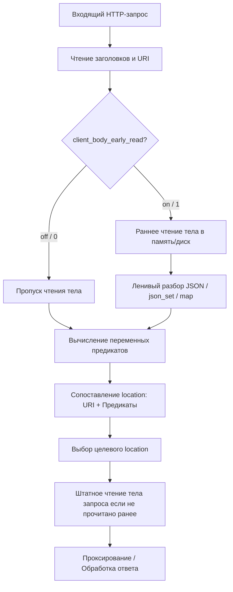

# Предикатные локейшены и продвинутая маршрутизация API-трафика

**Актуально для:** NGINX 1.31.5+ (проверено на NGINX 1.31.7)

## Определения

**Предикатный локейшен (predicate location)** — блок конфигурации `location`, в котором вместо статического префикса URI или регулярного выражения в качестве модификатора выбора выступает переменная Nginx (`location $variable { ... }`). Блок активируется, когда переменная принимает истинное значение (любая непустая строка, не равная строке `"0"`). Механизм представлен в NGINX 1.31.5.

**`client_body_early_read`** — директива контекстов `http` и `server` (появилась в NGINX 1.31.5), принудительно считывающая и буферизирующая тело входящего HTTP-запроса сразу после получения заголовков — до начала этапа сопоставления с блоками `location`.

**`ngx_http_json_module`** — модуль ядра Nginx (появился в 1.31.5, включается параметром сборки `--with-http_json_module`), реализующий высокопроизводительный нативный разбор JSON-документов на языке C без оверхеда внешних интерпретаторов (njs, Lua).

**`json_set`** — директива модуля `ngx_http_json_module` (контекст `http`), извлекающая значение поля или элемента массива из JSON-строки (находящейся в исходной переменной, например `$request_body`) по заданному пути JSONPath и записывающая его в целевую переменную Nginx.

**`json_max_depth`** — директива модуля `ngx_http_json_module` (контекст `http`), задающая максимальную допустимую глубину вложенности разбираемого JSON-документа (по умолчанию `32`, допустимый диапазон от `1` до `256`). Превышение глубины признает документ невалидным.

**JSONPath в Nginx** — специализированный синтаксис адресации внутри `json_set`. Поддерживает точечную нотацию для объектов (`user.id`), индексацию массивов (`events[0]`) и квадратные скобки в кавычках для ключей со спецсимволами (`'obj["field.with.dots"]'`).

**`map`** — директива модуля `ngx_http_map_module` (контекст `http`), формирующая значение новой переменной на основе сопоставления одной или нескольких входных переменных по хеш-таблице или регулярным выражениям. Служит базовым инструментом подготовки предикатов для `location`.

**`js_set` / njs** — директива модуля `ngx_http_js_module`, связывающая вычисление переменной с синхронной JavaScript-функцией. Применяется в предикатах для комплексных расчетов (проверка битовых масок, вычисление HMAC, декодирование специфических бинарных заголовков).

## Базовые концепции и архитектура

### Архитектурный сдвиг в маршрутизации Nginx

Классическая архитектура Nginx с момента создания опиралась на маршрутизацию по URI (`location /path` или `location ~ \.php$`). Процесс обработки запроса разделялся на строгие этапы:
1. Чтение и нормализация HTTP-заголовков и URI.
2. Фаза сопоставления конфигурации (`NGX_HTTP_FIND_CONFIG_PHASE`) — выбор наиболее специфичного блока `location` исключительно на основе URI запроса.
3. Фаза контент-хендлера — выполнение директив выбранного блока (`proxy_pass`, `fastcgi_pass`, `return`). Тело HTTP-запроса считывалось из сокета только на этом третьем этапе.



В современных микросервисных архитектурах, системах очередей и вебхуков запросы часто поступают на единый универсальный URI (например, `/api/v1/webhook`, `/events`, `/rpc`), а логика диспетчеризации определяется метаданными: сетевым происхождением (CIDR), наличием сервисного токена или внутренним типом события в JSON-пейлоуде.

До NGINX 1.31.5 решение таких задач требовало промежуточных внутренних редиректов (`rewrite ... last`), тяжелых Lua-скриптов или модулей njs, что снижало пропускную способность и усложняло отладку.

### Предикатные локейшены: синтаксис и правила сопоставления

Начиная с версии 1.31.5, директива `location` принимает в качестве аргумента имя переменной:

```nginx
location $variable_name {
    # директивы конфигурации
}
```

#### Семантика истинности предикатов
Nginx оценивает значение переменной предиката по строгим правилам:
- **Ложь (False):** переменная не инициализирована (not found), содержит пустую строку `""` или строго равна строковому символу `"0"`. Блок `location` пропускается.
- **Истина (True):** любое другое строковое значение (например, `"1"`, `"true"`, `"production"`, `"alert"`). Блок считается совпавшим.

#### Приоритет и порядок сопоставления
Предикатные локейшены сопоставляются последовательно в порядке их объявления в конфигурационном файле. 
- Если несколько предикатов в одном контексте возвращают истину, побеждает **первый объявленный** предикатный блок.
- Обычные статические префиксы и предикаты могут комбинироваться через вложенность.

#### Поведение директивы `alias` в предикатных блоках
При использовании директивы `alias` внутри предикатного локейшена действует важное системное правило: **значение `alias` обязано определять полный путь к файлу**, так как у предикатного локейшена отсутствует базовый сопоставляемый префикс URI, который Nginx мог бы заменить.

### Вложенность предикатов и URI

Предикаты и URI-блоки поддерживают произвольную вложенность. В практике DevOps/SRE выделяются две основные схемы организации:

#### 1. Сначала URI, затем предикат (рекомендуется для API-шлюзов)
Ограничивает вычисление тяжелых предикатов только заданным путем:

```nginx
http {
    server {
        listen 8080;

        location /api/v1/webhooks {
            # Базовые ограничения для пути
            client_max_body_size 2m;

            location $is_critical_alert {
                proxy_pass http://priority_alert_backend;
            }

            location $is_deploy_event {
                proxy_pass http://deploy_pipeline_backend;
            }

            # Fallback для остальных событий на этом пути
            proxy_pass http://default_webhook_backend;
        }
    }
}
```

#### 2. Сначала предикат, затем URI (рекомендуется для изоляции сред и режимов обслуживания)
Применяется при глобальных переключениях (Maintenance mode, изоляция административных подсетей):

```nginx
http {
    server {
        listen 80;

        location $maintenance_mode {
            return 503 "Service temporarily unavailable under maintenance\n";
        }

        location / {
            proxy_pass http://application_cluster;
        }
    }
}
```

### Раннее чтение тела запроса (`client_body_early_read`)

По умолчанию Nginx откладывает чтение тела HTTP-запроса. Если предикат или директива `json_set` обращаются к переменной `$request_body` на этапе сопоставления `location`, тело запроса без раннего чтения окажется пустым.

Директива `client_body_early_read` активирует предварительное считывание:

```nginx
Syntax:  client_body_early_read string ...;
Default: —
Context: http, server
```

Если хотя бы один строковый параметр директивы не пуст и не равен `"0"`, Nginx буферизирует тело запроса сразу после получения заголовков.

#### Важные системные свойства:
1. **Наследование параметров:** Чтение тела происходит в контексте `server`. Параметры буферизации (`client_max_body_size`, `client_body_buffer_size`, `client_body_temp_path`) берутся из блока `server`, а не из вложенных блоков `location`.
2. **Селективное включение:** Директива принимает переменные, что позволяет включать раннее чтение избирательно (например, только для `Content-Type: application/json`):

```nginx
http {
    map $http_content_type $json_payload_present {
        "~*application/json" 1;
        default              0;
    }

    server {
        listen 8080;
        client_body_early_read $json_payload_present;
        client_body_buffer_size 128k;
        client_max_body_size 5m;
        ...
    }
}
```

3. **Несовместимости:**
   - **gRPC:** несовместима с модулем `ngx_http_grpc_module`, так как gRPC использует потоковую небуферизованную передачу кадров.
   - **WebDAV:** несовместима с модулем `ngx_http_dav_module` (методы `PUT`, `MOVE`, `COPY`), записывающим тело напрямую во временные файлы целевых путей.
   - Директива `client_body_in_file_only` игнорируется при активном `client_body_early_read`.

### Нативный парсер JSON (`ngx_http_json_module`)

Модуль `ngx_http_json_module` предоставляет высокоэффективную интеграцию с JSON:

```nginx
json_set $target_variable $source_variable path;
```

#### Ключевые механизмы:
1. **Однократный ленивый парсинг (Single Lazy Evaluation):** Независимо от количества объявленных директив `json_set`, документ разбирается **ровно один раз** за запрос при первом обращении к любой из извлекаемых переменных.
2. **Типизация:**
   - Строковые значения сохраняются в переменные без экранирующих кавычек (unescaped).
   - Числа, булевы флаги (`true`/`false`) и `null` сохраняются в виде их строкового представления в документе.
   - Если путь указывает на объект или массив, сохраняется вся подстрока JSON целиком со всеми скобками.
3. **Отказоустойчивость:** Если документ поврежден, имеет синтаксические ошибки, превышает `json_max_depth` или искомое поле отсутствует, переменная считается ненайденной (`not found` / пустая строка). Ошибки 500 не генерируется, воркер переходит к обработке следующих условий.

## Практические сценарии

### Сценарий 1: Маршрутизация webhook-событий CI/CD и Git (GitLab/GitHub)

**Задача:** Высоконагруженный API-сервер принимает вебхуки на единый эндпоинт `/api/v1/webhook`. Требуется направлять события деплоя (`deployment`) на внутренний оркестратор, события сборок (`push`, `pipeline`) на воркеры сборки, а диагностические `ping` гасить на уровне прокси с ответом `204`.

```nginx
events {
    worker_connections 2048;
}

http {
    # Считываем тело запроса только если пришел JSON
    map $http_content_type $early_read_needed {
        "~*application/json" 1;
        default              0;
    }

    # Извлекаем тип события из JSON-тела
    json_set $event_action $request_body event;
    json_set $object_kind  $request_body object_kind;

    # Нормализуем тип события: учитываем заголовок GitHub или поле JSON GitLab
    map $http_x_github_event $normalized_event {
        default   $object_kind;
        "push"    "push";
        "ping"    "ping";
    }

    # Формируем предикаты для маршрутизации
    map $normalized_event $route_deploy {
        "deployment" 1;
        default      0;
    }

    map $normalized_event $route_build {
        "push"       1;
        "pipeline"   1;
        default      0;
    }

    map $normalized_event $route_ping {
        "ping"       1;
        default      0;
    }

    upstream deploy_service {
        server 10.10.10.20:8001 max_fails=3 fail_timeout=10s;
        keepalive 32;
    }

    upstream ci_build_workers {
        server 10.10.10.21:8002 max_fails=3 fail_timeout=10s;
        server 10.10.10.22:8002 max_fails=3 fail_timeout=10s;
        keepalive 32;
    }

    server {
        listen 8080;
        server_name webhook.infra.internal;

        client_body_early_read  $early_read_needed;
        client_body_buffer_size 256k;
        client_max_body_size    2m;

        location /api/v1/webhook {
            # Проверка предикатов
            location $route_ping {
                access_log off;
                return 204;
            }

            location $route_deploy {
                proxy_pass http://deploy_service;
                proxy_http_version 1.1;
                proxy_set_header Connection "";
                proxy_set_header Host $host;
                proxy_set_header X-Real-IP $remote_addr;
            }

            location $route_build {
                proxy_pass http://ci_build_workers;
                proxy_http_version 1.1;
                proxy_set_header Connection "";
                proxy_set_header Host $host;
                proxy_set_header X-Real-IP $remote_addr;
            }

            # Fallback для всех остальных типов вебхуков
            proxy_pass http://ci_build_workers;
            proxy_http_version 1.1;
            proxy_set_header Connection "";
            proxy_set_header Host $host;
        }

        location / {
            return 404 "Endpoint not found\n";
        }
    }
}
```

Верификация сценария:

```bash
# Проверка пинг-запроса
curl -s -o /dev/null -w "%{http_code}\n" -X POST \
  -H "Content-Type: application/json" \
  -H "X-GitHub-Event: ping" \
  -d '{"zen": "Keep it logically awesome."}' \
  http://127.0.0.1:8080/api/v1/webhook
# → 204

# Проверка отправки события деплоя
curl -s -X POST \
  -H "Content-Type: application/json" \
  -d '{"event": "deployment", "environment": "production"}' \
  http://127.0.0.1:8080/api/v1/webhook
# → Запрос направлен на upstream deploy_service (10.10.10.20:8001)
```

### Сценарий 2: Canary-маршрутизация и Feature Flagging без скриптовых модулей

**Задача:** Реализовать канареечный релиз нового микросервиса `v2`. Трафик направляется на канареечный upstream, если:
1. Присутствует сервисный заголовок `X-Canary: true` (для внутреннего тестирования QA/SRE).
2. Или 10% публичных запросов на основе хеша IP-клиента (`split_clients`) попадают в канареечную группу.

```nginx
http {
    # 1. Канареечный трафик по IP через split_clients
    split_clients "${remote_addr}${http_user_agent}" $canary_percentage_group {
        10%     "canary";
        *       "stable";
    }

    # 2. Объединяем ручной оверрайд из заголовка и процентную группу
    map $http_x_canary $canary_override {
        "true"  "canary";
        "1"     "canary";
        default $canary_percentage_group;
    }

    # 3. Формируем предикат
    map $canary_override $is_canary_active {
        "canary" 1;
        default  0;
    }

    upstream backend_stable {
        server 127.0.0.1:9001;
        keepalive 16;
    }

    upstream backend_canary {
        server 127.0.0.1:9002;
        keepalive 16;
    }

    server {
        listen 80;
        server_name api.infra.internal;

        location /api/ {
            proxy_http_version 1.1;
            proxy_set_header Connection "";
            proxy_set_header Host $host;

            location $is_canary_active {
                add_header X-Served-By "Canary-Cluster" always;
                proxy_pass http://backend_canary;
            }

            add_header X-Served-By "Stable-Cluster" always;
            proxy_pass http://backend_stable;
        }
    }
}
```

Верификация сценария:

```bash
# Принудительный вызов canary через заголовок
curl -I -H "X-Canary: true" http://127.0.0.1/api/users
# → HTTP/1.1 200 OK
# → X-Served-By: Canary-Cluster

# Обычный запрос без заголовка
curl -I http://127.0.0.1/api/users
# → HTTP/1.1 200 OK
# → X-Served-By: Stable-Cluster (или Canary-Cluster для 10% IP)
```

### Сценарий 3: Мультитенантный Rate Limiting и приоритизация по полю JSON

**Задача:** API шлюз обслуживает запросы нескольких арендаторов (tenants). Запросы с `tier: "premium"` должны иметь расширенные лимиты пропускной способности, а запросы `tier: "free"` — жестко лимитироваться по частоте (`limit_req`), чтобы не деградировать общее состояние кластера.

```nginx
http {
    client_body_early_read on;
    client_body_buffer_size 128k;
    client_max_body_size 1m;

    # Извлекаем тарифный план и ID тенанта из JSON-тела
    json_set $tenant_tier $request_body client.tier;
    json_set $tenant_id   $request_body client.id;

    # Зоны ограничения частоты запросов
    limit_req_zone $tenant_id zone=free_tenants:10m rate=5r/s;
    limit_req_zone $tenant_id zone=premium_tenants:10m rate=100r/s;

    # Предикаты уровней обслуживания
    map $tenant_tier $is_premium_tier {
        "premium" 1;
        default   0;
    }

    upstream core_api_cluster {
        server 10.0.1.10:8080;
        server 10.0.1.11:8080;
        keepalive 64;
    }

    server {
        listen 8080;

        location /api/v1/jobs {
            proxy_http_version 1.1;
            proxy_set_header Connection "";
            proxy_set_header Host $host;

            # Предикатный блок для премиум-пользователей
            location $is_premium_tier {
                limit_req zone=premium_tenants burst=20 nodelay;
                proxy_pass http://core_api_cluster;
            }

            # Fallback для бесплатного тарифа или запросов без явного tier
            limit_req zone=free_tenants burst=5 nodelay;
            proxy_pass http://core_api_cluster;
        }
    }
}
```

Верификация сценария:

```bash
# Запрос от Premium-клиента
curl -X POST -H "Content-Type: application/json" \
  -d '{"client": {"id": "corp_42", "tier": "premium"}, "payload": "run_report"}' \
  http://127.0.0.1:8080/api/v1/jobs
# → HTTP/1.1 200 OK

# Превышение лимита для Free-клиента
for i in {1..10}; do
  curl -s -o /dev/null -w "%{http_code}\n" -X POST \
    -H "Content-Type: application/json" \
    -d '{"client": {"id": "free_user_1", "tier": "free"}, "payload": "task"}' \
    http://127.0.0.1:8080/api/v1/jobs
done
# → Первые запросы 200, последующие возвращают 503 Service Temporarily Unavailable
```

### Сценарий 4: Селективное включение раннего чтения тела для предотвращения исчерпания RAM

**Задача:** Шлюз одновременно обслуживает быстрые микрозапросы API (`POST /api/v1/process`, JSON до 32 КБ) и тяжелые бинарные выгрузки образов/бэкапов (`POST /api/v1/storage/upload`, файлы до 500 МБ). Глобальное включение `client_body_early_read on` приведет к буферизации многогигабайтного дискового/оперативного I/O еще до входа в upload location. Требуется активировать раннее чтение **исключительно** для легковесных JSON-эндпоинтов.

```nginx
http {
    # 1. Проверяем, что запрос идет к легковесному JSON API
    map $uri $is_lightweight_api {
        "~^/api/v1/process" 1;
        "~^/api/v1/control" 1;
        default             0;
    }

    # 2. Проверяем заголовок Content-Type
    map $http_content_type $is_json_header {
        "~*application/json" 1;
        default              0;
    }

    # 3. Активируем раннее чтение только при совпадении обоих условий
    map "${is_lightweight_api}:${is_json_header}" $enable_early_read {
        "1:1"   1;
        default 0;
    }

    json_set $process_priority $request_body meta.priority;

    map $process_priority $is_urgent_task {
        "high"     1;
        "critical" 1;
        default    0;
    }

    upstream priority_queue_service {
        server 127.0.0.1:7001;
    }

    upstream standard_queue_service {
        server 127.0.0.1:7002;
    }

    upstream blob_storage_service {
        server 127.0.0.1:9000;
    }

    server {
        listen 80;
        server_name gateway.local;

        # Раннее чтение включено только когда $enable_early_read == 1
        client_body_early_read $enable_early_read;

        # Базовые параметры памяти для легковесных запросов
        client_body_buffer_size 64k;
        client_max_body_size    500m;

        # Обработка легковесного API
        location /api/v1/process {
            client_max_body_size 128k;

            location $is_urgent_task {
                proxy_pass http://priority_queue_service;
            }

            proxy_pass http://standard_queue_service;
        }

        # Эндпоинт тяжелых загрузок (тело читается потоково на уровне бэкенда)
        location /api/v1/storage/upload {
            client_body_early_read off;
            client_body_buffer_size 1m;
            client_body_temp_path /var/cache/nginx/client_temp 1 2;

            proxy_request_buffering off;
            proxy_http_version 1.1;
            proxy_pass http://blob_storage_service;
        }
    }
}
```

### Сценарий 5: Валидация подписи webhook (HMAC-SHA256) через njs в предикате

**Задача:** Защитить внутренний контур от подделки входящих вебхуков платежного шлюза или внешнего мониторинга. Перед проксированием требуется вычислить HMAC-SHA256 хеш от `$request_body` с использованием разделяемого секрета и сверить его с заголовком `X-Signature-SHA256`. Если подпись валидна — проксировать на процессинг, если невалидна — блокировать с кодом `403`.

```javascript
// /etc/nginx/njs/webhook_auth.js
import crypto from 'crypto';

const SHARED_SECRET = 's3cr3t_v@lidati0n_k3y_2026';

function verify_hmac(r) {
    const signatureHeader = r.headersIn['X-Signature-SHA256'];
    const body = r.variables['request_body'];

    if (!signatureHeader || !body) {
        return "0";
    }

    const calculatedHmac = crypto.createHmac('sha256', SHARED_SECRET)
                                 .update(body)
                                 .digest('hex');

    // Безопасное сравнение строк одинаковой длины
    if (signatureHeader.length === calculatedHmac.length &&
        crypto.timingSafeEqual(Buffer.from(signatureHeader), Buffer.from(calculatedHmac))) {
        return "1";
    }

    r.warn('HMAC validation failed for incoming webhook from ' + r.remoteAddress);
    return "0";
}

export default { verify_hmac };
```

```nginx
# /etc/nginx/nginx.conf
load_module modules/ngx_http_js_module.so;

events { worker_connections 1024; }

http {
    js_import /etc/nginx/njs/webhook_auth.js;
    js_set $is_signature_valid webhook_auth.verify_hmac;

    upstream secure_billing_processor {
        server 10.200.1.5:8443;
        keepalive 16;
    }

    server {
        listen 8443 ssl;
        server_name pay-hook.corp.internal;

        ssl_certificate     /etc/ssl/certs/hook.crt;
        ssl_certificate_key /etc/ssl/private/hook.key;

        # Тело необходимо прочитать заранее для расчета HMAC
        client_body_early_read on;
        client_body_buffer_size 128k;
        client_max_body_size 1m;

        location /webhook/payment {
            # Если подпись валидна ($is_signature_valid == "1")
            location $is_signature_valid {
                proxy_pass http://secure_billing_processor;
                proxy_set_header X-Signature-Verified "true";
            }

            # Не совпало — блокируем нелегитимный трафик на периметре
            return 403 "Forbidden: Invalid payload signature\n";
        }
    }
}
```

## Операции и команды

### 1. Проверка поддержки модулей в установленном Nginx

Директивы `client_body_early_read` и предикатные location входят в ядро NGINX с версии 1.31.5. Для работы с `json_set` требуется сборка с флагом `--with-http_json_module`.

```bash
# Проверка версии и ключей компиляции
nginx -V 2>&1 | grep -o -E "nginx/[0-9.]+|with-http_json_module"
# → nginx/1.31.7
# → with-http_json_module

# Проверка наличия модуля njs (при использовании js_set)
nginx -V 2>&1 | grep -o "http_js_module"
# → http_js_module
```

### 2. Валидация синтаксиса и безопасный Reload

Перед перезагрузкой конфигурации обязательно выполняется тест синтаксиса:

```bash
# Тестирование синтаксиса
nginx -t
# → nginx: the configuration file /etc/nginx/nginx.conf syntax is ok
# → nginx: configuration file /etc/nginx/nginx.conf test is successful

# Бесшовная перезагрузка master-процесса без сброса активных соединений
nginx -s reload
# → signal processed
```

### 3. Диагностика сопоставления предикатов через Debug Log

Для детальной трассировки процесса сопоставления предикатов бинарник Nginx должен быть собран с параметром `--with-debug`:

```nginx
# Включение уровня debug для конкретного хоста или подсети
error_log /var/log/nginx/debug.log debug;
```

После отправки тестового запроса журнал содержит этапы вычисления:

```bash
tail -f /var/log/nginx/debug.log | grep -E "using location|http script var"
# → *1042 http script var: "$route_deploy" = "1"
# → *1042 using location "$route_deploy" for "/api/v1/webhook"
# → *1043 http script var: "$is_canary_active" = "0"
```

### 4. Контроль буферизации и временных файлов тела запроса

При активном `client_body_early_read` тела запросов, превышающие `client_body_buffer_size`, пишутся во временные файлы. Важно контролировать их создание и права доступа:

```bash
# Проверка наличия временных файлов запросов
ls -la /var/cache/nginx/client_temp/
# → drwx------ 4 nginx nginx 4096 Oct 16 12:00 .

# Мониторинг I/O активности воркеров Nginx
pidstat -d -p $(pgrep -d',' -f "nginx: worker") 1 3
```

## Диагностика и устранение неполадок

### Проблема 1: Предикатный локейшен не выбирается при валидном JSON

**Симптомы:** Запрос уходит в дефолтный fallback-блок или возвращает `404`, несмотря на то, что поле в JSON присутствует и соответствует значению.

**Возможные причины:**
1. Не включена директива `client_body_early_read`. По умолчанию тело запроса на фазе сопоставления не прочитано, переменная `$request_body` пуста, и `json_set` возвращает пустую строку.
2. Значение переменной вычислено в строковый символ `"0"`. По правилам Nginx строка `"0"` интерпретируется как `false`.
3. Заголовок `Content-Type` не передан клиентом, из-за чего сработал `map`, отключивший раннее чтение.

**Диагностика и решение:**
- Проверьте значение переменной временным выводом в HTTP-ответ:
  ```nginx
  location /debug {
      return 200 "val='$route_deploy' body='$request_body'\n";
  }
  ```
- Убедитесь, что директива `client_body_early_read on;` (или переменная со значением `1`) прописана на уровне `http` или текущего блока `server`.

### Проблема 2: Деградация производительности и всплески памяти (OOM)

**Симптомы:** При высокой нагрузке воркеры Nginx начинают потреблять значительно больше оперативной памяти (RSS), либо наблюдаются задержки дискового ввода-вывода (I/O wait).

**Причина:** Глобальное включение `client_body_early_read on` без фильтрации эндпоинтов и без ограничения размера буферов. Каждый входящий запрос буферизирует тело в памяти до вызова логики фильтрации.

**Решение:**
1. Ограничьте `client_body_buffer_size` разумным значением для JSON (обычно `64k` или `128k`).
2. Принудительно задайте `client_max_body_size` в контексте `server` для предотвращения передачи гигантских пейлоудов.
3. Включайте раннее чтение строго селективно через директиву `map` по `Content-Type` или URI (см. Сценарий 4).

### Проблема 3: `json_set` возвращает пустое значение при корректном теле запроса

**Симптомы:** Поле гарантированно есть в JSON, но переменная остается пустой.

**Возможные причины:**
1. **Синтаксическая ошибка в JSON:** лишняя запятая, одинарные кавычки вместо двойных. Модуль `ngx_http_json_module` требует строгого соответствия спецификации RFC 8259.
2. **Превышение глубины вложенности:** структура документа глубже значения `json_max_depth` (по умолчанию 32).
3. **Спецсимволы в имени ключа:** если ключ содержит точки (`user.first.name`), дефисы или скобки, обращение через простую точечную нотацию ищет вложенный объект `first`.
4. **Частичное чтение (Streaming):** тело запроса превысило размер буфера и записалось во временный файл без флага `$request_body` в едином буфере (`client_body_in_single_buffer`).

**Решение:**
- Для ключей со спецсимволами используйте явное экранирование в конфигурации:
  ```nginx
  json_set $domain $request_body '["network.dns.domain"]';
  ```
- При работе с глубоко вложенными структурами увеличьте лимит глубины:
  ```nginx
  json_max_depth 64;
  ```
- Добавьте директиву `client_body_in_single_buffer on;` в блок `server`.

### Проблема 4: Ошибки конфигурации при использовании WebDAV или gRPC

**Симптомы:** При добавлении `client_body_early_read on` в блоке `http` ломается загрузка файлов по WebDAV (`PUT` возвращает 500) или сбоит проксирование gRPC-стримов.

**Причина:** `client_body_early_read` архитектурно несовместим с потоковой природой gRPC (`ngx_http_grpc_module`) и механизмом записи тела напрямую в файл модуля `ngx_http_dav_module`.

**Решение:** Выносите директиву `client_body_early_read` из контекста `http` в конкретные блоки `server`, либо отключайте её переменной (`client_body_early_read $disable_for_grpc;`) для специализированных эндпоинтов.

### Проблема 5: Некорректное поведение во вложенных предикатах (версии 1.31.5 vs 1.31.6+)

**Симптомы:** В сложных многоуровневых структурах вложенных предикатов (`location $a { location $b { ... } }`) внутренний предикат игнорируется при определенных ошибках вычисления.

**Причина:** Известный дефект ранней версии 1.31.5: ошибка вычисления переменной во вложенном поиске приводила к молчаливому пропуску блока. 

**Решение:** В NGINX 1.31.6 этот дефект полностью устранен upstream-патчем:
```
Changes with nginx 1.31.6:
*) Bugfix: an error while evaluating a predicate in a predicate location
   was ignored and the predicate was treated as false.
*) Bugfix: an error during a nested location lookup might be ignored if
   locations given by regular expressions or predicates were configured
   at the current level.
```
Обновите пакет Nginx до версии 1.31.6 или 1.31.7.

## Лучшие практики

### 1. Производительность (Performance & Resource Management)

- **Минимизируйте глубину проверки JSON:** Извлекайте только те поля, которые действительно участвуют в маршрутизации, логировании или лимитировании. Не используйте `json_set` для распаковки всего документа — это задача бэкенда.
- **Держите тело в памяти:** Устанавливайте `client_body_buffer_size` равным 99-му перцентилю размера ваших JSON-пейлоудов (например, `64k` или `128k`). Это исключит медленные дисковые системные вызовы на запись и чтение файлов во `/var/cache/nginx/client_temp`.
- **Используйте нативный `ngx_http_json_module` вместо Lua/njs:** Нативный парсер на C производит разбор в 3–5 раз быстрее скриптовых обвязок и не создает давления на сборщик мусора (GC) в worker-процессах.
- **Размещайте дешевые предикаты выше:** Если маршрутизация строится на нескольких условиях, сначала сопоставляйте дешевые проверки по заголовкам (`$http_x_api_key`), и лишь затем переходите к локейшенам с разбором тела.

### 2. Безопасность (Security Hardening)

- **Ограничивайте размер тела запроса (`client_max_body_size`):** Раннее чтение делает сервер более уязвимым к Slowloris/Slow POST атакам, если злоумышленник медленно передает огромный объем данных. Всегда задавайте жесткий лимит для API (например, `1m` или `2m`).
- **Контролируйте `json_max_depth`:** Для защиты от атак типа «JSON-бомба» (сверхглубокая рекурсивная вложенность `[[[[...]]]]`) удерживайте параметр `json_max_depth` в диапазоне от `16` до `32`.
- **Защита от спуфинга заголовков:** Если предикат завязан на `$remote_addr` или префикс клиента, не доверяйте внешним клиентским заголовкам `X-Forwarded-For` без директивы `real_ip_header` с явно указанными доверенными прокси (`set_real_ip_from`).

### 3. Эксплуатация и мониторинг (SRE & Observability)

- **Структурированное логирование предикатов:** Добавляйте вычисленные предикаты и ключевые JSON-поля в лог доступа. Это позволяет трассировать маршруты в системах сбора логов (Elasticsearch, Vector, Loki):

```nginx
log_format api_json_combined escape=json '{'
    '"time_local":"$time_iso8601",'
    '"remote_addr":"$remote_addr",'
    '"request":"$request",'
    '"status":$status,'
    '"bytes_sent":$bytes_sent,'
    '"request_time":$request_time,'
    '"tenant_id":"$tenant_id",'
    '"routed_predicate":"$route_deploy",'
    '"upstream_addr":"$upstream_addr"'
'}';

access_log /var/log/nginx/api_access.log api_json_combined;
```

- **Всегда предусматривайте fallback-локейшен:** Если предикат вычисляется в ложь или поле отсутствует, запрос должен штатно обрабатываться дефолтным `location /` или возвращать понятный код ошибки (`400 Bad Request` или `422 Unprocessable Entity`), а не попадать в непредвиденные ветки конфигурации.

## Дополнительная информация

### См. также во внутренней базе знаний

- **[Директива location: основы и приоритеты](./basics.md)** — базовый алгоритм выбора, спецификаторы `=`, `^~`, `~`, `~*` и классические приоритеты.
- **[Nginx location: лучшие практики и отладка](./best_practices.md)** — рекомендации по оптимизации структуры конфигурации, безопасность и устранение конфликтов.
- **[Nginx: внутренняя маршрутизация](./internal_routing.md)** — механизмы `internal`, `error_page`, именованные локации и `X-Accel-Redirect`.
- **[Модуль ngx_http_js_module (njs)](../nginx_njs_module.md)** — программирование динамической логики на JavaScript внутри Nginx.

### Официальная документация и источники

- [NGINX Core Module: Директива location](https://nginx.org/en/docs/http/ngx_http_core_module.html#location)
- [NGINX Core Module: Директива client_body_early_read](https://nginx.org/en/docs/http/ngx_http_core_module.html#client_body_early_read)
- [NGINX JSON Module: ngx_http_json_module](https://nginx.org/en/docs/http/ngx_http_json_module.html)
- [Журнал изменений NGINX (CHANGES)](https://nginx.org/en/CHANGES)
- [Анонс NGINX 1.31.5: Control API, Predicate Locations, Early Body Inspection](https://blog.nginx.org/blog/nginx-1-31-5-control-api-predicate-locations-early-body-inspection-and-more)
