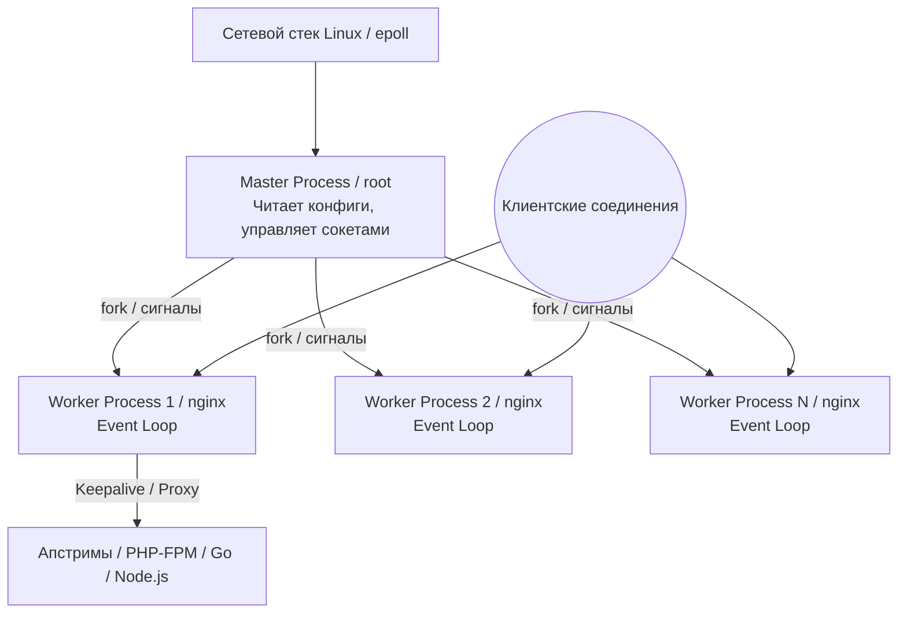
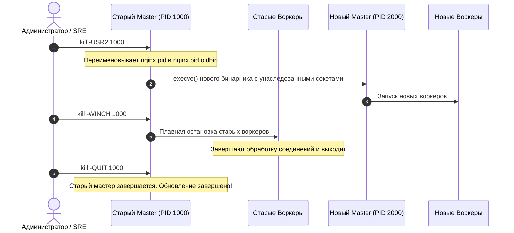

# Установка и базовая настройка Nginx

**Актуально для:** Nginx 1.30.x (Stable) / 1.31.x (Mainline)

---

## Определения

**Nginx** — высокопроизводительный веб-сервер, обратный прокси-сервер (reverse proxy), почтовый прокси и L4/L7-балансировщик нагрузки с открытым исходным кодом, использующий асинхронную событийно-ориентированную архитектуру для обработки сотен тысяч одновременных сетевых соединений при минимальном потреблении оперативной памяти и CPU.

**Мастер-процесс (Master Process)** — привилегированный родительский процесс Nginx (обычно запускаемый от пользователя `root`), отвечающий за чтение и валидацию конфигурационных файлов, связывание привилегированных сетевых портов (80, 443), управление жизненным циклом рабочих процессов (воркеров), обработку системных сигналов и бесшовное применение изменений. Мастер-процесс не обслуживает клиентские сетевые запросы напрямую.

**Рабочий процесс (Worker Process)** — непривилегированный дочерний процесс Nginx, выполняющий неблокирующий цикл обработки событий (Event Loop), сетевой ввод-вывод, TLS-терминацию, парсинг HTTP-протокола, маршрутизацию запросов и проксирование на бэкенды. Запускается от имени системного непривилегированного пользователя (`nginx` или `www-data`).

**Виртуальный хост (Server Block)** — изолированный блок конфигурации (`server { ... }`), определяющий параметры маршрутизации, безопасности и обработки запросов для конкретного доменного имени (FQDN) или комбинации IP-адреса и сетевого порта.
- **Сопоставление:** Nginx анализирует HTTP-заголовок `Host` входящего запроса (или SNI в TLS-сессии) и сопоставляет его со списком имен в директиве `server_name`.
- **Default Server (Fallback):** если заголовок `Host` отсутствует или не совпадает ни с одним `server_name`, запрос направляется в виртуальный хост с параметром `default_server` в директиве `listen`. Если `default_server` не объявлен явно, используется первый по порядку загрузки блок `server` для данного сокета.

**Редакции Mainline vs Stable:**
- **Mainline (основная ветка):** содержит новейший функционал, оптимизации протоколов (HTTP/2, HTTP/3, динамические модули) и актуальные исправления дефектов. Рекомендуется официальной командой разработки Nginx для большинства современных production-систем.
- **Stable (стабильная ветка):** формируется из стабильного среза Mainline и получает исключительно патчи критических уязвимостей безопасности и блокирующих багов. Новый функционал в ветку не переносится.

**Контекст конфигурации (Context / Scope)** — область видимости директив Nginx, задаваемая фигурными скобками (`main`, `events`, `http`, `stream`, `server`, `location`). Директивы подчиняются строгой иерархии наследования.

**Валидация конфигурации (Pre-flight Test)** — процедура статической проверки синтаксиса и целостности всех конфигурационных файлов утилитой `nginx -t` без внесения изменений в память работающего веб-сервера.

**Graceful Reload (Бесшовный перезапуск)** — перезагрузка конфигурации Nginx по сигналу `SIGHUP` (`nginx -s reload`), при которой мастер-процесс запускает новый пул воркеров с обновленной конфигурацией, а старые воркеры штатно дорабатывают уже открытые клиентские соединения и завершаются без сброса сетевых сессий.

---

## Базовые концепции

### Архитектура и процессная модель

Nginx спроектирован для преодоления проблемы C10K (одновременное обслуживание 10 000+ сетевых соединений) за счет отказа от модели «один поток/процесс на одно соединение» (Thread-per-Connection) в пользу асинхронного неблокирующего ввода-вывода (Non-blocking I/O) и мультиплексирования системных вызовов (`epoll` в Linux, `kqueue` в FreeBSD).



#### Роли процессов в операционной системе

1. **Master-процесс:**
   - Выполняет системные вызовы `bind()` и `listen()` для привилегированных сетевых портов (< 1024), требующих Linux capability `CAP_NET_BIND_SERVICE`.
   - Вызывает `setuid()` и `setgid()` для порождения воркеров от непривилегированного пользователя (`nginx` или `www-data`).
   - Читает конфигурационные файлы с диска от пользователя `root`.
   - Управляет жизненным циклом дочерних воркеров, мониторит их неожиданные падения и мгновенно перезапускает аварийные процессы.
   - Обеспечивает бесшовное обновление бинарного исполняемого файла на лету (Zero-Downtime Binary Upgrade) по сигналу `SIGUSR2`.
2. **Worker-процессы:**
   - Функционируют в рамках однопоточного цикла событий (Event Loop).
   - Принимают входящие TCP/UDP-соединения через общий слушающий сокет (или с использованием флага сокета `SO_REUSEPORT` ядра Linux).
   - Выполняют чтение и запись в сокеты, обработку TLS-рукопожатий, чтение статических файлов с диска (включая оптимизацию `sendfile`), сжатие данных и взаимодействие с бэкендами (upstream).

### Иерархия контекстов и наследование директив

Файл конфигурации Nginx структурирован в виде древовидной иерархии блоков. Директивы, заданные на верхнем уровне, наследуются вложенными блоками, если они не переопределены явно на более глубоком уровне:

```text
main (глобальный контекст)
 ├── events { ... }
 ├── http { ... }
 │    ├── upstream <name> { ... }
 │    ├── server { ... }
 │    │    ├── location <path> { ... }
 │    │    │    └── location <path> { ... } (вложенный)
 │    │    └── location <path> { ... }
 │    └── server { ... }
 └── stream { ... }
      ├── upstream <name> { ... }
      └── server { ... }
```

1. **`main` (глобальный контекст):** корневой контекст конфигурационного файла. Содержит директивы, влияющие на поведение операционной системы и самого демона: `user`, `worker_processes`, `worker_rlimit_nofile`, `pid`, `error_log`.
2. **`events`:** управление сетевыми соединениями и многопоточностью на уровне ОС (`worker_connections`, `use epoll`, `multi_accept`). Блок обязателен даже если он пуст.
3. **`http`:** основной контекст для обработки HTTP/HTTPS/QUIC-трафика. Включает глобальные параметры протоколов, форматы логирования, MIME-типы, лимиты буферов и подключение виртуальных хостов через директиву `include`.
4. **`stream`:** контекст L4-проксирования и балансировки произвольного TCP/UDP трафика (SSH, базы данных, кастомные протоколы). Располагается на одном уровне с `http` (внутри `main`), а не внутри него. Подробнее — в [L4 проксировании TCP/UDP](../Proxy/nginx_l4_proxying.md).
5. **`server`:** виртуальный хост. Определяет правила обработки запросов для конкретного сокета и домена.
6. **`location`:** правила обработки URI внутри виртуального хоста. Подробная логика приоритетов и модификаторов описана в [Основах директивы location](./Location/basics.md).

> [!CAUTION]
> Контекст `http` не может быть вложен внутрь блока `server`. Попытка разместить `http { ... }` внутри файла виртуального хоста приведет к ошибке валидации синтаксиса: `nginx: [emerg] "http" directive is not allowed here`.

### Структура директорий и раскладка файлов

В Linux-дистрибутивах используются две основные модели организации конфигурационных файлов Nginx:

| Параметр | Официальные пакеты nginx.org (RHEL, Debian, Ubuntu) | Пакеты репозиториев Debian / Ubuntu (`apt install nginx`) |
| :--- | :--- | :--- |
| **Главный конфигурационный файл** | `/etc/nginx/nginx.conf` | `/etc/nginx/nginx.conf` |
| **Директория виртуальных хостов** | `/etc/nginx/conf.d/*.conf` | `/etc/nginx/sites-available/` и `/etc/nginx/sites-enabled/` |
| **Механизм активации хостов** | Прямое создание файлов с расширением `.conf` | Создание символических ссылок из `sites-available/` в `sites-enabled/` |
| **Системный пользователь** | `nginx` | `www-data` |
| **Корневой каталог по умолчанию** | `/usr/share/nginx/html` | `/var/www/html` |
| **Логи сервера** | `/var/log/nginx/` (`access.log`, `error.log`) | `/var/log/nginx/` (`access.log`, `error.log`) |
| **Путь к PID-файлу** | `/run/nginx.pid` (или `/var/run/nginx.pid`) | `/run/nginx.pid` |

#### DevOps-сравнение моделей организации

1. **Подход `conf.d/*.conf` (Стандарт nginx.org и RHEL/Rocky):**
   - Все файлы в `/etc/nginx/conf.d/` с расширением `.conf` активны.
   - Идеально совместим с системами управления конфигурациями (Ansible, Puppet, SaltStack) и Git-версионированием: добавление или удаление виртуального хоста представляет собой атомарную операцию создания/удаления файла без промежуточных символических ссылок.
2. **Подход `sites-available` / `sites-enabled` (Наследие Debian/Apache):**
   - Файлы конфигурации хранятся в `sites-available`, а для активации создается симлинк в `sites-enabled`.
   - В Nginx отсутствуют утилиты `a2ensite`/`a2dissite` (они относятся исключительно к Apache). Симлинки создаются вручную (`ln -s`).
   - Риск: директива `include /etc/nginx/sites-enabled/*;` подключает **все** файлы, включая временные файлы редакторов (например, `.backup`, `~`), что приводит к дублированию директив и ошибкам запуска. Если используется этот подход, подключайте строго по маске: `include /etc/nginx/sites-enabled/*.conf;`.

### Модель прав доступа и безопасность файловой системы

Безопасное развертывание Nginx в операционной системе опирается на принцип наименьших привилегий (Principle of Least Privilege):

1. **Файлы конфигурации (`/etc/nginx/`):**
   - Владелец: `root:root`.
   - Права: `0644` для файлов, `0755` для директорий.
   - Пользователь воркера (`nginx` или `www-data`) **не должен иметь прав на запись** в файлы конфигурации. В противном случае компрометация воркера через веб-уязвимость позволит злоумышленнику модифицировать конфигурацию и повысить привилегии.
2. **Лог-файлы (`/var/log/nginx/`):**
   - Владелец директории: `root:adm` (Debian) или `nginx:nginx` (RHEL).
   - Права: `0750` или `0755`.
   - Мастер-процесс открывает дескрипторы логов до понижения привилегий воркеров, поэтому сами файлы логов принадлежат `root` или `nginx`.
3. **Статический веб-контент (`/var/www/` или `/usr/share/nginx/html`):**
   - Воркеру требуется исключительно право на чтение (`r-x`). Воркер не должен быть владельцем исполняемых скриптов или статических страниц, если веб-приложение не загружает пользовательские файлы.
   - Загружаемые пользователями каталоги (upload) должны монтироваться отдельно или изолироваться без права исполнения кода.
4. **Временные каталоги кэша и буферизации (`/var/cache/nginx/`):**
   - Владелец: пользователь воркера (`nginx:nginx` или `www-data:www-data`).
   - Права: `0700`.

### Расчет пропускной способности и лимиты файловых дескрипторов

В Linux каждый сетевой сокет, открытый файл статики или соединение с апстримом потребляет один файловый дескриптор (File Descriptor, FD).

```text
Теоретический максимум клиентов (Static Web Server) = worker_processes * worker_connections
Теоретический максимум клиентов (Reverse Proxy)     = (worker_processes * worker_connections) / 2
```

При работе в режиме обратного прокси (Reverse Proxy) на один клиентский HTTP-запрос расходуется **минимум два дескриптора**:
1. Соединение клиент ↔ Nginx.
2. Соединение Nginx ↔ Backend (FastCGI, Upstream HTTP, Unix Socket).
3. Дополнительные дескрипторы для логов, кэш-файлов на диске и резолвинга DNS.

Поэтому директива `worker_rlimit_nofile` в глобальном контексте должна минимум вдвое превышать `worker_connections`:

```nginx
# В /etc/nginx/nginx.conf
worker_processes auto;
worker_rlimit_nofile 65535;

events {
    worker_connections 8192;
    use epoll;
    multi_accept on;
}
```

---

## Практические сценарии

### Сценарий 1. Установка из официальных репозиториев Nginx

Официальные сборки nginx.org обеспечивают доступ к актуальным версиям Mainline и Stable с оперативной доставкой патчей безопасности, в то время как репозитории дистрибутивов Linux (Ubuntu LTS, Debian, RHEL) часто фиксируют устаревшие версии многолетней давности.

#### Debian / Ubuntu

1. Установка базовых утилит и ключей:

```bash
sudo apt update && sudo apt install -y curl gnupg2 ca-certificates lsb-release ubuntu-keyring
# → Чтение списков пакетов... Готово
```

2. Загрузка и деарморинг официального GPG-ключа подписи пакетов:

```bash
curl -fsSL https://nginx.org/keys/nginx_signing.key | gpg --dearmor | sudo tee /usr/share/keyrings/nginx-archive-keyring.gpg >/dev/null
ls -l /usr/share/keyrings/nginx-archive-keyring.gpg
# → -rw-r--r-- 1 root root 1773 Oct 16 09:30 /usr/share/keyrings/nginx-archive-keyring.gpg
```

3. Подключение официального репозитория (Mainline или Stable):

```bash
# Для ветки Mainline (рекомендуется):
echo "deb [signed-by=/usr/share/keyrings/nginx-archive-keyring.gpg] http://nginx.org/packages/mainline/ubuntu `lsb_release -cs` nginx" \
    | sudo tee /etc/apt/sources.list.d/nginx.list

# Настройка приоритета репозитория (Pinning) для предотвращения подмены системными пакетами:
cat << 'EOF' | sudo tee /etc/apt/preferences.d/99nginx
Package: nginx
Pin: origin nginx.org
Pin-Priority: 900
EOF
```

4. Установка пакета:

```bash
sudo apt update
sudo apt install -y nginx
# → Разворачивается nginx...
# → Настраивается пакет nginx...
```

5. Фиксация версии от случайного обновления пакетным менеджером (Pinning):

```bash
sudo apt-mark hold nginx
# → nginx помечен как зафиксированный.
```

#### RHEL / Rocky Linux / AlmaLinux (версии 8, 9, 10)

1. Создание конфигурационного файла репозитория `/etc/yum.repos.d/nginx.repo`:

```bash
cat << 'EOF' | sudo tee /etc/yum.repos.d/nginx.repo
[nginx-mainline]
name=nginx mainline repo
baseurl=http://nginx.org/packages/mainline/centos/$releasever/$basearch/
gpgcheck=1
enabled=1
gpgkey=https://nginx.org/keys/nginx_signing.key
module_hotfixes=true
priority=1
EOF
```

2. Установка Nginx через DNF:

```bash
sudo dnf clean all
sudo dnf install -y nginx
# → Installed: nginx-1.31.x.x86_64
```

3. Фиксация пакета в RHEL-системах:

```bash
sudo dnf install -y python3-dnf-plugin-versionlock
sudo dnf versionlock add nginx
# → Adding versionlock on: nginx-0:1.31.x
```

---

### Сценарий 2. Настройка системных лимитов ядра и systemd

Для работы под высокими сетевыми нагрузками стандартных ограничений ОС Linux (часто `1024` открытых файла) недостаточно. Необходимо скорректировать лимиты ядра и службы systemd.

#### 1. Системные лимиты сокетов и памяти ядра (`/etc/sysctl.d/99-nginx.conf`)

Создайте файл настроек sysctl:

```ini
# /etc/sysctl.d/99-nginx.conf

# Максимальная длина очереди входящих соединений на слушающем сокете
net.core.somaxconn = 65535

# Максимальное количество пакетов в очереди сетевого интерфейса
net.core.netdev_max_backlog = 65535

# Размер очереди полуоткрытых соединений (SYN flood защита и емкость)
net.ipv4.tcp_max_syn_backlog = 65535

# Диапазон локальных эфемерных портов для исходящих upstream-соединений
net.ipv4.ip_local_port_range = 1024 65535

# Повторное использование сокетов в состоянии TIME_WAIT
net.ipv4.tcp_tw_reuse = 1

# Системный лимит открытых дескрипторов
fs.file-max = 2097152
```

Применение параметров ядра:

```bash
sudo sysctl --system
# → Applying /etc/sysctl.d/99-nginx.conf ...
# → net.core.somaxconn = 65535
# → net.ipv4.tcp_tw_reuse = 1
```

#### 2. Ограничения службы через systemd Drop-In

В современных дистрибутивах Linux демон Nginx управляется systemd. Настройки `limits.conf` из PAM **не действуют** на сервисы systemd. Единственным надежным способом задать лимиты для демона является drop-in конфигурация:

```bash
sudo systemctl edit nginx
```

В открывшемся редакторе добавьте секцию:

```ini
[Service]
LimitNOFILE=65535
LimitNPROC=65535
TasksMax=infinity
```

Это создаст файл `/etc/systemd/system/nginx.service.d/override.conf`. Примените изменения:

```bash
sudo systemctl daemon-reload
sudo systemctl restart nginx
```

Проверка примененных лимитов работающего воркера:

```bash
cat /proc/$(pgrep -o -u nginx nginx || pgrep -o -u www-data nginx)/limits | grep "Max open files"
# → Max open files            65535                65535                files
```

---

### Сценарий 3. Базовая эталонная конфигурация `nginx.conf`

Ниже представлена чистая, безопасная и оптимизированная для продакшена конфигурация `/etc/nginx/nginx.conf`.

```nginx
# /etc/nginx/nginx.conf

# Запуск воркеров от непривилегированного пользователя
user nginx;

# Автоматическое определение количества воркеров по числу доступных ядер CPU
worker_processes auto;

# Жесткая привязка воркеров к ядрам процессора для снижения переключений контекста
worker_cpu_affinity auto;

# Системный лимит дескрипторов на воркер
worker_rlimit_nofile 65535;

# Уровень логирования ошибок мастера и процесса
error_log /var/log/nginx/error.log warn;
pid       /run/nginx.pid;

events {
    # Максимальное количество одновременных соединений на один воркер
    worker_connections 8192;

    # Использование наиболее эффективного механизма опроса сокетов в Linux
    use epoll;

    # Разрешить воркеру принимать все новые соединения из очереди за один вызов
    multi_accept on;
}

http {
    # Подключение MIME-типов
    include       /etc/nginx/mime.types;
    default_type  application/octet-stream;

    # Скрытие версии сервера в заголовках ответа и страницах ошибок
    server_tokens off;

    # Формат структурированных логов (JSON) для машинного парсинга (Vector / Fluentbit / ELK)
    log_format json_analytics escape=json '{'
        '"time_local":"$time_iso8601",'
        '"remote_addr":"$remote_addr",'
        '"request_method":"$request_method",'
        '"request_uri":"$request_uri",'
        '"status":$status,'
        '"body_bytes_sent":$body_bytes_sent,'
        '"request_time":$request_time,'
        '"upstream_response_time":"$upstream_response_time",'
        '"upstream_addr":"$upstream_addr",'
        '"upstream_status":"$upstream_status",'
        '"http_referrer":"$http_referer",'
        '"http_user_agent":"$http_user_agent"'
    '}';

    # Буферизованная запись access-логов для снижения нагрузки на дисковую подсистему
    access_log /var/log/nginx/access.log json_analytics buffer=64k flush=5s;

    # Оптимизация дискового ввода-вывода (Zero-Copy)
    sendfile        on;
    tcp_nopush      on; # Отправка заголовков и начала файла в одном сетевом пакете
    tcp_nodelay     on; # Отключение алгоритма Нагла для минимизации задержек

    # Таймауты клиентских сессий
    keepalive_timeout   65;
    keepalive_requests  1000;
    client_body_timeout 15s;
    client_header_timeout 15s;
    send_timeout        15s;

    # Размеры буферов заголовков и тел запросов
    client_body_buffer_size      64k;
    client_header_buffer_size    2k;
    large_client_header_buffers  4 8k;
    client_max_body_size         16m;

    # Ограничение количества входящих HTTP-заголовков (Nginx 1.29.8+)
    max_headers 100;

    # Оптимизация хэш-таблиц имен серверов и типов
    server_names_hash_bucket_size 64;
    types_hash_max_size 2048;

    # Базовое сжатие Gzip (подробная оптимизация — в Performance/nginx_compression.md)
    gzip on;
    gzip_vary on;
    gzip_proxied any;
    gzip_comp_level 5;
    gzip_min_length 1024;
    gzip_types
        text/plain
        text/css
        text/xml
        text/javascript
        application/json
        application/javascript
        application/xml
        application/xml+rss
        image/svg+xml;

    # Подключение изолированных конфигураций виртуальных хостов
    include /etc/nginx/conf.d/*.conf;
}
```

---

### Сценарий 4. Настройка Default Server и виртуального хоста

#### 1. Blackhole Default Server (`/etc/nginx/conf.d/00-default.conf`)

Для предотвращения сканирования инфраструктуры по IP-адресу, нецелевых запросов с некорректным заголовком `Host` и атак типа Host Header Injection настраивается сервер-заглушка:

```nginx
# /etc/nginx/conf.d/00-default.conf

# Заглушка для незарегистрированных доменов и прямого обращения по IP
server {
    listen 80 default_server;
    listen [::]:80 default_server;

    server_name _;

    # Возврат кода 444 (специфичный для Nginx код: немедленный разрыв соединения без ответа)
    return 444;
}
```

#### 2. Рабочий виртуальный хост с поддержкой Dual-Stack IPv4/IPv6 (`/etc/nginx/conf.d/example.com.conf`)

```nginx
# /etc/nginx/conf.d/example.com.conf

server {
    # Привязка к сокетам IPv4 и IPv6
    listen 80;
    listen [::]:80;

    server_name example.com www.example.com;

    # Корневая директория статического контента
    root /var/www/example.com/html;
    index index.html index.htm;

    # Индивидуальное логирование сайта
    access_log /var/log/nginx/example.com.access.log json_analytics buffer=32k flush=5s;
    error_log  /var/log/nginx/example.com.error.log warn;

    # Безопасность: запрет доступа к скрытым системным файлам (.git, .env, .htaccess)
    location ~ /\. {
        deny all;
        access_log off;
        log_not_found off;
    }

    # Раздача статического контента с кэшированием
    location /static/ {
        expires 30d;
        add_header Cache-Control "public, no-transform";
        access_log off;
        try_files $uri =404;
    }

    # Основная маршрутизация
    location / {
        # Проверка существования файла -> каталога -> передача на index
        try_files $uri $uri/ /index.html;
    }

    # Кастомные страницы системных ошибок
    error_page 500 502 503 504 /50x.html;
    location = /50x.html {
        root /usr/share/nginx/html;
        internal;
    }
}
```

Подготовка директории и прав:

```bash
sudo mkdir -p /var/www/example.com/html
sudo chown -R root:root /var/www/example.com
sudo find /var/www/example.com -type d -exec chmod 755 {} +
sudo find /var/www/example.com -type f -exec chmod 644 {} +
echo "<h1>Welcome to example.com</h1>" | sudo tee /var/www/example.com/html/index.html
```

---

### Сценарий 5. Управление сервисом через systemd и настройка отказоустойчивости

Стандартный юнит-файл Nginx в пакетных сборках размещается по пути `/usr/lib/systemd/system/nginx.service`.

#### Расширение юнита systemd (Drop-in override)

Создайте `/etc/systemd/system/nginx.service.d/resilience.conf` для автоматического восстановления сервиса при сбоях и усиления изоляции:

```ini
# /etc/systemd/system/nginx.service.d/resilience.conf
[Unit]
Description=The NGINX HTTP and reverse proxy server (Hardened)
After=network-online.target remote-fs.target nss-lookup.target
Wants=network-online.target

[Service]
Type=forking
PIDFile=/run/nginx.pid
ExecStartPre=/usr/sbin/nginx -t -q -g 'daemon on; master_process on;'
ExecStart=/usr/sbin/nginx -g 'daemon on; master_process on;'
ExecReload=/usr/sbin/nginx -s reload
ExecStop=-/sbin/start-stop-daemon --quiet --stop --retry QUIT/5 --pidfile /run/nginx.pid
TimeoutStopSec=10s
KillMode=mixed

# Автоматический перезапуск при аварийном завершении процессов
Restart=on-failure
RestartSec=5s

# Изоляция пространства файловой системы
PrivateTmp=true
ProtectSystem=full
ProtectHome=true

# Лимиты файловых дескрипторов процесса
LimitNOFILE=65535
```

Применение изменений:

```bash
sudo systemctl daemon-reload
sudo systemctl restart nginx
sudo systemctl status nginx
# → Active: active (running) since Fri 2026-10-16 09:35:12 UTC; 2s ago
# → Process: 14201 ExecStartPre=/usr/sbin/nginx -t -q -g daemon on; master_process on; (code=exited, status=0/SUCCESS)
# → Main PID: 14203 (nginx)
```

Включение в автозагрузку ОС:

```bash
sudo systemctl enable nginx
# → Created symlink /etc/systemd/system/multi-user.target.wants/nginx.service → /usr/lib/systemd/system/nginx.service.
```

---

### Сценарий 6. Версионирование конфигурации в Git и автоматизированный CI/CD пайплайн валидации

В соответствии со стандартами SRE конфигурация Nginx должна управляться как код (Infrastructure as Code) и храниться в системе контроля версий. Любые ручные правки на продакшене без прохождения автоматических проверок категорически запрещены.

#### 1. Инициализация репозитория на сервере

```bash
cd /etc/nginx

# Инициализация локального репозитория
sudo git init
sudo git config user.name "SRE Deployer"
sudo git config user.email "sre-deploy@internal.local"

# Исключение временных файлов, кэшей и ключей сертификатов
cat << 'EOF' | sudo tee /etc/nginx/.gitignore
*.swp
*.bak
*~
.DS_Store
ssl/
certs/
*.key
EOF

sudo git add nginx.conf conf.d/ mime.types .gitignore
sudo git commit -m "feat(nginx): baseline hardened production configuration"
# → [master (root-commit) 4f3a12b] feat(nginx): baseline hardened production configuration
```

#### 2. Bash-скрипт безопасного применения изменений (Safe Reload Runner)

Скрипт проверяет синтаксис перед перезагрузкой, применяет `reload` и выполняет автоматический откат к предыдущему коммиту при ошибке:

```bash
cat << 'EOF' | sudo tee /usr/local/bin/nginx-safe-deploy.sh
#!/usr/bin/env bash
set -Eeuo pipefail

NGINX_DIR="/etc/nginx"
cd "$NGINX_DIR"

echo "[*] Step 1: Pre-flight syntax validation..."
if ! nginx -t -q; then
    echo "[!] ERROR: Syntax validation failed! Configuration is broken."
    nginx -t
    exit 1
fi

echo "[*] Step 2: Applying configuration via systemctl reload..."
if systemctl reload nginx; then
    echo "[+] SUCCESS: Nginx reloaded cleanly without dropping connections."
    git rev-parse HEAD > /run/nginx.last_successful_commit
    exit 0
else
    echo "[!] CRITICAL: Reload failed! Rolling back git repository..."
    git reset --hard HEAD^
    nginx -t && systemctl reload nginx
    echo "[!] Rollback completed to previous working commit."
    exit 2
fi
EOF

sudo chmod +x /usr/local/bin/nginx-safe-deploy.sh
```

#### 3. Этап валидации в CI/CD (GitLab CI / Runner)

В пайплайне развертывания валидация запускается в контейнере или на pre-prod хосте до выкатки на серверы:

```yaml
# .gitlab-ci.yml
stages:
  - lint
  - deploy

lint_nginx:
  stage: lint
  image: nginx:1.31-alpine
  script:
    - echo "Проверка синтаксиса полной конфигурации..."
    - nginx -t -c $CI_PROJECT_DIR/nginx.conf
    - echo "Проверка отсутствия конфликтов в server_name..."
    - nginx -T -c $CI_PROJECT_DIR/nginx.conf | grep -E "server_name\s+"

deploy_production:
  stage: deploy
  script:
    - scp -r conf.d/ prod-lb1:/etc/nginx/conf.d/
    - ssh prod-lb1 "/usr/local/bin/nginx-safe-deploy.sh"
  only:
    - master
```

---

### Сценарий 7. Настройка ротации логов (`logrotate`)

При активной записи логов диск сервера может переполниться. Утилита `logrotate` переименовывает файлы журналов и посылает сигнал `USR1` мастер-процессу Nginx для открытия новых файлов без перезапуска демона.

Файл конфигурации `/etc/logrotate.d/nginx`:

```text
/var/log/nginx/*.log /var/log/nginx/*/*.log {
    daily
    missingok
    rotate 14
    compress
    delaycompress
    notifempty
    create 0640 nginx adm
    sharedscripts
    prerotate
        if [ -d /etc/logrotate.d/httpd-prerotate ]; then \
            run-parts /etc/logrotate.d/httpd-prerotate; \
        fi \
    endscript
    postrotate
        invoke-rc.d nginx rotate >/dev/null 2>&1 || true
        # Альтернативный прямой вызов сигнала USR1 для Nginx:
        # [ -f /run/nginx.pid ] && kill -USR1 $(cat /run/nginx.pid)
    endscript
}
```

Тестирование конфигурации ротации в режиме отладки:

```bash
sudo logrotate -d /etc/logrotate.d/nginx
# → reading config file /etc/logrotate.d/nginx
# → rotating pattern: /var/log/nginx/*.log  after 1 days (14 rotations)
# → ... log does not need rotating (not day yet)
```

Принудительный запуск ротации:

```bash
sudo logrotate -f /etc/logrotate.d/nginx
ls -la /var/log/nginx/
# → access.log
# → access.log.1
# → error.log
# → error.log.1
```

---

### Сценарий 8. Настройка межсетевого экрана (UFW и Firewalld)

#### UFW (Ubuntu / Debian)

```bash
# 1. Разрешить SSH во избежание потери доступа к серверу!
sudo ufw allow 22/tcp

# 2. Разрешить веб-трафик HTTP и HTTPS через профиль приложения Nginx
sudo ufw allow 'Nginx Full'

# 3. Активация UFW и проверка статуса правил
sudo ufw --force enable
sudo ufw status verbose
# → Status: active
# → 22/tcp                     ALLOW IN    Anywhere
# → Nginx Full                 ALLOW IN    Anywhere
```

#### Firewalld (RHEL / Rocky Linux / AlmaLinux)

```bash
# Добавление сервисов http и https в постоянную конфигурацию
sudo firewall-cmd --permanent --add-service=http
sudo firewall-cmd --permanent --add-service=https

# Применение правил
sudo firewall-cmd --reload
# → success

# Проверка открытых портов
sudo firewall-cmd --list-services
# → cockpit dhcpv6-client http https ssh
```

---

## Операции и команды

### Справочник параметров командной строки (CLI)

| Команда | Описание | Пример вызова и ожидаемый результат |
| :--- | :--- | :--- |
| `nginx -t` | Проверка синтаксиса и целостности всех подключенных файлов. | `sudo nginx -t`<br>`# → nginx: the configuration file /etc/nginx/nginx.conf syntax is ok`<br>`# → nginx: configuration file /etc/nginx/nginx.conf test is successful` |
| `nginx -T` | Валидация с полным дампом итоговой конфигурации со всеми `include`. | `sudo nginx -T \| grep -n "server_name"`<br>`# → 24: server_name example.com;` |
| `nginx -v` | Вывод версии Nginx. | `nginx -v`<br>`# → nginx version: nginx/1.31.7` |
| `nginx -V` | Полная информация: версия, компилятор, флаги сборки и скомпилированные модули. | `nginx -V 2>&1 \| tr ' ' '\n' \| grep module`<br>`# → --with-http_ssl_module`<br>`# → --with-http_v2_module` |
| `nginx -s <signal>` | Отправка управляющего сигнала главному процессу (`stop`, `quit`, `reload`, `reopen`). | `sudo nginx -s reload`<br>`# → signal processed` |
| `nginx -c <path>` | Запуск сервера с указанием альтернативного конфигурационного файла. | `sudo nginx -t -c /home/deploy/test-nginx.conf` |
| `nginx -g <directives>` | Переопределение глобальных директив командной строки. | `sudo nginx -g "daemon off;"` |
| `nginx -p <prefix>` | Установка префикса путей (рабочего каталога). | `sudo nginx -p /opt/custom_nginx/` |

---

### Управляющие сигналы процесса Nginx

Nginx поддерживает прямое управление через системные сигналы POSIX, отправляемые главному процессу (`kill -SIGNAL <pid>`):

| Сигнал | Команда CLI | Назначение | Поведение процесса |
| :--- | :--- | :--- | :--- |
| `SIGHUP` | `nginx -s reload` | Graceful Reload | Мастер перечитывает конфигурацию, порождает новых воркеров, старые воркеры штатно завершают текущие соединения и закрываются. |
| `SIGQUIT` | `nginx -s quit` | Graceful Shutdown | Плавная остановка: закрываются слушающие сокеты, воркеры дожидаются окончания обработки активных запросов. |
| `SIGTERM` / `SIGINT` | `nginx -s stop` | Quick Shutdown | Немедленная остановка: все процессы принудительно завершаются, активные TCP-сессии разрываются. |
| `SIGUSR1` | `nginx -s reopen` | Reopen Logs | Переоткрытие файлов логов без остановки сервера (используется для ротации). |
| `SIGUSR2` | *нет аналога* | Binary Upgrade | Запуск нового бинарного файла Nginx на лету с сохранением слушающих сокетов. |
| `SIGWINCH` | *нет аналога* | Graceful Worker Stop | Плавная остановка воркеров старого мастера при обновлении бинарного файла. |

---

### Пошаговый runbook: Обновление бинарного файла на лету (Zero-Downtime Binary Upgrade)

При обновлении Nginx из исходников или при кастомной сборке модулей замена бинарника может быть выполнена **без перезапуска сервиса и без потери входящих TCP-соединений**:



#### Пошаговые команды обновления

1. Замените исполняемый файл `/usr/sbin/nginx` новым скомпилированным бинарником.
2. Отправьте старому мастер-процессу сигнал `USR2`:

```bash
OLD_PID=$(cat /run/nginx.pid)
echo "Старый PID: $OLD_PID"
sudo kill -USR2 $OLD_PID
```

Мастер переименует файл `/run/nginx.pid` в `/run/nginx.pid.oldbin`, запустит новый экземпляр исполняемого файла, который запишет свой идентификатор в `/run/nginx.pid` и запустит новый пул воркеров.

3. Проверьте, что в системе параллельно работают два мастер-процесса:

```bash
ps aux | grep [n]ginx
# → root      1000  0.0  0.1  nginx: master process /usr/sbin/nginx (старый)
# → nginx     1001  0.2  0.4  nginx: worker process
# → root      2000  0.0  0.1  nginx: master process /usr/sbin/nginx (новый)
# → nginx     2001  0.1  0.4  nginx: worker process
```

4. Отправьте сигнал `WINCH` старому мастер-процессу:

```bash
sudo kill -WINCH $OLD_PID
```

Старый мастер отдаст команду своим воркерам плавно завершить работу. Новые запросы будут приниматься исключительно новым мастером и его воркерами.

5. Валидация работы нового сервиса:
- Отправьте тестовые HTTP-запросы и проверьте логи: `curl -I http://localhost`.
- Если обнаружены ошибки — **быстрый откат (Rollback):**
  ```bash
  sudo kill -HUP $OLD_PID   # Запуск старых воркеров
  sudo kill -QUIT $(cat /run/nginx.pid) # Остановка нового мастера
  ```
- Если всё работает штатно — **финализация обновления:**
  ```bash
  sudo kill -QUIT $OLD_PID
  ```
  Старый мастер-процесс завершится, освободив ресурсы. Обновление завершено без простоя сервиса.

---

### Аудит процессов, сокетов и системных ограничений

```bash
# Проверка слушающих сокетов и процесса-владельца
sudo ss -tulpn | grep nginx
# → tcp   LISTEN 0      65535        0.0.0.0:80        0.0.0.0:*    users:(("nginx",pid=14204,fd=6),("nginx",pid=14203,fd=6))
# → tcp   LISTEN 0      65535           [::]:80           [::]:*    users:(("nginx",pid=14204,fd=7),("nginx",pid=14203,fd=7))

# Дерево процессов Nginx
ps -ef --forest | grep -E "nginx|$"
# → root     14203     1  0 09:35 ?        00:00:00 nginx: master process /usr/sbin/nginx
# → nginx    14204 14203  0 09:35 ?        00:00:01  \_ nginx: worker process
# → nginx    14205 14203  0 09:35 ?        00:00:01  \_ nginx: worker process

# Проверка загрузки и системных лимитов воркера
cat /proc/14204/limits | grep -E "open files|processes"
# → Max open files            65535                65535                files
# → Max processes             65535                65535                processes
```

---

## Диагностика и устранение неполадок

| Симптом / Ошибка | Первопричина | Диагностическая команда | Решение |
| :--- | :--- | :--- | :--- |
| `nginx: [emerg] bind() to 0.0.0.0:80 failed (98: Address already in use)` | Порт 80 или 443 уже занят другим веб-сервером (Apache, Caddy, HAProxy) или старым зависшим процессом Nginx. | `sudo ss -tulpn \| grep :80`<br>`# → LISTEN 0 128 0.0.0.0:80 users:(("apache2",pid=912,fd=4))` | Остановить конфликтующий сервис (`sudo systemctl stop apache2 && sudo systemctl disable apache2`) или изменить порт в директиве `listen`. |
| `403 Forbidden` при обращении к статическому файлу | Отсутствуют права на чтение файла/каталога для пользователя воркера (`nginx` / `www-data`) или на каталогах нет бита выполнения (`+x`). | `sudo -u nginx test -r /var/www/example.com/html/index.html`<br>`# → Permission denied`<br>`namei -l /var/www/example.com/html/index.html` | Установить корректные права на всем пути: `chmod +x` для родительских каталогов, `chmod 644` для файлов, `chown -R root:root /var/www/example.com`. |
| `403 Forbidden` при наличии прав в ФС на RHEL/Rocky | SELinux блокирует чтение веб-контента процессом в домене `httpd_t`. | `sudo ausearch -m avc -ts recent`<br>`# → type=AVC msg=audit: avc: denied { read } for comm="nginx" path="/var/www/..."` | Назначить корректный SELinux-контекст: `sudo semanage fcontext -a -t httpd_sys_content_t "/var/www(/.*)?" && sudo restorecon -Rv /var/www`. |
| `nginx: [emerg] unknown directive "stream"` (или другой модуль) | Конфигурация использует функционал модуля, который не был скомпилирован или не загружен динамически. | `nginx -V 2>&1 \| grep -o with-stream`<br>`# → (пустой вывод)` | Установить динамический модуль из репозитория (`apt install libnginx-mod-stream` или `dnf install nginx-mod-stream`) и подключить директивой `load_module modules/ngx_stream_module.so;` в начале `nginx.conf`. |
| `Failed to start nginx.service: Unit entered failed state / Timeout` | Несовпадение пути к PID-файлу в `nginx.conf` (`pid /var/run/nginx.pid;`) и юнит-файле systemd (`PIDFile=/run/nginx.pid;`). | `sudo journalctl -u nginx.service -e`<br>`# → nginx.service: Can't open PID file /run/nginx.pid (yet?) after start: No such file or directory` | Синхронизировать пути: явно указать `pid /run/nginx.pid;` в глобальном контексте `/etc/nginx/nginx.conf` и выполнить `systemctl daemon-reload`. |
| `worker_connections are not enough` в `error.log` | Лимит `worker_connections` исчерпан под воздействием входящего трафика или всплеска соединений с апстримами. | `grep -c "worker_connections are not enough" /var/log/nginx/error.log`<br>`# → 248` | Увеличить `worker_connections` (например, с 1024 до 8192) и пропорционально поднять `worker_rlimit_nofile` в `nginx.conf` и `LimitNOFILE` в systemd. |
| `502 Bad Gateway` при обращении к локальному бэкенду на RHEL | SELinux запрещает процессу Nginx инициировать исходящие сетевые TCP-соединения. | `sudo getsebool httpd_can_network_connect`<br>`# → httpd_can_network_connect --> off` | Включить булевый флаг SELinux: `sudo setsebool -P httpd_can_network_connect 1`. |
| `open() "/var/log/nginx/access.log" failed (13: Permission denied)` | Директория `/var/log/nginx` или сам файл лога имеют некорректного владельца или права. | `ls -ld /var/log/nginx`<br>`# → drwxr-x--- 2 root root 4096 Oct 16 09:00 /var/log/nginx` | Восстановить права: `sudo chown -R nginx:adm /var/log/nginx` (RHEL) или `sudo chown -R root:adm /var/log/nginx` (Debian), `sudo chmod 750 /var/log/nginx`. |

Подробный разбор анализа сетевых дампов, трассировки системных вызовов через `strace`, отладки TLS-хэндшейков и HTTP-статусов 5xx представлен в профильном документе: [Диагностика и устранение неисправностей Nginx](../Operations/nginx_troubleshooting.md).

---

## Лучшие практики

1. **Обязательная предварительная валидация перед перезагрузкой:**
   Никогда не выполняйте `systemctl reload nginx` или `nginx -s reload` без предварительного вызова `nginx -t`. Внедрите в bash-алиасы и скрипты автоматизации цепочку: `sudo nginx -t && sudo systemctl reload nginx`.
2. **Конфигурационная изоляция и гигиена include:**
   - Не размещайте блоки `server { ... }` внутри главного файла `/etc/nginx/nginx.conf`.
   - Не храните временные файлы, дампы и бэкапы (`*.bak`, `*.old`, `~`) внутри каталогов `/etc/nginx/conf.d/` или `/etc/nginx/sites-enabled/`.
   - Подключайте файлы только с явным указанием расширения: `include /etc/nginx/conf.d/*.conf;`.
3. **Разделение прав доступа (Security Boundary):**
   - Файлы конфигурации Nginx должны принадлежать строго пользователю `root:root` с правами `0644`.
   - Рабочие процессы должны функционировать под выделенным непривилегированным пользователем (`nginx` или `www-data`) без доступа к командному шеллу (`/sbin/nologin` или `/usr/sbin/nologin`).
4. **Обязательный Default Server (Blackhole):**
   Всегда настраивайте виртуальный хост по умолчанию (`listen 80 default_server; server_name _; return 444;`). Это защищает сервер от сканирования уязвимостей ботами по IP-адресу и исключает перехват незарегистрированных доменов.
5. **Машиночитаемое логирование в формате JSON:**
   Для production-окружений настраивайте запись access-логов в формате JSON с фиксацией времени ответа сервера (`$request_time`) и времени ответа бэкенда (`$upstream_response_time`). Это обеспечивает бесшовную интеграцию с агентами доставки логов (Vector, Fluentbit, Promtail, Filebeat).
6. **Настройка системных лимитов до запуска трафика:**
   Убедитесь, что лимиты `LimitNOFILE` в systemd и `worker_rlimit_nofile` в `nginx.conf` согласованы и превышают пиковое расчетное количество сетевых дескрипторов минимум в 2 раза.
7. **Управление конфигурацией через Git и CI/CD:**
   Конфигурация Nginx должна версионироваться в Git. Применение изменений на production-серверах должно быть автоматизировано через пайплайны с валидацией синтаксиса и автоматическим откатом (Rollback).
8. **Использование Reload вместо Restart:**
   В процессе эксплуатации для обновления конфигурации и сертификатов используйте `systemctl reload nginx`. Команда `systemctl restart nginx` принудительно разрывает тысячи активных клиентских TCP-соединений и вызывает кратковременный отказ в обслуживании (Downtime).

---

## Дополнительная информация

### См. также

- **[Обзор Nginx](./nginx_overview.md)** — архитектурные принципы, событийно-ориентированная модель и сравнительный анализ редакций.
- **[Сборка Nginx из исходников](./nginx_build_from_source.md)** — компиляция с нестандартными сторонними модулями (Brotli, Headers-More, ModSecurity) и тюнинг опций сборки.
- **[Директива location: основы и приоритеты](./Location/basics.md)** — детальный разбор маршрутизации запросов, регулярных выражений и таблицы приоритетов.
- **[Nginx location: лучшие практики и отладка](./Location/best_practices.md)** — типовые паттерны маршрутизации, подводные камни с косой чертой (trailing slash) и рекомендации.
- **[Правила перезаписи rewrite и try_files](./nginx_rewrite_rules_and_try_files.md)** — манипуляции с URI, редиректы и маршрутизация одностраничных приложений (SPA).
- **[Модуль NJS в Nginx](./nginx_njs_module.md)** — расширение логики веб-сервера с помощью языка JavaScript (njs).
- **[Диагностика и устранение неисправностей Nginx](../Operations/nginx_troubleshooting.md)** — системное руководство по отладке сетевых сбоев, анализ логов, core dump и кодов ошибок.
- **[Анализ и мониторинг логов Nginx](../Operations/nginx_log_analysis.md)** — парсинг журналов, метрики производительности и мониторинг.
- **[Мониторинг состояния Nginx с VTS](../Operations/nginx_vts_monitoring_setup.md)** — сбор подробной телеметрии виртуальных хостов и экспортеры для Prometheus.
- **[Тюнинг производительности Nginx](../Performance/nginx_performance_tuning.md)** — тонкая настройка буферов, сокетов ядра Linux, TCP BBR и параметров кэширования.
- **[Сжатие контента в Nginx](../Performance/nginx_compression.md)** — настройка алгоритмов сжатия Gzip и Brotli для веб-трафика.
- **[Кэширование в Nginx](../Performance/Caching/proxy_caching.md)** — конфигурация `proxy_cache`, зоны памяти и сброс кэша.
- **[Балансировка нагрузки в Nginx](../Proxy/Load_Balancing/overview_concepts.md)** — алгоритмы балансировки upstream (round-robin, least_conn, ip_hash) и проверка доступности.
- **[L4 проксирование TCP/UDP](../Proxy/nginx_l4_proxying.md)** — настройка модуля `stream`, балансировка баз данных и почтовых протоколов.
- **[Руководство по безопасности Nginx](../Security/nginx_security_guide.md)** — защита от DoS/DDoS, rate limiting, белые и черные списки IP.
- **[Харденинг Nginx с systemd и SELinux](../Security/nginx_systemd_selinux_hardening.md)** — глубокая изоляция сервиса через cgroups, Capabilities, AppArmor и политики SELinux.
- **[Настройка TLS/SSL в Nginx](../Security/TLS_SSL/nginx_tls_ssl_overview.md)** — конфигурация шифронаборов, HSTS, OCSP Stapling и протоколов TLSv1.3.
- **[Nginx с Let's Encrypt](../Scenarios/nginx_with_letsencrypt.md)** — автоматизация выпуска и продления SSL-сертификатов с Certbot.
- **[Режим обслуживания (Maintenance Mode)](../Scenarios/nginx_maintenance_mode.md)** — сценарии перевода сервиса на регламентные работы без простоя.
