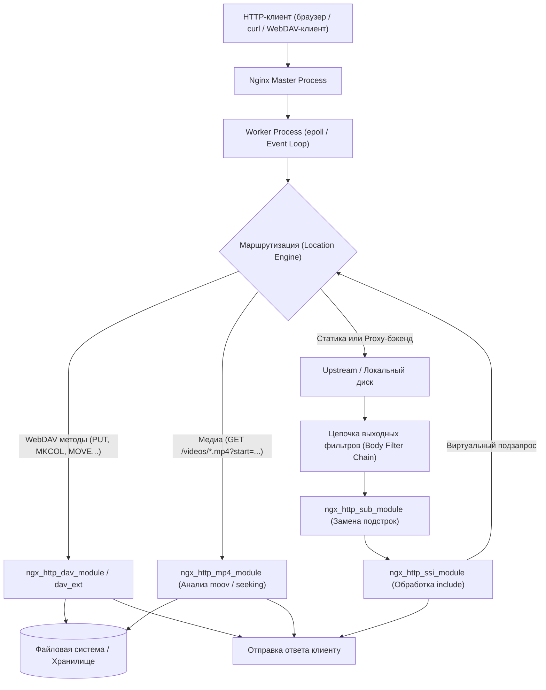

# Утилитные модули Nginx: WebDAV, видео, SSI и подмена контента

**Актуально для:** Nginx 1.26.x (Stable) / 1.28.x (Mainline), nginx-dav-ext-module 3.x

---

## Определения

**ngx_http_dav_module** — встроенный модуль Nginx, реализующий базовую серверную поддержку протокола WebDAV (RFC 4918 / RFC 2518) на уровне методов управления файловой системой: `PUT`, `DELETE`, `MKCOL`, `COPY` и `MOVE`. Позволяет организовать загрузку, удаление, создание каталогов и переименование файлов по протоколу HTTP/HTTPS без привлечения внешних бэкендов. По умолчанию в Nginx не собирается (требует флага сборки `--with-http_dav_module`).

**nginx-dav-ext-module (dav_ext)** — внешний динамический или статический модуль (автор Роман Арутюнян), расширяющий WebDAV-функционал Nginx недостающими стандартизированными методами: `PROPFIND` (запрос структуры каталогов и метаданных), `OPTIONS` (обнаружение возможностей сервера) и `LOCK`/`UNLOCK` (управление эксклюзивными блокировками файлов). Необходим для полноценной работы нативных ОС-клиентов WebDAV (Windows Explorer, macOS Finder, Linux gio/davfs2, Cyberduck, WinSCP).

**ngx_http_mp4_module** — встроенный модуль для псевдопотокового вещания (Progressive Download с произвольным позиционированием — seeking) медиафайлов в контейнерах `.mp4`, `.m4v`, `.m4a`. Обрабатывает HTTP-запросы с GET-параметрами временного диапазона (`?start=X&end=Y`), пересобирая атомы медиаконтейнера на лету и отдавая видео с запрошенной секунды без предварительного скачивания всего файла.

**ngx_http_flv_module** — легковесный модуль псевдопотокового вещания для устаревшего медиаконтейнера Flash Video (`.flv`), выполняющий позиционирование по запросу с байтовым или временным смещением (`?start=X`). Применяется исключительно в архивных и legacy-системах.

**ngx_http_ssi_module** — модуль серверных включений (Server Side Includes), выступающий фильтром тела ответа (output body filter). Парсит директивы вида `<!--# include virtual="..." -->`, подставляя в HTML-документ результаты внутренних подзапросов к статическим файлам или динамическим бэкендам без накладных расходов внешнего сетевого взаимодействия.

**ngx_http_sub_module** — потоковый фильтр тела ответа, выполняющий строковую замену одной или нескольких подстрок на лету в исходящем потоке данных. Используется системными администраторами и SRE для подмены URL ассетов, переписывания абсолютных путей при миграции доменов, внедрения системных баннеров и скрытия служебных заголовков.

**Moov-атом (Metadata Atom)** — служебная структура MP4-контейнера, содержащая индексную таблицу таймкодов, смещений чанков (`stco`/`co64`), длительность дорожек и кодеки. Для быстрого запуска воспроизведения и корректного seeking moov-атом должен находиться в начале файла (**faststart**).

**Эксклюзивная блокировка (Exclusive Write Lock)** — механизм WebDAV, предотвращающий одновременную модификацию или удаление файла несколькими пользователями путем выдачи временного Lock-токена (`urn:uuid:...`), сохраняемого в разделяемой памяти Nginx (`dav_ext_lock_zone`).

---

## Архитектура и принцип работы

### Модульная цепочка обработки запросов

Nginx обрабатывает входящие запросы через цепочку фаз (phases) ядра и систему фильтров (filter chain). Утилитные модули распределены по разным уровням архитектуры:



### Архитектура WebDAV в Nginx

1. **Разделение обязанностей:**
   - Модуль ядра `ngx_http_core_module` обрабатывает стандартные методы `GET` и `HEAD`.
   - Встроенный модуль `ngx_http_dav_module` перехватывает методы `PUT`, `DELETE`, `MKCOL`, `COPY`, `MOVE`.
   - Модуль `nginx-dav-ext-module` встраивается в фазы `NGX_HTTP_PRECONTENT_PHASE` и `NGX_HTTP_CONTENT_PHASE`, перехватывая `PROPFIND`, `OPTIONS`, `LOCK` и `UNLOCK`.
2. **Механизм загрузки через `PUT` и атомарность:**
   - Входящее тело файла не записывается сразу в целевой путь. Nginx буферизует его во временный каталог, задаваемый директивой `client_body_temp_path`.
   - После полной загрузки тела запроса и проверки контрольной суммы Nginx выполняет системный вызов `rename(2)` из временного каталога в целевое хранилище (`root` или `alias`).
   - Если промежуточные каталоги отсутствуют, директива `create_full_put_path on;` автоматически создает иерархию папок на диске.
3. **Управление блокировками (`dav_ext`):**
   - Таблица блокировок размещается в разделяемой памяти (`shared memory zone`), объявляемой директивой `dav_ext_lock_zone` в контексте `http`.
   - При запросе `LOCK` Nginx регистрирует путь и генерирует уникальный токен `Lock-Token: <urn:uuid:...>`. Любые последующие запросы `PUT`, `DELETE` или `MOVE` на этот ресурс без указания заголовка `If: (<urn:uuid:...>)` отклоняются с кодом `423 Locked`.

### Архитектура потокового видео (MP4 / FLV)

1. **Структура MP4-контейнера и проблема Moov-атома:**
   - MP4-файл состоит из атомов: `ftyp` (тип файла), `mdat` (бинарные медиаданные аудио/видео) и `moov` (индексная таблица).
   - Если файл сформирован камерой или кодировщиком без флага `+faststart`, `moov` записывается в самый конец файла.
   - При запросе `?start=X` модуль `ngx_http_mp4_module` обязан сначала прочитать `moov`. Если `moov` находится в конце многогигабайтного файла, модуль вынужден считывать файл до конца в буфер оперативной памяти `mp4_max_buffer_size`. Это порождает дисковый I/O-шторм и утечку памяти воркера.
2. **Процесс псевдостриминга на лету:**
   - Модуль читает `moov`, вычисляет новое смещение кадров для времени `start`, генерирует новый усеченный `moov`-атом в памяти.
   - Клиенту отправляется HTTP-заголовок `200 OK` (или `206 Partial Content` при Range-запросах) с обновленной метаинформацией, за которой сразу следует поток сэмплов из `mdat`, начиная с ключевого кадра (I-frame / Keyframe), если включен `mp4_start_key_frame on;`.
3. **Оптимизация высоконагруженного I/O:**
   - Передача видеопотоков через стандартный пул воркеров может заблокировать рабочий процесс при операциях чтения с медленного диска. Для исключения задержек применяются асинхронный ввод-вывод (`aio threads`) и флаг `directio` для обхода OS Page Cache при работе с файлами больше заданного размера.

### Архитектура SSI и виртуальных подзапросов

1. **Внутренние подзапросы (Internal Subrequests):**
   - Директива `<!--# include virtual="/path" -->` не порождает сетевого HTTP-соединения. Nginx создает внутреннюю структуру `ngx_http_request_t`, связанную с родительским запросом, и запускает ее через внутренний конвейер обработки.
   - Целевой `location` может быть закрыт от внешнего мира директивой `internal;`, обеспечивая безопасность служебных API.
2. **Потоковая сборка:**
   - Вывод формируется фрагментами (chunks). Если внутренний бэкенд задерживает ответ, родительский ответ блокируется, либо при директиве `ssi_silent_errors on;` выводится заготовленная заглушка `stub="..."`.

### Архитектура фильтрации `sub_filter`

1. **Потоковый буферный фильтр:**
   - Модуль `ngx_http_sub_module` просматривает проходящий поток данных через скользящее окно буферов.
   - **Критическое ограничение:** модуль работает только с открытым текстом. Если upstream-бэкенд вернул сжатый поток (`Content-Encoding: gzip`), Nginx не сможет найти подстроку без предварительного распаковщика `gunzip`. Поэтому на прокси-уровне обязательно отключается сжатие бэкенда (`proxy_set_header Accept-Encoding "";`).

---

## Практические сценарии

### Предварительные требования

Проверка наличия скомпилированных модулей в Nginx:

```bash
nginx -V 2>&1 | grep -oE 'with-http_[a-z_]*' | sort -u
# → --with-http_dav_module
# → --with-http_flv_module
# → --with-http_mp4_module
# → --with-http_ssi_module
# → --with-http_sub_module
```

Установка модуля `dav-ext` (для Debian/Ubuntu):

```bash
sudo apt-get update && sudo apt-get install -y libnginx-mod-http-dav-ext
# → Reading package lists... Done
# → libnginx-mod-http-dav-ext is already the newest version
```

Для RHEL/AlmaLinux/Rocky Linux (репозиторий EPEL):

```bash
sudo dnf install -y nginx-mod-http-dav-ext
# → Installed: nginx-mod-http-dav-ext
```

Подключение динамического модуля в начале файла `/etc/nginx/nginx.conf` (если не подключен пакетом автоматически):

```nginx
load_module modules/ngx_http_dav_ext_module.so;
```

Подготовка системного пользователя и каталогов хранения с POSIX-правами:

```bash
sudo mkdir -p /srv/storage/webdav /srv/storage/temp /srv/media/videos /srv/www/pages
sudo chown -R www-data:www-data /srv/storage /srv/media /srv/www
sudo chmod 2775 /srv/storage/webdav /srv/storage/temp
# → Установлен SGID-бит для сохранения группы при создании каталогов клиентами
```

---

### Сценарий 1: Производственный WebDAV-репозиторий для CI/CD артефактов и бэкапов

Задача: развернуть изолированное хранилище файлов для выгрузки билдов, ISO-образов и системных дампов через `curl`, защищенное TLS, BasicAuth, с жестким контролем прав и исключением выполнения вредоносных скриптов.

```nginx
# /etc/nginx/conf.d/webdav_artifacts.conf

server {
    listen 443 ssl;
    server_name artifacts.corp.internal;

    ssl_certificate     /etc/ssl/certs/artifacts.crt;
    ssl_certificate_key /etc/ssl/private/artifacts.key;
    ssl_protocols       TLSv1.2 TLSv1.3;
    ssl_ciphers         HIGH:!aNULL:!MD5;

    # Максимальный размер загружаемого артефакта
    client_max_body_size 20g;

    # КРИТИЧНО ДЛЯ SYSADMIN/SRE:
    # client_body_temp_path ДОЛЖЕН находиться на той же файловой системе (mount point),
    # что и root, чтобы rename() был атомарным системным вызовом, а не копированием через RAM/диск.
    client_body_temp_path /srv/storage/temp 1 2;

    location / {
        root /srv/storage/webdav;

        # Разрешенные WebDAV-методы
        dav_methods PUT DELETE MKCOL COPY MOVE;

        # Права доступа на создаваемые файлы и каталоги в ФС
        # user:rw group:rw all:r соответствует chmod 0664 для файлов и 0775 для папок
        dav_access user:rw group:rw all:r;

        # Автоматическое создание цепочки родительских каталогов при PUT
        create_full_put_path on;

        # Защита от случайного удаления корня репозитория (глубина пути >= 2)
        min_delete_depth 1;

        # Авторизация доступа
        auth_basic "Corporate Artifact Storage";
        auth_basic_user_file /etc/nginx/.htpasswd_artifacts;

        # Листинг содержимого для загрузки через браузер
        autoindex on;
        autoindex_exact_size off;
        autoindex_localtime on;

        # БЕЗОПАСНОСТЬ: Полный запрет исполнения любых исполняемых скриптов
        # исключает Remote Code Execution при случайной или намеренной выгрузке .php, .sh, .py
        location ~* \.(php|phtml|sh|py|pl|cgi|bash)$ {
            deny all;
            return 403;
        }
    }
}
```

Проверка и тестирование функционала:

```bash
# 1. Создание каталога сборки
curl -s -u deploy:SecretPass123 -X MKCOL https://artifacts.corp.internal/build-4521/
# → HTTP/1.1 201 Created

# 2. Атомарная загрузка артефакта
curl -s -u deploy:SecretPass123 -T app-release.tar.gz https://artifacts.corp.internal/build-4521/app-release.tar.gz
# → HTTP/1.1 201 Created

# 3. Проверка метаданных файла
curl -s -u deploy:SecretPass123 -I https://artifacts.corp.internal/build-4521/app-release.tar.gz
# → HTTP/1.1 200 OK
# → Content-Length: 45892144
# → Last-Modified: Wed, 16 Oct 2026 09:30:00 GMT

# 4. Проверка защитного правила от выгрузки исполняемых скриптов
curl -s -u deploy:SecretPass123 -T exploit.sh https://artifacts.corp.internal/build-4521/exploit.sh
# → HTTP/1.1 403 Forbidden
```

---

### Сценарий 2: Полнофункциональный WebDAV с PROPFIND и блокировками (`dav_ext`)

Задача: обеспечить возможность подключения хранилища в качестве сетевого диска для Windows Explorer, macOS Finder и мобильных клиентов с поддержкой листинга свойств каталогов (`PROPFIND`) и предотвращения конфликтов перезаписи через блокировки (`LOCK`/`UNLOCK`).

```nginx
# /etc/nginx/conf.d/webdav_full.conf

# ВНИМАНИЕ: Директива dav_ext_lock_zone объявляется СТРОГО в контексте http {}!
# Зона разделяемой памяти на 10 МБ способна хранить ~80 000 активных файловых локов.
dav_ext_lock_zone zone=dav_locks:10m;

server {
    listen 443 ssl;
    server_name dav.corp.internal;

    ssl_certificate     /etc/ssl/certs/dav.crt;
    ssl_certificate_key /etc/ssl/private/dav.key;

    client_max_body_size 10g;
    client_body_temp_path /srv/storage/temp 1 2;

    location /files/ {
        alias /srv/storage/webdav/;

        # Базовый модуль Nginx
        dav_methods PUT DELETE MKCOL COPY MOVE;
        dav_access user:rw group:rw all:r;
        create_full_put_path on;

        # Расширенный модуль dav_ext
        dav_ext_methods PROPFIND OPTIONS LOCK UNLOCK;
        dav_ext_lock zone=dav_locks;

        auth_basic "Enterprise WebDAV Storage";
        auth_basic_user_file /etc/nginx/.htpasswd_webdav;

        # Требуется для клиентов, отправляющих заголовок Depth
        # dav-ext обрабатывает Depth: 0, Depth: 1 и Depth: infinity
    }
}
```

Проверка работы методов `OPTIONS` и `PROPFIND`:

```bash
# Проверка поддерживаемых сервером методов (OPTIONS)
curl -s -u user:pass -X OPTIONS https://dav.corp.internal/files/ -I
# → HTTP/1.1 200 OK
# → DAV: 1, 2
# → Allow: GET, HEAD, PUT, DELETE, MKCOL, COPY, MOVE, PROPFIND, OPTIONS, LOCK, UNLOCK

# Запрос свойств каталога (PROPFIND с глубиной 1)
curl -s -u user:pass -X PROPFIND -H "Depth: 1" https://dav.corp.internal/files/ | head -n 15
# → <?xml version="1.0" encoding="utf-8" ?>
# → <D:multistatus xmlns:D="DAV:">
# → <D:response>
# → <D:href>/files/</D:href>
# → <D:propstat>
# → <D:prop>
# → <D:resourcetype><D:collection/></D:resourcetype>
```

---

### Сценарий 3: Высоконагруженная раздача видео (MP4) с seeking, AIO и шейпингом

Задача: настроить сервер для отдачи обучающих видеороликов и записей митингов в формате MP4 с минимальной нагрузкой на процессор, мгновенным стартом воспроизведения, поддержкой перемотки и предотвращением выедания сетевого канала отдельными пользователями.

```nginx
# /etc/nginx/conf.d/media_streaming.conf

# Определение пула потоков для неблокирующего дискового ввода-вывода
# Требует сборки Nginx с флагом --with-threads
thread_pool video_pool threads=32 max_queue=65536;

server {
    listen 80;
    server_name cdn-media.corp.internal;

    root /srv/media;

    location /videos/ {
        # Активация модуля MP4 псевдостриминга
        mp4;
        mp4_start_key_frame on;     # Начинать отдачу строго с ключевого кадра
        mp4_buffer_size     2m;     # Начальный буфер памяти для разбора
        mp4_max_buffer_size 64m;    # Максимальный буфер для moov-атома при seeking

        # Ограничение полосы пропускания для видео:
        # mp4_limit_rate_after задается во ВРЕМЕНИ ВОСПРОИЗВЕДЕНИЯ (не в байтах!).
        # Первые 60 секунд медиа отдаются на максимальной скорости сети для прогрева плеера.
        mp4_limit_rate_after 60s;
        
        # После 60с скорость ограничивается коэффициентом 1.25 от битрейта файла.
        # Это защищает сеть от перегрузки, гарантируя отсутствие буферизации у зрителя.
        mp4_limit_rate 1.25;

        # Высокопроизводительный дисковый I/O (SRE/Sysadmin Tuning):
        sendfile on;
        tcp_nopush on;
        
        # Обход Page Cache ядра для файлов крупнее 2 МБ во избежание вымывания кэша
        directio 2m;
        
        # Перенос чтения файлов с диска в пул независимых потоков
        aio threads=video_pool;

        # Заголовки кэширования для браузеров и CDN-прокси
        expires 30d;
        add_header Cache-Control "public, no-transform, max-age=2592000";
        add_header Accept-Ranges bytes;
    }
}
```

Проверка отдачи видео и корректности seeking:

```bash
# 1. Запрос фрагмента видео с 30-й секунды до 45-й секунды через GET-параметры
curl -s -I "http://cdn-media.corp.internal/videos/tutorial.mp4?start=30.0&end=45.0"
# → HTTP/1.1 200 OK
# → Content-Type: video/mp4
# → Accept-Ranges: bytes
# → Cache-Control: public, no-transform, max-age=2592000

# 2. Проверка HTTP Range запроса (RFC 7233)
curl -s -I -H "Range: bytes=0-1048575" http://cdn-media.corp.internal/videos/tutorial.mp4
# → HTTP/1.1 206 Partial Content
# → Content-Range: bytes 0-1048575/125829120
# → Content-Length: 1048576
```

---

### Сценарий 4: Сборка страниц на стороне Nginx через SSI (Micro-Frontends)

Задача: собирать страницы портала из независимых сервисов (стабильный статический шаблон + динамический блок меню + виджет баланса) без использования тяжелых серверных шаблонизаторов и с изоляцией сбоев.

```nginx
# /etc/nginx/conf.d/ssi_portal.conf

upstream user_profile_svc {
    server 127.0.0.1:8081 max_fails=3 fail_timeout=10s;
    keepalive 32;
}

upstream catalog_svc {
    server 127.0.0.1:8082 max_fails=3 fail_timeout=10s;
    keepalive 32;
}

server {
    listen 80;
    server_name portal.corp.internal;

    root /srv/www/pages;

    location / {
        ssi on;
        ssi_silent_errors on;     # При падении подзапроса отдавать fallback-заглушку
        ssi_types text/html text/xml;
        ssi_value_length 512;

        try_files $uri $uri/ /index.html;
    }

    # Служебные внутренние эндпоинты (закрыты от прямого доступа извне)
    location /internal/user-widget {
        internal;
        proxy_pass http://user_profile_svc/api/widget;
        proxy_connect_timeout 1s;
        proxy_read_timeout 2s;
        proxy_set_header X-Original-URI $request_uri;
    }

    location /internal/menu {
        internal;
        proxy_pass http://catalog_svc/api/menu;
        proxy_connect_timeout 1s;
        proxy_read_timeout 2s;
    }

    # Статическая заглушка при отказе сервисов (Circuit Breaker)
    location /internal/fallback-widget {
        internal;
        return 200 '<div class="widget-fallback">Сервис временно недоступен</div>';
    }
}
```

Пример HTML-шаблона `/srv/www/pages/index.html`:

```html
<!DOCTYPE html>
<html lang="ru">
<head>
    <meta charset="UTF-8">
    <title>Внутренний портал</title>
</head>
<body>
    <header>
        <!--# include virtual="/internal/menu" -->
    </header>
    <main>
        <h1>Личный кабинет</h1>
        <!--# include virtual="/internal/user-widget" stub="/internal/fallback-widget" -->
    </main>
    <footer>
        <p>Сгенерировано Nginx SSI: <!--# echo var="date_local" --></p>
    </footer>
</body>
</html>
```

Тестирование сборки страницы:

```bash
curl -s http://portal.corp.internal/
# → <!DOCTYPE html>
# → ...
# → <header><nav class="menu">...</nav></header>
# → <div class="user-info">Пользователь: admin</div>
# → <footer><p>Сгенерировано Nginx SSI: Wednesday, 16-Oct-2026 12:45:00 MSK</p></footer>
```

---

### Сценарий 5: Обратный прокси с подменой ссылок через `sub_filter`

Задача: настроить обратный прокси для легаси-приложения, которое генерирует ссылки на внутренний сервер `http://app-backend.internal:8080`, переписав их на внешний защищенный адрес `https://portal.corp.internal`, внедрив метатеги и скрыв служебные заголовки.

```nginx
# /etc/nginx/conf.d/proxy_sub_filter.conf

server {
    listen 443 ssl;
    server_name portal.corp.internal;

    ssl_certificate     /etc/ssl/certs/portal.crt;
    ssl_certificate_key /etc/ssl/private/portal.key;

    location / {
        proxy_pass http://10.10.20.15:8080;

        # КРИТИЧНО ДЛЯ SUB_FILTER:
        # Отключаем сжатие со стороны бэкенда!
        # Если бэкенд вернет gzip, sub_filter не сможет прочитать байты и пропустит замену.
        proxy_set_header Accept-Encoding "";

        # Параметры подмены текста
        sub_filter 'http://app-backend.internal:8080' 'https://portal.corp.internal';
        sub_filter '</head>' '<meta name="app-gateway" content="nginx-ingress"></head>';
        sub_filter_once off;                    # Заменять ВСЕ вхождения в документе
        sub_filter_types text/html text/javascript text/css application/json;
        sub_filter_last_modified on;            # Сохранять Last-Modified для кэширования

        # Управление заголовками безопасности (SRE/DevSecOps)
        proxy_hide_header X-Powered-By;
        proxy_hide_header Server;
        add_header X-Frame-Options "SAMEORIGIN" always;
        add_header X-Content-Type-Options "nosniff" always;
    }
}
```

Проверка подмены строк в ответах:

```bash
# Проверка отсутствия старых ссылок и наличия нового домена
curl -s https://portal.corp.internal/ | grep -c 'http://app-backend.internal:8080'
# → 0

curl -s https://portal.corp.internal/ | grep -c 'https://portal.corp.internal'
# → 14

# Проверка скрытия заголовка X-Powered-By
curl -s -I https://portal.corp.internal/ | grep -i 'x-powered-by'
# → (пустой вывод)
```

---

## Операции и команды

Сводная таблица ключевых директив утилитарных модулей:

| Директива | Модуль | Контекст | Значение по умолчанию | Назначение в production |
| :--- | :--- | :--- | :--- | :--- |
| `dav_methods` | `ngx_http_dav_module` | `http`, `server`, `location` | `off` | Активирует методы `PUT`, `DELETE`, `MKCOL`, `COPY`, `MOVE` |
| `create_full_put_path` | `ngx_http_dav_module` | `http`, `server`, `location` | `off` | Создает отсутствующие родительские директории при выгрузке файлов |
| `dav_access` | `ngx_http_dav_module` | `http`, `server`, `location` | `user:rw` | Задает POSIX-права доступа (`chmod`) на создаваемые файлы |
| `min_delete_depth` | `ngx_http_dav_module` | `http`, `server`, `location` | `0` | Защита от случайного удаления корня репозитория через `DELETE` |
| `dav_ext_lock_zone` | `dav_ext` | `http` | — | Создает разделяемую память для хранения блокировок WebDAV |
| `dav_ext_lock` | `dav_ext` | `http`, `server`, `location` | — | Привязывает зону блокировок к конкретному `location` |
| `dav_ext_methods` | `dav_ext` | `http`, `server`, `location` | `off` | Включает методы `PROPFIND`, `OPTIONS`, `LOCK`, `UNLOCK` |
| `mp4` | `ngx_http_mp4_module` | `location` | — | Включает обработку MP4-псевдостриминга |
| `mp4_start_key_frame` | `ngx_http_mp4_module` | `http`, `server`, `location` | `off` | Начинает отдачу видео строго с опорного ключевого кадра |
| `mp4_buffer_size` | `ngx_http_mp4_module` | `http`, `server`, `location` | `512k` | Начальный буфер памяти для разбора атомов MP4 |
| `mp4_max_buffer_size` | `ngx_http_mp4_module` | `http`, `server`, `location` | `10m` | Предельный размер буфера под чтение moov-атома |
| `mp4_limit_rate` | `ngx_http_mp4_module` | `http`, `server`, `location` | `off` | Ограничивает скорость передачи кратно битрейту медиафайла |
| `mp4_limit_rate_after` | `ngx_http_mp4_module` | `http`, `server`, `location` | `1m` | Время воспроизведения, отдаваемое без ограничения скорости |
| `ssi` | `ngx_http_ssi_module` | `http`, `server`, `location` | `off` | Включает парсинг директив Server Side Includes |
| `ssi_silent_errors` | `ngx_http_ssi_module` | `http`, `server`, `location` | `off` | Подавляет вывод системной строки об ошибке при падении include |
| `ssi_types` | `ngx_http_ssi_module` | `http`, `server`, `location` | `text/html` | MIME-типы ответов, в которых обрабатываются SSI-директивы |
| `sub_filter` | `ngx_http_sub_module` | `http`, `server`, `location` | — | Задает пары «строка поиска» → «строка замены» |
| `sub_filter_once` | `ngx_http_sub_module` | `http`, `server`, `location` | `on` | Выполнять только одну замену или заменять все вхождения (`off`) |
| `sub_filter_types` | `ngx_http_sub_module` | `http`, `server`, `location` | `text/html` | Список MIME-типов для выполнения строковой фильтрации |

Инструменты системного администратора для диагностики:

```bash
# 1. Анализ расположения moov-атома в MP4-файле
ffprobe -v trace /srv/media/videos/tutorial.mp4 2>&1 | grep -E -m 2 "type:'(moov|mdat)'"
# → [mov,mp4,m4a,3gp,3g2,mj2 @ 0x...] type:'moov' parent:'root'
# → Если первым выведен 'moov' — файл оптимизирован (faststart). Если 'mdat' — требуется исправление!

# 2. Перенос moov-атома в начало файла без перекодирования (атомарный faststart)
qt-faststart /srv/media/videos/raw.mp4 /srv/media/videos/tutorial.mp4
# Либо через ffmpeg:
ffmpeg -i /srv/media/videos/raw.mp4 -codec copy -movflags +faststart /srv/media/videos/tutorial.mp4 -y
# → [mp4 @ 0x...] Starting second pass: moving the moov atom to the beginning of the file

# 3. Интерактивная консоль тестирования WebDAV (утилита cadaver)
sudo apt-get install -y cadaver
cadaver https://dav.corp.internal/files/
# → Authentication required for Enterprise WebDAV Storage on 'dav.corp.internal':
# → Username: user
# → Password: 
# → dav:/files/> ls
# → Listing collection `/files/': succeeded.
# → Coll: build-4521                             4096  Oct 16 12:30
# → dav:/files/> lock app-release.tar.gz
# → Locking `app-release.tar.gz': succeeded. [Lock Token: <opaquelocktoken:...>]
```

---

## Устранение неполадок

### 1. `405 Method Not Allowed` при запросах `PUT`, `DELETE` или `PROPFIND`

- **Симптом:** Клиент получает ответ `HTTP/1.1 405 Method Not Allowed` при попытке загрузить файл или открыть директорию в WebDAV-клиенте.
- **Причина:**
  1. Метод не разрешен в директиве `dav_methods` (для `PUT`, `DELETE`, `MKCOL`) либо отсутствует директива `dav_ext_methods` (для `PROPFIND`, `OPTIONS`, `LOCK`).
  2. Запрос перехвачен другим регулярным выражением `location ~ ...`, в котором WebDAV не включен.
- **Диагностика:**
  ```bash
  curl -s -X PUT -T /dev/null https://dav.corp.internal/files/test.txt -I
  # Проверить секцию лога:
  tail -n 2 /var/log/nginx/error.log
  ```
- **Решение:**
  - Убедиться, что в `location` присутствуют директивы `dav_methods PUT DELETE MKCOL COPY MOVE;` и `dav_ext_methods PROPFIND OPTIONS LOCK UNLOCK;`.
  - Проверить приоритет `location` (префиксные `location ^~ /files/` имеют приоритет над регулярными выражениями).

---

### 2. Ошибка загрузки файлов: `rename() failed (18: Invalid cross-device link)`

- **Симптом:** При попытке `PUT` большого файла загрузка доходит до 100%, после чего сервер возвращает `HTTP/1.1 500 Internal Server Error`. В `error.log` появляется запись:
  `[crit] ... rename() "/var/lib/nginx/body/0000000001" to "/srv/storage/webdav/file.iso" failed (18: Invalid cross-device link)`.
- **Причина:** Каталог временных файлов `client_body_temp_path` (по умолчанию в `/var/lib/nginx/body`) и целевой каталог хранения (`/srv/storage/webdav`) находятся на разных физических дисках, разделах LVM или томах файловой системы. POSIX-вызов `rename(2)` не может атомарно перемещать файлы между разными точками монтирования.
- **Решение:** Явно задать `client_body_temp_path` на том же разделе, где находится целевое хранилище:
  ```nginx
  client_body_temp_path /srv/storage/temp 1 2;
  ```

---

### 3. Ошибка `409 Conflict` при загрузке файлов в поддиректории

- **Симптом:** Запрос `PUT /files/subdir1/subdir2/file.tar.gz` завершается с кодом `409 Conflict`.
- **Причина:** Промежуточные директории `subdir1` или `subdir2` не существуют на диске, а директива автоматического создания путей выключена.
- **Решение:** Добавить в контекст `location` директиву `create_full_put_path on;`.

---

### 4. Ошибка `mp4 moov atom is too large` и зависание воркеров

- **Симптом:** В журнале ошибок фиксируется запись:
  `[error] ... mp4 moov atom is too large: 41943040, you may want to increase mp4_max_buffer_size in ...`
  Клиент получает ошибку `500 Internal Server Error`, у воркера Nginx наблюдается пиковое потребление RAM.
- **Причина:** Размер индексного атома `moov` превысил лимит по умолчанию (`10m`). Часто случается на многочасовых 4K видеозаписях или при размещении `moov` в конце файла.
- **Решение:**
  1. В конфигурации увеличить лимит буфера:
     ```nginx
     mp4_max_buffer_size 64m;
     ```
  2. Оптимизировать видеофайл на диске утилитой `qt-faststart` или `ffmpeg -movflags +faststart`.

---

### 5. `sub_filter` не заменяет подстроку в ответе прокси

- **Симптом:** Страница отдается клиенту успешно (`200 OK`), но подмены домена или ссылок не произошло.
- **Причина:**
  1. Бэкенд возвращает ответ со сжатием (`Content-Encoding: gzip`). Nginx не распаковывает тело ответа перед передачей в `sub_filter`.
  2. MIME-тип ответа не входит в `sub_filter_types` (по умолчанию обрабатывается только `text/html`).
- **Диагностика:**
  ```bash
  curl -s -I -H "Host: portal.corp.internal" http://10.10.20.15:8080/ | grep -E -i 'Content-Type|Content-Encoding'
  # → Content-Type: application/javascript
  # → Content-Encoding: gzip
  ```
- **Решение:**
  - Отключить сжатие со стороны бэкенда: `proxy_set_header Accept-Encoding "";`.
  - Расширить список поддерживаемых типов: `sub_filter_types text/html text/plain text/css application/javascript application/json;`.

---

### 6. Зависание SSI-страницы или ошибка `504 Gateway Timeout`

- **Симптом:** Страница с SSI загружается с огромной задержкой и в итоге выдает `504 Gateway Timeout` либо частично пустой экран.
- **Причина:** Один из внутренних сервисов, вызываемый через `<!--# include virtual="/internal/..." -->`, не отвечает вовремя.
- **Решение:**
  - Настроить жесткие таймауты для внутренних proxy-локаций (`proxy_connect_timeout 1s; proxy_read_timeout 2s;`).
  - Включить подавление ошибок `ssi_silent_errors on;` и обязательно указывать параметр `stub` в SSI-теге:
    ```html
    <!--# include virtual="/internal/svc" stub="/internal/fallback" -->
    ```

---

## Лучшие практики (DevOps / SRE / Sysadmin)

### Безопасность и разграничение доступа

1. **Изоляция и предотвращение выполнения скриптов:**
   Никогда не совмещайте WebDAV-директории с обработчиками скриптов (PHP-FPM, uWSGI, Passenger). В любой локации, принимающей `PUT`, обязательно отключайте выполнение файлов:
   ```nginx
   location ~* \.(php|phtml|sh|py|pl|cgi|bash|bin|phar)$ {
       deny all;
       return 403;
   }
   ```
2. **Обязательное использование TLS и mTLS:**
   Протокол WebDAV передает учетные данные авторизации в открытом виде (Basic Auth — base64). На внешних и корпоративных сетевых периметрах WebDAV должен работать строго поверх HTTPS (TLS 1.2/1.3) либо с аутентификацией по клиентским сертификатам ([mTLS в Nginx](../Security/TLS_SSL/nginx_mtls_configuration.md)).
3. **Ограничение опасных методов:**
   Если хранилище предназначено только для выгрузки, запретите метод `DELETE` для сервисных учетных записей через `limit_except`:
   ```nginx
   limit_except GET HEAD PUT {
       auth_basic "Write-Only Storage";
       auth_basic_user_file /etc/nginx/.htpasswd_uploaders;
   }
   ```

### Производительность, хранение и дисковый ввод-вывод

1. **Размещение каталогов и оптимизация файловых систем:**
   - Выделяйте под хранилище WebDAV и видеоархивы независимые дисковые тома (отдельные mount points), смонтированные с опцией `noatime` в `/etc/fstab` для снижения накладных расходов метаданных ФС.
   - Следите за размещением `client_body_temp_path` строго на том же дисковом разделе, что и `root`, чтобы избежать отказа `EXDEV (Invalid cross-device link)`.
2. **Пул потоков (Thread Pools) и DirectIO для медиа:**
   - Чтение гигабайтных видеофайлов с диска может заблокировать рабочий поток Nginx, ухудшив latency для всех остальных клиентов. Включайте компиляцию с пулами потоков (`--with-threads`), настраивайте `aio threads` и используйте `directio 2m` для обхода системного page cache при отдаче крупных файлов.
3. **Ограничение полосы пропускания (Bandwidth Throttling):**
   - Используйте связку `mp4_limit_rate_after 30s` и `mp4_limit_rate 1.2` (или директивы `limit_rate` и `limit_rate_after`). Это позволяет клиенту мгновенно заполнить буфер плеера, после чего сервер искусственно притормаживает передачу, предотвращая истощение сетевого интерфейса (Network Interface Saturation).
4. **Конвейер подготовки медиаконтента (CI/CD Pipeline):**
   - Автоматизируйте прогон всех загружаемых видеофайлов через утилиту `qt-faststart` еще до публикации в каталог Nginx. Это гарантирует нахождение `moov`-атома в начале файла и нулевой оверхед по памяти.

### Мониторинг и наблюдаемость (SRE Observability)

1. **Формат журналов доступа:**
   Включите в `log_format` отображение метода запроса, переданных байт, времени ответа и статуса:
   ```nginx
   log_format webdav_combined '$remote_addr - $remote_user [$time_local] '
                              '"$request_method $uri $server_protocol" $status $body_bytes_sent '
                              '"$http_referer" "$http_user_agent" '
                              'rt=$request_time uct="$upstream_connect_time" uht="$upstream_header_time"';
   ```
2. **Мониторинг кодов состояния:**
   - Настройте алерты на всплески кодов:
     - `423 (Locked)` — зависшие блокировки WebDAV.
     - `507 (Insufficient Storage)` — исчерпание места на диске.
     - `405 (Method Not Allowed)` — некорректная конфигурация методов.
     - `409 (Conflict)` — попытка создания ресурса в несуществующем каталоге.
3. **Мониторинг дискового пространства и дескрипторов (Inodes):**
   - WebDAV-репозитории подвержены быстрому исчерпанию инод при загрузке множества мелких файлов билдов. Настройте мониторинг утилизации диска (`df -h`) и инод (`df -i`) через node_exporter / Prometheus.

---

## Дополнительная информация

### Взаимосвязи и смежные темы

- **[WebDAV: Архитектура протокола и клиенты](../../../Linux/Networking/Services/webdav/webdav_overview.md)** — разбор протокола RFC 4918, методы, заголовки `Depth` и `If`, клиенты Linux (davfs2, gio).
- **[Потоковое видео в Angie](../../Angie/angie_video_streaming.md)** — сравнение возможностей медиа-модулей Nginx с современным сервером Angie (динамическая HLS/DASH упаковка, выбор аудиодорожек).
- **[Утилитные модули Angie](../../Angie/angie-http-utility-modules.md)** — реализация `sub_filter`, `slice`, `split_clients` и `gunzip` в веб-серверах семейства Angie.
- **[mTLS в Nginx](../Security/TLS_SSL/nginx_mtls_configuration.md)** — настройка двусторонней TLS-аутентификации с проверкой клиентских сертификатов для защиты WebDAV.
- **[Тюнинг производительности Nginx](../Performance/nginx_performance_tuning.md)** — оптимизация `sendfile`, `tcp_nopush`, `aio threads`, буферов соединений и параметров ядра Linux.
- **[Мониторинг Nginx с модулем VTS](./nginx_vts_monitoring_setup.md)** — сбор метрик трафика по методам запросов и кодам ответов в Prometheus и Grafana.
- **[Сборка Nginx из исходников](../Core/nginx_build_from_source.md)** — компиляция веб-сервера с модулями `--with-http_dav_module`, `--with-http_mp4_module`, `--with-threads`.
- **[Проксирование HTTP-сервисов](../../../Networking/Protocols/HTTP/http_servers_proxies.md)** — управление наследованием заголовков, `proxy_hide_header` и взаимодействие с upstream.