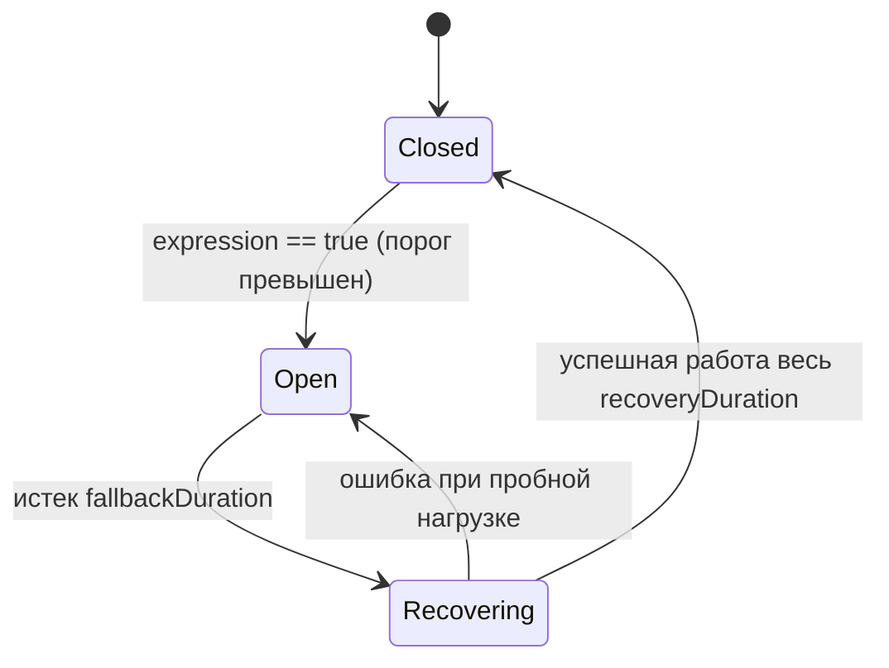

# Circuit Breaker и Retry в Traefik: паттерны, комбинации, мониторинг

**Актуально для:** Traefik v3.x (обратная совместимость с Traefik v2.x)

## Определения

**Circuit Breaker (CB, автоматический выключатель цепи)** — паттерн отказоустойчивости, отслеживающий ошибки и латентность вызываемого сервиса. При превышении заданного порога отказов он временно размыкает цепь (fast-fail), возвращая клиенту немедленную ошибку (по умолчанию HTTP 503) без отправки запросов на сбойный бэкенд, предотвращая каскадные сбои.

**Состояния Circuit Breaker в Traefik:**
- **Closed (Замкнуто):** Нормальный режим работы. Запросы свободно проходят к бэкенду. Traefik непрерывно собирает скользящую статистику метрик.
- **Open (Разомкнуто):** Аварийный режим. Цепь разорвана, входящие запросы не направляются бэкенду и мгновенно получают код ответа `responseCode` (по умолчанию 503 Service Unavailable). Состояние длится в течение `fallbackDuration`.
- **Recovering (Восстановление / Half-Open):** Пробный период после истечения `fallbackDuration`. Traefik начинает плавно пропускать линейно возрастающую долю запросов к бэкенду в течение интервала `recoveryDuration`. Любой сбой возвращает цепь в состояние Open; успешное прохождение всей фазы закрывает цепь (Closed).

**Retry (Повтор запроса)** — механизм повторной отправки HTTP-запроса к пулу серверов при получении сетевой ошибки или определенных кодов ответа бэкенда.

**Exponential Backoff (Экспоненциальная задержка)** — алгоритм прогрессивного увеличения паузы между повторными попытками (например, 100ms → 200ms → 400ms), предотвращающий мгновенную перегрузку восстанавливающегося сервиса.

**Jitter (Случайное отклонение)** — добавление псевдослучайной вариации к интервалу задержки для исключения синхронизации сотен клиентов и возникновения эффекта "громоподобного стада" (thundering herd).

**Retry Budget (Бюджет повторов)** — ограничение доли повторных запросов относительно общего объема легитимного трафика (в SRE-практике рекомендуется не более 10–20%), исключающее лавинообразную перегрузку (retry storm).

**Fallback Service (Резервный сервис)** — альтернативный обработчик или статическая страница-заглушка, отдающая деградированный, но корректный ответ клиенту в момент, когда основной сервис недоступен или Circuit Breaker разомкнут.

**Idempotency (Идемпотентность)** — свойство HTTP-метода (GET, HEAD, PUT, DELETE, OPTIONS), при котором многократное повторение одного и того же запроса приводит к тому же результату состояния сервера, что и однократное. Запросы POST и PATCH по умолчанию не являются идемпотентными.

## Базовые концепции и архитектура

### Машина состояний Circuit Breaker в Traefik

В отличие от многих библиотек (например, Hystrix или Resilience4j), Traefik использует встроенную скользящую аналитику на основе сетевых событий и HTTP-ответов:



#### Параметры конфигурации Circuit Breaker

```yaml
http:
  middlewares:
    api-circuit-breaker:
      circuitBreaker:
        expression: "ResponseCodeRatio(500, 600, 0, 600) > 0.30 || LatencyAtQuantileMS(50.0) > 500"
        checkPeriod: 100ms
        fallbackDuration: 15s
        recoveryDuration: 15s
        responseCode: 503
```

- `expression` (string) — логическое выражение для оценки состояния цепи. При значении `true` цепь размыкается (Open).
- `checkPeriod` (duration, по умолчанию `100ms`) — интервал между последовательными проверками выражения в состоянии Closed.
- `fallbackDuration` (duration, по умолчанию `10s`) — время нахождения в состоянии Open перед переходом к пробному восстановлению.
- `recoveryDuration` (duration, по умолчанию `10s`) — длительность фазы Recovering, в течение которой процент пересылаемых на бэкенд запросов линейно увеличивается от 0 до 100%.
- `responseCode` (int, по умолчанию `503`) — HTTP-код, возвращаемый клиенту при разомкнутой цепи.

#### Доступные функции в expression

1. **`NetworkErrorRatio()`** — вычисляет отношение ошибок сетевого уровня (сбои TCP-хэндшейка, сбросы соединений `connection reset`, обрывы сокетов) к общему числу сетевых попыток:
   ```text
   NetworkErrorRatio() > 0.20
   ```
2. **`ResponseCodeRatio(from, to, dividedByFrom, dividedByTo)`** — отношение количества ответов с кодами в диапазоне `[from, to)` к количеству ответов в диапазоне `[dividedByFrom, dividedByTo)`.
   > [!IMPORTANT]
   > Нижняя граница диапазона включается (`inclusive`), а верхняя граница исключается (`exclusive`).
   - Для проверки доли ошибок 5xx среди всех ответов: `ResponseCodeRatio(500, 600, 0, 600) > 0.25` (более 25% ошибок 500–599 от общего потока).
   - Если знаменатель равен 0, функция возвращает `0.0`.
3. **`LatencyAtQuantileMS(quantile)`** — латентность обслуживания запросов на заданном процентиле в миллисекундах.
   > [!WARNING]
   > Значение квантиля обязано передаваться вещественным числом с плавающей точкой (обязателен суффикс `.0`): `LatencyAtQuantileMS(50.0) > 200` или `LatencyAtQuantileMS(99.0) > 1000`. Целочисленный аргумент `LatencyAtQuantileMS(50)` вызовет синтаксическую ошибку парсера Traefik при загрузке конфигурации.

Поддерживаются операторы сравнения `>`, `>=`, `<`, `<=`, `==`, `!=` и логические связки `&&` (И), `||` (ИЛИ).

---

### Механизм Retry в Traefik

Middleware `retry` осуществляет повторную отправку запросов при возникновении сбоев:

```yaml
http:
  middlewares:
    api-retry:
      retry:
        attempts: 3
        initialInterval: 200ms
        timeout: 3s
        status:
          - "502-504"
        disableRetryOnNetworkError: false
        retryNonIdempotentMethod: false
        maxRequestBodyBytes: 2097152
```

#### Параметры конфигурации Retry

| Параметр | Тип / Единицы | По умолчанию | Описание |
| :--- | :--- | :--- | :--- |
| `attempts` | целое число (int) | *обязательный* | Количество попыток отправки запроса к бэкенду (минимум 1). Значение 3 означает: 1 первичный запрос + до 2 повторов. |
| `initialInterval` | duration | `0` (без пауз) | Начальная задержка перед первым повтором. Каждый последующий интервал удваивается (`2 * previousInterval`). |
| `timeout` | duration | `0` (без лимита) | Максимальное суммарное время, выделяемое middleware на выполнение всех попыток запроса. |
| `status` | список строк / кодов | `[]` (все 5xx) | Диапазоны или конкретные HTTP-коды ответов бэкенда для запуска повтора (`["500", "502-504"]`). |
| `disableRetryOnNetworkError` | boolean | `false` | Если `true`, отключает повтор при ошибках сетевого уровня (TCP/сеть). При включении этого флага директива `status` обязательна! |
| `retryNonIdempotentMethod` | boolean | `false` | Разрешает ли повтор для неидемпотентных методов (`POST`, `PATCH`, `LOCK`). По умолчанию отключено в целях безопасности данных. |
| `maxRequestBodyBytes` | int (байты) | `2097152` (2 МБ) | Лимит размера тела запроса, которое Traefik буферизует в памяти для возможности повторной отправки. Значение `-1` отключает лимит (не рекомендуется). |

---

### Архитектурная комбинация: Circuit Breaker + Retry

Порядок подключения middleware в цепочке (`chain`) критически важен для устойчивости системы:

#### Рекомендуемый порядок: `CircuitBreaker → Retry → Service`

```text
Клиент ──▶ [ Router ] ──▶ [ CircuitBreaker ] ──▶ [ Retry ] ──▶ [ Service / Backend Pool ]
```

1. **Режим нормальной работы (Closed):**
   Запрос проходит через Circuit Breaker и поступает в Retry. Если один из серверов в пуле возвращает 502 или обрывает соединение, Retry направляет запрос на другой здоровый сервер бэкенда.
2. **Режим изоляции сбоя (Open):**
   Если пул бэкендов деградировал целиком и Circuit Breaker разомкнулся, **все последующие запросы отсекаются на входе в Circuit Breaker за миллисекунды**, возвращая 503. Они **не доходят** до Retry, предотвращая холостой расход CPU, удержание горутин Traefik и задержки клиентов на ожидание тайм-аутов повторов.
3. **Защита от искажения метрик:**
   Circuit Breaker оценивает итоговый результат цепочки бэкенда: единичный сбой отдельного пода, успешно сглаженный middleware `retry` через соседний под, не приводит к преждевременному размыканию цепи.

#### Антипаттерн: `Retry → CircuitBreaker → Service`

Если расположить Retry перед Circuit Breaker, то при размыкании цепи Circuit Breaker вернет 503, а внешний Retry перехватит этот 503 и начнет выполнять повторные попытки против уже разомкнутого выключателя. Это искусственно умножит число отказов на клиентах и заблокирует потоки.

---

### Ограничения: WebSocket и gRPC-стримы

- **WebSocket и gRPC Server-Streaming/Bidirectional:** Circuit Breaker оперирует атомарными HTTP-запросами и ответами. Потоковые долгоживущие соединения не генерируют дискретных кодов завершения на каждое сообщение, поэтому скользящее окно метрик CB для них не отражает реальное состояние деградации.
- **Решение:** Для защиты потоковых сервисов вместо Circuit Breaker используется middleware `inFlightReq` (ограничение параллельных соединений) в связке с активными health check сервиса (`service.loadBalancer.healthCheck`).

## Практические сценарии и конфигурация

### Сценарий 1: Production-ready конфигурация CB + Retry для REST API (File Provider)

Пример динамической конфигурации `/etc/traefik/dynamic/api-resilience.yml`.

```yaml
http:
  routers:
    api-router:
      rule: "Host(`api.example.com`)"
      entryPoints:
        - websecure
      service: api-service
      middlewares:
        - chain-api-resilience
      tls: {}

  middlewares:
    # 1. Объединяющая цепочка: сначала Circuit Breaker, затем Retry
    chain-api-resilience:
      chain:
        middlewares:
          - mw-circuit-breaker
          - mw-retry

    # 2. Circuit Breaker: размыкание при >30% 5xx кодов или p50 > 400ms
    mw-circuit-breaker:
      circuitBreaker:
        expression: "ResponseCodeRatio(500, 600, 0, 600) > 0.30 || LatencyAtQuantileMS(50.0) > 400"
        checkPeriod: 100ms
        fallbackDuration: 20s
        recoveryDuration: 15s
        responseCode: 503

    # 3. Retry: 3 попытки, экспоненциальная задержка от 150ms, тайм-аут 2.5s
    mw-retry:
      retry:
        attempts: 3
        initialInterval: 150ms
        timeout: 2500ms
        status:
          - "502-504"
        disableRetryOnNetworkError: false
        retryNonIdempotentMethod: false
        maxRequestBodyBytes: 2097152

  services:
    api-service:
      loadBalancer:
        servers:
          - url: "http://10.0.1.11:8080"
          - url: "http://10.0.1.12:8080"
        healthCheck:
          path: /healthz
          interval: 5s
          timeout: 2s
```

---

### Сценарий 2: Развертывание в Docker Compose с labels

Конфигурация микросервиса в `docker-compose.yml` на базе Docker Provider. Порядок в `chain` гарантирует корректную последовательность middleware:

```yaml
version: "3.8"

services:
  payment-api:
    image: payment-service:v1.4.2
    restart: unless-stopped
    deploy:
      replicas: 2
    networks:
      - traefik-net
    labels:
      - "traefik.enable=true"
      - "traefik.http.routers.payment.rule=Host(`payment.internal.loc`)"
      - "traefik.http.routers.payment.entrypoints=web"
      - "traefik.http.routers.payment.service=payment-svc"
      - "traefik.http.routers.payment.middlewares=payment-resilience-chain"

      # Настройка цепочки (CB -> Retry)
      - "traefik.http.middlewares.payment-resilience-chain.chain.middlewares=payment-cb,payment-retry"

      # Circuit Breaker: размыкание при высоком проценте ошибок сети или 5xx
      - "traefik.http.middlewares.payment-cb.circuitbreaker.expression=NetworkErrorRatio() > 0.20 || ResponseCodeRatio(500, 600, 0, 600) > 0.25"
      - "traefik.http.middlewares.payment-cb.circuitbreaker.checkperiod=200ms"
      - "traefik.http.middlewares.payment-cb.circuitbreaker.fallbackduration=30s"
      - "traefik.http.middlewares.payment-cb.circuitbreaker.recoveryduration=20s"
      - "traefik.http.middlewares.payment-cb.circuitbreaker.responsecode=503"

      # Retry: строго без повторов POST (retryNonIdempotentMethod=false)
      - "traefik.http.middlewares.payment-retry.retry.attempts=2"
      - "traefik.http.middlewares.payment-retry.retry.initialinterval=100ms"
      - "traefik.http.middlewares.payment-retry.retry.timeout=1500ms"
      - "traefik.http.middlewares.payment-retry.retry.status=502,503,504"

      # Сервис и балансировка
      - "traefik.http.services.payment-svc.loadbalancer.server.port=8080"

networks:
  traefik-net:
    external: true
```

---

### Сценарий 3: Перехват аварийного состояния через Fallback Service (Errors middleware)

Когда Circuit Breaker разомкнут, он генерирует ответ с кодом 503. С помощью middleware `errors` этот ответ перехватывается и замещается статической страницей или ответом от легковесного локального аварийного сервиса (например, Nginx со статическим JSON/HTML):

```yaml
http:
  routers:
    store-router:
      rule: "Host(`shop.example.com`)"
      entryPoints:
        - websecure
      service: store-backend
      middlewares:
        - chain-store-protection
      tls: {}

  middlewares:
    chain-store-protection:
      chain:
        middlewares:
          - mw-error-fallback
          - mw-store-cb
          - mw-store-retry

    # 1. Перехват кодов 503 и перенаправление на аварийный сервис
    mw-error-fallback:
      errors:
        status:
          - "503"
        service: fallback-static-svc
        query: "/maintenance.json"

    # 2. Circuit Breaker
    mw-store-cb:
      circuitBreaker:
        expression: "ResponseCodeRatio(500, 600, 0, 600) > 0.40"
        fallbackDuration: 45s
        recoveryDuration: 20s
        responseCode: 503

    # 3. Retry
    mw-store-retry:
      retry:
        attempts: 2
        initialInterval: 250ms
        timeout: 2s
        status:
          - "502-504"

  services:
    store-backend:
      loadBalancer:
        servers:
          - url: "http://10.0.2.10:80"

    # Локальный резервный сервис-заглушка
    fallback-static-svc:
      loadBalancer:
        servers:
          - url: "http://127.0.0.1:8088"
```

---

### Сценарий 4: Защита больших загрузок и идемпотентность (DevOps/SRE)

При передаче больших файлов (например, архивов логов или бинарных артефактов) буферизация запроса в памяти для механизма Retry способна вызвать нехватку оперативной памяти (OOM) на ноде Traefik.

```yaml
http:
  routers:
    upload-router:
      rule: "Host(`files.example.com`) && PathPrefix(`/upload`)"
      entryPoints:
        - websecure
      service: upload-service
      middlewares:
        - upload-retry-limit
      tls: {}

  middlewares:
    upload-retry-limit:
      retry:
        attempts: 2
        initialInterval: 500ms
        # Ограничиваем буфер повтора 1 МБ. Тела большего размера ретраиться не будут
        maxRequestBodyBytes: 1048576
        # Запрещаем повтор для неидемпотентных запросов загрузки
        retryNonIdempotentMethod: false
        status:
          - "502-504"

  services:
    upload-service:
      loadBalancer:
        servers:
          - url: "http://10.0.3.5:9000"
```

---

### Сценарий 5: Мониторинг метрик и Prometheus алерты

Traefik экспортирует метрики на уровне сервисов (`traefik_service_*`) и роутеров (`traefik_router_*`).

```yaml
# /etc/prometheus/rules/traefik-resilience.yml
groups:
  - name: traefik.circuit-breaker-retry
    rules:
      # 1. Обнаружение размыкания Circuit Breaker (резкий всплеск 503 отсечек)
      - alert: TraefikCircuitBreakerTripped
        expr: |
          sum by (service) (rate(traefik_service_requests_total{code="503"}[2m])) 
          / 
          sum by (service) (rate(traefik_service_requests_total[2m])) > 0.30
        for: 1m
        labels:
          severity: critical
        annotations:
          summary: "Circuit Breaker активирован для сервиса {{ $labels.service }}"
          description: "Более 30% запросов сервиса {{ $labels.service }} завершаются по 503 за последние 2 минуты (вероятное срабатывание CB)."

      # 2. Высокая доля повторов (Retry Budget исчерпан)
      - alert: TraefikHighRetryBudgetConsumption
        expr: |
          sum by (service) (rate(traefik_service_retries_total[5m]))
          /
          sum by (service) (rate(traefik_service_requests_total[5m])) > 0.15
        for: 3m
        labels:
          severity: warning
        annotations:
          summary: "Высокая доля retry-запросов для {{ $labels.service }}"
          description: "Доля повторов для сервиса {{ $labels.service }} составляет {{ $value | humanizePercentage }} (порог 15%)."

      # 3. Угроза Retry Storm
      - alert: TraefikRetryStormDetected
        expr: |
          sum by (service) (rate(traefik_service_retries_total[2m])) > 50
        for: 1m
        labels:
          severity: critical
        annotations:
          summary: "Обнаружен Retry Storm для сервиса {{ $labels.service }}"
          description: "Частота повторных запросов превысила 50 rps на сервисе {{ $labels.service }}."
```

## Операции и команды

### Инспекция конфигурации через Traefik API

```bash
# Получение списка всех зарегистрированных middleware
curl -s http://127.0.0.1:8080/api/http/middlewares | jq '.[].name'
# → "chain-api-resilience@file"
# → "mw-circuit-breaker@file"
# → "mw-retry@file"

# Детальная проверка конфигурации конкретного Circuit Breaker
curl -s http://127.0.0.1:8080/api/http/middlewares/mw-circuit-breaker@file | jq .
# → {
# →   "circuitBreaker": {
# →     "expression": "ResponseCodeRatio(500, 600, 0, 600) > 0.30 || LatencyAtQuantileMS(50.0) > 400",
# →     "checkPeriod": "100ms",
# →     "fallbackDuration": "20s",
# →     "recoveryDuration": "15s",
# →     "responseCode": 503
# →   },
# →   "status": "enabled",
# →   "usedBy": [
# →     "chain-api-resilience@file"
# →   ]
# → }
```

### Проверка метрик в Prometheus

```bash
# Запрос метрик повторов по конкретному сервису
curl -s http://127.0.0.1:9100/metrics | grep '^traefik_service_retries_total'
# → traefik_service_retries_total{service="api-service@file"} 142

# Запрос количества ответов 503 (отсечки Circuit Breaker)
curl -s http://127.0.0.1:9100/metrics | grep 'traefik_service_requests_total.*code="503"'
# → traefik_service_requests_total{code="503",method="GET",protocol="http",service="api-service@file"} 89
```

### Мониторинг журналов Traefik на срабатывание выключателя

При изменении состояния Circuit Breaker Traefik фиксирует событие в стандартном выводе логов:

```bash
# Просмотр логов переключения Circuit Breaker в контейнере
docker logs -f traefik 2>&1 | grep -iE "circuit breaker|recovering|closed"
# → time="2026-10-17T14:50:02+03:00" level=warning msg="Circuit breaker entered open state" middlewareName=mw-circuit-breaker@file routerName=api-router@file
# → time="2026-10-17T14:50:22+03:00" level=info msg="Circuit breaker entered recovering state" middlewareName=mw-circuit-breaker@file routerName=api-router@file
# → time="2026-10-17T14:50:37+03:00" level=info msg="Circuit breaker closed" middlewareName=mw-circuit-breaker@file routerName=api-router@file
```

### Тестирование размыкания цепи и времени восстановления

```bash
# Имитация серии запросов к нестабильному эндпоинту
for i in {1..20}; do curl -s -o /dev/null -w "%{http_code}\n" http://api.example.com/fail; sleep 0.05; done
# → 500
# → 500
# → 500
# → 503
# → 503
# → 503

# Проверка быстрого отказа (fast-fail) при разомкнутой цепи: ответ 503 возвращается быстрее 2 мс
curl -o /dev/null -s -w "HTTP: %{http_code} | Time: %{time_total}s\n" http://api.example.com/test
# → HTTP: 503 | Time: 0.001842s
```

## Устранение неисправностей

| Проблема | Вероятная причина | Диагностика и решение |
| :--- | :--- | :--- |
| **CB ложно размыкается при низком трафике** | Проблема малых чисел в `ResponseCodeRatio`: 1 ошибка из 2 запросов дает 50% сбоев. | Используйте комбинацию с квантилями латентности или применяйте CB только на сервисах с достаточной интенсивностью потока (>10 rps). |
| **Ошибка синтаксиса `expression` при старте Traefik** | Квантиль в `LatencyAtQuantileMS` указан целым числом (например, `50` вместо `50.0`). | Проверьте логи `docker logs traefik`. Добавьте `.0` во все аргументы функции `LatencyAtQuantileMS(50.0)`. |
| **Retry Storm (лавина повторов валит бэкенд)** | Большое число `attempts` (>3) при отсутствии `timeout` и одновременном сбое реплик. | Уменьшите `attempts` до 2 или 3; жестко зафиксируйте `timeout`; настройте `initialInterval` не менее 100ms. |
| **Дублирование финансовых транзакций или записей в БД** | Включен параметр `retryNonIdempotentMethod: true` на POST/PATCH маршрутах. | Установите `retryNonIdempotentMethod: false` на уровне middleware платежей. Разделите роутеры для безопасных (GET) и мутирующих (POST) методов. |
| **Утечки памяти Traefik при повторах** | Передача больших файлов при параметре `maxRequestBodyBytes: -1`. | Задайте явный лимит `maxRequestBodyBytes` (например, `2097152` — 2 МБ) или отключите Retry для путей загрузки файлов (`/upload`). |
| **Зацикливание или отсутствие Fallback ответа** | Ошибка в fallback-сервисе или неправильный синтаксис директивы `errors`. | Убедитесь, что fallback-сервис (`service`) сам по себе возвращает код 200, а не 5xx. Проверьте правильность секции `errors.status`. |
| **CB не защищает WebSocket / SSE** | Стриминговые соединения не формируют кодов завершения на каждое сообщение. | Замените CB на middleware `inFlightReq` для лимитирования числа открытых сокетов и настройте TCP keep-alive таймауты. |

## Рекомендации и Best Practices

1. **Строгая очередность в Chain:** Всегда помещайте `circuitBreaker` **до** `retry` в списке middleware роутера. Это предотвратит бесполезные повторы при недоступном бэкенде.
2. **Лимиты попыток Retry:**
   - Для синхронных пользовательских запросов: максимум 2–3 попытки (`attempts: 2` или `3`).
   - `initialInterval`: от `100ms` до `500ms`.
   - `timeout`: суммарное время не должно превышать SLA клиентского ожидания (обычно до 2–3 секунд).
3. **Безопасность методов (Idempotency):**
   - Никогда не включайте `retryNonIdempotentMethod: true` глобально для всех маршрутов.
   - Если API требует повтора мутирующих запросов, обеспечьте генерацию клиентом уникального заголовка `Idempotency-Key` и его валидацию бэкендом.
4. **Калибровка порогов Circuit Breaker под SLO:**
   - Ошибки: порог `ResponseCodeRatio` должен опираться на допустимый бюджет ошибок (Error Budget). Стандартные значения: `0.20`–`0.35` (20–35%).
   - Латентность: порог `LatencyAtQuantileMS(50.0)` задавайте на уровне 3–4× от стандартного медианного времени ответа базы данных или сервиса.
   - Длительность `fallbackDuration`: рекомендуемый интервал 15–30 секунд. Меньше 10 секунд не дает бэкенду восстановиться; больше 60 секунд задерживает восстановление доступности.
5. **Процедура оперативного отключения (Bypass / Rollback):**
   - Поскольку Traefik поддерживает горячую перезагрузку без простоя, в случае аварийной блокировки трафика ложным срабатыванием Circuit Breaker достаточно удалить имя middleware из секции `routers.<name>.middlewares` в динамическом конфигурационном файле. Traefik применит изменения в памяти без перезапуска процесса.

## Дополнительная информация

- [Middleware для управления трафиком в Traefik](./traefik-middlewares-traffic.md) — настройка RateLimit, InFlightReq, Buffering и Compress.
- [Наблюдаемость Traefik](./traefik-observability.md) — конфигурация Prometheus метрик, AccessLog и OpenTelemetry трейсинга.
- [Безопасность и WAF в Traefik](./traefik-edge-security-waf.md) — защита периметра от DDoS и интеграция с CrowdSec.
- [Health Checks в Traefik](./traefik-health-checks.md) — активные и пассивные проверки работоспособности бэкендов.
- [Паттерны микросервисной архитектуры](../../Concepts/microservice_patterns.md) — архитектурные шаблоны изоляции сбоев и устойчивости.
- [Сетевые паттерны отказоустойчивости HTTP](../../Networking/Protocols/HTTP/http_rate_limiting_circuit_breakers.md) — теоретические основы ограничения скорости и размыкания цепей.
- [CI/CD: паттерны надежности](../../CI-CD/Core_Concepts/reliability_patterns.md) — управление бюджетами повторов и предотвращение лавинных нагрузок.
