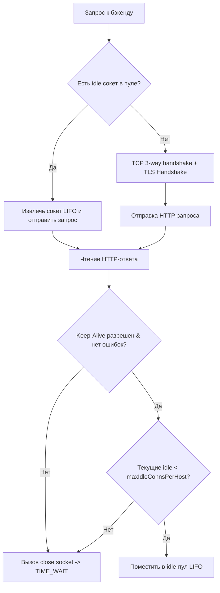

# Connection Pooling, Keep-Alive и File Descriptors в Traefik

**Актуально для:** Traefik v3.x (обратная совместимость с Traefik v2.x)

## Определения

- **Connection Pool (Пул соединений)** — структура данных в оперативной памяти процесса Traefik (реализованная в стандартном транспорте Go `net/http.Transport`), кэширующая открытые сетевые TCP/TLS-соединения к вышестоящим бэкендам для их повторного использования последующими запросами.
- **Keep-Alive (Постоянное соединение)** — протокольный механизм (в HTTP/1.1 через заголовок `Connection: keep-alive`, в HTTP/2 на уровне мультиплексированного транспорта), позволяющий передавать последовательные или параллельные HTTP-запросы в рамках одного установленного TCP-сокета без выполнения повторных процедур 3-way handshake и TLS-согласования.
- **Downstream Keep-Alive** — удержание и управление жизненным циклом входящих клиентских подключений между внешними потребителями (браузерами, шлюзами, мобильными клиентами) и точками входа Traefik (`entryPoints`).
- **Upstream Connection Pool** — пул исходящих постоянных соединений от Traefik к целевым серверам бэкенда. Конфигурируется глобально в статическом блоке `serversTransport` или индивидуально для сервисов через именованные динамические структуры `http.serversTransports`.
- **maxIdleConnsPerHost** — максимальное количество неактивных (idle) keep-alive соединений, удерживаемых в пуле для каждого уникального адреса бэкенда (`host:port`). В рантайме Go по умолчанию составляет 2, что является главным фактором деградации производительности высоконагруженных обратных прокси при стандартных настройках.
- **maxIdleConns** — глобальный лимит на общее суммарное количество неактивных соединений в пуле по всем бэкендам одновременно в рамках одного экземпляра транспорта. Значение `0` означает отсутствие глобального лимита.
- **idleConnTimeout** — максимальное время простоя открытого TCP-соединения в пуле без передачи трафика, по истечении которого Traefik выполняет активное закрытие сокета со своей стороны.
- **Silent Close (Keep-Alive Race Condition)** — состояние гонки таймаутов, при котором бэкенд закрывает неактивное TCP-соединение по своему таймауту простоя ровно в момент, когда Traefik извлекает это же соединение из пула и отправляет в него новый клиентский запрос. Приводит к возврату пакета TCP RST от бэкенда и генерации ошибки `502 Bad Gateway` на стороне Traefik.
- **File Descriptor (FD, файловый дескриптор)** — неотрицательное целое число, используемое ядром Linux для идентификации открытого файла или сокета процесса. Каждое клиентское сетевое подключение и каждое подключение к бэкенду занимает ровно один файловый дескриптор.
- **LimitNOFILE (RLIMIT_NOFILE)** — системный лимит максимального количества одновременно открытых файловых дескрипторов, доступных процессу на уровне POSIX-системы (`setrlimit`) и службы systemd.
- **TIME_WAIT State & 2MSL** — состояние TCP-сокета после отправки финального подтверждения закрытия (активное закрытие со стороны прокси), при котором кортеж сокета удерживается ядром на время удвоенного времени жизни сегмента (2MSL = 60 секунд в Linux) для предотвращения коллизий пакетов.
- **Ephemeral Port Exhaustion (Исчерпание эфемерных портов)** — отказ ядра Linux в выделении локального исходящего порта (`connect: cannot assign requested address`, код ошибки `EADDRNOTAVAIL`), возникающий при дефиците портов из диапазона `net.ipv4.ip_local_port_range` из-за лавины сокетов в состоянии `TIME_WAIT`.
- **HTTP/2 Multiplexing** — одновременная передача сотен независимых двунаправленных потоков (streams) данных внутри одного физического TCP-соединения, исключающая потребность в большом пуле параллельных сокетов на уровне L4.

---

## Архитектура и механизм работы

### Двустороннее управление соединениями в Traefik

Traefik функционирует как пограничный обратный прокси-сервер (L7/L4), разделяя сетевой поток на два независимых контура: **Downstream** (клиенты к Traefik) и **Upstream** (Traefik к серверам бэкенда).

```
[ Клиент 1 ] ──┐
[ Клиент 2 ] ──┼─▶ [ EntryPoint:443 ] ──▶ [ Traefik Core ] ──▶ [ ServersTransport ] ──┬─▶ [ Backend Pod 1 ]
[ Клиент 3 ] ──┘   (Downstream Keep-Alive)   (Маршрутизация)     (Upstream Pool)        └─▶ [ Backend Pod 2 ]
```

| Параметр контура | Downstream (Клиент ↔ Traefik) | Upstream (Traefik ↔ Бэкенд) |
| :--- | :--- | :--- |
| **Точка конфигурации** | `entryPoints.<name>.transport` | `serversTransport` / `http.serversTransports.<name>` |
| **Тип управления** | HTTP-сервер Go (`http.Server`) | Клиентский транспорт Go (`http.Transport`) |
| **Таймауты простоя** | `respondingTimeouts.idleTimeout` | `forwardingTimeouts.idleConnTimeout` |
| **Таймауты установки** | Регулируется системным TCP listen backlog | `forwardingTimeouts.dialTimeout` |
| **Лимит запросов** | `transport.keepAliveMaxRequests` | Задается конфигурацией серверов бэкенда |
| **Лимит времени** | `transport.keepAliveMaxTime` | `forwardingTimeouts.idleConnTimeout` |
| **Единица мультиплексирования**| `http2.maxConcurrentStreams` | Автоматически в рамках одного HTTP/2 сокета |

### Механика пула соединений в Go Runtime (`net/http.Transport`)

Upstream-пул Traefik построен на базе стандартного клиентского транспорта Go. Внутренняя архитектура пула имеет следующие особенности:

1. **Организация очередей (LIFO Connection Ring):** Неактивные соединения группируются по ключу хоста `scheme://host:port`. При освобождении сокет помещается в начало двусвязного списка (LIFO — Last In, First Out). Это гарантирует, что наиболее «прогретые» соединения с готовым TCP-окном переиспользуются первыми, а наименее востребованные сокеты плавно отмирают по таймауту.
2. **Блокировки и Concurrency:** Доступ к пулу соединений защищен внутренним мьютексом (`sync.Mutex`). При экстремально высоком RPS (>50 000) к одному бэкенду с малым пулом возникает contention (конкуренция за блокировку), приводящая к всплескам CPU в ядре Go рантайма.
3. **Логика усечения пула:** Когда HTTP-запрос завершен, транспорт решает судьбу TCP-сокета:
   - Если число свободных сокетов для данного хоста $< \text{maxIdleConnsPerHost}$ — сокет сохраняется в пул.
   - Если лимит $\text{maxIdleConnsPerHost}$ уже исчерпан — Traefik вызывает системный вызов `close()` на сокете со своей стороны.
   - **Критический эффект:** Если параметр `maxIdleConnsPerHost` оставлен в дефолтном значении (2), а сервис обрабатывает 1000 RPS, то 998 соединений в секунду принудительно закрываются со стороны Traefik, переходят в состояние `TIME_WAIT` на хосте прокси и приводят к исчерпанию портов за секунды.



### Анатомия гонки Silent Close (Keep-Alive Race Condition)

Когда обратный прокси и бэкенд взаимодействуют по постоянным соединениям, каждый из них ведет собственный таймер неактивности (`idle_timeout`).

```
Traefik                                                        Бэкенд
   │                                                              │
   │ ── (idleConnTimeout: 90s) ────── (idle_timeout: 60s) ─────── │
   │                                                              │
   │                                    t = 60s: Истек таймаут!   │
   │                                    Бэкенд шлет [FIN] ──────► │ (пакет в пути)
   │ t = 60.001s: Поступает новый запрос!                         │
   │ Traefik берет сокет из пула и шлет [HTTP Request] ─────────► │
   │                                                              │
   │ ◄─── Получен [FIN] (соединение уже полузакрыто) ──────────── │
   │ ◄─── Бэкенд получает данные в закрытый сокет и шлет [RST] ── │
   │                                                              │
   💥 Traefik фиксирует read/write error (connection reset by peer)
   💥 Клиент получает 502 Bad Gateway
```

**Фундаментальное правило SRE:** Таймаут неактивности на стороне Traefik (`forwardingTimeouts.idleConnTimeout`) обязан быть **строго меньше** таймаута неактивности на бэкенде (например, в Nginx, Node.js, Go, Gunicorn или PHP-FPM).

$$\text{idleConnTimeout}_{\text{Traefik}} \le \text{idle\_timeout}_{\text{Backend}} - 5\text{s}$$

### HTTP/1.1 vs HTTP/2 и gRPC

- **HTTP/1.1:** Протокол строго последователен на уровне сокета. Один TCP-сокет может обрабатывать только один HTTP-запрос в конкретный момент времени (Head-of-Line Blocking на уровне L7). Для обеспечения параллелизма в 100 одновременных запросов требуется 100 независимых открытых сокетов в пуле `maxIdleConnsPerHost`.
- **HTTP/2 и gRPC:** Протокол мультиплексирует запросы внутри одного физического соединения с помощью бинарных фреймов. Один сокет способен одновременно обслуживать до $N$ стримов (`maxConcurrentStreams`, стандартно 100–250). Потребность в количестве сокетов снижается в сотни раз, однако возрастают требования к CPU для парсинга фреймов и управлению окном потока (Flow Control Window).

### Математическая модель расчета файловых дескрипторов (SRE Sizing)

Каждое сетевое соединение в Linux представлено файловым дескриптором (`struct file` в ядре), потребляющим системную память ядра (Slab-аллокатор, структуры `dentry` и `inode_cache`, а также кольцевые буферы сокетов `rmem`/`wmem`).

#### Формула расчета потребления дескрипторов

$$\text{FD}_{\text{total}} = \text{FD}_{\text{downstream}} + \text{FD}_{\text{upstream}} + \text{FD}_{\text{system}}$$

Где:
1. **Downstream дескрипторы:**
   $$\text{FD}_{\text{downstream}} = (\text{RPS}_{\text{total}} \times T_{\text{response\_avg}}) + N_{\text{idle\_clients}}$$
   *где $N_{\text{idle\_clients}}$ — клиенты, удерживающие keep-alive в пределах `respondingTimeouts.idleTimeout`.*
2. **Upstream дескрипторы:**
   $$\text{FD}_{\text{upstream}} = \sum_{i=1}^{M} \left( \text{RPS}_{i} \times T_{\text{backend\_latency\_}i} \right) + (M \times \text{maxIdleConnsPerHost})$$
   *где $M$ — количество активных хостов бэкенда.*
3. **Системные накладные расходы:**
   $$\text{FD}_{\text{system}} = \text{FD}_{\text{epoll}} + \text{FD}_{\text{listeners}} + \text{FD}_{\text{pipes/logs}} + \text{FD}_{\text{acme/storage}} + \text{FD}_{\text{internal}}$$

#### Коэффициент запаса SRE (Safety Margin)

В production-средах лимит дескрипторов обязан учитывать резкие микроберсты, скачки задержки на бэкендах (когда время ответа растет, число активных сокетов пропорционально увеличивается согласно закону Литтла) и утечки при сбоях:

$$\text{LimitNOFILE} \ge 2.5 \times \text{FD}_{\text{total}}$$

#### Пример расчета:
- Входящая нагрузка: 5 000 RPS.
- Средняя латентность ответа клиенту: $50\text{ мс} = 0.05\text{ с}$.
- Клиенты с постоянным подключением: 3 000 активных сессий.
- Бэкенды: 10 сервисов по 4 инстанса = 40 хостов.
- `maxIdleConnsPerHost` = 100.
- Латентность бэкенда: $30\text{ мс} = 0.03\text{ с}$.

Расчет:
- $\text{FD}_{\text{downstream}} = (5000 \times 0.05) + 3000 = 250 + 3000 = 3250$
- $\text{FD}_{\text{upstream}} = (5000 \times 0.03) + (40 \times 100) = 150 + 4000 = 4150$
- $\text{FD}_{\text{system}} \approx 200$
- $\text{FD}_{\text{total}} = 3250 + 4150 + 200 = 7600$
- Рекомендуемый `LimitNOFILE`: $7600 \times 2.5 = 19000 \implies$ устанавливаем стандартный безопасный production-лимит **`65536`** (или **`1048576`** для магистральных edge-прокси).

---

## Практические сценарии и конфигурация

### Сценарий 1: Базовая статическая и динамическая конфигурация (High-Load HTTP/1.1)

Разделение конфигурации Traefik на статический блок (`/etc/traefik/traefik.yml`) и динамические настройки транспортов (`/etc/traefik/dynamic/transports.yml`).

#### 1. Статическая конфигурация: `/etc/traefik/traefik.yml`

```yaml
global:
  checkNewVersion: false
  sendAnonymousUsage: false

# Базовый транспорт по умолчанию для всех бэкендов
serversTransport:
  maxIdleConnsPerHost: 250
  forwardingTimeouts:
    dialTimeout: 5s
    responseHeaderTimeout: 30s    # Защита от бесконечного зависания сокета
    idleConnTimeout: 90s          # Должно быть меньше keep-alive таймаута бэкенда

entryPoints:
  web:
    address: ":80"
    transport:
      respondingTimeouts:
        readTimeout: 30s
        writeTimeout: 30s
        idleTimeout: 60s
      keepAliveMaxRequests: 10000 # Ротация сокета после 10k запросов
      keepAliveMaxTime: 10m       # Предельное время жизни сокета клиента
    http:
      redirections:
        entryPoint:
          to: websecure
          scheme: https
          permanent: true

  websecure:
    address: ":443"
    transport:
      respondingTimeouts:
        readTimeout: 60s
        writeTimeout: 60s
        idleTimeout: 120s
      keepAliveMaxRequests: 10000
      keepAliveMaxTime: 15m
    http2:
      maxConcurrentStreams: 250   # Защита памяти при мультиплексировании

providers:
  file:
    directory: /etc/traefik/dynamic
    watch: true

metrics:
  prometheus:
    addEntryPointsLabels: true
    addRoutersLabels: true
    addServicesLabels: true
```

#### 2. Динамическая конфигурация с кастомными транспортами: `/etc/traefik/dynamic/transports.yml`

```yaml
http:
  serversTransports:
    # Транспорт для высокочастотного микросервисного API с быстрым ответом
    fast-api-transport:
      maxIdleConnsPerHost: 500
      forwardingTimeouts:
        dialTimeout: 2s
        responseHeaderTimeout: 5s
        idleConnTimeout: 45s

    # Транспорт для тяжелых аналитических отчетов и выгрузок
    slow-reporting-transport:
      maxIdleConnsPerHost: 20
      forwardingTimeouts:
        dialTimeout: 10s
        responseHeaderTimeout: 300s # Длительное ожидание генерации ответа
        idleConnTimeout: 60s

    # Транспорт с принудительным отключением HTTP/2 (только HTTP/1.1 keep-alive)
    legacy-http11-transport:
      maxIdleConnsPerHost: 100
      disableHTTP2: true
      forwardingTimeouts:
        dialTimeout: 5s
        responseHeaderTimeout: 15s
        idleConnTimeout: 60s

  services:
    billing-service:
      loadBalancer:
        serversTransport: fast-api-transport
        servers:
          - url: "http://10.10.10.11:8080"
          - url: "http://10.10.10.12:8080"

    analytics-service:
      loadBalancer:
        serversTransport: slow-reporting-transport
        servers:
          - url: "http://10.10.20.5:9000"
```

### Сценарий 2: gRPC и HTTP/2 бэкенды через ServersTransport

При проксировании gRPC к бэкендам внутри закрытого контура используется схема `h2c://` (HTTP/2 Cleartext без TLS). Для внешнего gRPC с TLS Traefik использует мультиплексирование потоков поверх защищенного транспорта.

```yaml
# /etc/traefik/dynamic/grpc-services.yml
http:
  serversTransports:
    grpc-internal-transport:
      forwardingTimeouts:
        dialTimeout: 3s
        idleConnTimeout: 300s     # gRPC каналы рассчитаны на долгий idle
        readIdleTimeout: 60s      # Проверка живости HTTP/2 ping frame
        pingTimeout: 15s

  services:
    user-grpc-service:
      loadBalancer:
        serversTransport: grpc-internal-transport
        servers:
          # Схема h2c указывает Traefik использовать чистый HTTP/2 без TLS
          - url: "h2c://10.20.0.15:50051"
          - url: "h2c://10.20.0.16:50051"
```

### Сценарий 3: Настройка службы systemd на Bare-Metal с лимитами дескрипторов

На серверах под управлением systemd стандартный лимит процесса составляет 1024 дескриптора. Для работы под высокой нагрузкой требуется явная перегрузка `LimitNOFILE` и параметров изоляции.

```ini
# /etc/systemd/system/traefik.service
[Unit]
Description=Traefik Edge Reverse Proxy & Load Balancer
Documentation=https://doc.traefik.io/traefik/
After=network-online.target remote-fs.target
Wants=network-online.target

[Service]
Type=simple
User=traefik
Group=traefik
ExecStart=/usr/local/bin/traefik --configfile=/etc/traefik/traefik.yml
ExecReload=/bin/kill -HUP $MAINPID
Restart=on-failure
RestartSec=3s

# Сетевые привилегии для привязки к портам 80/443 от non-root
AmbientCapabilities=CAP_NET_BIND_SERVICE
CapabilityBoundingSet=CAP_NET_BIND_SERVICE

# Управление файловыми дескрипторами и процессами (SRE High-Load Baseline)
LimitNOFILE=1048576
LimitNPROC=512
LimitMEMLOCK=infinity

# Грамотная остановка (Graceful Shutdown)
KillMode=mixed
KillSignal=SIGTERM
TimeoutStopSec=45s

# Изоляция процесса (Sandboxing)
NoNewPrivileges=true
ProtectSystem=strict
ProtectHome=true
PrivateTmp=true
ProtectKernelTunables=true
ProtectKernelModules=true
ProtectControlGroups=true
RestrictNamespaces=true
RestrictRealtime=true
RestrictSUIDSGID=true
LockPersonality=true
ReadWritePaths=/var/lib/traefik /var/log/traefik

[Install]
WantedBy=multi-user.target
```

Применение параметров:

```bash
# Перечитывание конфигурации systemd
sudo systemctl daemon-reload

# Перезапуск службы
sudo systemctl restart traefik

# Проверка фактически примененного лимита процесса
cat /proc/$(pgrep -o -f traefik)/limits | grep "Max open files"
# → Max open files            1048576              1048576              files
```

### Сценарий 4: Тюнинг ядра Linux для сокетов и TCP-стека (`sysctl`)

Без тюнинга сетевой подсистемы ядра любые изменения пула в Traefik окажутся неэффективными: ядро будет сбрасывать входящие соединения в `listen backlog` и отказывать в открытии исходящих сокетов из-за нехватки портов.

Создайте файл `/etc/sysctl.d/99-traefik-network.conf`:

```ini
# Максимальное число открытых файлов на уровне всей операционной системы
fs.file-max = 2097152

# Предельный потолок дескрипторов для любого процесса
fs.nr_open = 1048576

# Размер системной очереди входящих соединений (Listen Backlog)
net.core.somaxconn = 65535

# Максимальное число пакетов в очереди сетевой карты перед передачей ядру
net.core.netdev_max_backlog = 65536

# Максимальный размер очереди полуоткрытых соединений (SYN Backlog)
net.ipv4.tcp_max_syn_backlog = 65535

# Безопасное переиспользование сокетов в состоянии TIME_WAIT для исходящих коннектов
# Требует обязательного включения tcp_timestamps (включено по умолчанию RFC 7323)
net.ipv4.tcp_tw_reuse = 1
net.ipv4.tcp_timestamps = 1

# Сокращение времени удержания сокета в FIN_WAIT_2
net.ipv4.tcp_fin_timeout = 15

# Расширение диапазона эфемерных портов для исходящих соединений к бэкендам
# Дает 55310 доступных портов вместо стандартных 28232
net.ipv4.ip_local_port_range = 10240 65535

# Максимальное количество сокетов в состоянии TIME_WAIT в памяти ядра
net.ipv4.tcp_max_tw_buckets = 1440000

# Отключение TCP Slow Start после простоя (ускоряет keep-alive соединения)
net.ipv4.tcp_slow_start_after_idle = 0
```

Применение и валидация:

```bash
# Применение параметров sysctl без перезагрузки
sudo sysctl --system

# Проверка применения параметров
sysctl net.ipv4.tcp_tw_reuse net.core.somaxconn fs.file-max
# → net.ipv4.tcp_tw_reuse = 1
# → net.core.somaxconn = 65535
# → fs.file-max = 2097152
```

### Сценарий 5: Развертывание в Docker Compose с тюнингом `ulimits` и `GOMAXPROCS`

В контейнеризованных средах Docker демон наследует лимиты `dockerd` (часто 1024 сокета), если они не заданы явно в манифесте `docker-compose.yml`. Кроме того, сборщик мусора Go требует согласования переменной `GOMAXPROCS` с CPU-квотой контейнера.

```yaml
services:
  traefik:
    image: traefik:v3.4
    container_name: traefik-edge
    restart: always
    network_mode: host    # Устраняет накладные расходы Docker NAT/iptables
    environment:
      # Фиксация числа системных потоков Go по выделенному лимиту CPU
      GOMAXPROCS: "4"
    volumes:
      - /etc/traefik:/etc/traefik:ro
      - /var/log/traefik:/var/log/traefik:rw
    ulimits:
      nofile:
        soft: 1048576
        hard: 1048576
      nproc: 65535
    deploy:
      resources:
        limits:
          cpus: '4.0'
          memory: 4G
        reservations:
          cpus: '2.0'
          memory: 2G
```

Проверка применения лимитов внутри контейнера:

```bash
# Проверка лимитов процесса PID 1 в контейнере
docker exec traefik-edge cat /proc/1/limits | grep "Max open files"
# → Max open files            1048576              1048576              files

# Проверка переменной окружения рантайма
docker exec traefik-edge printenv GOMAXPROCS
# → 4
```

### Сценарий 6: Мониторинг пула и файловых дескрипторов в Prometheus

Для предотвращения инцидентов исчерпания сокетов Traefik экспортирует метрики на внутреннем endpoint `/metrics`.

#### Ключевые метрики

| Метрика | Описание | Критический порог |
| :--- | :--- | :--- |
| `traefik_entrypoint_open_connections` | Текущие активные downstream-соединения | Резкий рост свидетельствует о slowloris/зависании клиентов |
| `traefik_service_open_connections` | Активные соединения с конкретным бэкендом | Рост выше размера пула указывает на создание новых сокетов |
| `process_open_fds` | Фактически открытые процессу файловые дескрипторы | $\ge 80\%$ от `process_max_fds` |
| `process_max_fds` | Максимальный лимит дескрипторов процесса | Значение должно быть согласовано с `LimitNOFILE` |
| `go_goroutines` | Число активных горутин рантайма Go | Каждое соединение порождает минимум 1-2 горутины |

#### Пример PromQL-правил для Prometheus Alertmanager

```yaml
# /etc/prometheus/rules/traefik_sockets.yml
groups:
  - name: traefik_connection_alerts
    rules:
      - alert: TraefikFileDescriptorsNearExhaustion
        expr: (process_open_fds{job="traefik"} / process_max_fds{job="traefik"}) > 0.80
        for: 2m
        labels:
          severity: critical
        annotations:
          summary: "Traefik исчерпывает файловые дескрипторы (инстанс {{ $labels.instance }})"
          description: "Использование FD превысило 80% (текущее: {{ $value | humanizePercentage }}). Возможен отказ в обслуживании new connections."

      - alert: TraefikDownstreamConnectionSurge
        expr: sum by (entrypoint) (traefik_entrypoint_open_connections) > 10000
        for: 5m
        labels:
          severity: warning
        annotations:
          summary: "Аномальный рост соединений на entrypoint {{ $labels.entrypoint }}"
          description: "Число удерживаемых клиентских соединений превысило 10 000. Проверьте slowloris-атаки или таймауты idleTimeout."
```

---

## Операции и команды

### 1. Проверка использования дескрипторов и лимитов процесса

```bash
# Определение основного PID процесса Traefik
PID=$(pgrep -o -f traefik)
echo "Traefik PID: $PID"
# → Traefik PID: 12345

# Подсчет фактически открытых дескрипторов процесса
ls -1 /proc/$PID/fd | wc -l
# → 1420

# Просмотр детальных системных лимитов процесса
cat /proc/$PID/limits | grep -E 'Max open files|Max processes'
# → Max open files            1048576              1048576              files
# → Max processes             512                  512                  processes

# Просмотр лимитов службы systemd
systemctl show traefik -p LimitNOFILE -p LimitNPROC
# → LimitNOFILE=1048576
# → LimitNPROC=512
```

### 2. Анализ сетевых сокетов и состояний соединений (`ss`)

```bash
# Суммарная статистика сокетов в системе
ss -s
# → Total: 2840
# → TCP:   2150 (estab 850, closed 1100, orphaned 0, timewait 980)

# Подсчет соединений Traefik по состояниям
ss -tanp | grep "pid=$PID" | awk '{print $1}' | sort | uniq -c | sort -nr
# →    850 ESTAB
# →    120 TIME-WAIT
# →     15 CLOSE-WAIT
# →      2 LISTEN

# Подсчет соединений к бэкенду (порт 8080)
ss -tan dst :8080 | awk '{print $1}' | sort | uniq -c
# →    250 ESTAB
# →     12 TIME-WAIT

# Проверка очереди Listen Backlog для сокетов Traefik
ss -lntp '( sport = :80 or sport = :443 )'
# → State  Recv-Q Send-Q Local Address:Port  Peer Address:PortProcess
# → LISTEN 0      4096   *:80                *:*              users:(("traefik",pid=12345,fd=7))
# → LISTEN 0      4096   *:443               *:*              users:(("traefik",pid=12345,fd=8))
# (Если Recv-Q > 0, процесс не успевает вызывать accept(), сокеты копятся в очереди)
```

### 3. Анализ типов открытых дескрипторов через `lsof`

```bash
# Классификация открытых дескрипторов процесса (сокеты, файлы, пайпы)
lsof -p $PID -a -d ^txt,^mem | awk '{print $5}' | sort | uniq -c | sort -nr
# →   1280 IPv4
# →    110 IPv6
# →     22 FIFO
# →      8 REG
# →      2 unix

# Поиск зависших соединений к конкретному IP бэкенда
lsof -p $PID -i @10.10.10.11:8080
# → traefik 12345 traefik   42u  IPv4 18293849  0t0  TCP 10.10.10.1:48294->10.10.10.11:8080 (ESTABLISHED)
```

### 4. Тестирование и валидация переиспользования Keep-Alive

```bash
# Проверка HTTP-заголовков постоянного соединения от Traefik
curl -sIv https://app.example.com/api/v1/health 2>&1 | grep -iE 'connection|keep-alive'
# → < Connection: keep-alive
# → < Keep-Alive: timeout=60

# Тестирование выполнения 5 запросов подряд через одно TCP-соединение
curl -v -k https://app.example.com/api/v1/health \
        https://app.example.com/api/v1/health \
        https://app.example.com/api/v1/health 2>&1 | grep -E 'Connected to|Re-using existing connection'
# → * Connected to app.example.com (127.0.0.1) port 443
# → * Re-using existing connection with host app.example.com
# → * Re-using existing connection with host app.example.com
```

### 5. Опрос метрик Prometheus вручную

```bash
# Проверка метрик открытых соединений и дескрипторов
curl -s http://127.0.0.1:8080/metrics | grep -E 'process_open_fds|process_max_fds|traefik_entrypoint_open_connections'
# → process_max_fds 1048576
# → process_open_fds 1420
# → traefik_entrypoint_open_connections{entrypoint="websecure"} 850
```

---

## Диагностика и устранение неполадок

| Проблема | Первопричина | Методика диагностики | Практическое решение |
| :--- | :--- | :--- | :--- |
| **`too many open files` (код ошибки `EMFILE`)** | Превышен лимит файловых дескрипторов процесса (`LimitNOFILE`). Новые сокеты сбрасываются вызовом `accept()`. | 1. `cat /proc/$PID/limits \| grep "Max open files"`<br>2. `ls /proc/$PID/fd \| wc -l` | Увеличить `LimitNOFILE=1048576` в unit-файле systemd или `ulimits.nofile` в Docker Compose. Перезапустить службу. |
| **`too many open files in system` (код ошибки `ENFILE`)** | Превышен глобальный общесистемный лимит ядра `fs.file-max`. | 1. `cat /proc/sys/fs/file-nr`<br>*(выводит: выделено, не используется, максимум)* | Выставить `fs.file-max = 2097152` и `fs.nr_open = 1048576` в `/etc/sysctl.d/99-traefik-network.conf` и выполнить `sysctl --system`. |
| **`connect: cannot assign requested address` (`EADDRNOTAVAIL`)** | Исчерпаны локальные эфемерные порты из-за десятков тысяч сокетов в `TIME_WAIT`. | 1. `ss -s \| grep timewait`<br>2. `sysctl net.ipv4.ip_local_port_range` | 1. Включить `maxIdleConnsPerHost` ($\ge 200$) в `serversTransport`.<br>2. Включить `sysctl -w net.ipv4.tcp_tw_reuse=1`.<br>3. Расширить `net.ipv4.ip_local_port_range = 10240 65535`. |
| **Случайные ошибки `502 Bad Gateway` / `read: connection reset by peer`** | Гонка таймаутов простоя (Silent Close): бэкенд закрыл сокет раньше, чем Traefik удалил его из пула. | Проверить логи Traefik на наличие `read: connection reset by peer`. Сравнить `idleConnTimeout` с таймаутом бэкенда. | Уменьшить `forwardingTimeouts.idleConnTimeout` в `serversTransport` так, чтобы он был минимум на 5–15 секунд меньше таймаута бэкенда (например, 45s против 60s). |
| **Резкий рост латентности при пиковых RPS** | Дефолтный `maxIdleConnsPerHost: 2`. Traefik уничтожает сокеты и на каждый новый запрос тратит 1–3 RTT на TCP/TLS handshakes. | Сравнить задержку: `time_connect` vs `time_total` через `curl -w`. Проверить всплеск сокетов `TIME_WAIT`. | Увеличить `maxIdleConnsPerHost` до 250–500 для высоконагруженных бэкендов в `http.serversTransports`. |
| **Сокеты зависают в состоянии `CLOSE_WAIT`** | Бэкенд или клиент закрыл свою сторону соединения (шлет FIN), но Traefik удерживает дескриптор из-за непрочитанного ответа или блокировки плагина. | `ss -tanp \| grep CLOSE-WAIT` покажет дескрипторы и PID владельца. Снять дамп горутин через `/debug/pprof/goroutine`. | Проверить таймауты `responseHeaderTimeout` и `writeTimeout`. Устранить утечки в кастомных middleware или плагинах. |
| **Ошибки `504 Gateway Timeout` при живом бэкенде** | Зависание воркера бэкенда при значении `responseHeaderTimeout: 0s` (безлимитно по умолчанию). Сокет в пуле блокируется навсегда. | `ss -tanp dst :<backend_port>` — сокеты висят в `ESTABLISHED` часами. | Всегда явно задавать конечное значение `forwardingTimeouts.responseHeaderTimeout` (например, `30s` или `60s`). |
| **Утечка памяти при использовании HTTP/2** | Слишком высокое значение `maxConcurrentStreams` (1000+) при атаках или медленных клиентах; буферы окон потока переполняют RAM. | Проверить метрику `go_memstats_heap_inuse_bytes` и heap-профиль через `/debug/pprof/heap`. | Ограничить `entryPoints.<name>.http2.maxConcurrentStreams: 250` (или 100 для высоконагруженных публичных сервисов). |

---

## Рекомендации и Best Practices

### 1. Архитектурный SRE-чеклист конфигурации пулов

- [ ] **Никогда не оставляйте `maxIdleConnsPerHost` по умолчанию:** Стандартное значение Go runtime равно 2. Для любого продакшн-сервиса с нагрузкой выше 50 RPS выставляйте значение в диапазоне от **100** до **500**.
- [ ] **Соблюдайте иерархию таймаутов простоя:** Таймаут неактивности Traefik должен быть строго меньше таймаута бэкенда:
  $$\text{idleConnTimeout}_{\text{Traefik}} < \text{keepalive\_timeout}_{\text{Nginx/App}}$$
- [ ] **Обязательно ограничивайте `responseHeaderTimeout`:** Значение по умолчанию `0s` отключает таймаут ожидания ответа бэкенда. Любой зависший запрос заблокирует сокет и слот в пуле навсегда. Для production выставляйте безопасное значение от `15s` до `60s`.
- [ ] **Разделяйте транспорты по профилю нагрузки:** Используйте динамические `http.serversTransports`:
  - Для быстрых stateless REST/gRPC API — большой пул (`maxIdleConnsPerHost: 500`), агрессивный `dialTimeout: 2s`, `idleConnTimeout: 30s`.
  - Для тяжелых выгрузок и отчетов — малый пул (`maxIdleConnsPerHost: 20`), увеличенный `responseHeaderTimeout: 300s`.
- [ ] **Защищайте Downstream от исчерпания сокетов:** На входных точках (`entryPoints`) настраивайте параметры ротации `keepAliveMaxRequests: 10000` и `keepAliveMaxTime: 15m`. Это предотвращает вечную фиксацию соединений за одним инстансом и обеспечивает равномерную балансировку через L4 (LVS/Keepalived/BGP).
- [ ] **Синхронизируйте лимиты systemd и ядра:** Задавайте `LimitNOFILE=1048576` в systemd-юните Traefik и согласуйте его с общесистемным `fs.file-max = 2097152` и `fs.nr_open = 1048576`.
- [ ] **Всегда активируйте `net.ipv4.tcp_tw_reuse = 1`:** Для систем с ролью обратного прокси это обязательная директива ядра, исключающая отказ по `EADDRNOTAVAIL`.
- [ ] **Алертинг по метрикам:** Настройте оповещение в Alertmanager при превышении порога использования дескрипторов:
  $$\frac{\text{process\_open\_fds}}{\text{process\_max\_fds}} > 0.80$$

---

## Связанные технологии и ссылки

- [Traefik на bare-metal](file:///c:/Users/Elise/notes/WebServers/Traefik/traefik-bare-metal.md) — развертывание под systemd, sandboxing, CAP_NET_BIND_SERVICE, базовый тюнинг ОС.
- [Отладка и производительность Traefik](file:///c:/Users/Elise/notes/WebServers/Traefik/traefik-debugging-performance.md) — анализ таймаутов, снятие профилей pprof (heap/goroutines), настройка GOMAXPROCS.
- [Обзор Traefik](file:///c:/Users/Elise/notes/WebServers/Traefik/traefik_overview.md) — общая архитектура, статические и динамические провайдеры, синтаксис правил маршрутизации.
- [Traefik с Docker Compose](file:///c:/Users/Elise/notes/WebServers/Traefik/traefik_with_docker_compose.md) — развертывание в контейнерах, настройка ulimits и меток маршрутизации.
- [Протоколы и потоки данных Traefik](file:///c:/Users/Elise/notes/WebServers/Traefik/traefik-protocols-advanced.md) — маршрутизация TCP, UDP, gRPC, h2c и WebSockets.
- [Graceful Shutdown и Zero-Downtime Deploy в Traefik](file:///c:/Users/Elise/notes/WebServers/Traefik/traefik-graceful-shutdown.md) — корректный дренаж активных клиентских и серверных соединений при остановке.
- [Upstream Keepalive и Connection Pooling](file:///c:/Users/Elise/notes/WebServers/Concepts/web_performance/upstream_keepalive_and_pooling.md) — теоретические основы пулинга постоянных соединений, математика RTT, RFC 7323 и TIME_WAIT.
