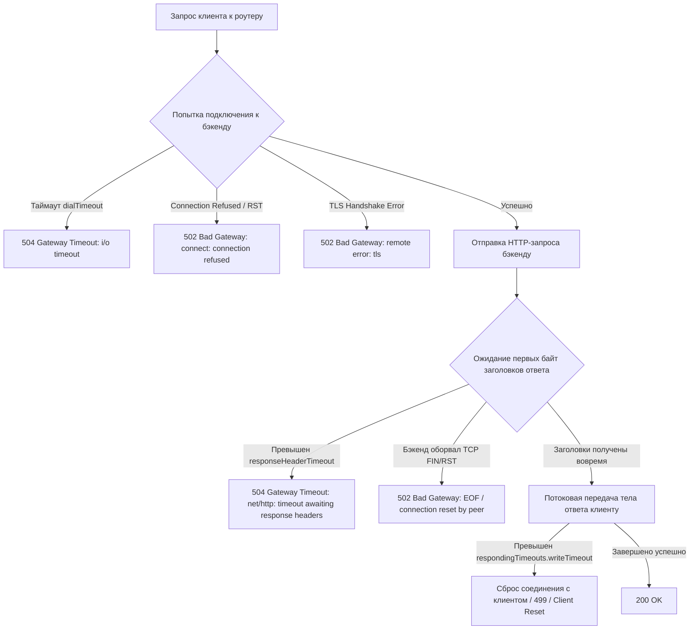

# Отладка и производительность Traefik: pprof, таймауты, HTTP/2 тюнинг

**Актуально для:** Traefik v3.x (обратная совместимость с Traefik v2.x)

## Определения

- **pprof** — специализированный профилировщик рантайма языка Go (`runtime/pprof`, `net/http/pprof`), предоставляющий HTTP-интерфейс для сбора дампов кучи (heap), процессорного времени (CPU profile), трассировок горутин (goroutine dump), аллокаций памяти (allocs), взаимных блокировок (mutex contention) и задержек синхронизации (block profile). В Traefik активируется параметром статической конфигурации `api.debug: true`.
- **Горутины (Goroutines)** — легковесные потоки выполнения, управляемые планировщиком Go рантайма в пространстве пользователя. В архитектуре Traefik каждое клиентское соединение и каждый проксируемый запрос обслуживаются отдельными цепочками горутин. Утечка горутин (goroutine leak) возникает при блокировках на каналах или зависших I/O вызовах и приводит к линейному росту оперативной памяти и падению производительности.
- **Go Scheduler (M:N планировщик)** — подсистема рантайма Go, мультиплексирующая $M$ горутин ($G$) на $N$ системных потоков ОС ($M$) через логические контексты процессоров ($P$).
- **GOMAXPROCS** — переменная окружения и параметр рантайма Go, определяющий количество логических процессоров ($P$), доступных для одновременного выполнения пользовательского Go-кода. По умолчанию равен числу ядер хоста; в контейнерах с жесткими квотами CPU требует синхронизации для исключения CFS CPU throttling.
- **GOMEMLIMIT** — механизм мягкого ограничения оперативной памяти рантайма Go (введен в Go 1.19+), задающий порог, при приближении к которому сборщик мусора (GC) запускается более агрессивно и возвращает свободные страницы ядру ОС, предотвращая принудительное уничтожение процесса Linux OOM Killer.
- **504 Gateway Timeout** — стандартный HTTP-код состояния, означающий, что Traefik в роли шлюза или обратного прокси не получил своевременного ответа от вышестоящего бэкенда в течение сконфигурированного интервала времени (`dialTimeout` или `responseHeaderTimeout`).
- **502 Bad Gateway** — HTTP-код состояния, возвращаемый Traefik при невозможности связаться с бэкендом: сброс соединения бэкендом (TCP RST), отказ в рукопожатии TLS, отсутствие доступных адресов или срабатывание состояния гонки при закрытии неактивного keep-alive соединения (silent close).
- **Downstream Responding Timeouts** — группа таймаутов на входящих точках входа (`entryPoints.<name>.transport.respondingTimeouts`), регулирующая допустимое время чтения клиентского запроса, отправки ответа и удержания соединения в режиме keep-alive.
- **Upstream Forwarding Timeouts** — группа таймаутов клиентского транспорта Traefik (`serversTransport.forwardingTimeouts` или `http.serversTransports.<name>.forwardingTimeouts`), определяющая лимиты времени на установку TCP-соединения с бэкендом и ожидание первого байта заголовков ответа.
- **HTTP/2 maxConcurrentStreams** — предельное количество одновременно активных параллельных двунаправленных потоков (streams), разрешенных в рамках одного мультиплексированного TCP-соединения между клиентом и точкой входа Traefik.
- **Execution Tracer (`/debug/pprof/trace`)** — встроенный в рантайм Go низкоуровневый инструмент записи временной шкалы событий (переключение горутин, задержки системных вызовов, фазы сборщика мусора и активность сети).
- **Traefik Latency Overhead** — разница между общей длительностью обработки запроса с точки зрения клиента (`Duration`) и временем ожидания ответа бэкенда (`OriginDuration`), отражающая вычислительные затраты Traefik на маршрутизацию, сопоставление правил и выполнение middleware.

---

## Архитектура и механизмы работы

### Жизненный цикл запроса и сквозная карта таймаутов

Traefik разделяет процесс передачи данных на два изолированных сетевых плеча: входящее **Downstream** (клиент ↔ Traefik) и исходящее **Upstream** (Traefik ↔ бэкенд). Таймауты на каждом плече настраиваются независимо и управляются разными сетевыми примитивами Go:

```
[Клиент] ──────── TCP / TLS Handshake ────────▶ [ EntryPoint:443 ]
   │                                                    │
   │ ─── HTTP Request Headers + Body ───▶               │  respondingTimeouts.readTimeout
   │                                                    ▼
   │                                             [ Middleware Pipeline ] (Auth, RateLimit, Buffering)
   │                                                    │
   │                                                    ▼
   │                                             [ ServersTransport ]
   │                                                    │
   │                                                    │ ── TCP Dial / TLS ──▶ [ Бэкенд ]
   │                                                    │    (forwardingTimeouts.dialTimeout)
   │                                                    │
   │                                                    │ ── Wait Headers ────▶ [ Бэкенд ]
   │                                                    │    (forwardingTimeouts.responseHeaderTimeout)
   │                                                    │
   │                                                    │ ◀── Response Stream ── [ Бэкенд ]
   │                                                    ▼
   │ ◀── HTTP Response Headers + Body ─── [ Traefik Core ]
   │     (respondingTimeouts.writeTimeout)
   │
   ▼
[ Idle Keep-Alive Window ] ─────────────────────▶ respondingTimeouts.idleTimeout
```

| Параметр таймаута | Уровень конфигурации | Значение по умолчанию | Механика работы и последствия превышения |
| :--- | :--- | :--- | :--- |
| `respondingTimeouts.readTimeout` | `entryPoints.<name>.transport` | `0s` (отключен) | Максимальное время на чтение всего клиентского запроса (заголовки + тело). Защищает от атак Slowloris. При превышении соединение принудительно разрывается без ответа. |
| `respondingTimeouts.writeTimeout` | `entryPoints.<name>.transport` | `0s` (отключен) | Максимальное время записи полного ответа клиенту с момента завершения чтения заголовков запроса. При превышении передача ответа обрывается. |
| `respondingTimeouts.idleTimeout` | `entryPoints.<name>.transport` | `180s` | Время ожидания следующего запроса в открытом клиентском keep-alive соединении перед отправкой TCP FIN. |
| `forwardingTimeouts.dialTimeout` | `serversTransport` / `serversTransports` | `30s` | Лимит времени на установку L4 TCP-соединения и завершение TLS handshake с сервером бэкенда. При истечении Traefik возвращает клиенту `504 Gateway Timeout`. |
| `forwardingTimeouts.responseHeaderTimeout` | `serversTransport` / `serversTransports` | `0s` (ждать бесконечно) | Время ожидания заголовков ответа от бэкенда после успешной отправки запроса. При превышении сгенерируется `504 Gateway Timeout`. |
| `forwardingTimeouts.idleConnTimeout` | `serversTransport` / `serversTransports` | `90s` | Время удержания неактивного исходящего соединения в пуле к бэкенду. По истечении закрывается со стороны Traefik. |
| `forwardingTimeouts.readIdleTimeout` | `serversTransport` / `serversTransports` | `0s` (отключен) | В HTTP/2 транспорте к бэкенду — время ожидания между кадрами (frames), предотвращающее зависание мультиплексированного стрима. |

> [!WARNING]
> Значение `0s` для `readTimeout`, `writeTimeout` и `responseHeaderTimeout` означает полное отсутствие временного лимита. Если бэкенд зависает в процессе обработки или клиент намеренно медленно передает тело запроса, соединение и связанные с ним дескрипторы сокетов и горутины блокируются бесконечно, что приводит к исчерпанию лимитов операционной системы.

---

### Механика генерации кодов 504 Gateway Timeout и 502 Bad Gateway

Разделение кодов 502 и 504 в Traefik строго привязано к фазам сетевого протокола и поведению транспортного уровня:



1. **504 Gateway Timeout:**
   - **Фаза Dial:** Бэкенд недоступен по сети (пакеты SYN отбрасываются фаерволом, переполнение очереди SYN backlog на бэкенде, сетевой разрыв) и время попытки превышает `forwardingTimeouts.dialTimeout`.
   - **Фаза ожидания ответа:** Соединение установлено, запрос передан, но бэкенд выполняет тяжелые вычисления или заблокирован базой данных дольше интервала `forwardingTimeouts.responseHeaderTimeout`.
2. **502 Bad Gateway:**
   - Бэкенд активно отклонил подключение (порт закрыт, сервис упал: `ECONNREFUSED`).
   - Сбой проверки сертификата бэкенда при включенном TLS и отсутствии соответствующего CA.
   - **Silent Close (состояние гонки):** Бэкенд закрывает keep-alive соединение по своему локальному таймауту простоя ровно в момент, когда Traefik извлекает этот сокет из пула и отправляет в него байты запроса. Бэкенд отвечает пакетом TCP RST, приводящим к ошибке `EOF` в Go транспорте.

---

### Архитектура Go Runtime: M:N планировщик, CFS Throttling и GOMEMLIMIT

Traefik компилируется в статический бинарный файл на языке Go. Производительность прокси-сервера напрямую зависит от взаимодействия рантайма Go с подсистемами ядра Linux (cgroups и CFS Scheduler).

```
[ Ядро Linux: cgroups CPU Quota (например, 2.0 cores) ]
                     │
                     ▼
       ┌─────────────────────────────┐
       │     Go Runtime Scheduler    │
       │   GOMAXPROCS = 2 (логические P) │
       └──────────────┬──────────────┘
                      │
        ┌─────────────┴─────────────┐
        ▼                           ▼
[ OS Thread M1 ]            [ OS Thread M2 ]
        │                           │
  [ Goroutine G1 ]            [ Goroutine G3 ]
  [ Goroutine G2 ]            [ Goroutine G4 ]
  (Клиентские сокеты)         (Upstream пулы)
```

1. **Проблема CFS Throttling при несогласованном `GOMAXPROCS`:**
   - Если контейнеру Traefik выделена квота CPU (например, 2 ядра на 64-ядерном сервере), но переменная `GOMAXPROCS` не задана, рантайм Go инициализирует 64 системных потока $M$ и 64 логических процессора $P$.
   - Планировщик Go распределяет задачи по всем 64 потокам. Ядро Linux обнаруживает, что суммарное процессорное время процесса за квант (100 мс) превысило квоту (200 мс), и принудительно замораживает процесс Traefik до наступления следующего кванта (CFS Throttling). Это вызывает резкие скачки задержки (latency spikes) с 1 мс до 100–300 мс.
   - **Решение:** Явное задание `GOMAXPROCS` равным целой части CPU-лимита контейнера (`GOMAXPROCS="2"` при квоте 2.0).

2. **Защита от Out-of-Memory через `GOMEMLIMIT`:**
   - Сборщик мусора Go (GC) по умолчанию ориентируется на параметр `GOGC=100`, запуская сборку только тогда, когда размер выделенной памяти удваивается по сравнению с предыдущим циклом.
   - Если контейнеру выделен лимит RAM 2 ГБ, а базовое потребление составляет 1.2 ГБ, следующий цикл GC запланируется на 2.4 ГБ. Ядро Linux обнаруживает превышение `memory.max` и аварийно завершает процесс Traefik с сигналом `SIGKILL` (код OOMKilled 137).
   - **Решение:** Параметр `GOMEMLIMIT` (например, `1800MiB` при лимите контейнера 2GiB) сообщает рантайму верхнюю границу. При приближении к порогу в 1800 МБ сборщик мусора запускается непрерывно, вытесняя неиспользуемые страницы через `madvise(MADV_DONTNEED)` и удерживая RSS контейнера в безопасной зоне.

---

### Архитектура и эндпоинты встроенного профилировщика pprof

Включение директивы `api.debug: true` активирует в стандартном HTTP-мультиплексоре API Traefik обработчики пакета `net/http/pprof`. Все вызовы доступны по путям `/debug/pprof/*`:

| Эндпоинт pprof | Тип данных | Влияние на производительность | Назначение в диагностике SRE / SysAdmin |
| :--- | :--- | :--- | :--- |
| `/debug/pprof/` | HTML-страница | Нулевое | Главный индекс со сводкой всех активных профилей и числом аллокаций. |
| `/debug/pprof/heap` | Пакетный дамп кучи (Gzip proto / текст) | Минимальное (~1–2%) | Анализ удержания памяти. Разделяет `inuse_space` (активная память) и `alloc_space` (суммарно выделенная за все время). |
| `/debug/pprof/goroutine?debug=1` | Текстовый отчет | Низкое | Сводка уникальных стектрейсов горутин с группировкой по количеству. Обнаружение утечек при блокировках. |
| `/debug/pprof/goroutine?debug=2` | Текстовый отчет | Среднее (при >10k горутин) | Полный развернутый дамп всех горутин с индивидуальными идентификаторами и статусами (`chan receive`, `select`, `IO wait`). |
| `/debug/pprof/profile?seconds=30` | Бинарный CPU-профиль | 2–5% на время замера | Выборка сигналов таймера ядра (100 Гц). Определение функций, потребляющих больше всего времени CPU. |
| `/debug/pprof/allocs` | Бинарный профиль аллокаций | Минимальное | Анализ частоты выделения временных объектов в памяти (поиск источников частых циклов сборщика мусора). |
| `/debug/pprof/block` | Бинарный профиль блокировок | Зависит от sampling rate | Анализ времени, проведенного горутинами в ожидании операций синхронизации каналов и мьютексов. |
| `/debug/pprof/mutex` | Бинарный профиль мьютексов | Зависит от sampling rate | Выявление конкуренции (contention) за блокировки `sync.Mutex` и `sync.RWMutex`. |
| `/debug/pprof/trace?seconds=5` | Бинарная трассировка событий | 5–15% на время записи | Микросекундная хронологическая запись работы планировщика, сетевого поллера и пауз сборщика мусора. |

---

### Тюнинг HTTP/2 и HTTP/3 (QUIC) для высоконагруженных шлюзов

Протоколы HTTP/2 и HTTP/3 мультиплексируют запросы внутри единого транспортного соединения, что коренным образом меняет требования к ресурсам:

```
[ HTTP/2 Multiplexing ]
TCP Connection ──────┬── Stream 1 (GET /api/v1/users) ──────▶ Traefik EntryPoint
                     ├── Stream 3 (POST /api/v1/orders) ────▶ (maxConcurrentStreams: 250)
                     └── Stream 5 (GET /static/app.js) ──────▶
```

1. **Ограничение `maxConcurrentStreams`:**
   - По умолчанию в Go рантайме значение равно 250.
   - Если клиент открывает 1000 стримов в одном TCP-соединении, Traefik вынужден аллоцировать внутренние буферы для каждого стрима. Недобросовестные или медленные клиенты могут вызвать атаку исчерпания памяти (Rapid Reset Attack / Slow Stream DoS).
   - Для высоконагруженных публичных периметров рекомендуется явно ограничивать `maxConcurrentStreams: 100`–`250`.
2. **Параметры буферов ядра Linux для HTTP/3 (QUIC):**
   - HTTP/3 работает поверх протокола UDP. В отличие от TCP, где управление окном и повторная передача реализованы ядром Linux, передача QUIC обрабатывается в пользовательском пространстве Traefik.
   - При высоких скоростях пакеты UDP переполняют системные буферы сокетов до того, как Traefik успевает выполнить системный вызов `recvmsg()`, приводя к дропам пакетов.
   - Для работы HTTP/3 обязателен тюнинг системных буферов через `sysctl`: `net.core.rmem_max=4194304` и `net.core.wmem_max=4194304`.

---

### Анализ оверхеда Traefik через Access Log и метрики задержки

Для точного ответа на вопрос «почему запрос обрабатывается медленно — виноват Traefik или бэкенд?», используется Access Log в формате JSON.

Traefik регистрирует три ключевые метрики времени для каждого запроса:

$$\text{Overhead} = \text{Duration} - \text{OriginDuration}$$

- **`Duration`** — суммарное время от получения первого байта запроса от клиента до отправки финального байта ответа клиенту (в наносекундах).
- **`OriginDuration`** — время от момента отправки запроса в сторону бэкенда до получения последнего байта ответа от него.
- **`Overhead`** — чистые вычислительные затраты Traefik. В норме составляет от 200 микросекунд до 2 миллисекунд.

Пример записи лога при деградации производительности:

```json
{
  "ClientHost": "192.168.1.15",
  "DownstreamStatus": 504,
  "Duration": 30005230000,
  "OriginDuration": 30001020000,
  "Overhead": 4210000,
  "OriginStatus": 504,
  "RequestMethod": "POST",
  "RequestPath": "/api/v1/checkout",
  "RouterName": "api-router@file",
  "ServiceName": "api-service@file",
  "RetryAttempts": 0
}
```

Анализ записи: `OriginDuration` составляет ровно 30 секунд (30001020000 нс), что соответствует дефолтному значению `forwardingTimeouts.dialTimeout`. Значение `Overhead` составляет всего 4.2 мс. Вывод: задержка вызвана сетевой недоступностью бэкенда, Traefik отработал корректно.

---

## Практические сценарии и конфигурация

### Сценарий 1: Производственная конфигурация таймаутов под разные типы трафика

Специфика разных типов трафика (микросервисный REST API, длинные очереди Long-Polling/SSE, двунаправленные WebSocket и передача тяжелых файлов) требует раздельной настройки таймаутов на уровне транспортов сервисов (`serversTransports`).

#### Статическая конфигурация (`traefik.yml`)

```yaml
# Статическая конфигурация Traefik v3.x
global:
  checkNewVersion: false
  sendAnonymousUsage: false

api:
  dashboard: false
  insecure: false
  debug: true              # Активация эндпоинтов /debug/pprof/*

entryPoints:
  web:
    address: ":80"
    http:
      redirections:
        entryPoint:
          to: websecure
          scheme: https
          permanent: true

  websecure:
    address: ":443"
    transport:
      respondingTimeouts:
        readTimeout: 60s        # Защита от медленных клиентов Slowloris
        writeTimeout: 60s       # Общий лимит на отдачу ответа клиенту
        idleTimeout: 180s       # Удержание клиентского keep-alive
      keepAliveMaxRequests: 1000 # Ротация соединений для балансировки L4
      keepAliveMaxTime: 10m
      lifeCycle:
        requestAcceptGraceTimeout: 5s
        graceTimeout: 15s
    http2:
      maxConcurrentStreams: 250

  metrics:
    address: "127.0.0.1:8082"   # Выделенный изолированный порт метрик и pprof

providers:
  file:
    directory: "/etc/traefik/dynamic"
    watch: true

# Глобальный транспорт по умолчанию для всех сервисов
serversTransport:
  maxIdleConnsPerHost: 200
  forwardingTimeouts:
    dialTimeout: 5s              # 5 секунд на установку TCP/TLS к бэкенду
    responseHeaderTimeout: 15s  # Защита от зависших бэкендов в стандартных API
    idleConnTimeout: 90s         # Очистка неактивных сокетов в пуле
```

#### Динамическая конфигурация специализированных транспортов (`/etc/traefik/dynamic/transports.yml`)

```yaml
http:
  serversTransports:
    # Профиль 1: Высоконагруженный внутренний REST API с жесткими SLA
    fast-api-transport:
      maxIdleConnsPerHost: 500
      forwardingTimeouts:
        dialTimeout: 1s
        responseHeaderTimeout: 3s
        idleConnTimeout: 60s

    # Профиль 2: Потоковые данные (Server-Sent Events, Long-Polling, WebSockets)
    streaming-transport:
      maxIdleConnsPerHost: 100
      forwardingTimeouts:
        dialTimeout: 5s
        responseHeaderTimeout: 0s # 0s отключает лимит ожидания для постоянных потоков
        idleConnTimeout: 300s
        readIdleTimeout: 120s

    # Профиль 3: Загрузка и выгрузка больших файлов (архивы, образы)
    heavy-upload-transport:
      maxIdleConnsPerHost: 50
      forwardingTimeouts:
        dialTimeout: 10s
        responseHeaderTimeout: 120s
        idleConnTimeout: 60s

  routers:
    api-router:
      rule: "Host(`api.example.com`)"
      entryPoints: ["websecure"]
      service: api-service

    stream-router:
      rule: "Host(`stream.example.com`)"
      entryPoints: ["websecure"]
      service: stream-service

  services:
    api-service:
      loadBalancer:
        serversTransport: fast-api-transport
        servers:
          - url: "http://10.0.1.10:8080"
          - url: "http://10.0.1.11:8080"

    stream-service:
      loadBalancer:
        serversTransport: streaming-transport
        servers:
          - url: "http://10.0.2.20:8080"
```

---

### Сценарий 2: Пошаговая диагностика и локализация ошибок 504 Gateway Timeout

При возникновении ошибок 504 необходимо пошагово изолировать сегмент сети или приложение, вызывающее сбой.

#### Шаг 1. Анализ фаз сетевой задержки с помощью cURL

Выполнение запроса с детализацией таймингов позволяет сразу определить, на каком этапе происходит зависание:

```bash
curl -sS -o /dev/null -w 'dns=%{time_namelookup}s connect=%{time_connect}s tls=%{time_appconnect}s pretransfer=%{time_pretransfer}s ttfb=%{time_starttransfer}s total=%{time_total}s code=%{http_code}\n' https://api.example.com/api/v1/resource
# → dns=0.002s connect=0.012s tls=0.035s pretransfer=0.035s ttfb=15.038s total=15.039s code=504
```

**Интерпретация:**
- `connect` и `tls` отработали штатно (суммарно 35 мс) — клиентское плечо до Traefik исправно.
- `ttfb` (Time To First Byte) составляет ровно 15 секунд и возвращается код 504. Это точно соответствует настроенному `forwardingTimeouts.responseHeaderTimeout: 15s`. Запрос висит на стороне бэкенда.

#### Шаг 2. Прямая проверка бэкенда в обход прокси

Запрос выполняется непосредственно с хоста, где запущен Traefik, в сторону бэкенда:

```bash
# Проверка сетевой связности и времени ответа бэкенда
time curl -v --max-time 20 http://10.0.1.10:8080/health
# → * Connected to 10.0.1.10 (10.0.1.10) port 8080
# → < HTTP/1.1 200 OK
# → < Content-Type: application/json
# → {"status":"UP"}
# → real    0m0.015s
```

Если прямой запрос к `/health` успешен, но запросы к рабочим URL зависают:
- Проблема в тяжелых запросах бэкенда к СУБД или взаимных блокировках потоков приложения.

#### Шаг 3. Анализ сетевых очередей сокетов (Socket Backlog)

Проверка состояния очередей сокетов на уровне ядра хоста Traefik и хоста бэкенда:

```bash
# Проверка очередей Recv-Q и Send-Q на портах бэкендов
ss -tlnp '( sport = :8080 or dport = :8080 )'
# → State      Recv-Q Send-Q Local Address:Port  Peer Address:Port Process
# → LISTEN     129    128    0.0.0.0:8080        0.0.0.0:*     users:(("java",pid=14201,fd=45))
```

**Интерпретация:** `Recv-Q` (129) превышает `Send-Q` (128). Очередь `listen()` бэкенда полностью переполнена. Приложение не успевает вызывать `accept()`, входящие пакеты SYN сбрасываются ядром Linux, а Traefik выходит по `dialTimeout`.

---

### Сценарий 3: Снятие и анализ профилей pprof под реальной нагрузкой

При деградации производительности Traefik (рост потребления CPU или памяти) выполняется сбор профилей рантайма Go.

#### Шаг 1. Анализ утечек горутин (Goroutine Leak)

Утечка горутин проявляется в том, что число активных горутин монотонно растет при сохранении стабильного входящего RPS.

```bash
# Запрос суммарного количества и сгруппированных стеков горутин
curl -s "http://127.0.0.1:8082/debug/pprof/goroutine?debug=1" | head -n 25
# → goroutine profile: total 14250
# → 13800 @ 0x43b2f0 0x44b1c0 0x44ad30 0x7b2310 0x46e101
# → #	0x7b2310	net/http.(*persistConn).readLoop+0x990	/usr/local/go/src/net/http/transport.go:2140
# → 350 @ 0x43b2f0 0x44b1c0 0x46e101
# → #	0x891240	internal/poll.(*FD).Accept+0x60		/usr/local/go/src/internal/poll/fd_unix.go:614
```

**Интерпретация:** Из 14 250 горутин 13 800 заблокированы в функции `readLoop` транспорта HTTP. Это означает, что бэкенды не закрывают соединения корректно, а в `serversTransport` отсутствуют таймауты `idleConnTimeout` и `responseHeaderTimeout`, удерживая соединения открытыми навечно.

#### Шаг 2. Анализ профиля кучи (Heap Memory Profiling)

Сравнение двух снимков памяти с интервалом позволяет локализовать удержание объектов в памяти:

```bash
# 1. Загрузка бинарного профиля памяти
curl -s "http://127.0.0.1:8082/debug/pprof/heap" -o heap_base.pb.gz

# 2. Выдержка интервала под нагрузкой
sleep 120

# 3. Загрузка второго снимка памяти
curl -s "http://127.0.0.1:8082/debug/pprof/heap" -o heap_peak.pb.gz

# 4. Анализ разницы (diff) в удержании памяти (inuse_space)
go tool pprof -top -diff_base=heap_base.pb.gz heap_peak.pb.gz
# → Showing top 5 nodes out of 45, diff sorted by inuse_space
# →       flat  flat%   sum%        cum   cum%
# →   240.50MB 75.12% 75.12%   240.50MB 75.12%  bufio.NewReaderSize
# →    45.20MB 14.12% 89.24%    45.20MB 14.12%  net/http.newBufioWriterSize
# →    12.10MB  3.78% 93.02%    12.10MB  3.78%  github.com/traefik/traefik/v3/pkg/middlewares/buffering
```

**Интерпретация:** Основной рост памяти (+240 МБ) сосредоточен в буферах чтения ввода-вывода `bufio.NewReaderSize` в связке с middleware буферизации. Причина — чрезмерное количество параллельных соединений с включенной буферизацией тел запросов без ограничения максимального размера.

#### Шаг 3. Анализ загрузки процессора (CPU Profile)

```bash
# Запись 30-секундного процессорного профиля
curl -s "http://127.0.0.1:8082/debug/pprof/profile?seconds=30" -o cpu_profile.pb.gz

# Просмотр горячих функций через консоль go tool pprof
go tool pprof -top -cum cpu_profile.pb.gz
# → Showing top 10 nodes out of 95, cumSorted by cum
# →      flat  flat%   sum%        cum   cum%
# →     0.45s  3.10%  3.10%      6.80s 46.90%  runtime.mcall
# →     0.10s  0.69%  3.79%      5.20s 35.86%  runtime.park_m
# →     0.30s  2.07%  5.86%      4.80s 33.10%  runtime.findrunnable
# →     1.20s  8.28% 14.14%      2.10s 14.48%  crypto/tls.(*Conn).readRecord
```

**Интерпретация:** Преобладание системных функций планировщика Go (`runtime.findrunnable`, `runtime.park_m`) при относительно низком времени на прикладную криптографию TLS (`readRecord`) указывает на высокую конкуренцию за ядра процессора или CFS Throttling в контейнере из-за завышенного `GOMAXPROCS`.

---

### Сценарий 4: Настройка ресурсов Go рантайма в Docker и Systemd

Конфигурация параметров рантайма и системных лимитов для обеспечения максимальной стабильности под нагрузкой.

#### Вариант A. Запуск в Docker Compose (`docker-compose.yml`)

```yaml
services:
  traefik:
    image: traefik:v3.1.2
    restart: unless-stopped
    command:
      - "--configFile=/etc/traefik/traefik.yml"
    environment:
      # Фиксация числа потоков планировщика по выделенной квоте CPU (2 ядра)
      - GOMAXPROCS=2
      # Мягкий лимит памяти на уровне 85% от лимита контейнера (2048M * 0.85 ≈ 1740MiB)
      - GOMEMLIMIT=1740MiB
      # Стандартный порог сборщика мусора
      - GOGC=100
    deploy:
      resources:
        limits:
          cpus: '2.00'
          memory: 2048M
        reservations:
          cpus: '2.00'
          memory: 1024M
    ulimits:
      nofile:
        soft: 1048576
        hard: 1048576
    ports:
      - "80:80"
      - "443:443"
      - "127.0.0.1:8082:8082" # Порт метрик и pprof
    volumes:
      - /etc/traefik:/etc/traefik:ro
```

#### Вариант B. Служба Systemd на выделенном сервере (`/etc/systemd/system/traefik.service`)

```ini
[Unit]
Description=Traefik Edge Router & Reverse Proxy
Documentation=https://doc.traefik.io/traefik/
After=network-online.target
Wants=network-online.target

[Service]
Type=simple
User=traefik
Group=traefik
ExecStart=/usr/local/bin/traefik --configFile=/etc/traefik/traefik.yml
Restart=always
RestartSec=5s

# Настройки рантайма Go под 8-ядерный выделенный сервер с 16 ГБ RAM
Environment=GOMAXPROCS=8
Environment=GOMEMLIMIT=14GiB
Environment=GOGC=100

# Системные лимиты дескрипторов файлов и сокетов
LimitNOFILE=1048576
LimitNPROC=512000
LimitMEMLOCK=infinity

# Защита и изоляция службы
CapabilityBoundingSet=CAP_NET_BIND_SERVICE
AmbientCapabilities=CAP_NET_BIND_SERVICE
ProtectSystem=strict
ProtectHome=true
ReadWritePaths=/var/log/traefik

[Install]
WantedBy=multi-user.target
```

#### Настройка сетевого стека ядра Linux (`/etc/sysctl.d/99-traefik-performance.conf`)

```ini
# Максимальный размер очереди полностью установленных TCP соединений
net.core.somaxconn = 65535

# Максимальный размер очереди незавершенных подключений (SYN backlog)
net.ipv4.tcp_max_syn_backlog = 65535

# Очередь сетевых пакетов на входе сетевой карты
net.core.netdev_max_backlog = 10000

# Повторное использование сокетов в состоянии TIME_WAIT для исходящих коннектов
net.ipv4.tcp_tw_reuse = 1

# Сокращение времени удержания сокета в состоянии FIN-WAIT-2
net.ipv4.tcp_fin_timeout = 15

# Расширение диапазона исходящих портов
net.ipv4.ip_local_port_range = 1024 65535

# Отключение сброса окна перегрузки после простоя TCP-соединения
net.ipv4.tcp_slow_start_after_idle = 0

# Максимальные системные буферы сокетов (критично для HTTP/2 и HTTP/3 QUIC)
net.core.rmem_max = 4194304
net.core.wmem_max = 4194304

# Максимальное суммарное число открытых файлов в системе
fs.file-max = 2097152
```

Применение параметров:

```bash
sudo sysctl --system
# → Applying /etc/sysctl.d/99-traefik-performance.conf ...
# → net.core.somaxconn = 65535
# → net.ipv4.tcp_max_syn_backlog = 65535
# → net.core.netdev_max_backlog = 10000
# → net.ipv4.tcp_tw_reuse = 1
# → net.ipv4.tcp_fin_timeout = 15
# → net.ipv4.ip_local_port_range = 1024 65535
# → net.ipv4.tcp_slow_start_after_idle = 0
# → net.core.rmem_max = 4194304
# → net.core.wmem_max = 4194304
# → fs.file-max = 2097152
```

---

### Сценарий 5: Нагрузочное тестирование, бенчмаркинг и поиск точки насыщения

Цель нагрузочного тестирования — определить предельную пропускную способность (RPS) и поведение латентности Traefik до момента деградации сервиса.

#### Протокол тестирования с помощью `wrk`

1. **Тестирование HTTP/1.1 с удержанием Keep-Alive соединений:**

```bash
# 4 потока, 200 параллельных соединений, длительность 30 секунд со сбором перцентилей
wrk -t4 -c200 -d30s --latency https://api.example.com/api/v1/ping
# → Running 30s test @ https://api.example.com/api/v1/ping
# →   4 threads and 200 connections
# →   Thread Stats   Avg      Stdev     Max   +/- Stdev
# →     Latency     6.42ms    2.15ms  38.10ms   85.12%
# →     Req/Sec     5.25k   512.40     6.80k    72.00%
# →   Latency Distribution
# →      50%    5.80ms
# →      75%    7.10ms
# →      90%    9.20ms
# →      99%   14.50ms
# →   628410 requests in 30.02s, 185.70MB read
# → Requests/sec:  20933.04
# → Transfer/sec:      6.19MB
```

2. **Тестирование мультиплексирования HTTP/2 с помощью `hey`:**

```bash
# 100 000 запросов, 200 параллельных воркеров, использование протокола HTTP/2
hey -n 100000 -c 200 -h2 https://api.example.com/api/v1/ping
# → Summary:
# →   Total:        4.1205 secs
# →   Slowest:      0.0451 secs
# →   Fastest:      0.0012 secs
# →   Average:      0.0078 secs
# →   Requests/sec: 24268.89
# → 
# → Response time histogram:
# →   0.001 [1]     |
# →   0.006 [65400] |■■■■■■■■■■■■■■■■■■■■■■■■■■■■■■■■
# →   0.010 [28100] |■■■■■■■■■■■■■■
# →   0.019 [5200]  |■■■
# →   0.045 [1299]  |■
# → 
# → Latency distribution:
# →   10% in 0.0035 secs
# →   25% in 0.0051 secs
# →   50% in 0.0072 secs
# →   75% in 0.0094 secs
# →   90% in 0.0125 secs
# →   95% in 0.0162 secs
# →   99% in 0.0284 secs
# → Status code distribution:
# →   [200] 100000 responses
```

3. **Ступенчатый поиск точки насыщения (Saturation Curve):**

```bash
for concurrency in 100 200 400 800 1600; do
  echo "=== Тестирование Concurrency: $concurrency ==="
  wrk -t4 -c$concurrency -d20s --latency https://api.example.com/api/v1/ping | grep -E 'Requests/sec|99%|Non-2xx'
done
# → === Тестирование Concurrency: 100 ===
# →      99%    8.40ms
# → Requests/sec:  18500.12
# → === Тестирование Concurrency: 200 ===
# →      99%   12.10ms
# → Requests/sec:  24100.45
# → === Тестирование Concurrency: 400 ===
# →      99%   18.50ms
# → Requests/sec:  26200.80
# → === Тестирование Concurrency: 800 ===
# →      99%   45.20ms
# → Requests/sec:  26400.10
# → === Тестирование Concurrency: 1600 ===
# →      99%  280.40ms
# → Requests/sec:  21100.30
# →   Non-2xx or connect errors: 42
```

**Интерпретация результатов:**
- Точка насыщения находится в диапазоне 400–800 параллельных клиентов.
- При увеличении нагрузки до 1600 соединений RPS падает с 26.4k до 21.1k, латентность 99-го перцентиля деградирует в 6 раз (до 280 мс), появляются ошибки подключений.
- Система уперлась в лимит потоков CPU или contention на пуле соединений.

---

## Операции и команды

Сводка команд для повседневной эксплуатации, профилирования и проверки здоровья Traefik.

| Задача | Команда | Ожидаемый вывод / Результат |
| :--- | :--- | :--- |
| **Проверка статуса API** | `curl -sS "http://127.0.0.1:8082/api/version" \| jq .` | `{"version":"3.1.2","codename":"kanary",...}` |
| **Количество горутин в реальном времени** | `curl -s "http://127.0.0.1:8082/debug/pprof/goroutine?debug=1" \| grep '^#.*goroutine'` | `# goroutine profile: total 312` |
| **Проверка активных файловых дескрипторов процесса** | `ls -1 /proc/$(pgrep -f "traefik")/fd \| wc -l` | `# → 142` (число открытых сокетов и файлов) |
| **Проверка лимита LimitNOFILE процесса** | `cat /proc/$(pgrep -f "traefik")/limits \| grep "Max open files"` | `Max open files 1048576 1048576 files` |
| **Проверка переменных окружения процесса** | `tr '\0' '\n' < /proc/$(pgrep -f "traefik")/environ \| grep -E 'GO(MAXPROCS\|MEMLIMIT\|GC)'` | `GOMAXPROCS=4`<br>`GOMEMLIMIT=3400MiB`<br>`GOGC=100` |
| **Интерактивный анализ CPU профиля** | `go tool pprof http://127.0.0.1:8082/debug/pprof/profile?seconds=15` | Открывает консоль `(pprof) top`, `(pprof) web`, `(pprof) list <func>` |
| **Запуск веб-интерфейса pprof с графами** | `go tool pprof -http=127.0.0.1:8085 http://127.0.0.1:8082/debug/pprof/heap` | Запускает Web UI на порту 8085 с интерактивным графом аллокаций |
| **Снятие низкоуровневой трассировки Go** | `curl -s "http://127.0.0.1:8082/debug/pprof/trace?seconds=5" -o trace.out && go tool trace trace.out` | Открывает браузер с временной шкалой планировщика, сетевого поллера и GC |
| **Мониторинг сокетов в состоянии TIME_WAIT** | `ss -s` | `TCP: 1250 (estab 85, closed 1120, orphaned 0, timewait 1080)` |
| **Поиск медленных запросов в Access Log** | `tail -n 1000 /var/log/traefik/access.log \| jq -r 'select(.Duration > 1000000000) \| "\(.RequestMethod) \(.RequestPath) \(.DownstreamStatus) \(.Duration/1000000000)s"'` | `POST /api/v1/reports 200 4.215s`<br>`GET /export/csv 504 15.001s` |

---

## Диагностика и устранение неисправностей

| Симптом | Вероятная причина | Команда для диагностики | Решение |
| :--- | :--- | :--- | :--- |
| **504 Gateway Timeout при `responseHeaderTimeout: 0s`** | Сработал `forwardingTimeouts.dialTimeout` (бэкенд недоступен на L4) либо бэкенд упал по своему внутреннему таймауту и закрыл сокет. | `curl -v --max-time 5 http://<backend_ip>:<port>/health` | Проверить сетевой маршрут к бэкенду; увеличить `dialTimeout`; устранить перегрузку очередей `backlog` на бэкенде. |
| **504 Gateway Timeout через ровно $N$ секунд** | Время выполнения запроса на бэкенде превысило лимит `responseHeaderTimeout`. | `tail -f /var/log/traefik/access.log \| jq 'select(.DownstreamStatus==504)'` | Увеличить `responseHeaderTimeout` в динамическом транспорте сервиса (`serversTransports`) либо оптимизировать SQL/код бэкенда. |
| **502 Bad Gateway сразу после старта запроса** | Порт бэкенда закрыт (`connection refused`), сбой валидации TLS-сертификата или race condition (silent close) старого keep-alive сокета. | `grep "502" /var/log/traefik/traefik.log` или `tcpdump -nn -i any port <backend_port>` | Настроить `serversTransport.forwardingTimeouts.idleConnTimeout` меньше, чем таймаут keep-alive на стороне бэкенда; проверить TLS-настройки. |
| **Периодические всплески задержек (Latency Spikes) на 100–300 мс** | CFS CPU Throttling в контейнере из-за расхождения реальной CPU-квоты и дефолтного `GOMAXPROCS`. | `cat /sys/fs/cgroup/cpu.stat \| grep throttled` (cgroups v2) | Установить переменную окружения `GOMAXPROCS` равной целому числу выделенных контейнеру CPU. |
| **Аварийное завершение процесса Traefik с кодом 137 (OOMKilled)** | Сборщик мусора Go не успел сработать до исчерпания жесткого лимита памяти контейнера. | `dmesg -T \| grep -i oom` или `docker inspect <container> --format='{{.State.OOMKilled}}'` | Задать переменную окружения `GOMEMLIMIT` на уровне 80–85% от лимита оперативной памяти контейнера. |
| **Монотонный рост оперативной памяти и числа горутин** | Утечка горутин (`goroutine leak`) из-за незавершенных HTTP-подключений или блокировок в плагинах. | `curl -s "http://127.0.0.1:8082/debug/pprof/goroutine?debug=1" \| head -n 30` | Выставить конечные значения `respondingTimeouts.readTimeout`, `writeTimeout` и `idleConnTimeout`; обновить проблемные плагины. |
| **Ошибка ядра `connect: cannot assign requested address` (EADDRNOTAVAIL)** | Исчерпание диапазона локальных эфемерных портов из-за лавины сокетов в состоянии `TIME_WAIT`. | `ss -tan \| grep TIME-WAIT \| wc -l` | Включить `sysctl -w net.ipv4.tcp_tw_reuse=1` и расширить `net.ipv4.ip_local_port_range="1024 65535"`; включить keep-alive к бэкендам (`maxIdleConnsPerHost: 200`). |
| **Ошибка `accept: too many open files`** | Превышение лимита файловых дескрипторов процесса (`RLIMIT_NOFILE`). | `cat /proc/$(pgrep traefik)/limits \| grep "open files"` | Увеличить `LimitNOFILE=1048576` в systemd unit-файле или `nofile` в блоке `ulimits` Docker Compose. |
| **Высокий оверхед Traefik (`Overhead` > 10 мс в Access Log)** | Избыточное количество регулярных выражений в роутерах, тяжелые middleware сжатия/буферизации или блокировки трассировки. | Профиль CPU через `go tool pprof http://127.0.0.1:8082/debug/pprof/profile?seconds=20` | Оптимизировать правила `HostRegexp`/`PathRegexp`; отключить сжатие (`compress`) для бинарного трафика; проверить доступность OTLP-коллектора. |

---

## Рекомендации и Best Practices

1. **Принцип конечных таймаутов (Zero-Infinite-Timeouts):**
   - Никогда не оставляйте значения `readTimeout`, `writeTimeout`, `dialTimeout` и `responseHeaderTimeout` равными `0s` для общедоступных периметров. Дефолтное отсутствие таймаутов превращает любую задержку бэкенда в зависшее соединение Traefik.
   - Для долгоживущих соединений (SSE, WebSocket, потоковые выгрузки) используйте изолированные именованные транспорты `http.serversTransports.<name>` с явным указанием `responseHeaderTimeout: 0s`, не затрагивая глобальный `serversTransport`.

2. **Защита и изоляция эндпоинтов pprof:**
   - Никогда не публикуйте порт с включенным `api.debug: true` во внешнюю сеть. Дампы памяти содержат приватные ключи TLS, токены авторизации и конфиденциальные данные пользователей.
   - Выносите эндпоинт `api` и `metrics` на отдельный внутренний интерфейс (Loopback `127.0.0.1` или изолированную сеть управления).

3. **Синхронизация рантайма Go с ограничениями Linux cgroups:**
   - Для всех контейнерных инсталляций Traefik обязательно фиксируйте:
     - `GOMAXPROCS` = число полных CPU ядер из лимита контейнера;
     - `GOMEMLIMIT` = 80–85% от лимита памяти контейнера.

4. **Масштабирование пула постоянных соединений (Upstream Keep-Alive):**
   - Увеличивайте `serversTransport.maxIdleConnsPerHost` со стандартного значения `2` до минимум `200` (для микросервисов до `500`–`1000`). Это предотвращает циклы постоянного пересоздания сокетов, экономит ресурсы процессора на TLS-хэндшейках и исключает нехватку эфемерных портов.

5. **Мониторинг метрик задержки и SLO:**
   - Контролируйте разницу между `Duration` и `OriginDuration` в логах доступа.
   - Настройте оповещения на рост перцентилей `traefik_entrypoint_request_duration_seconds_bucket` (p95 > 200 мс, p99 > 500 мс) и частоту ответов с кодами `502` и `504` в метрике `traefik_entrypoint_requests_total`.

---

## Дополнительная информация

- [Connection Pooling, Keep-Alive и File Descriptors в Traefik](./traefik-connection-pooling.md) — детальная архитектура пула соединений, управление сокетами `TIME_WAIT` и исчерпание дескрипторов.
- [Наблюдаемость Traefik: метрики, трейсинг, логи](./traefik-observability.md) — экспорт метрик Prometheus, сбор распределенных трейсов OpenTelemetry и настройка Access Log.
- [Traefik на Bare-Metal и Linux](./traefik-bare-metal.md) — развертывание Traefik в виде systemd-сервиса, системная настройка ядра и привязка к сетевым интерфейсам.
- [Плавное завершение работы (Graceful Shutdown) в Traefik](./traefik-graceful-shutdown.md) — управление жизненным циклом соединений при остановке и обновлении Traefik.
- [Обзор архитектуры Traefik](./traefik_overview.md) — точки входа, маршрутизаторы, промежуточные обработчики и балансировка.
- [Профилирование приложений (CI-CD)](../../CI-CD/Core_Concepts/performance_profiling.md) — методики профилирования и устранение узких мест производительности.
- [Разбор CPU-потребления процессов в Linux](../../Linux/Diagnostics/Processes/thread_cpu_troubleshooting.md) — системный анализ загрузки ядер и поиск горячих потоков процесса.
- [Профилирование: глубокое погружение](../../Concepts/Observability_and_Monitoring/profiling_deep_dive.md) — теория профилирования памяти, процессора и событий Go рантайма.