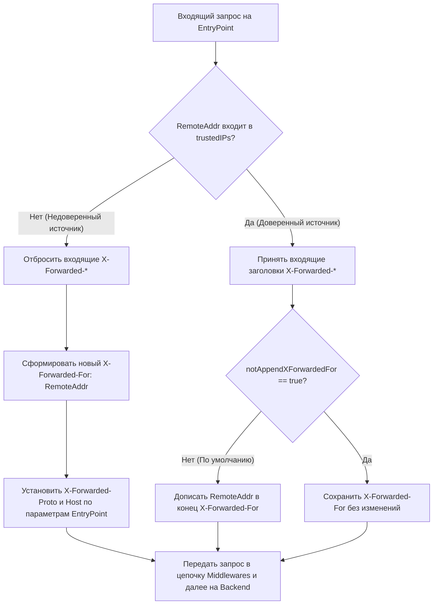

# Доверенные заголовки и реальный IP клиента в Traefik

**Актуально для:** Traefik v3.x (с обратной совместимостью с Traefik v2.x)

## Определения

**`X-Forwarded-*` headers** — семейство де-факто стандартных HTTP-заголовков (`X-Forwarded-For`, `X-Forwarded-Proto`, `X-Forwarded-Host`, `X-Forwarded-Port`, `X-Forwarded-Server`, `X-Real-IP`), через которые промежуточные L7-прокси передают целевому веб-серверу информацию об исходном клиенте и первичном соединении.

**RFC 7239 `Forwarded`** — стандартизированный IETF HTTP-заголовок единого формата (`Forwarded: for=192.0.2.60;proto=https;by=203.0.113.43;host=app.example.com`), объединяющий разрозненные заголовки `X-Forwarded-*`.

**`forwardedHeaders`** — секция статической конфигурации EntryPoint в Traefik, определяющая правила доверия и модификации заголовков `X-Forwarded-*`, поступающих от вышестоящих сетевых узлов.

**`trustedIPs`** — список доверенных IP-адресов или CIDR-диапазонов (IPv4 и IPv6). Traefik доверяет входящим заголовкам проксирования **только** в том случае, если сетевой адрес непосредственного отправителя пакета входит в этот список.

**`forwardedHeaders.insecure`** — режим работы EntryPoint, при котором Traefik слепо доверяет заголовкам `X-Forwarded-*` от абсолютно любого источника (`0.0.0.0/0`). Представляет критическую уязвимость в продакшене (IP Spoofing).

**PROXY protocol** — сетевой протокол (v1 текстовый, v2 бинарный), разработанный проектом HAProxy для передачи метаданных об исходном IP-адресе и порте клиента на транспортном уровне (L4/TCP) до начала передачи прикладных данных.

**`proxyProtocol`** — секция статической конфигурации EntryPoint в Traefik для приема и парсинга заголовков PROXY protocol на уровне входящего сокета.

**`RemoteAddr`** — фактический сетевой IP-адрес пира (сокета), с которого операционная система приняла TCP-соединение на сетевой интерфейс Traefik.

**`sourceCriterion` / `ipStrategy`** — механизм middleware Traefik (`RateLimit`, `inFlightReq`, `IPAllowList`), определяющий алгоритм извлечения клиентского IP из цепочки `X-Forwarded-For` по глубине (`depth`) или через фильтрацию доверенных подсетей (`excludedIPs`).

**IP Spoofing (спуфинг IP)** — атака подделки идентификатора клиента, при которой злоумышленник отправляет произвольный заголовок `X-Forwarded-For: 127.0.0.1` или IP доверенного лица с целью обхода списков контроля доступа (`IPAllowList`), лимитов (`RateLimit`) или сокрытия следов в журнале аудита.

## Архитектура и базовые концепции

### Проблема сохранения IP клиента в каскадных топологиях

При размещении Traefik за промежуточными узлами (аппаратный балансировщик, Nginx, HAProxy, шлюз виртуализации или Docker NAT) прямое TCP-соединение устанавливается не с конечным клиентом, а с промежуточным прокси:

```
[Клиент: 203.0.113.195]
          │
          ▼ TCP
[Внешний балансировщик (HAProxy/Nginx): 192.168.1.10]
          │
          ▼ TCP (RemoteAddr = 192.168.1.10)
[Traefik: 192.168.1.20]
          │
          ▼ HTTP (X-Forwarded-For)
[Сервис приложения: 10.0.0.5]
```

Если доверие к заголовкам не настроено:
- **Ошибочный аудит и логи:** веб-приложение и access-логи фиксируют адрес балансировщика (`192.168.1.10`) вместо адреса клиента (`203.0.113.195`).
- **Глобальная деградация Rate Limit:** middleware `RateLimit` считает все входящие запросы исходящими от одного IP (`192.168.1.10`) и блокирует весь входящий трафик при превышении порога одним клиентом.
- **Отказ белых списков:** middleware `IPAllowList` либо блокирует всех внешних пользователей, либо (при ошибочном добавлении IP прокси в список) открывает доступ любому нарушителю.
- **Уязвимость к спуфингу:** если прокси доверяет входящему трафику без валидации, атакующий может передать фиктивный `X-Forwarded-For: 10.0.0.1` и получить доступ к административным ресурсам.

### Алгоритм обработки `X-Forwarded-*` в Traefik

При получении HTTP-запроса на EntryPoint Traefik выполняет строгую проверку сетевого адреса `RemoteAddr` против списка `forwardedHeaders.trustedIPs`:



#### Поведение при различных режимах `forwardedHeaders`

| Режим конфигурации | Источник доверия | Обработка пришедших заголовков | Риск безопасности |
| :--- | :--- | :--- | :--- |
| `forwardedHeaders.trustedIPs: [...]` | Только перечисленные IP/CIDR | Сохраняются от доверенных; от остальных — сбрасываются и перезаписываются | Минимальный (стандарт для продакшена) |
| `forwardedHeaders.insecure: true` | Любой сетевой адрес (`0.0.0.0/0`) | Слепо принимаются любые заголовки от любого клиента | **Критический**: полный IP Spoofing |
| Не задано (дефолтное поведение) | Никто не доверен | Все приходящие `X-Forwarded-*` сбрасываются; формируется заголовок с `RemoteAddr` | Потеря реального IP клиента за прокси |

Дополнительные параметры EntryPoint:
- `notAppendXForwardedFor: true` — отключает автоматическое добавление сетевого адреса непосредственного прокси (`RemoteAddr`) в конец цепочки `X-Forwarded-For`. Применяется, когда вышестоящий прокси уже полностью сформировал корректную цепочку.
- `connection: [...]` — список заголовков `Connection`, разрешенных к сквозной передаче через цепочку проксирования.

### Сравнение L4 PROXY Protocol и L7 Forwarded Headers

В инфраструктуре под управлением SRE и системных администраторов применяются два принципиально разных механизма передачи исходного IP-адреса:

| Критерий | L4 PROXY Protocol (`proxyProtocol`) | L7 Forwarded Headers (`forwardedHeaders`) |
| :--- | :--- | :--- |
| **Уровень модели OSI** | Layer 4 (Транспортный: TCP/Unix сокет) | Layer 7 (Прикладной: HTTP) |
| **Точка внедрения** | В начало TCP-потока перед TLS/HTTP | В заголовки каждого HTTP-запроса |
| **Подмена `RemoteAddr`** | **Да**: Traefik заменяет `RemoteAddr` сокета на IP клиента | **Нет**: `RemoteAddr` остается IP-адресом вышестоящего прокси |
| **Матчер роутера `ClientIP(...)`** | **Работает напрямую** с реальным IP клиента | **Не работает** (видит только IP промежуточного прокси) |
| **Access-лог (`ClientAddr`)** | Фиксирует реальный IP клиента | Фиксирует IP промежуточного прокси |
| **Поддержка протоколов** | Любые TCP/UDP (HTTP/1.1, HTTP/2, gRPC, TCP SNI, TLS pass-through) | Только HTTP/HTTPS/WebSocket |
| **Накладные расходы** | Минимальные (разбор один раз при установке соединения) | Повторный парсинг строк заголовков каждого запроса |

> [!IMPORTANT]
> Матчер роутера `ClientIP(...)` в Traefik v3 проверяет **исключительно** сетевой адрес сокета `RemoteAddr` и намеренно игнорирует HTTP-заголовок `X-Forwarded-For` во избежание спуфинга. Если Traefik получает трафик через L7-прокси без PROXY protocol, фильтрация по клиентскому IP на уровне роутера `ClientIP(...)` невозможна — вместо этого необходимо применять middleware `IPAllowList` с директивой `ipStrategy`.

### Алгоритм `sourceCriterion.ipStrategy` в Middlewares

Middleware (`RateLimit`, `inFlightReq`, `IPAllowList`) используют структуру `sourceCriterion` для определения ключа клиента. По умолчанию идентификатором выступает `RemoteAddr`. Если Traefik находится за L7-прокси, для извлечения адреса из `X-Forwarded-For` настраивается `ipStrategy`.

В заголовке `X-Forwarded-For: Client_IP, Proxy1_IP, Proxy2_IP` адреса добавляются слева направо:
- `Client_IP` — первоначальный инициатор запроса.
- `Proxy1_IP` — внешний пограничный балансировщик (Edge).
- `Proxy2_IP` — внутренний прокси, передавший запрос в Traefik.

#### Режим `depth` (позиция с правого края)

Параметр `depth: N` инструктирует Traefik брать IP-адрес, отступая на `N` позиций **с правого конца** цепочки:
- `depth: 1` — выбирает последний добавленный в заголовок IP (непосредственный прокси перед Traefik).
- `depth: 2` — выбирает предпоследний IP (клиент перед одним промежуточным прокси).
- Если `depth` превышает общее количество IP в цепочке, запрос отвергается или отбирается крайний доступный IP в зависимости от типа middleware.

#### Режим `excludedIPs` (исключение доверенных подсетей)

Параметр `excludedIPs` содержит список CIDR (например, внутренние сети `10.0.0.0/8`, `192.168.0.0/16`). Traefik просматривает список `X-Forwarded-For` справа налево и выбирает **первый IP-адрес, не входящий** в список `excludedIPs`.

> [!WARNING]
> Параметры `depth` и `excludedIPs` взаимно исключают друг друга. Установка `depth > 0` полностью отключает обработку списка `excludedIPs`.

## Практические сценарии и конфигурация

### Сценарий 1: Traefik за пограничным L7-прокси (Nginx / HAProxy)

Классическая схема: на хосте или выделенном узле работает Nginx/HAProxy, терминирующий внешний периметр и передающий трафик на Traefik по локальной сети `192.168.10.0/24`.

#### Статическая конфигурация Traefik (`traefik.yml`)

```yaml
entryPoints:
  web:
    address: ":80"
    forwardedHeaders:
      trustedIPs:
        - "127.0.0.1/32"
        - "192.168.10.15/32"   # IP пограничного Nginx
        - "10.100.0.0/16"       # Внутренняя сервисная подсеть
  websecure:
    address: ":443"
    forwardedHeaders:
      trustedIPs:
        - "192.168.10.15/32"

accessLog:
  format: json
  filePath: "/var/log/traefik/access.log"
  fields:
    defaultMode: keep
    names:
      ClientAddr: keep
      ClientHost: keep
      DownstreamStatus: keep
    headers:
      defaultMode: keep
      names:
        X-Forwarded-For: keep
        X-Real-IP: keep

providers:
  file:
    directory: "/etc/traefik/dynamic"
    watch: true
```

#### Конфигурация вышестоящего Nginx (`/etc/nginx/conf.d/upstream_traefik.conf`)

```nginx
server {
    listen 80;
    server_name app.example.internal;

    location / {
        proxy_pass http://192.168.10.20:80;
        proxy_set_header Host $host;
        proxy_set_header X-Real-IP $remote_addr;
        proxy_set_header X-Forwarded-For $proxy_add_x_forwarded_for;
        proxy_set_header X-Forwarded-Proto $scheme;
        proxy_set_header X-Forwarded-Port $server_port;
        proxy_connect_timeout 5s;
        proxy_read_timeout 60s;
    }
}
```

### Сценарий 2: L4-балансировка с PROXY Protocol v2 (HAProxy + Traefik)

Для минимизации накладных расходов и сохранения прозрачности сокетов на уровне ядра Linux upstream-балансировщик передает трафик через PROXY protocol v2.

#### Конфигурация HAProxy (`/etc/haproxy/haproxy.cfg`)

```haproxy
frontend fe_http
    bind 0.0.0.0:80
    mode tcp
    default_backend be_traefik_http

frontend fe_https
    bind 0.0.0.0:443
    mode tcp
    default_backend be_traefik_https

backend be_traefik_http
    mode tcp
    balance roundrobin
    server traefik-node-1 192.168.10.21:80 check send-proxy-v2
    server traefik-node-2 192.168.10.22:80 check send-proxy-v2

backend be_traefik_https
    mode tcp
    balance roundrobin
    server traefik-node-1 192.168.10.21:443 check send-proxy-v2
    server traefik-node-2 192.168.10.22:443 check send-proxy-v2
```

#### Статическая конфигурация Traefik (`traefik.yml`)

```yaml
entryPoints:
  web:
    address: ":80"
    proxyProtocol:
      trustedIPs:
        - "192.168.10.10/32"   # IP HAProxy узла 1
        - "192.168.10.11/32"   # IP HAProxy узла 2
  websecure:
    address: ":443"
    proxyProtocol:
      trustedIPs:
        - "192.168.10.10/32"
        - "192.168.10.11/32"
```

При такой конфигурации `RemoteAddr` соединения в Traefik сразу становится равен реальному IP клиента. Роутеры с правилом `ClientIP(...)` работают напрямую без вспомогательных middleware.

### Сценарий 3: Защита периметра (IPAllowList + RateLimit с `ipStrategy`)

Динамическая конфигурация Traefik для защиты критичного API с проверкой реального IP за прокси.

#### Динамическая конфигурация (`/etc/traefik/dynamic/security-rules.yml`)

```yaml
http:
  routers:
    admin-api:
      entryPoints:
        - websecure
      rule: "Host(`admin.example.internal`) && PathPrefix(`/api/v1`)"
      service: admin-service
      middlewares:
        - admin-ip-whitelist
        - api-ratelimit

  middlewares:
    # Ограничение доступа только с корпоративных внешних IP
    admin-ip-whitelist:
      ipAllowList:
        sourceRange:
          - "198.51.100.0/24"
          - "203.0.113.50/32"
        ipStrategy:
          depth: 1

    # Защита от брутфорса и перегрузки по реальному IP клиента
    api-ratelimit:
      rateLimit:
        average: 30
        period: 1s
        burst: 60
        sourceCriterion:
          ipStrategy:
            depth: 1

  services:
    admin-service:
      loadBalancer:
        servers:
          - url: "http://127.0.0.1:8080"
```

### Сценарий 4: Развертывание в Docker с сохранением Source IP

При запуске Traefik в контейнере через стандартный Docker Bridge (`bridge`) демон Docker выполняет SNAT/MASQUERADE, в результате чего все входящие пакеты приходят с IP-адреса шлюза моста (`172.17.0.1` или `172.x.x.1`).

#### Продакшен `docker-compose.yml` с прямым доступом к сети хоста

```yaml
services:
  traefik:
    image: traefik:v3.3
    container_name: traefik-edge
    restart: always
    network_mode: host
    environment:
      - TZ=UTC
    volumes:
      - /var/run/docker.sock:/var/run/docker.sock:ro
      - /opt/traefik/traefik.yml:/etc/traefik/traefik.yml:ro
      - /opt/traefik/dynamic:/etc/traefik/dynamic:ro
      - /var/log/traefik:/var/log/traefik

  backend-app:
    image: hashicorp/http-echo:latest
    container_name: demo-backend
    restart: unless-stopped
    command: ["-text=Backend received request successfully", "-listen=:8080"]
    network_mode: host
```

> [!NOTE]
> Использование `network_mode: host` исключает оверхед `docker-proxy` и трансляцию адресов, позволяя Traefik видеть оригинальный сетевой адрес входящего сокета без дополнительных прослоек.

## Проверка и валидация конфигурации

### Проверка передачи заголовков через `curl`

Проверка сквозного прохождения и корректности модификации заголовков с симуляцией запроса от вышестоящего доверенного узла:

```bash
# Тест 1: Запрос с доверенного хоста с передачей исходного IP
curl -s -v -H "Host: admin.example.internal" \
     -H "X-Forwarded-For: 203.0.113.195" \
     -H "X-Forwarded-Proto: https" \
     http://127.0.0.1:80/api/v1/status
# → < HTTP/1.1 200 OK
# → < Content-Type: text/plain; charset=utf-8
```

Проверка попытки спуфинга с недоверенного адреса:

```bash
# Тест 2: Попытка передать фиктивный белый IP со стороннего узла (например, 192.168.1.99, отсутствующего в trustedIPs)
curl -s -i -H "Host: admin.example.internal" \
     -H "X-Forwarded-For: 203.0.113.50" \
     http://192.168.1.20:80/api/v1/status
# → HTTP/1.1 403 Forbidden
# → content-length: 9
# → Forbidden
```

### Анализ сетевого трафика через `tcpdump`

Проверка наличия заголовка PROXY Protocol v2 на сетевом интерфейсе Traefik:

```bash
# Захват первых 64 байт TCP-соединения на порту 80
sudo tcpdump -nn -vv -i eth0 'tcp port 80 and (((ip[2:2] - ((ip[0]&0xf)<<2)) - ((tcp[12:1]&0xf0)>>2)) != 0)' -c 1 -X
# → 15:40:12.102941 IP 192.168.10.15.48291 > 192.168.10.20.80: Flags [P.], seq 1:29 ...
# → 0x0000:  4500 0045 1a2b 4000 4006 ...
# → 0x0020:  0d0a 0d0a 000d 0a51 5549 540a 2111 000c  .......QUIT.!...
# → 0x0030:  cb00 71c3 c0a8 0a14 c49a 0050            ..q........P
```
Байтовая последовательность `0d0a 0d0a 000d 0a51 5549 540a` (`\r\n\r\n\0\r\nQUIT\n`) подтверждает получение валидного заголовка PROXY Protocol v2.

### Проверка JSON-журнала Traefik

```bash
# Чтение последней записи access-лога Traefik
tail -n 1 /var/log/traefik/access.log | jq .
# → {
# →   "ClientAddr": "192.168.10.15:48291",
# →   "ClientHost": "203.0.113.195",
# →   "DownstreamStatus": 200,
# →   "Duration": 1245000,
# →   "EntryPointName": "web",
# →   "RequestHost": "admin.example.internal",
# →   "RequestMethod": "GET",
# →   "RequestPath": "/api/v1/status",
# →   "request_X-Forwarded-For": "203.0.113.195, 192.168.10.15"
# → }
```

## Устранение неисправностей

| Проблема | Диагностика | Первопричина | Решение |
| :--- | :--- | :--- | :--- |
| **Все клиенты логируются с IP балансировщика** | В логах приложений `ClientAddr` равен шлюзу или L7-прокси | Не настроен `forwardedHeaders.trustedIPs` на EntryPoint Traefik | Добавить IP-адреса промежуточных балансировщиков в `entryPoints.<name>.forwardedHeaders.trustedIPs` |
| **RateLimit возвращает `429 Too Many Requests` всем клиентам сразу** | Срабатывание лимита при обращении независимых пользователей | Middleware вычисляет лимит по `RemoteAddr` (балансировщик) | Указать `sourceCriterion.ipStrategy.depth: 1` в секции `rateLimit` |
| **В логах отображается `172.17.0.1` (Docker gateway)** | `ClientAddr: "172.17.0.1:..."` в `access.log` | Входящий трафик транслируется механизмом Docker NAT/Userland Proxy | Запустить контейнер с `network_mode: host` или добавить диапазон `172.16.0.0/12` в `trustedIPs` |
| **Соединение сбрасывается (`connection reset by peer`, `EOF`)** | В логах Traefik: `error while reading PROXY protocol: unknown protocol` | Включен `proxyProtocol` на Traefik, но балансировщик отправляет стандартный HTTP | Включить `send-proxy` / `send-proxy-v2` на балансировщике либо отключить `proxyProtocol` в Traefik |
| **Матчер роутера `ClientIP(...)` не фильтрует трафик за прокси** | Запросы от неразрешенных IP проходят или роутер всегда отдает 404 | `ClientIP` матчит сетевой `RemoteAddr`, а не `X-Forwarded-For` | Использовать L4 PROXY protocol либо перенести фильтрацию в middleware `ipAllowList` с `ipStrategy` |
| **Отказ в доступе `403 Forbidden` через IPv6** | Клиенты с IPv6 получают отказ при корректной настройке IPv4 | `trustedIPs` не содержит IPv6 адреса промежуточного прокси | Добавить IPv6-префиксы балансировщика в `trustedIPs` (например, `fe80::/10`, `2001:db8::/32`) |

## Лучшие практики

1. **Принцип минимального доверия в `trustedIPs`:**
   Никогда не указывайте `forwardedHeaders.insecure: true` или маску `0.0.0.0/0` на публичных сетевых интерфейсах. Вносите в список исключительно статические адреса или доверенные сервисные подсети вышестоящих узлов.

2. **Выбор уровня абстракции (L4 против L7):**
   При наличии собственного парка аппаратных или программных балансировщиков (HAProxy, Keepalived LVS) отдавайте предпочтение **PROXY Protocol v2**. Он исключает повторный оверхед парсинга строк в HTTP, автоматически подменяет `RemoteAddr` на уровне ядра сокета и обеспечивает прозрачную работу матчера `ClientIP(...)` и метрик.

3. **Осознанная глубина цепочки (`depth`):**
   Всегда сопоставляйте топологию сети с параметром `depth`. Если запрос проходит путь `Клиент → Пограничный CDN/WAF → Внутренний HAProxy → Traefik`, для извлечения адреса клиента используйте `depth: 2`. При наличии динамического числа внутренних узлов используйте `excludedIPs` со списком локальных подсетей (`10.0.0.0/8`, `172.16.0.0/12`, `192.168.0.0/16`).

4. **Аудит и логирование безопасности:**
   Всегда настраивайте расширенное логирование в `accessLog`: сохраняйте `ClientAddr`, `ClientHost` и заголовки `X-Forwarded-For`, `X-Real-IP`. Это позволяет дифференцировать сетевой узел передачи пакета и реального инициатора HTTP-сессии при расследовании инцидентов ИБ.

5. **Очистка и изоляция внутренних заголовков:**
   Если бэкенды используют заголовки авторизации (`X-Forwarded-User`, `X-Webauth-User`), гарантируйте, что Traefik либо пограничный WAF затирает эти заголовки при входе из внешней сети, не позволяя внешним клиентам передавать их в обход аутентификационных middleware.

## Дополнительная информация

- [Обзор архитектуры Traefik](./traefik_overview.md) — компоненты EntryPoints, Routers, Middlewares и Services.
- [Маршрутизация в Traefik: правила и приоритеты](./traefik-routers-and-rules.md) — особенности синтаксиса матчеров v3 и поведение `ClientIP`.
- [Глубокое погружение в Rate Limiting](./traefik-rate-limiting-deep.md) — настройка локальных и распределенных (Redis) лимитов по IP.
- [Безопасность и Middleware в Traefik](./traefik-middlewares-security.md) — настройка `ipAllowList`, базовой аутентификации и заголовков безопасности.
- [Edge Security и WAF](./traefik-edge-security-waf.md) — интеграция Traefik с CrowdSec и правила доверия `forwardedHeadersTrustedIPs`.
- [PROXY protocol: Архитектура и спецификация](../../Networking/Protocols/proxy_protocol.md) — детальный разбор структуры заголовков v1 и v2.
- [Концепция и архитектура прокси-серверов](../../Networking/Concepts/proxy.md) — фундаментальные основы прямого и обратного проксирования.
- [Конфигурация HTTP-серверов и обратных прокси](../../Networking/Protocols/HTTP/http_servers_proxies.md) — настройка директив `real_ip` в Nginx и HAProxy.
- [Ограничение скорости на веб-серверах](../../WebServers/Concepts/webserver_rate_limiting.md) — реализация алгоритмов Token Bucket и Leaky Bucket.