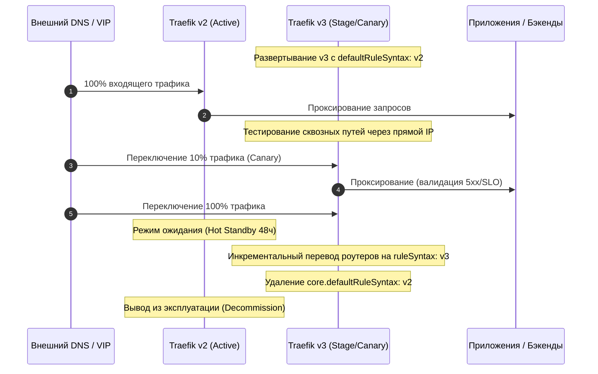

# Миграция с Traefik v2 на v3

**Актуально для:** Traefik v2.11.x / v3.7.x

## Определения

**Breaking changes (Критические изменения)** — изменения в синтаксисе конфигурации, API или поведении компонентов, которые делают существующие настройки Traefik v2 несовместимыми с рантаймом Traefik v3 и приводят к ошибкам старта или сбоям маршрутизации без предварительной адаптации.

**v2 rule syntax (Синтаксис правил v2)** — легаси-формат сопоставления правил маршрутизатора, поддерживающий множественное число матчеров (`Headers`, `HeadersRegexp`), плейсхолдеры в путях (`Path(`/api/{id:[0-9]+}`)`) и нестрогие регулярные выражения.

**v3 rule syntax (Синтаксис правил v3)** — актуальный строгий формат правил маршрутизации по умолчанию в Traefik v3: стандартизированный синтаксис Go-regexp, единственное число матчеров (`Header`, `HeaderRegexp`), строгие матчеры (`PathRegexp`, `QueryRegexp`) и требование явных логических операторов (`&&`, `||`).

**Compatibility Gate (`defaultRuleSyntax`)** — механизм обратной совместимости в статической конфигурации Traefik v3 (`core.defaultRuleSyntax: v2`), позволяющий рантайму v3 интерпретировать правила роутеров в формате v2 в переходный период без остановки сервиса.

**CRD API Group Migration** — миграция ресурсов Kubernetes IngressRoute с устаревшей группы API `traefik.containo.us/v1alpha1` на официальную группу `traefik.io/v1alpha1`, сопровождающаяся обновлением схемы валидации и RBAC.

**OTLP Tracing (OpenTelemetry Protocol)** — единый открытый протокол экспорта трассировки, ставший в Traefik v3 единственным встроенным механизмом трейсинга взамен устаревших проприетарных драйверов (Jaeger, Zipkin, Datadog).

**TCPServersTransport** — специализированный ресурс и транспортный уровень в Traefik v3 для тонкой настройки пула TCP-соединений к бэкендам (таймауты, TLS, задержка завершения `terminationDelay`).

## Архитектура и ключевые отличия Traefik v2 и v3

### Архитектурные изменения

Traefik v3 оптимизировал внутреннее ядро маршрутизации, унифицировал интеграции с внешними системами и удалил накопившийся технический долг версий 2.x:

1. **Разделение провайдеров:** В v2 провайдер Docker отвечал как за локальный Docker Daemon, так и за кластер Docker Swarm через флаг `swarmMode`. В v3 Swarm выделен в самостоятельный провайдер `providers.swarm`, а поддержка `swarmMode` в `providers.docker` удалена.
2. **Строгая грамматика правил:** Отказ от внутренних плейсхолдеров в `Path` и `PathPrefix` в пользу нативного синтаксиса регулярных выражений Go (`regexp`) в `PathRegexp`. Все матчеры переведены в единственное число (`Header`, `HeaderRegexp`).
3. **Очистка Middleware и TLS:** Удалены дублирующие директивы перенаправления трафика (`sslRedirect` внутри Headers middleware). Вся логика перенаправления HTTP→HTTPS централизована в `entryPoints.redirections` или специализированном middleware `redirectScheme`.
4. **Удаление клиентского `tls.caOptional`:** Опция `caOptional` удалена из клиентских конфигураций провайдеров (Docker, Consul, Nomad, Redis, Etcd, HTTP) и middleware `ForwardAuth`, так как опциональная аутентификация клиента применима только на стороне TLS-сервера.
5. **Полноценная поддержка HTTP/3:** Протокол HTTP/3 переведен из разряда экспериментальных опций в стабильный функционал и активируется непосредственно на уровне точки входа (`entryPoint`).
6. **Унификация наблюдаемости:** Прямые коннекторы трассировки к бэкендам (Jaeger, Zipkin, Datadog) удалены. Traefik v3 отправляет телеметрию исключительно через OpenTelemetry (OTLP gRPC/HTTP). Метрики соединений объединены в глобальный счетчик `traefik_open_connections`.
7. **Удаление устаревших провайдеров:** Полностью исключены неподдерживаемые апстримом решения: Rancher v1, Mesosphere Marathon, InfluxDB v1 и облачный сервис Traefik Pilot.

### Сводная таблица breaking changes

| Компонент / Область | В Traefik v2 | В Traefik v3 | Влияние и действие администратора |
| :--- | :--- | :--- | :--- |
| **Синтаксис заголовков** | `Headers(`...`)`, `HeadersRegexp(`...`)` | `Header(`...`)`, `HeaderRegexp(`...`)` | Ошибка парсинга роутера; требуется замена имен матчеров |
| **Пути с параметрами** | `Path(`/items/{id:[0-9]+}`)` | `PathRegexp(`^/items/[0-9]+$`)` | Роутер v3 не матчит плейсхолдеры; переписать на `PathRegexp` |
| **Префиксы путей** | `PathPrefix` поддерживал regexp | `PathPrefix` — только строгий префикс; для regexp — `PathRegexp` | Регулярные выражения в `PathPrefix` вызывают синтаксическую ошибку |
| **Query-параметры** | `Query(`key`, `val`)` | `Query(`key`, `val`)` и `QueryRegexp(`key`, `regex`)` | Появился нативный regex-матчер query-строки |
| **Docker & Swarm** | `providers.docker.swarmMode: true` | Отдельный провайдер `providers.swarm` | Traefik не стартует при наличии флага `swarmMode` у `docker` |
| **HTTP→HTTPS редирект** | `headers.sslRedirect: true` | `redirections.entryPoint` или `redirectScheme` | Ошибка `field not found`; удалить из Headers middleware |
| **Белые списки IP** | `ipWhiteList` middleware | `ipAllowList` middleware | Ошибка `field not found, node: ipWhiteList`; переименовать |
| **Client IP Matcher** | `ClientIP(`...`)` | `ClientIP(`...`)` (синтаксис v3) | Требует явных сетевых масок CIDR |
| **Политики безопасности** | `headers.featurePolicy` | `headers.permissionsPolicy` | Устаревший заголовок Feature-Policy заменен на Permissions-Policy |
| **TLS Options** | `preferServerCipherSuites: true` | Удалено | Удалить поле из статических/динамических `tls.options` |
| **Client CA Optional** | `tls.caOptional: true` у провайдеров | Удалено | Удалить директиву из блоков провайдеров и `forwardAuth` |
| **HTTP/3** | `experimental.http3: true` | `entryPoints.<name>.http3: {}` | Удалить секцию `experimental`; включить на entrypoint |
| **Трассировка** | Драйверы `jaeger`, `zipkin`, `datadog` | Исключительно `tracing.openTelemetry` | Ошибка валидации статического конфига; переход на OTLP |
| **Метрики соединений** | `traefik_entrypoint_open_connections` | `traefik_open_connections` | Старые метрики удалены; обновить дашборды и алерты |
| **Content-Type** | Автодетекция при пустом типе | Отключена по умолчанию | Подключить middleware `contentType`, если бэкенд не отдает MIME |
| **Kubernetes CRD Group** | `traefik.containo.us/v1alpha1` | `traefik.io/v1alpha1` | Манифесты не применяются; обновить CRD и API group |
| **TCP Termination** | `terminationDelay` у TCP LB | Перенесено в `TCPServersTransport` | Ошибка в TCP LB; настроить через транспорт |

### Механика обратной совместимости (Compatibility Gate)

Для минимизации рисков при обновлении production-окружений Traefik v3 предоставляет двухфазный механизм совместимости:

```mermaid
flowchart TD
    A["Запрос поступает в Traefik v3"] --> B{"Настроен ли ruleSyntax у роутера?"}
    B -->|Да: ruleSyntax = v2| C["Парсинг движком v2 (плейсхолдеры, Headers)"]
    B -->|Да: ruleSyntax = v3| D["Парсинг строгим движком v3 (Go-regexp)"]
    B -->|Нет| E{"core.defaultRuleSyntax в traefik.yml"}
    E -->|v2| C
    E -->|v3 (по умолчанию)| D
    C --> F["Маршрутизация к целевому сервису"]
    D --> F
```

1. **Глобальный уровень (`traefik.yml`):**
   ```yaml
   core:
     defaultRuleSyntax: v2
   ```
   Позволяет запустить инстанс Traefik v3 со всеми существующими динамическими конфигурациями v2 без их одномоментной правки.
2. **Локальный уровень (на роутере):**
   Флаг `ruleSyntax: v3` на отдельных роутерах позволяет инкрементально переводить сервисы на новый синтаксис, тестировать их и выявлять ошибки без риска для остальных маршрутов.

## Практические сценарии миграции

### Сценарий 1: Аудит и миграция статической конфигурации (Docker Compose и Linux systemd)

При переходе с v2 на v3 статическая конфигурация проверяется в первую очередь, так как наличие удаленных полей блокирует запуск процесса Traefik.

#### Конфигурация Traefik v2 (до миграции)

```yaml
# traefik.yml (v2 legacy)
entryPoints:
  web:
    address: ":80"
  websecure:
    address: ":443"

experimental:
  http3: true

providers:
  docker:
    endpoint: "unix:///var/run/docker.sock"
    exposedByDefault: false
    swarmMode: false
    tls:
      caOptional: true
  file:
    directory: "/etc/traefik/dynamic"
    watch: true

tracing:
  jaeger:
    samplingServerURL: "http://127.0.0.1:5778/sampling"
    localAgentHostPort: "127.0.0.1:6831"

pilot:
  token: "xxxx-xxxx-xxxx"
```

#### Конфигурация Traefik v3 (после миграции)

```yaml
# traefik.yml (v3 production)
core:
  # Временный шлюз совместимости на период пошагового переноса правил
  defaultRuleSyntax: v2

entryPoints:
  web:
    address: ":80"
    http:
      # Нативный редирект HTTP -> HTTPS на уровне точки входа
      redirections:
        entryPoint:
          to: websecure
          scheme: https
          permanent: true

  websecure:
    address: ":443"
    # HTTP/3 активируется прямо на entrypoint без секции experimental
    http3: {}
    transport:
      respondingTimeouts:
        readTimeout: 60s
        writeTimeout: 60s
        idleTimeout: 180s

providers:
  docker:
    endpoint: "unix:///var/run/docker.sock"
    exposedByDefault: false
    # swarmMode и tls.caOptional полностью удалены

  file:
    directory: "/etc/traefik/dynamic"
    watch: true

# Унифицированная трассировка через OpenTelemetry
tracing:
  openTelemetry:
    address: "otel-collector:4317"
    insecure: true

# Системный health check
ping:
  entryPoint: "web"
```

> [!IMPORTANT]
> Если кластер развернут в Docker Swarm, в секции `providers` заменяется `docker` на `swarm`:
> ```yaml
> providers:
>   swarm:
>     endpoint: "unix:///var/run/docker.sock"
>     exposedByDefault: false
> ```

---

### Сценарий 2: Пошаговая миграция правил роутеров и путей

В динамической конфигурации заменяются матчеры заголовков, префиксов и динамических сегментов URL.

#### До миграции (v2)

```yaml
# dynamic_v2.yml
http:
  routers:
    legacy-api:
      rule: "Host(`api.example.internal`) && PathPrefix(`/api/v1`) && Headers(`X-Client-Type`, `mobile`)"
      entryPoints:
        - websecure
      service: api-service
      tls: {}

    legacy-user-item:
      # Плейсхолдеры внутри Path
      rule: "Host(`api.example.internal`) && Path(`/users/{userId:[0-9]+}/orders/{orderId:[a-z0-9-]+}`)"
      entryPoints:
        - websecure
      service: order-service
      tls: {}
```

#### После миграции (v3)

```yaml
# dynamic_v3.yml
http:
  routers:
    legacy-api:
      # Замена Headers -> Header, строгий PathPrefix
      rule: "Host(`api.example.internal`) && PathPrefix(`/api/v1`) && Header(`X-Client-Type`, `mobile`)"
      entryPoints:
        - websecure
      service: api-service
      tls: {}

    legacy-user-item:
      # Замена плейсхолдеров на нативный PathRegexp со строгим синтаксисом Go-regexp
      rule: "Host(`api.example.internal`) && PathRegexp(`^/users/[0-9]+/orders/[a-z0-9-]+$`)"
      # Явное объявление синтаксиса v3 для валидации конкретного роутера
      ruleSyntax: v3
      entryPoints:
        - websecure
      service: order-service
      tls: {}
```

#### Эквивалент в Docker Compose Labels

До (v2):
```yaml
labels:
  - "traefik.enable=true"
  - "traefik.http.routers.catalog.rule=Host(`catalog.internal`) && HeadersRegexp(`X-Brand`, `^(apple|sony)$`)"
```

После (v3):
```yaml
labels:
  - "traefik.enable=true"
  - "traefik.http.routers.catalog.rule=Host(`catalog.internal`) && HeaderRegexp(`X-Brand`, `^(apple|sony)$`)"
  - "traefik.http.routers.catalog.ruleSyntax=v3"
```

---

### Сценарий 3: Рефакторинг Middleware безопасности и TLS-опций

Устаревшие директивы `ipWhiteList`, `sslRedirect`, `featurePolicy` и `preferServerCipherSuites` заменяются современными аналогами.

#### До миграции (v2)

```yaml
# middlewares_v2.yml
http:
  middlewares:
    sec-headers:
      headers:
        sslRedirect: true
        sslForceHost: true
        sslHost: "app.example.internal"
        featurePolicy: "camera 'none'; microphone 'none'"
        browserXssFilter: true
        contentTypeNosniff: true
        stsSeconds: 31536000

    admin-whitelist:
      ipWhiteList:
        sourceRange:
          - "192.168.10.0/24"
          - "10.0.0.50/32"

tls:
  options:
    default:
      minVersion: "VersionTLS12"
      preferServerCipherSuites: true
```

#### После миграции (v3)

```yaml
# middlewares_v3.yml
http:
  middlewares:
    sec-headers:
      headers:
        # sslRedirect и sslHost удалены (редирект вынесен на EntryPoint)
        # featurePolicy переименован в актуальный стандарт W3C permissionsPolicy
        permissionsPolicy: "camera=(), microphone=()"
        browserXssFilter: true
        contentTypeNosniff: true
        stsSeconds: 31536000
        stsIncludeSubdomains: true
        stsPreload: true

    admin-whitelist:
      # ipWhiteList переименован в ipAllowList без изменения структуры
      ipAllowList:
        sourceRange:
          - "192.168.10.0/24"
          - "10.0.0.50/32"

    # Middleware для бэкендов, не отдающих Content-Type
    auto-mime:
      contentType: {}

tls:
  options:
    default:
      minVersion: "VersionTLS12"
      # preferServerCipherSuites удален (в Go 1.17+ порядок определяет клиент или crypto/tls)
      cipherSuites:
        - "TLS_ECDHE_ECDSA_WITH_AES_128_GCM_SHA256"
        - "TLS_ECDHE_RSA_WITH_AES_128_GCM_SHA256"
        - "TLS_ECDHE_ECDSA_WITH_AES_256_GCM_SHA384"
        - "TLS_ECDHE_RSA_WITH_AES_256_GCM_SHA384"
        - "TLS_ECDHE_ECDSA_WITH_CHACHA20_POLY1305"
        - "TLS_ECDHE_RSA_WITH_CHACHA20_POLY1305"
```

---

### Сценарий 4: Миграция в Kubernetes (CRD `traefik.io` и Helm Chart)

В кластере Kubernetes v3 требует обновления Custom Resource Definitions с удалением группы `traefik.containo.us`.

#### Шаг 1. Бэкап существующих ресурсов v2

```bash
# Экспорт всех IngressRoute старой группы
kubectl get ingressroutes.traefik.containo.us -A -o yaml > ingressroutes-v2-backup.yaml
kubectl get middlewares.traefik.containo.us -A -o yaml > middlewares-v2-backup.yaml
kubectl get tlsoptions.traefik.containo.us -A -o yaml > tlsoptions-v2-backup.yaml
```

#### Шаг 2. Обновление CRD до версии v3 (`traefik.io`)

```bash
kubectl apply --server-side -f https://raw.githubusercontent.com/traefik/traefik/v3.7/docs/content/reference/dynamic-configuration/kubernetes-crd-definition-v1.yml
# → customresourcedefinition.apiextensions.k8s.io/ingressroutes.traefik.io configured
# → customresourcedefinition.apiextensions.k8s.io/middlewares.traefik.io configured
# → customresourcedefinition.apiextensions.k8s.io/serverstransports.traefik.io configured
# → customresourcedefinition.apiextensions.k8s.io/serverstransportstcps.traefik.io created
```

#### Шаг 3. Миграция манифеста IngressRoute

До (v2):
```yaml
apiVersion: traefik.containo.us/v1alpha1
kind: IngressRoute
metadata:
  name: billing-app
  namespace: finance
spec:
  entryPoints:
    - websecure
  routes:
    - match: Host(`billing.internal`) && PathPrefix(`/pay`)
      kind: Rule
      services:
        - name: billing-svc
          port: 8080
      middlewares:
        - name: finance-ip-whitelist
```

После (v3):
```yaml
apiVersion: traefik.io/v1alpha1
kind: IngressRoute
metadata:
  name: billing-app
  namespace: finance
spec:
  entryPoints:
    - websecure
  routes:
    - match: Host(`billing.internal`) && PathPrefix(`/pay`)
      kind: Rule
      syntax: v3
      services:
        - name: billing-svc
          port: 8080
      middlewares:
        - name: finance-ip-allowlist
```

#### Шаг 4. Обновление Helm values

При использовании официального чарта Traefik переход с ветки 10.x/20.x на 33.x/34.x:

```yaml
# values-v3.yaml
deployment:
  replicas: 3

image:
  name: traefik
  tag: "v3.7.0"

core:
  defaultRuleSyntax: "v2" # Шлюз совместимости на время перехода

providers:
  kubernetesCRD:
    enabled: true
    allowCrossNamespace: true
  kubernetesIngress:
    enabled: true

service:
  type: LoadBalancer

ports:
  web:
    port: 8000
    expose:
      default: true
    redirectTo:
      port: websecure
  websecure:
    port: 8443
    expose:
      default: true
    http3:
      enabled: true
```

---

### Сценарий 5: Миграция мониторинга и телеметрии (Prometheus & OpenTelemetry)

После перехода на v3 метрики соединений и ошибки парсинга изменяют названия.

#### 1. Метрики соединений Prometheus
Метрики `traefik_entrypoint_open_connections`, `traefik_router_open_connections`, `traefik_service_open_connections` удалены. Вместо них снимается общее число активных соединений прокси-сервера:

```promql
# Суммарное количество открытых соединений в Traefik v3
sum(traefik_open_connections) by (instance)
```

#### 2. Алерты для Prometheus Alertmanager

Обновление правил алертинга:

```yaml
# prometheus-traefik-alerts.yaml
groups:
  - name: traefik_v3_migration_alerts
    rules:
      - alert: TraefikHigh5xxErrorRate
        expr: |
          sum(rate(traefik_entrypoint_requests_total{code=~"5.."}[2m])) 
          / 
          sum(rate(traefik_entrypoint_requests_total[2m])) * 100 > 2
        for: 2m
        labels:
          severity: critical
        annotations:
          summary: "Всплеск 5xx ошибок на Traefik v3: {{ $value }}%"
          description: "Возможна деградация бэкендов или отказ маршрутизации после обновления."

      - alert: TraefikConfigReloadFailure
        # В v3 reload failures фиксируются через логгер или проверку статуса API
        expr: increase(traefik_config_reload_total{status="failed"}[5m]) > 0
        for: 1m
        labels:
          severity: warning
        annotations:
          summary: "Сбой загрузки динамической конфигурации Traefik"
          description: "Синтаксическая ошибка в правилах dynamic configuration."
```

#### 3. Настройка OpenTelemetry Tracing

Подключение к локальному OTel Collector по gRPC:

```yaml
# traefik.yml
tracing:
  openTelemetry:
    address: "127.0.0.1:4317"
    insecure: true
    grpc: true
```

---

### Сценарий 6: Продакшн Runbook бездаунтаймного переключения и отката

Перевод продуктивной нагрузки выполняется по схеме канареечного переключения DNS / Load Balancer с сохранением резервной инсталляции v2 в горячем резерве в течение 48 часов.



#### Порядок действий администратора

1. **Предварительный аудит:** Выполнить схемную валидацию всех конфигурационных файлов.
2. **Параллельный запуск:** Развернуть инстанс Traefik v3 рядом с v2 на резервных IP-адресах или выделенном порту.
3. **Smoke-тестирование:** Проверить прохождение контрольных запросов и выпуск TLS-сертификатов.
4. **Переключение:** Переключить Keepalived VIP или upstream во внешнем L4 балансировщике (HAProxy / Nginx) на ноды v3.
5. **Мониторинг:** Контролировать журнал ошибок и метрику `traefik_entrypoint_requests_total{code=~"5.."}`.
6. **Откат (Rollback):** При обнаружении деградации (рост 5xx > 1%) немедленно вернуть VIP / upstream на ноды v2:
   ```bash
   # Мгновенный возврат трафика на v2 в HAProxy
   echo "set server backend_traefik/traefik_v2 state ready" | sudo socat stdio /var/run/haproxy.sock
   echo "set server backend_traefik/traefik_v3 state maint" | sudo socat stdio /var/run/haproxy.sock
   ```

## Операции и команды валидации и миграции

В бинарном дистрибутиве Traefik отсутствуют отдельные подкоманды генерации миграций, поэтому валидация выполняется через запуск инстанса с флагом проверки модели, JSON-схемы и API интроспекции.

| Операция | Команда | Назначение и ожидаемый результат |
| :--- | :--- | :--- |
| **Проверка версии** | `traefik version` | Проверка версии бинарника (`# → Version: 3.7.0`) |
| **Схемная проверка YAML** | `check-jsonschema --schemafile traefik-v3.json traefik.yml` | Проверка конфигурации по JSON-схеме (`# → OK`) |
| **Изолированный тест** | `docker run --rm -v $(pwd)/traefik.yml:/etc/traefik/traefik.yml:ro traefik:v3.7.0 --configFile=/etc/traefik/traefik.yml` | Тестовый запуск с быстрым завершением при синтаксических ошибках |
| **Проверка Liveness** | `curl -f http://127.0.0.1:8080/ping` | Проверка жизнеспособности прокси (`# → OK`) |
| **Дамп состояния API** | `curl -s http://127.0.0.1:8080/api/rawdata \| jq '.http.routers'` | Выгрузка активных роутеров для сравнения v2 и v3 |
| **Проверка TLS-хэндшейка** | `openssl s_client -connect app.example.internal:443 -servername app.example.internal -tls1_3 < /dev/null` | Проверка сертификата и отсутствия сбоев рукопожатия |
| **Тест HTTP/3 (QUIC)** | `curl --http3-only -iv https://app.example.internal/` | Проверка ответа по UDP/QUIC (`# → HTTP/3 200`) |

### Примеры выполнения команд

```bash
# 1. Проверка версии бинарного файла Traefik
traefik version
# → Version:      3.7.0
# → Codename:     ricotta
# → Go version:   go1.23.4
# → Built:        2025-01-15T12:00:00Z
# → OS/Arch:      linux/amd64

# 2. Проверка здоровья процесса через health check endpoint
curl -i http://127.0.0.1:8080/ping
# → HTTP/1.1 200 OK
# → Content-Length: 2
# → Content-Type: text/plain; charset=utf-8
# → Date: Fri, 17 Oct 2026 13:45:00 GMT
# → 
# → OK

# 3. Сравнение количества активных роутеров между v2 и v3 через API
curl -s http://traefik-v2:8080/api/rawdata | jq '.http.routers | length'
# → 42

curl -s http://traefik-v3:8080/api/rawdata | jq '.http.routers | length'
# → 42
```

## Диагностика и устранение неисправностей

| Ошибка в логах / Симптом | Первопричина | Метод диагностики | Способ устранения |
| :--- | :--- | :--- | :--- |
| `field not found, node: ipWhiteList` | Использование старого имени middleware в v3 | `grep -r "ipWhiteList" /etc/traefik/` | Заменить `ipWhiteList` на `ipAllowList` в динамическом конфиге |
| `field not found, node: sslRedirect` | Директива удалена из middleware Headers | `grep -rn "sslRedirect" /etc/traefik/dynamic/` | Удалить `sslRedirect`; настроить `redirections.entryPoint` в `traefik.yml` |
| `field not found, node: swarmMode` | Использование Docker-провайдера для Swarm | `grep -n "swarmMode" /etc/traefik/traefik.yml` | Заменить `providers.docker` на `providers.swarm` |
| `error while parsing rule: ... unexpected token` | Применение синтаксиса `Headers(`...`)` при активном `ruleSyntax: v3` | `curl -s http://127.0.0.1:8080/api/rawdata \| jq '.http.routers[] \| select(.error != null)'` | Заменить `Headers(` на `Header(` или временно выставить `ruleSyntax: v2` |
| `PathPrefix matcher does not accept regular expressions` | Регулярное выражение внутри `PathPrefix` | Проверить роутер по логу ошибки `ERR` | Заменить `PathPrefix(/api/[0-9]+)` на `PathRegexp(^/api/[0-9]+)` |
| Запросы к `/users/123` возвращают 404 | Плейсхолдер `{id:[0-9]+}` проигнорирован движком v3 | `curl -iv https://api.internal/users/123` | Переписать правило роутера на `PathRegexp` со строгим regex |
| `the server could not find the requested resource` при деплое IngressRoute | Использование старой CRD-группы `traefik.containo.us` | `kubectl get crd \| grep traefik` | Обновить CRD на `traefik.io` и сменить `apiVersion: traefik.io/v1alpha1` |
| Ответ бэкенда приходит без `Content-Type` | Traefik v3 отключил автоматический sniffing MIME-типа | `curl -I https://app.example.internal/file` | Подключить к роутеру middleware `contentType: {}` |
| Ошибка подключения трассировки: `connection refused` | Попытка подключения к старому Jaeger/Zipkin без OTLP | Проверить логи: `journalctl -u traefik -g "tracing"` | Перенаправить экспорт на порт 4317 OTel Collector (`tracing.openTelemetry`) |

### Детальный анализ типовых проблем

#### 1. Ошибка парсинга плейсхолдеров в URL
**Симптом:** После обновления на v3 запросы к динамическим эндпоинтам бэкенда завершаются с кодом `404 Not Found`.

**Причина:** В v2 правило `Path(`/api/{category:[a-z]+}/{id:[0-9]+}`)` автоматически транслировалось в regexp. В v3 строгий синтаксис правил воспринимает фигурные скобки как литеральные символы URL.

**Решение:**
Перевести правило на `PathRegexp`:
```yaml
# Было (v2):
rule: "Host(`api.example.internal`) && Path(`/api/{category:[a-z]+}/{id:[0-9]+}`)"

# Стало (v3):
rule: "Host(`api.example.internal`) && PathRegexp(`^/api/[a-z]+/[0-9]+$`)"
```

#### 2. Зацикливание редиректов (Redirect Loop)
**Симптом:** При открытии сайта браузер выдает `ERR_TOO_MANY_REDIRECTS`.

**Причина:** Одновременная настройка глобального перенаправления на EntryPoint `web` (`scheme: https`) и старого middleware `redirectScheme`, которое повторно заворачивает уже защищенный трафик на тот же порт.

**Решение:** Оставить перенаправление исключительно на уровне точки входа `web` и удалить избыточный middleware с роутера `websecure`.

## Рекомендации и лучшие практики

- **Фиксация версий образов:** В production категорически запрещено использовать тег `:latest`. Фиксируйте точные версии (например, `traefik:v3.7.0`), чтобы исключить неконтролируемые обновления библиотек при перезапуске нод.
- **Двухфазная миграция:** Всегда активируйте `core.defaultRuleSyntax: v2` при первичном запуске Traefik v3. Переводите роутеры на синтаксис v3 поочередно (`ruleSyntax: v3`), контролируя стабильность каждого сервиса.
- **Автоматизированная валидация схем:** Включайте валидацию конфигурационных файлов (`yamllint`, `check-jsonschema`) в CI/CD пайплайны до попадания изменений на прод-серверы.
- **Graceful Shutdown:** Настройте таймауты завершения соединений в `traefik.yml`, чтобы при плановом перезапуске инстанса v3 активные HTTP/TCP соединения успевали закрыться корректно:
  ```yaml
  entryPoints:
    websecure:
      transport:
        lifeCycle:
          requestAcceptGraceTimeout: 5s
          graceTimeout: 30s
  ```
- **Своевременное удаление совместимости:** После того как все роутеры переведены на синтаксис v3 и протестированы, удалите блок `core.defaultRuleSyntax: v2` из статической конфигурации, чтобы предотвратить появление новых легаси-правил.
- **Резервное копирование ACME:** Перед любыми манипуляциями с миграцией сохраните резервную копию файла сертификатов (`acme.json`) с правами `chmod 600`, чтобы не исчерпать лимиты Let's Encrypt при повторных выпусках.

## Дополнительная информация

- [Архитектура и обзор Traefik](./traefik_overview.md) — базовые концепции, статические и динамические провайдеры.
- [Развертывание Traefik](./traefik-deployments.md) — стратегии Blue/Green, Canary и плавного переключения трафика.
- [Правила и маршрутизация](./traefik-routers-and-rules.md) — полный справочник синтаксиса матчеров Traefik v3.
- [Параметры TLS и mTLS](./traefik-tls-options.md) — актуальные конфигурации TLS 1.2/1.3 и клиентских сертификатов.
- [Middleware для безопасности](./traefik-middlewares-security.md) — настройка заголовков, IP AllowList и фильтрации трафика.
- [Развертывание на Bare-Metal](./traefik-bare-metal.md) — запуск Traefik под управлением Linux systemd.
- [Traefik в Kubernetes](./traefik-kubernetes.md) — спецификации CRD IngressRoute, Middleware и TLSStore в K8s.
- [Graceful Shutdown и дренаж](./traefik-graceful-shutdown.md) — управление таймаутами жизненного цикла соединений.
- [Наблюдаемость и мониторинг](./traefik-observability.md) — экспорт метрик в Prometheus и трейсинга в OpenTelemetry.