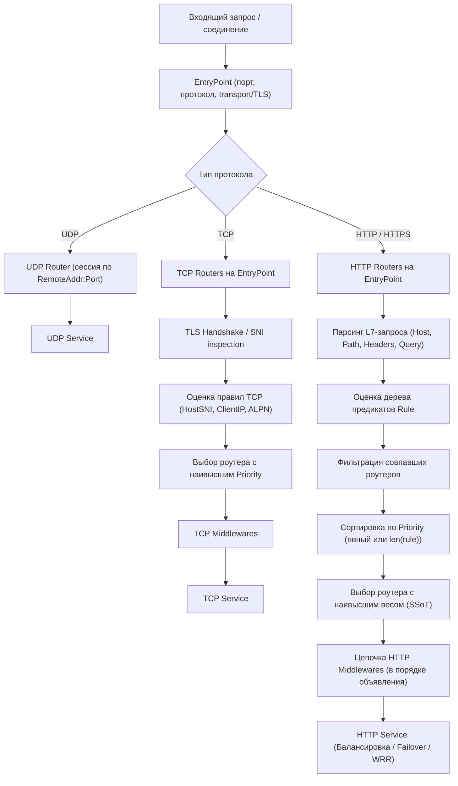
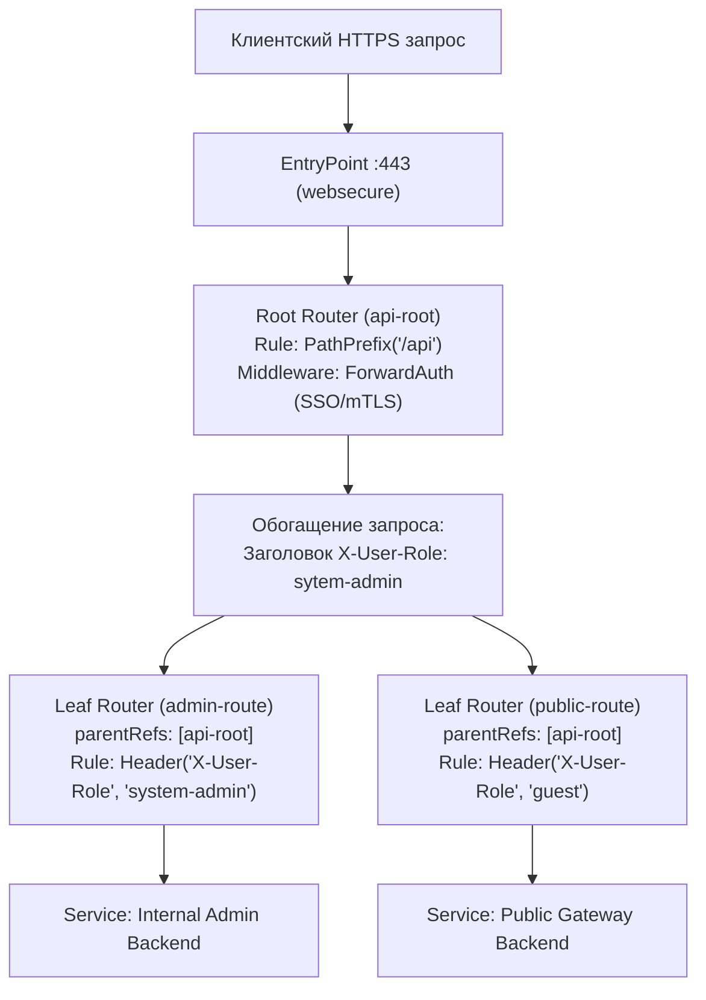

# Маршрутизация в Traefik: правила, приоритет и конфликты

**Актуально для:** Traefik v3.x (с замечаниями по обратной совместимости и отличиям от Traefik v2.x)

## Определения

**Router (Роутер)** — динамический компонент Traefik, связывающий входящие сетевые соединения или HTTP-запросы на конкретных точках входа (`entryPoints`) с целевыми сервисами (`services`). Роутер инкапсулирует правила фильтрации (`rule`), числовой приоритет (`priority`), цепочки промежуточных обработчиков (`middlewares`), параметры безопасности TLS и конфигурацию телеметрии (`observability`).

**Rule (Правило)** — логическое предикатное выражение, составленное из элементарных условий сравнения (матчеров), соединенных логическими операторами `&&` (И), `||` (ИЛИ) и `!` (НЕ). Роутер активируется и начинает обработку запроса только в том случае, если вычисление всего дерева правила дает результат `true`.

**Matcher (Матчер)** — атомарная предикатная функция внутри правила (например, `Host(...)`, `PathPrefix(...)`, `Header(...)`), сопоставляющая свойства сетевого соединения или заголовков/путей запроса с заданными строковыми значениями или регулярными выражениями.

**Priority (Приоритет)** — целочисленный весовой коэффициент роутера. Используется подсистемой маршрутизации для детерминированного выбора единственного роутера-победителя, если один и тот же запрос удовлетворяет правилам нескольких активных роутеров одновременно. Чем выше числовое значение, тем выше приоритет.

**Default Priority (Приоритет по умолчанию)** — автоматически вычисляемый вес роутера при отсутствии явного параметра `priority`. Рассчитывается как суммарная длина строки правила (`len(rule)`) за вычетом символов подстановок в двойных wildcard-паттернах.

**Provider Precedence (Приоритет провайдеров)** — глобальный упорядоченный список статической конфигурации (`providers.precedence`), разрешающий конфликты между роутерами из разных провайдеров (например, `file`, `docker`, `kubernetescrd`), когда их числовые приоритеты строго совпадают.

**Multi-Layer Routing (Многоуровневая / Иерархическая маршрутизация)** — архитектурная возможность Traefik v3, позволяющая связывать роутеры в цепочки типа «родитель — потомок» через директиву `parentRefs`. Позволяет родителю исполнять общие middleware (например, аутентификацию или модификацию заголовков), после чего дочерние роутеры принимают решения о финальной доставке трафика на основе обогащенного контекста.

**HostSNI** — L4-матчер для TCP-роутеров, проверяющий имя виртуального хоста в расширении Server Name Indication (SNI) протокола TLS до расшифровки полезной нагрузки или в режиме сквозного пропуска (TLS Passthrough).

**ALPN (Application-Layer Protocol Negotiation)** — L4-матчер для протоколов прикладного уровня, согласуемых в процессе TLS-рукопожатия (например, `h2`, `http/1.1`). Защищен внутренним ограничением Traefik: перехват сервисного протокола `ACME-TLS/1` пользовательскими роутерами категорически запрещен.

**ruleSyntax** — параметр роутера, указывающий версию грамматического анализатора правил (`v2` или `v3`). Применяется в Traefik v3 как временная мера обратной совместимости при поэтапной миграции устаревших конфигураций.

---

## Базовые концепции и архитектура

### Архитектурный конвейер обработки трафика

При поступлении сетевого пакета или HTTP-запроса Traefik выполняет строгую последовательность фаз маршрутизации:



#### Фазы маршрутизации HTTP:
1. **Привязка к EntryPoint:** Отсекаются все роутеры, не входящие в список `entryPoints` данного порта (если директива не задана, роутер прослушивает абсолютно все HTTP-точки входа).
2. **Проверка условий безопасности (TLS):** Если роутер сконфигурирован с блоком `tls`, он принимает только шифрованные HTTPS-запросы, соответствующие его сертификатам и доменным именам.
3. **Вычисление предикатов (Rule Evaluation):** Дерево логических выражений рассчитывается по принципу короткого замыкания (short-circuit evaluation).
4. **Разрешение коллизий по Priority:** Из всех роутеров, чьи правила вернули `true`, выбирается роутер с максимальным значением `priority`.
5. **Исполнение Middleware:** Запрос последовательно пропускается через цепочку объявленных промежуточных слоев (аутентификация, сжатие, модификация заголовков, ограничение скорости).
6. **Маршрутизация в Service:** Запрос передается сервису балансировки. Если у HTTP-роутера отсутствует директива `service` (и он не является родительским роутером в Multi-Layer архитектуре), Traefik возвращает клиенту ошибку `404 Not Found`.

---

### Синтаксис правил и парсер AST (Traefik v3)

В Traefik v3 правила маршрутизации разбираются строгим парсером на базе синтаксиса строковых литералов Go (`Go String Literals`):

1. **Кавычки и экранирование:**
   - Значения параметров матчеров обязательно заключаются в **обратные кавычки** (backticks) `` ` `` либо в **экранированные двойные кавычки** `\"`.
   - **Одинарные кавычки `'` не допускаются.** Попытка применить `'example.com'` вызовет синтаксическую ошибку парсера при инициализации роутера (`invalid rule: ...`).
   - При определении правил внутри YAML-строк в двойных кавычках обратные кавычки сохраняются прозрачно: `"Host(\`example.com\`) && PathPrefix(\`/api\`)"`.
2. **Логические операторы:**
   - `&&` — логическое И (конъюнкция).
   - `||` — логическое ИЛИ (дизъюнкция). Имеет более низкий приоритет, чем `&&`.
   - `!` — логическое НЕ (инверсия предиката).
   - Группировка скобками `(` и `)` управляет порядком вычисления сложных условий.
3. **Регулярные выражения:**
   - Все матчеры с суффиксом `Regexp` компилируют регулярные выражения движком Go `regexp` (синтаксис RE2, защищенный от катастрофического отката).
   - В RE2 не поддерживаются обратные ссылки (`backreferences`) и опережающие/ретроспективные проверки (`lookaround assertions`).
   - Регистронезависимое сравнение задается через флаг `(?i)`: ``HeaderRegexp(`X-Custom`, `(?i)^staging-`)``.
4. **Интернационализованные домены (IDN):**
   - Матчеры хостов не поддерживают прямые Unicode-символы в не-ASCII диапазоне. Для кириллических и национальных доменов обязательно применяется кодирование Punycode (RFC 3492): вместо `сайт.рф` указывается `xn--80aswg.xn--p1ai`.

---

### Полный справочник матчеров HTTP

| Матчер | Описание и особенности | Пример конфигурации |
| :--- | :--- | :--- |
| `Host(domain, ...)` | Сопоставление доменного имени заголовка `Host`. Поддерживает одиночные (`*`) и множественные (`**`) подстановочные знаки, а также catch-all ``Host(`*`)``. | ``Host(`api.domain.internal`)``<br>``Host(`*.domain.internal`)`` |
| `HostRegexp(regexp)` | Сопоставление домена по регулярному выражению Go. | ``HostRegexp(`^[a-z0-9-]+\.corp\.internal$`)`` |
| `Path(path, ...)` | Строгое совпадение точного URL-пути (учитывает конечный слэш `/`). | ``Path(`/healthz`, `/metrics`)`` |
| `PathPrefix(prefix, ...)` | Проверка совпадения префикса пути. В Traefik v3 является **строгой посимвольной проверкой**, не поддерживает регулярные выражения и плейсхолдеры. | ``PathPrefix(`/api/v1/`, `/internal/`)`` |
| `PathRegexp(regexp)` | Сопоставление структуры пути по регулярному выражению. | ``PathRegexp(`^/v[0-9]+/orders/[0-9a-f-]+$`)`` |
| `Header(key, value)` | Точное совпадение значения HTTP-заголовка. Названия заголовков нормализуются без учета регистра. | ``Header(`Content-Type`, `application/json`)`` |
| `HeaderRegexp(key, regexp)` | Проверка значения HTTP-заголовка по регулярному выражению. | ``HeaderRegexp(`Authorization`, `^Bearer\s+.+$`)`` |
| `Method(method, ...)` | Проверка HTTP-метода запроса (`GET`, `POST`, `PUT`, `DELETE`, `PATCH`, `OPTIONS`, `HEAD`). | ``Method(`POST`, `PUT`, `PATCH`)`` |
| `Query(key)` / `Query(key, val)` | Проверка наличия параметра в строке запроса URL (Query String) либо его конкретного значения. | ``Query(`debug`)``<br>``Query(`format`, `json`)`` |
| `QueryRegexp(key, regexp)` | Сопоставление значения query-параметра по регулярному выражению. | ``QueryRegexp(`api_version`, `^[2-3]\.[0-9]+$`)`` |
| `ClientIP(ip, ...)` | Проверка физического IP-клиента (IPv4, IPv6 или подсети в формате CIDR). **Внимание:** проверяет сокетный адрес `RemoteAddr` и игнорирует L7-заголовки `X-Forwarded-For`. | ``ClientIP(`10.240.0.0/16`, `172.16.10.50`)`` |

#### Тонкости поведения матчеров:
- **Wildcard в `Host`:**
  - ``Host(`*.example.com`)`` — строго одноуровневый wildcard: соответствует `node1.example.com`, но **не** соответствует `sub.node1.example.com` и **не** соответствует корневому домену `example.com`.
  - ``Host(`**.example.com`)`` — многоуровневый wildcard: соответствует и `node1.example.com`, и `nested.sub.node1.example.com`. Корневой `example.com` не матчится.
  - ``Host(`*`)`` — глобальный catch-all: перехватывает абсолютно любой HTTP-запрос, включая запросы с пустым или отсутствующим заголовком `Host` (HTTP/1.0).
- **Специфика `PathPrefix`:**
  - `PathPrefix(`/api`)` без закрывающего слэша выполняет посимвольное сопоставление префикса. Это означает, что под правило подпадут `/api`, `/api/users`, а также непреднамеренные пути вроде `/apidocs` или `/apigateway`. Для изоляции маршрута микросервиса используйте префикс с закрывающим слэшем: ``PathPrefix(`/api/`)`` либо связку ``Path(`/api`) || PathPrefix(`/api/`)``.
- **Сетевой контекст `ClientIP`:**
  - Матчер роутера `ClientIP(...)` работает непосредственно с дескриптором TCP-соединения (`net.Conn.RemoteAddr()`). Если перед Traefik расположен внешний аппаратный балансировщик L4/L7, Traefik увидит IP-адрес этого балансировщика, а не исходного клиента.
  - Для корректной работы `ClientIP` при наличии вышестоящего прокси обязательно требуется включение **PROXY Protocol** на `entryPoint`. Использование заголовка `X-Forwarded-For` через `ClientIP` невозможно — для заголовков L7 следует применять middleware `ipAllowList` с директивой `ipStrategy`.

---

### L4 Маршрутизация: TCP и UDP

#### TCP-роутеры и матчеры
TCP-роутеры работают на транспортном уровне и классифицируются по признаку включения TLS:

| Матчер TCP | Назначение | Особенности |
| :--- | :--- | :--- |
| `HostSNI(domain)` | Фильтрация по имени сервера в расширении TLS ClientHello. | Требует включенного `tls: {}` на роутере. Поддерживает `*.domain.com`, `**.domain.com`. |
| `HostSNI(`*`)` | Прием любого TCP-трафика. | **Единственный вариант `HostSNI` для не-TLS роутеров.** Передает сырой нешифрованный TCP-поток (PostgreSQL, SSH, Redis). |
| `HostSNIRegexp(regexp)` | Сопоставление SNI по регулярному выражению Go. | Требует TLS. Не поддерживает не-ASCII символы (требуется Punycode). |
| `ClientIP(cidr)` | Фильтрация источника входящего TCP-соединения. | Принимает IPv4, IPv6 и маски подсетей. Совместим как с TLS, так и с non-TLS роутерами. |
| `ALPN(protocol)` | Маршрутизация на основе согласованного протокола прикладного уровня. | Применяется в TLS-рукопожатии (например, `h2`, `http/1.1`, протоколы баз данных). |

> [!CAUTION]
> **Ограничение безопасности ALPN:** Попытка зарегистрировать пользовательский роутер с правилом ``ALPN(`ACME-TLS/1`)`` блокируется Traefik как критическая ошибка конфигурации. Протокол `ACME-TLS/1` зарезервирован под встроенный контроллер выпуска TLS-сертификатов Let's Encrypt / ACME challenge.

#### UDP-роутеры: сессионная маршрутизация
Протокол UDP не имеет состояния, концепции сессий L4/L7, заголовков хоста и URL-путей.
- В Traefik UDP-роутеры **не поддерживают предикатные правила (`rule`) и приоритеты (`priority`)**.
- UDP-роутер представляет собой прямую связку точки входа `entryPoints` и целевого `service`.
- **Сессионность:** Traefik отслеживает поток UDP-пакетов через таблицу квази-сессий по паре `ClientIP:ClientPort`. Ответные дейтаграммы от бэкенда транслируются исходному клиенту в рамках таймаута неактивности сессии.
- Таймаут настраивается в статической конфигурации точки входа:
  ```yaml
  entryPoints:
    streaming-udp:
      address: ":5000/udp"
      udp:
        timeout: 30s
  ```

---

### Алгоритм расчета и коллизий Priority

Если под входящий запрос подходят правила нескольких зарегистрированных роутеров, подсистема маршрутизации Traefik разрешает неоднозначность на основе строгого алгоритмического порядка.

#### 1. Числовой расчет дефолтного приоритета
Если параметр `priority` не задан в конфигурации или равен `0` (в языке Go `0` является нулевым значением типа `int` и интерпретируется как «не задано»), Traefik вычисляет приоритет по длине строки правила:

$$\text{Priority}_{\text{default}} = \text{len}(\text{rule})$$

**Исключение для Wildcard:** Символы звездочек `*` в многоуровневом доменном паттерне `**` не учитываются при подсчете длины. Это гарантирует, что точные совпадения и одиночные поддомены всегда получают приоритет выше, чем перекрывающий многоуровневый wildcard:

| Роутер | Правило | Расчет веса | Итоговый Priority |
| :--- | :--- | :--- | :--- |
| **R1 (Exact)** | ``Host(`foo.domain.internal`)`` | Длина строки: 28 символов | **28** |
| **R2 (Single Wildcard)** | ``Host(`*.domain.internal`)`` | Длина строки: 26 символов | **26** |
| **R3 (Double Wildcard)** | ``Host(`**.domain.internal`)`` | Длина за вычетом звездочек | **25** |
| **R4 (Catch-All)** | ``Host(`*`)`` | Длина строки: 9 символов | **9** |

#### 2. Зарезервированный системный диапазон
Traefik резервирует верхнюю границу числового диапазона целых чисел под внутренние сервисные маршруты (маршрутизаторы ACME TLS-ALPN-01 и HTTP-01 challenge имеют приоритет `math.MaxInt`).

Максимально допустимое значение `priority`, доступное пользователю:
- Для 32-битных платформ: $\text{MaxInt32} - 1000 = 2\,147\,482\,647 - 1000 = 2\,147\,481\,647$.
- Для 64-битных платформ: $\text{MaxInt64} - 1000 = 9\,223\,372\,036\,854\,774\,807$.

> [!NOTE]
> Отрицательные значения `priority` (например, `-10`, `-100`) являются валидными и активно применяются в SRE-практике для создания низкоприоритетных fallback-роутеров («черных дыр» или общих заглушек 404/503), гарантируя, что они не перехватят легитимный трафик.

#### 3. Разрешение ничьей между провайдерами (`providers.precedence`)
Если два роутера из **разных источников конфигурации** (например, статический файл и Docker API) имеют полностью идентичный числовой приоритет и оба соответствуют запросу, применяется механизм Provider Precedence:

```yaml
# traefik.yml (статическая конфигурация)
providers:
  precedence:
    - file
    - kubernetescrd
    - docker
    - consulcatalog
```

Провайдер, находящийся выше в списке `precedence`, побеждает в споре за маршрут. Если директива не определена, применяется порядок Traefik по умолчанию:
1. `kubernetesgateway`
2. `kubernetescrd`
3. `kubernetes`
4. `kubernetesingressnginx`
5. `swarm`
6. `docker`
7. `file`
8. `redis`
9. `consul` / `consulcatalog`
10. `nomad`
11. `etcd`
12. `http`

> [!IMPORTANT]
> `providers.precedence` работает **исключительно как tiebreaker (разрешение ничьей)** при равных значениях `priority`. Если роутер из низкорангового провайдера (например, `docker`) имеет `priority: 100`, а роутер из высокорангового `file` имеет `priority: 50`, побеждает роутер с приоритетом `100`.

---

### Многоуровневая маршрутизация (Multi-Layer Routing в v3)

Начиная с Traefik v3, поддерживается декомпозиция правил через иерархию роутеров с помощью директивы `parentRefs`. Запрос последовательно проходит через цепочку узлов графа:



#### Правила и ограничения иерархии:
1. **Корневой роутер (Root Router):**
   - Не имеет директивы `parentRefs`.
   - Привязывается к `entryPoints`, задает параметры `tls` и политики `observability`.
   - Исполняет входные middleware (аутентификация, базовая валидация).
   - **Не содержит** директивы `service` при наличии дочерних роутеров.
2. **Промежуточный роутер (Intermediate Router):**
   - Ссылается на вышестоящий роутер через `parentRefs: [имя_родителя]`.
   - Имеет подчиненные дочерние роутеры.
   - **Не имеет права** объявлять директивы `service`, `entryPoints`, `tls` или `observability`.
3. **Листовой роутер (Leaf Router):**
   - Обязательно ссылается на предка через `parentRefs`.
   - **Обязан** содержать директиву `service` для финальной балансировки трафика.
   - **Не имеет права** переопределять `entryPoints` и `tls` (наследуются от корня).
4. **Поддержка провайдерами:** Multi-Layer Routing поддерживается провайдерами `file`, KV-хранилищами (`consul`, `etcd`, `redis`) и Kubernetes CRD (`IngressRoute`). Провайдер Docker labels и стандартный Kubernetes Ingress данную функцию не поддерживают.

---

### Управление наблюдаемостью на уровне роутера (Observability)

В Traefik v3 реализован точечный аудит метрик и логов на уровне отдельных роутеров через секцию `observability`:

```yaml
http:
  routers:
    payment-router:
      rule: "Host(`pay.domain.internal`)"
      service: payment-service
      observability:
        accessLogs: true
        metrics: true
        tracing: true
        traceVerbosity: detailed
```

- `accessLogs` (bool) — принудительное включение/отключение записи в журнал доступа для данного роутера (позволяет подавлять логи высокочастотных healthcheck-маршрутов).
- `metrics` (bool) — экспорт меток данного роутера в Prometheus-экспортер.
- `tracing` (bool) — передача трейсинга OpenTelemetry / Jaeger.
- `traceVerbosity` (`minimal` | `detailed`) — детализация span-атрибутов запроса.

---

## Практические сценарии

### Сценарий 1: Продакшн HTTP-роутинг микросервисов с явными приоритетами

Решение классической проблемы затенения путей (shadowing), когда корневой обработчик SPA перехватывает запросы к API из-за большей длины правила при автоматическом расчете.

Файловый провайдер (`/etc/traefik/dynamic/routing-rules.yml`):

```yaml
http:
  routers:
    # 1. Служебный роутер проверки жизнеспособности (максимальный приоритет)
    service-healthz:
      entryPoints:
        - websecure
      rule: "Host(`app.domain.internal`) && Path(`/healthz`)"
      service: local-health-service
      priority: 1000
      tls: {}

    # 2. Специфичный роутер REST API v2
    api-v2-router:
      entryPoints:
        - websecure
      rule: "Host(`app.domain.internal`) && PathPrefix(`/api/v2/`)"
      middlewares:
        - api-stripprefix
        - ratelimit-burst
      service: api-v2-service
      priority: 200
      tls: {}

    # 3. Базовый роутер REST API v1
    api-v1-router:
      entryPoints:
        - websecure
      rule: "Host(`app.domain.internal`) && PathPrefix(`/api/v1/`)"
      middlewares:
        - api-stripprefix
      service: api-v1-service
      priority: 100
      tls: {}

    # 4. Фронтенд Single Page Application (SPA catch-all для домена)
    spa-frontend-router:
      entryPoints:
        - websecure
      rule: "Host(`app.domain.internal`) && PathPrefix(`/`)"
      service: frontend-spa-service
      priority: 10
      tls: {}

    # 5. Глобальный Fallback (Черная дыра для неизвестных хостов)
    global-catch-all:
      entryPoints:
        - websecure
      rule: "HostRegexp(`.+`)"
      service: default-404-service
      priority: 1
      tls: {}

  middlewares:
    api-stripprefix:
      stripPrefixRegex:
        regex:
          - "^/api/v[1-2]"

    ratelimit-burst:
      rateLimit:
        average: 100
        burst: 50

  services:
    local-health-service:
      loadBalancer:
        servers:
          - url: "http://127.0.0.1:8080"
    api-v2-service:
      loadBalancer:
        servers:
          - url: "http://10.240.10.11:8000"
          - url: "http://10.240.10.12:8000"
    api-v1-service:
      loadBalancer:
        servers:
          - url: "http://10.240.10.21:8000"
    frontend-spa-service:
      loadBalancer:
        servers:
          - url: "http://10.240.20.10:80"
    default-404-service:
      loadBalancer:
        servers:
          - url: "http://127.0.0.1:9999"
```

---

### Сценарий 2: Иерархическая маршрутизация (Multi-Layer Routing) с ForwardAuth

Сценарий разграничения доступа в защищенной корпоративной сети: родительский роутер выполняет единую аутентификацию через внутренний Identity Provider и проставляет заголовок `X-User-Group`. Дочерние роутеры перенаправляют запрос в соответствующий контур на основе полученной группы.

```yaml
http:
  routers:
    # Родительский роутер: перехватывает все запросы в /portal/
    portal-root:
      entryPoints:
        - websecure
      rule: "Host(`portal.internal.corp`) && PathPrefix(`/portal/`)"
      middlewares:
        - auth-forward-sso
      tls:
        options: internal-strict@file
      # service отсутствует — это родительский узел

    # Дочерний роутер для инженеров SRE и Devops
    portal-child-devops:
      rule: "Header(`X-User-Group`, `devops-sre`)"
      service: devops-admin-service
      parentRefs:
        - portal-root

    # Дочерний роутер для сотрудников компании
    portal-child-staff:
      rule: "Header(`X-User-Group`, `staff`)"
      service: staff-portal-service
      parentRefs:
        - portal-root

    # Fallback-роутер для аутентифицированных пользователей без прав
    portal-child-unauthorized:
      rule: "!HeaderRegexp(`X-User-Group`, `^(devops-sre|staff)$`)"
      service: access-denied-service
      priority: 1
      parentRefs:
        - portal-root

  middlewares:
    auth-forward-sso:
      forwardAuth:
        address: "http://10.240.0.25:9090/validate"
        authResponseHeaders:
          - "X-User-Group"
          - "X-User-Email"

  services:
    devops-admin-service:
      loadBalancer:
        servers:
          - url: "http://10.240.1.100:8443"
    staff-portal-service:
      loadBalancer:
        servers:
          - url: "http://10.240.1.150:8080"
    access-denied-service:
      loadBalancer:
        servers:
          - url: "http://127.0.0.1:9099"
```

---

### Сценарий 3: Сквозной L4 TCP-роутинг баз данных и SSH с фильтрацией ClientIP

Развертывание защищенного L4-шлюза: трафик базы данных PostgreSQL и SSH-сервера направляется на один и тот же порт `443` или выделенный L4 порт, используя `HostSNI` и ограничение по доверенным CIDR-подсетям.

```yaml
tcp:
  routers:
    # Защищенный шлюз PostgreSQL с TLS Passthrough (сертификат проверяется самой СУБД)
    postgres-direct-tls:
      entryPoints:
        - pg-ingress
      rule: "HostSNI(`pg-cluster.internal.net`) && ClientIP(`10.100.0.0/16`, `192.168.1.0/24`)"
      service: postgres-backend-cluster
      tls:
        passthrough: true

    # Служебный TCP-роутер с терминацией TLS на стороне Traefik
    secure-metrics-agent:
      entryPoints:
        - pg-ingress
      rule: "HostSNI(`telemetry.internal.net`)"
      service: metrics-collector-tcp
      tls:
        options: default

    # Нешифрованный аварийный SSH (доступен строго из подсети NOC)
    noc-ssh-router:
      entryPoints:
        - ssh-entry
      rule: "HostSNI(`*`) && ClientIP(`10.200.0.0/24`)"
      service: bastion-ssh-service

  services:
    postgres-backend-cluster:
      loadBalancer:
        servers:
          - address: "10.100.5.10:5432"
          - address: "10.100.5.11:5432"
    metrics-collector-tcp:
      loadBalancer:
        servers:
          - address: "127.0.0.1:9100"
    bastion-ssh-service:
      loadBalancer:
        servers:
          - address: "10.200.0.1:22"
```

---

### Сценарий 4: Docker Compose — правила, экранирование переменных и labels

При объявлении правил маршрутизации в директиве `labels` Docker Compose необходимо учитывать системные правила парсинга Docker-файлов:
1. Символ доллара `$` является специальным символом подстановки переменных в Compose. Для передачи символа доллара в регулярное выражение или подстановку middleware его необходимо **экранировать двойным долларом `$$`**.
2. Для регулярных выражений внутри обратных кавычек слэши экранируются дважды: `\\.`.

`docker-compose.yml`:

```yaml
services:
  payment-api:
    image: internal-registry.corp/apps/payment:v3.2.1
    restart: unless-stopped
    networks:
      - traefik-net
    labels:
      - "traefik.enable=true"
      # Точка входа
      - "traefik.http.routers.payment.entrypoints=websecure"
      # Правило маршрутизации с логическим AND
      - "traefik.http.routers.payment.rule=Host(`billing.internal.domain`) && PathPrefix(`/v1/charges`)"
      # Явный приоритет для предотвращения перехвата
      - "traefik.http.routers.payment.priority=150"
      # Включение TLS
      - "traefik.http.routers.payment.tls=true"
      # Цепочка middleware
      - "traefik.http.routers.payment.middlewares=payment-retry,payment-ratelimit"
      # Привязка к порту контейнера
      - "traefik.http.services.payment.loadbalancer.server.port=8080"
      
      # Редирект старых URL: экранирование regex и $1 через $$
      - "traefik.http.middlewares.payment-redirect.redirectregex.regex=^https://billing\\.internal\\.domain/legacy/(.*)"
      - "traefik.http.middlewares.payment-redirect.redirectregex.replacement=https://billing.internal.domain/v1/charges/$${1}"
      - "traefik.http.middlewares.payment-redirect.redirectregex.permanent=true"

networks:
  traefik-net:
    external: true
```

---

## Операции и команды

### Инспекция роутеров через Traefik API

Traefik предоставляет REST API для инспекции состояния маршрутизации и валидации зарегистрированных правил:

```bash
# Получение списка всех активных HTTP-роутеров с правилами, приоритетами и сервисами
curl -s http://127.0.0.1:8080/api/http/routers | jq '.[] | {name, rule, priority, status, service, using}'
# → {
# →   "name": "api-v2-router@file",
# →   "rule": "Host(`app.domain.internal`) && PathPrefix(`/api/v2/`)",
# →   "priority": 200,
# →   "status": "enabled",
# →   "service": "api-v2-service@file",
# →   "using": ["websecure"]
# → }

# Поиск роутеров с ошибками компиляции правил или отсутствующими сервисами
curl -s http://127.0.0.1:8080/api/http/routers | jq '.[] | select(.status != "enabled") | {name, error, status}'
# → (если ошибок нет, вывод пустой)

# Инспекция TCP-роутеров
curl -s http://127.0.0.1:8080/api/tcp/routers | jq '.[] | {name, rule, priority, service, status}'
# → {
# →   "name": "postgres-direct-tls@file",
# →   "rule": "HostSNI(`pg-cluster.internal.net`) && ClientIP(`10.100.0.0/16`)",
# →   "priority": 67,
# →   "service": "postgres-backend-cluster@file",
# →   "status": "enabled"
# → }

# Инспекция UDP-роутеров (отображаются привязки к точкам входа и сервисам)
curl -s http://127.0.0.1:8080/api/udp/routers | jq '.[] | {name, service, entryPoints, status}'
```

### Валидация статической и динамической конфигурации через CLI

Перед применением новой конфигурации в продуктивной среде проверяйте синтаксис файлов:

```bash
# Проверка корректности файлов динамической маршрутизации
traefik config validate --providers.docker=false --providers.file.directory=/etc/traefik/dynamic
# → Configuration OK

# Проверка конфигурации с включенным подробным выводом логов
traefik --configFile=/etc/traefik/traefik.yml --log.level=DEBUG
```

### Диагностика маршрутизации и тестирование правил через curl и OpenSSL

```bash
# 1. Проверка совпадения Host и PathPrefix с получением трассировочных заголовков
curl -k -v -H "Host: app.domain.internal" https://127.0.0.1/api/v2/orders
# → < HTTP/2 200
# → < x-traefik-router: api-v2-router@file

# 2. Проверка L4 TLS SNI-маршрутизации без локального изменения /etc/hosts
openssl s_client -connect 127.0.0.1:443 -servername pg-cluster.internal.net -tlsextdebug -status
# → TLS handshake completed, SNI matched

# 3. Проверка поведения роутера при запросе к несуществующему хосту (проверка fallback)
curl -k -I -H "Host: unknown.internal.domain" https://127.0.0.1/
# → HTTP/2 404
```

---

## Устранение неисправностей

| Симптом | Первопричина | Метод диагностики | Способ устранения |
| :--- | :--- | :--- | :--- |
| **Запрос попадает на catch-all / не тот роутер** | Затенение приоритетов (Shadowing). Роутер со специфичным префиксом короче по длине `len(rule)`, чем общее правило с регулярным выражением. | Выполнить `curl -s /api/http/routers \| jq` и сопоставить вычисленные поля `priority`. | Задать явный целочисленный `priority: 200` специфичному роутеру и `priority: 1` для catch-all. |
| **HTTP 404 Not Found** при активном роутере | Роутер успешно сматчил запрос, но ссылается на отсутствующий сервис (опечатка в имени или сервис не зарегистрирован в провайдере). | Посмотреть журнал Traefik: `level=error msg="router ... references unknown service"`. | Проверить имя сервиса в `/api/http/services`, указать корректный суффикс провайдера (например, `@file`). |
| **HTTP 421 Misdirected Request** | Конфликт TLS-сертификатов: клиент переиспользует существующее HTTP/2 TCP-соединение для другого хоста, на который у данного роутера нет валидного сертификата. | Анализ заголовков в `curl -v --http2`. | Использовать единый SAN-сертификат, покрывающий оба домена, либо отключить агрессивный HTTP/2 connection reuse на клиенте. |
| **Одинарные кавычки в правиле (`invalid rule`)** | Синтаксическая ошибка: правила Traefik v3 требуют строковых литералов Go (обратные кавычки или экранированные двойные кавычки). | Ошибка парсера в логе: `level=error msg="cannot create router: ... invalid character in rule"`. | Заменить `'example.com'` на `` `example.com` ``. |
| **`ClientIP` пропускает неавторизованный трафик** | Traefik развернут за L7-балансировщиком без передачи PROXY Protocol. Матчер анализирует локальный адрес сокета балансировщика. | Лог Traefik: `remote_addr` указывает на IP балансировщика (например, `10.0.0.2`), а не клиента. | Включить PROXY Protocol на балансировщике и в точке входа Traefik (`proxyProtocol.trustedIPs`), либо перенести логику в middleware `ipAllowList` с `ipStrategy.depth`. |
| **Ошибка при старте: `ACME-TLS/1 protocol is forbidden`** | В TCP-роутере объявлен матчер ``ALPN(`ACME-TLS/1`)``. | Ошибка валидатора конфигурации при старте демона. | Удалить `ACME-TLS/1` из пользовательских правил. Протокол зарезервирован под встроенный ACME-резолвер. |
| **Всплеск утилизации CPU при обработке запросов** | Неэффективные регулярные выражения в `HostRegexp` или `PathRegexp` без ограничения жадности или якорей. | Профилирование runtime через `go tool pprof http://127.0.0.1:8080/debug/pprof/profile`. | Заменить `HostRegexp` на нативные маски ``Host(`*.domain.corp`)``; в `PathRegexp` обязательно использовать якоря `^` и `$`. |

---

## Рекомендации

### 1. Архитектурная политика явных приоритетов
- **Запрет неявного `len(rule)` в продакшене:** Никогда не полагайтесь на автоматический расчет приоритета по длине строки в сложных распределенных инфраструктурах. Случайное добавление длинного комментария или незначительное изменение домена меняет длину правила и может сломать порядок перехвата маршрутов.
- **Стандарт диапазонов приоритетов:**
  - `1000+` — системные роутеры (healthcheck, security endpoints, ACME).
  - `500–999` — строгие пути с проверкой ролей, заголовков и методов (canary, admin).
  - `100–499` — стандартные API-маршруты микросервисов (`/api/v2/`, `/api/v1/`).
  - `10–99` — общие префиксы порталов, фронтендов и статики (`/`, `/static/`).
  - `1–9` — доменные fallback-обработчики.
  - `<= 0` (отрицательные) — глобальные «черные дыры» для отсечения сканеров уязвимостей.

### 2. Безопасность и производительность регулярных выражений
- Предпочитайте предикаты `Host` с подстановками `*.domain` или `**.domain` вместо `HostRegexp`. Они компилируются в оптимизированные префиксные/суффиксные деревья и выполняются в десятки раз быстрее регулярных выражений.
- Если регулярное выражение необходимо:
  - Всегда привязывайте паттерн к началу (`^`) и концу (`$`) строки: ``PathRegexp(`^/api/v[0-9]+/items$`)``.
  - Избегайте универсальных конструкций `.*` внутри пути, заменяйте их на строгие классы символов: `[a-zA-Z0-9_-]+`.

### 3. SRE-мониторинг и ключевые метрики маршрутизации
Для мониторинга корректности работы роутеров в Prometheus настройте сбор следующих метрик:

```promql
# 1. Интенсивность запросов по роутерам и кодам ответа
sum by (router, code) (rate(traefik_router_requests_total[5m]))

# 2. Доля 5xx ошибок на конкретном роутере (SLO алертинг)
sum by (router) (rate(traefik_router_requests_total{code=~"5.."}[5m]))
/
sum by (router) (rate(traefik_router_requests_total[5m])) > 0.01

# 3. 99-й процентиль латентности обработки запроса на роутере
histogram_quantile(0.99, sum by (le, router) (rate(traefik_router_request_duration_seconds_bucket[5m])))

# 4. Количество открытых соединений в разрезе роутеров
traefik_router_open_connections
```

---

## Дополнительная информация

- [Обзор архитектуры Traefik](./traefik_overview.md) — базовые концепции точек входа, сервисов и балансировки.
- [Развертывание Traefik с Docker Compose](./traefik_with_docker_compose.md) — синтаксис labels, сетевые топологии и dynamic discovery.
- [Доверенные заголовки и реальный IP](./traefik-forwarded-headers.md) — специфика работы сокета `RemoteAddr`, PROXY Protocol и заголовков `X-Forwarded-For`.
- [TLS Options и сертификаты](./traefik-tls-options.md) — привязка шифрования к роутерам, разрешение конфликтов SNI и ALPN.
- [Миграция с Traefik v2 на v3](./traefik-migration-v2-to-v3.md) — детали изменения грамматики правил, отказ от плейсхолдеров и переименование матчеров.
- [Middlewares управления трафиком](./traefik-middlewares-traffic.md) — модификация путей (`stripPrefix`, `replacePathRegex`), редиректы и буферизация.
- [Сетевые протоколы L4 (TCP/UDP)](./traefik-protocols-advanced.md) — особенности проксирования нестандартных протоколов и баз данных.
- [Отладка и профилирование производительности](./traefik-debugging-performance.md) — анализ ReDoS, трассировка запросов и тюнинг runtime Go.