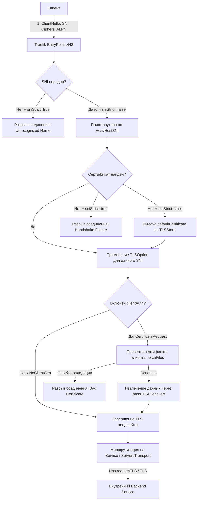

# TLS Options, mTLS и сертификаты в Traefik

**Актуально для:** Traefik v3.x (с замечаниями по обратной совместимости с Traefik v2.x) / Linux systemd / Docker Compose v2.x / Kubernetes 1.30+

## Определения

**TLSOption** — динамический именованный ресурс Traefik, инкапсулирующий криптографические параметры TLS-рукопожатия (версии протокола, наборы шифров, эллиптические кривые, ALPN, политику строгой проверки SNI и взаимную аутентификацию mTLS) и привязываемый к роутерам или точкам входа (`entryPoints`).

**TLSStore** — динамическое хранилище сертификатов Traefik, предназначенное для объявления резервного (fallback) сертификата по умолчанию (`defaultCertificate`) или привязки генератора сертификатов ACME, когда ни один доменный сертификат не подошел под запрошенный клиентом SNI.

**TLS termination (Завершение TLS)** — криптографическая операция снятия TLS-нагрузки на стороне Traefik (L7): входящий клиентский трафик расшифровывается, инспектируется middleware-цепочками и перенаправляется на бэкенд в открытом или повторно зашифрованном виде.

**TLS passthrough (Сквозной TLS)** — режим L4 TCP-маршрутизации, при котором зашифрованный TLS-поток передается на бэкенд в неизменном виде без дешифрования и прерывания хендшейка (маршрутизация выполняется на основе SNI в открытом пакете `ClientHello`).

**Mutual TLS (mTLS / clientAuth)** — протокол двусторонней аутентификации, при котором не только сервер подтверждает свою подлинность клиенту, но и клиент обязан предъявить доверенный сертификат X.509, подписанный указанным удостоверяющим центром (CA).

**SNI (Server Name Indication) и sniStrict** — расширение TLS (RFC 6066), передающее доменное имя запрашиваемого хоста в сообщении `ClientHello`. Параметр `sniStrict: true` инструктирует Traefik немедленно прерывать хендшейк, если клиент не указал SNI либо запрошенное имя отсутствует в хранилище сертификатов.

**ALPN (Application-Layer Protocol Negotiation)** — расширение TLS (RFC 7301), позволяющее клиенту и серверу согласовать протокол прикладного уровня (например, HTTP/2 `h2`, HTTP/1.1 `http/1.1`, ACME `acme-tls/1`) внутри TLS-рукопожатия до передачи данных.

**Cipher Suite (Набор шифров)** — структурированная комбинация криптографических алгоритмов, определяющая протокол согласования ключей (KEM/DHE), аутентификацию (RSA/ECDSA), симметричное шифрование (AES-GCM/ChaCha20) и контроль целостности/хеширование (SHA-256/SHA-384).

**PFS (Perfect Forward Secrecy)** — свойство протоколов согласования ключей (DHE/ECDHE), гарантирующее, что компрометация долгосрочного приватного ключа сервера не позволит расшифровать архивные сессии трафика, записанные в прошлом.

**ServersTransport** — ресурс статической или динамической конфигурации Traefik, управляющий параметрами исходящих TLS- и TCP-соединений от Traefik к вышестоящим сервисам (upstream backends), включая доверенные Root CA, проверку имени хоста, mTLS-сертификаты и пулинг соединений.

**passTLSClientCert** — встроенное middleware Traefik, извлекающее параметры или PEM-представление проверенного клиентского mTLS-сертификата и передающее их в заголовках HTTP (`X-Forwarded-Tls-Client-Cert`, `X-Forwarded-Tls-Client-Cert-Info`) на бэкенд для авторизации на прикладном уровне.

---

## Архитектура и базовые концепции

### Жизненный цикл TLS-рукопожатия в Traefik

Traefik построен на базе стандартной библиотеки Go (`crypto/tls`), поверх которой реализован динамический диспетчер SNI, хранилищ сертификатов и профилей безопасности.



### Параметры TLSOption

Политики TLS объявляются в динамической конфигурации в секции `tls.options`:

| Параметр | Тип | Значение по умолчанию | Назначение и допустимые значения |
| :--- | :--- | :--- | :--- |
| `minVersion` | `string` | `VersionTLS10` (в Go) / рекомендуется `VersionTLS12` | Минимально допустимая версия протокола: `VersionTLS10`, `VersionTLS11`, `VersionTLS12`, `VersionTLS13`. |
| `maxVersion` | `string` | `VersionTLS13` | Максимальная версия TLS. Явное ограничение не рекомендуется, чтобы не блокировать TLS 1.3. |
| `cipherSuites` | `[]string` | Системный список Go | Список допустимых шифров для TLS 1.0–1.2 (Go-идентификаторы, например `TLS_ECDHE_ECDSA_WITH_AES_128_GCM_SHA256`). |
| `curvePreferences` | `[]string` | Системный список Go | Приоритет эллиптических кривых для ECDHE: `CurveP256`, `CurveP384`, `CurveP521`, `X25519`. |
| `sniStrict` | `bool` | `false` | При `true` отклоняет соединения, если заголовок SNI отсутствует или запрашиваемое имя не покрыто доступными сертификатами. |
| `alpnProtocols` | `[]string` | `["h2", "http/1.1", "acme-tls/1"]` | Список протоколов прикладного уровня, согласуемых при рукопожатии. |
| `disableSessionTickets` | `bool` | `false` | При `true` отключает TLS Session Tickets (RFC 5077), снижая риски компрометации PFS при утечке ключа тикетов (STEK). |
| `clientAuth.caFiles` | `[]string` | `[]` | Список путей к файлам доверенных Root/Intermediate CA в формате PEM для валидации сертификатов клиентов. |
| `clientAuth.clientAuthType` | `string` | `NoClientCert` | Политика обязательности и валидации клиентского сертификата. |

### Особенности Traefik v3 vs Traefik v2

В архитектуре Traefik v3 произошли существенные изменения в подсистеме TLS:

1. **Ненастраиваемые шифры TLS 1.3:** В протоколе TLS 1.3 наборы шифров стандартизированы RFC 8446 (`TLS_AES_128_GCM_SHA256`, `TLS_AES_256_GCM_SHA384`, `TLS_CHACHA20_POLY1305_SHA256`). В стандартной библиотеке Go и Traefik директива `cipherSuites` управляет **исключительно** наборами для TLS 1.0–1.2. Попытка указать шифры TLS 1.3 в `cipherSuites` игнорируется.
2. **Удаление `preferServerCipherSuites`:** В Traefik v2 существовала директива `preferServerCipherSuites: true`. В Traefik v3 эта опция **полностью удалена**. Начиная с Go 1.17, выбор набора шифров контролируется логикой криптографического ядра с учетом аппаратной поддержки AES-NI на стороне клиента и сервера, предотвращая деградацию производительности.
3. **Провайдеры конфигураций и метки (Labels):** Настройка `TLSOption` и `TLSStore` является динамической конфигурацией файлового уровня или уровня CRD Kubernetes. **Невозможно объявить `TLSOption` через Docker Labels**. В метках контейнеров разрешено только ссылаться на готовый профиль, созданный в файловом провайдере:
   ```yaml
   traefik.http.routers.my-app.tls.options: "hardened@file"
   ```

### Модель привязки TLSOption к доменам и разрешение коллизий

В Traefik привязка `TLSOption` действует на уровне **доменных имен (SNI/FQDN)**, извлеченных из правил роутеров (`Host(...)` или `HostSNI(...)`), а не на уровне абстрактного сетевого соединения:

- **Привязка к домену:** Если роутер `app-router` обслуживает `Host(`api.example.com`)` и указывает `tls.options: modern`, профиль `modern` ассоциируется с доменным именем `api.example.com`.
- **Коллизия профилей:** Если два разных роутера заявляют одно и то же доменное имя `Host(`api.example.com`)`, но ссылаются на несовместимые `TLSOption` (например, один требует `modern`, а второй `legacy`), Traefik фиксирует конфликт в логах:
  ```text
  ERR Cannot apply conflicting TLS options to host "api.example.com": dropping both and falling back to default
  ```
  В этом случае домен `api.example.com` автоматически сбрасывается на профиль `default`.
- **Конфликт Host Header и SNI (HTTP 421):** Если клиент выполняет хендшейк с SNI `auth.example.com`, но в HTTP-запросе отправляет заголовок `Host: admin.example.com`, маршрутизируемый на другой роутер с иными требованиями TLS, Traefik возвращает код ответа `421 Misdirected Request`, предотвращая атаку типа Virtual Host Confusion.

### Режимы клиентской аутентификации (clientAuthType)

Директива `clientAuth.clientAuthType` определяет степень жесткости валидации сертификата клиента:

| Режим | Требование сертификата | Валидация по CA | Назначение и поведение |
| :--- | :--- | :--- | :--- |
| `NoClientCert` | Нет | Нет | Стандартный односторонний TLS (по умолчанию). Клиентский сертификат не запрашивается. |
| `RequestClientCert` | Опционально | Нет | Сертификат запрашивается в `CertificateRequest`. Если клиент его не передал, соединение продолжается. Если передал — валидация цепочки доверия не выполняется (может использоваться для кастомной внешней валидации). |
| `RequireAnyClientCert` | Обязательно | Нет | Клиент обязан передать сертификат. Подлинность и подпись удостоверяющим центром Traefik не проверяются (проверяется лишь синтаксическая корректность ASN.1/X.509). |
| `VerifyClientCertIfGiven` | Опционально | Да | Если клиент не предоставил сертификат — соединение успешно устанавливается. Если предоставил — Traefik валидирует его по `caFiles`. При невалидном сертификате хендшейк разрывается. |
| `RequireAndVerifyClientCert` | Обязательно | Да | **Промышленный стандарт mTLS.** Клиент обязан предоставить валидный сертификат, подписанный одним из CA из списка `caFiles`. При отсутствии или ошибке проверки хендшейк прерывается. |

### Механика TLSStore и Fallback-сертификатов

`TLSStore` с зарезервированным именем `default` управляет поведением сервера при поступлении запроса на домен, для которого у Traefik отсутствует точный или wildcard-сертификат:

1. **`sniStrict: false` (режим по умолчанию):** Если клиент запрашивает неизвестный SNI или обращается по голому IP-адресу, Traefik отдает сертификат из `tls.stores.default.defaultCertificate`. Если `defaultCertificate` не задан, генерируется временный самоподписанный сертификат Traefik ("TRAEFIK DEFAULT CERT").
2. **`sniStrict: true` (режим безопасности):** Traefik мгновенно разрывает TCP/TLS-сессию на этапе `ClientHello` с ошибкой `unrecognized name`. Защищает инфраструктуру от автоматизированных интернет-сканеров, сканирования портов и утечки доменных имен, содержащихся в теле сертификата по умолчанию.

### L4 TCP: Termination vs Passthrough

При маршрутизации не-HTTP протоколов (PostgreSQL, Redis, MQTT, AMQP, IMAP) через TCP-роутеры Traefik поддерживает два взаимоисключающих режима:

- **TLS Termination (`tls: {}`):** Traefik владеет сертификатом и ключом, завершает TLS, расшифровывает полезную нагрузку и может перенаправить ее на локальный порт базы данных в открытом виде или через шифрованный `tcp.serversTransports`.
- **TLS Passthrough (`tls.passthrough: true`):** Traefik читает SNI из `ClientHello` на L4, не вмешиваясь в криптографию, и перенаправляет сырой зашифрованный байтовый поток на бэкенд. Сертификаты и закрытые ключи находятся непосредственно на бэкенд-серверах (например, на кластере PostgreSQL). Опции `TLSOption` и `clientAuth` в режиме Passthrough не применяются, так как Traefik не участвует в рукопожатии.

---

## Практические сценарии

### Сценарий 1: Промышленный харденинг TLS (File Provider: Linux systemd / Docker Compose)

Создание глобальных политик безопасности: профиль по умолчанию (Mozilla Intermediate) для общедоступных сервисов и профиль ультра-строгой безопасности (Mozilla Modern — только TLS 1.3) для критических API.

Файл динамической конфигурации: `/etc/traefik/dynamic/tls-hardening.yml`

```yaml
tls:
  options:
    # 1. Профиль по умолчанию: совместимость со всеми современными ОС и браузерами (Intermediate)
    default:
      minVersion: VersionTLS12
      maxVersion: VersionTLS13
      sniStrict: true
      disableSessionTickets: false
      alpnProtocols:
        - h2
        - http/1.1
      curvePreferences:
        - X25519
        - CurveP256
        - CurveP384
      cipherSuites:
        # Только надежные наборы с поддержкой PFS и AEAD (GCM / Poly1305)
        - TLS_ECDHE_ECDSA_WITH_AES_128_GCM_SHA256
        - TLS_ECDHE_RSA_WITH_AES_128_GCM_SHA256
        - TLS_ECDHE_ECDSA_WITH_AES_256_GCM_SHA384
        - TLS_ECDHE_RSA_WITH_AES_256_GCM_SHA384
        - TLS_ECDHE_ECDSA_WITH_CHACHA20_POLY1305
        - TLS_ECDHE_RSA_WITH_CHACHA20_POLY1305

    # 2. Профиль ультра-безопасности: исключительно TLS 1.3 (Modern)
    modern-strict:
      minVersion: VersionTLS13
      sniStrict: true
      disableSessionTickets: true
      alpnProtocols:
        - h2

http:
  routers:
    public-web:
      rule: "Host(`portal.example.internal`)"
      service: portal-service
      entryPoints:
        - websecure
      tls:
        options: default

    critical-api:
      rule: "Host(`payment.example.internal`)"
      service: payment-service
      entryPoints:
        - websecure
      tls:
        options: modern-strict

  services:
    portal-service:
      loadBalancer:
        servers:
          - url: "http://127.0.0.1:8080"
    payment-service:
      loadBalancer:
        servers:
          - url: "http://127.0.0.1:8443"
```

Привязка через `docker-compose.yml` с использованием ссылки на файловый профиль:

```yaml
services:
  payment-app:
    image: internal-registry.example.internal/apps/payment:v1.4.2
    labels:
      - "traefik.enable=true"
      - "traefik.http.routers.payment.rule=Host(`pay.example.internal`)"
      - "traefik.http.routers.payment.entrypoints=websecure"
      - "traefik.http.routers.payment.tls=true"
      # Ссылка на TLSOption, объявленный в file-провайдере
      - "traefik.http.routers.payment.tls.options=modern-strict@file"
      - "traefik.http.services.payment.loadbalancer.server.port=8080"
```

---

### Сценарий 2: Централизованная политика TLS в Kubernetes через CRD

Развертывание общекластерного профиля `TLSOption` и резервного сертификата `TLSStore` через нативные CRD `traefik.io/v1alpha1`.

Файл манифеста: `k8s-tls-policy.yaml`

```yaml
# 1. Резервный сертификат по умолчанию для перехвата невалидных доменов
apiVersion: traefik.io/v1alpha1
kind: TLSStore
metadata:
  name: default
  namespace: traefik
spec:
  defaultCertificate:
    secretName: fallback-wildcard-cert
---
# 2. Корпоративный профиль TLS с ограничением cipher suites и кривых
apiVersion: traefik.io/v1alpha1
kind: TLSOption
metadata:
  name: enterprise-tls-policy
  namespace: prod
spec:
  minVersion: VersionTLS12
  sniStrict: true
  disableSessionTickets: true
  curvePreferences:
    - X25519
    - CurveP256
  cipherSuites:
    - TLS_ECDHE_ECDSA_WITH_AES_128_GCM_SHA256
    - TLS_ECDHE_RSA_WITH_AES_128_GCM_SHA256
    - TLS_ECDHE_ECDSA_WITH_AES_256_GCM_SHA384
    - TLS_ECDHE_RSA_WITH_AES_256_GCM_SHA384
  alpnProtocols:
    - h2
    - http/1.1
---
# 3. Маршрутизация IngressRoute с привязкой созданной политики
apiVersion: traefik.io/v1alpha1
kind: IngressRoute
metadata:
  name: core-api-route
  namespace: prod
spec:
  entryPoints:
    - websecure
  routes:
    - match: Host(`api.example.internal`) && PathPrefix(`/v1`)
      kind: Rule
      services:
        - name: core-api-svc
          port: 8080
  tls:
    secretName: api-example-tls
    options:
      name: enterprise-tls-policy
      namespace: prod
```

---

### Сценарий 3: mTLS для защищенного API с пробросом сертификата клиенту (passTLSClientCert)

Настройка взаимной аутентификации B2B-шлюза: проверка клиентского сертификата корпоративным Root CA и проброс извлеченных атрибутов (CN, Огранизация, Серийный номер) в бэкенд через HTTP-заголовки.

Файл динамической конфигурации: `/etc/traefik/dynamic/mtls-gateway.yml`

```yaml
tls:
  options:
    b2b-mtls-profile:
      minVersion: VersionTLS12
      sniStrict: true
      clientAuth:
        # Корпоративный CA, выпускающий сертификаты партнерам
        caFiles:
          - /etc/traefik/certs/b2b-partner-ca.crt
        clientAuthType: RequireAndVerifyClientCert

http:
  middlewares:
    # Вариант A: Проброс полного PEM-сертификата (Base64/URL-encoded)
    forward-client-pem:
      passTLSClientCert:
        pem: true

    # Вариант B: Структурированный проброс атрибутов субъекта и серийного номера
    forward-client-attributes:
      passTLSClientCert:
        info:
          notAfter: true
          notBefore: true
          sans: true
          serialNumber: true
          subject:
            commonName: true
            organization: true
            organizationalUnit: true
            country: true
          issuer:
            commonName: true
            organization: true

  routers:
    b2b-endpoint:
      rule: "Host(`b2b-gateway.example.internal`)"
      entryPoints:
        - websecure
      service: b2b-backend-service
      tls:
        options: b2b-mtls-profile
      middlewares:
        - forward-client-attributes

  services:
    b2b-backend-service:
      loadBalancer:
        servers:
          - url: "http://10.10.50.25:8000"
```

При успешном хендшейке Traefik передает в HTTP-запросе к бэкенду заголовок:
```http
X-Forwarded-Tls-Client-Cert-Info: Subject="CN=partner-billing,O=PartnerCorp,C=RU";Issuer="CN=Corporate-B2B-CA,O=ExampleCompany";NB=1740000000;NA=1771500000;SAN=partner-billing.local;SN=1F4A89C2
```

---

### Сценарий 4: Защита Upstream-трафика (mTLS между Traefik и внутренним сервисом)

Организация Zero-Trust сегмента внутри закрытой сети: Traefik подключается к защищенному бэкенду по HTTPS, валидирует сертификат сервера через локальный CA и авторизуется собственным клиентским сертификатом через `serversTransport`.

Файл динамической конфигурации: `/etc/traefik/dynamic/upstream-mtls.yml`

```yaml
http:
  serversTransports:
    secure-upstream-transport:
      serverName: "vault-core.internal"
      insecureSkipVerify: false
      # CA для проверки сертификата бэкенда
      rootCAs:
        - /etc/traefik/certs/internal-datacenter-ca.crt
      # Сертификат и закрытый ключ самого Traefik для mTLS авторизации на бэкенде
      certificates:
        - certFile: /etc/traefik/certs/traefik-client.crt
          keyFile: /etc/traefik/certs/traefik-client.key
      maxIdleConnsPerHost: 64
      forwardingTimeouts:
        dialTimeout: "3s"
        responseHeaderTimeout: "10s"
        idleConnTimeout: "90s"

  routers:
    vault-ui:
      rule: "Host(`vault.example.internal`)"
      entryPoints:
        - websecure
      service: vault-backend
      tls:
        options: default

  services:
    vault-backend:
      loadBalancer:
        serversTransport: secure-upstream-transport
        servers:
          - url: "https://10.200.1.15:8200"
          - url: "https://10.200.1.16:8200"
```

---

### Сценарий 5: Строгая изоляция SNI и отсечение сканеров (sniStrict)

Сценарий предотвращает зондирование инфраструктуры интернет-сканерами (Censys, Shodan, Masscan), которые обращаются по IP-адресу или передают произвольные SNI.

Файл конфигурации: `/etc/traefik/dynamic/strict-sni.yml`

```yaml
tls:
  options:
    strict-sni-profile:
      minVersion: VersionTLS12
      # Запрет любых несогласованных рукопожатий
      sniStrict: true

  stores:
    default:
      defaultCertificate:
        certFile: /etc/traefik/certs/dummy-fallback.crt
        keyFile: /etc/traefik/certs/dummy-fallback.key

http:
  routers:
    production-app:
      rule: "Host(`service.example.internal`)"
      entryPoints:
        - websecure
      service: app-service
      tls:
        options: strict-sni-profile
```

---

### Сценарий 6: L4 TCP Passthrough для внешних баз данных и брокеров

Проброс зашифрованного TLS-трафика до кластера PostgreSQL без расшифровки и без необходимости загружать закрытые ключи базы данных на балансировщик Traefik.

Файл динамической конфигурации: `/etc/traefik/dynamic/tcp-passthrough.yml`

```yaml
tcp:
  routers:
    postgres-passthrough:
      # Маршрутизация по полю SNI в ClientHello
      rule: "HostSNI(`postgres-cluster.example.internal`)"
      service: postgres-upstream
      entryPoints:
        - tcp-database
      tls:
        # Ключевой параметр: сквозной проброс L4 потока
        passthrough: true

  services:
    postgres-upstream:
      loadBalancer:
        servers:
          - address: "10.100.20.10:5432"
          - address: "10.100.20.11:5432"

entryPoints:
  tcp-database:
    address: ":5432"
```

---

## Операции и команды

### 1. Проверка применяемой версии TLS и шифра через OpenSSL

```bash
# Проверка успешного согласования TLS 1.3
openssl s_client -connect portal.example.internal:443 -servername portal.example.internal -tls1_3 </dev/null 2>/dev/null | grep -E "Protocol|Cipher"
# →     Protocol  : TLSv1.3
# →     Cipher    : TLS_AES_128_GCM_SHA256

# Проверка блокировки устаревшего TLS 1.0/1.1 (должен завершиться ошибкой)
openssl s_client -connect portal.example.internal:443 -servername portal.example.internal -tls1_1 </dev/null 2>&1 | grep -i "alert"
# → 140356172658496:error:1409442E:SSL routines:ssl3_read_bytes:tlsv1 alert protocol version:s3_pkt.c:1493:SSL alert number 70

# Проверка конкретного набора шифров TLS 1.2
openssl s_client -connect portal.example.internal:443 -servername portal.example.internal -tls1_2 -cipher "ECDHE-RSA-AES128-GCM-SHA256" </dev/null 2>/dev/null | grep "Cipher"
# →     Cipher    : ECDHE-RSA-AES128-GCM-SHA256
```

### 2. Тестирование строгой проверки SNI (sniStrict)

```bash
# Запрос с корректным SNI (успех)
openssl s_client -connect portal.example.internal:443 -servername portal.example.internal </dev/null 2>&1 | grep "Verify return code"
# →     Verify return code: 0 (ok)

# Запрос без SNI (подключение напрямую по IP-адресу при sniStrict=true)
openssl s_client -connect 10.10.50.10:443 </dev/null 2>&1 | grep -E "error|alert"
# → 140221348579136:error:14094438:SSL routines:ssl3_read_bytes:tlsv1 alert unrecognized name:s3_pkt.c:1493:SSL alert number 112
```

### 3. Тестирование двусторонней аутентификации (mTLS)

```bash
# 1. Попытка подключения без клиентского сертификата (ожидается отказ)
curl -sv https://b2b-gateway.example.internal/ 2>&1 | grep -E "SSL certificate|alert"
# → * OpenSSL SSL_read: error:14094412:SSL routines:ssl3_read_bytes:sslv3 alert bad certificate, errno 0
# → * Closing connection 0

# 2. Успешное подключение с клиентским сертификатом и закрытым ключом
curl -s --cert /etc/ssl/client/partner.crt --key /etc/ssl/client/partner.key \
     --cacert /etc/ssl/certs/corporate-root.crt \
     https://b2b-gateway.example.internal/api/ping
# → {"status":"authenticated","subject":"CN=partner-billing,O=PartnerCorp,C=RU"}
```

### 4. Инспекция активных TLS Options и сертификатов через Traefik API

```bash
# Список всех зарегистрированных в ядре профилей TLS Options
curl -s http://127.0.0.1:8080/api/rawdata | jq '.tls.options'
# → {
# →   "default@file": {
# →     "minVersion": "VersionTLS12",
# →     "sniStrict": true,
# →     "alpnProtocols": ["h2", "http/1.1"]
# →   },
# →   "b2b-mtls-profile@file": {
# →     "minVersion": "VersionTLS12",
# →     "clientAuth": {
# →       "clientAuthType": "RequireAndVerifyClientCert"
# →     }
# →   }
# → }

# Проверка привязки TLS Option к конкретному HTTP-роутеру
curl -s http://127.0.0.1:8080/api/http/routers/critical-api@file | jq '{name: .name, tls: .tls}'
# → {
# →   "name": "critical-api@file",
# →   "tls": {
# →     "options": "modern-strict@file"
# →   }
# → }
```

### 5. Валидация синтаксиса и проверка журналов Traefik

```bash
# Проверка журнала systemd на предмет ошибок в TLS Options и сертификатах
journalctl -u traefik -n 50 --no-pager | grep -iE "tls|cert|options"
# → May 12 10:14:22 edge-01 traefik[1842]: time="2026-05-12T10:14:22Z" level=info msg="Configuration loaded from flags and file" providerName=file
# → May 12 10:14:22 edge-01 traefik[1842]: time="2026-05-12T10:14:22Z" level=info msg="Adding certificate for domain(s) portal.example.internal"

# Проверка журналов Docker Compose
docker compose logs traefik 2>&1 | grep -i "TLS"
```

---

## Устранение неисправностей

| Симптом / Ошибка | Первопричина | Диагностика | Решение |
| :--- | :--- | :--- | :--- |
| `remote error: tls: unrecognized name (Alert 112)` | Включен `sniStrict: true`, но клиент обращается по IP-адресу или передает незарегистрированный SNI | `openssl s_client -connect IP:443` без `-servername` возвращает Alert 112 | Убедитесь, что клиент отправляет корректный SNI, совпадающий с правилом `Host(...)` роутера, либо добавьте домен в сертификат |
| `remote error: tls: bad certificate (Alert 42)` | В профиле mTLS включен `RequireAndVerifyClientCert`, но клиент предоставил самоподписанный или чужой сертификат | `curl --cert ...` выдает alert bad certificate; в логах Traefik: `client certificate authentication failed` | Проверьте цепочку доверия CA в `clientAuth.caFiles`, убедитесь, что сертификат клиента подписан именно указанным CA |
| `remote error: tls: certificate required (Alert 116)` | Клиент не передал сертификат на роутер с обязательным mTLS | Вызов `curl` без флага `--cert` | Настройте предоставление сертификата на клиенте или смените `clientAuthType` на `VerifyClientCertIfGiven` |
| `remote error: tls: protocol version (Alert 70)` | Версия протокола клиента ниже, чем установленный `minVersion` | Попытка подключения с `-tls1` или `-tls1_1` | Если требуется поддержка старых клиентов — понизьте `minVersion: VersionTLS12`, иначе обновите клиентское ПО |
| `remote error: tls: handshake failure (Alert 40)` | Нет общих наборов шифров (Cipher Suites) между клиентом и сервером | `openssl s_client -cipher ...` | Расширьте список `cipherSuites` в `TLSOption` или разрешите стандартные AES-GCM шифры |
| `421 Misdirected Request` | Несоответствие между TLS SNI и HTTP-заголовком `Host` при мультидоменной маршрутизации | `curl -H "Host: b.internal" https://a.internal/` | Клиенты должны отправлять согласованные значения SNI и заголовка Host при переиспользовании HTTP/2 соединений |
| Не применяются `options` из Docker Labels | Попытка описать конфигурацию `TLSOption` в метках `traefik.tls.options.*` | В Traefik API опция отсутствует, роутер использует `default` | Опции задаются только в File Provider или CRD Kubernetes. В Docker Label используйте только ссылку: `traefik.http.routers.app.tls.options=myopt@file` |
| Сброс параметров роутера на `default` | Два роутера для одного и того же домена ссылаются на разные `TLSOption` | В логах Traefik: `Cannot apply conflicting TLS options to host ...` | Унифицируйте имя `tls.options` для всех роутеров, обрабатывающих одинаковый домен |
| Ошибка апстрима: `x509: certificate signed by unknown authority` | Сервер бэкенда использует корпоративный самоподписанный сертификат, неизвестный Traefik | В логах Traefik: `Internal Server Error` при проксировании к бэкенду | Зарегистрируйте корневой CA в `serversTransport.rootCAs` или (только в dev-среде) задайте `insecureSkipVerify: true` |

---

## Рекомендации

1. **Базовый минимум — TLS 1.2:** В производственной среде всегда фиксируйте `minVersion: VersionTLS12`. Протоколы TLS 1.0 и 1.1 фундаментально уязвимы (POODLE, BEAST) и должны быть запрещены.
2. **Сегментация TLS 1.3:** Для критичных межсервисных взаимодействий (mTLS, Payment Gateways, админ-панели) применяйте профиль с `minVersion: VersionTLS13` и отключенными session tickets (`disableSessionTickets: true`).
3. **Безопасное хранение ключевого материала:**
   - Закрытые ключи (`.key`) на хосте Traefik должны иметь права доступа `0600` и принадлежать исключительно пользователю процесса Traefik (`chown traefik:traefik /etc/traefik/certs/*.key`).
   - В Kubernetes монтируйте сертификаты через защищенные `Secret` с ограничением RBAC.
4. **Защита от сканирования инфраструктуры:** Включайте `sniStrict: true` на публичных контурах и формируйте пустой самоподписанный `defaultCertificate` в `tls.stores.default`. Это предотвращает выявление реальных доменных имен сканерами по IP-адресам.
5. **Изоляция CA для клиентских сертификатов:** Никогда не используйте один и тот же корневой CA для выпуска серверных сертификатов доменов и клиентских mTLS-сертификатов. Держите отдельный выделенный Intermediate CA для клиентской аутентификации.
6. **Защита заголовка `X-Forwarded-Tls-Client-Cert`:** При использовании middleware `passTLSClientCert` убедитесь, что внешний клиент не может подделать этот заголовок. Traefik автоматически перезаписывает этот заголовок при обработке, однако на уровне инфраструктуры бэкенды должны принимать трафик **только** от IP-адресов Traefik.
7. **Отказ от `insecureSkipVerify` в Upstream:** В продакшене категорически запрещается использовать `insecureSkipVerify: true` в `serversTransport`. Добавляйте локальные и промежуточные сертификаты в `rootCAs` для обеспечения полноценной сквозной аутентификации (Zero-Trust Data Plane).

---

## Дополнительная информация

- [Обзор Traefik](./traefik_overview.md) — базовая архитектура, провайдеры конфигурации и выпуск сертификатов через ACME.
- [Правила и маршрутизация Traefik](./traefik-routers-and-rules.md) — синтаксис матчеров `Host` и `HostSNI`, приоритеты роутеров.
- [Безопасность и харденинг Traefik](./traefik-security-hardening.md) — комплексный харденинг шлюза, маскирование заголовков и аудит логов.
- [Middleware безопасности](./traefik-middlewares-security.md) — настройка заголовков HSTS, CSP, IP-фильтрации и middleware `passTLSClientCert`.
- [Traefik в Kubernetes](./traefik-kubernetes.md) — развертывание CRD `TLSOption`, `TLSStore`, `ServersTransport` и `IngressRoute`.
- [Traefik, cert-manager и IngressRoute TLS](./traefik-cert-manager-ingressroute-tls.md) — автоматический выпуск и ротация сертификатов через cert-manager в связке с `TLSOption`.
- [Мониторинг сертификатов](./traefik-cert-monitoring.md) — сбор метрик сроков действия TLS-сертификатов через Prometheus и Blackbox Exporter.
- [Расширенные протоколы: TCP, UDP, gRPC](./traefik-protocols-advanced.md) — детализация L4 TCP TLS Passthrough и PROXY protocol.
- [Миграция с Traefik v2 на v3](./traefik-migration-v2-to-v3.md) — изменения в синтаксисе TLS и удаление `preferServerCipherSuites`.
- [TLS-харденинг для веб-серверов](../../Networking/Protocols/HTTP/http_tls_hardening.md) — системные стандарты cipher suites и криптографических профилей.